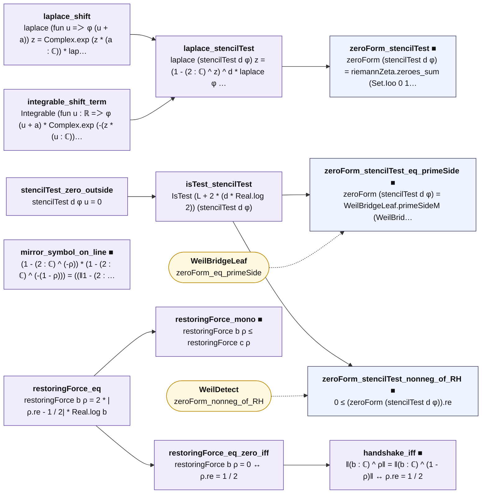

# `lean_stage3/Stage3/StencilWeil.lean`

StencilWeil — block T4 of `lean_stage3/design/joints.md`. 2026-11-22. The table's stencil inside Weil's form, and the restoring force read off a mode of the table. In the variable `u = log x` one doubling is the shift by `log 2`; `stencilTest d φ` is the depth-`d` stencil applied to a test function `φ` along the doublings. It is again a test function, its transform is the symbol to the depth times `φ`'s, and so each zero of ζ enters Weil's form on it with weight the symbol at the zero times the symbol at its mirror…

13 theorems, 2 definitions, 300 lines. Arrows are Lean's own record of what each proof uses.

**Imports:** [`WeilBridgeLeaf`](../lean_stage3/WeilBridgeLeaf.md)  
**Imported by:** [`Stage3`](../lean_stage3/Stage3.md)

## The picture



An arrow A → B reads "A is used in the proof of B". Green: counting, integers only. Violet: shape, analysis with no ζ. Blue: reads ζ. A name ending in ■ is an end: nothing else uses it. Red: contains `sorry`. Yellow: theorems in another file, counted; a dotted arrow crosses files. Definitions are not drawn; they are listed below the diagram.

## Definitions

<a name="StencilWeil-stencilTest"></a>
### `StencilWeil.stencilTest`

def · line 47

The depth-`d` stencil applied to a test function along the doublings, in the variable `u = log x`.

- **Is:** `` stencilTest (d : ℕ) (φ : ℝ → ℂ) : ℝ → ℂ := fun u => ∑ k ∈ range (d + 1), ((((-1 : ℝ) ^ k * (d.choose k : ℝ) : ℝ)) : ℂ) * φ (u + k * Real.log 2) ``
- **Used by 6:** [`StencilWeil.isTest_stencilTest`](#StencilWeil-isTest_stencilTest), [`StencilWeil.laplace_stencilTest`](#StencilWeil-laplace_stencilTest), [`StencilWeil.stencilTest_zero_outside`](#StencilWeil-stencilTest_zero_outside), [`StencilWeil.zeroForm_stencilTest`](#StencilWeil-zeroForm_stencilTest), [`StencilWeil.zeroForm_stencilTest_eq_primeSide`](#StencilWeil-zeroForm_stencilTest_eq_primeSide), [`StencilWeil.zeroForm_stencilTest_nonneg_of_RH`](#StencilWeil-zeroForm_stencilTest_nonneg_of_RH)

<a name="StencilWeil-restoringForce"></a>
### `StencilWeil.restoringForce`

def · line 51

The imbalance between a mode of the table and its mirror, in logarithms.

- **Is:** `` restoringForce (b : ℝ) (ρ : ℂ) : ℝ := |Real.log ‖(b : ℂ) ^ ρ‖ - Real.log ‖(b : ℂ) ^ (1 - ρ)‖| ``
- **Used by 4:** [`StencilWeil.handshake_iff`](#StencilWeil-handshake_iff), [`StencilWeil.restoringForce_eq`](#StencilWeil-restoringForce_eq), [`StencilWeil.restoringForce_eq_zero_iff`](#StencilWeil-restoringForce_eq_zero_iff), [`StencilWeil.restoringForce_mono`](#StencilWeil-restoringForce_mono)

## Theorems

<a name="StencilWeil-laplace_shift"></a>
### `StencilWeil.laplace_shift`

line 55

**Shape.** Uses real or complex analysis; nothing in it or beneath it reads ζ.

**Why.** Shifting a function multiplies its transform by an exponential.

**Proves**

```lean
laplace (fun u => φ (u + a)) z = Complex.exp (z * (a : ℂ)) * laplace φ z
```

**Needs** (its hypotheses)

  - `` φ : ℝ → ℂ ``
  - `` a : ℝ ``
  - `` z : ℂ ``

**Stated with:** [`WeilDetect.laplace`](../lean_stage3/WeilDetect.md#WeilDetect-laplace)

**Fed by:** no theorem of this repo; it stands on Mathlib and the definitions below.

**Feeds** (1 that use it)

  - [`StencilWeil.laplace_stencilTest`](#StencilWeil-laplace_stencilTest) — `` laplace (stencilTest d φ) z = (1 - (2 : ℂ) ^ z) ^ d * laplace φ z ``

<a name="StencilWeil-integrable_shift_term"></a>
### `StencilWeil.integrable_shift_term`

line 79

**Shape.** Uses real or complex analysis; nothing in it or beneath it reads ζ.

**Why.** A shifted test function against the transform's kernel is integrable.

**Proves**

```lean
Integrable (fun u : ℝ => φ (u + a) * Complex.exp (-(z * (u : ℂ))))
```

**Needs** (its hypotheses)

  - `` hφ : IsTest L φ ``
  - `` a : ℝ ``
  - `` z : ℂ ``

**Stated with:** [`WeilDetect.IsTest`](../lean_stage3/WeilDetect.md#WeilDetect-IsTest)

**Fed by:** no theorem of this repo; it stands on Mathlib and the definitions below.

**Feeds** (1 that use it)

  - [`StencilWeil.laplace_stencilTest`](#StencilWeil-laplace_stencilTest) — `` laplace (stencilTest d φ) z = (1 - (2 : ℂ) ^ z) ^ d * laplace φ z ``

<a name="StencilWeil-laplace_stencilTest"></a>
### `StencilWeil.laplace_stencilTest`

line 90

**Shape.** Uses real or complex analysis; nothing in it or beneath it reads ζ.

**Why.** The stencil's transform is the symbol to the depth.

**Proves**

```lean
laplace (stencilTest d φ) z = (1 - (2 : ℂ) ^ z) ^ d * laplace φ z
```

**Needs** (its hypotheses)

  - `` hφ : IsTest L φ ``
  - `` d : ℕ ``
  - `` z : ℂ ``

**Stated with:** [`StencilWeil.stencilTest`](#StencilWeil-stencilTest), [`WeilDetect.IsTest`](../lean_stage3/WeilDetect.md#WeilDetect-IsTest), [`WeilDetect.laplace`](../lean_stage3/WeilDetect.md#WeilDetect-laplace)

**Fed by** (2 theorems its proof uses)

  - [`StencilWeil.integrable_shift_term`](#StencilWeil-integrable_shift_term) — `` Integrable (fun u : ℝ => φ (u + a) * Complex.exp (-(z * (u : ℂ)))) ``
  - [`StencilWeil.laplace_shift`](#StencilWeil-laplace_shift) — `` laplace (fun u => φ (u + a)) z = Complex.exp (z * (a : ℂ)) * laplace φ z ``

**Feeds** (1 that use it)

  - [`StencilWeil.zeroForm_stencilTest`](#StencilWeil-zeroForm_stencilTest) — `` zeroForm (stencilTest d φ) = riemannZeta.zeroes_sum (Set.Ioo 0 1) (Set.univ : Set ℝ) (fun ρ => ((1 - (2 : ℂ) ^ (-ρ)) * (1 - (2 : ℂ) ^ (-(1 - ρ)))) ^ d… ``

<a name="StencilWeil-stencilTest_zero_outside"></a>
### `StencilWeil.stencilTest_zero_outside`

line 134

**Shape.** Uses real or complex analysis; nothing in it or beneath it reads ζ.

**Why.** The stencil of a test function vanishes off the widened window.

**Proves**

```lean
stencilTest d φ u = 0
```

**Needs** (its hypotheses)

  - `` hφ : IsTest L φ ``
  - `` d : ℕ ``
  - `` hu : u ∉ Set.Icc (-(L + 2 * (d * Real.log 2)) / 2) ((L + 2 * (d * Real.log 2)) / 2) ``

**Stated with:** [`StencilWeil.stencilTest`](#StencilWeil-stencilTest), [`WeilDetect.IsTest`](../lean_stage3/WeilDetect.md#WeilDetect-IsTest)

**Fed by:** no theorem of this repo; it stands on Mathlib and the definitions below.

**Feeds** (1 that use it)

  - [`StencilWeil.isTest_stencilTest`](#StencilWeil-isTest_stencilTest) — `` IsTest (L + 2 * (d * Real.log 2)) (stencilTest d φ) ``

<a name="StencilWeil-isTest_stencilTest"></a>
### `StencilWeil.isTest_stencilTest`

line 156

**Shape.** Uses real or complex analysis; nothing in it or beneath it reads ζ.

**Why.** The stencil of a test function is a test function, on a window wider by the stencil's reach.

**Proves**

```lean
IsTest (L + 2 * (d * Real.log 2)) (stencilTest d φ)
```

**Needs** (its hypotheses)

  - `` hφ : IsTest L φ ``
  - `` d : ℕ ``

**Stated with:** [`StencilWeil.stencilTest`](#StencilWeil-stencilTest), [`WeilDetect.IsTest`](../lean_stage3/WeilDetect.md#WeilDetect-IsTest)

**Fed by** (1 theorem its proof uses)

  - [`StencilWeil.stencilTest_zero_outside`](#StencilWeil-stencilTest_zero_outside) — `` stencilTest d φ u = 0 ``

**Feeds** (2 that use it)

  - [`StencilWeil.zeroForm_stencilTest_eq_primeSide`](#StencilWeil-zeroForm_stencilTest_eq_primeSide) — `` zeroForm (stencilTest d φ) = WeilBridgeLeaf.primeSideM (WeilBridgeLeaf.kOfM (stencilTest d φ)) ``
  - [`StencilWeil.zeroForm_stencilTest_nonneg_of_RH`](#StencilWeil-zeroForm_stencilTest_nonneg_of_RH) — `` 0 ≤ (zeroForm (stencilTest d φ)).re ``

<a name="StencilWeil-zeroForm_stencilTest"></a>
### `StencilWeil.zeroForm_stencilTest`

line 172

**Reads ζ.** It, or something it rests on, uses the zeta function, its zeros or the Riemann hypothesis.

**Why.** Weil's form on the stencil, zero by zero. Each zero enters with the symbol at the zero times the symbol at its mirror point, to the depth.

**Proves**

```lean
zeroForm (stencilTest d φ) = riemannZeta.zeroes_sum (Set.Ioo 0 1) (Set.univ : Set ℝ) (fun ρ => ((1 - (2 : ℂ) ^ (-ρ)) * (1 - (2 : ℂ) ^ (-(1 - ρ)))) ^ d * (laplace φ (-ρ) * laplace φ (-(1 - ρ))))
```

**Needs** (its hypotheses)

  - `` hφ : IsTest L φ ``
  - `` d : ℕ ``

**Stated with:** [`StencilWeil.stencilTest`](#StencilWeil-stencilTest), [`WeilDetect.IsTest`](../lean_stage3/WeilDetect.md#WeilDetect-IsTest), [`WeilDetect.laplace`](../lean_stage3/WeilDetect.md#WeilDetect-laplace), [`WeilDetect.zeroForm`](../lean_stage3/WeilDetect.md#WeilDetect-zeroForm)

**Fed by** (1 theorem its proof uses)

  - [`StencilWeil.laplace_stencilTest`](#StencilWeil-laplace_stencilTest) — `` laplace (stencilTest d φ) z = (1 - (2 : ℂ) ^ z) ^ d * laplace φ z ``

**Feeds:** nothing. It is an end.

<a name="StencilWeil-mirror_symbol_on_line"></a>
### `StencilWeil.mirror_symbol_on_line`

line 185

**Shape.** Uses real or complex analysis; nothing in it or beneath it reads ζ.

**Why.** On the line the handshake holds. The symbol at a zero times the symbol at its mirror point is the square of the symbol's size.

**Proves**

```lean
(1 - (2 : ℂ) ^ (-ρ)) * (1 - (2 : ℂ) ^ (-(1 - ρ))) = ((‖1 - (2 : ℂ) ^ (-ρ)‖ ^ 2 : ℝ) : ℂ)
```

**Needs** (its hypotheses)

  - `` h : ρ.re = 1 / 2 ``

**Fed by:** no theorem of this repo; it stands on Mathlib.

**Feeds:** nothing. It connects to nothing.

<a name="StencilWeil-restoringForce_eq"></a>
### `StencilWeil.restoringForce_eq`

line 203

**Shape.** Uses real or complex analysis; nothing in it or beneath it reads ζ.

**Why.** The restoring force, in closed form: twice the displacement from one half, times the logarithm of the base.

**Proves**

```lean
restoringForce b ρ = 2 * |ρ.re - 1 / 2| * Real.log b
```

**Needs** (its hypotheses)

  - `` hb : 1 < b ``
  - `` ρ : ℂ ``

**Stated with:** [`StencilWeil.restoringForce`](#StencilWeil-restoringForce)

**Fed by:** no theorem of this repo; it stands on Mathlib and the definitions below.

**Feeds** (2 that use it)

  - [`StencilWeil.restoringForce_eq_zero_iff`](#StencilWeil-restoringForce_eq_zero_iff) — `` restoringForce b ρ = 0 ↔ ρ.re = 1 / 2 ``
  - [`StencilWeil.restoringForce_mono`](#StencilWeil-restoringForce_mono) — `` restoringForce b ρ ≤ restoringForce c ρ ``

<a name="StencilWeil-restoringForce_eq_zero_iff"></a>
### `StencilWeil.restoringForce_eq_zero_iff`

line 217

**Shape.** Uses real or complex analysis; nothing in it or beneath it reads ζ.

**Why.** The force is zero exactly on the line.

**Proves**

```lean
restoringForce b ρ = 0 ↔ ρ.re = 1 / 2
```

**Needs** (its hypotheses)

  - `` hb : 1 < b ``
  - `` ρ : ℂ ``

**Stated with:** [`StencilWeil.restoringForce`](#StencilWeil-restoringForce)

**Fed by** (1 theorem its proof uses)

  - [`StencilWeil.restoringForce_eq`](#StencilWeil-restoringForce_eq) — `` restoringForce b ρ = 2 * |ρ.re - 1 / 2| * Real.log b ``

**Feeds** (1 that use it)

  - [`StencilWeil.handshake_iff`](#StencilWeil-handshake_iff) — `` ‖(b : ℂ) ^ ρ‖ = ‖(b : ℂ) ^ (1 - ρ)‖ ↔ ρ.re = 1 / 2 ``

<a name="StencilWeil-handshake_iff"></a>
### `StencilWeil.handshake_iff`

line 234

**Shape.** Uses real or complex analysis; nothing in it or beneath it reads ζ.

**Why.** The handshake. A mode of the table and its mirror have the same size exactly when the zero is on the line.

**Proves**

```lean
‖(b : ℂ) ^ ρ‖ = ‖(b : ℂ) ^ (1 - ρ)‖ ↔ ρ.re = 1 / 2
```

**Needs** (its hypotheses)

  - `` hb : 1 < b ``
  - `` ρ : ℂ ``

**Fed by** (1 theorem its proof uses)

  - [`StencilWeil.restoringForce_eq_zero_iff`](#StencilWeil-restoringForce_eq_zero_iff) — `` restoringForce b ρ = 0 ↔ ρ.re = 1 / 2 ``

**Definitions its proof touches:** [`StencilWeil.restoringForce`](#StencilWeil-restoringForce)

**Feeds:** nothing. It is an end.

<a name="StencilWeil-restoringForce_mono"></a>
### `StencilWeil.restoringForce_mono`

line 251

**Shape.** Uses real or complex analysis; nothing in it or beneath it reads ζ.

**Why.** Stiffer further out. At a larger base the same displacement gives a larger force.

**Proves**

```lean
restoringForce b ρ ≤ restoringForce c ρ
```

**Needs** (its hypotheses)

  - `` hb : 1 < b ``
  - `` hbc : b ≤ c ``
  - `` ρ : ℂ ``

**Stated with:** [`StencilWeil.restoringForce`](#StencilWeil-restoringForce)

**Fed by** (1 theorem its proof uses)

  - [`StencilWeil.restoringForce_eq`](#StencilWeil-restoringForce_eq) — `` restoringForce b ρ = 2 * |ρ.re - 1 / 2| * Real.log b ``

**Feeds:** nothing. It is an end.

<a name="StencilWeil-zeroForm_stencilTest_eq_primeSide"></a>
### `StencilWeil.zeroForm_stencilTest_eq_primeSide`

line 258

**Reads ζ.** It, or something it rests on, uses the zeta function, its zeros or the Riemann hypothesis.

**Why.** The form on the stencil is its prime side, given the bridge.

**Proves**

```lean
zeroForm (stencilTest d φ) = WeilBridgeLeaf.primeSideM (WeilBridgeLeaf.kOfM (stencilTest d φ))
```

**Needs** (its hypotheses)

  - `` h : WeilBridgeLeaf.StmtWeilBridge ``
  - `` hφ : IsTest L φ ``
  - `` d : ℕ ``

**Stated with:** [`StencilWeil.stencilTest`](#StencilWeil-stencilTest), [`WeilBridgeLeaf.StmtWeilBridge`](../lean_stage3/WeilBridgeLeaf.md#WeilBridgeLeaf-StmtWeilBridge), [`WeilBridgeLeaf.kOfM`](../lean_stage3/WeilBridgeLeaf.md#WeilBridgeLeaf-kOfM), [`WeilBridgeLeaf.primeSideM`](../lean_stage3/WeilBridgeLeaf.md#WeilBridgeLeaf-primeSideM), [`WeilDetect.IsTest`](../lean_stage3/WeilDetect.md#WeilDetect-IsTest), [`WeilDetect.zeroForm`](../lean_stage3/WeilDetect.md#WeilDetect-zeroForm)

**Fed by** (2 theorems its proof uses)

  - [`StencilWeil.isTest_stencilTest`](#StencilWeil-isTest_stencilTest) — `` IsTest (L + 2 * (d * Real.log 2)) (stencilTest d φ) ``
  - [`WeilBridgeLeaf.zeroForm_eq_primeSide`](../lean_stage3/WeilBridgeLeaf.md#WeilBridgeLeaf-zeroForm_eq_primeSide) (WeilBridgeLeaf) — `` zeroForm G = primeSideM (kOfM G) ``

**Feeds:** nothing. It is an end.

<a name="StencilWeil-zeroForm_stencilTest_nonneg_of_RH"></a>
### `StencilWeil.zeroForm_stencilTest_nonneg_of_RH`

line 265

**Reads ζ.** It, or something it rests on, uses the zeta function, its zeros or the Riemann hypothesis.

**Why.** Under the Riemann hypothesis the form on the stencil is nonnegative.

**Proves**

```lean
0 ≤ (zeroForm (stencilTest d φ)).re
```

**Needs** (its hypotheses)

  - `` hRH : RiemannHypothesis ``
  - `` hφ : IsTest L φ ``
  - `` d : ℕ ``

**Stated with:** [`StencilWeil.stencilTest`](#StencilWeil-stencilTest), [`WeilDetect.IsTest`](../lean_stage3/WeilDetect.md#WeilDetect-IsTest), [`WeilDetect.zeroForm`](../lean_stage3/WeilDetect.md#WeilDetect-zeroForm)

**Fed by** (2 theorems its proof uses)

  - [`StencilWeil.isTest_stencilTest`](#StencilWeil-isTest_stencilTest) — `` IsTest (L + 2 * (d * Real.log 2)) (stencilTest d φ) ``
  - [`WeilDetect.zeroForm_nonneg_of_RH`](../lean_stage3/WeilDetect.md#WeilDetect-zeroForm_nonneg_of_RH) (WeilDetect) — `` 0 ≤ (zeroForm G).re ``

**Feeds:** nothing. It is an end.

