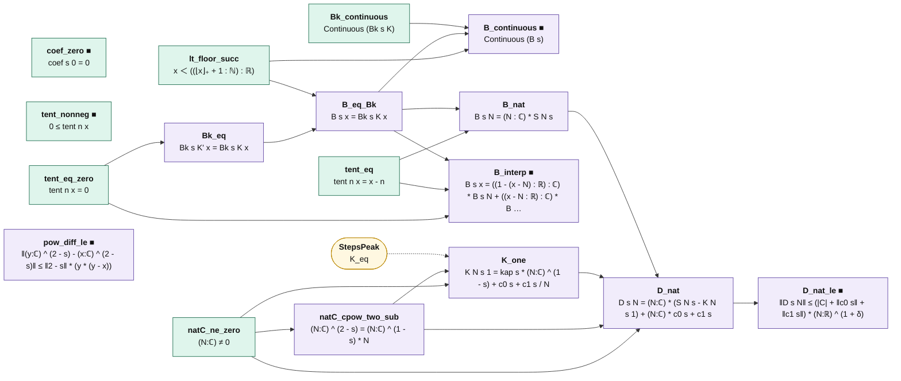

# `lean_stage3/Stage3/StepsBelow.lean`

> **Read from the source text.** This file changed after the last `python3 utilities/lean_map.py --dump`, so the arrows on this page are names occurring in each proof and have not been confirmed by Lean.

StepsBelow — block R9 of `lean_stage3/design/runs.md`, the turned steps. 2026-11-23.

17 theorems, 8 definitions, 229 lines. 

**Imports:** [`StepsRate`](../lean_stage3/StepsRate.md), [`ThetaConverse`](../lean_stage3/ThetaConverse.md)  
**Imported by:** nothing

## The picture



An arrow A → B reads "A is used in the proof of B". Green: counting, integers only. Violet: shape, analysis with no ζ. Blue: reads ζ. A name ending in ■ is an end: nothing else uses it. Red: contains `sorry`. Yellow: theorems in another file, counted; a dotted arrow crosses files. Definitions are not drawn; they are listed below the diagram.

## Definitions

<a name="StepsBelow-coef"></a>
### `StepsBelow.coef`

def · line 39

The weight `a_n = Λ(n)·n^(−s)`.

- **Is:** `` coef (s : ℂ) (n : ℕ) : ℂ := (ArithmeticFunction.vonMangoldt n : ℂ) * (n : ℂ) ^ (-s) ``
- **Used by 3:** [`StepsBelow.B_nat`](#StepsBelow-B_nat), [`StepsBelow.Bk`](#StepsBelow-Bk), [`StepsBelow.coef_zero`](#StepsBelow-coef_zero)

<a name="StepsBelow-tent"></a>
### `StepsBelow.tent`

def · line 42

The tent `(x − n)_+`.

- **Is:** `` tent (n : ℕ) (x : ℝ) : ℝ := max (x - n) 0 ``
- **Used by 6:** [`StepsBelow.B_interp`](#StepsBelow-B_interp), [`StepsBelow.Bk`](#StepsBelow-Bk), [`StepsBelow.Bk_continuous`](#StepsBelow-Bk_continuous), [`StepsBelow.tent_eq`](#StepsBelow-tent_eq), [`StepsBelow.tent_eq_zero`](#StepsBelow-tent_eq_zero), [`StepsBelow.tent_nonneg`](#StepsBelow-tent_nonneg)

<a name="StepsBelow-Bk"></a>
### `StepsBelow.Bk`

def · line 45

The staircase truncated to the first `K` steps.

- **Is:** `` Bk (s : ℂ) (K : ℕ) (x : ℝ) : ℂ := ∑ n ∈ Finset.range K, coef s n * (tent n x : ℂ) ``
- **Built from:** [`StepsBelow.coef`](#StepsBelow-coef), [`StepsBelow.tent`](#StepsBelow-tent), [`StepsPeak.K`](../lean_stage3/StepsPeak.md#StepsPeak-K)
- **Used by 7:** [`StepsBelow.B`](#StepsBelow-B), [`StepsBelow.B_continuous`](#StepsBelow-B_continuous), [`StepsBelow.B_eq_Bk`](#StepsBelow-B_eq_Bk), [`StepsBelow.B_interp`](#StepsBelow-B_interp), [`StepsBelow.B_nat`](#StepsBelow-B_nat), [`StepsBelow.Bk_continuous`](#StepsBelow-Bk_continuous), [`StepsBelow.Bk_eq`](#StepsBelow-Bk_eq)

<a name="StepsBelow-B"></a>
### `StepsBelow.B`

def · line 48

The staircase `B(x) = Σ_{n≤x} a_n·(x − n)`.

- **Is:** `` B (s : ℂ) (x : ℝ) : ℂ := Bk s (⌊x⌋₊ + 1) x ``
- **Built from:** [`StepsBelow.Bk`](#StepsBelow-Bk)
- **Used by 5:** [`StepsBelow.B_continuous`](#StepsBelow-B_continuous), [`StepsBelow.B_eq_Bk`](#StepsBelow-B_eq_Bk), [`StepsBelow.B_interp`](#StepsBelow-B_interp), [`StepsBelow.B_nat`](#StepsBelow-B_nat), [`StepsBelow.D`](#StepsBelow-D)

<a name="StepsBelow-kap"></a>
### `StepsBelow.kap`

def · line 134

`κ = 1/((1−s)(2−s))`.

- **Is:** `` kap (s : ℂ) : ℂ := 1 / ((1 - s) * (2 - s)) ``
- **Used by 2:** [`StepsBelow.D`](#StepsBelow-D), [`StepsBelow.K_one`](#StepsBelow-K_one)

<a name="StepsBelow-c0"></a>
### `StepsBelow.c0`

def · line 136

- **Is:** `` c0 (s : ℂ) : ℂ := -s * 2 ^ (1 - s) / (1 - s) ``
- **Used by 3:** [`StepsBelow.D_nat`](#StepsBelow-D_nat), [`StepsBelow.D_nat_le`](#StepsBelow-D_nat_le), [`StepsBelow.K_one`](#StepsBelow-K_one)

<a name="StepsBelow-c1"></a>
### `StepsBelow.c1`

def · line 138

- **Is:** `` c1 (s : ℂ) : ℂ := (s - 1) * 2 ^ (2 - s) / (2 - s) ``
- **Used by 3:** [`StepsBelow.D_nat`](#StepsBelow-D_nat), [`StepsBelow.D_nat_le`](#StepsBelow-D_nat_le), [`StepsBelow.K_one`](#StepsBelow-K_one)

<a name="StepsBelow-D"></a>
### `StepsBelow.D`

def · line 167

The staircase less its smooth part.

- **Is:** `` D (s : ℂ) (x : ℝ) : ℂ := B s x - kap s * (x : ℂ) ^ (2 - s) ``
- **Built from:** [`StepsBelow.B`](#StepsBelow-B), [`StepsBelow.kap`](#StepsBelow-kap)
- **Used by 2:** [`StepsBelow.D_nat`](#StepsBelow-D_nat), [`StepsBelow.D_nat_le`](#StepsBelow-D_nat_le)

## Theorems

<a name="StepsBelow-coef_zero"></a>
### `StepsBelow.coef_zero`

line 50 · arrows read from text

**Counting.** Integers only: nothing in its statement or proof, or in anything it rests on, uses analysis or ζ.

**Proves**

```lean
coef s 0 = 0
```

**Needs** (its hypotheses)

  - `` s : ℂ ``

**Fed by:** no theorem of this repo; it stands on Mathlib and the definitions below.

**Definitions its proof touches:** [`StepsBelow.coef`](#StepsBelow-coef)

**Feeds:** nothing. It is an end.

<a name="StepsBelow-tent_nonneg"></a>
### `StepsBelow.tent_nonneg`

line 52 · arrows read from text

**Counting.** Integers only: nothing in its statement or proof, or in anything it rests on, uses analysis or ζ.

**Proves**

```lean
0 ≤ tent n x
```

**Needs** (its hypotheses)

  - `` n : ℕ ``
  - `` x : ℝ ``

**Fed by:** no theorem of this repo; it stands on Mathlib and the definitions below.

**Definitions its proof touches:** [`StepsBelow.tent`](#StepsBelow-tent)

**Feeds:** nothing. It is an end.

<a name="StepsBelow-tent_eq_zero"></a>
### `StepsBelow.tent_eq_zero`

line 54 · arrows read from text

**Counting.** Integers only: nothing in its statement or proof, or in anything it rests on, uses analysis or ζ.

**Proves**

```lean
tent n x = 0
```

**Needs** (its hypotheses)

  - `` h : x ≤ n ``

**Fed by:** no theorem of this repo; it stands on Mathlib and the definitions below.

**Definitions its proof touches:** [`StepsBelow.tent`](#StepsBelow-tent)

**Feeds** (2 that use it)

  - [`StepsBelow.B_interp`](#StepsBelow-B_interp) — `` B s x = ((1 - (x - N) : ℝ) : ℂ) * B s N + ((x - N : ℝ) : ℂ) * B s ((N + 1 : ℕ) : ℝ) ``
  - [`StepsBelow.Bk_eq`](#StepsBelow-Bk_eq) — `` Bk s K' x = Bk s K x ``

<a name="StepsBelow-tent_eq"></a>
### `StepsBelow.tent_eq`

line 57 · arrows read from text

**Counting.** Integers only: nothing in its statement or proof, or in anything it rests on, uses analysis or ζ.

**Proves**

```lean
tent n x = x - n
```

**Needs** (its hypotheses)

  - `` h : (n:ℝ) ≤ x ``

**Fed by:** no theorem of this repo; it stands on Mathlib and the definitions below.

**Definitions its proof touches:** [`StepsBelow.tent`](#StepsBelow-tent)

**Feeds** (2 that use it)

  - [`StepsBelow.B_interp`](#StepsBelow-B_interp) — `` B s x = ((1 - (x - N) : ℝ) : ℂ) * B s N + ((x - N : ℝ) : ℂ) * B s ((N + 1 : ℕ) : ℝ) ``
  - [`StepsBelow.B_nat`](#StepsBelow-B_nat) — `` B s N = (N : ℂ) * S N s ``

<a name="StepsBelow-Bk_eq"></a>
### `StepsBelow.Bk_eq`

line 60 · arrows read from text

**Shape.** Uses real or complex analysis; nothing in it or beneath it reads ζ.

**Proves**

```lean
Bk s K' x = Bk s K x
```

**Needs** (its hypotheses)

  - `` hK : x < K ``
  - `` hKK : K ≤ K' ``

**Fed by** (1 theorem its proof uses)

  - [`StepsBelow.tent_eq_zero`](#StepsBelow-tent_eq_zero) — `` tent n x = 0 ``

**Definitions its proof touches:** [`StepsBelow.Bk`](#StepsBelow-Bk), [`StepsPeak.K`](../lean_stage3/StepsPeak.md#StepsPeak-K)

**Feeds** (1 that use it)

  - [`StepsBelow.B_eq_Bk`](#StepsBelow-B_eq_Bk) — `` B s x = Bk s K x ``

<a name="StepsBelow-lt_floor_succ"></a>
### `StepsBelow.lt_floor_succ`

line 69 · arrows read from text

**Counting.** Integers only: nothing in its statement or proof, or in anything it rests on, uses analysis or ζ.

**Proves**

```lean
x < ((⌊x⌋₊ + 1 : ℕ) : ℝ)
```

**Needs** (its hypotheses)

  - `` x : ℝ ``

**Fed by:** no theorem of this repo; it stands on Mathlib.

**Feeds** (2 that use it)

  - [`StepsBelow.B_continuous`](#StepsBelow-B_continuous) — `` Continuous (B s) ``
  - [`StepsBelow.B_eq_Bk`](#StepsBelow-B_eq_Bk) — `` B s x = Bk s K x ``

<a name="StepsBelow-B_eq_Bk"></a>
### `StepsBelow.B_eq_Bk`

line 72 · arrows read from text

**Shape.** Uses real or complex analysis; nothing in it or beneath it reads ζ.

**Proves**

```lean
B s x = Bk s K x
```

**Needs** (its hypotheses)

  - `` hK : x < K ``

**Fed by** (2 theorems its proof uses)

  - [`StepsBelow.Bk_eq`](#StepsBelow-Bk_eq) — `` Bk s K' x = Bk s K x ``
  - [`StepsBelow.lt_floor_succ`](#StepsBelow-lt_floor_succ) — `` x < ((⌊x⌋₊ + 1 : ℕ) : ℝ) ``

**Definitions its proof touches:** [`StepsBelow.B`](#StepsBelow-B), [`StepsBelow.Bk`](#StepsBelow-Bk), [`StepsPeak.K`](../lean_stage3/StepsPeak.md#StepsPeak-K)

**Feeds** (3 that use it)

  - [`StepsBelow.B_continuous`](#StepsBelow-B_continuous) — `` Continuous (B s) ``
  - [`StepsBelow.B_interp`](#StepsBelow-B_interp) — `` B s x = ((1 - (x - N) : ℝ) : ℂ) * B s N + ((x - N : ℝ) : ℂ) * B s ((N + 1 : ℕ) : ℝ) ``
  - [`StepsBelow.B_nat`](#StepsBelow-B_nat) — `` B s N = (N : ℂ) * S N s ``

<a name="StepsBelow-Bk_continuous"></a>
### `StepsBelow.Bk_continuous`

line 78 · arrows read from text

**Counting.** Integers only: nothing in its statement or proof, or in anything it rests on, uses analysis or ζ.

**Proves**

```lean
Continuous (Bk s K)
```

**Needs** (its hypotheses)

  - `` s : ℂ ``
  - `` K : ℕ ``

**Fed by:** no theorem of this repo; it stands on Mathlib and the definitions below.

**Definitions its proof touches:** [`StepsBelow.Bk`](#StepsBelow-Bk), [`StepsBelow.tent`](#StepsBelow-tent), [`StepsPeak.K`](../lean_stage3/StepsPeak.md#StepsPeak-K)

**Feeds** (1 that use it)

  - [`StepsBelow.B_continuous`](#StepsBelow-B_continuous) — `` Continuous (B s) ``

<a name="StepsBelow-B_continuous"></a>
### `StepsBelow.B_continuous`

line 82 · arrows read from text

**Shape.** Uses real or complex analysis; nothing in it or beneath it reads ζ.

**Proves**

```lean
Continuous (B s)
```

**Needs** (its hypotheses)

  - `` s : ℂ ``

**Fed by** (3 theorems its proof uses)

  - [`StepsBelow.B_eq_Bk`](#StepsBelow-B_eq_Bk) — `` B s x = Bk s K x ``
  - [`StepsBelow.Bk_continuous`](#StepsBelow-Bk_continuous) — `` Continuous (Bk s K) ``
  - [`StepsBelow.lt_floor_succ`](#StepsBelow-lt_floor_succ) — `` x < ((⌊x⌋₊ + 1 : ℕ) : ℝ) ``

**Definitions its proof touches:** [`StepsBelow.B`](#StepsBelow-B), [`StepsBelow.Bk`](#StepsBelow-Bk)

**Feeds:** nothing. It is an end.

<a name="StepsBelow-B_nat"></a>
### `StepsBelow.B_nat`

line 91 · arrows read from text

**Shape.** Uses real or complex analysis; nothing in it or beneath it reads ζ.

**Why.** At the integers the staircase is the cutoff times the turned steps.

**Proves**

```lean
B s N = (N : ℂ) * S N s
```

**Needs** (its hypotheses)

  - `` s : ℂ ``
  - `` hN : 2 ≤ N ``

**Fed by** (2 theorems its proof uses)

  - [`StepsBelow.B_eq_Bk`](#StepsBelow-B_eq_Bk) — `` B s x = Bk s K x ``
  - [`StepsBelow.tent_eq`](#StepsBelow-tent_eq) — `` tent n x = x - n ``

**Definitions its proof touches:** [`StepsBelow.B`](#StepsBelow-B), [`StepsBelow.Bk`](#StepsBelow-Bk), [`StepsBelow.coef`](#StepsBelow-coef), [`StepsPeak.K`](../lean_stage3/StepsPeak.md#StepsPeak-K), [`StepsPeak.S`](../lean_stage3/StepsPeak.md#StepsPeak-S), [`StepsPeak.ramp`](../lean_stage3/StepsPeak.md#StepsPeak-ramp)

**Feeds** (1 that use it)

  - [`StepsBelow.D_nat`](#StepsBelow-D_nat) — `` D s N = (N:ℂ) * (S N s - K N s 1) + (N:ℂ) * c0 s + c1 s ``

<a name="StepsBelow-B_interp"></a>
### `StepsBelow.B_interp`

line 108 · arrows read from text

**Shape.** Uses real or complex analysis; nothing in it or beneath it reads ζ.

**Why.** Linear between the integers.

**Proves**

```lean
B s x = ((1 - (x - N) : ℝ) : ℂ) * B s N + ((x - N : ℝ) : ℂ) * B s ((N + 1 : ℕ) : ℝ)
```

**Needs** (its hypotheses)

  - `` s : ℂ ``
  - `` N : ℕ ``
  - `` h1 : (N:ℝ) ≤ x ``
  - `` h2 : x ≤ N + 1 ``

**Fed by** (3 theorems its proof uses)

  - [`StepsBelow.B_eq_Bk`](#StepsBelow-B_eq_Bk) — `` B s x = Bk s K x ``
  - [`StepsBelow.tent_eq`](#StepsBelow-tent_eq) — `` tent n x = x - n ``
  - [`StepsBelow.tent_eq_zero`](#StepsBelow-tent_eq_zero) — `` tent n x = 0 ``

**Definitions its proof touches:** [`StepsBelow.B`](#StepsBelow-B), [`StepsBelow.Bk`](#StepsBelow-Bk), [`StepsBelow.tent`](#StepsBelow-tent)

**Feeds:** nothing. It is an end.

<a name="StepsBelow-natC_ne_zero"></a>
### `StepsBelow.natC_ne_zero`

line 140 · arrows read from text

**Counting.** Integers only: nothing in its statement or proof, or in anything it rests on, uses analysis or ζ.

**Proves**

```lean
(N:ℂ) ≠ 0
```

**Needs** (its hypotheses)

  - `` hN : 2 ≤ N ``

**Fed by:** no theorem of this repo; it stands on Mathlib.

**Feeds** (3 that use it)

  - [`StepsBelow.D_nat`](#StepsBelow-D_nat) — `` D s N = (N:ℂ) * (S N s - K N s 1) + (N:ℂ) * c0 s + c1 s ``
  - [`StepsBelow.K_one`](#StepsBelow-K_one) — `` K N s 1 = kap s * (N:ℂ) ^ (1 - s) + c0 s + c1 s / N ``
  - [`StepsBelow.natC_cpow_two_sub`](#StepsBelow-natC_cpow_two_sub) — `` (N:ℂ) ^ (2 - s) = (N:ℂ) ^ (1 - s) * N ``

<a name="StepsBelow-natC_cpow_two_sub"></a>
### `StepsBelow.natC_cpow_two_sub`

line 146 · arrows read from text

**Shape.** Uses real or complex analysis; nothing in it or beneath it reads ζ.

**Proves**

```lean
(N:ℂ) ^ (2 - s) = (N:ℂ) ^ (1 - s) * N
```

**Needs** (its hypotheses)

  - `` hN : 2 ≤ N ``
  - `` s : ℂ ``

**Fed by** (1 theorem its proof uses)

  - [`StepsBelow.natC_ne_zero`](#StepsBelow-natC_ne_zero) — `` (N:ℂ) ≠ 0 ``

**Feeds** (2 that use it)

  - [`StepsBelow.D_nat`](#StepsBelow-D_nat) — `` D s N = (N:ℂ) * (S N s - K N s 1) + (N:ℂ) * c0 s + c1 s ``
  - [`StepsBelow.K_one`](#StepsBelow-K_one) — `` K N s 1 = kap s * (N:ℂ) ^ (1 - s) + c0 s + c1 s / N ``

<a name="StepsBelow-K_one"></a>
### `StepsBelow.K_one`

line 152 · arrows read from text

**Shape.** Uses real or complex analysis; nothing in it or beneath it reads ζ.

**Why.** The smooth term in closed form: `K(1) = κ·N^(1−s) + c₀ + c₁/N`.

**Proves**

```lean
K N s 1 = kap s * (N:ℂ) ^ (1 - s) + c0 s + c1 s / N
```

**Needs** (its hypotheses)

  - `` hN : 2 ≤ N ``
  - `` hs1 : s ≠ 1 ``
  - `` hs2 : s ≠ 2 ``

**Fed by** (3 theorems its proof uses)

  - [`StepsBelow.natC_cpow_two_sub`](#StepsBelow-natC_cpow_two_sub) — `` (N:ℂ) ^ (2 - s) = (N:ℂ) ^ (1 - s) * N ``
  - [`StepsBelow.natC_ne_zero`](#StepsBelow-natC_ne_zero) — `` (N:ℂ) ≠ 0 ``
  - [`StepsPeak.K_eq`](../lean_stage3/StepsPeak.md#StepsPeak-K_eq) (StepsPeak) — `` K N s a = s * ((N:ℂ) ^ (a - s) - 2 ^ (a - s)) / (a - s) - (s - 1) * ((N:ℂ) ^ (a - s + 1) - 2 ^ (a - s + 1)) / ((a - s + 1) * N) ``

**Definitions its proof touches:** [`StepsBelow.c0`](#StepsBelow-c0), [`StepsBelow.c1`](#StepsBelow-c1), [`StepsBelow.kap`](#StepsBelow-kap), [`StepsPeak.K`](../lean_stage3/StepsPeak.md#StepsPeak-K)

**Feeds** (1 that use it)

  - [`StepsBelow.D_nat`](#StepsBelow-D_nat) — `` D s N = (N:ℂ) * (S N s - K N s 1) + (N:ℂ) * c0 s + c1 s ``

<a name="StepsBelow-D_nat"></a>
### `StepsBelow.D_nat`

line 169 · arrows read from text

**Shape.** Uses real or complex analysis; nothing in it or beneath it reads ζ.

**Proves**

```lean
D s N = (N:ℂ) * (S N s - K N s 1) + (N:ℂ) * c0 s + c1 s
```

**Needs** (its hypotheses)

  - `` hN : 2 ≤ N ``
  - `` hs1 : s ≠ 1 ``
  - `` hs2 : s ≠ 2 ``

**Fed by** (4 theorems its proof uses)

  - [`StepsBelow.B_nat`](#StepsBelow-B_nat) — `` B s N = (N : ℂ) * S N s ``
  - [`StepsBelow.K_one`](#StepsBelow-K_one) — `` K N s 1 = kap s * (N:ℂ) ^ (1 - s) + c0 s + c1 s / N ``
  - [`StepsBelow.natC_cpow_two_sub`](#StepsBelow-natC_cpow_two_sub) — `` (N:ℂ) ^ (2 - s) = (N:ℂ) ^ (1 - s) * N ``
  - [`StepsBelow.natC_ne_zero`](#StepsBelow-natC_ne_zero) — `` (N:ℂ) ≠ 0 ``

**Definitions its proof touches:** [`StepsBelow.D`](#StepsBelow-D), [`StepsBelow.c0`](#StepsBelow-c0), [`StepsBelow.c1`](#StepsBelow-c1), [`StepsPeak.K`](../lean_stage3/StepsPeak.md#StepsPeak-K), [`StepsPeak.S`](../lean_stage3/StepsPeak.md#StepsPeak-S)

**Feeds** (1 that use it)

  - [`StepsBelow.D_nat_le`](#StepsBelow-D_nat_le) — `` ‖D s N‖ ≤ (|C| + ‖c0 s‖ + ‖c1 s‖) * (N:ℝ) ^ (1 + δ) ``

<a name="StepsBelow-D_nat_le"></a>
### `StepsBelow.D_nat_le`

line 176 · arrows read from text

**Shape.** Uses real or complex analysis; nothing in it or beneath it reads ζ.

**Proves**

```lean
‖D s N‖ ≤ (|C| + ‖c0 s‖ + ‖c1 s‖) * (N:ℝ) ^ (1 + δ)
```

**Needs** (its hypotheses)

  - `` hN : 2 ≤ N ``
  - `` hs1 : s ≠ 1 ``
  - `` hs2 : s ≠ 2 ``
  - `` hδ : 0 ≤ δ ``
  - `` H : ‖S N s - K N s 1‖ ≤ C * (N:ℝ) ^ δ ``

**Fed by** (1 theorem its proof uses)

  - [`StepsBelow.D_nat`](#StepsBelow-D_nat) — `` D s N = (N:ℂ) * (S N s - K N s 1) + (N:ℂ) * c0 s + c1 s ``

**Definitions its proof touches:** [`StepsBelow.D`](#StepsBelow-D), [`StepsBelow.c0`](#StepsBelow-c0), [`StepsBelow.c1`](#StepsBelow-c1), [`StepsPeak.K`](../lean_stage3/StepsPeak.md#StepsPeak-K), [`StepsPeak.S`](../lean_stage3/StepsPeak.md#StepsPeak-S)

**Feeds:** nothing. It is an end.

<a name="StepsBelow-pow_diff_le"></a>
### `StepsBelow.pow_diff_le`

line 200 · arrows read from text

**Shape.** Uses real or complex analysis; nothing in it or beneath it reads ζ.

**Why.** A difference of the smooth power, by the integral of its derivative.

**Proves**

```lean
‖(y:ℂ) ^ (2 - s) - (x:ℂ) ^ (2 - s)‖ ≤ ‖2 - s‖ * (y * (y - x))
```

**Needs** (its hypotheses)

  - `` hs : 0 < s.re ``
  - `` hs2 : s ≠ 2 ``
  - `` hx : 1 ≤ x ``
  - `` hxy : x ≤ y ``

**Fed by:** no theorem of this repo; it stands on Mathlib.

**Feeds:** nothing. It connects to nothing.

