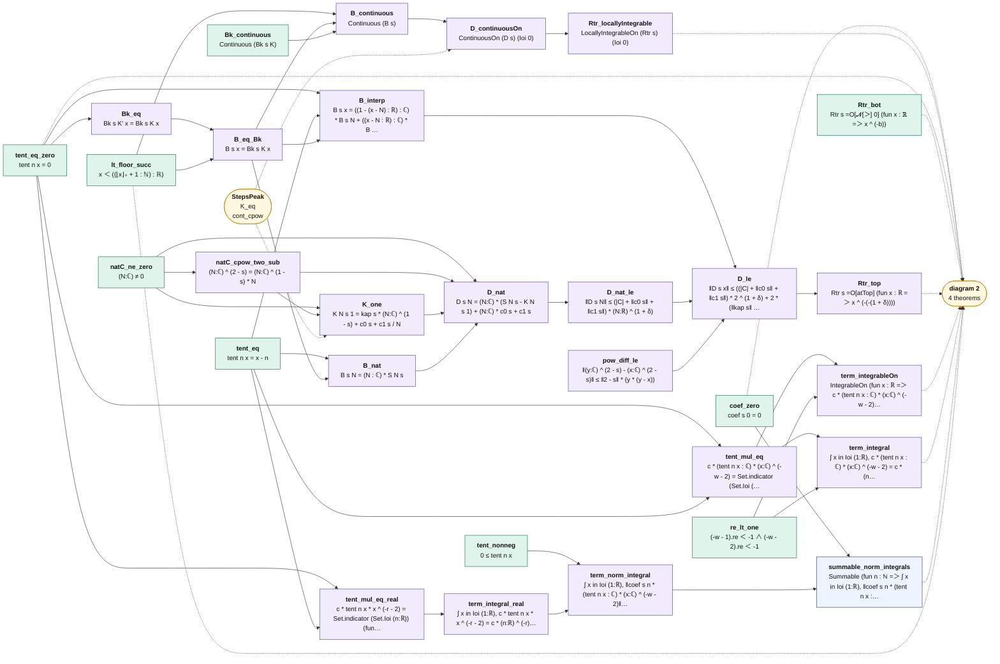
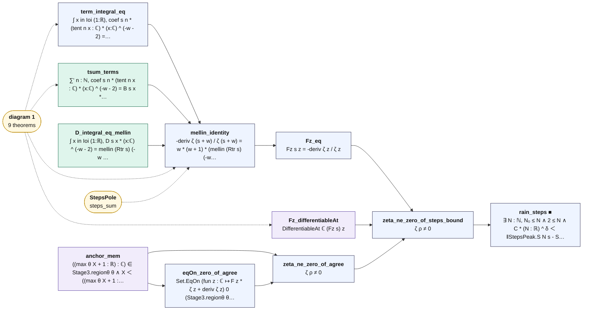

# `lean_stage3/Stage3/StepsBelow.lean`

> **Read from the source text.** This file changed after the last `python3 utilities/lean_map.py --dump`, so the arrows on this page are names occurring in each proof and have not been confirmed by Lean.

StepsBelow — block R9 of `lean_stage3/design/runs.md`, the turned steps. 2026-11-23.

41 theorems, 10 definitions, 782 lines. 

**Imports:** [`StepsRate`](../lean_stage3/StepsRate.md), [`ThetaConverse`](../lean_stage3/ThetaConverse.md)  
**Imported by:** [`Stage3`](../lean_stage3/Stage3.md)

## The picture

### Diagram 1 of 2: `coef_zero` to `summable_norm_integrals`



### Diagram 2 of 2: `term_integral_eq` to `rain_steps`



An arrow A → B reads "A is used in the proof of B". Green: counting, integers only. Violet: shape, analysis with no ζ. Blue: reads ζ. A name ending in ■ is an end: nothing else uses it. Red: contains `sorry`. Yellow: theorems in another file, counted; a dotted arrow crosses files. Definitions are not drawn; they are listed below the diagram.

## Definitions

<a name="StepsBelow-coef"></a>
### `StepsBelow.coef`

def · line 39

The weight `a_n = Λ(n)·n^(−s)`.

- **Is:** `` coef (s : ℂ) (n : ℕ) : ℂ := (ArithmeticFunction.vonMangoldt n : ℂ) * (n : ℂ) ^ (-s) ``
- **Used by 8:** [`StepsBelow.B_nat`](#StepsBelow-B_nat), [`StepsBelow.Bk`](#StepsBelow-Bk), [`StepsBelow.coef_zero`](#StepsBelow-coef_zero), [`StepsBelow.mellin_identity`](#StepsBelow-mellin_identity), [`StepsBelow.summable_norm_integrals`](#StepsBelow-summable_norm_integrals), [`StepsBelow.term_integral_eq`](#StepsBelow-term_integral_eq), [`StepsBelow.term_norm_integral`](#StepsBelow-term_norm_integral), [`StepsBelow.tsum_terms`](#StepsBelow-tsum_terms)

<a name="StepsBelow-tent"></a>
### `StepsBelow.tent`

def · line 42

The tent `(x − n)_+`.

- **Is:** `` tent (n : ℕ) (x : ℝ) : ℝ := max (x - n) 0 ``
- **Used by 16:** [`StepsBelow.B_interp`](#StepsBelow-B_interp), [`StepsBelow.Bk`](#StepsBelow-Bk), [`StepsBelow.Bk_continuous`](#StepsBelow-Bk_continuous), [`StepsBelow.mellin_identity`](#StepsBelow-mellin_identity), [`StepsBelow.summable_norm_integrals`](#StepsBelow-summable_norm_integrals), [`StepsBelow.tent_eq`](#StepsBelow-tent_eq), [`StepsBelow.tent_eq_zero`](#StepsBelow-tent_eq_zero), [`StepsBelow.tent_mul_eq`](#StepsBelow-tent_mul_eq), [`StepsBelow.tent_mul_eq_real`](#StepsBelow-tent_mul_eq_real), [`StepsBelow.tent_nonneg`](#StepsBelow-tent_nonneg), [`StepsBelow.term_integrableOn`](#StepsBelow-term_integrableOn), [`StepsBelow.term_integral`](#StepsBelow-term_integral), [`StepsBelow.term_integral_eq`](#StepsBelow-term_integral_eq), [`StepsBelow.term_integral_real`](#StepsBelow-term_integral_real), [`StepsBelow.term_norm_integral`](#StepsBelow-term_norm_integral), [`StepsBelow.tsum_terms`](#StepsBelow-tsum_terms)

<a name="StepsBelow-Bk"></a>
### `StepsBelow.Bk`

def · line 45

The staircase truncated to the first `K` steps.

- **Is:** `` Bk (s : ℂ) (K : ℕ) (x : ℝ) : ℂ := ∑ n ∈ Finset.range K, coef s n * (tent n x : ℂ) ``
- **Built from:** [`StepsBelow.coef`](#StepsBelow-coef), [`StepsBelow.tent`](#StepsBelow-tent), [`StepsPeak.K`](../lean_stage3/StepsPeak.md#StepsPeak-K)
- **Used by 8:** [`StepsBelow.B`](#StepsBelow-B), [`StepsBelow.B_continuous`](#StepsBelow-B_continuous), [`StepsBelow.B_eq_Bk`](#StepsBelow-B_eq_Bk), [`StepsBelow.B_interp`](#StepsBelow-B_interp), [`StepsBelow.B_nat`](#StepsBelow-B_nat), [`StepsBelow.Bk_continuous`](#StepsBelow-Bk_continuous), [`StepsBelow.Bk_eq`](#StepsBelow-Bk_eq), [`StepsBelow.tsum_terms`](#StepsBelow-tsum_terms)

<a name="StepsBelow-B"></a>
### `StepsBelow.B`

def · line 48

The staircase `B(x) = Σ_{n≤x} a_n·(x − n)`.

- **Is:** `` B (s : ℂ) (x : ℝ) : ℂ := Bk s (⌊x⌋₊ + 1) x ``
- **Built from:** [`StepsBelow.Bk`](#StepsBelow-Bk)
- **Used by 7:** [`StepsBelow.B_continuous`](#StepsBelow-B_continuous), [`StepsBelow.B_eq_Bk`](#StepsBelow-B_eq_Bk), [`StepsBelow.B_interp`](#StepsBelow-B_interp), [`StepsBelow.B_nat`](#StepsBelow-B_nat), [`StepsBelow.D`](#StepsBelow-D), [`StepsBelow.mellin_identity`](#StepsBelow-mellin_identity), [`StepsBelow.tsum_terms`](#StepsBelow-tsum_terms)

<a name="StepsBelow-kap"></a>
### `StepsBelow.kap`

def · line 134

`κ = 1/((1−s)(2−s))`.

- **Is:** `` kap (s : ℂ) : ℂ := 1 / ((1 - s) * (2 - s)) ``
- **Used by 7:** [`StepsBelow.D`](#StepsBelow-D), [`StepsBelow.D_le`](#StepsBelow-D_le), [`StepsBelow.Fz`](#StepsBelow-Fz), [`StepsBelow.Fz_differentiableAt`](#StepsBelow-Fz_differentiableAt), [`StepsBelow.K_one`](#StepsBelow-K_one), [`StepsBelow.Rtr_top`](#StepsBelow-Rtr_top), [`StepsBelow.mellin_identity`](#StepsBelow-mellin_identity)

<a name="StepsBelow-c0"></a>
### `StepsBelow.c0`

def · line 136

- **Is:** `` c0 (s : ℂ) : ℂ := -s * 2 ^ (1 - s) / (1 - s) ``
- **Used by 5:** [`StepsBelow.D_le`](#StepsBelow-D_le), [`StepsBelow.D_nat`](#StepsBelow-D_nat), [`StepsBelow.D_nat_le`](#StepsBelow-D_nat_le), [`StepsBelow.K_one`](#StepsBelow-K_one), [`StepsBelow.Rtr_top`](#StepsBelow-Rtr_top)

<a name="StepsBelow-c1"></a>
### `StepsBelow.c1`

def · line 138

- **Is:** `` c1 (s : ℂ) : ℂ := (s - 1) * 2 ^ (2 - s) / (2 - s) ``
- **Used by 5:** [`StepsBelow.D_le`](#StepsBelow-D_le), [`StepsBelow.D_nat`](#StepsBelow-D_nat), [`StepsBelow.D_nat_le`](#StepsBelow-D_nat_le), [`StepsBelow.K_one`](#StepsBelow-K_one), [`StepsBelow.Rtr_top`](#StepsBelow-Rtr_top)

<a name="StepsBelow-D"></a>
### `StepsBelow.D`

def · line 167

The staircase less its smooth part.

- **Is:** `` D (s : ℂ) (x : ℝ) : ℂ := B s x - kap s * (x : ℂ) ^ (2 - s) ``
- **Built from:** [`StepsBelow.B`](#StepsBelow-B), [`StepsBelow.kap`](#StepsBelow-kap)
- **Used by 7:** [`StepsBelow.D_continuousOn`](#StepsBelow-D_continuousOn), [`StepsBelow.D_integral_eq_mellin`](#StepsBelow-D_integral_eq_mellin), [`StepsBelow.D_le`](#StepsBelow-D_le), [`StepsBelow.D_nat`](#StepsBelow-D_nat), [`StepsBelow.D_nat_le`](#StepsBelow-D_nat_le), [`StepsBelow.Rtr`](#StepsBelow-Rtr), [`StepsBelow.mellin_identity`](#StepsBelow-mellin_identity)

<a name="StepsBelow-Rtr"></a>
### `StepsBelow.Rtr`

def · line 319

The remainder `B(x) − κ·x^(2−s)` on `(1, ∞)`, zero below.

- **Is:** `` Rtr (s : ℂ) : ℝ → ℂ := Set.indicator (Set.Ioi 1) (D s) ``
- **Built from:** [`StepsBelow.D`](#StepsBelow-D)
- **Used by 7:** [`StepsBelow.D_integral_eq_mellin`](#StepsBelow-D_integral_eq_mellin), [`StepsBelow.Fz`](#StepsBelow-Fz), [`StepsBelow.Fz_differentiableAt`](#StepsBelow-Fz_differentiableAt), [`StepsBelow.Rtr_bot`](#StepsBelow-Rtr_bot), [`StepsBelow.Rtr_locallyIntegrable`](#StepsBelow-Rtr_locallyIntegrable), [`StepsBelow.Rtr_top`](#StepsBelow-Rtr_top), [`StepsBelow.mellin_identity`](#StepsBelow-mellin_identity)

<a name="StepsBelow-Fz"></a>
### `StepsBelow.Fz`

def · line 589

The continuation of `−ζ'/ζ`: `F(z) = w(w+1)·(M[R](−w−1) + κ/(z−1))`, `w = z − s`.

- **Is:** `` Fz (s z : ℂ) : ℂ := (z - s) * (z - s + 1) * (mellin (Rtr s) (-(z - s) - 1) + kap s / (z - 1)) ``
- **Built from:** [`StepsBelow.Rtr`](#StepsBelow-Rtr), [`StepsBelow.kap`](#StepsBelow-kap)
- **Used by 3:** [`StepsBelow.Fz_differentiableAt`](#StepsBelow-Fz_differentiableAt), [`StepsBelow.Fz_eq`](#StepsBelow-Fz_eq), [`StepsBelow.zeta_ne_zero_of_steps_bound`](#StepsBelow-zeta_ne_zero_of_steps_bound)

## Theorems

<a name="StepsBelow-coef_zero"></a>
### `StepsBelow.coef_zero`

line 50 · arrows read from text

**Counting.** Integers only: nothing in its statement or proof, or in anything it rests on, uses analysis or ζ.

**Proves**

```lean
coef s 0 = 0
```

**Needs** (its hypotheses)

  - `` s : ℂ ``

**Fed by:** no theorem of this repo; it stands on Mathlib and the definitions below.

**Definitions its proof touches:** [`StepsBelow.coef`](#StepsBelow-coef)

**Feeds** (2 that use it)

  - [`StepsBelow.summable_norm_integrals`](#StepsBelow-summable_norm_integrals) — `` Summable (fun n : ℕ => ∫ x in Ioi (1:ℝ), ‖coef s n * (tent n x : ℂ) * (x:ℂ) ^ (-w - 2)‖) ``
  - [`StepsBelow.term_integral_eq`](#StepsBelow-term_integral_eq) — `` ∫ x in Ioi (1:ℝ), coef s n * (tent n x : ℂ) * (x:ℂ) ^ (-w - 2) = LSeries.term (fun n => (ArithmeticFunction.vonMangoldt n : ℂ)) (s + w) n / (w * (w + … ``

<a name="StepsBelow-tent_nonneg"></a>
### `StepsBelow.tent_nonneg`

line 52 · arrows read from text

**Counting.** Integers only: nothing in its statement or proof, or in anything it rests on, uses analysis or ζ.

**Proves**

```lean
0 ≤ tent n x
```

**Needs** (its hypotheses)

  - `` n : ℕ ``
  - `` x : ℝ ``

**Fed by:** no theorem of this repo; it stands on Mathlib and the definitions below.

**Definitions its proof touches:** [`StepsBelow.tent`](#StepsBelow-tent)

**Feeds** (1 that use it)

  - [`StepsBelow.term_norm_integral`](#StepsBelow-term_norm_integral) — `` ∫ x in Ioi (1:ℝ), ‖coef s n * (tent n x : ℂ) * (x:ℂ) ^ (-w - 2)‖ = ‖coef s n‖ * (n:ℝ) ^ (-w.re) / (w.re * (w.re + 1)) ``

<a name="StepsBelow-tent_eq_zero"></a>
### `StepsBelow.tent_eq_zero`

line 54 · arrows read from text

**Counting.** Integers only: nothing in its statement or proof, or in anything it rests on, uses analysis or ζ.

**Proves**

```lean
tent n x = 0
```

**Needs** (its hypotheses)

  - `` h : x ≤ n ``

**Fed by:** no theorem of this repo; it stands on Mathlib and the definitions below.

**Definitions its proof touches:** [`StepsBelow.tent`](#StepsBelow-tent)

**Feeds** (5 that use it)

  - [`StepsBelow.B_interp`](#StepsBelow-B_interp) — `` B s x = ((1 - (x - N) : ℝ) : ℂ) * B s N + ((x - N : ℝ) : ℂ) * B s ((N + 1 : ℕ) : ℝ) ``
  - [`StepsBelow.Bk_eq`](#StepsBelow-Bk_eq) — `` Bk s K' x = Bk s K x ``
  - [`StepsBelow.tent_mul_eq`](#StepsBelow-tent_mul_eq) — `` c * (tent n x : ℂ) * (x:ℂ) ^ (-w - 2) = Set.indicator (Set.Ioi (n:ℝ)) (fun x : ℝ => c * ((x:ℂ) ^ (-w - 1) - n * (x:ℂ) ^ (-w - 2))) x ``
  - [`StepsBelow.tent_mul_eq_real`](#StepsBelow-tent_mul_eq_real) — `` c * tent n x * x ^ (-r - 2) = Set.indicator (Set.Ioi (n:ℝ)) (fun x : ℝ => c * (x ^ (-r - 1) - n * x ^ (-r - 2))) x ``
  - [`StepsBelow.tsum_terms`](#StepsBelow-tsum_terms) — `` ∑' n : ℕ, coef s n * (tent n x : ℂ) * (x:ℂ) ^ (-w - 2) = B s x * (x:ℂ) ^ (-w - 2) ``

<a name="StepsBelow-tent_eq"></a>
### `StepsBelow.tent_eq`

line 57 · arrows read from text

**Counting.** Integers only: nothing in its statement or proof, or in anything it rests on, uses analysis or ζ.

**Proves**

```lean
tent n x = x - n
```

**Needs** (its hypotheses)

  - `` h : (n:ℝ) ≤ x ``

**Fed by:** no theorem of this repo; it stands on Mathlib and the definitions below.

**Definitions its proof touches:** [`StepsBelow.tent`](#StepsBelow-tent)

**Feeds** (4 that use it)

  - [`StepsBelow.B_interp`](#StepsBelow-B_interp) — `` B s x = ((1 - (x - N) : ℝ) : ℂ) * B s N + ((x - N : ℝ) : ℂ) * B s ((N + 1 : ℕ) : ℝ) ``
  - [`StepsBelow.B_nat`](#StepsBelow-B_nat) — `` B s N = (N : ℂ) * S N s ``
  - [`StepsBelow.tent_mul_eq`](#StepsBelow-tent_mul_eq) — `` c * (tent n x : ℂ) * (x:ℂ) ^ (-w - 2) = Set.indicator (Set.Ioi (n:ℝ)) (fun x : ℝ => c * ((x:ℂ) ^ (-w - 1) - n * (x:ℂ) ^ (-w - 2))) x ``
  - [`StepsBelow.tent_mul_eq_real`](#StepsBelow-tent_mul_eq_real) — `` c * tent n x * x ^ (-r - 2) = Set.indicator (Set.Ioi (n:ℝ)) (fun x : ℝ => c * (x ^ (-r - 1) - n * x ^ (-r - 2))) x ``

<a name="StepsBelow-Bk_eq"></a>
### `StepsBelow.Bk_eq`

line 60 · arrows read from text

**Shape.** Uses real or complex analysis; nothing in it or beneath it reads ζ.

**Proves**

```lean
Bk s K' x = Bk s K x
```

**Needs** (its hypotheses)

  - `` hK : x < K ``
  - `` hKK : K ≤ K' ``

**Fed by** (1 theorem its proof uses)

  - [`StepsBelow.tent_eq_zero`](#StepsBelow-tent_eq_zero) — `` tent n x = 0 ``

**Definitions its proof touches:** [`StepsBelow.Bk`](#StepsBelow-Bk), [`StepsPeak.K`](../lean_stage3/StepsPeak.md#StepsPeak-K)

**Feeds** (1 that use it)

  - [`StepsBelow.B_eq_Bk`](#StepsBelow-B_eq_Bk) — `` B s x = Bk s K x ``

<a name="StepsBelow-lt_floor_succ"></a>
### `StepsBelow.lt_floor_succ`

line 69 · arrows read from text

**Counting.** Integers only: nothing in its statement or proof, or in anything it rests on, uses analysis or ζ.

**Proves**

```lean
x < ((⌊x⌋₊ + 1 : ℕ) : ℝ)
```

**Needs** (its hypotheses)

  - `` x : ℝ ``

**Fed by:** no theorem of this repo; it stands on Mathlib.

**Feeds** (3 that use it)

  - [`StepsBelow.B_continuous`](#StepsBelow-B_continuous) — `` Continuous (B s) ``
  - [`StepsBelow.B_eq_Bk`](#StepsBelow-B_eq_Bk) — `` B s x = Bk s K x ``
  - [`StepsBelow.tsum_terms`](#StepsBelow-tsum_terms) — `` ∑' n : ℕ, coef s n * (tent n x : ℂ) * (x:ℂ) ^ (-w - 2) = B s x * (x:ℂ) ^ (-w - 2) ``

<a name="StepsBelow-B_eq_Bk"></a>
### `StepsBelow.B_eq_Bk`

line 72 · arrows read from text

**Shape.** Uses real or complex analysis; nothing in it or beneath it reads ζ.

**Proves**

```lean
B s x = Bk s K x
```

**Needs** (its hypotheses)

  - `` hK : x < K ``

**Fed by** (2 theorems its proof uses)

  - [`StepsBelow.Bk_eq`](#StepsBelow-Bk_eq) — `` Bk s K' x = Bk s K x ``
  - [`StepsBelow.lt_floor_succ`](#StepsBelow-lt_floor_succ) — `` x < ((⌊x⌋₊ + 1 : ℕ) : ℝ) ``

**Definitions its proof touches:** [`StepsBelow.B`](#StepsBelow-B), [`StepsBelow.Bk`](#StepsBelow-Bk), [`StepsPeak.K`](../lean_stage3/StepsPeak.md#StepsPeak-K)

**Feeds** (3 that use it)

  - [`StepsBelow.B_continuous`](#StepsBelow-B_continuous) — `` Continuous (B s) ``
  - [`StepsBelow.B_interp`](#StepsBelow-B_interp) — `` B s x = ((1 - (x - N) : ℝ) : ℂ) * B s N + ((x - N : ℝ) : ℂ) * B s ((N + 1 : ℕ) : ℝ) ``
  - [`StepsBelow.B_nat`](#StepsBelow-B_nat) — `` B s N = (N : ℂ) * S N s ``

<a name="StepsBelow-Bk_continuous"></a>
### `StepsBelow.Bk_continuous`

line 78 · arrows read from text

**Counting.** Integers only: nothing in its statement or proof, or in anything it rests on, uses analysis or ζ.

**Proves**

```lean
Continuous (Bk s K)
```

**Needs** (its hypotheses)

  - `` s : ℂ ``
  - `` K : ℕ ``

**Fed by:** no theorem of this repo; it stands on Mathlib and the definitions below.

**Definitions its proof touches:** [`StepsBelow.Bk`](#StepsBelow-Bk), [`StepsBelow.tent`](#StepsBelow-tent), [`StepsPeak.K`](../lean_stage3/StepsPeak.md#StepsPeak-K)

**Feeds** (1 that use it)

  - [`StepsBelow.B_continuous`](#StepsBelow-B_continuous) — `` Continuous (B s) ``

<a name="StepsBelow-B_continuous"></a>
### `StepsBelow.B_continuous`

line 82 · arrows read from text

**Shape.** Uses real or complex analysis; nothing in it or beneath it reads ζ.

**Proves**

```lean
Continuous (B s)
```

**Needs** (its hypotheses)

  - `` s : ℂ ``

**Fed by** (3 theorems its proof uses)

  - [`StepsBelow.B_eq_Bk`](#StepsBelow-B_eq_Bk) — `` B s x = Bk s K x ``
  - [`StepsBelow.Bk_continuous`](#StepsBelow-Bk_continuous) — `` Continuous (Bk s K) ``
  - [`StepsBelow.lt_floor_succ`](#StepsBelow-lt_floor_succ) — `` x < ((⌊x⌋₊ + 1 : ℕ) : ℝ) ``

**Definitions its proof touches:** [`StepsBelow.B`](#StepsBelow-B), [`StepsBelow.Bk`](#StepsBelow-Bk)

**Feeds** (1 that use it)

  - [`StepsBelow.D_continuousOn`](#StepsBelow-D_continuousOn) — `` ContinuousOn (D s) (Ioi 0) ``

<a name="StepsBelow-B_nat"></a>
### `StepsBelow.B_nat`

line 91 · arrows read from text

**Shape.** Uses real or complex analysis; nothing in it or beneath it reads ζ.

**Why.** At the integers the staircase is the cutoff times the turned steps.

**Proves**

```lean
B s N = (N : ℂ) * S N s
```

**Needs** (its hypotheses)

  - `` s : ℂ ``
  - `` hN : 2 ≤ N ``

**Fed by** (2 theorems its proof uses)

  - [`StepsBelow.B_eq_Bk`](#StepsBelow-B_eq_Bk) — `` B s x = Bk s K x ``
  - [`StepsBelow.tent_eq`](#StepsBelow-tent_eq) — `` tent n x = x - n ``

**Definitions its proof touches:** [`StepsBelow.B`](#StepsBelow-B), [`StepsBelow.Bk`](#StepsBelow-Bk), [`StepsBelow.coef`](#StepsBelow-coef), [`StepsPeak.K`](../lean_stage3/StepsPeak.md#StepsPeak-K), [`StepsPeak.S`](../lean_stage3/StepsPeak.md#StepsPeak-S), [`StepsPeak.ramp`](../lean_stage3/StepsPeak.md#StepsPeak-ramp)

**Feeds** (1 that use it)

  - [`StepsBelow.D_nat`](#StepsBelow-D_nat) — `` D s N = (N:ℂ) * (S N s - K N s 1) + (N:ℂ) * c0 s + c1 s ``

<a name="StepsBelow-B_interp"></a>
### `StepsBelow.B_interp`

line 108 · arrows read from text

**Shape.** Uses real or complex analysis; nothing in it or beneath it reads ζ.

**Why.** Linear between the integers.

**Proves**

```lean
B s x = ((1 - (x - N) : ℝ) : ℂ) * B s N + ((x - N : ℝ) : ℂ) * B s ((N + 1 : ℕ) : ℝ)
```

**Needs** (its hypotheses)

  - `` s : ℂ ``
  - `` N : ℕ ``
  - `` h1 : (N:ℝ) ≤ x ``
  - `` h2 : x ≤ N + 1 ``

**Fed by** (3 theorems its proof uses)

  - [`StepsBelow.B_eq_Bk`](#StepsBelow-B_eq_Bk) — `` B s x = Bk s K x ``
  - [`StepsBelow.tent_eq`](#StepsBelow-tent_eq) — `` tent n x = x - n ``
  - [`StepsBelow.tent_eq_zero`](#StepsBelow-tent_eq_zero) — `` tent n x = 0 ``

**Definitions its proof touches:** [`StepsBelow.B`](#StepsBelow-B), [`StepsBelow.Bk`](#StepsBelow-Bk), [`StepsBelow.tent`](#StepsBelow-tent)

**Feeds** (1 that use it)

  - [`StepsBelow.D_le`](#StepsBelow-D_le) — `` ‖D s x‖ ≤ ((|C| + ‖c0 s‖ + ‖c1 s‖) * 2 ^ (1 + δ) + 2 * (‖kap s‖ * ‖2 - s‖)) * x ^ (1 + δ) ``

<a name="StepsBelow-natC_ne_zero"></a>
### `StepsBelow.natC_ne_zero`

line 140 · arrows read from text

**Counting.** Integers only: nothing in its statement or proof, or in anything it rests on, uses analysis or ζ.

**Proves**

```lean
(N:ℂ) ≠ 0
```

**Needs** (its hypotheses)

  - `` hN : 2 ≤ N ``

**Fed by:** no theorem of this repo; it stands on Mathlib.

**Feeds** (3 that use it)

  - [`StepsBelow.D_nat`](#StepsBelow-D_nat) — `` D s N = (N:ℂ) * (S N s - K N s 1) + (N:ℂ) * c0 s + c1 s ``
  - [`StepsBelow.K_one`](#StepsBelow-K_one) — `` K N s 1 = kap s * (N:ℂ) ^ (1 - s) + c0 s + c1 s / N ``
  - [`StepsBelow.natC_cpow_two_sub`](#StepsBelow-natC_cpow_two_sub) — `` (N:ℂ) ^ (2 - s) = (N:ℂ) ^ (1 - s) * N ``

<a name="StepsBelow-natC_cpow_two_sub"></a>
### `StepsBelow.natC_cpow_two_sub`

line 146 · arrows read from text

**Shape.** Uses real or complex analysis; nothing in it or beneath it reads ζ.

**Proves**

```lean
(N:ℂ) ^ (2 - s) = (N:ℂ) ^ (1 - s) * N
```

**Needs** (its hypotheses)

  - `` hN : 2 ≤ N ``
  - `` s : ℂ ``

**Fed by** (1 theorem its proof uses)

  - [`StepsBelow.natC_ne_zero`](#StepsBelow-natC_ne_zero) — `` (N:ℂ) ≠ 0 ``

**Feeds** (2 that use it)

  - [`StepsBelow.D_nat`](#StepsBelow-D_nat) — `` D s N = (N:ℂ) * (S N s - K N s 1) + (N:ℂ) * c0 s + c1 s ``
  - [`StepsBelow.K_one`](#StepsBelow-K_one) — `` K N s 1 = kap s * (N:ℂ) ^ (1 - s) + c0 s + c1 s / N ``

<a name="StepsBelow-K_one"></a>
### `StepsBelow.K_one`

line 152 · arrows read from text

**Shape.** Uses real or complex analysis; nothing in it or beneath it reads ζ.

**Why.** The smooth term in closed form: `K(1) = κ·N^(1−s) + c₀ + c₁/N`.

**Proves**

```lean
K N s 1 = kap s * (N:ℂ) ^ (1 - s) + c0 s + c1 s / N
```

**Needs** (its hypotheses)

  - `` hN : 2 ≤ N ``
  - `` hs1 : s ≠ 1 ``
  - `` hs2 : s ≠ 2 ``

**Fed by** (3 theorems its proof uses)

  - [`StepsBelow.natC_cpow_two_sub`](#StepsBelow-natC_cpow_two_sub) — `` (N:ℂ) ^ (2 - s) = (N:ℂ) ^ (1 - s) * N ``
  - [`StepsBelow.natC_ne_zero`](#StepsBelow-natC_ne_zero) — `` (N:ℂ) ≠ 0 ``
  - [`StepsPeak.K_eq`](../lean_stage3/StepsPeak.md#StepsPeak-K_eq) (StepsPeak) — `` K N s a = s * ((N:ℂ) ^ (a - s) - 2 ^ (a - s)) / (a - s) - (s - 1) * ((N:ℂ) ^ (a - s + 1) - 2 ^ (a - s + 1)) / ((a - s + 1) * N) ``

**Definitions its proof touches:** [`StepsBelow.c0`](#StepsBelow-c0), [`StepsBelow.c1`](#StepsBelow-c1), [`StepsBelow.kap`](#StepsBelow-kap), [`StepsPeak.K`](../lean_stage3/StepsPeak.md#StepsPeak-K)

**Feeds** (1 that use it)

  - [`StepsBelow.D_nat`](#StepsBelow-D_nat) — `` D s N = (N:ℂ) * (S N s - K N s 1) + (N:ℂ) * c0 s + c1 s ``

<a name="StepsBelow-D_nat"></a>
### `StepsBelow.D_nat`

line 169 · arrows read from text

**Shape.** Uses real or complex analysis; nothing in it or beneath it reads ζ.

**Proves**

```lean
D s N = (N:ℂ) * (S N s - K N s 1) + (N:ℂ) * c0 s + c1 s
```

**Needs** (its hypotheses)

  - `` hN : 2 ≤ N ``
  - `` hs1 : s ≠ 1 ``
  - `` hs2 : s ≠ 2 ``

**Fed by** (4 theorems its proof uses)

  - [`StepsBelow.B_nat`](#StepsBelow-B_nat) — `` B s N = (N : ℂ) * S N s ``
  - [`StepsBelow.K_one`](#StepsBelow-K_one) — `` K N s 1 = kap s * (N:ℂ) ^ (1 - s) + c0 s + c1 s / N ``
  - [`StepsBelow.natC_cpow_two_sub`](#StepsBelow-natC_cpow_two_sub) — `` (N:ℂ) ^ (2 - s) = (N:ℂ) ^ (1 - s) * N ``
  - [`StepsBelow.natC_ne_zero`](#StepsBelow-natC_ne_zero) — `` (N:ℂ) ≠ 0 ``

**Definitions its proof touches:** [`StepsBelow.D`](#StepsBelow-D), [`StepsBelow.c0`](#StepsBelow-c0), [`StepsBelow.c1`](#StepsBelow-c1), [`StepsPeak.K`](../lean_stage3/StepsPeak.md#StepsPeak-K), [`StepsPeak.S`](../lean_stage3/StepsPeak.md#StepsPeak-S)

**Feeds** (1 that use it)

  - [`StepsBelow.D_nat_le`](#StepsBelow-D_nat_le) — `` ‖D s N‖ ≤ (|C| + ‖c0 s‖ + ‖c1 s‖) * (N:ℝ) ^ (1 + δ) ``

<a name="StepsBelow-D_nat_le"></a>
### `StepsBelow.D_nat_le`

line 176 · arrows read from text

**Shape.** Uses real or complex analysis; nothing in it or beneath it reads ζ.

**Proves**

```lean
‖D s N‖ ≤ (|C| + ‖c0 s‖ + ‖c1 s‖) * (N:ℝ) ^ (1 + δ)
```

**Needs** (its hypotheses)

  - `` hN : 2 ≤ N ``
  - `` hs1 : s ≠ 1 ``
  - `` hs2 : s ≠ 2 ``
  - `` hδ : 0 ≤ δ ``
  - `` H : ‖S N s - K N s 1‖ ≤ C * (N:ℝ) ^ δ ``

**Fed by** (1 theorem its proof uses)

  - [`StepsBelow.D_nat`](#StepsBelow-D_nat) — `` D s N = (N:ℂ) * (S N s - K N s 1) + (N:ℂ) * c0 s + c1 s ``

**Definitions its proof touches:** [`StepsBelow.D`](#StepsBelow-D), [`StepsBelow.c0`](#StepsBelow-c0), [`StepsBelow.c1`](#StepsBelow-c1), [`StepsPeak.K`](../lean_stage3/StepsPeak.md#StepsPeak-K), [`StepsPeak.S`](../lean_stage3/StepsPeak.md#StepsPeak-S)

**Feeds** (1 that use it)

  - [`StepsBelow.D_le`](#StepsBelow-D_le) — `` ‖D s x‖ ≤ ((|C| + ‖c0 s‖ + ‖c1 s‖) * 2 ^ (1 + δ) + 2 * (‖kap s‖ * ‖2 - s‖)) * x ^ (1 + δ) ``

<a name="StepsBelow-pow_diff_le"></a>
### `StepsBelow.pow_diff_le`

line 200 · arrows read from text

**Shape.** Uses real or complex analysis; nothing in it or beneath it reads ζ.

**Why.** A difference of the smooth power, by the integral of its derivative.

**Proves**

```lean
‖(y:ℂ) ^ (2 - s) - (x:ℂ) ^ (2 - s)‖ ≤ ‖2 - s‖ * (y * (y - x))
```

**Needs** (its hypotheses)

  - `` hs : 0 < s.re ``
  - `` hs2 : s ≠ 2 ``
  - `` hx : 1 ≤ x ``
  - `` hxy : x ≤ y ``

**Fed by:** no theorem of this repo; it stands on Mathlib.

**Feeds** (1 that use it)

  - [`StepsBelow.D_le`](#StepsBelow-D_le) — `` ‖D s x‖ ≤ ((|C| + ‖c0 s‖ + ‖c1 s‖) * 2 ^ (1 + δ) + 2 * (‖kap s‖ * ‖2 - s‖)) * x ^ (1 + δ) ``

<a name="StepsBelow-D_le"></a>
### `StepsBelow.D_le`

line 228 · arrows read from text

**Shape.** Uses real or complex analysis; nothing in it or beneath it reads ζ.

**Why.** From the integers to the reals. A bound `‖S(N,s) − K(1)‖ ≤ C·N^δ` from `N₁` on gives `‖B(x) − κ·x^(2−s)‖ ≤ C'·x^(1+δ)` from `N₁` on.

**Proves**

```lean
‖D s x‖ ≤ ((|C| + ‖c0 s‖ + ‖c1 s‖) * 2 ^ (1 + δ) + 2 * (‖kap s‖ * ‖2 - s‖)) * x ^ (1 + δ)
```

**Needs** (its hypotheses)

  - `` hs : 0 < s.re ``
  - `` hs1 : s ≠ 1 ``
  - `` hs2 : s ≠ 2 ``
  - `` hδ : 0 ≤ δ ``
  - `` hN₁ : 2 ≤ N₁ ``
  - `` H : ∀ N : ℕ, N₁ ≤ N → ‖S N s - K N s 1‖ ≤ C * (N:ℝ) ^ δ ``
  - `` hx : (N₁:ℝ) ≤ x ``

**Fed by** (3 theorems its proof uses)

  - [`StepsBelow.B_interp`](#StepsBelow-B_interp) — `` B s x = ((1 - (x - N) : ℝ) : ℂ) * B s N + ((x - N : ℝ) : ℂ) * B s ((N + 1 : ℕ) : ℝ) ``
  - [`StepsBelow.D_nat_le`](#StepsBelow-D_nat_le) — `` ‖D s N‖ ≤ (|C| + ‖c0 s‖ + ‖c1 s‖) * (N:ℝ) ^ (1 + δ) ``
  - [`StepsBelow.pow_diff_le`](#StepsBelow-pow_diff_le) — `` ‖(y:ℂ) ^ (2 - s) - (x:ℂ) ^ (2 - s)‖ ≤ ‖2 - s‖ * (y * (y - x)) ``

**Definitions its proof touches:** [`StepsBelow.D`](#StepsBelow-D), [`StepsBelow.c0`](#StepsBelow-c0), [`StepsBelow.c1`](#StepsBelow-c1), [`StepsBelow.kap`](#StepsBelow-kap), [`StepsPeak.K`](../lean_stage3/StepsPeak.md#StepsPeak-K), [`StepsPeak.S`](../lean_stage3/StepsPeak.md#StepsPeak-S)

**Feeds** (1 that use it)

  - [`StepsBelow.Rtr_top`](#StepsBelow-Rtr_top) — `` Rtr s =O[atTop] (fun x : ℝ => x ^ (-(-(1 + δ)))) ``

<a name="StepsBelow-D_continuousOn"></a>
### `StepsBelow.D_continuousOn`

line 321 · arrows read from text

**Shape.** Uses real or complex analysis; nothing in it or beneath it reads ζ.

**Proves**

```lean
ContinuousOn (D s) (Ioi 0)
```

**Needs** (its hypotheses)

  - `` s : ℂ ``

**Fed by** (2 theorems its proof uses)

  - [`StepsBelow.B_continuous`](#StepsBelow-B_continuous) — `` Continuous (B s) ``
  - [`StepsPeak.cont_cpow`](../lean_stage3/StepsPeak.md#StepsPeak-cont_cpow) (StepsPeak) — `` ContinuousOn (fun y : ℝ => (y : ℂ) ^ c) (Set.Ioi 0) ``

**Definitions its proof touches:** [`StepsBelow.D`](#StepsBelow-D)

**Feeds** (1 that use it)

  - [`StepsBelow.Rtr_locallyIntegrable`](#StepsBelow-Rtr_locallyIntegrable) — `` LocallyIntegrableOn (Rtr s) (Ioi 0) ``

<a name="StepsBelow-Rtr_locallyIntegrable"></a>
### `StepsBelow.Rtr_locallyIntegrable`

line 324 · arrows read from text

**Shape.** Uses real or complex analysis; nothing in it or beneath it reads ζ.

**Proves**

```lean
LocallyIntegrableOn (Rtr s) (Ioi 0)
```

**Needs** (its hypotheses)

  - `` s : ℂ ``

**Fed by** (1 theorem its proof uses)

  - [`StepsBelow.D_continuousOn`](#StepsBelow-D_continuousOn) — `` ContinuousOn (D s) (Ioi 0) ``

**Definitions its proof touches:** [`StepsBelow.Rtr`](#StepsBelow-Rtr)

**Feeds** (2 that use it)

  - [`StepsBelow.Fz_differentiableAt`](#StepsBelow-Fz_differentiableAt) — `` DifferentiableAt ℂ (Fz s) z ``
  - [`StepsBelow.mellin_identity`](#StepsBelow-mellin_identity) — `` -deriv ζ (s + w) / ζ (s + w) = w * (w + 1) * (mellin (Rtr s) (-w - 1) + kap s / (s + w - 1)) ``

<a name="StepsBelow-Rtr_bot"></a>
### `StepsBelow.Rtr_bot`

line 329 · arrows read from text

**Counting.** Integers only: nothing in its statement or proof, or in anything it rests on, uses analysis or ζ.

**Proves**

```lean
Rtr s =O[𝓝[>] 0] (fun x : ℝ => x ^ (-b))
```

**Needs** (its hypotheses)

  - `` s : ℂ ``
  - `` b : ℝ ``

**Fed by:** no theorem of this repo; it stands on Mathlib and the definitions below.

**Definitions its proof touches:** [`StepsBelow.Rtr`](#StepsBelow-Rtr)

**Feeds** (2 that use it)

  - [`StepsBelow.Fz_differentiableAt`](#StepsBelow-Fz_differentiableAt) — `` DifferentiableAt ℂ (Fz s) z ``
  - [`StepsBelow.mellin_identity`](#StepsBelow-mellin_identity) — `` -deriv ζ (s + w) / ζ (s + w) = w * (w + 1) * (mellin (Rtr s) (-w - 1) + kap s / (s + w - 1)) ``

<a name="StepsBelow-Rtr_top"></a>
### `StepsBelow.Rtr_top`

line 338 · arrows read from text

**Shape.** Uses real or complex analysis; nothing in it or beneath it reads ζ.

**Proves**

```lean
Rtr s =O[atTop] (fun x : ℝ => x ^ (-(-(1 + δ))))
```

**Needs** (its hypotheses)

  - `` hs : 0 < s.re ``
  - `` hs1 : s ≠ 1 ``
  - `` hs2 : s ≠ 2 ``
  - `` hδ : 0 ≤ δ ``
  - `` hN₁ : 2 ≤ N₁ ``
  - `` H : ∀ N : ℕ, N₁ ≤ N → ‖S N s - K N s 1‖ ≤ C * (N:ℝ) ^ δ ``

**Fed by** (1 theorem its proof uses)

  - [`StepsBelow.D_le`](#StepsBelow-D_le) — `` ‖D s x‖ ≤ ((|C| + ‖c0 s‖ + ‖c1 s‖) * 2 ^ (1 + δ) + 2 * (‖kap s‖ * ‖2 - s‖)) * x ^ (1 + δ) ``

**Definitions its proof touches:** [`StepsBelow.Rtr`](#StepsBelow-Rtr), [`StepsBelow.c0`](#StepsBelow-c0), [`StepsBelow.c1`](#StepsBelow-c1), [`StepsBelow.kap`](#StepsBelow-kap), [`StepsPeak.K`](../lean_stage3/StepsPeak.md#StepsPeak-K), [`StepsPeak.S`](../lean_stage3/StepsPeak.md#StepsPeak-S)

**Feeds** (2 that use it)

  - [`StepsBelow.Fz_differentiableAt`](#StepsBelow-Fz_differentiableAt) — `` DifferentiableAt ℂ (Fz s) z ``
  - [`StepsBelow.mellin_identity`](#StepsBelow-mellin_identity) — `` -deriv ζ (s + w) / ζ (s + w) = w * (w + 1) * (mellin (Rtr s) (-w - 1) + kap s / (s + w - 1)) ``

<a name="StepsBelow-tent_mul_eq"></a>
### `StepsBelow.tent_mul_eq`

line 353 · arrows read from text

**Shape.** Uses real or complex analysis; nothing in it or beneath it reads ζ.

**Proves**

```lean
c * (tent n x : ℂ) * (x:ℂ) ^ (-w - 2) = Set.indicator (Set.Ioi (n:ℝ)) (fun x : ℝ => c * ((x:ℂ) ^ (-w - 1) - n * (x:ℂ) ^ (-w - 2))) x
```

**Needs** (its hypotheses)

  - `` c w : ℂ ``
  - `` n : ℕ ``
  - `` x : ℝ ``

**Fed by** (2 theorems its proof uses)

  - [`StepsBelow.tent_eq`](#StepsBelow-tent_eq) — `` tent n x = x - n ``
  - [`StepsBelow.tent_eq_zero`](#StepsBelow-tent_eq_zero) — `` tent n x = 0 ``

**Definitions its proof touches:** [`StepsBelow.tent`](#StepsBelow-tent)

**Feeds** (2 that use it)

  - [`StepsBelow.term_integrableOn`](#StepsBelow-term_integrableOn) — `` IntegrableOn (fun x : ℝ => c * (tent n x : ℂ) * (x:ℂ) ^ (-w - 2)) (Ioi 1) ``
  - [`StepsBelow.term_integral`](#StepsBelow-term_integral) — `` ∫ x in Ioi (1:ℝ), c * (tent n x : ℂ) * (x:ℂ) ^ (-w - 2) = c * (n:ℂ) ^ (-w) / (w * (w + 1)) ``

<a name="StepsBelow-tent_mul_eq_real"></a>
### `StepsBelow.tent_mul_eq_real`

line 368 · arrows read from text

**Shape.** Uses real or complex analysis; nothing in it or beneath it reads ζ.

**Proves**

```lean
c * tent n x * x ^ (-r - 2) = Set.indicator (Set.Ioi (n:ℝ)) (fun x : ℝ => c * (x ^ (-r - 1) - n * x ^ (-r - 2))) x
```

**Needs** (its hypotheses)

  - `` c r : ℝ ``
  - `` n : ℕ ``
  - `` x : ℝ ``

**Fed by** (2 theorems its proof uses)

  - [`StepsBelow.tent_eq`](#StepsBelow-tent_eq) — `` tent n x = x - n ``
  - [`StepsBelow.tent_eq_zero`](#StepsBelow-tent_eq_zero) — `` tent n x = 0 ``

**Definitions its proof touches:** [`StepsBelow.tent`](#StepsBelow-tent)

**Feeds** (1 that use it)

  - [`StepsBelow.term_integral_real`](#StepsBelow-term_integral_real) — `` ∫ x in Ioi (1:ℝ), c * tent n x * x ^ (-r - 2) = c * (n:ℝ) ^ (-r) / (r * (r + 1)) ``

<a name="StepsBelow-re_lt_one"></a>
### `StepsBelow.re_lt_one`

line 379 · arrows read from text

**Counting.** Integers only: nothing in its statement or proof, or in anything it rests on, uses analysis or ζ.

**Proves**

```lean
(-w - 1).re < -1 ∧ (-w - 2).re < -1
```

**Needs** (its hypotheses)

  - `` hw : 0 < w.re ``

**Fed by:** no theorem of this repo; it stands on Mathlib.

**Feeds** (2 that use it)

  - [`StepsBelow.term_integrableOn`](#StepsBelow-term_integrableOn) — `` IntegrableOn (fun x : ℝ => c * (tent n x : ℂ) * (x:ℂ) ^ (-w - 2)) (Ioi 1) ``
  - [`StepsBelow.term_integral`](#StepsBelow-term_integral) — `` ∫ x in Ioi (1:ℝ), c * (tent n x : ℂ) * (x:ℂ) ^ (-w - 2) = c * (n:ℂ) ^ (-w) / (w * (w + 1)) ``

<a name="StepsBelow-term_integrableOn"></a>
### `StepsBelow.term_integrableOn`

line 382 · arrows read from text

**Shape.** Uses real or complex analysis; nothing in it or beneath it reads ζ.

**Proves**

```lean
IntegrableOn (fun x : ℝ => c * (tent n x : ℂ) * (x:ℂ) ^ (-w - 2)) (Ioi 1)
```

**Needs** (its hypotheses)

  - `` c w : ℂ ``
  - `` n : ℕ ``
  - `` hw : 0 < w.re ``

**Fed by** (2 theorems its proof uses)

  - [`StepsBelow.re_lt_one`](#StepsBelow-re_lt_one) — `` (-w - 1).re < -1 ∧ (-w - 2).re < -1 ``
  - [`StepsBelow.tent_mul_eq`](#StepsBelow-tent_mul_eq) — `` c * (tent n x : ℂ) * (x:ℂ) ^ (-w - 2) = Set.indicator (Set.Ioi (n:ℝ)) (fun x : ℝ => c * ((x:ℂ) ^ (-w - 1) - n * (x:ℂ) ^ (-w - 2))) x ``

**Definitions its proof touches:** [`StepsBelow.tent`](#StepsBelow-tent)

**Feeds** (1 that use it)

  - [`StepsBelow.mellin_identity`](#StepsBelow-mellin_identity) — `` -deriv ζ (s + w) / ζ (s + w) = w * (w + 1) * (mellin (Rtr s) (-w - 1) + kap s / (s + w - 1)) ``

<a name="StepsBelow-term_integral"></a>
### `StepsBelow.term_integral`

line 395 · arrows read from text

**Shape.** Uses real or complex analysis; nothing in it or beneath it reads ζ.

**Why.** The Mellin transform of a tent: `∫_1^∞ (x−n)_+·x^(−w−2) = n^(−w)/(w(w+1))`.

**Proves**

```lean
∫ x in Ioi (1:ℝ), c * (tent n x : ℂ) * (x:ℂ) ^ (-w - 2) = c * (n:ℂ) ^ (-w) / (w * (w + 1))
```

**Needs** (its hypotheses)

  - `` c : ℂ ``
  - `` hn : 1 ≤ n ``
  - `` hw : 0 < w.re ``

**Fed by** (2 theorems its proof uses)

  - [`StepsBelow.re_lt_one`](#StepsBelow-re_lt_one) — `` (-w - 1).re < -1 ∧ (-w - 2).re < -1 ``
  - [`StepsBelow.tent_mul_eq`](#StepsBelow-tent_mul_eq) — `` c * (tent n x : ℂ) * (x:ℂ) ^ (-w - 2) = Set.indicator (Set.Ioi (n:ℝ)) (fun x : ℝ => c * ((x:ℂ) ^ (-w - 1) - n * (x:ℂ) ^ (-w - 2))) x ``

**Definitions its proof touches:** [`StepsBelow.tent`](#StepsBelow-tent)

**Feeds** (1 that use it)

  - [`StepsBelow.term_integral_eq`](#StepsBelow-term_integral_eq) — `` ∫ x in Ioi (1:ℝ), coef s n * (tent n x : ℂ) * (x:ℂ) ^ (-w - 2) = LSeries.term (fun n => (ArithmeticFunction.vonMangoldt n : ℂ)) (s + w) n / (w * (w + … ``

<a name="StepsBelow-term_integral_real"></a>
### `StepsBelow.term_integral_real`

line 429 · arrows read from text

**Shape.** Uses real or complex analysis; nothing in it or beneath it reads ζ.

**Proves**

```lean
∫ x in Ioi (1:ℝ), c * tent n x * x ^ (-r - 2) = c * (n:ℝ) ^ (-r) / (r * (r + 1))
```

**Needs** (its hypotheses)

  - `` c : ℝ ``
  - `` hn : 1 ≤ n ``
  - `` hr : 0 < r ``

**Fed by** (1 theorem its proof uses)

  - [`StepsBelow.tent_mul_eq_real`](#StepsBelow-tent_mul_eq_real) — `` c * tent n x * x ^ (-r - 2) = Set.indicator (Set.Ioi (n:ℝ)) (fun x : ℝ => c * (x ^ (-r - 1) - n * x ^ (-r - 2))) x ``

**Definitions its proof touches:** [`StepsBelow.tent`](#StepsBelow-tent)

**Feeds** (1 that use it)

  - [`StepsBelow.term_norm_integral`](#StepsBelow-term_norm_integral) — `` ∫ x in Ioi (1:ℝ), ‖coef s n * (tent n x : ℂ) * (x:ℂ) ^ (-w - 2)‖ = ‖coef s n‖ * (n:ℝ) ^ (-w.re) / (w.re * (w.re + 1)) ``

<a name="StepsBelow-term_norm_integral"></a>
### `StepsBelow.term_norm_integral`

line 456 · arrows read from text

**Shape.** Uses real or complex analysis; nothing in it or beneath it reads ζ.

**Proves**

```lean
∫ x in Ioi (1:ℝ), ‖coef s n * (tent n x : ℂ) * (x:ℂ) ^ (-w - 2)‖ = ‖coef s n‖ * (n:ℝ) ^ (-w.re) / (w.re * (w.re + 1))
```

**Needs** (its hypotheses)

  - `` s w : ℂ ``
  - `` hn : 1 ≤ n ``
  - `` hw : 0 < w.re ``

**Fed by** (2 theorems its proof uses)

  - [`StepsBelow.tent_nonneg`](#StepsBelow-tent_nonneg) — `` 0 ≤ tent n x ``
  - [`StepsBelow.term_integral_real`](#StepsBelow-term_integral_real) — `` ∫ x in Ioi (1:ℝ), c * tent n x * x ^ (-r - 2) = c * (n:ℝ) ^ (-r) / (r * (r + 1)) ``

**Definitions its proof touches:** [`StepsBelow.coef`](#StepsBelow-coef), [`StepsBelow.tent`](#StepsBelow-tent)

**Feeds** (1 that use it)

  - [`StepsBelow.summable_norm_integrals`](#StepsBelow-summable_norm_integrals) — `` Summable (fun n : ℕ => ∫ x in Ioi (1:ℝ), ‖coef s n * (tent n x : ℂ) * (x:ℂ) ^ (-w - 2)‖) ``

<a name="StepsBelow-summable_norm_integrals"></a>
### `StepsBelow.summable_norm_integrals`

line 465 · arrows read from text

**Reads ζ.** It, or something it rests on, uses the zeta function, its zeros or the Riemann hypothesis.

**Proves**

```lean
Summable (fun n : ℕ => ∫ x in Ioi (1:ℝ), ‖coef s n * (tent n x : ℂ) * (x:ℂ) ^ (-w - 2)‖)
```

**Needs** (its hypotheses)

  - `` s w : ℂ ``
  - `` hw : 0 < w.re ``
  - `` h1 : 1 < (s + w).re ``

**Fed by** (2 theorems its proof uses)

  - [`StepsBelow.coef_zero`](#StepsBelow-coef_zero) — `` coef s 0 = 0 ``
  - [`StepsBelow.term_norm_integral`](#StepsBelow-term_norm_integral) — `` ∫ x in Ioi (1:ℝ), ‖coef s n * (tent n x : ℂ) * (x:ℂ) ^ (-w - 2)‖ = ‖coef s n‖ * (n:ℝ) ^ (-w.re) / (w.re * (w.re + 1)) ``

**Definitions its proof touches:** [`StepsBelow.coef`](#StepsBelow-coef), [`StepsBelow.tent`](#StepsBelow-tent)

**Feeds** (1 that use it)

  - [`StepsBelow.mellin_identity`](#StepsBelow-mellin_identity) — `` -deriv ζ (s + w) / ζ (s + w) = w * (w + 1) * (mellin (Rtr s) (-w - 1) + kap s / (s + w - 1)) ``

<a name="StepsBelow-term_integral_eq"></a>
### `StepsBelow.term_integral_eq`

line 483 · arrows read from text

**Reads ζ.** It, or something it rests on, uses the zeta function, its zeros or the Riemann hypothesis.

**Proves**

```lean
∫ x in Ioi (1:ℝ), coef s n * (tent n x : ℂ) * (x:ℂ) ^ (-w - 2) = LSeries.term (fun n => (ArithmeticFunction.vonMangoldt n : ℂ)) (s + w) n / (w * (w + 1))
```

**Needs** (its hypotheses)

  - `` s w : ℂ ``
  - `` hw : 0 < w.re ``
  - `` n : ℕ ``

**Fed by** (2 theorems its proof uses)

  - [`StepsBelow.coef_zero`](#StepsBelow-coef_zero) — `` coef s 0 = 0 ``
  - [`StepsBelow.term_integral`](#StepsBelow-term_integral) — `` ∫ x in Ioi (1:ℝ), c * (tent n x : ℂ) * (x:ℂ) ^ (-w - 2) = c * (n:ℂ) ^ (-w) / (w * (w + 1)) ``

**Definitions its proof touches:** [`StepsBelow.coef`](#StepsBelow-coef), [`StepsBelow.tent`](#StepsBelow-tent)

**Feeds** (1 that use it)

  - [`StepsBelow.mellin_identity`](#StepsBelow-mellin_identity) — `` -deriv ζ (s + w) / ζ (s + w) = w * (w + 1) * (mellin (Rtr s) (-w - 1) + kap s / (s + w - 1)) ``

<a name="StepsBelow-tsum_terms"></a>
### `StepsBelow.tsum_terms`

line 496 · arrows read from text

**Counting.** Integers only: nothing in its statement or proof, or in anything it rests on, uses analysis or ζ.

**Proves**

```lean
∑' n : ℕ, coef s n * (tent n x : ℂ) * (x:ℂ) ^ (-w - 2) = B s x * (x:ℂ) ^ (-w - 2)
```

**Needs** (its hypotheses)

  - `` s w : ℂ ``
  - `` x : ℝ ``

**Fed by** (2 theorems its proof uses)

  - [`StepsBelow.lt_floor_succ`](#StepsBelow-lt_floor_succ) — `` x < ((⌊x⌋₊ + 1 : ℕ) : ℝ) ``
  - [`StepsBelow.tent_eq_zero`](#StepsBelow-tent_eq_zero) — `` tent n x = 0 ``

**Definitions its proof touches:** [`StepsBelow.B`](#StepsBelow-B), [`StepsBelow.Bk`](#StepsBelow-Bk), [`StepsBelow.coef`](#StepsBelow-coef), [`StepsBelow.tent`](#StepsBelow-tent)

**Feeds** (1 that use it)

  - [`StepsBelow.mellin_identity`](#StepsBelow-mellin_identity) — `` -deriv ζ (s + w) / ζ (s + w) = w * (w + 1) * (mellin (Rtr s) (-w - 1) + kap s / (s + w - 1)) ``

<a name="StepsBelow-D_integral_eq_mellin"></a>
### `StepsBelow.D_integral_eq_mellin`

line 506 · arrows read from text

**Counting.** Integers only: nothing in its statement or proof, or in anything it rests on, uses analysis or ζ.

**Proves**

```lean
∫ x in Ioi (1:ℝ), D s x * (x:ℂ) ^ (-w - 2) = mellin (Rtr s) (-w - 1)
```

**Needs** (its hypotheses)

  - `` s w : ℂ ``

**Fed by:** no theorem of this repo; it stands on Mathlib and the definitions below.

**Definitions its proof touches:** [`StepsBelow.D`](#StepsBelow-D), [`StepsBelow.Rtr`](#StepsBelow-Rtr)

**Feeds** (1 that use it)

  - [`StepsBelow.mellin_identity`](#StepsBelow-mellin_identity) — `` -deriv ζ (s + w) / ζ (s + w) = w * (w + 1) * (mellin (Rtr s) (-w - 1) + kap s / (s + w - 1)) ``

<a name="StepsBelow-mellin_identity"></a>
### `StepsBelow.mellin_identity`

line 527 · arrows read from text

**Reads ζ.** It, or something it rests on, uses the zeta function, its zeros or the Riemann hypothesis.

**Why.** The Mellin identity. Under the bound, for `Re w > 1 + δ`: `−ζ'/ζ(s+w) = w(w+1)·(M[R](−w−1) + κ/(s+w−1))`.

**Proves**

```lean
-deriv ζ (s + w) / ζ (s + w) = w * (w + 1) * (mellin (Rtr s) (-w - 1) + kap s / (s + w - 1))
```

**Needs** (its hypotheses)

  - `` hs : 0 < s.re ``
  - `` hs1 : s ≠ 1 ``
  - `` hs2 : s ≠ 2 ``
  - `` hδ : 0 ≤ δ ``
  - `` hN₁ : 2 ≤ N₁ ``
  - `` H : ∀ N : ℕ, N₁ ≤ N → ‖S N s - K N s 1‖ ≤ C * (N:ℝ) ^ δ ``
  - `` hw : 1 + δ < w.re ``

**Fed by** (9 theorems its proof uses)

  - [`StepsBelow.D_integral_eq_mellin`](#StepsBelow-D_integral_eq_mellin) — `` ∫ x in Ioi (1:ℝ), D s x * (x:ℂ) ^ (-w - 2) = mellin (Rtr s) (-w - 1) ``
  - [`StepsBelow.Rtr_bot`](#StepsBelow-Rtr_bot) — `` Rtr s =O[𝓝[>] 0] (fun x : ℝ => x ^ (-b)) ``
  - [`StepsBelow.Rtr_locallyIntegrable`](#StepsBelow-Rtr_locallyIntegrable) — `` LocallyIntegrableOn (Rtr s) (Ioi 0) ``
  - [`StepsBelow.Rtr_top`](#StepsBelow-Rtr_top) — `` Rtr s =O[atTop] (fun x : ℝ => x ^ (-(-(1 + δ)))) ``
  - [`StepsBelow.summable_norm_integrals`](#StepsBelow-summable_norm_integrals) — `` Summable (fun n : ℕ => ∫ x in Ioi (1:ℝ), ‖coef s n * (tent n x : ℂ) * (x:ℂ) ^ (-w - 2)‖) ``
  - [`StepsBelow.term_integrableOn`](#StepsBelow-term_integrableOn) — `` IntegrableOn (fun x : ℝ => c * (tent n x : ℂ) * (x:ℂ) ^ (-w - 2)) (Ioi 1) ``
  - [`StepsBelow.term_integral_eq`](#StepsBelow-term_integral_eq) — `` ∫ x in Ioi (1:ℝ), coef s n * (tent n x : ℂ) * (x:ℂ) ^ (-w - 2) = LSeries.term (fun n => (ArithmeticFunction.vonMangoldt n : ℂ)) (s + w) n / (w * (w + … ``
  - [`StepsBelow.tsum_terms`](#StepsBelow-tsum_terms) — `` ∑' n : ℕ, coef s n * (tent n x : ℂ) * (x:ℂ) ^ (-w - 2) = B s x * (x:ℂ) ^ (-w - 2) ``
  - [`StepsPole.steps_sum`](../lean_stage3/StepsPole.md#StepsPole-steps_sum) (StepsPole) — `` LSeries (fun n => (ArithmeticFunction.vonMangoldt n : ℂ)) s = - deriv riemannZeta s / riemannZeta s ``

**Definitions its proof touches:** [`StepsBelow.B`](#StepsBelow-B), [`StepsBelow.D`](#StepsBelow-D), [`StepsBelow.Rtr`](#StepsBelow-Rtr), [`StepsBelow.coef`](#StepsBelow-coef), [`StepsBelow.kap`](#StepsBelow-kap), [`StepsBelow.tent`](#StepsBelow-tent), [`StepsPeak.K`](../lean_stage3/StepsPeak.md#StepsPeak-K), [`StepsPeak.S`](../lean_stage3/StepsPeak.md#StepsPeak-S)

**Feeds** (1 that use it)

  - [`StepsBelow.Fz_eq`](#StepsBelow-Fz_eq) — `` Fz s z = -deriv ζ z / ζ z ``

<a name="StepsBelow-Fz_eq"></a>
### `StepsBelow.Fz_eq`

line 591 · arrows read from text

**Reads ζ.** It, or something it rests on, uses the zeta function, its zeros or the Riemann hypothesis.

**Proves**

```lean
Fz s z = -deriv ζ z / ζ z
```

**Needs** (its hypotheses)

  - `` hs : 0 < s.re ``
  - `` hs1 : s ≠ 1 ``
  - `` hs2 : s ≠ 2 ``
  - `` hδ : 0 ≤ δ ``
  - `` hN₁ : 2 ≤ N₁ ``
  - `` H : ∀ N : ℕ, N₁ ≤ N → ‖S N s - K N s 1‖ ≤ C * (N:ℝ) ^ δ ``
  - `` hz : s.re + (1 + δ) < z.re ``

**Fed by** (1 theorem its proof uses)

  - [`StepsBelow.mellin_identity`](#StepsBelow-mellin_identity) — `` -deriv ζ (s + w) / ζ (s + w) = w * (w + 1) * (mellin (Rtr s) (-w - 1) + kap s / (s + w - 1)) ``

**Definitions its proof touches:** [`StepsBelow.Fz`](#StepsBelow-Fz), [`StepsPeak.K`](../lean_stage3/StepsPeak.md#StepsPeak-K), [`StepsPeak.S`](../lean_stage3/StepsPeak.md#StepsPeak-S)

**Feeds** (1 that use it)

  - [`StepsBelow.zeta_ne_zero_of_steps_bound`](#StepsBelow-zeta_ne_zero_of_steps_bound) — `` ζ ρ ≠ 0 ``

<a name="StepsBelow-Fz_differentiableAt"></a>
### `StepsBelow.Fz_differentiableAt`

line 602 · arrows read from text

**Shape.** Uses real or complex analysis; nothing in it or beneath it reads ζ.

**Proves**

```lean
DifferentiableAt ℂ (Fz s) z
```

**Needs** (its hypotheses)

  - `` hs : 0 < s.re ``
  - `` hs1 : s ≠ 1 ``
  - `` hs2 : s ≠ 2 ``
  - `` hδ : 0 ≤ δ ``
  - `` hN₁ : 2 ≤ N₁ ``
  - `` H : ∀ N : ℕ, N₁ ≤ N → ‖S N s - K N s 1‖ ≤ C * (N:ℝ) ^ δ ``
  - `` hz : s.re + δ < z.re ``
  - `` hz1 : z ≠ 1 ``

**Fed by** (3 theorems its proof uses)

  - [`StepsBelow.Rtr_bot`](#StepsBelow-Rtr_bot) — `` Rtr s =O[𝓝[>] 0] (fun x : ℝ => x ^ (-b)) ``
  - [`StepsBelow.Rtr_locallyIntegrable`](#StepsBelow-Rtr_locallyIntegrable) — `` LocallyIntegrableOn (Rtr s) (Ioi 0) ``
  - [`StepsBelow.Rtr_top`](#StepsBelow-Rtr_top) — `` Rtr s =O[atTop] (fun x : ℝ => x ^ (-(-(1 + δ)))) ``

**Definitions its proof touches:** [`StepsBelow.Fz`](#StepsBelow-Fz), [`StepsBelow.Rtr`](#StepsBelow-Rtr), [`StepsBelow.kap`](#StepsBelow-kap), [`StepsPeak.K`](../lean_stage3/StepsPeak.md#StepsPeak-K), [`StepsPeak.S`](../lean_stage3/StepsPeak.md#StepsPeak-S)

**Feeds** (1 that use it)

  - [`StepsBelow.zeta_ne_zero_of_steps_bound`](#StepsBelow-zeta_ne_zero_of_steps_bound) — `` ζ ρ ≠ 0 ``

<a name="StepsBelow-anchor_mem"></a>
### `StepsBelow.anchor_mem`

line 621 · arrows read from text

**Shape.** Uses real or complex analysis; nothing in it or beneath it reads ζ.

**Proves**

```lean
((max θ X + 1 : ℝ) : ℂ) ∈ Stage3.regionθ θ ∧ X < ((max θ X + 1 : ℝ) : ℂ).re
```

**Needs** (its hypotheses)

  - `` θ X : ℝ ``
  - `` hX : 1 ≤ X ``

**Fed by:** no theorem of this repo; it stands on Mathlib.

**Feeds** (2 that use it)

  - [`StepsBelow.eqOn_zero_of_agree`](#StepsBelow-eqOn_zero_of_agree) — `` Set.EqOn (fun z : ℂ ↦ F z * ζ z + deriv ζ z) 0 (Stage3.regionθ θ) ``
  - [`StepsBelow.zeta_ne_zero_of_agree`](#StepsBelow-zeta_ne_zero_of_agree) — `` ζ ρ ≠ 0 ``

<a name="StepsBelow-eqOn_zero_of_agree"></a>
### `StepsBelow.eqOn_zero_of_agree`

line 633 · arrows read from text

**Reads ζ.** It, or something it rests on, uses the zeta function, its zeros or the Riemann hypothesis.

**Why.** V3, for any continuation. An `F` analytic on `{re > θ} \ {1}` that is `−ζ'/ζ` right of `X ≥ 1` satisfies `F·ζ + ζ′ = 0` on the whole region.

**Proves**

```lean
Set.EqOn (fun z : ℂ ↦ F z * ζ z + deriv ζ z) 0 (Stage3.regionθ θ)
```

**Needs** (its hypotheses)

  - `` hF : AnalyticOnNhd ℂ F (Stage3.regionθ θ) ``
  - `` hX : 1 ≤ X ``
  - `` heq : ∀ z : ℂ, X < z.re → F z = -deriv ζ z / ζ z ``

**Fed by** (1 theorem its proof uses)

  - [`StepsBelow.anchor_mem`](#StepsBelow-anchor_mem) — `` ((max θ X + 1 : ℝ) : ℂ) ∈ Stage3.regionθ θ ∧ X < ((max θ X + 1 : ℝ) : ℂ).re ``

**Feeds** (1 that use it)

  - [`StepsBelow.zeta_ne_zero_of_agree`](#StepsBelow-zeta_ne_zero_of_agree) — `` ζ ρ ≠ 0 ``

<a name="StepsBelow-zeta_ne_zero_of_agree"></a>
### `StepsBelow.zeta_ne_zero_of_agree`

line 653 · arrows read from text

**Reads ζ.** It, or something it rests on, uses the zeta function, its zeros or the Riemann hypothesis.

**Why.** V4, for any continuation. Under the hypotheses of V3, no zero of `ζ` has real part above `θ`. `ThetaConverse.no_zero_right_of_theta` with `F` abstract.

**Proves**

```lean
ζ ρ ≠ 0
```

**Needs** (its hypotheses)

  - `` hF : AnalyticOnNhd ℂ F (Stage3.regionθ θ) ``
  - `` hX : 1 ≤ X ``
  - `` heq : ∀ z : ℂ, X < z.re → F z = -deriv ζ z / ζ z ``
  - `` hρ : θ < ρ.re ``
  - `` hρ1 : ρ ≠ 1 ``

**Fed by** (2 theorems its proof uses)

  - [`StepsBelow.anchor_mem`](#StepsBelow-anchor_mem) — `` ((max θ X + 1 : ℝ) : ℂ) ∈ Stage3.regionθ θ ∧ X < ((max θ X + 1 : ℝ) : ℂ).re ``
  - [`StepsBelow.eqOn_zero_of_agree`](#StepsBelow-eqOn_zero_of_agree) — `` Set.EqOn (fun z : ℂ ↦ F z * ζ z + deriv ζ z) 0 (Stage3.regionθ θ) ``

**Feeds** (1 that use it)

  - [`StepsBelow.zeta_ne_zero_of_steps_bound`](#StepsBelow-zeta_ne_zero_of_steps_bound) — `` ζ ρ ≠ 0 ``

<a name="StepsBelow-zeta_ne_zero_of_steps_bound"></a>
### `StepsBelow.zeta_ne_zero_of_steps_bound`

line 743 · arrows read from text

**Reads ζ.** It, or something it rests on, uses the zeta function, its zeros or the Riemann hypothesis.

**Why.** The converse for the turned steps. A bound `‖S(N,s) − K(1)‖ ≤ C·N^δ` from `N₁` on, `δ ≥ 0`, leaves no zero of `ζ` with real part above `Re s + δ`.

**Proves**

```lean
ζ ρ ≠ 0
```

**Needs** (its hypotheses)

  - `` hs : 0 < s.re ``
  - `` hs1 : s ≠ 1 ``
  - `` hs2 : s ≠ 2 ``
  - `` hδ : 0 ≤ δ ``
  - `` hN₁ : 2 ≤ N₁ ``
  - `` H : ∀ N : ℕ, N₁ ≤ N → ‖S N s - K N s 1‖ ≤ C * (N:ℝ) ^ δ ``
  - `` hρ : s.re + δ < ρ.re ``
  - `` hρ1 : ρ ≠ 1 ``

**Fed by** (3 theorems its proof uses)

  - [`StepsBelow.Fz_differentiableAt`](#StepsBelow-Fz_differentiableAt) — `` DifferentiableAt ℂ (Fz s) z ``
  - [`StepsBelow.Fz_eq`](#StepsBelow-Fz_eq) — `` Fz s z = -deriv ζ z / ζ z ``
  - [`StepsBelow.zeta_ne_zero_of_agree`](#StepsBelow-zeta_ne_zero_of_agree) — `` ζ ρ ≠ 0 ``

**Definitions its proof touches:** [`StepsBelow.Fz`](#StepsBelow-Fz), [`StepsPeak.K`](../lean_stage3/StepsPeak.md#StepsPeak-K), [`StepsPeak.S`](../lean_stage3/StepsPeak.md#StepsPeak-S)

**Feeds** (1 that use it)

  - [`StepsBelow.rain_steps`](#StepsBelow-rain_steps) — `` ∃ N : ℕ, N₀ ≤ N ∧ 2 ≤ N ∧ C * (N : ℝ) ^ δ < ‖StepsPeak.S N s - StepsPeak.K N s 1‖ ``

<a name="StepsBelow-rain_steps"></a>
### `StepsBelow.rain_steps`

line 760 · arrows read from text

**Reads ζ.** It, or something it rests on, uses the zeta function, its zeros or the Riemann hypothesis.

**Why.** The rain comes. At a zero `ρ₀`, the turned steps to a cutoff, less their smooth term, exceed `C·N^δ` at cutoffs beyond any `N₀`, for every `0 ≤ δ < Re ρ₀ − Re s`.

**Proves**

```lean
∃ N : ℕ, N₀ ≤ N ∧ 2 ≤ N ∧ C * (N : ℝ) ^ δ < ‖StepsPeak.S N s - StepsPeak.K N s 1‖
```

**Needs** (its hypotheses)

  - `` ρ₀ : Kadiri.NontrivialZeros ``
  - `` hs : 0 < s.re ``
  - `` hne : (ρ₀ : ℂ) ≠ s ``
  - `` hδ0 : 0 ≤ δ ``
  - `` hδ : δ < (ρ₀ : ℂ).re - s.re ``
  - `` C : ℝ ``
  - `` N₀ : ℕ ``

**Fed by** (1 theorem its proof uses)

  - [`StepsBelow.zeta_ne_zero_of_steps_bound`](#StepsBelow-zeta_ne_zero_of_steps_bound) — `` ζ ρ ≠ 0 ``

**Definitions its proof touches:** [`StepsPeak.K`](../lean_stage3/StepsPeak.md#StepsPeak-K), [`StepsPeak.S`](../lean_stage3/StepsPeak.md#StepsPeak-S)

**Feeds:** nothing. It is an end.

