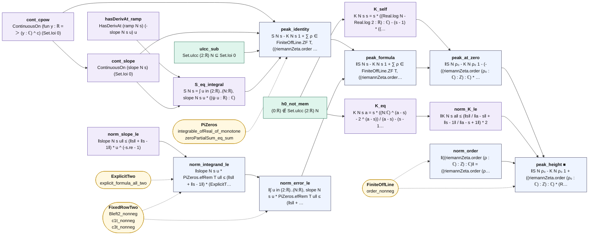

# `lean_stage3/Stage3/StepsPeak.lean`

> **Read from the source text.** This file changed after the last `python3 utilities/lean_map.py --dump`, so the arrows on this page are names occurring in each proof and have not been confirmed by Lean.

StepsPeak — block R5 of `lean_stage3/design/runs.md`. 2026-11-23. The first size of unit 0472: the turned steps up to a cutoff `N`, with the ramp `1 − n/N`, stand at height `m·log N` at a zero of order `m`.

17 theorems, 5 definitions, 635 lines. 

**Imports:** [`ExplicitTwo`](../lean_stage3/ExplicitTwo.md), [`FixedRowTwo`](../lean_stage3/FixedRowTwo.md), [`StepsPole`](../lean_stage3/StepsPole.md)  
**Imported by:** [`Stage3`](../lean_stage3/Stage3.md)

## The picture



An arrow A → B reads "A is used in the proof of B". Green: counting, integers only. Violet: shape, analysis with no ζ. Blue: reads ζ. A name ending in ■ is an end: nothing else uses it. Red: contains `sorry`. Yellow: theorems in another file, counted; a dotted arrow crosses files. Definitions are not drawn; they are listed below the diagram.

## Definitions

<a name="StepsPeak-ramp"></a>
### `StepsPeak.ramp`

def · line 44

The ramp `f(u) = u^(−s)·(1 − u/N)`.

- **Is:** `` ramp (N : ℕ) (s : ℂ) (u : ℝ) : ℂ := (u : ℂ) ^ (-s) * (1 - (u : ℂ) / (N : ℂ)) ``
- **Used by 3:** [`StepsPeak.S`](#StepsPeak-S), [`StepsPeak.S_eq_integral`](#StepsPeak-S_eq_integral), [`StepsPeak.hasDerivAt_ramp`](#StepsPeak-hasDerivAt_ramp)

<a name="StepsPeak-slope"></a>
### `StepsPeak.slope`

def · line 47

Minus its slope, `g(u) = s·u^(−s−1) − (s−1)·u^(−s)/N`.

- **Is:** `` slope (N : ℕ) (s : ℂ) (u : ℝ) : ℂ := s * (u : ℂ) ^ (-s - 1) - (s - 1) * (u : ℂ) ^ (-s) / (N : ℂ) ``
- **Used by 10:** [`StepsPeak.K`](#StepsPeak-K), [`StepsPeak.K_eq`](#StepsPeak-K_eq), [`StepsPeak.K_self`](#StepsPeak-K_self), [`StepsPeak.S_eq_integral`](#StepsPeak-S_eq_integral), [`StepsPeak.cont_slope`](#StepsPeak-cont_slope), [`StepsPeak.hasDerivAt_ramp`](#StepsPeak-hasDerivAt_ramp), [`StepsPeak.norm_error_le`](#StepsPeak-norm_error_le), [`StepsPeak.norm_integrand_le`](#StepsPeak-norm_integrand_le), [`StepsPeak.norm_slope_le`](#StepsPeak-norm_slope_le), [`StepsPeak.peak_identity`](#StepsPeak-peak_identity)

<a name="StepsPeak-S"></a>
### `StepsPeak.S`

def · line 52

The turned steps to the cutoff `N`, with the ramp: `S(N,s) = Σ_{n ≤ N} Λ(n)·n^(−s)·(1 − n/N)`.

- **Is:** `` S (N : ℕ) (s : ℂ) : ℂ := ∑ n ∈ Icc 0 N, ramp N s n * (ArithmeticFunction.vonMangoldt n : ℂ) ``
- **Built from:** [`StepsPeak.ramp`](#StepsPeak-ramp)
- **Used by 5:** [`StepsPeak.S_eq_integral`](#StepsPeak-S_eq_integral), [`StepsPeak.peak_at_zero`](#StepsPeak-peak_at_zero), [`StepsPeak.peak_formula`](#StepsPeak-peak_formula), [`StepsPeak.peak_height`](#StepsPeak-peak_height), [`StepsPeak.peak_identity`](#StepsPeak-peak_identity)

<a name="StepsPeak-K"></a>
### `StepsPeak.K`

def · line 56

The kernel of a power, `K(a) = ∫_2^N u^a·g(u) du`.

- **Is:** `` K (N : ℕ) (s a : ℂ) : ℂ := ∫ u in (2:ℝ)..(N:ℝ), (u : ℂ) ^ a * slope N s u ``
- **Built from:** [`StepsPeak.slope`](#StepsPeak-slope)
- **Used by 7:** [`StepsPeak.K_eq`](#StepsPeak-K_eq), [`StepsPeak.K_self`](#StepsPeak-K_self), [`StepsPeak.norm_K_le`](#StepsPeak-norm_K_le), [`StepsPeak.peak_at_zero`](#StepsPeak-peak_at_zero), [`StepsPeak.peak_formula`](#StepsPeak-peak_formula), [`StepsPeak.peak_height`](#StepsPeak-peak_height), [`StepsPeak.peak_identity`](#StepsPeak-peak_identity)

<a name="StepsPeak-C1"></a>
### `StepsPeak.C1`

def · line 188

The constant of the error, a function of `σ = Re s` alone: `C₁(σ) = (c3t·(2/σ) + Bleft2)·(2/σ)`.

- **Is:** `` C1 (σ : ℝ) : ℝ := (ExplicitTwo.c3t * (2 / σ) + ExplicitTwo.Bleft2) * (2 / σ) ``
- **Built from:** [`ExplicitTwo.Bleft2`](../lean_stage3/ExplicitTwo.md#ExplicitTwo-Bleft2), [`ExplicitTwo.c3t`](../lean_stage3/ExplicitTwo.md#ExplicitTwo-c3t)
- **Used by 4:** [`StepsPeak.norm_error_le`](#StepsPeak-norm_error_le), [`StepsPeak.peak_at_zero`](#StepsPeak-peak_at_zero), [`StepsPeak.peak_formula`](#StepsPeak-peak_formula), [`StepsPeak.peak_height`](#StepsPeak-peak_height)

## Theorems

<a name="StepsPeak-hasDerivAt_ramp"></a>
### `StepsPeak.hasDerivAt_ramp`

line 58 · arrows read from text

**Shape.** Uses real or complex analysis; nothing in it or beneath it reads ζ.

**Proves**

```lean
HasDerivAt (ramp N s) (-slope N s u) u
```

**Needs** (its hypotheses)

  - `` hs : s ≠ 0 ``
  - `` hu : 0 < u ``

**Fed by:** no theorem of this repo; it stands on Mathlib and the definitions below.

**Definitions its proof touches:** [`StepsPeak.ramp`](#StepsPeak-ramp), [`StepsPeak.slope`](#StepsPeak-slope)

**Feeds** (1 that use it)

  - [`StepsPeak.S_eq_integral`](#StepsPeak-S_eq_integral) — `` S N s = ∫ u in (2:ℝ)..(N:ℝ), slope N s u * ((ψ u : ℝ) : ℂ) ``

<a name="StepsPeak-cont_cpow"></a>
### `StepsPeak.cont_cpow`

line 76 · arrows read from text

**Shape.** Uses real or complex analysis; nothing in it or beneath it reads ζ.

**Why.** A power is continuous right of `0`.

**Proves**

```lean
ContinuousOn (fun y : ℝ => (y : ℂ) ^ c) (Set.Ioi 0)
```

**Needs** (its hypotheses)

  - `` c : ℂ ``

**Fed by:** no theorem of this repo; it stands on Mathlib.

**Feeds** (2 that use it)

  - [`StepsPeak.cont_slope`](#StepsPeak-cont_slope) — `` ContinuousOn (slope N s) (Set.Ioi 0) ``
  - [`StepsPeak.peak_identity`](#StepsPeak-peak_identity) — `` S N s - K N s 1 + ∑ ρ ∈ FiniteOffLine.ZF T, ((riemannZeta.order (ρ : ℂ) : ℤ) : ℂ) / (ρ : ℂ) * K N s (ρ : ℂ) = ∫ u in (2:ℝ)..(N:ℝ), slope N s u * PiZer… ``

<a name="StepsPeak-cont_slope"></a>
### `StepsPeak.cont_slope`

line 80 · arrows read from text

**Shape.** Uses real or complex analysis; nothing in it or beneath it reads ζ.

**Proves**

```lean
ContinuousOn (slope N s) (Set.Ioi 0)
```

**Needs** (its hypotheses)

  - `` N : ℕ ``
  - `` s : ℂ ``

**Fed by** (1 theorem its proof uses)

  - [`StepsPeak.cont_cpow`](#StepsPeak-cont_cpow) — `` ContinuousOn (fun y : ℝ => (y : ℂ) ^ c) (Set.Ioi 0) ``

**Definitions its proof touches:** [`StepsPeak.slope`](#StepsPeak-slope)

**Feeds** (2 that use it)

  - [`StepsPeak.S_eq_integral`](#StepsPeak-S_eq_integral) — `` S N s = ∫ u in (2:ℝ)..(N:ℝ), slope N s u * ((ψ u : ℝ) : ℂ) ``
  - [`StepsPeak.peak_identity`](#StepsPeak-peak_identity) — `` S N s - K N s 1 + ∑ ρ ∈ FiniteOffLine.ZF T, ((riemannZeta.order (ρ : ℂ) : ℤ) : ℂ) / (ρ : ℂ) * K N s (ρ : ℂ) = ∫ u in (2:ℝ)..(N:ℝ), slope N s u * PiZer… ``

<a name="StepsPeak-uIcc_sub"></a>
### `StepsPeak.uIcc_sub`

line 85 · arrows read from text

**Counting.** Integers only: nothing in its statement or proof, or in anything it rests on, uses analysis or ζ.

**Proves**

```lean
Set.uIcc (2:ℝ) N ⊆ Set.Ioi 0
```

**Needs** (its hypotheses)

  - `` hN : 2 ≤ N ``

**Fed by:** no theorem of this repo; it stands on Mathlib.

**Feeds** (1 that use it)

  - [`StepsPeak.peak_identity`](#StepsPeak-peak_identity) — `` S N s - K N s 1 + ∑ ρ ∈ FiniteOffLine.ZF T, ((riemannZeta.order (ρ : ℂ) : ℤ) : ℂ) / (ρ : ℂ) * K N s (ρ : ℂ) = ∫ u in (2:ℝ)..(N:ℝ), slope N s u * PiZer… ``

<a name="StepsPeak-S_eq_integral"></a>
### `StepsPeak.S_eq_integral`

line 92 · arrows read from text

**Shape.** Uses real or complex analysis; nothing in it or beneath it reads ζ.

**Why.** Partial summation. `f(N) = 0`, so `S(N,s) = ∫_2^N g·ψ`.

**Proves**

```lean
S N s = ∫ u in (2:ℝ)..(N:ℝ), slope N s u * ((ψ u : ℝ) : ℂ)
```

**Needs** (its hypotheses)

  - `` hN : 2 ≤ N ``
  - `` hs : 0 < s.re ``

**Fed by** (2 theorems its proof uses)

  - [`StepsPeak.cont_slope`](#StepsPeak-cont_slope) — `` ContinuousOn (slope N s) (Set.Ioi 0) ``
  - [`StepsPeak.hasDerivAt_ramp`](#StepsPeak-hasDerivAt_ramp) — `` HasDerivAt (ramp N s) (-slope N s u) u ``

**Definitions its proof touches:** [`StepsPeak.S`](#StepsPeak-S), [`StepsPeak.ramp`](#StepsPeak-ramp), [`StepsPeak.slope`](#StepsPeak-slope)

**Feeds** (1 that use it)

  - [`StepsPeak.peak_identity`](#StepsPeak-peak_identity) — `` S N s - K N s 1 + ∑ ρ ∈ FiniteOffLine.ZF T, ((riemannZeta.order (ρ : ℂ) : ℤ) : ℂ) / (ρ : ℂ) * K N s (ρ : ℂ) = ∫ u in (2:ℝ)..(N:ℝ), slope N s u * PiZer… ``

<a name="StepsPeak-peak_identity"></a>
### `StepsPeak.peak_identity`

line 127 · arrows read from text

**Reads ζ.** It, or something it rests on, uses the zeta function, its zeros or the Riemann hypothesis.

**Why.** The identity. With `E(u,T) = ψ(u) − u + Σ_{|γ|<T} m·u^ρ/ρ` the remainder of the explicit formula, `S(N,s) = K(1) − Σ_{|γ|<T} (m/ρ)·K(ρ) + ∫_2^N E·g`.

**Proves**

```lean
S N s - K N s 1 + ∑ ρ ∈ FiniteOffLine.ZF T, ((riemannZeta.order (ρ : ℂ) : ℤ) : ℂ) / (ρ : ℂ) * K N s (ρ : ℂ) = ∫ u in (2:ℝ)..(N:ℝ), slope N s u * PiZeros.efRem T u
```

**Needs** (its hypotheses)

  - `` hN : 2 ≤ N ``
  - `` hs : 0 < s.re ``
  - `` T : ℝ ``

**Fed by** (6 theorems its proof uses)

  - [`PiZeros.integrable_ofReal_of_monotone`](../lean_stage3/PiZeros.md#PiZeros-integrable_ofReal_of_monotone) (PiZeros) — `` IntervalIntegrable (fun t => ((f t : ℝ) : ℂ)) volume 2 x ``
  - [`PiZeros.zeroPartialSum_eq_sum`](../lean_stage3/PiZeros.md#PiZeros-zeroPartialSum_eq_sum) (PiZeros) — `` Stage3.zeroPartialSum t T = ∑ ρ ∈ ZF T, ((riemannZeta.order (ρ : ℂ) : ℤ) : ℂ) * ((t : ℂ) ^ (ρ : ℂ) / (ρ : ℂ)) ``
  - [`StepsPeak.S_eq_integral`](#StepsPeak-S_eq_integral) — `` S N s = ∫ u in (2:ℝ)..(N:ℝ), slope N s u * ((ψ u : ℝ) : ℂ) ``
  - [`StepsPeak.cont_cpow`](#StepsPeak-cont_cpow) — `` ContinuousOn (fun y : ℝ => (y : ℂ) ^ c) (Set.Ioi 0) ``
  - [`StepsPeak.cont_slope`](#StepsPeak-cont_slope) — `` ContinuousOn (slope N s) (Set.Ioi 0) ``
  - [`StepsPeak.uIcc_sub`](#StepsPeak-uIcc_sub) — `` Set.uIcc (2:ℝ) N ⊆ Set.Ioi 0 ``

**Definitions its proof touches:** [`FiniteOffLine.ZF`](../lean_stage3/FiniteOffLine.md#FiniteOffLine-ZF), [`PiZeros.efRem`](../lean_stage3/PiZeros.md#PiZeros-efRem), [`StepsPeak.K`](#StepsPeak-K), [`StepsPeak.S`](#StepsPeak-S), [`StepsPeak.slope`](#StepsPeak-slope)

**Feeds** (1 that use it)

  - [`StepsPeak.peak_formula`](#StepsPeak-peak_formula) — `` ‖S N s - K N s 1 + ∑ ρ ∈ FiniteOffLine.ZF T, ((riemannZeta.order (ρ : ℂ) : ℤ) : ℂ) / (ρ : ℂ) * K N s (ρ : ℂ)‖ ≤ (‖s‖ + ‖s - 1‖) * (ExplicitTwo.c1t * N… ``

<a name="StepsPeak-norm_slope_le"></a>
### `StepsPeak.norm_slope_le`

line 167 · arrows read from text

**Shape.** Uses real or complex analysis; nothing in it or beneath it reads ζ.

**Why.** The size of `g` on `[1, N]`: `‖g(u)‖ ≤ (‖s‖ + ‖s−1‖)·u^(−σ−1)`.

**Proves**

```lean
‖slope N s u‖ ≤ (‖s‖ + ‖s - 1‖) * u ^ (-s.re - 1)
```

**Needs** (its hypotheses)

  - `` hu : 1 ≤ u ``
  - `` huN : u ≤ N ``

**Fed by:** no theorem of this repo; it stands on Mathlib and the definitions below.

**Definitions its proof touches:** [`StepsPeak.slope`](#StepsPeak-slope)

**Feeds** (1 that use it)

  - [`StepsPeak.norm_integrand_le`](#StepsPeak-norm_integrand_le) — `` ‖slope N s u * PiZeros.efRem T u‖ ≤ (‖s‖ + ‖s - 1‖) * (ExplicitTwo.c1t * Real.log ((N:ℝ) * T) ^ 2 / T + (ExplicitTwo.c3t * (2 / s.re) + ExplicitTwo.Bl… ``

<a name="StepsPeak-norm_integrand_le"></a>
### `StepsPeak.norm_integrand_le`

line 191 · arrows read from text

**Reads ζ.** It, or something it rests on, uses the zeta function, its zeros or the Riemann hypothesis.

**Why.** The integrand of the error, pointwise on `[2, N]`.

**Proves**

```lean
‖slope N s u * PiZeros.efRem T u‖ ≤ (‖s‖ + ‖s - 1‖) * (ExplicitTwo.c1t * Real.log ((N:ℝ) * T) ^ 2 / T + (ExplicitTwo.c3t * (2 / s.re) + ExplicitTwo.Bleft2) * u ^ (-s.re / 2 - 1))
```

**Needs** (its hypotheses)

  - `` hs : 0 < s.re ``
  - `` hT : 2 ≤ T ``
  - `` hu : 2 ≤ u ``
  - `` huN : u ≤ N ``

**Fed by** (5 theorems its proof uses)

  - [`ExplicitTwo.explicit_formula_all_two`](../lean_stage3/ExplicitTwo.md#ExplicitTwo-explicit_formula_all_two) (ExplicitTwo) — `` ‖(Chebyshev.psi x : ℂ) - (x:ℂ) + Stage3.zeroPartialSum x T‖ ≤ c1t * x * Real.log (x*T)^2 / T + c3t * Real.log x + Bleft2 * x ^ (-(1:ℝ)/4) ``
  - [`FixedRowTwo.Bleft2_nonneg`](../lean_stage3/FixedRowTwo.md#FixedRowTwo-Bleft2_nonneg) (FixedRowTwo) — `` 0 ≤ ExplicitTwo.Bleft2 ``
  - [`FixedRowTwo.c1t_nonneg`](../lean_stage3/FixedRowTwo.md#FixedRowTwo-c1t_nonneg) (FixedRowTwo) — `` 0 ≤ ExplicitTwo.c1t ``
  - [`FixedRowTwo.c3t_nonneg`](../lean_stage3/FixedRowTwo.md#FixedRowTwo-c3t_nonneg) (FixedRowTwo) — `` 0 ≤ ExplicitTwo.c3t ``
  - [`StepsPeak.norm_slope_le`](#StepsPeak-norm_slope_le) — `` ‖slope N s u‖ ≤ (‖s‖ + ‖s - 1‖) * u ^ (-s.re - 1) ``

**Definitions its proof touches:** [`ExplicitTwo.Bleft2`](../lean_stage3/ExplicitTwo.md#ExplicitTwo-Bleft2), [`ExplicitTwo.c1t`](../lean_stage3/ExplicitTwo.md#ExplicitTwo-c1t), [`ExplicitTwo.c3t`](../lean_stage3/ExplicitTwo.md#ExplicitTwo-c3t), [`PiZeros.efRem`](../lean_stage3/PiZeros.md#PiZeros-efRem), [`StepsPeak.slope`](#StepsPeak-slope)

**Feeds** (1 that use it)

  - [`StepsPeak.norm_error_le`](#StepsPeak-norm_error_le) — `` ‖∫ u in (2:ℝ)..(N:ℝ), slope N s u * PiZeros.efRem T u‖ ≤ (‖s‖ + ‖s - 1‖) * (ExplicitTwo.c1t * N * Real.log ((N:ℝ) * T) ^ 2 / T + C1 s.re) ``

<a name="StepsPeak-norm_error_le"></a>
### `StepsPeak.norm_error_le`

line 277 · arrows read from text

**Reads ζ.** It, or something it rests on, uses the zeta function, its zeros or the Riemann hypothesis.

**Why.** The error. `‖∫_2^N E·g‖ ≤ (‖s‖+‖s−1‖)·(c1t·N·log²(NT)/T + C₁(σ))`.

**Proves**

```lean
‖∫ u in (2:ℝ)..(N:ℝ), slope N s u * PiZeros.efRem T u‖ ≤ (‖s‖ + ‖s - 1‖) * (ExplicitTwo.c1t * N * Real.log ((N:ℝ) * T) ^ 2 / T + C1 s.re)
```

**Needs** (its hypotheses)

  - `` hN : 2 ≤ N ``
  - `` hs : 0 < s.re ``
  - `` hT : 2 ≤ T ``

**Fed by** (4 theorems its proof uses)

  - [`FixedRowTwo.Bleft2_nonneg`](../lean_stage3/FixedRowTwo.md#FixedRowTwo-Bleft2_nonneg) (FixedRowTwo) — `` 0 ≤ ExplicitTwo.Bleft2 ``
  - [`FixedRowTwo.c1t_nonneg`](../lean_stage3/FixedRowTwo.md#FixedRowTwo-c1t_nonneg) (FixedRowTwo) — `` 0 ≤ ExplicitTwo.c1t ``
  - [`FixedRowTwo.c3t_nonneg`](../lean_stage3/FixedRowTwo.md#FixedRowTwo-c3t_nonneg) (FixedRowTwo) — `` 0 ≤ ExplicitTwo.c3t ``
  - [`StepsPeak.norm_integrand_le`](#StepsPeak-norm_integrand_le) — `` ‖slope N s u * PiZeros.efRem T u‖ ≤ (‖s‖ + ‖s - 1‖) * (ExplicitTwo.c1t * Real.log ((N:ℝ) * T) ^ 2 / T + (ExplicitTwo.c3t * (2 / s.re) + ExplicitTwo.Bl… ``

**Definitions its proof touches:** [`ExplicitTwo.Bleft2`](../lean_stage3/ExplicitTwo.md#ExplicitTwo-Bleft2), [`ExplicitTwo.c1t`](../lean_stage3/ExplicitTwo.md#ExplicitTwo-c1t), [`ExplicitTwo.c3t`](../lean_stage3/ExplicitTwo.md#ExplicitTwo-c3t), [`PiZeros.efRem`](../lean_stage3/PiZeros.md#PiZeros-efRem), [`StepsPeak.C1`](#StepsPeak-C1), [`StepsPeak.slope`](#StepsPeak-slope)

**Feeds** (1 that use it)

  - [`StepsPeak.peak_formula`](#StepsPeak-peak_formula) — `` ‖S N s - K N s 1 + ∑ ρ ∈ FiniteOffLine.ZF T, ((riemannZeta.order (ρ : ℂ) : ℤ) : ℂ) / (ρ : ℂ) * K N s (ρ : ℂ)‖ ≤ (‖s‖ + ‖s - 1‖) * (ExplicitTwo.c1t * N… ``

<a name="StepsPeak-peak_formula"></a>
### `StepsPeak.peak_formula`

line 338 · arrows read from text

**Reads ζ.** It, or something it rests on, uses the zeta function, its zeros or the Riemann hypothesis.

**Why.** The height of the peak, as a formula. For `Re s > 0`, `N ≥ 2`, `T ≥ 2`: `‖S(N,s) − K(1) + Σ_{|γ|<T} (m/ρ)·K(ρ)‖ ≤ (‖s‖+‖s−1‖)·(c1t·N·log²(NT)/T + C₁(Re s))`.

**Proves**

```lean
‖S N s - K N s 1 + ∑ ρ ∈ FiniteOffLine.ZF T, ((riemannZeta.order (ρ : ℂ) : ℤ) : ℂ) / (ρ : ℂ) * K N s (ρ : ℂ)‖ ≤ (‖s‖ + ‖s - 1‖) * (ExplicitTwo.c1t * N * Real.log ((N:ℝ) * T) ^ 2 / T + C1 s.re)
```

**Needs** (its hypotheses)

  - `` hN : 2 ≤ N ``
  - `` hs : 0 < s.re ``
  - `` hT : 2 ≤ T ``

**Fed by** (2 theorems its proof uses)

  - [`StepsPeak.norm_error_le`](#StepsPeak-norm_error_le) — `` ‖∫ u in (2:ℝ)..(N:ℝ), slope N s u * PiZeros.efRem T u‖ ≤ (‖s‖ + ‖s - 1‖) * (ExplicitTwo.c1t * N * Real.log ((N:ℝ) * T) ^ 2 / T + C1 s.re) ``
  - [`StepsPeak.peak_identity`](#StepsPeak-peak_identity) — `` S N s - K N s 1 + ∑ ρ ∈ FiniteOffLine.ZF T, ((riemannZeta.order (ρ : ℂ) : ℤ) : ℂ) / (ρ : ℂ) * K N s (ρ : ℂ) = ∫ u in (2:ℝ)..(N:ℝ), slope N s u * PiZer… ``

**Definitions its proof touches:** [`ExplicitTwo.c1t`](../lean_stage3/ExplicitTwo.md#ExplicitTwo-c1t), [`FiniteOffLine.ZF`](../lean_stage3/FiniteOffLine.md#FiniteOffLine-ZF), [`StepsPeak.C1`](#StepsPeak-C1), [`StepsPeak.K`](#StepsPeak-K), [`StepsPeak.S`](#StepsPeak-S)

**Feeds** (1 that use it)

  - [`StepsPeak.peak_at_zero`](#StepsPeak-peak_at_zero) — `` ‖S N ρ₀ - K N ρ₀ 1 - (-((riemannZeta.order (ρ₀ : ℂ) : ℤ) : ℂ) * (Real.log N : ℂ) + ((riemannZeta.order (ρ₀ : ℂ) : ℤ) : ℂ) * (Real.log 2 : ℂ) + ((riema… ``

<a name="StepsPeak-h0_not_mem"></a>
### `StepsPeak.h0_not_mem`

line 350 · arrows read from text

**Counting.** Integers only: nothing in its statement or proof, or in anything it rests on, uses analysis or ζ.

**Proves**

```lean
(0:ℝ) ∉ Set.uIcc (2:ℝ) N
```

**Needs** (its hypotheses)

  - `` hN : 2 ≤ N ``

**Fed by:** no theorem of this repo; it stands on Mathlib.

**Feeds** (2 that use it)

  - [`StepsPeak.K_eq`](#StepsPeak-K_eq) — `` K N s a = s * ((N:ℂ) ^ (a - s) - 2 ^ (a - s)) / (a - s) - (s - 1) * ((N:ℂ) ^ (a - s + 1) - 2 ^ (a - s + 1)) / ((a - s + 1) * N) ``
  - [`StepsPeak.K_self`](#StepsPeak-K_self) — `` K N s s = s * ((Real.log N - Real.log 2 : ℝ) : ℂ) - (s - 1) * ((N:ℂ) - 2) / N ``

<a name="StepsPeak-K_eq"></a>
### `StepsPeak.K_eq`

line 357 · arrows read from text

**Shape.** Uses real or complex analysis; nothing in it or beneath it reads ζ.

**Why.** The kernel in closed form, for `a ≠ s` and `a ≠ s − 1`.

**Proves**

```lean
K N s a = s * ((N:ℂ) ^ (a - s) - 2 ^ (a - s)) / (a - s) - (s - 1) * ((N:ℂ) ^ (a - s + 1) - 2 ^ (a - s + 1)) / ((a - s + 1) * N)
```

**Needs** (its hypotheses)

  - `` hN : 2 ≤ N ``
  - `` h1 : a ≠ s ``
  - `` h2 : a ≠ s - 1 ``

**Fed by** (1 theorem its proof uses)

  - [`StepsPeak.h0_not_mem`](#StepsPeak-h0_not_mem) — `` (0:ℝ) ∉ Set.uIcc (2:ℝ) N ``

**Definitions its proof touches:** [`StepsPeak.K`](#StepsPeak-K), [`StepsPeak.slope`](#StepsPeak-slope)

**Feeds** (1 that use it)

  - [`StepsPeak.norm_K_le`](#StepsPeak-norm_K_le) — `` ‖K N s a‖ ≤ (‖s‖ / ‖a - s‖ + ‖s - 1‖ / ‖a - s + 1‖) * 2 ``

<a name="StepsPeak-K_self"></a>
### `StepsPeak.K_self`

line 395 · arrows read from text

**Shape.** Uses real or complex analysis; nothing in it or beneath it reads ζ.

**Why.** The kernel at `a = s`: `K(s) = s·(log N − log 2) − (s−1)·(N−2)/N`.

**Proves**

```lean
K N s s = s * ((Real.log N - Real.log 2 : ℝ) : ℂ) - (s - 1) * ((N:ℂ) - 2) / N
```

**Needs** (its hypotheses)

  - `` hN : 2 ≤ N ``
  - `` s : ℂ ``

**Fed by** (1 theorem its proof uses)

  - [`StepsPeak.h0_not_mem`](#StepsPeak-h0_not_mem) — `` (0:ℝ) ∉ Set.uIcc (2:ℝ) N ``

**Definitions its proof touches:** [`StepsPeak.K`](#StepsPeak-K), [`StepsPeak.slope`](#StepsPeak-slope)

**Feeds** (1 that use it)

  - [`StepsPeak.peak_at_zero`](#StepsPeak-peak_at_zero) — `` ‖S N ρ₀ - K N ρ₀ 1 - (-((riemannZeta.order (ρ₀ : ℂ) : ℤ) : ℂ) * (Real.log N : ℂ) + ((riemannZeta.order (ρ₀ : ℂ) : ℤ) : ℂ) * (Real.log 2 : ℂ) + ((riema… ``

<a name="StepsPeak-peak_at_zero"></a>
### `StepsPeak.peak_at_zero`

line 440 · arrows read from text

**Reads ζ.** It, or something it rests on, uses the zeta function, its zeros or the Riemann hypothesis.

**Why.** The peak at a zero. At `s = ρ₀`, a nontrivial zero of order `m₀` below the height `T`, its own term is `−m₀·log N + m₀·log 2 + m₀·(ρ₀−1)·(N−2)/(ρ₀·N)` and the sum runs over the other zeros below `T`.

**Proves**

```lean
‖S N ρ₀ - K N ρ₀ 1 - (-((riemannZeta.order (ρ₀ : ℂ) : ℤ) : ℂ) * (Real.log N : ℂ) + ((riemannZeta.order (ρ₀ : ℂ) : ℤ) : ℂ) * (Real.log 2 : ℂ) + ((riemannZeta.order (ρ₀ : ℂ) : ℤ) : ℂ) * ((ρ₀ : ℂ) - 1) * ((N : ℂ) - 2) / ((ρ₀ : ℂ) * N)) + ∑ ρ ∈ (FiniteOffLine.ZF T).erase ρ₀, ((riemannZeta.order (ρ : ℂ) : ℤ) : ℂ) / (ρ : ℂ) * K N ρ₀ (ρ : ℂ)‖ ≤ (‖(ρ₀ : ℂ)‖ + ‖(ρ₀ : ℂ) - 1‖) * (ExplicitTwo.c1t * N * Real.log ((N:ℝ) * T) ^ 2 / T + C1 (ρ₀ : ℂ).re)
```

**Needs** (its hypotheses)

  - `` hN : 2 ≤ N ``
  - `` ρ₀ : NontrivialZeros ``
  - `` hT : 2 ≤ T ``
  - `` hρ₀ : |(ρ₀ : ℂ).im| < T ``

**Fed by** (2 theorems its proof uses)

  - [`StepsPeak.K_self`](#StepsPeak-K_self) — `` K N s s = s * ((Real.log N - Real.log 2 : ℝ) : ℂ) - (s - 1) * ((N:ℂ) - 2) / N ``
  - [`StepsPeak.peak_formula`](#StepsPeak-peak_formula) — `` ‖S N s - K N s 1 + ∑ ρ ∈ FiniteOffLine.ZF T, ((riemannZeta.order (ρ : ℂ) : ℤ) : ℂ) / (ρ : ℂ) * K N s (ρ : ℂ)‖ ≤ (‖s‖ + ‖s - 1‖) * (ExplicitTwo.c1t * N… ``

**Definitions its proof touches:** [`ExplicitTwo.c1t`](../lean_stage3/ExplicitTwo.md#ExplicitTwo-c1t), [`FiniteOffLine.ZF`](../lean_stage3/FiniteOffLine.md#FiniteOffLine-ZF), [`StepsPeak.C1`](#StepsPeak-C1), [`StepsPeak.K`](#StepsPeak-K), [`StepsPeak.S`](#StepsPeak-S)

**Feeds** (1 that use it)

  - [`StepsPeak.peak_height`](#StepsPeak-peak_height) — `` ‖S N ρ₀ - K N ρ₀ 1 + ((riemannZeta.order (ρ₀ : ℂ) : ℤ) : ℂ) * (Real.log N : ℂ)‖ ≤ ((riemannZeta.order (ρ₀ : ℂ) : ℤ) : ℝ) * Real.log 2 + ((riemannZeta.… ``

<a name="StepsPeak-norm_K_le"></a>
### `StepsPeak.norm_K_le`

line 483 · arrows read from text

**Shape.** Uses real or complex analysis; nothing in it or beneath it reads ζ.

**Why.** Another zero's kernel, free of `N`. For `a ≠ s`, `a ≠ s − 1` and `Re a ≤ Re s`: `‖K(a)‖ ≤ (‖s‖/‖a−s‖ + ‖s−1‖/‖a−s+1‖)·2`.

**Proves**

```lean
‖K N s a‖ ≤ (‖s‖ / ‖a - s‖ + ‖s - 1‖ / ‖a - s + 1‖) * 2
```

**Needs** (its hypotheses)

  - `` hN : 2 ≤ N ``
  - `` h1 : a ≠ s ``
  - `` h2 : a ≠ s - 1 ``
  - `` hre : a.re ≤ s.re ``

**Fed by** (1 theorem its proof uses)

  - [`StepsPeak.K_eq`](#StepsPeak-K_eq) — `` K N s a = s * ((N:ℂ) ^ (a - s) - 2 ^ (a - s)) / (a - s) - (s - 1) * ((N:ℂ) ^ (a - s + 1) - 2 ^ (a - s + 1)) / ((a - s + 1) * N) ``

**Definitions its proof touches:** [`StepsPeak.K`](#StepsPeak-K)

**Feeds** (1 that use it)

  - [`StepsPeak.peak_height`](#StepsPeak-peak_height) — `` ‖S N ρ₀ - K N ρ₀ 1 + ((riemannZeta.order (ρ₀ : ℂ) : ℤ) : ℂ) * (Real.log N : ℂ)‖ ≤ ((riemannZeta.order (ρ₀ : ℂ) : ℤ) : ℝ) * Real.log 2 + ((riemannZeta.… ``

<a name="StepsPeak-norm_order"></a>
### `StepsPeak.norm_order`

line 532 · arrows read from text

**Reads ζ.** It, or something it rests on, uses the zeta function, its zeros or the Riemann hypothesis.

**Why.** The norm of a zero's order, read in `ℂ`.

**Proves**

```lean
‖((riemannZeta.order (ρ : ℂ) : ℤ) : ℂ)‖ = ((riemannZeta.order (ρ : ℂ) : ℤ) : ℝ)
```

**Needs** (its hypotheses)

  - `` ρ : NontrivialZeros ``

**Fed by** (1 theorem its proof uses)

  - [`FiniteOffLine.order_nonneg`](../lean_stage3/FiniteOffLine.md#FiniteOffLine-order_nonneg) (FiniteOffLine) — `` (0 : ℝ) ≤ ((riemannZeta.order (ρ : ℂ) : ℤ) : ℝ) ``

**Feeds** (1 that use it)

  - [`StepsPeak.peak_height`](#StepsPeak-peak_height) — `` ‖S N ρ₀ - K N ρ₀ 1 + ((riemannZeta.order (ρ₀ : ℂ) : ℤ) : ℂ) * (Real.log N : ℂ)‖ ≤ ((riemannZeta.order (ρ₀ : ℂ) : ℤ) : ℝ) * Real.log 2 + ((riemannZeta.… ``

<a name="StepsPeak-peak_height"></a>
### `StepsPeak.peak_height`

line 540 · arrows read from text

**Reads ζ.** It, or something it rests on, uses the zeta function, its zeros or the Riemann hypothesis.

**Why.** The height of the peak. If no zero below `T` lies right of `ρ₀`, then `S(N,ρ₀) − K(1)` stands at `−m₀·log N`, up to `m₀·log 2 + m₀·‖ρ₀−1‖/‖ρ₀‖`, a sum over the other zeros below `T` free of `N`, and the error of `peak_formula`.

**Proves**

```lean
‖S N ρ₀ - K N ρ₀ 1 + ((riemannZeta.order (ρ₀ : ℂ) : ℤ) : ℂ) * (Real.log N : ℂ)‖ ≤ ((riemannZeta.order (ρ₀ : ℂ) : ℤ) : ℝ) * Real.log 2 + ((riemannZeta.order (ρ₀ : ℂ) : ℤ) : ℝ) * ‖(ρ₀ : ℂ) - 1‖ / ‖(ρ₀ : ℂ)‖ + ∑ ρ ∈ (FiniteOffLine.ZF T).erase ρ₀, ((riemannZeta.order (ρ : ℂ) : ℤ) : ℝ) / ‖(ρ : ℂ)‖ * ((‖(ρ₀ : ℂ)‖ / ‖(ρ : ℂ) - ρ₀‖ + ‖(ρ₀ : ℂ) - 1‖ / ‖(ρ : ℂ) - ρ₀ + 1‖) * 2) + (‖(ρ₀ : ℂ)‖ + ‖(ρ₀ : ℂ) - 1‖) * (ExplicitTwo.c1t * N * Real.log ((N:ℝ) * T) ^ 2 / T + C1 (ρ₀ : ℂ).re)
```

**Needs** (its hypotheses)

  - `` hN : 2 ≤ N ``
  - `` ρ₀ : NontrivialZeros ``
  - `` hT : 2 ≤ T ``
  - `` hρ₀ : |(ρ₀ : ℂ).im| < T ``
  - `` hright : ∀ ρ ∈ FiniteOffLine.ZF T, (ρ : ℂ).re ≤ (ρ₀ : ℂ).re ``

**Fed by** (4 theorems its proof uses)

  - [`FiniteOffLine.order_nonneg`](../lean_stage3/FiniteOffLine.md#FiniteOffLine-order_nonneg) (FiniteOffLine) — `` (0 : ℝ) ≤ ((riemannZeta.order (ρ : ℂ) : ℤ) : ℝ) ``
  - [`StepsPeak.norm_K_le`](#StepsPeak-norm_K_le) — `` ‖K N s a‖ ≤ (‖s‖ / ‖a - s‖ + ‖s - 1‖ / ‖a - s + 1‖) * 2 ``
  - [`StepsPeak.norm_order`](#StepsPeak-norm_order) — `` ‖((riemannZeta.order (ρ : ℂ) : ℤ) : ℂ)‖ = ((riemannZeta.order (ρ : ℂ) : ℤ) : ℝ) ``
  - [`StepsPeak.peak_at_zero`](#StepsPeak-peak_at_zero) — `` ‖S N ρ₀ - K N ρ₀ 1 - (-((riemannZeta.order (ρ₀ : ℂ) : ℤ) : ℂ) * (Real.log N : ℂ) + ((riemannZeta.order (ρ₀ : ℂ) : ℤ) : ℂ) * (Real.log 2 : ℂ) + ((riema… ``

**Definitions its proof touches:** [`ExplicitTwo.c1t`](../lean_stage3/ExplicitTwo.md#ExplicitTwo-c1t), [`FiniteOffLine.ZF`](../lean_stage3/FiniteOffLine.md#FiniteOffLine-ZF), [`StepsPeak.C1`](#StepsPeak-C1), [`StepsPeak.K`](#StepsPeak-K), [`StepsPeak.S`](#StepsPeak-S)

**Feeds:** nothing. It is an end.

