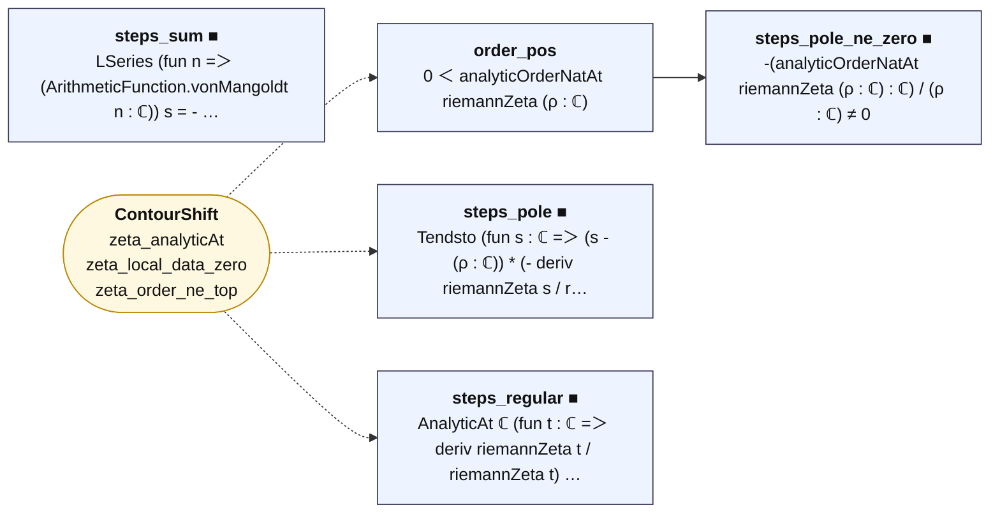

# `lean_stage3/Stage3/StepsPole.lean`

> **Read from the source text.** This file changed after the last `python3 utilities/lean_map.py --dump`, so the arrows on this page are names occurring in each proof and have not been confirmed by Lean.

StepsPole — block R4 of `lean_stage3/design/runs.md`. 2026-11-23. Unit 0472 turned the steps of the staircase and saw them line up at the heights of the zeros. The exact core: the sum of the turned steps is the logarithmic derivative of zeta, and it has a pole at every nontrivial zero, whose weight is the zero's order over the zero, the same weight the zero carries in the table's residual.

5 theorems, 0 definitions, 111 lines. 

**Imports:** [`ContourShift`](../lean_stage3/ContourShift.md), [`SieveResidual`](../lean_stage3/SieveResidual.md)  
**Imported by:** [`Stage3`](../lean_stage3/Stage3.md)

## The picture



An arrow A → B reads "A is used in the proof of B". Green: counting, integers only. Violet: shape, analysis with no ζ. Blue: reads ζ. A name ending in ■ is an end: nothing else uses it. Red: contains `sorry`. Yellow: theorems in another file, counted; a dotted arrow crosses files. Definitions are not drawn; they are listed below the diagram.

## Theorems

<a name="StepsPole-steps_sum"></a>
### `StepsPole.steps_sum`

line 30 · arrows read from text

**Reads ζ.** It, or something it rests on, uses the zeta function, its zeros or the Riemann hypothesis.

**Why.** The turned steps. Right of the line `Re s = 1` the sum over the integers of the step `Λ(n)` turned and weighed by `n^(−s)` is minus the logarithmic derivative of zeta.

**Proves**

```lean
LSeries (fun n => (ArithmeticFunction.vonMangoldt n : ℂ)) s = - deriv riemannZeta s / riemannZeta s
```

**Needs** (its hypotheses)

  - `` hs : 1 < s.re ``

**Fed by:** no theorem of this repo; it stands on Mathlib.

**Feeds:** nothing. It connects to nothing.

<a name="StepsPole-order_pos"></a>
### `StepsPole.order_pos`

line 36 · arrows read from text

**Reads ζ.** It, or something it rests on, uses the zeta function, its zeros or the Riemann hypothesis.

**Why.** A nontrivial zero has order at least one.

**Proves**

```lean
0 < analyticOrderNatAt riemannZeta (ρ : ℂ)
```

**Needs** (its hypotheses)

  - `` ρ : NontrivialZeros ``

**Fed by** (2 theorems its proof uses)

  - [`ContourShift.zeta_analyticAt`](../lean_stage3/ContourShift.md#ContourShift-zeta_analyticAt) (ContourShift) — `` AnalyticAt ℂ riemannZeta ρ ``
  - [`ContourShift.zeta_order_ne_top`](../lean_stage3/ContourShift.md#ContourShift-zeta_order_ne_top) (ContourShift) — `` analyticOrderAt riemannZeta ρ ≠ ⊤ ``

**Feeds** (1 that use it)

  - [`StepsPole.steps_pole_ne_zero`](#StepsPole-steps_pole_ne_zero) — `` -(analyticOrderNatAt riemannZeta (ρ : ℂ) : ℂ) / (ρ : ℂ) ≠ 0 ``

<a name="StepsPole-steps_pole"></a>
### `StepsPole.steps_pole`

line 52 · arrows read from text

**Reads ζ.** It, or something it rests on, uses the zeta function, its zeros or the Riemann hypothesis.

**Why.** The pole at a zero. At a nontrivial zero `ρ` of order `m`, the turned steps' sum over `s`, times the distance `s − ρ`, tends to `−m/ρ`.

**Proves**

```lean
Tendsto (fun s : ℂ => (s - (ρ : ℂ)) * (- deriv riemannZeta s / riemannZeta s / s)) (𝓝[≠] (ρ : ℂ)) (𝓝 (-(analyticOrderNatAt riemannZeta (ρ : ℂ) : ℂ) / (ρ : ℂ)))
```

**Needs** (its hypotheses)

  - `` ρ : NontrivialZeros ``

**Fed by** (1 theorem its proof uses)

  - [`ContourShift.zeta_local_data_zero`](../lean_stage3/ContourShift.md#ContourShift-zeta_local_data_zero) (ContourShift) — `` ∃ h : ℂ → ℂ, AnalyticAt ℂ h ρ ∧ ∀ᶠ s in nhdsWithin ρ {ρ}ᶜ, - deriv riemannZeta s / riemannZeta s * ((x:ℝ):ℂ) ^ s / s = h s + (-(analyticOrderNatAt rie… ``

**Feeds:** nothing. It is an end.

<a name="StepsPole-steps_pole_ne_zero"></a>
### `StepsPole.steps_pole_ne_zero`

line 81 · arrows read from text

**Reads ζ.** It, or something it rests on, uses the zeta function, its zeros or the Riemann hypothesis.

**Why.** The pole is there: its weight is not zero.

**Proves**

```lean
-(analyticOrderNatAt riemannZeta (ρ : ℂ) : ℂ) / (ρ : ℂ) ≠ 0
```

**Needs** (its hypotheses)

  - `` ρ : NontrivialZeros ``

**Fed by** (1 theorem its proof uses)

  - [`StepsPole.order_pos`](#StepsPole-order_pos) — `` 0 < analyticOrderNatAt riemannZeta (ρ : ℂ) ``

**Feeds:** nothing. It is an end.

<a name="StepsPole-steps_regular"></a>
### `StepsPole.steps_regular`

line 94 · arrows read from text

**Reads ζ.** It, or something it rests on, uses the zeta function, its zeros or the Riemann hypothesis.

**Why.** No pole away from the zeros. Where zeta does not vanish, and away from `1`, the logarithmic derivative of zeta is analytic.

**Proves**

```lean
AnalyticAt ℂ (fun t : ℂ => deriv riemannZeta t / riemannZeta t) s
```

**Needs** (its hypotheses)

  - `` hs1 : s ≠ 1 ``
  - `` hz : riemannZeta s ≠ 0 ``

**Fed by** (1 theorem its proof uses)

  - [`ContourShift.zeta_analyticAt`](../lean_stage3/ContourShift.md#ContourShift-zeta_analyticAt) (ContourShift) — `` AnalyticAt ℂ riemannZeta ρ ``

**Feeds:** nothing. It is an end.

