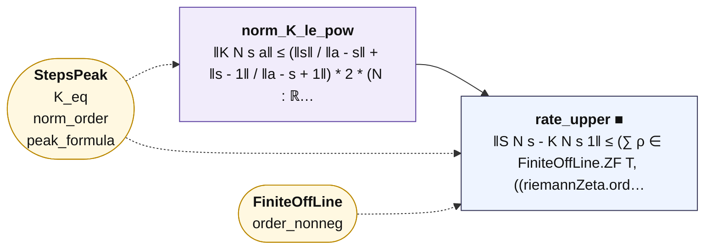

# `lean_stage3/Stage3/StepsRate.lean`

> **Read from the source text.** This file changed after the last `python3 utilities/lean_map.py --dump`, so the arrows on this page are names occurring in each proof and have not been confirmed by Lean.

StepsRate — block R8 of `lean_stage3/design/runs.md`. 2026-11-23. The second size of unit 0472: the size rate. Away from the zeros the turned steps to a cutoff `N`, less their smooth term, grow no faster than `N` to the power of the largest real part of a zero below the height less the real part of the point.

2 theorems, 0 definitions, 141 lines. 

**Imports:** [`StepsPeak`](../lean_stage3/StepsPeak.md)  
**Imported by:** [`Stage3`](../lean_stage3/Stage3.md), [`BandJoin`](../lean_stage3/BandJoin.md), [`CompositeSplit`](../lean_stage3/CompositeSplit.md), [`RateBelow`](../lean_stage3/RateBelow.md)

## The picture



An arrow A → B reads "A is used in the proof of B". Green: counting, integers only. Violet: shape, analysis with no ζ. Blue: reads ζ. A name ending in ■ is an end: nothing else uses it. Red: contains `sorry`. Yellow: theorems in another file, counted; a dotted arrow crosses files. Definitions are not drawn; they are listed below the diagram.

## Theorems

<a name="StepsRate-norm_K_le_pow"></a>
### `StepsRate.norm_K_le_pow`

line 24 · arrows read from text

**Shape.** Uses real or complex analysis; nothing in it or beneath it reads ζ.

**Why.** A zero's kernel grows at most as the cutoff to the gap of the real parts.

**Proves**

```lean
‖K N s a‖ ≤ (‖s‖ / ‖a - s‖ + ‖s - 1‖ / ‖a - s + 1‖) * 2 * (N : ℝ) ^ δ
```

**Needs** (its hypotheses)

  - `` hN : 2 ≤ N ``
  - `` h1 : a ≠ s ``
  - `` h2 : a ≠ s - 1 ``
  - `` hδ : 0 ≤ δ ``
  - `` hre : a.re - s.re ≤ δ ``

**Fed by** (1 theorem its proof uses)

  - [`StepsPeak.K_eq`](../lean_stage3/StepsPeak.md#StepsPeak-K_eq) (StepsPeak) — `` K N s a = s * ((N:ℂ) ^ (a - s) - 2 ^ (a - s)) / (a - s) - (s - 1) * ((N:ℂ) ^ (a - s + 1) - 2 ^ (a - s + 1)) / ((a - s + 1) * N) ``

**Definitions its proof touches:** [`StepsPeak.K`](../lean_stage3/StepsPeak.md#StepsPeak-K)

**Feeds** (1 that use it)

  - [`StepsRate.rate_upper`](#StepsRate-rate_upper) — `` ‖S N s - K N s 1‖ ≤ (∑ ρ ∈ FiniteOffLine.ZF T, ((riemannZeta.order (ρ : ℂ) : ℤ) : ℝ) / ‖(ρ : ℂ)‖ * ((‖s‖ / ‖(ρ : ℂ) - s‖ + ‖s - 1‖ / ‖(ρ : ℂ) - s + 1‖… ``

<a name="StepsRate-rate_upper"></a>
### `StepsRate.rate_upper`

line 85 · arrows read from text

**Reads ζ.** It, or something it rests on, uses the zeta function, its zeros or the Riemann hypothesis.

**Why.** The size rate, from above. At a point `s` with `0 < Re s ≤ 1` that is not a zero, if every zero below the height `T` has real part at most `Θ` and `Re s ≤ Θ`, the turned steps to the cutoff `N` less their smooth term are at most a sum over the zeros below `T`, free of `N`, times `N^(Θ − Re s)`, plus the error of `peak_formula`.

**Proves**

```lean
‖S N s - K N s 1‖ ≤ (∑ ρ ∈ FiniteOffLine.ZF T, ((riemannZeta.order (ρ : ℂ) : ℤ) : ℝ) / ‖(ρ : ℂ)‖ * ((‖s‖ / ‖(ρ : ℂ) - s‖ + ‖s - 1‖ / ‖(ρ : ℂ) - s + 1‖) * 2)) * (N : ℝ) ^ (Θ - s.re) + (‖s‖ + ‖s - 1‖) * (ExplicitTwo.c1t * N * Real.log ((N:ℝ) * T) ^ 2 / T + C1 s.re)
```

**Needs** (its hypotheses)

  - `` hN : 2 ≤ N ``
  - `` hs : 0 < s.re ``
  - `` hs1 : s.re ≤ 1 ``
  - `` hT : 2 ≤ T ``
  - `` hsΘ : s.re ≤ Θ ``
  - `` hΘ : ∀ ρ ∈ FiniteOffLine.ZF T, (ρ : ℂ).re ≤ Θ ``
  - `` hne : ∀ ρ ∈ FiniteOffLine.ZF T, (ρ : ℂ) ≠ s ``

**Fed by** (4 theorems its proof uses)

  - [`FiniteOffLine.order_nonneg`](../lean_stage3/FiniteOffLine.md#FiniteOffLine-order_nonneg) (FiniteOffLine) — `` (0 : ℝ) ≤ ((riemannZeta.order (ρ : ℂ) : ℤ) : ℝ) ``
  - [`StepsPeak.norm_order`](../lean_stage3/StepsPeak.md#StepsPeak-norm_order) (StepsPeak) — `` ‖((riemannZeta.order (ρ : ℂ) : ℤ) : ℂ)‖ = ((riemannZeta.order (ρ : ℂ) : ℤ) : ℝ) ``
  - [`StepsPeak.peak_formula`](../lean_stage3/StepsPeak.md#StepsPeak-peak_formula) (StepsPeak) — `` ‖S N s - K N s 1 + ∑ ρ ∈ FiniteOffLine.ZF T, ((riemannZeta.order (ρ : ℂ) : ℤ) : ℂ) / (ρ : ℂ) * K N s (ρ : ℂ)‖ ≤ (‖s‖ + ‖s - 1‖) * (ExplicitTwo.c1t * N… ``
  - [`StepsRate.norm_K_le_pow`](#StepsRate-norm_K_le_pow) — `` ‖K N s a‖ ≤ (‖s‖ / ‖a - s‖ + ‖s - 1‖ / ‖a - s + 1‖) * 2 * (N : ℝ) ^ δ ``

**Definitions its proof touches:** [`ExplicitTwo.c1t`](../lean_stage3/ExplicitTwo.md#ExplicitTwo-c1t), [`FiniteOffLine.ZF`](../lean_stage3/FiniteOffLine.md#FiniteOffLine-ZF), [`StepsPeak.C1`](../lean_stage3/StepsPeak.md#StepsPeak-C1), [`StepsPeak.K`](../lean_stage3/StepsPeak.md#StepsPeak-K), [`StepsPeak.S`](../lean_stage3/StepsPeak.md#StepsPeak-S)

**Feeds:** nothing. It is an end.

