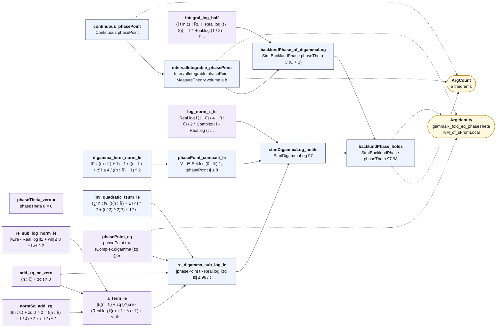

# `lean_stage3/Stage3/Stirling.lean`

Stirling — the phase construction: θ as the digamma integral. Entry 132 made the continuous phase part of the Stirling half's discharge. This module constructs it. The classical θ(T) is `Im log Γ(1/4 + iT/2) − (T/2)·log π` along the continuous branch, and the continuous branch IS the integral of the derivative:

17 theorems, 4 definitions, 1011 lines. Arrows are Lean's own record of what each proof uses.

**Imports:** [`RvMCrude`](../lean_stage3/RvMCrude.md)  
**Imported by:** [`Stage3`](../lean_stage3/Stage3.md), [`ArgIdentity`](../lean_stage3/ArgIdentity.md)

## The picture



An arrow A → B reads "A is used in the proof of B". Green: counting, integers only. Violet: shape, analysis with no ζ. Blue: reads ζ. A name ending in ■ is an end: nothing else uses it. Red: contains `sorry`. Yellow: theorems in another file, counted; a dotted arrow crosses files. Definitions are not drawn; they are listed below the diagram.

## Definitions

<a name="Stage3-phasePoint"></a>
### `Stage3.phasePoint`

def · line 50

The phase integrand: `Re ψ(1/4 + it/2)`, the derivative of the continuous `Im log Γ` along the quarter-line.

- **Is:** `` phasePoint (t : ℝ) : ℝ := (Complex.digamma ((1 : ℂ) / 4 + (t : ℂ) / 2 * Complex.I)).re ``
- **Used by 14:** [`ArgCount.argS_le_gt_two`](../lean_stage3/ArgCount.md#ArgCount-argS_le_gt_two), [`ArgCount.phasePoint_bound_near`](../lean_stage3/ArgCount.md#ArgCount-phasePoint_bound_near), [`ArgCount.phaseTheta_sub_le`](../lean_stage3/ArgCount.md#ArgCount-phaseTheta_sub_le), [`Stage3.gammaR_fold_eq_phaseTheta`](../lean_stage3/ArgIdentity.md#Stage3-gammaR_fold_eq_phaseTheta), [`Stage3.StmtDigammaLog`](#Stage3-StmtDigammaLog), [`Stage3.backlundPhase_of_digammaLog`](#Stage3-backlundPhase_of_digammaLog), [`Stage3.continuous_phasePoint`](#Stage3-continuous_phasePoint), [`Stage3.intervalIntegrable_phasePoint`](#Stage3-intervalIntegrable_phasePoint), [`Stage3.phasePoint_compact_le`](#Stage3-phasePoint_compact_le), [`Stage3.phasePoint_eq`](#Stage3-phasePoint_eq), [`Stage3.phaseTheta`](#Stage3-phaseTheta), [`Stage3.phaseTheta_zero`](#Stage3-phaseTheta_zero), [`Stage3.re_digamma_sub_log_le`](#Stage3-re_digamma_sub_log_le), [`Stage3.stmtDigammaLog_holds`](#Stage3-stmtDigammaLog_holds)

<a name="Stage3-phaseTheta"></a>
### `Stage3.phaseTheta`

def · line 55

The continuous phase, by construction: the integral of the derivative, anchored at `θ(0) = 0 = arg Γ(1/4)`.

- **Is:** `` phaseTheta (T : ℝ) : ℝ := (1 / 2) * (∫ t in (0 : ℝ)..T, phasePoint t) - T / 2 * Real.log Real.pi ``
- **Built from:** [`Stage3.phasePoint`](#Stage3-phasePoint)
- **Used by 14:** [`ArgCount.argS_le_gt_two`](../lean_stage3/ArgCount.md#ArgCount-argS_le_gt_two), [`ArgCount.argS_two_le`](../lean_stage3/ArgCount.md#ArgCount-argS_two_le), [`ArgCount.phaseTheta_sub_le`](../lean_stage3/ArgCount.md#ArgCount-phaseTheta_sub_le), [`ArgCount.rvM_crude`](../lean_stage3/ArgCount.md#ArgCount-rvM_crude), [`ArgCount.rvM_crude_of_good_two`](../lean_stage3/ArgCount.md#ArgCount-rvM_crude_of_good_two), [`Stage3.argS`](../lean_stage3/ArgIdentity.md#Stage3-argS), [`Stage3.argS_eq_zetaArgContour`](../lean_stage3/ArgIdentity.md#Stage3-argS_eq_zetaArgContour), [`Stage3.backlundArg_of_sFromLocal`](../lean_stage3/ArgIdentity.md#Stage3-backlundArg_of_sFromLocal), [`Stage3.gammaR_fold_eq_phaseTheta`](../lean_stage3/ArgIdentity.md#Stage3-gammaR_fold_eq_phaseTheta), [`Stage3.rvM_of_sFromLocal`](../lean_stage3/ArgIdentity.md#Stage3-rvM_of_sFromLocal), [`Stage3.stmtArgIdentity_holds`](../lean_stage3/ArgIdentity.md#Stage3-stmtArgIdentity_holds), [`Stage3.backlundPhase_holds`](#Stage3-backlundPhase_holds), [`Stage3.backlundPhase_of_digammaLog`](#Stage3-backlundPhase_of_digammaLog), [`Stage3.phaseTheta_zero`](#Stage3-phaseTheta_zero)

<a name="Stage3-StmtDigammaLog"></a>
### `Stage3.StmtDigammaLog`

def · line 137

The last analytic fact of the Stirling half: the digamma comparison. Component one: `|Re ψ(1/4 + it/2) − log(t/2)| ≤ C/t` for `t ≥ 1` — the textbook `ψ(z) = log z + O(1/|z|)` on the quarter-line. Component two: `|Re ψ| ≤ C` on `[0, 1]` — boundedness on the compact piece. Both classical; the discharge route is the dependency's sorry-free `digamma_eq_tsum` series.

- **Is:** `` StmtDigammaLog (C : ℝ) : Prop := (∀ t : ℝ, 1 ≤ t → |phasePoint t - Real.log (t / 2)| ≤ C / t) ∧ ∀ t ∈ Set.Icc (0 : ℝ) 1, |phasePoint t| ≤ C ``
- **Built from:** [`Stage3.phasePoint`](#Stage3-phasePoint)
- **Used by 2:** [`Stage3.backlundPhase_of_digammaLog`](#Stage3-backlundPhase_of_digammaLog), [`Stage3.stmtDigammaLog_holds`](#Stage3-stmtDigammaLog_holds)

<a name="Stage3-zq"></a>
### `Stage3.zq`

def · line 614

The quarter-line point, named: `zq t = 1/4 + it/2`.

- **Is:** `` zq (t : ℝ) : ℂ := (1 : ℂ) / 4 + (t : ℂ) / 2 * Complex.I ``
- **Used by 7:** [`Stage3.gammaR_fold_eq_phaseTheta`](../lean_stage3/ArgIdentity.md#Stage3-gammaR_fold_eq_phaseTheta), [`Stage3.a_term_le`](#Stage3-a_term_le), [`Stage3.add_zq_ne_zero`](#Stage3-add_zq_ne_zero), [`Stage3.normSq_add_zq`](#Stage3-normSq_add_zq), [`Stage3.phasePoint_eq`](#Stage3-phasePoint_eq), [`Stage3.re_digamma_sub_log_le`](#Stage3-re_digamma_sub_log_le), [`Stage3.stmtDigammaLog_holds`](#Stage3-stmtDigammaLog_holds)

## Theorems

<a name="Stage3-continuous_phasePoint"></a>
### `Stage3.continuous_phasePoint`

line 60

**Reads ζ.** It, or something it rests on, uses the zeta function, its zeros or the Riemann hypothesis.

**Why.** The integrand is continuous: the quarter-line stays in `re > 0`, where the dependency's digamma continuity holds sorry-free.

**Proves**

```lean
Continuous phasePoint
```

**Stated with:** [`Stage3.phasePoint`](#Stage3-phasePoint)

**Fed by:** no theorem of this repo; it stands on Mathlib and the definitions below.

**Feeds** (2 that use it)

  - [`ArgCount.phasePoint_bound_near`](../lean_stage3/ArgCount.md#ArgCount-phasePoint_bound_near) (ArgCount) — `` ∃ M : ℝ, 0 ≤ M ∧ ∀ t ∈ Set.Icc (T₀ - 1) T₀, |Stage3.phasePoint t| ≤ M ``
  - [`Stage3.intervalIntegrable_phasePoint`](#Stage3-intervalIntegrable_phasePoint) — `` IntervalIntegrable phasePoint MeasureTheory.volume a b ``

<a name="Stage3-intervalIntegrable_phasePoint"></a>
### `Stage3.intervalIntegrable_phasePoint`

line 78

**Reads ζ.** It, or something it rests on, uses the zeta function, its zeros or the Riemann hypothesis.

**Why.** Hence integrable on every interval.

**Proves**

```lean
IntervalIntegrable phasePoint MeasureTheory.volume a b
```

**Needs** (its hypotheses)

  - `` a b : ℝ ``

**Stated with:** [`Stage3.phasePoint`](#Stage3-phasePoint)

**Fed by** (1 theorem its proof uses)

  - [`Stage3.continuous_phasePoint`](#Stage3-continuous_phasePoint) — `` Continuous phasePoint ``

**Feeds** (3 that use it)

  - [`ArgCount.phaseTheta_sub_le`](../lean_stage3/ArgCount.md#ArgCount-phaseTheta_sub_le) (ArgCount) — `` |Stage3.phaseTheta T₀ - Stage3.phaseTheta T| ≤ (T₀ - T) * (M / 2 + Real.log Real.pi / 2) ``
  - [`Stage3.gammaR_fold_eq_phaseTheta`](../lean_stage3/ArgIdentity.md#Stage3-gammaR_fold_eq_phaseTheta) (ArgIdentity) — `` (∫ t in (0:ℝ)..T, logDeriv Gammaℝ (2 + (t : ℂ) * Complex.I)).re - (∫ x in (1/2:ℝ)..2, logDeriv Gammaℝ ((x : ℂ) + T * Complex.I)).im = phaseTheta T ``
  - [`Stage3.backlundPhase_of_digammaLog`](#Stage3-backlundPhase_of_digammaLog) — `` StmtBacklundPhase phaseTheta C (C + 1) ``

<a name="Stage3-phaseTheta_zero"></a>
### `Stage3.phaseTheta_zero`

line 83

**Shape.** Uses real or complex analysis; nothing in it or beneath it reads ζ.

**Why.** The anchor: `θ(0) = 0`.

**Proves**

```lean
phaseTheta 0 = 0
```

**Stated with:** [`Stage3.phaseTheta`](#Stage3-phaseTheta)

**Fed by:** no theorem of this repo; it stands on Mathlib and the definitions below.

**Definitions its proof touches:** [`Stage3.phasePoint`](#Stage3-phasePoint)

**Feeds:** nothing. It is an end.

<a name="Stage3-integral_log_half"></a>
### `Stage3.integral_log_half`

line 91

**Shape.** Uses real or complex analysis; nothing in it or beneath it reads ζ.

**Why.** The main-term integral, by FTC (avoiding `t = 0` entirely): `∫₁ᵀ log(t/2) dt = T·log(T/2) − T + 1 + log 2`. The antiderivative is `t·log(t/2) − t`.

**Proves**

```lean
(∫ t in (1 : ℝ)..T, Real.log (t / 2)) = T * Real.log (T / 2) - T + 1 + Real.log 2
```

**Needs** (its hypotheses)

  - `` hT : 1 ≤ T ``

**Fed by:** no theorem of this repo; it stands on Mathlib.

**Feeds** (1 that use it)

  - [`Stage3.backlundPhase_of_digammaLog`](#Stage3-backlundPhase_of_digammaLog) — `` StmtBacklundPhase phaseTheta C (C + 1) ``

<a name="Stage3-backlundPhase_of_digammaLog"></a>
### `Stage3.backlundPhase_of_digammaLog`

line 148

**Reads ζ.** It, or something it rests on, uses the zeta function, its zeros or the Riemann hypothesis.

**Why.** The Stirling half, reduced to the digamma comparison: `StmtDigammaLog C` gives `StmtBacklundPhase phaseTheta C (C + 1)`. The proof splits the phase integral at `1`, bounds the compact piece by `C`, integrates the `C/t` band to `C·log T`, evaluates the main term by `integral_log_half`, and watches the `T`-terms cancel exactly against the RvM main term — the `7/8` mismatch and the integration constants land inside `C + 1`.

**Proves**

```lean
StmtBacklundPhase phaseTheta C (C + 1)
```

**Needs** (its hypotheses)

  - `` hC : 0 ≤ C ``
  - `` h : StmtDigammaLog C ``

**Stated with:** [`Stage3.StmtBacklundPhase`](../lean_stage3/RvMCrude.md#Stage3-StmtBacklundPhase), [`Stage3.StmtDigammaLog`](#Stage3-StmtDigammaLog), [`Stage3.phaseTheta`](#Stage3-phaseTheta)

**Fed by** (2 theorems its proof uses)

  - [`Stage3.integral_log_half`](#Stage3-integral_log_half) — `` (∫ t in (1 : ℝ)..T, Real.log (t / 2)) = T * Real.log (T / 2) - T + 1 + Real.log 2 ``
  - [`Stage3.intervalIntegrable_phasePoint`](#Stage3-intervalIntegrable_phasePoint) — `` IntervalIntegrable phasePoint MeasureTheory.volume a b ``

**Definitions its proof touches:** [`Stage3.phasePoint`](#Stage3-phasePoint)

**Feeds** (1 that use it)

  - [`Stage3.backlundPhase_holds`](#Stage3-backlundPhase_holds) — `` StmtBacklundPhase phaseTheta 97 98 ``

<a name="Stage3-digamma_term_norm_le"></a>
### `Stage3.digamma_term_norm_le`

line 287

**Reads ζ.** It, or something it rests on, uses the zeta function, its zeros or the Riemann hypothesis.

**Why.** Per-term bound for the digamma series on the quarter-line segment: `‖1/(n+1) − 1/(n+z)‖ ≤ 4/(n+1)²` whenever `re z = 1/4` and `‖z−1‖ ≤ 1`.

**Proves**

```lean
‖1 / ((n : ℂ) + 1) - 1 / ((n : ℂ) + z)‖ ≤ 4 / ((n : ℝ) + 1) ^ 2
```

**Needs** (its hypotheses)

  - `` hre : z.re = 1 / 4 ``
  - `` hz1 : ‖z - 1‖ ≤ 1 ``
  - `` n : ℕ ``

**Fed by:** no theorem of this repo; it stands on Mathlib.

**Feeds** (1 that use it)

  - [`Stage3.phasePoint_compact_le`](#Stage3-phasePoint_compact_le) — `` ∀ t ∈ Set.Icc (0 : ℝ) 1, |phasePoint t| ≤ 8 ``

<a name="Stage3-phasePoint_compact_le"></a>
### `Stage3.phasePoint_compact_le`

line 327

**Reads ζ.** It, or something it rests on, uses the zeta function, its zeros or the Riemann hypothesis.

**Why.** Component two of `StmtDigammaLog`, discharged with an explicit constant: `|Re ψ(1/4 + it/2)| ≤ 8` on `[0, 1]`. From the sorry-free series: `|ψ| ≤ γ + Σ 4/(n+1)² = γ + 4·π²/6 < 8`.

**Proves**

```lean
∀ t ∈ Set.Icc (0 : ℝ) 1, |phasePoint t| ≤ 8
```

**Stated with:** [`Stage3.phasePoint`](#Stage3-phasePoint)

**Fed by** (1 theorem its proof uses)

  - [`Stage3.digamma_term_norm_le`](#Stage3-digamma_term_norm_le) — `` ‖1 / ((n : ℂ) + 1) - 1 / ((n : ℂ) + z)‖ ≤ 4 / ((n : ℝ) + 1) ^ 2 ``

**Feeds** (1 that use it)

  - [`Stage3.stmtDigammaLog_holds`](#Stage3-stmtDigammaLog_holds) — `` StmtDigammaLog 97 ``

<a name="Stage3-log_norm_z_le"></a>
### `Stage3.log_norm_z_le`

line 411

**Shape.** Uses real or complex analysis; nothing in it or beneath it reads ζ.

**Why.** The norm-vs-`t/2` log ratio on the quarter-line: `|log‖z_t‖ − log(t/2)| ≤ 1/(4t)` for `t ≥ 1` — from `log(1 + 1/(4t²)) ≤ 1/(4t²)`.

**Proves**

```lean
|Real.log ‖(1 : ℂ) / 4 + (t : ℂ) / 2 * Complex.I‖ - Real.log (t / 2)| ≤ 1 / (4 * t)
```

**Needs** (its hypotheses)

  - `` ht : 1 ≤ t ``

**Fed by:** no theorem of this repo; it stands on Mathlib.

**Feeds** (1 that use it)

  - [`Stage3.stmtDigammaLog_holds`](#Stage3-stmtDigammaLog_holds) — `` StmtDigammaLog 97 ``

<a name="Stage3-inv_quadratic_tsum_le"></a>
### `Stage3.inv_quadratic_tsum_le`

line 457

**Reads ζ.** It, or something it rests on, uses the zeta function, its zeros or the Riemann hypothesis.

**Why.** The quadratic tail sum on the quarter-line: `Σ' 1/((n+1/4)² + (t/2)²) ≤ 12/t` for `t ≥ 1`. Head (`n < ⌊t⌋+1`) by the `(t/2)²` floor, tail by the dependency's sorry-free `tsum_one_div_natCast_add_add_one_sq_le`.

**Proves**

```lean
(∑' n : ℕ, (((n : ℝ) + 1 / 4) ^ 2 + (t / 2) ^ 2)⁻¹) ≤ 12 / t
```

**Needs** (its hypotheses)

  - `` ht : 1 ≤ t ``

**Fed by:** no theorem of this repo; it stands on Mathlib.

**Feeds** (1 that use it)

  - [`Stage3.re_digamma_sub_log_le`](#Stage3-re_digamma_sub_log_le) — `` |phasePoint t - Real.log ‖zq t‖| ≤ 96 / t ``

<a name="Stage3-re_sub_log_norm_le"></a>
### `Stage3.re_sub_log_norm_le`

line 558

**Shape.** Uses real or complex analysis; nothing in it or beneath it reads ζ.

**Why.** The per-term log-Taylor bound — the telescope's engine: for `w` in the open right half-plane with `‖w‖ ≤ 2`, `|Re w − log‖1 + w‖| ≤ 8‖w‖²`. Both sides come from `log y ≤ y − 1` alone (applied at `1+u` and at `(1+u)⁻¹`). The `≤ 2` radius admits the `n = 0` term of the telescope at every `t ≥ 1`.

**Proves**

```lean
|w.re - Real.log ‖1 + w‖| ≤ 8 * ‖w‖ ^ 2
```

**Needs** (its hypotheses)

  - `` hw : 0 < w.re ``
  - `` hw1 : ‖w‖ ≤ 2 ``

**Fed by:** no theorem of this repo; it stands on Mathlib.

**Feeds** (1 that use it)

  - [`Stage3.a_term_le`](#Stage3-a_term_le) — `` |(((n : ℂ) + zq t)⁻¹).re - (Real.log ‖((n + 1 : ℕ) : ℂ) + zq t‖ - Real.log ‖(n : ℂ) + zq t‖)| ≤ 8 * ((((n : ℝ) + 1 / 4) ^ 2 + (t / 2) ^ 2)⁻¹) ``

<a name="Stage3-phasePoint_eq"></a>
### `Stage3.phasePoint_eq`

line 618

**Shape.** Uses real or complex analysis; nothing in it or beneath it reads ζ.

**Why.** The phase integrand at `t` is the real part of the digamma function at the quarter-line point `zq t`.

**Proves**

```lean
phasePoint t = (Complex.digamma (zq t)).re
```

**Needs** (its hypotheses)

  - `` t : ℝ ``

**Stated with:** [`Stage3.phasePoint`](#Stage3-phasePoint), [`Stage3.zq`](#Stage3-zq)

**Fed by:** no theorem of this repo; it stands on Mathlib and the definitions below.

**Feeds** (2 that use it)

  - [`Stage3.gammaR_fold_eq_phaseTheta`](../lean_stage3/ArgIdentity.md#Stage3-gammaR_fold_eq_phaseTheta) (ArgIdentity) — `` (∫ t in (0:ℝ)..T, logDeriv Gammaℝ (2 + (t : ℂ) * Complex.I)).re - (∫ x in (1/2:ℝ)..2, logDeriv Gammaℝ ((x : ℂ) + T * Complex.I)).im = phaseTheta T ``
  - [`Stage3.re_digamma_sub_log_le`](#Stage3-re_digamma_sub_log_le) — `` |phasePoint t - Real.log ‖zq t‖| ≤ 96 / t ``

<a name="Stage3-normSq_add_zq"></a>
### `Stage3.normSq_add_zq`

line 623

**Shape.** Uses real or complex analysis; nothing in it or beneath it reads ζ.

**Why.** Norm-square along the shifted quarter-line: `‖n + zq t‖² = (n + 1/4)² + (t/2)²`.

**Proves**

```lean
‖(n : ℂ) + zq t‖ ^ 2 = ((n : ℝ) + 1 / 4) ^ 2 + (t / 2) ^ 2
```

**Needs** (its hypotheses)

  - `` t : ℝ ``
  - `` n : ℕ ``

**Stated with:** [`Stage3.zq`](#Stage3-zq)

**Fed by:** no theorem of this repo; it stands on Mathlib and the definitions below.

**Feeds** (1 that use it)

  - [`Stage3.a_term_le`](#Stage3-a_term_le) — `` |(((n : ℂ) + zq t)⁻¹).re - (Real.log ‖((n + 1 : ℕ) : ℂ) + zq t‖ - Real.log ‖(n : ℂ) + zq t‖)| ≤ 8 * ((((n : ℝ) + 1 / 4) ^ 2 + (t / 2) ^ 2)⁻¹) ``

<a name="Stage3-add_zq_ne_zero"></a>
### `Stage3.add_zq_ne_zero`

line 632

**Shape.** Uses real or complex analysis; nothing in it or beneath it reads ζ.

**Why.** The shifted point is never zero (its real part is `n + 1/4`).

**Proves**

```lean
(n : ℂ) + zq t ≠ 0
```

**Needs** (its hypotheses)

  - `` t : ℝ ``
  - `` n : ℕ ``

**Stated with:** [`Stage3.zq`](#Stage3-zq)

**Fed by:** no theorem of this repo; it stands on Mathlib and the definitions below.

**Feeds** (2 that use it)

  - [`Stage3.a_term_le`](#Stage3-a_term_le) — `` |(((n : ℂ) + zq t)⁻¹).re - (Real.log ‖((n + 1 : ℕ) : ℂ) + zq t‖ - Real.log ‖(n : ℂ) + zq t‖)| ≤ 8 * ((((n : ℝ) + 1 / 4) ^ 2 + (t / 2) ^ 2)⁻¹) ``
  - [`Stage3.re_digamma_sub_log_le`](#Stage3-re_digamma_sub_log_le) — `` |phasePoint t - Real.log ‖zq t‖| ≤ 96 / t ``

<a name="Stage3-a_term_le"></a>
### `Stage3.a_term_le`

line 642

**Shape.** Uses real or complex analysis; nothing in it or beneath it reads ζ.

**Why.** The per-term telescope bound: each digamma-series step tracks the log-norm step to within `8/((n+1/4)² + (t/2)²)` on `t ≥ 1`.

**Proves**

```lean
|(((n : ℂ) + zq t)⁻¹).re - (Real.log ‖((n + 1 : ℕ) : ℂ) + zq t‖ - Real.log ‖(n : ℂ) + zq t‖)| ≤ 8 * ((((n : ℝ) + 1 / 4) ^ 2 + (t / 2) ^ 2)⁻¹)
```

**Needs** (its hypotheses)

  - `` ht : 1 ≤ t ``
  - `` n : ℕ ``

**Stated with:** [`Stage3.zq`](#Stage3-zq)

**Fed by** (3 theorems its proof uses)

  - [`Stage3.add_zq_ne_zero`](#Stage3-add_zq_ne_zero) — `` (n : ℂ) + zq t ≠ 0 ``
  - [`Stage3.normSq_add_zq`](#Stage3-normSq_add_zq) — `` ‖(n : ℂ) + zq t‖ ^ 2 = ((n : ℝ) + 1 / 4) ^ 2 + (t / 2) ^ 2 ``
  - [`Stage3.re_sub_log_norm_le`](#Stage3-re_sub_log_norm_le) — `` |w.re - Real.log ‖1 + w‖| ≤ 8 * ‖w‖ ^ 2 ``

**Feeds** (1 that use it)

  - [`Stage3.re_digamma_sub_log_le`](#Stage3-re_digamma_sub_log_le) — `` |phasePoint t - Real.log ‖zq t‖| ≤ 96 / t ``

<a name="Stage3-re_digamma_sub_log_le"></a>
### `Stage3.re_digamma_sub_log_le`

line 699

**Reads ζ.** It, or something it rests on, uses the zeta function, its zeros or the Riemann hypothesis.

**Why.** The harmonic-γ limit assembly — component 1 of the digamma comparison: `|Re ψ(zq t) − log‖zq t‖| ≤ 96/t` for `t ≥ 1`. The digamma series telescopes against log-norm steps; the partial sums of the telescope converge to `log‖z‖ − Re ψ(z)` through Mathlib's `tendsto_eulerMascheroniSeq`, and every partial sum is bounded by `8 · Σ' 1/((n+1/4)² + (t/2)²) ≤ 96/t`.

**Proves**

```lean
|phasePoint t - Real.log ‖zq t‖| ≤ 96 / t
```

**Needs** (its hypotheses)

  - `` ht : 1 ≤ t ``

**Stated with:** [`Stage3.phasePoint`](#Stage3-phasePoint), [`Stage3.zq`](#Stage3-zq)

**Fed by** (4 theorems its proof uses)

  - [`Stage3.a_term_le`](#Stage3-a_term_le) — `` |(((n : ℂ) + zq t)⁻¹).re - (Real.log ‖((n + 1 : ℕ) : ℂ) + zq t‖ - Real.log ‖(n : ℂ) + zq t‖)| ≤ 8 * ((((n : ℝ) + 1 / 4) ^ 2 + (t / 2) ^ 2)⁻¹) ``
  - [`Stage3.add_zq_ne_zero`](#Stage3-add_zq_ne_zero) — `` (n : ℂ) + zq t ≠ 0 ``
  - [`Stage3.inv_quadratic_tsum_le`](#Stage3-inv_quadratic_tsum_le) — `` (∑' n : ℕ, (((n : ℝ) + 1 / 4) ^ 2 + (t / 2) ^ 2)⁻¹) ≤ 12 / t ``
  - [`Stage3.phasePoint_eq`](#Stage3-phasePoint_eq) — `` phasePoint t = (Complex.digamma (zq t)).re ``

**Feeds** (1 that use it)

  - [`Stage3.stmtDigammaLog_holds`](#Stage3-stmtDigammaLog_holds) — `` StmtDigammaLog 97 ``

<a name="Stage3-stmtDigammaLog_holds"></a>
### `Stage3.stmtDigammaLog_holds`

line 901

**Reads ζ.** It, or something it rests on, uses the zeta function, its zeros or the Riemann hypothesis.

**Why.** THE DIGAMMA COMPARISON, DISCHARGED: `StmtDigammaLog 97` holds. Component 1 composes the limit assembly (`96/t`) with the log ratio (`1/(4t) ≤ t/(4t) = 1/4·(1/t)`); component 2 is the compact bound `8 ≤ 97`. A named leaf falls.

**Proves**

```lean
StmtDigammaLog 97
```

**Stated with:** [`Stage3.StmtDigammaLog`](#Stage3-StmtDigammaLog)

**Fed by** (3 theorems its proof uses)

  - [`Stage3.log_norm_z_le`](#Stage3-log_norm_z_le) — `` |Real.log ‖(1 : ℂ) / 4 + (t : ℂ) / 2 * Complex.I‖ - Real.log (t / 2)| ≤ 1 / (4 * t) ``
  - [`Stage3.phasePoint_compact_le`](#Stage3-phasePoint_compact_le) — `` ∀ t ∈ Set.Icc (0 : ℝ) 1, |phasePoint t| ≤ 8 ``
  - [`Stage3.re_digamma_sub_log_le`](#Stage3-re_digamma_sub_log_le) — `` |phasePoint t - Real.log ‖zq t‖| ≤ 96 / t ``

**Definitions its proof touches:** [`Stage3.phasePoint`](#Stage3-phasePoint), [`Stage3.zq`](#Stage3-zq)

**Feeds** (1 that use it)

  - [`Stage3.backlundPhase_holds`](#Stage3-backlundPhase_holds) — `` StmtBacklundPhase phaseTheta 97 98 ``

<a name="Stage3-backlundPhase_holds"></a>
### `Stage3.backlundPhase_holds`

line 925

**Reads ζ.** It, or something it rests on, uses the zeta function, its zeros or the Riemann hypothesis.

**Why.** THE STIRLING HALF OF BACKLUND, DISCHARGED: `StmtBacklundPhase phaseTheta 97 98` — the continuous phase tracks the Riemann–von Mangoldt main term with explicit crude constants, proved end to end from the digamma series. The hNT leaf ledger shrinks to `StmtArgCrude` alone.

**Proves**

```lean
StmtBacklundPhase phaseTheta 97 98
```

**Stated with:** [`Stage3.StmtBacklundPhase`](../lean_stage3/RvMCrude.md#Stage3-StmtBacklundPhase), [`Stage3.phaseTheta`](#Stage3-phaseTheta)

**Fed by** (2 theorems its proof uses)

  - [`Stage3.backlundPhase_of_digammaLog`](#Stage3-backlundPhase_of_digammaLog) — `` StmtBacklundPhase phaseTheta C (C + 1) ``
  - [`Stage3.stmtDigammaLog_holds`](#Stage3-stmtDigammaLog_holds) — `` StmtDigammaLog 97 ``

**Feeds** (4 that use it)

  - [`ArgCount.argS_two_le`](../lean_stage3/ArgCount.md#ArgCount-argS_two_le) (ArgCount) — `` |Stage3.argS 2| ≤ 15 * Real.log 2 + 600 ``
  - [`ArgCount.rvM_crude`](../lean_stage3/ArgCount.md#ArgCount-rvM_crude) (ArgCount) — `` riemannZeta.Riemann_vonMangoldt_bound 112 0 698 ``
  - [`ArgCount.rvM_crude_of_good_two`](../lean_stage3/ArgCount.md#ArgCount-rvM_crude_of_good_two) (ArgCount) — `` riemannZeta.Riemann_vonMangoldt_bound 112 0 173 ``
  - [`Stage3.rvM_of_sFromLocal`](../lean_stage3/ArgIdentity.md#Stage3-rvM_of_sFromLocal) (ArgIdentity) — `` riemannZeta.Riemann_vonMangoldt_bound (97 + a * 15) 0 (98 + (a * 73 + b)) ``

