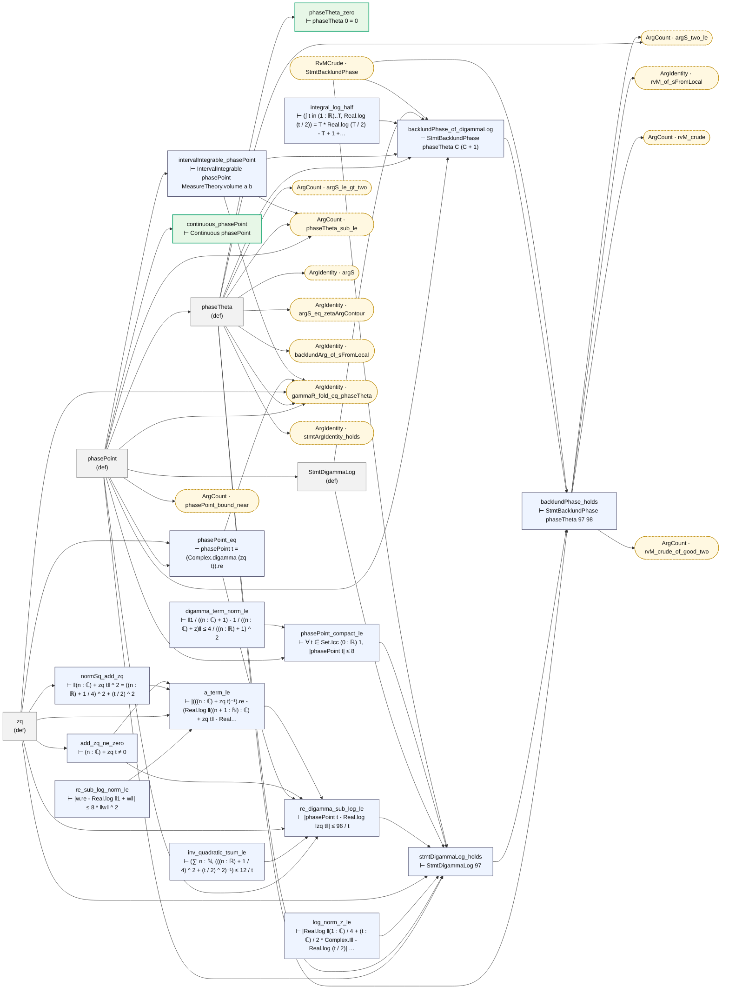

# `lean_stage3/Stage3/Stirling.lean`

**What it does** (its own header): Stirling — the phase construction: θ as the digamma integral. Entry 132 made the continuous phase part of the Stirling half's discharge. This module constructs it. The classical θ(T) is `Im log Γ(1/4 + iT/2) − (T/2)·log π` along the continuous branch, and the continuous branch IS the integral of the derivative:

**Imports:** [`RvMCrude`](../lean_stage3/RvMCrude.md).
**Imported by:** [`Stage3`](../lean_stage3/Stage3.md), [`ArgIdentity`](../lean_stage3/ArgIdentity.md).

Blue: theorem. Green: a theorem nothing else uses (an end). Dashed white: connects to nothing. Grey: definition. Red: contains `sorry`. Yellow: in another file. An arrow A → B reads "A is used by B".

## Every declaration

| declaration | proves (output) | needs (input) | why (its own docstring) | uses | used by |
|---|---|---|---|---|---|
| `Stage3.phasePoint` def, line 50 | ℝ | t : ℝ | The phase integrand: `Re ψ(1/4 + it/2)`, the derivative of the continuous `Im log Γ` along the quarter-line. | — | `ArgCount.phasePoint_bound_near`, `ArgCount.phaseTheta_sub_le`, `Stage3.gammaR_fold_eq_phaseTheta`, `Stage3.StmtDigammaLog`, `Stage3.backlundPhase_of_digammaLog`, `Stage3.continuous_phasePoint`, `Stage3.intervalIntegrable_phasePoint`, `Stage3.phasePoint_compact_le`, `Stage3.phasePoint_eq`, `Stage3.phaseTheta`, `Stage3.re_digamma_sub_log_le`, `Stage3.stmtDigammaLog_holds` |
| `Stage3.phaseTheta` def, line 55 | ℝ | T : ℝ | The continuous phase, by construction: the integral of the derivative, anchored at `θ(0) = 0 = arg Γ(1/4)`. | `Stage3.phasePoint` | `ArgCount.argS_le_gt_two`, `ArgCount.argS_two_le`, `ArgCount.phaseTheta_sub_le`, `Stage3.argS`, `Stage3.argS_eq_zetaArgContour`, `Stage3.backlundArg_of_sFromLocal`, `Stage3.gammaR_fold_eq_phaseTheta`, `Stage3.stmtArgIdentity_holds`, `Stage3.backlundPhase_holds`, `Stage3.backlundPhase_of_digammaLog`, `Stage3.phaseTheta_zero`, `Stage3.stmtDigammaLog_holds` |
| `Stage3.continuous_phasePoint` theorem, line 60 | Continuous phasePoint | — | The integrand is continuous: the quarter-line stays in `re &gt; 0`, where the dependency's digamma continuity holds sorry-free. | `Stage3.phasePoint` | — |
| `Stage3.intervalIntegrable_phasePoint` theorem, line 78 | IntervalIntegrable phasePoint MeasureTheory.volume a b | a b : ℝ | Hence integrable on every interval. | `Stage3.phasePoint` | `ArgCount.phaseTheta_sub_le`, `Stage3.gammaR_fold_eq_phaseTheta`, `Stage3.backlundPhase_of_digammaLog` |
| `Stage3.phaseTheta_zero` theorem, line 83 | phaseTheta 0 = 0 | — | The anchor: `θ(0) = 0`. | `Stage3.phaseTheta` | — |
| `Stage3.integral_log_half` theorem, line 91 | (∫ t in (1 : ℝ)..T, Real.log (t / 2)) = T * Real.log (T / 2) - T + 1 + Real.log 2 | hT : 1 ≤ T | The main-term integral, by FTC (avoiding `t = 0` entirely): `∫₁ᵀ log(t/2) dt = T·log(T/2) − T + 1 + log 2`. The antiderivative is `t·log(t/2) − t`. | — | `Stage3.backlundPhase_of_digammaLog` |
| `Stage3.StmtDigammaLog` def, line 137 | Prop | C : ℝ | The last analytic fact of the Stirling half: the digamma comparison. Component one: `\|Re ψ(1/4 + it/2) − log(t/2)\| ≤ C/t` for `t ≥ 1` — the textbook `ψ(z) = log z + O(1/\|z\|)` on the quarter-line. Component two: `\|Re ψ\| ≤ C` on `[0, 1]` — boundedness on the compact piece. Both classical; the discharge route is the dependency's sorry-free `digamma_eq_tsum` ser… | `Stage3.phasePoint` | `Stage3.backlundPhase_of_digammaLog`, `Stage3.stmtDigammaLog_holds` |
| `Stage3.backlundPhase_of_digammaLog` theorem, line 148 | StmtBacklundPhase phaseTheta C (C + 1) | hC : 0 ≤ C; h : StmtDigammaLog C | The Stirling half, reduced to the digamma comparison: `StmtDigammaLog C` gives `StmtBacklundPhase phaseTheta C (C + 1)`. The proof splits the phase integral at `1`, bounds the compact piece by `C`, integrates the `C/t` band to `C·log T`, evaluates the main term by `integral_log_half`, and watches the `T`-terms cancel exactly against the RvM main term — the `… | `Stage3.StmtBacklundPhase`, `Stage3.StmtDigammaLog`, `Stage3.integral_log_half`, `Stage3.intervalIntegrable_phasePoint`, `Stage3.phasePoint`, `Stage3.phaseTheta` | `Stage3.backlundPhase_holds` |
| `Stage3.digamma_term_norm_le` theorem, line 287 | ‖1 / ((n : ℂ) + 1) - 1 / ((n : ℂ) + z)‖ ≤ 4 / ((n : ℝ) + 1) ^ 2 | hre : z.re = 1 / 4; hz1 : ‖z - 1‖ ≤ 1; n : ℕ | Per-term bound for the digamma series on the quarter-line segment: `‖1/(n+1) − 1/(n+z)‖ ≤ 4/(n+1)²` whenever `re z = 1/4` and `‖z−1‖ ≤ 1`. | — | `Stage3.phasePoint_compact_le` |
| `Stage3.phasePoint_compact_le` theorem, line 327 | ∀ t ∈ Set.Icc (0 : ℝ) 1, \|phasePoint t\| ≤ 8 | — | Component two of `StmtDigammaLog`, discharged with an explicit constant: `\|Re ψ(1/4 + it/2)\| ≤ 8` on `[0, 1]`. From the sorry-free series: `\|ψ\| ≤ γ + Σ 4/(n+1)² = γ + 4·π²/6 &lt; 8`. | `Stage3.digamma_term_norm_le`, `Stage3.phasePoint` | `Stage3.stmtDigammaLog_holds` |
| `Stage3.log_norm_z_le` theorem, line 411 | \|Real.log ‖(1 : ℂ) / 4 + (t : ℂ) / 2 * Complex.I‖ - Real.log (t / 2)\| ≤ 1 / (4 * t) | ht : 1 ≤ t | The norm-vs-`t/2` log ratio on the quarter-line: `\|log‖z_t‖ − log(t/2)\| ≤ 1/(4t)` for `t ≥ 1` — from `log(1 + 1/(4t²)) ≤ 1/(4t²)`. | — | `Stage3.stmtDigammaLog_holds` |
| `Stage3.inv_quadratic_tsum_le` theorem, line 457 | (∑' n : ℕ, (((n : ℝ) + 1 / 4) ^ 2 + (t / 2) ^ 2)⁻¹) ≤ 12 / t | ht : 1 ≤ t | The quadratic tail sum on the quarter-line: `Σ' 1/((n+1/4)² + (t/2)²) ≤ 12/t` for `t ≥ 1`. Head (`n &lt; ⌊t⌋+1`) by the `(t/2)²` floor, tail by the dependency's sorry-free `tsum_one_div_natCast_add_add_one_sq_le`. | — | `Stage3.re_digamma_sub_log_le` |
| `Stage3.re_sub_log_norm_le` theorem, line 558 | \|w.re - Real.log ‖1 + w‖\| ≤ 8 * ‖w‖ ^ 2 | hw : 0 &lt; w.re; hw1 : ‖w‖ ≤ 2 | The per-term log-Taylor bound — the telescope's engine: for `w` in the open right half-plane with `‖w‖ ≤ 2`, `\|Re w − log‖1 + w‖\| ≤ 8‖w‖²`. Both sides come from `log y ≤ y − 1` alone (applied at `1+u` and at `(1+u)⁻¹`). The `≤ 2` radius admits the `n = 0` term of the telescope at every `t ≥ 1`. | — | `Stage3.a_term_le` |
| `Stage3.zq` def, line 614 | ℂ | t : ℝ | The quarter-line point, named: `zq t = 1/4 + it/2`. | — | `Stage3.gammaR_fold_eq_phaseTheta`, `Stage3.a_term_le`, `Stage3.add_zq_ne_zero`, `Stage3.normSq_add_zq`, `Stage3.phasePoint_eq`, `Stage3.re_digamma_sub_log_le`, `Stage3.stmtDigammaLog_holds` |
| `Stage3.phasePoint_eq` theorem, line 616 | phasePoint t = (Complex.digamma (zq t)).re | t : ℝ | — | `Stage3.phasePoint`, `Stage3.zq` | `Stage3.gammaR_fold_eq_phaseTheta`, `Stage3.re_digamma_sub_log_le` |
| `Stage3.normSq_add_zq` theorem, line 621 | ‖(n : ℂ) + zq t‖ ^ 2 = ((n : ℝ) + 1 / 4) ^ 2 + (t / 2) ^ 2 | t : ℝ; n : ℕ | Norm-square along the shifted quarter-line: `‖n + zq t‖² = (n + 1/4)² + (t/2)²`. | `Stage3.zq` | `Stage3.a_term_le` |
| `Stage3.add_zq_ne_zero` theorem, line 630 | (n : ℂ) + zq t ≠ 0 | t : ℝ; n : ℕ | The shifted point is never zero (its real part is `n + 1/4`). | `Stage3.zq` | `Stage3.a_term_le`, `Stage3.re_digamma_sub_log_le` |
| `Stage3.a_term_le` theorem, line 640 | \|(((n : ℂ) + zq t)⁻¹).re - (Real.log ‖((n + 1 : ℕ) : ℂ) + zq t‖ - Real.log ‖(n : ℂ) + zq t‖)\| ≤ 8 * ((((n : ℝ) + 1 / 4) ^ 2 + (t / 2) ^ 2)⁻¹) | ht : 1 ≤ t; n : ℕ | The per-term telescope bound: each digamma-series step tracks the log-norm step to within `8/((n+1/4)² + (t/2)²)` on `t ≥ 1`. | `Stage3.add_zq_ne_zero`, `Stage3.normSq_add_zq`, `Stage3.re_sub_log_norm_le`, `Stage3.zq` | `Stage3.re_digamma_sub_log_le` |
| `Stage3.re_digamma_sub_log_le` theorem, line 697 | \|phasePoint t - Real.log ‖zq t‖\| ≤ 96 / t | ht : 1 ≤ t | The harmonic-γ limit assembly — component 1 of the digamma comparison: `\|Re ψ(zq t) − log‖zq t‖\| ≤ 96/t` for `t ≥ 1`. The digamma series telescopes against log-norm steps; the partial sums of the telescope converge to `log‖z‖ − Re ψ(z)` through Mathlib's `tendsto_eulerMascheroniSeq`, and every partial sum is bounded by `8 · Σ' 1/((n+1/4)² + (t/2)²) ≤ 96/t`. | `Stage3.a_term_le`, `Stage3.add_zq_ne_zero`, `Stage3.inv_quadratic_tsum_le`, `Stage3.phasePoint`, `Stage3.phasePoint_eq`, `Stage3.zq` | `Stage3.stmtDigammaLog_holds` |
| `Stage3.stmtDigammaLog_holds` theorem, line 899 | StmtDigammaLog 97 | — | THE DIGAMMA COMPARISON, DISCHARGED: `StmtDigammaLog 97` holds. Component 1 composes the limit assembly (`96/t`) with the log ratio (`1/(4t) ≤ t/(4t) = 1/4·(1/t)`); component 2 is the compact bound `8 ≤ 97`. A named leaf falls. | `Stage3.StmtBacklundPhase`, `Stage3.StmtDigammaLog`, `Stage3.log_norm_z_le`, `Stage3.phasePoint`, `Stage3.phasePoint_compact_le`, `Stage3.phaseTheta`, `Stage3.re_digamma_sub_log_le`, `Stage3.zq` | `Stage3.backlundPhase_holds` |
| `Stage3.backlundPhase_holds` theorem, line 923 | StmtBacklundPhase phaseTheta 97 98 | — | THE STIRLING HALF OF BACKLUND, DISCHARGED: `StmtBacklundPhase phaseTheta 97 98` — the continuous phase tracks the Riemann–von Mangoldt main term with explicit crude constants, proved end to end from the digamma series. The hNT leaf ledger shrinks to `StmtArgCrude` alone. | `Stage3.StmtBacklundPhase`, `Stage3.backlundPhase_of_digammaLog`, `Stage3.phaseTheta`, `Stage3.stmtDigammaLog_holds` | `ArgCount.argS_two_le`, `ArgCount.rvM_crude`, `ArgCount.rvM_crude_of_good_two`, `Stage3.rvM_of_sFromLocal` |
