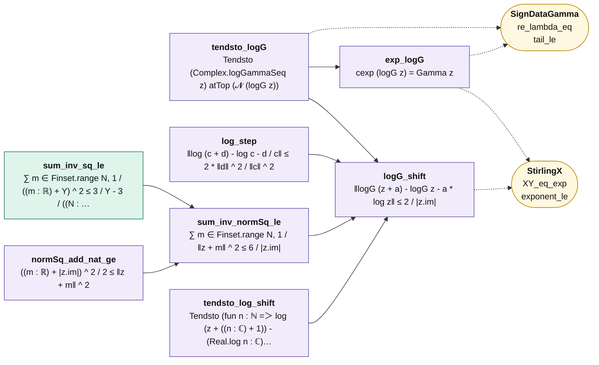

# `lean_stage3/Stage3/StirlingLog.lean`

> **Read from the source text.** This file changed after the last `python3 utilities/lean_map.py --dump`, so the arrows on this page are names occurring in each proof and have not been confirmed by Lean.

# StirlingLog — block S12 of `lean_stage3/design/stencil.md`, the Γ-shift with its phase. 2026-11-25.

8 theorems, 1 definition, 301 lines. 

**Imports:** nothing in this tree  
**Imported by:** [`SignDataGamma`](../lean_stage3/SignDataGamma.md), [`StirlingX`](../lean_stage3/StirlingX.md)

## The picture



An arrow A → B reads "A is used in the proof of B". Green: counting, integers only. Violet: shape, analysis with no ζ. Blue: reads ζ. A name ending in ■ is an end: nothing else uses it. Red: contains `sorry`. Yellow: theorems in another file, counted; a dotted arrow crosses files. Definitions are not drawn; they are listed below the diagram.

## Definitions

<a name="Stirling-logG"></a>
### `Stirling.logG`

def · line 38

A logarithm of `Γ` on the right half-plane: the limit of PNT+'s `logGammaSeq`.

- **Is:** `` logG (z : ℂ) : ℂ := limUnder atTop (Complex.logGammaSeq z) ``
- **Used by 8:** [`SignData.re_lambda_eq`](../lean_stage3/SignDataGamma.md#SignData-re_lambda_eq), [`SignData.tail_le`](../lean_stage3/SignDataGamma.md#SignData-tail_le), [`Stirling.exp_logG`](#Stirling-exp_logG), [`Stirling.logG_shift`](#Stirling-logG_shift), [`Stirling.tendsto_logG`](#Stirling-tendsto_logG), [`Stirling.XY_eq_exp`](../lean_stage3/StirlingX.md#Stirling-XY_eq_exp), [`Stirling.exponent_le`](../lean_stage3/StirlingX.md#Stirling-exponent_le), [`Stirling.stmtXStirlingRel_holds`](../lean_stage3/StirlingX.md#Stirling-stmtXStirlingRel_holds)

## Theorems

<a name="Stirling-tendsto_logG"></a>
### `Stirling.tendsto_logG`

line 40 · arrows read from text

**Shape.** Uses real or complex analysis; nothing in it or beneath it reads ζ.

**Proves**

```lean
Tendsto (Complex.logGammaSeq z) atTop (𝓝 (logG z))
```

**Needs** (its hypotheses)

  - `` hz : 0 < z.re ``

**Fed by:** no theorem of this repo; it stands on Mathlib and the definitions below.

**Definitions its proof touches:** [`Stirling.logG`](#Stirling-logG)

**Feeds** (3 that use it)

  - [`SignData.tail_le`](../lean_stage3/SignDataGamma.md#SignData-tail_le) (SignDataGamma) — `` ‖Stirling.logG z - Complex.logGammaSeq z n‖ ≤ (2 * ‖z‖ + ‖z‖ ^ 2) / n ``
  - [`Stirling.exp_logG`](#Stirling-exp_logG) — `` cexp (logG z) = Gamma z ``
  - [`Stirling.logG_shift`](#Stirling-logG_shift) — `` ‖logG (z + a) - logG z - a * log z‖ ≤ 2 / |z.im| ``

<a name="Stirling-exp_logG"></a>
### `Stirling.exp_logG`

line 44 · arrows read from text

**Shape.** Uses real or complex analysis; nothing in it or beneath it reads ζ.

**Proves**

```lean
cexp (logG z) = Gamma z
```

**Needs** (its hypotheses)

  - `` hz : 0 < z.re ``

**Fed by** (1 theorem its proof uses)

  - [`Stirling.tendsto_logG`](#Stirling-tendsto_logG) — `` Tendsto (Complex.logGammaSeq z) atTop (𝓝 (logG z)) ``

**Definitions its proof touches:** [`Stirling.logG`](#Stirling-logG)

**Feeds** (2 that use it)

  - [`SignData.re_lambda_eq`](../lean_stage3/SignDataGamma.md#SignData-re_lambda_eq) (SignDataGamma) — `` ∃ c : ℝ, 0 < c ∧ (completedRiemannZeta (lineS t)).re = c * (gammaDir t n * riemannZeta (lineS t)).re ``
  - [`Stirling.XY_eq_exp`](../lean_stage3/StirlingX.md#Stirling-XY_eq_exp) (StirlingX) — `` XY α β t = cexp (log (Real.pi : ℂ) * (α + β) + ((logG (wm t + -α / 2) + logG (wp t + -β / 2)) - (logG (wp t + α / 2) + logG (wm t + β / 2)))) ``

<a name="Stirling-log_step"></a>
### `Stirling.log_step`

line 54 · arrows read from text

**Shape.** Uses real or complex analysis; nothing in it or beneath it reads ζ.

**Why.** One step of the logarithm along a segment in the right half-plane.

**Proves**

```lean
‖log (c + d) - log c - d / c‖ ≤ 2 * ‖d‖ ^ 2 / ‖c‖ ^ 2
```

**Needs** (its hypotheses)

  - `` hpos : ∀ s ∈ Icc (0 : ℝ) 1, 0 < (c + (s : ℂ) * d).re ``
  - `` hlow : ∀ s ∈ Icc (0 : ℝ) 1, ‖c‖ ≤ 2 * ‖c + (s : ℂ) * d‖ ``

**Fed by:** no theorem of this repo; it stands on Mathlib.

**Feeds** (1 that use it)

  - [`Stirling.logG_shift`](#Stirling-logG_shift) — `` ‖logG (z + a) - logG z - a * log z‖ ≤ 2 / |z.im| ``

<a name="Stirling-sum_inv_sq_le"></a>
### `Stirling.sum_inv_sq_le`

line 102 · arrows read from text

**Counting.** Integers only: nothing in its statement or proof, or in anything it rests on, uses analysis or ζ.

**Why.** `Σ_{m<N} 1/(m+Y)² ≤ 3/Y − 3/(N+Y)` for `Y ≥ 1/2`.

**Proves**

```lean
∑ m ∈ Finset.range N, 1 / ((m : ℝ) + Y) ^ 2 ≤ 3 / Y - 3 / ((N : ℝ) + Y)
```

**Needs** (its hypotheses)

  - `` hY : 1 / 2 ≤ Y ``
  - `` N : ℕ ``

**Fed by:** no theorem of this repo; it stands on Mathlib.

**Feeds** (1 that use it)

  - [`Stirling.sum_inv_normSq_le`](#Stirling-sum_inv_normSq_le) — `` ∑ m ∈ Finset.range N, 1 / ‖z + m‖ ^ 2 ≤ 6 / |z.im| ``

<a name="Stirling-normSq_add_nat_ge"></a>
### `Stirling.normSq_add_nat_ge`

line 120 · arrows read from text

**Shape.** Uses real or complex analysis; nothing in it or beneath it reads ζ.

**Why.** `‖z + m‖² ≥ (m + |Im z|)²/2` for `Re z ≥ 0`.

**Proves**

```lean
((m : ℝ) + |z.im|) ^ 2 / 2 ≤ ‖z + m‖ ^ 2
```

**Needs** (its hypotheses)

  - `` hre : 0 ≤ z.re ``
  - `` m : ℕ ``

**Fed by:** no theorem of this repo; it stands on Mathlib.

**Feeds** (1 that use it)

  - [`Stirling.sum_inv_normSq_le`](#Stirling-sum_inv_normSq_le) — `` ∑ m ∈ Finset.range N, 1 / ‖z + m‖ ^ 2 ≤ 6 / |z.im| ``

<a name="Stirling-sum_inv_normSq_le"></a>
### `Stirling.sum_inv_normSq_le`

line 129 · arrows read from text

**Shape.** Uses real or complex analysis; nothing in it or beneath it reads ζ.

**Why.** `Σ_{m<N} 1/‖z+m‖² ≤ 6/|Im z|` for `Re z ≥ 0`, `|Im z| ≥ 1/2`.

**Proves**

```lean
∑ m ∈ Finset.range N, 1 / ‖z + m‖ ^ 2 ≤ 6 / |z.im|
```

**Needs** (its hypotheses)

  - `` hre : 0 ≤ z.re ``
  - `` hY : 1 / 2 ≤ |z.im| ``
  - `` N : ℕ ``

**Fed by** (2 theorems its proof uses)

  - [`Stirling.normSq_add_nat_ge`](#Stirling-normSq_add_nat_ge) — `` ((m : ℝ) + |z.im|) ^ 2 / 2 ≤ ‖z + m‖ ^ 2 ``
  - [`Stirling.sum_inv_sq_le`](#Stirling-sum_inv_sq_le) — `` ∑ m ∈ Finset.range N, 1 / ((m : ℝ) + Y) ^ 2 ≤ 3 / Y - 3 / ((N : ℝ) + Y) ``

**Feeds** (1 that use it)

  - [`Stirling.logG_shift`](#Stirling-logG_shift) — `` ‖logG (z + a) - logG z - a * log z‖ ≤ 2 / |z.im| ``

<a name="Stirling-tendsto_log_shift"></a>
### `Stirling.tendsto_log_shift`

line 151 · arrows read from text

**Shape.** Uses real or complex analysis; nothing in it or beneath it reads ζ.

**Why.** `log(z + (n+1)) − log n → 0`.

**Proves**

```lean
Tendsto (fun n : ℕ => log (z + ((n : ℂ) + 1)) - (Real.log n : ℂ)) atTop (𝓝 0)
```

**Needs** (its hypotheses)

  - `` z : ℂ ``

**Fed by:** no theorem of this repo; it stands on Mathlib.

**Feeds** (1 that use it)

  - [`Stirling.logG_shift`](#Stirling-logG_shift) — `` ‖logG (z + a) - logG z - a * log z‖ ≤ 2 / |z.im| ``

<a name="Stirling-logG_shift"></a>
### `Stirling.logG_shift`

line 176 · arrows read from text

**Shape.** Uses real or complex analysis; nothing in it or beneath it reads ζ.

**Why.** The Γ-shift with its phase: `logG(z+a) − logG z = a log z + O(1/|Im z|)`, the constant `2`, for `Re z ≥ 1/4`, `‖a‖ ≤ 1/8`, `|Im z| ≥ 1/2`.

**Proves**

```lean
‖logG (z + a) - logG z - a * log z‖ ≤ 2 / |z.im|
```

**Needs** (its hypotheses)

  - `` hre : 1 / 4 ≤ z.re ``
  - `` ha : ‖a‖ ≤ 1 / 8 ``
  - `` hY : 1 / 2 ≤ |z.im| ``

**Fed by** (4 theorems its proof uses)

  - [`Stirling.log_step`](#Stirling-log_step) — `` ‖log (c + d) - log c - d / c‖ ≤ 2 * ‖d‖ ^ 2 / ‖c‖ ^ 2 ``
  - [`Stirling.sum_inv_normSq_le`](#Stirling-sum_inv_normSq_le) — `` ∑ m ∈ Finset.range N, 1 / ‖z + m‖ ^ 2 ≤ 6 / |z.im| ``
  - [`Stirling.tendsto_logG`](#Stirling-tendsto_logG) — `` Tendsto (Complex.logGammaSeq z) atTop (𝓝 (logG z)) ``
  - [`Stirling.tendsto_log_shift`](#Stirling-tendsto_log_shift) — `` Tendsto (fun n : ℕ => log (z + ((n : ℂ) + 1)) - (Real.log n : ℂ)) atTop (𝓝 0) ``

**Definitions its proof touches:** [`Stirling.logG`](#Stirling-logG)

**Feeds** (1 that use it)

  - [`Stirling.exponent_le`](../lean_stage3/StirlingX.md#Stirling-exponent_le) (StirlingX) — `` ‖(log (Real.pi : ℂ) * (α + β) + ((logG (wm t + -α / 2) + logG (wp t + -β / 2)) - (logG (wp t + α / 2) + logG (wm t + β / 2)))) - log (((t / (2 * Real.… ``

