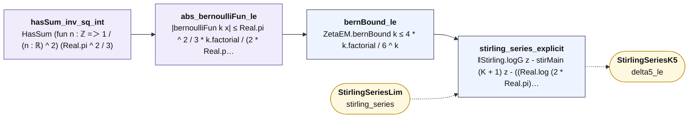

# `lean_stage3/Stage3/StirlingSeriesBern.lean`

> **Read from the source text.** This file changed after the last `python3 utilities/lean_map.py --dump`, so the arrows on this page are names occurring in each proof and have not been confirmed by Lean.

StirlingSeriesBern — block S14 of `lean_stage3/design/stencil.md`, Turing at scale: the size of the Bernoulli polynomials on `[0, 1]`, for every order, and Stirling's remainder with it. 2026-11-25.

4 theorems, 0 definitions, 143 lines. 

**Imports:** [`StirlingSeriesLim`](../lean_stage3/StirlingSeriesLim.md)  
**Imported by:** [`StirlingSeries`](../lean_stage3/StirlingSeries.md), [`StirlingSeriesK5`](../lean_stage3/StirlingSeriesK5.md)

## The picture



An arrow A → B reads "A is used in the proof of B". Green: counting, integers only. Violet: shape, analysis with no ζ. Blue: reads ζ. A name ending in ■ is an end: nothing else uses it. Red: contains `sorry`. Yellow: theorems in another file, counted; a dotted arrow crosses files. Definitions are not drawn; they are listed below the diagram.

## Theorems

<a name="StirlingSeries-hasSum_inv_sq_int"></a>
### `StirlingSeries.hasSum_inv_sq_int`

line 30 · arrows read from text

**Shape.** Uses real or complex analysis; nothing in it or beneath it reads ζ.

**Why.** `Σ_{n ∈ ℤ} 1/n² = π²/3`.

**Proves**

```lean
HasSum (fun n : ℤ => 1 / (n : ℝ) ^ 2) (Real.pi ^ 2 / 3)
```

**Fed by:** no theorem of this repo; it stands on Mathlib.

**Feeds** (1 that use it)

  - [`StirlingSeries.abs_bernoulliFun_le`](#StirlingSeries-abs_bernoulliFun_le) — `` |bernoulliFun k x| ≤ Real.pi ^ 2 / 3 * k.factorial / (2 * Real.pi) ^ k ``

<a name="StirlingSeries-abs_bernoulliFun_le"></a>
### `StirlingSeries.abs_bernoulliFun_le`

line 50 · arrows read from text

**Shape.** Uses real or complex analysis; nothing in it or beneath it reads ζ.

**Why.** The Bernoulli polynomials on `[0, 1]`: `|B_k(x)| ≤ (π²/3)·k!/(2π)^k` for `k ≥ 2`.

**Proves**

```lean
|bernoulliFun k x| ≤ Real.pi ^ 2 / 3 * k.factorial / (2 * Real.pi) ^ k
```

**Needs** (its hypotheses)

  - `` hk : 2 ≤ k ``
  - `` hx : x ∈ Set.Icc (0 : ℝ) 1 ``

**Fed by** (1 theorem its proof uses)

  - [`StirlingSeries.hasSum_inv_sq_int`](#StirlingSeries-hasSum_inv_sq_int) — `` HasSum (fun n : ℤ => 1 / (n : ℝ) ^ 2) (Real.pi ^ 2 / 3) ``

**Feeds** (1 that use it)

  - [`StirlingSeries.bernBound_le`](#StirlingSeries-bernBound_le) — `` ZetaEM.bernBound k ≤ 4 * k.factorial / 6 ^ k ``

<a name="StirlingSeries-bernBound_le"></a>
### `StirlingSeries.bernBound_le`

line 88 · arrows read from text

**Reads ζ.** It, or something it rests on, uses the zeta function, its zeros or the Riemann hypothesis.

**Why.** `bernBound k ≤ 4·k!/6^k` for `k ≥ 2`.

**Proves**

```lean
ZetaEM.bernBound k ≤ 4 * k.factorial / 6 ^ k
```

**Needs** (its hypotheses)

  - `` hk : 2 ≤ k ``

**Fed by** (1 theorem its proof uses)

  - [`StirlingSeries.abs_bernoulliFun_le`](#StirlingSeries-abs_bernoulliFun_le) — `` |bernoulliFun k x| ≤ Real.pi ^ 2 / 3 * k.factorial / (2 * Real.pi) ^ k ``

**Definitions its proof touches:** [`ZetaEM.bernBound`](../lean_stage3/ZetaEM.md#ZetaEM-bernBound)

**Feeds** (1 that use it)

  - [`StirlingSeries.stirling_series_explicit`](#StirlingSeries-stirling_series_explicit) — `` ‖Stirling.logG z - stirMain (K + 1) z - ((Real.log (2 * Real.pi) / 2 : ℝ) : ℂ)‖ ≤ 4 * (2 * K).factorial / 6 ^ (2 * K) / (2 * K) * (6 / |z.im|) / ‖z‖ ^… ``

<a name="StirlingSeries-stirling_series_explicit"></a>
### `StirlingSeries.stirling_series_explicit`

line 112 · arrows read from text

**Reads ζ.** It, or something it rests on, uses the zeta function, its zeros or the Riemann hypothesis.

**Why.** Stirling's series, every constant explicit: for `Re z > 0`, `|Im z| ≥ ½`, `K ≥ 1`, `‖logG z − S_{K+1}(z) − ½ log 2π‖ ≤ 4(2K)!/6^{2K}/(2K)·(6/|Im z|)/‖z‖^{2K−2}`.

**Proves**

```lean
‖Stirling.logG z - stirMain (K + 1) z - ((Real.log (2 * Real.pi) / 2 : ℝ) : ℂ)‖ ≤ 4 * (2 * K).factorial / 6 ^ (2 * K) / (2 * K) * (6 / |z.im|) / ‖z‖ ^ (2 * K - 2)
```

**Needs** (its hypotheses)

  - `` hz : 0 < z.re ``
  - `` hY : 1 / 2 ≤ |z.im| ``
  - `` hK : 1 ≤ K ``

**Fed by** (2 theorems its proof uses)

  - [`StirlingSeries.bernBound_le`](#StirlingSeries-bernBound_le) — `` ZetaEM.bernBound k ≤ 4 * k.factorial / 6 ^ k ``
  - [`StirlingSeries.stirling_series`](../lean_stage3/StirlingSeriesLim.md#StirlingSeries-stirling_series) (StirlingSeriesLim) — `` ‖Stirling.logG z - stirMain (K + 1) z - ((Real.log (2 * Real.pi) / 2 : ℝ) : ℂ)‖ ≤ ZetaEM.bernBound (2 * K) / (2 * K) * (6 / |z.im|) / ‖z‖ ^ (2 * K - 2… ``

**Definitions its proof touches:** [`Stirling.logG`](../lean_stage3/StirlingLog.md#Stirling-logG), [`StirlingSeries.stirMain`](../lean_stage3/StirlingSeriesEM.md#StirlingSeries-stirMain)

**Feeds** (1 that use it)

  - [`StirlingSeries.delta5_le`](../lean_stage3/StirlingSeriesK5.md#StirlingSeries-delta5_le) (StirlingSeriesK5) — `` ‖Stirling.logG (zz t) - stirMain 5 (zz t) - ((Real.log (2 * Real.pi) / 2 : ℝ) : ℂ)‖ ≤ 10 / |t| ^ 7 ``

