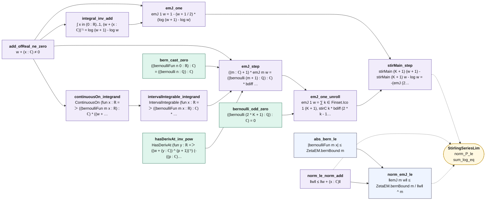

# `lean_stage3/Stage3/StirlingSeriesEM.lean`

> **Read from the source text.** This file changed after the last `python3 utilities/lean_map.py --dump`, so the arrows on this page are names occurring in each proof and have not been confirmed by Lean.

StirlingSeriesEM — block S14 of `lean_stage3/design/stencil.md`, Turing at scale: one step of Stirling's series by Euler–Maclaurin on `[0, 1]`. 2026-11-25.

14 theorems, 5 definitions, 286 lines. 

**Imports:** [`StirlingLog`](../lean_stage3/StirlingLog.md), [`ZetaEM`](../lean_stage3/ZetaEM.md)  
**Imported by:** [`StirlingSeries`](../lean_stage3/StirlingSeries.md), [`StirlingSeriesLim`](../lean_stage3/StirlingSeriesLim.md)

## The picture



An arrow A → B reads "A is used in the proof of B". Green: counting, integers only. Violet: shape, analysis with no ζ. Blue: reads ζ. A name ending in ■ is an end: nothing else uses it. Red: contains `sorry`. Yellow: theorems in another file, counted; a dotted arrow crosses files. Definitions are not drawn; they are listed below the diagram.

## Definitions

<a name="StirlingSeries-emJ"></a>
### `StirlingSeries.emJ`

def · line 42

`J_m(w) = ∫₀¹ B_m(x)·(w+x)^{−m}`.

- **Is:** `` emJ (m : ℕ) (w : ℂ) : ℂ := ∫ x in (0 : ℝ)..1, ((bernoulliFun m x : ℝ) : ℂ) * ((w + (x : ℂ)) ^ m)⁻¹ ``
- **Used by 7:** [`StirlingSeries.emJ_one`](#StirlingSeries-emJ_one), [`StirlingSeries.emJ_one_unroll`](#StirlingSeries-emJ_one_unroll), [`StirlingSeries.emJ_step`](#StirlingSeries-emJ_step), [`StirlingSeries.norm_emJ_le`](#StirlingSeries-norm_emJ_le), [`StirlingSeries.stirMain_step`](#StirlingSeries-stirMain_step), [`StirlingSeries.norm_P_le`](../lean_stage3/StirlingSeriesLim.md#StirlingSeries-norm_P_le), [`StirlingSeries.remP`](../lean_stage3/StirlingSeriesLim.md#StirlingSeries-remP)

<a name="StirlingSeries-bdiff"></a>
### `StirlingSeries.bdiff`

def · line 46

`Δ_m(w) = (w+1)^{−m} − w^{−m}`.

- **Is:** `` bdiff (m : ℕ) (w : ℂ) : ℂ := ((w + 1) ^ m)⁻¹ - (w ^ m)⁻¹ ``
- **Used by 3:** [`StirlingSeries.emJ_one_unroll`](#StirlingSeries-emJ_one_unroll), [`StirlingSeries.emJ_step`](#StirlingSeries-emJ_step), [`StirlingSeries.stirMain_step`](#StirlingSeries-stirMain_step)

<a name="StirlingSeries-stirC"></a>
### `StirlingSeries.stirC`

def · line 49

The Stirling coefficient `c_k = B_{2k}/(2k(2k−1))`.

- **Is:** `` stirC (k : ℕ) : ℂ := ((bernoulli (2 * k) : ℚ) : ℂ) / ((2 * k : ℂ) * (2 * k - 1)) ``
- **Used by 9:** [`StirlingSeries.emJ_one_unroll`](#StirlingSeries-emJ_one_unroll), [`StirlingSeries.stirMain_step`](#StirlingSeries-stirMain_step), [`StirlingSeries.stirSum`](#StirlingSeries-stirSum), [`StirlingSeries.stirC_four`](../lean_stage3/StirlingSeriesK5.md#StirlingSeries-stirC_four), [`StirlingSeries.stirC_three`](../lean_stage3/StirlingSeriesK5.md#StirlingSeries-stirC_three), [`StirlingSeries.stirling_series'`](../lean_stage3/StirlingSeriesLim.md#StirlingSeries-stirling_series-), [`StirlingSeries.tendsto_stirSum_shift`](../lean_stage3/StirlingSeriesLim.md#StirlingSeries-tendsto_stirSum_shift), [`StirlingSeries.stirC_one`](../lean_stage3/StirlingSeriesPhase.md#StirlingSeries-stirC_one), [`StirlingSeries.stirC_two`](../lean_stage3/StirlingSeriesPhase.md#StirlingSeries-stirC_two)

<a name="StirlingSeries-stirSum"></a>
### `StirlingSeries.stirSum`

def · line 52

The Stirling correction `Σ_{1 ≤ k < K} c_k w^{−(2k−1)}`.

- **Is:** `` stirSum (K : ℕ) (w : ℂ) : ℂ := ∑ k ∈ Finset.Ico 1 K, stirC k * (w ^ (2 * k - 1))⁻¹ ``
- **Built from:** [`StirlingSeries.stirC`](#StirlingSeries-stirC)
- **Used by 9:** [`StirlingSeries.stirMain`](#StirlingSeries-stirMain), [`StirlingSeries.stirMain_step`](#StirlingSeries-stirMain_step), [`StirlingSeries.im_stirMain_ball`](../lean_stage3/StirlingSeriesK5.md#StirlingSeries-im_stirMain_ball), [`StirlingSeries.stirSum5_eq`](../lean_stage3/StirlingSeriesK5.md#StirlingSeries-stirSum5_eq), [`StirlingSeries.stirSum5_im`](../lean_stage3/StirlingSeriesK5.md#StirlingSeries-stirSum5_im), [`StirlingSeries.stirling_series'`](../lean_stage3/StirlingSeriesLim.md#StirlingSeries-stirling_series-), [`StirlingSeries.tendsto_stirSum_shift`](../lean_stage3/StirlingSeriesLim.md#StirlingSeries-tendsto_stirSum_shift), [`StirlingSeries.stirSum3_eq`](../lean_stage3/StirlingSeriesPhase.md#StirlingSeries-stirSum3_eq), [`StirlingSeries.stirSum3_im`](../lean_stage3/StirlingSeriesPhase.md#StirlingSeries-stirSum3_im)

<a name="StirlingSeries-stirMain"></a>
### `StirlingSeries.stirMain`

def · line 55

The Stirling main part `S_K(w) = (w − ½) log w − w + Σ_{1 ≤ k < K} c_k w^{−(2k−1)}`.

- **Is:** `` stirMain (K : ℕ) (w : ℂ) : ℂ := (w - 1 / 2) * log w - w + stirSum K w ``
- **Built from:** [`StirlingSeries.stirSum`](#StirlingSeries-stirSum)
- **Used by 16:** [`StirlingSeries.stirling_series_explicit`](../lean_stage3/StirlingSeriesBern.md#StirlingSeries-stirling_series_explicit), [`StirlingSeries.stirMain_step`](#StirlingSeries-stirMain_step), [`StirlingSeries.delta5_le`](../lean_stage3/StirlingSeriesK5.md#StirlingSeries-delta5_le), [`StirlingSeries.gamma_phase_ball5`](../lean_stage3/StirlingSeriesK5.md#StirlingSeries-gamma_phase_ball5), [`StirlingSeries.im_stirMain_ball`](../lean_stage3/StirlingSeriesK5.md#StirlingSeries-im_stirMain_ball), [`StirlingSeries.seqA`](../lean_stage3/StirlingSeriesLim.md#StirlingSeries-seqA), [`StirlingSeries.stirling_series`](../lean_stage3/StirlingSeriesLim.md#StirlingSeries-stirling_series), [`StirlingSeries.stirling_series'`](../lean_stage3/StirlingSeriesLim.md#StirlingSeries-stirling_series-), [`StirlingSeries.sum_log_eq`](../lean_stage3/StirlingSeriesLim.md#StirlingSeries-sum_log_eq), [`StirlingSeries.tendsto_A`](../lean_stage3/StirlingSeriesLim.md#StirlingSeries-tendsto_A), [`StirlingSeries.delta3_le`](../lean_stage3/StirlingSeriesPhase.md#StirlingSeries-delta3_le), [`StirlingSeries.delta3_le'`](../lean_stage3/StirlingSeriesPhase.md#StirlingSeries-delta3_le-), [`StirlingSeries.im_logG_ball`](../lean_stage3/StirlingSeriesPhase.md#StirlingSeries-im_logG_ball), [`StirlingSeries.re_lambda_eq_stir`](../lean_stage3/StirlingSeriesPhase.md#StirlingSeries-re_lambda_eq_stir), [`StirlingSeries.stirPhase`](../lean_stage3/StirlingSeriesPhase.md#StirlingSeries-stirPhase), [`StirlingSeries.stirPhase3_ball`](../lean_stage3/StirlingSeriesPhase.md#StirlingSeries-stirPhase3_ball)

## Theorems

<a name="StirlingSeries-add_ofReal_ne_zero"></a>
### `StirlingSeries.add_ofReal_ne_zero`

line 57 · arrows read from text

**Shape.** Uses real or complex analysis; nothing in it or beneath it reads ζ.

**Proves**

```lean
w + (x : ℂ) ≠ 0
```

**Needs** (its hypotheses)

  - `` hw : 0 < w.re ``
  - `` hx : 0 ≤ x ``

**Fed by:** no theorem of this repo; it stands on Mathlib.

**Feeds** (4 that use it)

  - [`StirlingSeries.continuousOn_integrand`](#StirlingSeries-continuousOn_integrand) — `` ContinuousOn (fun x : ℝ => ((bernoulliFun m x : ℝ) : ℂ) * ((w + (x : ℂ)) ^ m)⁻¹) (uIcc (0 : ℝ) 1) ``
  - [`StirlingSeries.emJ_one`](#StirlingSeries-emJ_one) — `` emJ 1 w = 1 - (w + 1 / 2) * (log (w + 1) - log w) ``
  - [`StirlingSeries.emJ_step`](#StirlingSeries-emJ_step) — `` ((m : ℂ) + 1) * emJ m w = ((bernoulli (m + 1) : ℚ) : ℂ) * bdiff m w + (m : ℂ) * emJ (m + 1) w ``
  - [`StirlingSeries.integral_inv_add`](#StirlingSeries-integral_inv_add) — `` ∫ x in (0 : ℝ)..1, (w + (x : ℂ))⁻¹ = log (w + 1) - log w ``

<a name="StirlingSeries-bern_cast_zero"></a>
### `StirlingSeries.bern_cast_zero`

line 63 · arrows read from text

**Counting.** Integers only: nothing in its statement or proof, or in anything it rests on, uses analysis or ζ.

**Proves**

```lean
((bernoulliFun n 0 : ℝ) : ℂ) = ((bernoulli n : ℚ) : ℂ)
```

**Needs** (its hypotheses)

  - `` n : ℕ ``

**Fed by:** no theorem of this repo; it stands on Mathlib.

**Feeds** (1 that use it)

  - [`StirlingSeries.emJ_step`](#StirlingSeries-emJ_step) — `` ((m : ℂ) + 1) * emJ m w = ((bernoulli (m + 1) : ℚ) : ℂ) * bdiff m w + (m : ℂ) * emJ (m + 1) w ``

<a name="StirlingSeries-continuousOn_integrand"></a>
### `StirlingSeries.continuousOn_integrand`

line 68 · arrows read from text

**Shape.** Uses real or complex analysis; nothing in it or beneath it reads ζ.

**Proves**

```lean
ContinuousOn (fun x : ℝ => ((bernoulliFun m x : ℝ) : ℂ) * ((w + (x : ℂ)) ^ m)⁻¹) (uIcc (0 : ℝ) 1)
```

**Needs** (its hypotheses)

  - `` m : ℕ ``
  - `` hw : 0 < w.re ``

**Fed by** (1 theorem its proof uses)

  - [`StirlingSeries.add_ofReal_ne_zero`](#StirlingSeries-add_ofReal_ne_zero) — `` w + (x : ℂ) ≠ 0 ``

**Feeds** (1 that use it)

  - [`StirlingSeries.intervalIntegrable_integrand`](#StirlingSeries-intervalIntegrable_integrand) — `` IntervalIntegrable (fun x : ℝ => ((bernoulliFun m x : ℝ) : ℂ) * ((w + (x : ℂ)) ^ m)⁻¹) volume 0 1 ``

<a name="StirlingSeries-intervalIntegrable_integrand"></a>
### `StirlingSeries.intervalIntegrable_integrand`

line 79 · arrows read from text

**Shape.** Uses real or complex analysis; nothing in it or beneath it reads ζ.

**Proves**

```lean
IntervalIntegrable (fun x : ℝ => ((bernoulliFun m x : ℝ) : ℂ) * ((w + (x : ℂ)) ^ m)⁻¹) volume 0 1
```

**Needs** (its hypotheses)

  - `` m : ℕ ``
  - `` hw : 0 < w.re ``

**Fed by** (1 theorem its proof uses)

  - [`StirlingSeries.continuousOn_integrand`](#StirlingSeries-continuousOn_integrand) — `` ContinuousOn (fun x : ℝ => ((bernoulliFun m x : ℝ) : ℂ) * ((w + (x : ℂ)) ^ m)⁻¹) (uIcc (0 : ℝ) 1) ``

**Feeds** (1 that use it)

  - [`StirlingSeries.emJ_step`](#StirlingSeries-emJ_step) — `` ((m : ℂ) + 1) * emJ m w = ((bernoulli (m + 1) : ℚ) : ℂ) * bdiff m w + (m : ℂ) * emJ (m + 1) w ``

<a name="StirlingSeries-hasDerivAt_inv_pow"></a>
### `StirlingSeries.hasDerivAt_inv_pow`

line 85 · arrows read from text

**Counting.** Integers only: nothing in its statement or proof, or in anything it rests on, uses analysis or ζ.

**Why.** The derivative of `(w + x)^{−(p+1)}` in the real variable `x`.

**Proves**

```lean
HasDerivAt (fun y : ℝ => ((w + (y : ℂ)) ^ (p + 1))⁻¹) (-((p : ℂ) + 1) * ((w + (x : ℂ)) ^ (p + 2))⁻¹) x
```

**Needs** (its hypotheses)

  - `` hx : w + (x : ℂ) ≠ 0 ``
  - `` p : ℕ ``

**Fed by:** no theorem of this repo; it stands on Mathlib.

**Feeds** (1 that use it)

  - [`StirlingSeries.emJ_step`](#StirlingSeries-emJ_step) — `` ((m : ℂ) + 1) * emJ m w = ((bernoulli (m + 1) : ℚ) : ℂ) * bdiff m w + (m : ℂ) * emJ (m + 1) w ``

<a name="StirlingSeries-emJ_step"></a>
### `StirlingSeries.emJ_step`

line 102 · arrows read from text

**Shape.** Uses real or complex analysis; nothing in it or beneath it reads ζ.

**Why.** One integration by parts: `(m+1)J_m = B_{m+1}Δ_m + m J_{m+1}` for `m ≥ 1`.

**Proves**

```lean
((m : ℂ) + 1) * emJ m w = ((bernoulli (m + 1) : ℚ) : ℂ) * bdiff m w + (m : ℂ) * emJ (m + 1) w
```

**Needs** (its hypotheses)

  - `` hm : 1 ≤ m ``
  - `` hw : 0 < w.re ``

**Fed by** (4 theorems its proof uses)

  - [`StirlingSeries.add_ofReal_ne_zero`](#StirlingSeries-add_ofReal_ne_zero) — `` w + (x : ℂ) ≠ 0 ``
  - [`StirlingSeries.bern_cast_zero`](#StirlingSeries-bern_cast_zero) — `` ((bernoulliFun n 0 : ℝ) : ℂ) = ((bernoulli n : ℚ) : ℂ) ``
  - [`StirlingSeries.hasDerivAt_inv_pow`](#StirlingSeries-hasDerivAt_inv_pow) — `` HasDerivAt (fun y : ℝ => ((w + (y : ℂ)) ^ (p + 1))⁻¹) (-((p : ℂ) + 1) * ((w + (x : ℂ)) ^ (p + 2))⁻¹) x ``
  - [`StirlingSeries.intervalIntegrable_integrand`](#StirlingSeries-intervalIntegrable_integrand) — `` IntervalIntegrable (fun x : ℝ => ((bernoulliFun m x : ℝ) : ℂ) * ((w + (x : ℂ)) ^ m)⁻¹) volume 0 1 ``

**Definitions its proof touches:** [`StirlingSeries.bdiff`](#StirlingSeries-bdiff), [`StirlingSeries.emJ`](#StirlingSeries-emJ)

**Feeds** (1 that use it)

  - [`StirlingSeries.emJ_one_unroll`](#StirlingSeries-emJ_one_unroll) — `` emJ 1 w = ∑ k ∈ Finset.Ico 1 (K + 1), stirC k * bdiff (2 * k - 1) w + emJ (2 * K) w / (2 * K) ``

<a name="StirlingSeries-integral_inv_add"></a>
### `StirlingSeries.integral_inv_add`

line 134 · arrows read from text

**Shape.** Uses real or complex analysis; nothing in it or beneath it reads ζ.

**Why.** `∫₀¹ (w+x)⁻¹ = log(w+1) − log w` on `Re w > 0`.

**Proves**

```lean
∫ x in (0 : ℝ)..1, (w + (x : ℂ))⁻¹ = log (w + 1) - log w
```

**Needs** (its hypotheses)

  - `` hw : 0 < w.re ``

**Fed by** (1 theorem its proof uses)

  - [`StirlingSeries.add_ofReal_ne_zero`](#StirlingSeries-add_ofReal_ne_zero) — `` w + (x : ℂ) ≠ 0 ``

**Feeds** (1 that use it)

  - [`StirlingSeries.emJ_one`](#StirlingSeries-emJ_one) — `` emJ 1 w = 1 - (w + 1 / 2) * (log (w + 1) - log w) ``

<a name="StirlingSeries-emJ_one"></a>
### `StirlingSeries.emJ_one`

line 155 · arrows read from text

**Shape.** Uses real or complex analysis; nothing in it or beneath it reads ζ.

**Why.** The base: `J_1(w) = 1 − (w + ½)(log(w+1) − log w)`.

**Proves**

```lean
emJ 1 w = 1 - (w + 1 / 2) * (log (w + 1) - log w)
```

**Needs** (its hypotheses)

  - `` hw : 0 < w.re ``

**Fed by** (2 theorems its proof uses)

  - [`StirlingSeries.add_ofReal_ne_zero`](#StirlingSeries-add_ofReal_ne_zero) — `` w + (x : ℂ) ≠ 0 ``
  - [`StirlingSeries.integral_inv_add`](#StirlingSeries-integral_inv_add) — `` ∫ x in (0 : ℝ)..1, (w + (x : ℂ))⁻¹ = log (w + 1) - log w ``

**Definitions its proof touches:** [`StirlingSeries.emJ`](#StirlingSeries-emJ)

**Feeds** (1 that use it)

  - [`StirlingSeries.stirMain_step`](#StirlingSeries-stirMain_step) — `` stirMain (K + 1) (w + 1) - stirMain (K + 1) w - log w = -(emJ (2 * K) w / (2 * K)) ``

<a name="StirlingSeries-bernoulli_odd_zero"></a>
### `StirlingSeries.bernoulli_odd_zero`

line 177 · arrows read from text

**Counting.** Integers only: nothing in its statement or proof, or in anything it rests on, uses analysis or ζ.

**Proves**

```lean
((bernoulli (2 * K + 1) : ℚ) : ℂ) = 0
```

**Needs** (its hypotheses)

  - `` hK : 1 ≤ K ``

**Fed by:** no theorem of this repo; it stands on Mathlib.

**Feeds** (1 that use it)

  - [`StirlingSeries.emJ_one_unroll`](#StirlingSeries-emJ_one_unroll) — `` emJ 1 w = ∑ k ∈ Finset.Ico 1 (K + 1), stirC k * bdiff (2 * k - 1) w + emJ (2 * K) w / (2 * K) ``

<a name="StirlingSeries-emJ_one_unroll"></a>
### `StirlingSeries.emJ_one_unroll`

line 182 · arrows read from text

**Shape.** Uses real or complex analysis; nothing in it or beneath it reads ζ.

**Why.** The unrolled identity: `J_1 = Σ_{k ∈ [1,K]} c_k Δ_{2k−1} + J_{2K}/(2K)` for `K ≥ 1`.

**Proves**

```lean
emJ 1 w = ∑ k ∈ Finset.Ico 1 (K + 1), stirC k * bdiff (2 * k - 1) w + emJ (2 * K) w / (2 * K)
```

**Needs** (its hypotheses)

  - `` hK : 1 ≤ K ``
  - `` hw : 0 < w.re ``

**Fed by** (2 theorems its proof uses)

  - [`StirlingSeries.bernoulli_odd_zero`](#StirlingSeries-bernoulli_odd_zero) — `` ((bernoulli (2 * K + 1) : ℚ) : ℂ) = 0 ``
  - [`StirlingSeries.emJ_step`](#StirlingSeries-emJ_step) — `` ((m : ℂ) + 1) * emJ m w = ((bernoulli (m + 1) : ℚ) : ℂ) * bdiff m w + (m : ℂ) * emJ (m + 1) w ``

**Definitions its proof touches:** [`StirlingSeries.bdiff`](#StirlingSeries-bdiff), [`StirlingSeries.emJ`](#StirlingSeries-emJ), [`StirlingSeries.stirC`](#StirlingSeries-stirC)

**Feeds** (1 that use it)

  - [`StirlingSeries.stirMain_step`](#StirlingSeries-stirMain_step) — `` stirMain (K + 1) (w + 1) - stirMain (K + 1) w - log w = -(emJ (2 * K) w / (2 * K)) ``

<a name="StirlingSeries-stirMain_step"></a>
### `StirlingSeries.stirMain_step`

line 226 · arrows read from text

**Shape.** Uses real or complex analysis; nothing in it or beneath it reads ζ.

**Why.** The one-step identity: `S_{K+1}(w+1) − S_{K+1}(w) − log w = −J_{2K}(w)/(2K)`.

**Proves**

```lean
stirMain (K + 1) (w + 1) - stirMain (K + 1) w - log w = -(emJ (2 * K) w / (2 * K))
```

**Needs** (its hypotheses)

  - `` hK : 1 ≤ K ``
  - `` hw : 0 < w.re ``

**Fed by** (2 theorems its proof uses)

  - [`StirlingSeries.emJ_one`](#StirlingSeries-emJ_one) — `` emJ 1 w = 1 - (w + 1 / 2) * (log (w + 1) - log w) ``
  - [`StirlingSeries.emJ_one_unroll`](#StirlingSeries-emJ_one_unroll) — `` emJ 1 w = ∑ k ∈ Finset.Ico 1 (K + 1), stirC k * bdiff (2 * k - 1) w + emJ (2 * K) w / (2 * K) ``

**Definitions its proof touches:** [`StirlingSeries.bdiff`](#StirlingSeries-bdiff), [`StirlingSeries.emJ`](#StirlingSeries-emJ), [`StirlingSeries.stirC`](#StirlingSeries-stirC), [`StirlingSeries.stirMain`](#StirlingSeries-stirMain), [`StirlingSeries.stirSum`](#StirlingSeries-stirSum)

**Feeds** (1 that use it)

  - [`StirlingSeries.sum_log_eq`](../lean_stage3/StirlingSeriesLim.md#StirlingSeries-sum_log_eq) (StirlingSeriesLim) — `` ∑ n ∈ Finset.range (N + 1), log (z + (n : ℂ)) = stirMain (K + 1) (z + ((N + 1 : ℕ) : ℂ)) - stirMain (K + 1) z + remP K z N ``

<a name="StirlingSeries-abs_bern_le"></a>
### `StirlingSeries.abs_bern_le`

line 240 · arrows read from text

**Reads ζ.** It, or something it rests on, uses the zeta function, its zeros or the Riemann hypothesis.

**Proves**

```lean
|bernoulliFun m x| ≤ ZetaEM.bernBound m
```

**Needs** (its hypotheses)

  - `` m : ℕ ``
  - `` hx : x ∈ Icc (0 : ℝ) 1 ``

**Fed by:** no theorem of this repo; it stands on Mathlib and the definitions below.

**Definitions its proof touches:** [`ZetaEM.bernBound`](../lean_stage3/ZetaEM.md#ZetaEM-bernBound)

**Feeds** (1 that use it)

  - [`StirlingSeries.norm_emJ_le`](#StirlingSeries-norm_emJ_le) — `` ‖emJ m w‖ ≤ ZetaEM.bernBound m / ‖w‖ ^ m ``

<a name="StirlingSeries-norm_le_norm_add"></a>
### `StirlingSeries.norm_le_norm_add`

line 246 · arrows read from text

**Shape.** Uses real or complex analysis; nothing in it or beneath it reads ζ.

**Proves**

```lean
‖w‖ ≤ ‖w + (x : ℂ)‖
```

**Needs** (its hypotheses)

  - `` hw : 0 ≤ w.re ``
  - `` hx : 0 ≤ x ``

**Fed by:** no theorem of this repo; it stands on Mathlib.

**Feeds** (2 that use it)

  - [`StirlingSeries.norm_emJ_le`](#StirlingSeries-norm_emJ_le) — `` ‖emJ m w‖ ≤ ZetaEM.bernBound m / ‖w‖ ^ m ``
  - [`StirlingSeries.norm_P_le`](../lean_stage3/StirlingSeriesLim.md#StirlingSeries-norm_P_le) (StirlingSeriesLim) — `` ‖remP K z N‖ ≤ ZetaEM.bernBound (2 * K) / (2 * K) * (6 / |z.im|) / ‖z‖ ^ (2 * K - 2) ``

<a name="StirlingSeries-norm_emJ_le"></a>
### `StirlingSeries.norm_emJ_le`

line 254 · arrows read from text

**Reads ζ.** It, or something it rests on, uses the zeta function, its zeros or the Riemann hypothesis.

**Why.** The size of `J_m`: `‖J_m(w)‖ ≤ bernBound m/‖w‖^m` on `Re w ≥ 0`, `w ≠ 0`.

**Proves**

```lean
‖emJ m w‖ ≤ ZetaEM.bernBound m / ‖w‖ ^ m
```

**Needs** (its hypotheses)

  - `` m : ℕ ``
  - `` hw : 0 ≤ w.re ``
  - `` hw0 : w ≠ 0 ``

**Fed by** (2 theorems its proof uses)

  - [`StirlingSeries.abs_bern_le`](#StirlingSeries-abs_bern_le) — `` |bernoulliFun m x| ≤ ZetaEM.bernBound m ``
  - [`StirlingSeries.norm_le_norm_add`](#StirlingSeries-norm_le_norm_add) — `` ‖w‖ ≤ ‖w + (x : ℂ)‖ ``

**Definitions its proof touches:** [`StirlingSeries.emJ`](#StirlingSeries-emJ), [`ZetaEM.bernBound`](../lean_stage3/ZetaEM.md#ZetaEM-bernBound)

**Feeds** (1 that use it)

  - [`StirlingSeries.norm_P_le`](../lean_stage3/StirlingSeriesLim.md#StirlingSeries-norm_P_le) (StirlingSeriesLim) — `` ‖remP K z N‖ ≤ ZetaEM.bernBound (2 * K) / (2 * K) * (6 / |z.im|) / ‖z‖ ^ (2 * K - 2) ``

