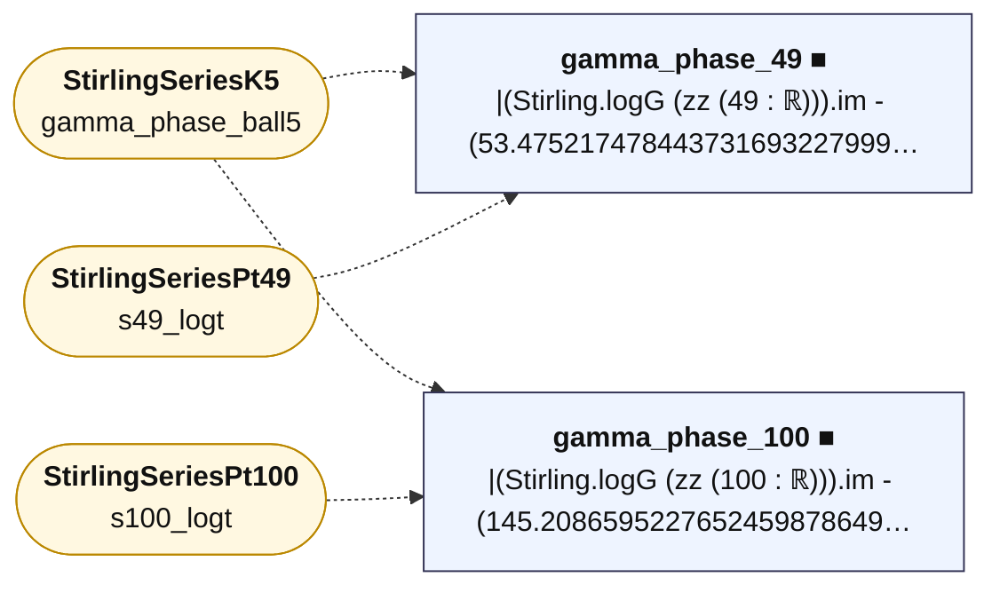

# `lean_stage3/Stage3/StirlingSeriesGammaPhase.lean`

> **Read from the source text.** This file changed after the last `python3 utilities/lean_map.py --dump`, so the arrows on this page are names occurring in each proof and have not been confirmed by Lean.

StirlingSeriesGammaPhase — block S14 of `lean_stage3/design/stencil.md`, Turing at scale: the phase of `Γ(1/4 + it/2)` at rational `t` in a ball, Stirling's series with `K = 5`. 2026-11-25. Generated by `lean_stage3/checks/stirlingseries/gen_stirlingseries.py`; do not edit by hand.

2 theorems, 0 definitions, 49 lines. 

**Imports:** [`StirlingSeriesK5`](../lean_stage3/StirlingSeriesK5.md), [`StirlingSeriesPt100`](../lean_stage3/StirlingSeriesPt100.md), [`StirlingSeriesPt49`](../lean_stage3/StirlingSeriesPt49.md)  
**Imported by:** [`StirlingSeries`](../lean_stage3/StirlingSeries.md)

## The picture



An arrow A → B reads "A is used in the proof of B". Green: counting, integers only. Violet: shape, analysis with no ζ. Blue: reads ζ. A name ending in ■ is an end: nothing else uses it. Red: contains `sorry`. Yellow: theorems in another file, counted; a dotted arrow crosses files. Definitions are not drawn; they are listed below the diagram.

## Theorems

<a name="StirlingSeries-gamma_phase_49"></a>
### `StirlingSeries.gamma_phase_49`

line 29 · arrows read from text

**Reads ζ.** It, or something it rests on, uses the zeta function, its zeros or the Riemann hypothesis.

**Why.** The phase of `Γ(1/4 + it/2)` at `t = 49.0`, Stirling's series with `K = 5`.

**Proves**

```lean
|(Stirling.logG (zz (49 : ℝ))).im - (53.475217478443731693227999150409)| ≤ (0.00000001839550878290902361445)
```

**Fed by** (2 theorems its proof uses)

  - [`StirlingSeries.gamma_phase_ball5`](../lean_stage3/StirlingSeriesK5.md#StirlingSeries-gamma_phase_ball5) (StirlingSeriesK5) — `` |(Stirling.logG (zz t)).im - φ₀| ≤ E + 10 / t ^ 7 ``
  - [`StirlingSeries.s49_logt`](../lean_stage3/StirlingSeriesPt49.md#StirlingSeries-s49_logt) (StirlingSeriesPt49) — `` |Real.log ((49 : ℝ) / 2) - (3.198673117540734086884499189184)| ≤ (0.000000000750043256362389999542) ``

**Definitions its proof touches:** [`SignData.zz`](../lean_stage3/SignDataGamma.md#SignData-zz), [`Stirling.logG`](../lean_stage3/StirlingLog.md#Stirling-logG), [`StirlingSeries.sig5`](../lean_stage3/StirlingSeriesK5.md#StirlingSeries-sig5)

**Feeds:** nothing. It is an end.

<a name="StirlingSeries-gamma_phase_100"></a>
### `StirlingSeries.gamma_phase_100`

line 34 · arrows read from text

**Reads ζ.** It, or something it rests on, uses the zeta function, its zeros or the Riemann hypothesis.

**Why.** The phase of `Γ(1/4 + it/2)` at `t = 100.0`, Stirling's series with `K = 5`.

**Proves**

```lean
|(Stirling.logG (zz (100 : ℝ))).im - (145.208659522765245987864957748603)| ≤ (0.000000037501695896480665224476)
```

**Fed by** (2 theorems its proof uses)

  - [`StirlingSeries.gamma_phase_ball5`](../lean_stage3/StirlingSeriesK5.md#StirlingSeries-gamma_phase_ball5) (StirlingSeriesK5) — `` |(Stirling.logG (zz t)).im - φ₀| ≤ E + 10 / t ^ 7 ``
  - [`StirlingSeries.s100_logt`](../lean_stage3/StirlingSeriesPt100.md#StirlingSeries-s100_logt) (StirlingSeriesPt100) — `` |Real.log ((100 : ℝ) / 2) - (3.912023005398309015776372746574)| ≤ (0.00000000075002928759039232459) ``

**Definitions its proof touches:** [`SignData.zz`](../lean_stage3/SignDataGamma.md#SignData-zz), [`Stirling.logG`](../lean_stage3/StirlingLog.md#Stirling-logG), [`StirlingSeries.sig5`](../lean_stage3/StirlingSeriesK5.md#StirlingSeries-sig5)

**Feeds:** nothing. It is an end.

