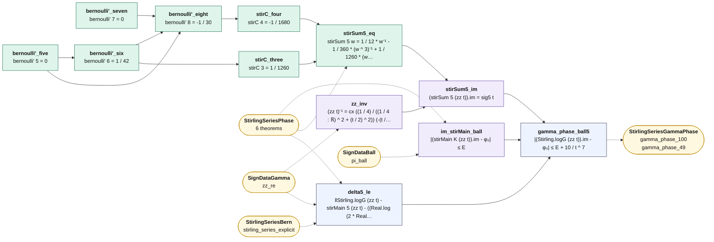

# `lean_stage3/Stage3/StirlingSeriesK5.lean`

> **Read from the source text.** This file changed after the last `python3 utilities/lean_map.py --dump`, so the arrows on this page are names occurring in each proof and have not been confirmed by Lean.

StirlingSeriesK5 — block S14 of `lean_stage3/design/stencil.md`, Turing at scale: the phase of `Γ(1/4 + it/2)` from Stirling's series with the four terms `B₂ … B₈` (`S₅`). 2026-11-25.

12 theorems, 1 definition, 225 lines. 

**Imports:** [`StirlingSeriesBern`](../lean_stage3/StirlingSeriesBern.md), [`StirlingSeriesPhase`](../lean_stage3/StirlingSeriesPhase.md)  
**Imported by:** [`StirlingSeries`](../lean_stage3/StirlingSeries.md), [`StirlingSeriesGammaPhase`](../lean_stage3/StirlingSeriesGammaPhase.md)

## The picture



An arrow A → B reads "A is used in the proof of B". Green: counting, integers only. Violet: shape, analysis with no ζ. Blue: reads ζ. A name ending in ■ is an end: nothing else uses it. Red: contains `sorry`. Yellow: theorems in another file, counted; a dotted arrow crosses files. Definitions are not drawn; they are listed below the diagram.

## Definitions

<a name="StirlingSeries-sig5"></a>
### `StirlingSeries.sig5`

def · line 71

`Im` of `S₅`'s correction at `z = zz t`, with `p + iq = 1/z`.

- **Is:** `` sig5 (t : ℝ) : ℝ := let ρ := (1 / 4 : ℝ) ^ 2 + (t / 2) ^ 2 let p := (1 / 4) / ρ let q := -(t / 2) / ρ 1 / 12 * q - 1 / 360 * (3 * p ^ 2 * q - q ^ 3) + 1 / 1260 * (5 * p ^ 4 * q - 10 * p ^ 2 * q ^ 3 + q ^ 5) - 1 / 1680 * (7 * p ^ 6 * q - 35 * p ^ 4 * q ^ 3 + 21 * p ^ 2 * q ^ 5 - q ^ 7) ``
- **Used by 4:** [`StirlingSeries.gamma_phase_100`](../lean_stage3/StirlingSeriesGammaPhase.md#StirlingSeries-gamma_phase_100), [`StirlingSeries.gamma_phase_49`](../lean_stage3/StirlingSeriesGammaPhase.md#StirlingSeries-gamma_phase_49), [`StirlingSeries.gamma_phase_ball5`](#StirlingSeries-gamma_phase_ball5), [`StirlingSeries.stirSum5_im`](#StirlingSeries-stirSum5_im)

## Theorems

<a name="StirlingSeries-bernoulli-_five"></a>
### `StirlingSeries.bernoulli'_five`

line 32 · arrows read from text

**Counting.** Integers only: nothing in its statement or proof, or in anything it rests on, uses analysis or ζ.

**Proves**

```lean
bernoulli' 5 = 0
```

**Fed by:** no theorem of this repo; it stands on Mathlib.

**Feeds** (2 that use it)

  - [`StirlingSeries.bernoulli'_eight`](#StirlingSeries-bernoulli-_eight) — `` bernoulli' 8 = -1 / 30 ``
  - [`StirlingSeries.bernoulli'_six`](#StirlingSeries-bernoulli-_six) — `` bernoulli' 6 = 1 / 42 ``

<a name="StirlingSeries-bernoulli-_seven"></a>
### `StirlingSeries.bernoulli'_seven`

line 34 · arrows read from text

**Counting.** Integers only: nothing in its statement or proof, or in anything it rests on, uses analysis or ζ.

**Proves**

```lean
bernoulli' 7 = 0
```

**Fed by:** no theorem of this repo; it stands on Mathlib.

**Feeds** (1 that use it)

  - [`StirlingSeries.bernoulli'_eight`](#StirlingSeries-bernoulli-_eight) — `` bernoulli' 8 = -1 / 30 ``

<a name="StirlingSeries-bernoulli-_six"></a>
### `StirlingSeries.bernoulli'_six`

line 36 · arrows read from text

**Counting.** Integers only: nothing in its statement or proof, or in anything it rests on, uses analysis or ζ.

**Proves**

```lean
bernoulli' 6 = 1 / 42
```

**Fed by** (1 theorem its proof uses)

  - [`StirlingSeries.bernoulli'_five`](#StirlingSeries-bernoulli-_five) — `` bernoulli' 5 = 0 ``

**Feeds** (2 that use it)

  - [`StirlingSeries.bernoulli'_eight`](#StirlingSeries-bernoulli-_eight) — `` bernoulli' 8 = -1 / 30 ``
  - [`StirlingSeries.stirC_three`](#StirlingSeries-stirC_three) — `` stirC 3 = 1 / 1260 ``

<a name="StirlingSeries-bernoulli-_eight"></a>
### `StirlingSeries.bernoulli'_eight`

line 42 · arrows read from text

**Counting.** Integers only: nothing in its statement or proof, or in anything it rests on, uses analysis or ζ.

**Proves**

```lean
bernoulli' 8 = -1 / 30
```

**Fed by** (3 theorems its proof uses)

  - [`StirlingSeries.bernoulli'_five`](#StirlingSeries-bernoulli-_five) — `` bernoulli' 5 = 0 ``
  - [`StirlingSeries.bernoulli'_seven`](#StirlingSeries-bernoulli-_seven) — `` bernoulli' 7 = 0 ``
  - [`StirlingSeries.bernoulli'_six`](#StirlingSeries-bernoulli-_six) — `` bernoulli' 6 = 1 / 42 ``

**Feeds** (1 that use it)

  - [`StirlingSeries.stirC_four`](#StirlingSeries-stirC_four) — `` stirC 4 = -1 / 1680 ``

<a name="StirlingSeries-stirC_three"></a>
### `StirlingSeries.stirC_three`

line 49 · arrows read from text

**Counting.** Integers only: nothing in its statement or proof, or in anything it rests on, uses analysis or ζ.

**Proves**

```lean
stirC 3 = 1 / 1260
```

**Fed by** (1 theorem its proof uses)

  - [`StirlingSeries.bernoulli'_six`](#StirlingSeries-bernoulli-_six) — `` bernoulli' 6 = 1 / 42 ``

**Definitions its proof touches:** [`StirlingSeries.stirC`](../lean_stage3/StirlingSeriesEM.md#StirlingSeries-stirC)

**Feeds** (1 that use it)

  - [`StirlingSeries.stirSum5_eq`](#StirlingSeries-stirSum5_eq) — `` stirSum 5 w = 1 / 12 * w⁻¹ - 1 / 360 * (w ^ 3)⁻¹ + 1 / 1260 * (w ^ 5)⁻¹ - 1 / 1680 * (w ^ 7)⁻¹ ``

<a name="StirlingSeries-stirC_four"></a>
### `StirlingSeries.stirC_four`

line 55 · arrows read from text

**Counting.** Integers only: nothing in its statement or proof, or in anything it rests on, uses analysis or ζ.

**Proves**

```lean
stirC 4 = -1 / 1680
```

**Fed by** (1 theorem its proof uses)

  - [`StirlingSeries.bernoulli'_eight`](#StirlingSeries-bernoulli-_eight) — `` bernoulli' 8 = -1 / 30 ``

**Definitions its proof touches:** [`StirlingSeries.stirC`](../lean_stage3/StirlingSeriesEM.md#StirlingSeries-stirC)

**Feeds** (1 that use it)

  - [`StirlingSeries.stirSum5_eq`](#StirlingSeries-stirSum5_eq) — `` stirSum 5 w = 1 / 12 * w⁻¹ - 1 / 360 * (w ^ 3)⁻¹ + 1 / 1260 * (w ^ 5)⁻¹ - 1 / 1680 * (w ^ 7)⁻¹ ``

<a name="StirlingSeries-stirSum5_eq"></a>
### `StirlingSeries.stirSum5_eq`

line 61 · arrows read from text

**Counting.** Integers only: nothing in its statement or proof, or in anything it rests on, uses analysis or ζ.

**Proves**

```lean
stirSum 5 w = 1 / 12 * w⁻¹ - 1 / 360 * (w ^ 3)⁻¹ + 1 / 1260 * (w ^ 5)⁻¹ - 1 / 1680 * (w ^ 7)⁻¹
```

**Needs** (its hypotheses)

  - `` w : ℂ ``

**Fed by** (4 theorems its proof uses)

  - [`StirlingSeries.stirC_four`](#StirlingSeries-stirC_four) — `` stirC 4 = -1 / 1680 ``
  - [`StirlingSeries.stirC_three`](#StirlingSeries-stirC_three) — `` stirC 3 = 1 / 1260 ``
  - [`StirlingSeries.stirC_one`](../lean_stage3/StirlingSeriesPhase.md#StirlingSeries-stirC_one) (StirlingSeriesPhase) — `` stirC 1 = 1 / 12 ``
  - [`StirlingSeries.stirC_two`](../lean_stage3/StirlingSeriesPhase.md#StirlingSeries-stirC_two) (StirlingSeriesPhase) — `` stirC 2 = -1 / 360 ``

**Definitions its proof touches:** [`StirlingSeries.stirSum`](../lean_stage3/StirlingSeriesEM.md#StirlingSeries-stirSum)

**Feeds** (1 that use it)

  - [`StirlingSeries.stirSum5_im`](#StirlingSeries-stirSum5_im) — `` (stirSum 5 (zz t)).im = sig5 t ``

<a name="StirlingSeries-zz_inv"></a>
### `StirlingSeries.zz_inv`

line 79 · arrows read from text

**Shape.** Uses real or complex analysis; nothing in it or beneath it reads ζ.

**Proves**

```lean
(zz t)⁻¹ = cx ((1 / 4) / ((1 / 4 : ℝ) ^ 2 + (t / 2) ^ 2)) (-(t / 2) / ((1 / 4 : ℝ) ^ 2 + (t / 2) ^ 2))
```

**Needs** (its hypotheses)

  - `` t : ℝ ``

**Fed by** (1 theorem its proof uses)

  - [`SignData.zz_re`](../lean_stage3/SignDataGamma.md#SignData-zz_re) (SignDataGamma) — `` (zz t).re = 1 / 4 ``

**Definitions its proof touches:** [`SignData.cx`](../lean_stage3/SignDataBall.md#SignData-cx), [`SignData.zz`](../lean_stage3/SignDataGamma.md#SignData-zz)

**Feeds** (1 that use it)

  - [`StirlingSeries.stirSum5_im`](#StirlingSeries-stirSum5_im) — `` (stirSum 5 (zz t)).im = sig5 t ``

<a name="StirlingSeries-stirSum5_im"></a>
### `StirlingSeries.stirSum5_im`

line 94 · arrows read from text

**Shape.** Uses real or complex analysis; nothing in it or beneath it reads ζ.

**Proves**

```lean
(stirSum 5 (zz t)).im = sig5 t
```

**Needs** (its hypotheses)

  - `` t : ℝ ``

**Fed by** (2 theorems its proof uses)

  - [`StirlingSeries.stirSum5_eq`](#StirlingSeries-stirSum5_eq) — `` stirSum 5 w = 1 / 12 * w⁻¹ - 1 / 360 * (w ^ 3)⁻¹ + 1 / 1260 * (w ^ 5)⁻¹ - 1 / 1680 * (w ^ 7)⁻¹ ``
  - [`StirlingSeries.zz_inv`](#StirlingSeries-zz_inv) — `` (zz t)⁻¹ = cx ((1 / 4) / ((1 / 4 : ℝ) ^ 2 + (t / 2) ^ 2)) (-(t / 2) / ((1 / 4 : ℝ) ^ 2 + (t / 2) ^ 2)) ``

**Definitions its proof touches:** [`SignData.cx`](../lean_stage3/SignDataBall.md#SignData-cx), [`SignData.zz`](../lean_stage3/SignDataGamma.md#SignData-zz), [`StirlingSeries.stirSum`](../lean_stage3/StirlingSeriesEM.md#StirlingSeries-stirSum), [`StirlingSeries.sig5`](#StirlingSeries-sig5)

**Feeds** (1 that use it)

  - [`StirlingSeries.gamma_phase_ball5`](#StirlingSeries-gamma_phase_ball5) — `` |(Stirling.logG (zz t)).im - φ₀| ≤ E + 10 / t ^ 7 ``

<a name="StirlingSeries-delta5_le"></a>
### `StirlingSeries.delta5_le`

line 101 · arrows read from text

**Reads ζ.** It, or something it rests on, uses the zeta function, its zeros or the Riemann hypothesis.

**Why.** The remainder at `K = 5`: `‖logG z − S₅ z − ½ log 2π‖ ≤ 10/|t|⁷` for `|t| ≥ 1`.

**Proves**

```lean
‖Stirling.logG (zz t) - stirMain 5 (zz t) - ((Real.log (2 * Real.pi) / 2 : ℝ) : ℂ)‖ ≤ 10 / |t| ^ 7
```

**Needs** (its hypotheses)

  - `` ht : 1 ≤ |t| ``

**Fed by** (4 theorems its proof uses)

  - [`SignData.zz_re`](../lean_stage3/SignDataGamma.md#SignData-zz_re) (SignDataGamma) — `` (zz t).re = 1 / 4 ``
  - [`StirlingSeries.stirling_series_explicit`](../lean_stage3/StirlingSeriesBern.md#StirlingSeries-stirling_series_explicit) (StirlingSeriesBern) — `` ‖Stirling.logG z - stirMain (K + 1) z - ((Real.log (2 * Real.pi) / 2 : ℝ) : ℂ)‖ ≤ 4 * (2 * K).factorial / 6 ^ (2 * K) / (2 * K) * (6 / |z.im|) / ‖z‖ ^… ``
  - [`StirlingSeries.norm_zz_ge`](../lean_stage3/StirlingSeriesPhase.md#StirlingSeries-norm_zz_ge) (StirlingSeriesPhase) — `` |t| / 2 ≤ ‖zz t‖ ``
  - [`StirlingSeries.zz_im`](../lean_stage3/StirlingSeriesPhase.md#StirlingSeries-zz_im) (StirlingSeriesPhase) — `` (zz t).im = t / 2 ``

**Definitions its proof touches:** [`SignData.zz`](../lean_stage3/SignDataGamma.md#SignData-zz), [`Stirling.logG`](../lean_stage3/StirlingLog.md#Stirling-logG), [`StirlingSeries.stirMain`](../lean_stage3/StirlingSeriesEM.md#StirlingSeries-stirMain)

**Feeds** (1 that use it)

  - [`StirlingSeries.gamma_phase_ball5`](#StirlingSeries-gamma_phase_ball5) — `` |(Stirling.logG (zz t)).im - φ₀| ≤ E + 10 / t ^ 7 ``

<a name="StirlingSeries-im_stirMain_ball"></a>
### `StirlingSeries.im_stirMain_ball`

line 129 · arrows read from text

**Shape.** Uses real or complex analysis; nothing in it or beneath it reads ζ.

**Why.** `Im S_K(zz t)` in closed form, for any `K`, given `σ = Im Σ_{k<K} c_k z^{1−2k}`.

**Proves**

```lean
|(stirMain K (zz t)).im - φ₀| ≤ E
```

**Needs** (its hypotheses)

  - `` K : ℕ ``
  - `` ht : 0 < t ``
  - `` hy1 : 1 / (2 * t) < 1 ``
  - `` hℓ : |Real.log (t / 2) - ℓ| ≤ eℓ ``
  - `` hσ : (stirSum K (zz t)).im = σ ``
  - `` hφ : |(t / 2) * (ℓ + (1 / (2 * t)) ^ 2 / 2 - (1 / (2 * t)) ^ 4 / 4) - (3.14159265358979323846 / 2 + (-(1 / (2 * t)) + (1 / (2 * t)) ^ 3 / 3 - (1 / (2 * t)) ^ 5 / 5)) / 4 - t / 2 + σ - φ₀| + (t / 2) * (eℓ + (1 / (2 * t)) ^ 6 * (1 - 1 / (2 * t))⁻¹ / 6) + (1 / 10 ^ 20 / 2 + (1 / (2 * t)) ^ 6 * (1 - 1 /… ``

**Fed by** (3 theorems its proof uses)

  - [`SignData.pi_ball`](../lean_stage3/SignDataBall.md#SignData-pi_ball) (SignDataBall) — `` |Real.pi - 3.14159265358979323846| ≤ 1 / 10 ^ 20 ``
  - [`StirlingSeries.log_one_sub_ball`](../lean_stage3/StirlingSeriesPhase.md#StirlingSeries-log_one_sub_ball) (StirlingSeriesPhase) — `` ‖log (1 + cx 0 (-y)) - cx (y ^ 2 / 2 - y ^ 4 / 4) (-y + y ^ 3 / 3 - y ^ 5 / 5)‖ ≤ y ^ 6 * (1 - y)⁻¹ / 6 ``
  - [`StirlingSeries.log_zz_eq`](../lean_stage3/StirlingSeriesPhase.md#StirlingSeries-log_zz_eq) (StirlingSeriesPhase) — `` log (zz t) = ((Real.log (t / 2) : ℝ) : ℂ) + ((Real.pi / 2 : ℝ) : ℂ) * I + log (1 + cx 0 (-(1 / (2 * t)))) ``

**Definitions its proof touches:** [`SignData.cx`](../lean_stage3/SignDataBall.md#SignData-cx), [`SignData.zz`](../lean_stage3/SignDataGamma.md#SignData-zz), [`StirlingSeries.stirMain`](../lean_stage3/StirlingSeriesEM.md#StirlingSeries-stirMain), [`StirlingSeries.stirSum`](../lean_stage3/StirlingSeriesEM.md#StirlingSeries-stirSum)

**Feeds** (1 that use it)

  - [`StirlingSeries.gamma_phase_ball5`](#StirlingSeries-gamma_phase_ball5) — `` |(Stirling.logG (zz t)).im - φ₀| ≤ E + 10 / t ^ 7 ``

<a name="StirlingSeries-gamma_phase_ball5"></a>
### `StirlingSeries.gamma_phase_ball5`

line 191 · arrows read from text

**Reads ζ.** It, or something it rests on, uses the zeta function, its zeros or the Riemann hypothesis.

**Why.** The phase of `Γ(1/4 + it/2)` in a ball, `K = 5`: `|Im logG(zz t) − φ₀| ≤ E + 10/t⁷`.

**Proves**

```lean
|(Stirling.logG (zz t)).im - φ₀| ≤ E + 10 / t ^ 7
```

**Needs** (its hypotheses)

  - `` ht : 1 ≤ t ``
  - `` hℓ : |Real.log (t / 2) - ℓ| ≤ eℓ ``
  - `` hφ : |(t / 2) * (ℓ + (1 / (2 * t)) ^ 2 / 2 - (1 / (2 * t)) ^ 4 / 4) - (3.14159265358979323846 / 2 + (-(1 / (2 * t)) + (1 / (2 * t)) ^ 3 / 3 - (1 / (2 * t)) ^ 5 / 5)) / 4 - t / 2 + sig5 t - φ₀| + (t / 2) * (eℓ + (1 / (2 * t)) ^ 6 * (1 - 1 / (2 * t))⁻¹ / 6) + (1 / 10 ^ 20 / 2 + (1 / (2 * t)) ^ 6 * (1 … ``

**Fed by** (3 theorems its proof uses)

  - [`StirlingSeries.delta5_le`](#StirlingSeries-delta5_le) — `` ‖Stirling.logG (zz t) - stirMain 5 (zz t) - ((Real.log (2 * Real.pi) / 2 : ℝ) : ℂ)‖ ≤ 10 / |t| ^ 7 ``
  - [`StirlingSeries.im_stirMain_ball`](#StirlingSeries-im_stirMain_ball) — `` |(stirMain K (zz t)).im - φ₀| ≤ E ``
  - [`StirlingSeries.stirSum5_im`](#StirlingSeries-stirSum5_im) — `` (stirSum 5 (zz t)).im = sig5 t ``

**Definitions its proof touches:** [`SignData.zz`](../lean_stage3/SignDataGamma.md#SignData-zz), [`Stirling.logG`](../lean_stage3/StirlingLog.md#Stirling-logG), [`StirlingSeries.stirMain`](../lean_stage3/StirlingSeriesEM.md#StirlingSeries-stirMain), [`StirlingSeries.sig5`](#StirlingSeries-sig5)

**Feeds** (2 that use it)

  - [`StirlingSeries.gamma_phase_100`](../lean_stage3/StirlingSeriesGammaPhase.md#StirlingSeries-gamma_phase_100) (StirlingSeriesGammaPhase) — `` |(Stirling.logG (zz (100 : ℝ))).im - (145.208659522765245987864957748603)| ≤ (0.000000037501695896480665224476) ``
  - [`StirlingSeries.gamma_phase_49`](../lean_stage3/StirlingSeriesGammaPhase.md#StirlingSeries-gamma_phase_49) (StirlingSeriesGammaPhase) — `` |(Stirling.logG (zz (49 : ℝ))).im - (53.475217478443731693227999150409)| ≤ (0.00000001839550878290902361445) ``

