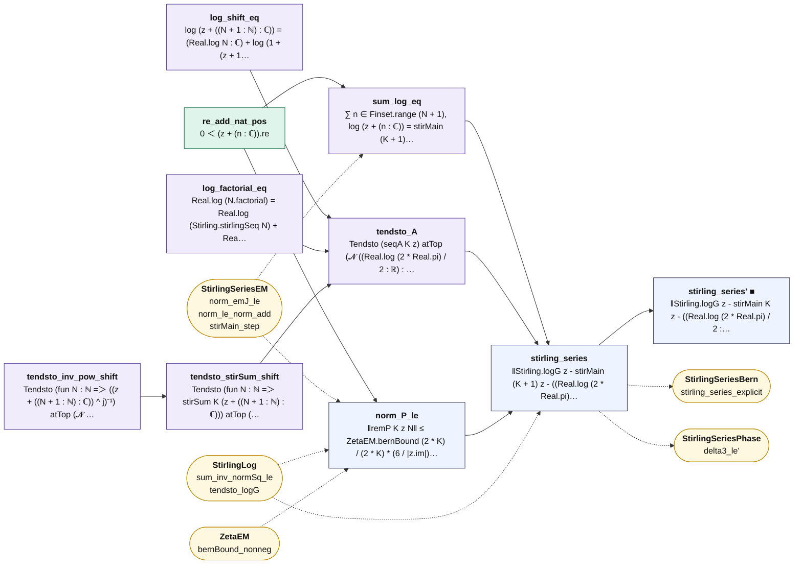

# `lean_stage3/Stage3/StirlingSeriesLim.lean`

> **Read from the source text.** This file changed after the last `python3 utilities/lean_map.py --dump`, so the arrows on this page are names occurring in each proof and have not been confirmed by Lean.

StirlingSeriesLim — block S14 of `lean_stage3/design/stencil.md`, Turing at scale: Stirling's series for `log Γ` with an explicit remainder. 2026-11-25.

10 theorems, 2 definitions, 279 lines. 

**Imports:** [`StirlingSeriesEM`](../lean_stage3/StirlingSeriesEM.md)  
**Imported by:** [`StirlingSeries`](../lean_stage3/StirlingSeries.md), [`StirlingSeriesBern`](../lean_stage3/StirlingSeriesBern.md), [`StirlingSeriesPhase`](../lean_stage3/StirlingSeriesPhase.md)

## The picture



An arrow A → B reads "A is used in the proof of B". Green: counting, integers only. Violet: shape, analysis with no ζ. Blue: reads ζ. A name ending in ■ is an end: nothing else uses it. Red: contains `sorry`. Yellow: theorems in another file, counted; a dotted arrow crosses files. Definitions are not drawn; they are listed below the diagram.

## Definitions

<a name="StirlingSeries-remP"></a>
### `StirlingSeries.remP`

def · line 37

The remainder's partial sums `P_N = Σ_{n≤N} J_{2K}(z+n)/(2K)`.

- **Is:** `` remP (K : ℕ) (z : ℂ) (N : ℕ) : ℂ := ∑ n ∈ Finset.range (N + 1), emJ (2 * K) (z + (n : ℂ)) / (2 * K) ``
- **Built from:** [`StirlingSeries.emJ`](../lean_stage3/StirlingSeriesEM.md#StirlingSeries-emJ)
- **Used by 3:** [`StirlingSeries.norm_P_le`](#StirlingSeries-norm_P_le), [`StirlingSeries.stirling_series`](#StirlingSeries-stirling_series), [`StirlingSeries.sum_log_eq`](#StirlingSeries-sum_log_eq)

<a name="StirlingSeries-seqA"></a>
### `StirlingSeries.seqA`

def · line 41

`A_N = z log N + log N! − S_{K+1}(z + N + 1)`.

- **Is:** `` seqA (K : ℕ) (z : ℂ) (N : ℕ) : ℂ := z * (Real.log N : ℂ) + (Real.log (N.factorial) : ℂ) - stirMain (K + 1) (z + ((N + 1 : ℕ) : ℂ)) ``
- **Built from:** [`StirlingSeries.stirMain`](../lean_stage3/StirlingSeriesEM.md#StirlingSeries-stirMain)
- **Used by 2:** [`StirlingSeries.stirling_series`](#StirlingSeries-stirling_series), [`StirlingSeries.tendsto_A`](#StirlingSeries-tendsto_A)

## Theorems

<a name="StirlingSeries-re_add_nat_pos"></a>
### `StirlingSeries.re_add_nat_pos`

line 44 · arrows read from text

**Counting.** Integers only: nothing in its statement or proof, or in anything it rests on, uses analysis or ζ.

**Proves**

```lean
0 < (z + (n : ℂ)).re
```

**Needs** (its hypotheses)

  - `` hz : 0 < z.re ``
  - `` n : ℕ ``

**Fed by:** no theorem of this repo; it stands on Mathlib.

**Feeds** (2 that use it)

  - [`StirlingSeries.norm_P_le`](#StirlingSeries-norm_P_le) — `` ‖remP K z N‖ ≤ ZetaEM.bernBound (2 * K) / (2 * K) * (6 / |z.im|) / ‖z‖ ^ (2 * K - 2) ``
  - [`StirlingSeries.sum_log_eq`](#StirlingSeries-sum_log_eq) — `` ∑ n ∈ Finset.range (N + 1), log (z + (n : ℂ)) = stirMain (K + 1) (z + ((N + 1 : ℕ) : ℂ)) - stirMain (K + 1) z + remP K z N ``

<a name="StirlingSeries-sum_log_eq"></a>
### `StirlingSeries.sum_log_eq`

line 50 · arrows read from text

**Shape.** Uses real or complex analysis; nothing in it or beneath it reads ζ.

**Why.** The telescoped sum: `Σ_{n≤N} log(z+n) = S_{K+1}(z+N+1) − S_{K+1}(z) + P_N`.

**Proves**

```lean
∑ n ∈ Finset.range (N + 1), log (z + (n : ℂ)) = stirMain (K + 1) (z + ((N + 1 : ℕ) : ℂ)) - stirMain (K + 1) z + remP K z N
```

**Needs** (its hypotheses)

  - `` hK : 1 ≤ K ``
  - `` hz : 0 < z.re ``
  - `` N : ℕ ``

**Fed by** (2 theorems its proof uses)

  - [`StirlingSeries.stirMain_step`](../lean_stage3/StirlingSeriesEM.md#StirlingSeries-stirMain_step) (StirlingSeriesEM) — `` stirMain (K + 1) (w + 1) - stirMain (K + 1) w - log w = -(emJ (2 * K) w / (2 * K)) ``
  - [`StirlingSeries.re_add_nat_pos`](#StirlingSeries-re_add_nat_pos) — `` 0 < (z + (n : ℂ)).re ``

**Definitions its proof touches:** [`StirlingSeries.stirMain`](../lean_stage3/StirlingSeriesEM.md#StirlingSeries-stirMain), [`StirlingSeries.remP`](#StirlingSeries-remP)

**Feeds** (1 that use it)

  - [`StirlingSeries.stirling_series`](#StirlingSeries-stirling_series) — `` ‖Stirling.logG z - stirMain (K + 1) z - ((Real.log (2 * Real.pi) / 2 : ℝ) : ℂ)‖ ≤ ZetaEM.bernBound (2 * K) / (2 * K) * (6 / |z.im|) / ‖z‖ ^ (2 * K - 2… ``

<a name="StirlingSeries-log_shift_eq"></a>
### `StirlingSeries.log_shift_eq`

line 70 · arrows read from text

**Shape.** Uses real or complex analysis; nothing in it or beneath it reads ζ.

**Why.** `log(z + N + 1) = log N + log(1 + (z+1)/N)` for `N ≥ 1`, `Re z ≥ 0`.

**Proves**

```lean
log (z + ((N + 1 : ℕ) : ℂ)) = (Real.log N : ℂ) + log (1 + (z + 1) / (N : ℂ))
```

**Needs** (its hypotheses)

  - `` hz : 0 ≤ z.re ``
  - `` hN : 1 ≤ N ``

**Fed by:** no theorem of this repo; it stands on Mathlib.

**Feeds** (1 that use it)

  - [`StirlingSeries.tendsto_A`](#StirlingSeries-tendsto_A) — `` Tendsto (seqA K z) atTop (𝓝 ((Real.log (2 * Real.pi) / 2 : ℝ) : ℂ)) ``

<a name="StirlingSeries-log_factorial_eq"></a>
### `StirlingSeries.log_factorial_eq`

line 90 · arrows read from text

**Shape.** Uses real or complex analysis; nothing in it or beneath it reads ζ.

**Why.** `log N! = log(stirlingSeq N) + ½ log 2 + ½ log N + N log N − N` for `N ≥ 1`.

**Proves**

```lean
Real.log (N.factorial) = Real.log (Stirling.stirlingSeq N) + Real.log 2 / 2 + Real.log N / 2 + N * Real.log N - N
```

**Needs** (its hypotheses)

  - `` hN : 1 ≤ N ``

**Fed by:** no theorem of this repo; it stands on Mathlib.

**Feeds** (1 that use it)

  - [`StirlingSeries.tendsto_A`](#StirlingSeries-tendsto_A) — `` Tendsto (seqA K z) atTop (𝓝 ((Real.log (2 * Real.pi) / 2 : ℝ) : ℂ)) ``

<a name="StirlingSeries-tendsto_inv_pow_shift"></a>
### `StirlingSeries.tendsto_inv_pow_shift`

line 99 · arrows read from text

**Shape.** Uses real or complex analysis; nothing in it or beneath it reads ζ.

**Proves**

```lean
Tendsto (fun N : ℕ => ((z + ((N + 1 : ℕ) : ℂ)) ^ j)⁻¹) atTop (𝓝 0)
```

**Needs** (its hypotheses)

  - `` hz : 0 ≤ z.re ``
  - `` hj : 1 ≤ j ``

**Fed by:** no theorem of this repo; it stands on Mathlib.

**Feeds** (1 that use it)

  - [`StirlingSeries.tendsto_stirSum_shift`](#StirlingSeries-tendsto_stirSum_shift) — `` Tendsto (fun N : ℕ => stirSum K (z + ((N + 1 : ℕ) : ℂ))) atTop (𝓝 0) ``

<a name="StirlingSeries-tendsto_stirSum_shift"></a>
### `StirlingSeries.tendsto_stirSum_shift`

line 120 · arrows read from text

**Shape.** Uses real or complex analysis; nothing in it or beneath it reads ζ.

**Proves**

```lean
Tendsto (fun N : ℕ => stirSum K (z + ((N + 1 : ℕ) : ℂ))) atTop (𝓝 0)
```

**Needs** (its hypotheses)

  - `` hz : 0 ≤ z.re ``
  - `` K : ℕ ``

**Fed by** (1 theorem its proof uses)

  - [`StirlingSeries.tendsto_inv_pow_shift`](#StirlingSeries-tendsto_inv_pow_shift) — `` Tendsto (fun N : ℕ => ((z + ((N + 1 : ℕ) : ℂ)) ^ j)⁻¹) atTop (𝓝 0) ``

**Definitions its proof touches:** [`StirlingSeries.stirC`](../lean_stage3/StirlingSeriesEM.md#StirlingSeries-stirC), [`StirlingSeries.stirSum`](../lean_stage3/StirlingSeriesEM.md#StirlingSeries-stirSum)

**Feeds** (1 that use it)

  - [`StirlingSeries.tendsto_A`](#StirlingSeries-tendsto_A) — `` Tendsto (seqA K z) atTop (𝓝 ((Real.log (2 * Real.pi) / 2 : ℝ) : ℂ)) ``

<a name="StirlingSeries-tendsto_A"></a>
### `StirlingSeries.tendsto_A`

line 130 · arrows read from text

**Shape.** Uses real or complex analysis; nothing in it or beneath it reads ζ.

**Why.** The constant: `z log N + log N! − S_{K+1}(z+N+1) → ½ log 2π`.

**Proves**

```lean
Tendsto (seqA K z) atTop (𝓝 ((Real.log (2 * Real.pi) / 2 : ℝ) : ℂ))
```

**Needs** (its hypotheses)

  - `` hz : 0 ≤ z.re ``
  - `` K : ℕ ``

**Fed by** (3 theorems its proof uses)

  - [`StirlingSeries.log_factorial_eq`](#StirlingSeries-log_factorial_eq) — `` Real.log (N.factorial) = Real.log (Stirling.stirlingSeq N) + Real.log 2 / 2 + Real.log N / 2 + N * Real.log N - N ``
  - [`StirlingSeries.log_shift_eq`](#StirlingSeries-log_shift_eq) — `` log (z + ((N + 1 : ℕ) : ℂ)) = (Real.log N : ℂ) + log (1 + (z + 1) / (N : ℂ)) ``
  - [`StirlingSeries.tendsto_stirSum_shift`](#StirlingSeries-tendsto_stirSum_shift) — `` Tendsto (fun N : ℕ => stirSum K (z + ((N + 1 : ℕ) : ℂ))) atTop (𝓝 0) ``

**Definitions its proof touches:** [`StirlingSeries.stirMain`](../lean_stage3/StirlingSeriesEM.md#StirlingSeries-stirMain), [`StirlingSeries.seqA`](#StirlingSeries-seqA)

**Feeds** (1 that use it)

  - [`StirlingSeries.stirling_series`](#StirlingSeries-stirling_series) — `` ‖Stirling.logG z - stirMain (K + 1) z - ((Real.log (2 * Real.pi) / 2 : ℝ) : ℂ)‖ ≤ ZetaEM.bernBound (2 * K) / (2 * K) * (6 / |z.im|) / ‖z‖ ^ (2 * K - 2… ``

<a name="StirlingSeries-norm_P_le"></a>
### `StirlingSeries.norm_P_le`

line 169 · arrows read from text

**Reads ζ.** It, or something it rests on, uses the zeta function, its zeros or the Riemann hypothesis.

**Why.** `‖P_N‖ ≤ bernBound(2K)/(2K)·(6/|Im z|)/‖z‖^{2K−2}`.

**Proves**

```lean
‖remP K z N‖ ≤ ZetaEM.bernBound (2 * K) / (2 * K) * (6 / |z.im|) / ‖z‖ ^ (2 * K - 2)
```

**Needs** (its hypotheses)

  - `` hK : 1 ≤ K ``
  - `` hz : 0 < z.re ``
  - `` hY : 1 / 2 ≤ |z.im| ``
  - `` N : ℕ ``

**Fed by** (5 theorems its proof uses)

  - [`Stirling.sum_inv_normSq_le`](../lean_stage3/StirlingLog.md#Stirling-sum_inv_normSq_le) (StirlingLog) — `` ∑ m ∈ Finset.range N, 1 / ‖z + m‖ ^ 2 ≤ 6 / |z.im| ``
  - [`StirlingSeries.norm_emJ_le`](../lean_stage3/StirlingSeriesEM.md#StirlingSeries-norm_emJ_le) (StirlingSeriesEM) — `` ‖emJ m w‖ ≤ ZetaEM.bernBound m / ‖w‖ ^ m ``
  - [`StirlingSeries.norm_le_norm_add`](../lean_stage3/StirlingSeriesEM.md#StirlingSeries-norm_le_norm_add) (StirlingSeriesEM) — `` ‖w‖ ≤ ‖w + (x : ℂ)‖ ``
  - [`StirlingSeries.re_add_nat_pos`](#StirlingSeries-re_add_nat_pos) — `` 0 < (z + (n : ℂ)).re ``
  - [`ZetaEM.bernBound_nonneg`](../lean_stage3/ZetaEM.md#ZetaEM-bernBound_nonneg) (ZetaEM) — `` 0 ≤ bernBound k ``

**Definitions its proof touches:** [`StirlingSeries.emJ`](../lean_stage3/StirlingSeriesEM.md#StirlingSeries-emJ), [`StirlingSeries.remP`](#StirlingSeries-remP), [`ZetaEM.bernBound`](../lean_stage3/ZetaEM.md#ZetaEM-bernBound)

**Feeds** (1 that use it)

  - [`StirlingSeries.stirling_series`](#StirlingSeries-stirling_series) — `` ‖Stirling.logG z - stirMain (K + 1) z - ((Real.log (2 * Real.pi) / 2 : ℝ) : ℂ)‖ ≤ ZetaEM.bernBound (2 * K) / (2 * K) * (6 / |z.im|) / ‖z‖ ^ (2 * K - 2… ``

<a name="StirlingSeries-stirling_series"></a>
### `StirlingSeries.stirling_series`

line 220 · arrows read from text

**Reads ζ.** It, or something it rests on, uses the zeta function, its zeros or the Riemann hypothesis.

**Why.** Stirling's series with an explicit remainder: for `Re z > 0`, `|Im z| ≥ ½`, `K ≥ 1`, `‖logG z − S_{K+1}(z) − ½ log 2π‖ ≤ bernBound(2K)/(2K)·(6/|Im z|)/‖z‖^{2K−2}`.

**Proves**

```lean
‖Stirling.logG z - stirMain (K + 1) z - ((Real.log (2 * Real.pi) / 2 : ℝ) : ℂ)‖ ≤ ZetaEM.bernBound (2 * K) / (2 * K) * (6 / |z.im|) / ‖z‖ ^ (2 * K - 2)
```

**Needs** (its hypotheses)

  - `` hz : 0 < z.re ``
  - `` hY : 1 / 2 ≤ |z.im| ``
  - `` hK : 1 ≤ K ``

**Fed by** (4 theorems its proof uses)

  - [`Stirling.tendsto_logG`](../lean_stage3/StirlingLog.md#Stirling-tendsto_logG) (StirlingLog) — `` Tendsto (Complex.logGammaSeq z) atTop (𝓝 (logG z)) ``
  - [`StirlingSeries.norm_P_le`](#StirlingSeries-norm_P_le) — `` ‖remP K z N‖ ≤ ZetaEM.bernBound (2 * K) / (2 * K) * (6 / |z.im|) / ‖z‖ ^ (2 * K - 2) ``
  - [`StirlingSeries.sum_log_eq`](#StirlingSeries-sum_log_eq) — `` ∑ n ∈ Finset.range (N + 1), log (z + (n : ℂ)) = stirMain (K + 1) (z + ((N + 1 : ℕ) : ℂ)) - stirMain (K + 1) z + remP K z N ``
  - [`StirlingSeries.tendsto_A`](#StirlingSeries-tendsto_A) — `` Tendsto (seqA K z) atTop (𝓝 ((Real.log (2 * Real.pi) / 2 : ℝ) : ℂ)) ``

**Definitions its proof touches:** [`Stirling.logG`](../lean_stage3/StirlingLog.md#Stirling-logG), [`StirlingSeries.stirMain`](../lean_stage3/StirlingSeriesEM.md#StirlingSeries-stirMain), [`StirlingSeries.remP`](#StirlingSeries-remP), [`StirlingSeries.seqA`](#StirlingSeries-seqA), [`ZetaEM.bernBound`](../lean_stage3/ZetaEM.md#ZetaEM-bernBound)

**Feeds** (3 that use it)

  - [`StirlingSeries.stirling_series_explicit`](../lean_stage3/StirlingSeriesBern.md#StirlingSeries-stirling_series_explicit) (StirlingSeriesBern) — `` ‖Stirling.logG z - stirMain (K + 1) z - ((Real.log (2 * Real.pi) / 2 : ℝ) : ℂ)‖ ≤ 4 * (2 * K).factorial / 6 ^ (2 * K) / (2 * K) * (6 / |z.im|) / ‖z‖ ^… ``
  - [`StirlingSeries.stirling_series'`](#StirlingSeries-stirling_series-) — `` ‖Stirling.logG z - stirMain K z - ((Real.log (2 * Real.pi) / 2 : ℝ) : ℂ)‖ ≤ ‖stirC K‖ / ‖z‖ ^ (2 * K - 1) + ZetaEM.bernBound (2 * K) / (2 * K) * (6 / … ``
  - [`StirlingSeries.delta3_le'`](../lean_stage3/StirlingSeriesPhase.md#StirlingSeries-delta3_le-) (StirlingSeriesPhase) — `` ‖Stirling.logG (zz t) - stirMain 3 (zz t) - ((Real.log (2 * Real.pi) / 2 : ℝ) : ℂ)‖ ≤ 2 / 5 / |t| ^ 3 ``

<a name="StirlingSeries-stirling_series-"></a>
### `StirlingSeries.stirling_series'`

line 243 · arrows read from text

**Reads ζ.** It, or something it rests on, uses the zeta function, its zeros or the Riemann hypothesis.

**Why.** The form with `S_K`: the remainder after the terms `k < K` is at most `‖c_K‖/‖z‖^{2K−1} + bernBound(2K)/(2K)·(6/|Im z|)/‖z‖^{2K−2}`.

**Proves**

```lean
‖Stirling.logG z - stirMain K z - ((Real.log (2 * Real.pi) / 2 : ℝ) : ℂ)‖ ≤ ‖stirC K‖ / ‖z‖ ^ (2 * K - 1) + ZetaEM.bernBound (2 * K) / (2 * K) * (6 / |z.im|) / ‖z‖ ^ (2 * K - 2)
```

**Needs** (its hypotheses)

  - `` hz : 0 < z.re ``
  - `` hY : 1 / 2 ≤ |z.im| ``
  - `` hK : 1 ≤ K ``

**Fed by** (1 theorem its proof uses)

  - [`StirlingSeries.stirling_series`](#StirlingSeries-stirling_series) — `` ‖Stirling.logG z - stirMain (K + 1) z - ((Real.log (2 * Real.pi) / 2 : ℝ) : ℂ)‖ ≤ ZetaEM.bernBound (2 * K) / (2 * K) * (6 / |z.im|) / ‖z‖ ^ (2 * K - 2… ``

**Definitions its proof touches:** [`Stirling.logG`](../lean_stage3/StirlingLog.md#Stirling-logG), [`StirlingSeries.stirC`](../lean_stage3/StirlingSeriesEM.md#StirlingSeries-stirC), [`StirlingSeries.stirMain`](../lean_stage3/StirlingSeriesEM.md#StirlingSeries-stirMain), [`StirlingSeries.stirSum`](../lean_stage3/StirlingSeriesEM.md#StirlingSeries-stirSum), [`ZetaEM.bernBound`](../lean_stage3/ZetaEM.md#ZetaEM-bernBound)

**Feeds:** nothing. It is an end.

