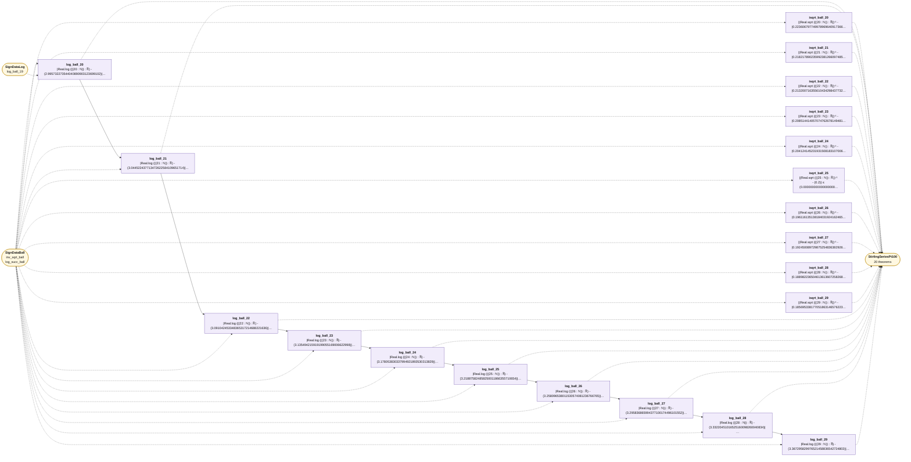

# `lean_stage3/Stage3/StirlingSeriesLog.lean`

> **Read from the source text.** This file changed after the last `python3 utilities/lean_map.py --dump`, so the arrows on this page are names occurring in each proof and have not been confirmed by Lean.

StirlingSeriesLog — block S14 of `lean_stage3/design/stencil.md`, Turing at scale: the real balls `log m` and `(√m)⁻¹` for `20 ≤ m ≤ 29`, continuing `SignDataLog`'s chain. 2026-11-25. Generated by `lean_stage3/checks/stirlingseries/gen_stirlingseries.py`; do not edit by hand.

20 theorems, 0 definitions, 108 lines. 

**Imports:** [`SignDataLog`](../lean_stage3/SignDataLog.md)  
**Imported by:** [`StirlingSeries`](../lean_stage3/StirlingSeries.md), [`StirlingSeriesPt100`](../lean_stage3/StirlingSeriesPt100.md)

## The picture



An arrow A → B reads "A is used in the proof of B". Green: counting, integers only. Violet: shape, analysis with no ζ. Blue: reads ζ. A name ending in ■ is an end: nothing else uses it. Red: contains `sorry`. Yellow: theorems in another file, counted; a dotted arrow crosses files. Definitions are not drawn; they are listed below the diagram.

## Theorems

<a name="StirlingSeries-log_ball_20"></a>
### `StirlingSeries.log_ball_20`

line 21 · arrows read from text

**Shape.** Uses real or complex analysis; nothing in it or beneath it reads ζ.

**Proves**

```lean
|Real.log (((20 : ℕ)) : ℝ) - (2.995732273544040890903123699102)| ≤ (0.000000000250069931036558732271)
```

**Fed by** (2 theorems its proof uses)

  - [`SignData.log_succ_ball`](../lean_stage3/SignDataBall.md#SignData-log_succ_ball) (SignDataBall) — `` |Real.log q - c| ≤ R ``
  - [`SignData.log_ball_19`](../lean_stage3/SignDataLog.md#SignData-log_ball_19) (SignDataLog) — `` |Real.log (((19 : ℕ)) : ℝ) - (2.944438979156490822698758619737)| ≤ (0.000000000250064791233927153323) ``

**Feeds** (2 that use it)

  - [`StirlingSeries.log_ball_21`](#StirlingSeries-log_ball_21) — `` |Real.log (((21 : ℕ)) : ℝ) - (3.044522437713472622584109651714)| ≤ (0.000000000250072928659867036761) ``
  - [`StirlingSeries.s100_E20`](../lean_stage3/StirlingSeriesPt100.md#StirlingSeries-s100_E20) (StirlingSeriesPt100) — `` ‖cexp ((((-((100 : ℝ) * Real.log (((20 : ℕ)) : ℝ))) : ℝ) : ℂ) * Complex.I) - cx (-(0.433948709474731235154872988879)) (0.90093757694149671067407505851… ``

<a name="StirlingSeries-log_ball_21"></a>
### `StirlingSeries.log_ball_21`

line 25 · arrows read from text

**Shape.** Uses real or complex analysis; nothing in it or beneath it reads ζ.

**Proves**

```lean
|Real.log (((21 : ℕ)) : ℝ) - (3.044522437713472622584109651714)| ≤ (0.000000000250072928659867036761)
```

**Fed by** (2 theorems its proof uses)

  - [`SignData.log_succ_ball`](../lean_stage3/SignDataBall.md#SignData-log_succ_ball) (SignDataBall) — `` |Real.log q - c| ≤ R ``
  - [`StirlingSeries.log_ball_20`](#StirlingSeries-log_ball_20) — `` |Real.log (((20 : ℕ)) : ℝ) - (2.995732273544040890903123699102)| ≤ (0.000000000250069931036558732271) ``

**Feeds** (2 that use it)

  - [`StirlingSeries.log_ball_22`](#StirlingSeries-log_ball_22) — `` |Real.log (((22 : ℕ)) : ℝ) - (3.091042453348365317214688221636)| ≤ (0.0000000002500747215509079107) ``
  - [`StirlingSeries.s100_E21`](../lean_stage3/StirlingSeriesPt100.md#StirlingSeries-s100_E21) (StirlingSeriesPt100) — `` ‖cexp ((((-((100 : ℝ) * Real.log (((21 : ℕ)) : ℝ))) : ℝ) : ℂ) * Complex.I) - cx (-(0.960432980965226943714830415552)) (-(0.278511200985253049502066134… ``

<a name="StirlingSeries-log_ball_22"></a>
### `StirlingSeries.log_ball_22`

line 29 · arrows read from text

**Shape.** Uses real or complex analysis; nothing in it or beneath it reads ζ.

**Proves**

```lean
|Real.log (((22 : ℕ)) : ℝ) - (3.091042453348365317214688221636)| ≤ (0.0000000002500747215509079107)
```

**Fed by** (2 theorems its proof uses)

  - [`SignData.log_succ_ball`](../lean_stage3/SignDataBall.md#SignData-log_succ_ball) (SignDataBall) — `` |Real.log q - c| ≤ R ``
  - [`StirlingSeries.log_ball_21`](#StirlingSeries-log_ball_21) — `` |Real.log (((21 : ℕ)) : ℝ) - (3.044522437713472622584109651714)| ≤ (0.000000000250072928659867036761) ``

**Feeds** (2 that use it)

  - [`StirlingSeries.log_ball_23`](#StirlingSeries-log_ball_23) — `` |Real.log (((23 : ℕ)) : ℝ) - (3.135494215919199055169006622998)| ≤ (0.000000000250075818784155965857) ``
  - [`StirlingSeries.s100_E22`](../lean_stage3/StirlingSeriesPt100.md#StirlingSeries-s100_E22) (StirlingSeriesPt100) — `` ‖cexp ((((-((100 : ℝ) * Real.log (((22 : ℕ)) : ℝ))) : ℝ) : ℂ) * Complex.I) - cx (0.335966363793826153353671169857) (-(0.941873984352022783470837265696… ``

<a name="StirlingSeries-log_ball_23"></a>
### `StirlingSeries.log_ball_23`

line 33 · arrows read from text

**Shape.** Uses real or complex analysis; nothing in it or beneath it reads ζ.

**Proves**

```lean
|Real.log (((23 : ℕ)) : ℝ) - (3.135494215919199055169006622998)| ≤ (0.000000000250075818784155965857)
```

**Fed by** (2 theorems its proof uses)

  - [`SignData.log_succ_ball`](../lean_stage3/SignDataBall.md#SignData-log_succ_ball) (SignDataBall) — `` |Real.log q - c| ≤ R ``
  - [`StirlingSeries.log_ball_22`](#StirlingSeries-log_ball_22) — `` |Real.log (((22 : ℕ)) : ℝ) - (3.091042453348365317214688221636)| ≤ (0.0000000002500747215509079107) ``

**Feeds** (2 that use it)

  - [`StirlingSeries.log_ball_24`](#StirlingSeries-log_ball_24) — `` |Real.log (((24 : ℕ)) : ℝ) - (3.178053830337994921893530313829)| ≤ (0.000000000250076504524572447879) ``
  - [`StirlingSeries.s100_E23`](../lean_stage3/StirlingSeriesPt100.md#StirlingSeries-s100_E23) (StirlingSeriesPt100) — `` ‖cexp ((((-((100 : ℝ) * Real.log (((23 : ℕ)) : ℝ))) : ℝ) : ℂ) * Complex.I) - cx (0.819737508609686202067943426674) (0.572739397089448212630923824822)‖… ``

<a name="StirlingSeries-log_ball_24"></a>
### `StirlingSeries.log_ball_24`

line 37 · arrows read from text

**Shape.** Uses real or complex analysis; nothing in it or beneath it reads ζ.

**Proves**

```lean
|Real.log (((24 : ℕ)) : ℝ) - (3.178053830337994921893530313829)| ≤ (0.000000000250076504524572447879)
```

**Fed by** (2 theorems its proof uses)

  - [`SignData.log_succ_ball`](../lean_stage3/SignDataBall.md#SignData-log_succ_ball) (SignDataBall) — `` |Real.log q - c| ≤ R ``
  - [`StirlingSeries.log_ball_23`](#StirlingSeries-log_ball_23) — `` |Real.log (((23 : ℕ)) : ℝ) - (3.135494215919199055169006622998)| ≤ (0.000000000250075818784155965857) ``

**Feeds** (2 that use it)

  - [`StirlingSeries.log_ball_25`](#StirlingSeries-log_ball_25) — `` |Real.log (((25 : ℕ)) : ℝ) - (3.218875824858250011866355710654)| ≤ (0.000000000250076941431239114547) ``
  - [`StirlingSeries.s100_E24`](../lean_stage3/StirlingSeriesPt100.md#StirlingSeries-s100_E24) (StirlingSeriesPt100) — `` ‖cexp ((((-((100 : ℝ) * Real.log (((24 : ℕ)) : ℝ))) : ℝ) : ℂ) * Complex.I) - cx (-(0.875404173958508075709450900972)) (-(-0.48339169646987331284231866… ``

<a name="StirlingSeries-log_ball_25"></a>
### `StirlingSeries.log_ball_25`

line 41 · arrows read from text

**Shape.** Uses real or complex analysis; nothing in it or beneath it reads ζ.

**Proves**

```lean
|Real.log (((25 : ℕ)) : ℝ) - (3.218875824858250011866355710654)| ≤ (0.000000000250076941431239114547)
```

**Fed by** (2 theorems its proof uses)

  - [`SignData.log_succ_ball`](../lean_stage3/SignDataBall.md#SignData-log_succ_ball) (SignDataBall) — `` |Real.log q - c| ≤ R ``
  - [`StirlingSeries.log_ball_24`](#StirlingSeries-log_ball_24) — `` |Real.log (((24 : ℕ)) : ℝ) - (3.178053830337994921893530313829)| ≤ (0.000000000250076504524572447879) ``

**Feeds** (2 that use it)

  - [`StirlingSeries.log_ball_26`](#StirlingSeries-log_ball_26) — `` |Real.log (((26 : ℕ)) : ℝ) - (3.258096538011530574081236766765)| ≤ (0.000000000250084308587127577629) ``
  - [`StirlingSeries.s100_E25`](../lean_stage3/StirlingSeriesPt100.md#StirlingSeries-s100_E25) (StirlingSeriesPt100) — `` ‖cexp ((((-((100 : ℝ) * Real.log (((25 : ℕ)) : ℝ))) : ℝ) : ℂ) * Complex.I) - cx (0.125334028233470410498337793327) (-(0.992114600924092660847045288773… ``

<a name="StirlingSeries-log_ball_26"></a>
### `StirlingSeries.log_ball_26`

line 45 · arrows read from text

**Shape.** Uses real or complex analysis; nothing in it or beneath it reads ζ.

**Proves**

```lean
|Real.log (((26 : ℕ)) : ℝ) - (3.258096538011530574081236766765)| ≤ (0.000000000250084308587127577629)
```

**Fed by** (2 theorems its proof uses)

  - [`SignData.log_succ_ball`](../lean_stage3/SignDataBall.md#SignData-log_succ_ball) (SignDataBall) — `` |Real.log q - c| ≤ R ``
  - [`StirlingSeries.log_ball_25`](#StirlingSeries-log_ball_25) — `` |Real.log (((25 : ℕ)) : ℝ) - (3.218875824858250011866355710654)| ≤ (0.000000000250076941431239114547) ``

**Feeds** (2 that use it)

  - [`StirlingSeries.log_ball_27`](#StirlingSeries-log_ball_27) — `` |Real.log (((27 : ℕ)) : ℝ) - (3.295836865994377100174496101552)| ≤ (0.000000000250089352328098335678) ``
  - [`StirlingSeries.s100_E26`](../lean_stage3/StirlingSeriesPt100.md#StirlingSeries-s100_E26) (StirlingSeriesPt100) — `` ‖cexp ((((-((100 : ℝ) * Real.log (((26 : ℕ)) : ℝ))) : ℝ) : ℂ) * Complex.I) - cx (-(-0.609011848508619969196626619559)) (0.7931611238431405375941492877… ``

<a name="StirlingSeries-log_ball_27"></a>
### `StirlingSeries.log_ball_27`

line 49 · arrows read from text

**Shape.** Uses real or complex analysis; nothing in it or beneath it reads ζ.

**Proves**

```lean
|Real.log (((27 : ℕ)) : ℝ) - (3.295836865994377100174496101552)| ≤ (0.000000000250089352328098335678)
```

**Fed by** (2 theorems its proof uses)

  - [`SignData.log_succ_ball`](../lean_stage3/SignDataBall.md#SignData-log_succ_ball) (SignDataBall) — `` |Real.log q - c| ≤ R ``
  - [`StirlingSeries.log_ball_26`](#StirlingSeries-log_ball_26) — `` |Real.log (((26 : ℕ)) : ℝ) - (3.258096538011530574081236766765)| ≤ (0.000000000250084308587127577629) ``

**Feeds** (2 that use it)

  - [`StirlingSeries.log_ball_28`](#StirlingSeries-log_ball_28) — `` |Real.log (((28 : ℕ)) : ℝ) - (3.33220451016525160098260040834)| ≤ (0.000000000250092853504186808688) ``
  - [`StirlingSeries.s100_E27`](../lean_stage3/StirlingSeriesPt100.md#StirlingSeries-s100_E27) (StirlingSeriesPt100) — `` ‖cexp ((((-((100 : ℝ) * Real.log (((27 : ℕ)) : ℝ))) : ℝ) : ℂ) * Complex.I) - cx (-(0.960070552378529655773954541115)) (-(0.279757992657198169141607255… ``

<a name="StirlingSeries-log_ball_28"></a>
### `StirlingSeries.log_ball_28`

line 53 · arrows read from text

**Shape.** Uses real or complex analysis; nothing in it or beneath it reads ζ.

**Proves**

```lean
|Real.log (((28 : ℕ)) : ℝ) - (3.33220451016525160098260040834)| ≤ (0.000000000250092853504186808688)
```

**Fed by** (2 theorems its proof uses)

  - [`SignData.log_succ_ball`](../lean_stage3/SignDataBall.md#SignData-log_succ_ball) (SignDataBall) — `` |Real.log q - c| ≤ R ``
  - [`StirlingSeries.log_ball_27`](#StirlingSeries-log_ball_27) — `` |Real.log (((27 : ℕ)) : ℝ) - (3.295836865994377100174496101552)| ≤ (0.000000000250089352328098335678) ``

**Feeds** (2 that use it)

  - [`StirlingSeries.log_ball_29`](#StirlingSeries-log_ball_29) — `` |Real.log (((29 : ℕ)) : ℝ) - (3.367295829976521458836542724803)| ≤ (0.000000000250095315345114975566) ``
  - [`StirlingSeries.s100_E28`](../lean_stage3/StirlingSeriesPt100.md#StirlingSeries-s100_E28) (StirlingSeriesPt100) — `` ‖cexp ((((-((100 : ℝ) * Real.log (((28 : ℕ)) : ℝ))) : ℝ) : ℂ) * Complex.I) - cx (0.977689881425668544815507998064) (-0.210053554499470874739640853872)… ``

<a name="StirlingSeries-log_ball_29"></a>
### `StirlingSeries.log_ball_29`

line 57 · arrows read from text

**Shape.** Uses real or complex analysis; nothing in it or beneath it reads ζ.

**Proves**

```lean
|Real.log (((29 : ℕ)) : ℝ) - (3.367295829976521458836542724803)| ≤ (0.000000000250095315345114975566)
```

**Fed by** (2 theorems its proof uses)

  - [`SignData.log_succ_ball`](../lean_stage3/SignDataBall.md#SignData-log_succ_ball) (SignDataBall) — `` |Real.log q - c| ≤ R ``
  - [`StirlingSeries.log_ball_28`](#StirlingSeries-log_ball_28) — `` |Real.log (((28 : ℕ)) : ℝ) - (3.33220451016525160098260040834)| ≤ (0.000000000250092853504186808688) ``

**Feeds** (1 that use it)

  - [`StirlingSeries.s100_E29`](../lean_stage3/StirlingSeriesPt100.md#StirlingSeries-s100_E29) (StirlingSeriesPt100) — `` ‖cexp ((((-((100 : ℝ) * Real.log (((29 : ℕ)) : ℝ))) : ℝ) : ℂ) * Complex.I) - cx (-(0.836917734160420441869366372007)) (-(-0.54732870036915460348123520… ``

<a name="StirlingSeries-isqrt_ball_20"></a>
### `StirlingSeries.isqrt_ball_20`

line 61 · arrows read from text

**Shape.** Uses real or complex analysis; nothing in it or beneath it reads ζ.

**Proves**

```lean
|(Real.sqrt (((20 : ℕ)) : ℝ))⁻¹ - (0.223606797749978969640917366874)| ≤ (0.000000000000000000000000000001)
```

**Fed by** (1 theorem its proof uses)

  - [`SignData.inv_sqrt_ball`](../lean_stage3/SignDataBall.md#SignData-inv_sqrt_ball) (SignDataBall) — `` |(Real.sqrt m)⁻¹ - c| ≤ R ``

**Feeds** (1 that use it)

  - [`StirlingSeries.s100_T20`](../lean_stage3/StirlingSeriesPt100.md#StirlingSeries-s100_T20) (StirlingSeriesPt100) — `` ‖(((20 : ℕ)) : ℂ) ^ (-lineS (100 : ℝ)) - cx (-0.097033881313380609937699675514) (0.201455766552513371525234050692)‖ ≤ (0.00000000559173364947837215477… ``

<a name="StirlingSeries-isqrt_ball_21"></a>
### `StirlingSeries.isqrt_ball_21`

line 65 · arrows read from text

**Shape.** Uses real or complex analysis; nothing in it or beneath it reads ζ.

**Proves**

```lean
|(Real.sqrt (((21 : ℕ)) : ℝ))⁻¹ - (0.218217890235992381266097485416)| ≤ (0.000000000000000000000000000001)
```

**Fed by** (1 theorem its proof uses)

  - [`SignData.inv_sqrt_ball`](../lean_stage3/SignDataBall.md#SignData-inv_sqrt_ball) (SignDataBall) — `` |(Real.sqrt m)⁻¹ - c| ≤ R ``

**Feeds** (1 that use it)

  - [`StirlingSeries.s100_T21`](../lean_stage3/StirlingSeriesPt100.md#StirlingSeries-s100_T21) (StirlingSeriesPt100) — `` ‖(((21 : ℕ)) : ℂ) ^ (-lineS (100 : ℝ)) - cx (-0.209583658819296853253079440788) (-0.060776126686094363108196965777)‖ ≤ (0.0000000054570386899410838079… ``

<a name="StirlingSeries-isqrt_ball_22"></a>
### `StirlingSeries.isqrt_ball_22`

line 69 · arrows read from text

**Shape.** Uses real or complex analysis; nothing in it or beneath it reads ζ.

**Proves**

```lean
|(Real.sqrt (((22 : ℕ)) : ℝ))⁻¹ - (0.213200716355610434298437732434)| ≤ (0.000000000000000000000000000001)
```

**Fed by** (1 theorem its proof uses)

  - [`SignData.inv_sqrt_ball`](../lean_stage3/SignDataBall.md#SignData-inv_sqrt_ball) (SignDataBall) — `` |(Real.sqrt m)⁻¹ - c| ≤ R ``

**Feeds** (1 that use it)

  - [`StirlingSeries.s100_T22`](../lean_stage3/StirlingSeriesPt100.md#StirlingSeries-s100_T22) (StirlingSeriesPt100) — `` ‖(((22 : ℕ)) : ℂ) ^ (-lineS (100 : ℝ)) - cx (0.071628269432233356812917939341) (-0.200808208180564270114118237102)‖ ≤ (0.00000000533161097791859155613… ``

<a name="StirlingSeries-isqrt_ball_23"></a>
### `StirlingSeries.isqrt_ball_23`

line 73 · arrows read from text

**Shape.** Uses real or complex analysis; nothing in it or beneath it reads ζ.

**Proves**

```lean
|(Real.sqrt (((23 : ℕ)) : ℝ))⁻¹ - (0.20851441405707476267814948105)| ≤ (0.000000000000000000000000000001)
```

**Fed by** (1 theorem its proof uses)

  - [`SignData.inv_sqrt_ball`](../lean_stage3/SignDataBall.md#SignData-inv_sqrt_ball) (SignDataBall) — `` |(Real.sqrt m)⁻¹ - c| ≤ R ``

**Feeds** (1 that use it)

  - [`StirlingSeries.s100_T23`](../lean_stage3/StirlingSeriesPt100.md#StirlingSeries-s100_T23) (StirlingSeriesPt100) — `` ‖(((23 : ℕ)) : ℂ) ^ (-lineS (100 : ℝ)) - cx (0.170927086288354996910358168737) (0.119424419791508564805391153972)‖ ≤ (0.00000000521444128257080624039) ``

<a name="StirlingSeries-isqrt_ball_24"></a>
### `StirlingSeries.isqrt_ball_24`

line 77 · arrows read from text

**Shape.** Uses real or complex analysis; nothing in it or beneath it reads ζ.

**Proves**

```lean
|(Real.sqrt (((24 : ℕ)) : ℝ))⁻¹ - (0.204124145231931508183107006226)| ≤ (0.000000000000000000000000000001)
```

**Fed by** (1 theorem its proof uses)

  - [`SignData.inv_sqrt_ball`](../lean_stage3/SignDataBall.md#SignData-inv_sqrt_ball) (SignDataBall) — `` |(Real.sqrt m)⁻¹ - c| ≤ R ``

**Feeds** (1 that use it)

  - [`StirlingSeries.s100_T24`](../lean_stage3/StirlingSeriesPt100.md#StirlingSeries-s100_T24) (StirlingSeriesPt100) — `` ‖(((24 : ℕ)) : ℂ) ^ (-lineS (100 : ℝ)) - cx (-0.178691128741745536765770678541) (0.098671916854126173447704217246)‖ ≤ (0.00000000510466527307354459267… ``

<a name="StirlingSeries-isqrt_ball_25"></a>
### `StirlingSeries.isqrt_ball_25`

line 81 · arrows read from text

**Shape.** Uses real or complex analysis; nothing in it or beneath it reads ζ.

**Proves**

```lean
|(Real.sqrt (((25 : ℕ)) : ℝ))⁻¹ - (0.2)| ≤ (0.000000000000000000000000000001)
```

**Fed by** (1 theorem its proof uses)

  - [`SignData.inv_sqrt_ball`](../lean_stage3/SignDataBall.md#SignData-inv_sqrt_ball) (SignDataBall) — `` |(Real.sqrt m)⁻¹ - c| ≤ R ``

**Feeds** (1 that use it)

  - [`StirlingSeries.s100_T25`](../lean_stage3/StirlingSeriesPt100.md#StirlingSeries-s100_T25) (StirlingSeriesPt100) — `` ‖(((25 : ℕ)) : ℂ) ^ (-lineS (100 : ℝ)) - cx (0.025066805646694082099667558665) (-0.198422920184818532169409057755)‖ ≤ (0.00000000500153882883066807786… ``

<a name="StirlingSeries-isqrt_ball_26"></a>
### `StirlingSeries.isqrt_ball_26`

line 85 · arrows read from text

**Shape.** Uses real or complex analysis; nothing in it or beneath it reads ζ.

**Proves**

```lean
|(Real.sqrt (((26 : ℕ)) : ℝ))⁻¹ - (0.196116135138184031924162465732)| ≤ (0.000000000000000000000000000001)
```

**Fed by** (1 theorem its proof uses)

  - [`SignData.inv_sqrt_ball`](../lean_stage3/SignDataBall.md#SignData-inv_sqrt_ball) (SignDataBall) — `` |(Real.sqrt m)⁻¹ - c| ≤ R ``

**Feeds** (1 that use it)

  - [`StirlingSeries.s100_T26`](../lean_stage3/StirlingSeriesPt100.md#StirlingSeries-s100_T26) (StirlingSeriesPt100) — `` ‖(((26 : ℕ)) : ℂ) ^ (-lineS (100 : ℝ)) - cx (0.119437049982871775259169804834) (0.155551694149975270552931868037)‖ ≤ (0.000000004904556806084961971565… ``

<a name="StirlingSeries-isqrt_ball_27"></a>
### `StirlingSeries.isqrt_ball_27`

line 89 · arrows read from text

**Shape.** Uses real or complex analysis; nothing in it or beneath it reads ζ.

**Proves**

```lean
|(Real.sqrt (((27 : ℕ)) : ℝ))⁻¹ - (0.192450089729875254836382926834)| ≤ (0.000000000000000000000000000001)
```

**Fed by** (1 theorem its proof uses)

  - [`SignData.inv_sqrt_ball`](../lean_stage3/SignDataBall.md#SignData-inv_sqrt_ball) (SignDataBall) — `` |(Real.sqrt m)⁻¹ - c| ≤ R ``

**Feeds** (1 that use it)

  - [`StirlingSeries.s100_T27`](../lean_stage3/StirlingSeriesPt100.md#StirlingSeries-s100_T27) (StirlingSeriesPt100) — `` ‖(((27 : ℕ)) : ℂ) ^ (-lineS (100 : ℝ)) - cx (-0.18476566395225893302102317054) (-0.053839450789527570325126827342)‖ ≤ (0.00000000481297182980503878631… ``

<a name="StirlingSeries-isqrt_ball_28"></a>
### `StirlingSeries.isqrt_ball_28`

line 93 · arrows read from text

**Shape.** Uses real or complex analysis; nothing in it or beneath it reads ζ.

**Proves**

```lean
|(Real.sqrt (((28 : ℕ)) : ℝ))⁻¹ - (0.188982236504613613607258268118)| ≤ (0.000000000000000000000000000001)
```

**Fed by** (1 theorem its proof uses)

  - [`SignData.inv_sqrt_ball`](../lean_stage3/SignDataBall.md#SignData-inv_sqrt_ball) (SignDataBall) — `` |(Real.sqrt m)⁻¹ - c| ≤ R ``

**Feeds** (1 that use it)

  - [`StirlingSeries.s100_T28`](../lean_stage3/StirlingSeriesPt100.md#StirlingSeries-s100_T28) (StirlingSeriesPt100) — `` ‖(((28 : ℕ)) : ℂ) ^ (-lineS (100 : ℝ)) - cx (0.184766020399753333447559368441) (-0.03969639051505374991220040881)‖ ≤ (0.000000004726310679104520588764… ``

<a name="StirlingSeries-isqrt_ball_29"></a>
### `StirlingSeries.isqrt_ball_29`

line 97 · arrows read from text

**Shape.** Uses real or complex analysis; nothing in it or beneath it reads ζ.

**Proves**

```lean
|(Real.sqrt (((29 : ℕ)) : ℝ))⁻¹ - (0.185695338177051863146576223846)| ≤ (0.000000000000000000000000000001)
```

**Fed by** (1 theorem its proof uses)

  - [`SignData.inv_sqrt_ball`](../lean_stage3/SignDataBall.md#SignData-inv_sqrt_ball) (SignDataBall) — `` |(Real.sqrt m)⁻¹ - c| ≤ R ``

**Feeds** (1 that use it)

  - [`StirlingSeries.s100_T29`](../lean_stage3/StirlingSeriesPt100.md#StirlingSeries-s100_T29) (StirlingSeriesPt100) — `` ‖(((29 : ℕ)) : ℂ) ^ (-lineS (100 : ℝ)) - cx (-0.155411721671291264308554761535) (0.101636388109056455021656933054)‖ ≤ (0.00000000464415341615024419514… ``

