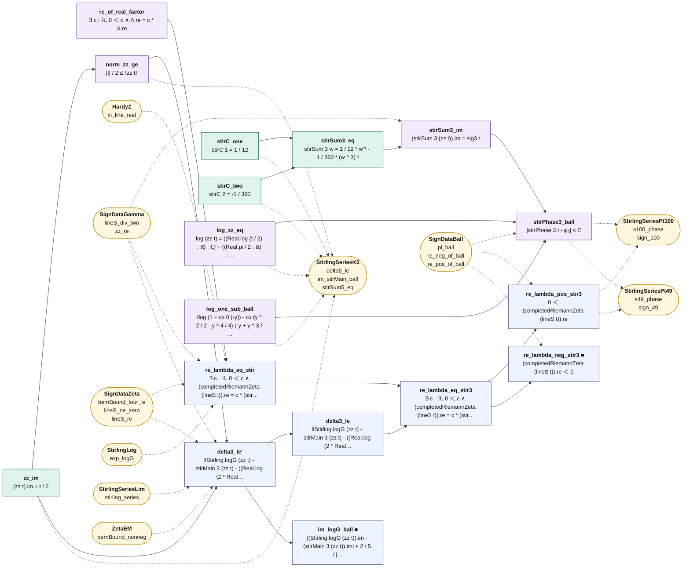

# `lean_stage3/Stage3/StirlingSeriesPhase.lean`

> **Read from the source text.** This file changed after the last `python3 utilities/lean_map.py --dump`, so the arrows on this page are names occurring in each proof and have not been confirmed by Lean.

StirlingSeriesPhase — block S14 of `lean_stage3/design/stencil.md`, Turing at scale: the phase of `Gammaℝ` on the line from Stirling's series, in a fixed number of balls. 2026-11-25.

17 theorems, 3 definitions, 379 lines. 

**Imports:** [`SignDataGamma`](../lean_stage3/SignDataGamma.md), [`StirlingSeriesLim`](../lean_stage3/StirlingSeriesLim.md)  
**Imported by:** [`StirlingSeries`](../lean_stage3/StirlingSeries.md), [`StirlingSeriesK5`](../lean_stage3/StirlingSeriesK5.md), [`StirlingSeriesPt100`](../lean_stage3/StirlingSeriesPt100.md), [`StirlingSeriesPt49`](../lean_stage3/StirlingSeriesPt49.md)

## The picture



An arrow A → B reads "A is used in the proof of B". Green: counting, integers only. Violet: shape, analysis with no ζ. Blue: reads ζ. A name ending in ■ is an end: nothing else uses it. Red: contains `sorry`. Yellow: theorems in another file, counted; a dotted arrow crosses files. Definitions are not drawn; they are listed below the diagram.

## Definitions

<a name="StirlingSeries-stirPhase"></a>
### `StirlingSeries.stirPhase`

def · line 44

The Stirling phase `φ_K(t) = Im S_K(1/4 + it/2) − (t/2) log π`.

- **Is:** `` stirPhase (K : ℕ) (t : ℝ) : ℝ := (stirMain K (zz t)).im - t / 2 * Real.log Real.pi ``
- **Built from:** [`SignData.zz`](../lean_stage3/SignDataGamma.md#SignData-zz), [`StirlingSeries.stirMain`](../lean_stage3/StirlingSeriesEM.md#StirlingSeries-stirMain)
- **Used by 5:** [`StirlingSeries.re_lambda_eq_stir`](#StirlingSeries-re_lambda_eq_stir), [`StirlingSeries.stirDir`](#StirlingSeries-stirDir), [`StirlingSeries.stirPhase3_ball`](#StirlingSeries-stirPhase3_ball), [`StirlingSeries.s100_phase`](../lean_stage3/StirlingSeriesPt100.md#StirlingSeries-s100_phase), [`StirlingSeries.s49_phase`](../lean_stage3/StirlingSeriesPt49.md#StirlingSeries-s49_phase)

<a name="StirlingSeries-stirDir"></a>
### `StirlingSeries.stirDir`

def · line 47

The Stirling direction `e^{iφ_K(t)}`.

- **Is:** `` stirDir (K : ℕ) (t : ℝ) : ℂ := cexp (((stirPhase K t : ℝ) : ℂ) * I) ``
- **Built from:** [`StirlingSeries.stirPhase`](#StirlingSeries-stirPhase)
- **Used by 8:** [`StirlingSeries.re_lambda_eq_stir`](#StirlingSeries-re_lambda_eq_stir), [`StirlingSeries.re_lambda_eq_stir3`](#StirlingSeries-re_lambda_eq_stir3), [`StirlingSeries.re_lambda_neg_stir3`](#StirlingSeries-re_lambda_neg_stir3), [`StirlingSeries.re_lambda_pos_stir3`](#StirlingSeries-re_lambda_pos_stir3), [`StirlingSeries.s100_X`](../lean_stage3/StirlingSeriesPt100.md#StirlingSeries-s100_X), [`StirlingSeries.s100_dir`](../lean_stage3/StirlingSeriesPt100.md#StirlingSeries-s100_dir), [`StirlingSeries.s49_X`](../lean_stage3/StirlingSeriesPt49.md#StirlingSeries-s49_X), [`StirlingSeries.s49_dir`](../lean_stage3/StirlingSeriesPt49.md#StirlingSeries-s49_dir)

<a name="StirlingSeries-sig3"></a>
### `StirlingSeries.sig3`

def · line 213

`Im` of the correction `S₃ − ((z − ½) log z − z)` at `z = zz t`, with `p + iq = 1/z`.

- **Is:** `` sig3 (t : ℝ) : ℝ := let ρ := (1 / 4 : ℝ) ^ 2 + (t / 2) ^ 2 let p := (1 / 4) / ρ let q := -(t / 2) / ρ 1 / 12 * q - 1 / 360 * (3 * p ^ 2 * q - q ^ 3) ``
- **Used by 4:** [`StirlingSeries.stirPhase3_ball`](#StirlingSeries-stirPhase3_ball), [`StirlingSeries.stirSum3_im`](#StirlingSeries-stirSum3_im), [`StirlingSeries.s100_phase`](../lean_stage3/StirlingSeriesPt100.md#StirlingSeries-s100_phase), [`StirlingSeries.s49_phase`](../lean_stage3/StirlingSeriesPt49.md#StirlingSeries-s49_phase)

## Theorems

<a name="StirlingSeries-zz_im"></a>
### `StirlingSeries.zz_im`

line 49 · arrows read from text

**Counting.** Integers only: nothing in its statement or proof, or in anything it rests on, uses analysis or ζ.

**Proves**

```lean
(zz t).im = t / 2
```

**Needs** (its hypotheses)

  - `` t : ℝ ``

**Fed by:** no theorem of this repo; it stands on Mathlib and the definitions below.

**Definitions its proof touches:** [`SignData.zz`](../lean_stage3/SignDataGamma.md#SignData-zz)

**Feeds** (3 that use it)

  - [`StirlingSeries.delta5_le`](../lean_stage3/StirlingSeriesK5.md#StirlingSeries-delta5_le) (StirlingSeriesK5) — `` ‖Stirling.logG (zz t) - stirMain 5 (zz t) - ((Real.log (2 * Real.pi) / 2 : ℝ) : ℂ)‖ ≤ 10 / |t| ^ 7 ``
  - [`StirlingSeries.delta3_le'`](#StirlingSeries-delta3_le-) — `` ‖Stirling.logG (zz t) - stirMain 3 (zz t) - ((Real.log (2 * Real.pi) / 2 : ℝ) : ℂ)‖ ≤ 2 / 5 / |t| ^ 3 ``
  - [`StirlingSeries.norm_zz_ge`](#StirlingSeries-norm_zz_ge) — `` |t| / 2 ≤ ‖zz t‖ ``

<a name="StirlingSeries-re_of_real_factor"></a>
### `StirlingSeries.re_of_real_factor`

line 53 · arrows read from text

**Shape.** Uses real or complex analysis; nothing in it or beneath it reads ζ.

**Why.** A real number with a known factorization: `Λ` real, `Λ = κ e^δ X`, `κ > 0`, `‖δ‖ ≤ 3/2` ⊢ `Re Λ = c · Re X` with `c > 0`.

**Proves**

```lean
∃ c : ℝ, 0 < c ∧ Λ.re = c * X.re
```

**Needs** (its hypotheses)

  - `` hreal : Λ.im = 0 ``
  - `` hκ : 0 < κ ``
  - `` hδ : ‖δ‖ ≤ 3 / 2 ``
  - `` h : Λ = (κ : ℂ) * cexp δ * X ``

**Fed by:** no theorem of this repo; it stands on Mathlib.

**Feeds** (1 that use it)

  - [`StirlingSeries.re_lambda_eq_stir`](#StirlingSeries-re_lambda_eq_stir) — `` ∃ c : ℝ, 0 < c ∧ (completedRiemannZeta (lineS t)).re = c * (stirDir K t * riemannZeta (lineS t)).re ``

<a name="StirlingSeries-re_lambda_eq_stir"></a>
### `StirlingSeries.re_lambda_eq_stir`

line 83 · arrows read from text

**Reads ζ.** It, or something it rests on, uses the zeta function, its zeros or the Riemann hypothesis.

**Why.** The phase of `Gammaℝ` from Stirling's series: if the Stirling remainder at `z = zz t` is at most `3/2`, the sign of `Re Λ(1/2 + it)` is the sign of `Re(e^{iφ_K(t)} ζ(1/2 + it))`.

**Proves**

```lean
∃ c : ℝ, 0 < c ∧ (completedRiemannZeta (lineS t)).re = c * (stirDir K t * riemannZeta (lineS t)).re
```

**Needs** (its hypotheses)

  - `` K : ℕ ``
  - `` t : ℝ ``
  - `` hδ : ‖Stirling.logG (zz t) - stirMain K (zz t) - ((Real.log (2 * Real.pi) / 2 : ℝ) : ℂ)‖ ≤ 3 / 2 ``

**Fed by** (7 theorems its proof uses)

  - [`HardyZ.xi_line_real`](../lean_stage3/HardyZ.md#HardyZ-xi_line_real) (HardyZ) — `` (completedRiemannZeta (1/2 + t * Complex.I)).im = 0 ``
  - [`SignData.lineS_div_two`](../lean_stage3/SignDataGamma.md#SignData-lineS_div_two) (SignDataGamma) — `` lineS t / 2 = zz t ``
  - [`SignData.zz_re`](../lean_stage3/SignDataGamma.md#SignData-zz_re) (SignDataGamma) — `` (zz t).re = 1 / 4 ``
  - [`SignData.lineS_ne_zero`](../lean_stage3/SignDataZeta.md#SignData-lineS_ne_zero) (SignDataZeta) — `` lineS t ≠ 0 ``
  - [`SignData.lineS_re`](../lean_stage3/SignDataZeta.md#SignData-lineS_re) (SignDataZeta) — `` (lineS t).re = 1 / 2 ``
  - [`Stirling.exp_logG`](../lean_stage3/StirlingLog.md#Stirling-exp_logG) (StirlingLog) — `` cexp (logG z) = Gamma z ``
  - [`StirlingSeries.re_of_real_factor`](#StirlingSeries-re_of_real_factor) — `` ∃ c : ℝ, 0 < c ∧ Λ.re = c * X.re ``

**Definitions its proof touches:** [`SignData.zz`](../lean_stage3/SignDataGamma.md#SignData-zz), [`SignData.lineS`](../lean_stage3/SignDataZeta.md#SignData-lineS), [`Stirling.logG`](../lean_stage3/StirlingLog.md#Stirling-logG), [`StirlingSeries.stirMain`](../lean_stage3/StirlingSeriesEM.md#StirlingSeries-stirMain), [`StirlingSeries.stirDir`](#StirlingSeries-stirDir), [`StirlingSeries.stirPhase`](#StirlingSeries-stirPhase)

**Feeds** (1 that use it)

  - [`StirlingSeries.re_lambda_eq_stir3`](#StirlingSeries-re_lambda_eq_stir3) — `` ∃ c : ℝ, 0 < c ∧ (completedRiemannZeta (lineS t)).re = c * (stirDir 3 t * riemannZeta (lineS t)).re ``

<a name="StirlingSeries-norm_zz_ge"></a>
### `StirlingSeries.norm_zz_ge`

line 127 · arrows read from text

**Shape.** Uses real or complex analysis; nothing in it or beneath it reads ζ.

**Proves**

```lean
|t| / 2 ≤ ‖zz t‖
```

**Needs** (its hypotheses)

  - `` t : ℝ ``

**Fed by** (1 theorem its proof uses)

  - [`StirlingSeries.zz_im`](#StirlingSeries-zz_im) — `` (zz t).im = t / 2 ``

**Definitions its proof touches:** [`SignData.zz`](../lean_stage3/SignDataGamma.md#SignData-zz)

**Feeds** (2 that use it)

  - [`StirlingSeries.delta5_le`](../lean_stage3/StirlingSeriesK5.md#StirlingSeries-delta5_le) (StirlingSeriesK5) — `` ‖Stirling.logG (zz t) - stirMain 5 (zz t) - ((Real.log (2 * Real.pi) / 2 : ℝ) : ℂ)‖ ≤ 10 / |t| ^ 7 ``
  - [`StirlingSeries.delta3_le'`](#StirlingSeries-delta3_le-) — `` ‖Stirling.logG (zz t) - stirMain 3 (zz t) - ((Real.log (2 * Real.pi) / 2 : ℝ) : ℂ)‖ ≤ 2 / 5 / |t| ^ 3 ``

<a name="StirlingSeries-delta3_le-"></a>
### `StirlingSeries.delta3_le'`

line 133 · arrows read from text

**Reads ζ.** It, or something it rests on, uses the zeta function, its zeros or the Riemann hypothesis.

**Why.** The remainder at `K = 3`: for `|t| ≥ 1`, `‖logG z − S₃ z − ½ log 2π‖ ≤ (2/5)/|t|³`.

**Proves**

```lean
‖Stirling.logG (zz t) - stirMain 3 (zz t) - ((Real.log (2 * Real.pi) / 2 : ℝ) : ℂ)‖ ≤ 2 / 5 / |t| ^ 3
```

**Needs** (its hypotheses)

  - `` ht : 1 ≤ |t| ``

**Fed by** (6 theorems its proof uses)

  - [`SignData.zz_re`](../lean_stage3/SignDataGamma.md#SignData-zz_re) (SignDataGamma) — `` (zz t).re = 1 / 4 ``
  - [`SignData.bernBound_four_le`](../lean_stage3/SignDataZeta.md#SignData-bernBound_four_le) (SignDataZeta) — `` bernBound 4 ≤ 1 / 30 ``
  - [`StirlingSeries.stirling_series`](../lean_stage3/StirlingSeriesLim.md#StirlingSeries-stirling_series) (StirlingSeriesLim) — `` ‖Stirling.logG z - stirMain (K + 1) z - ((Real.log (2 * Real.pi) / 2 : ℝ) : ℂ)‖ ≤ ZetaEM.bernBound (2 * K) / (2 * K) * (6 / |z.im|) / ‖z‖ ^ (2 * K - 2… ``
  - [`StirlingSeries.norm_zz_ge`](#StirlingSeries-norm_zz_ge) — `` |t| / 2 ≤ ‖zz t‖ ``
  - [`StirlingSeries.zz_im`](#StirlingSeries-zz_im) — `` (zz t).im = t / 2 ``
  - [`ZetaEM.bernBound_nonneg`](../lean_stage3/ZetaEM.md#ZetaEM-bernBound_nonneg) (ZetaEM) — `` 0 ≤ bernBound k ``

**Definitions its proof touches:** [`SignData.zz`](../lean_stage3/SignDataGamma.md#SignData-zz), [`Stirling.logG`](../lean_stage3/StirlingLog.md#Stirling-logG), [`StirlingSeries.stirMain`](../lean_stage3/StirlingSeriesEM.md#StirlingSeries-stirMain), [`ZetaEM.bernBound`](../lean_stage3/ZetaEM.md#ZetaEM-bernBound)

**Feeds** (2 that use it)

  - [`StirlingSeries.delta3_le`](#StirlingSeries-delta3_le) — `` ‖Stirling.logG (zz t) - stirMain 3 (zz t) - ((Real.log (2 * Real.pi) / 2 : ℝ) : ℂ)‖ ≤ 3 / 2 ``
  - [`StirlingSeries.im_logG_ball`](#StirlingSeries-im_logG_ball) — `` |(Stirling.logG (zz t)).im - (stirMain 3 (zz t)).im| ≤ 2 / 5 / |t| ^ 3 ``

<a name="StirlingSeries-delta3_le"></a>
### `StirlingSeries.delta3_le`

line 158 · arrows read from text

**Reads ζ.** It, or something it rests on, uses the zeta function, its zeros or the Riemann hypothesis.

**Proves**

```lean
‖Stirling.logG (zz t) - stirMain 3 (zz t) - ((Real.log (2 * Real.pi) / 2 : ℝ) : ℂ)‖ ≤ 3 / 2
```

**Needs** (its hypotheses)

  - `` ht : 1 ≤ |t| ``

**Fed by** (1 theorem its proof uses)

  - [`StirlingSeries.delta3_le'`](#StirlingSeries-delta3_le-) — `` ‖Stirling.logG (zz t) - stirMain 3 (zz t) - ((Real.log (2 * Real.pi) / 2 : ℝ) : ℂ)‖ ≤ 2 / 5 / |t| ^ 3 ``

**Definitions its proof touches:** [`SignData.zz`](../lean_stage3/SignDataGamma.md#SignData-zz), [`Stirling.logG`](../lean_stage3/StirlingLog.md#Stirling-logG), [`StirlingSeries.stirMain`](../lean_stage3/StirlingSeriesEM.md#StirlingSeries-stirMain)

**Feeds** (1 that use it)

  - [`StirlingSeries.re_lambda_eq_stir3`](#StirlingSeries-re_lambda_eq_stir3) — `` ∃ c : ℝ, 0 < c ∧ (completedRiemannZeta (lineS t)).re = c * (stirDir 3 t * riemannZeta (lineS t)).re ``

<a name="StirlingSeries-im_logG_ball"></a>
### `StirlingSeries.im_logG_ball`

line 167 · arrows read from text

**Reads ζ.** It, or something it rests on, uses the zeta function, its zeros or the Riemann hypothesis.

**Why.** The phase of `Γ(1/4 + it/2)` to `(2/5)/|t|³`: `|Im logG z − Im S₃ z| ≤ (2/5)/|t|³`.

**Proves**

```lean
|(Stirling.logG (zz t)).im - (stirMain 3 (zz t)).im| ≤ 2 / 5 / |t| ^ 3
```

**Needs** (its hypotheses)

  - `` ht : 1 ≤ |t| ``

**Fed by** (1 theorem its proof uses)

  - [`StirlingSeries.delta3_le'`](#StirlingSeries-delta3_le-) — `` ‖Stirling.logG (zz t) - stirMain 3 (zz t) - ((Real.log (2 * Real.pi) / 2 : ℝ) : ℂ)‖ ≤ 2 / 5 / |t| ^ 3 ``

**Definitions its proof touches:** [`SignData.zz`](../lean_stage3/SignDataGamma.md#SignData-zz), [`Stirling.logG`](../lean_stage3/StirlingLog.md#Stirling-logG), [`StirlingSeries.stirMain`](../lean_stage3/StirlingSeriesEM.md#StirlingSeries-stirMain)

**Feeds:** nothing. It is an end.

<a name="StirlingSeries-re_lambda_eq_stir3"></a>
### `StirlingSeries.re_lambda_eq_stir3`

line 172 · arrows read from text

**Reads ζ.** It, or something it rests on, uses the zeta function, its zeros or the Riemann hypothesis.

**Proves**

```lean
∃ c : ℝ, 0 < c ∧ (completedRiemannZeta (lineS t)).re = c * (stirDir 3 t * riemannZeta (lineS t)).re
```

**Needs** (its hypotheses)

  - `` ht : 1 ≤ |t| ``

**Fed by** (2 theorems its proof uses)

  - [`StirlingSeries.delta3_le`](#StirlingSeries-delta3_le) — `` ‖Stirling.logG (zz t) - stirMain 3 (zz t) - ((Real.log (2 * Real.pi) / 2 : ℝ) : ℂ)‖ ≤ 3 / 2 ``
  - [`StirlingSeries.re_lambda_eq_stir`](#StirlingSeries-re_lambda_eq_stir) — `` ∃ c : ℝ, 0 < c ∧ (completedRiemannZeta (lineS t)).re = c * (stirDir K t * riemannZeta (lineS t)).re ``

**Definitions its proof touches:** [`SignData.lineS`](../lean_stage3/SignDataZeta.md#SignData-lineS), [`StirlingSeries.stirDir`](#StirlingSeries-stirDir)

**Feeds** (2 that use it)

  - [`StirlingSeries.re_lambda_neg_stir3`](#StirlingSeries-re_lambda_neg_stir3) — `` (completedRiemannZeta (lineS t)).re < 0 ``
  - [`StirlingSeries.re_lambda_pos_stir3`](#StirlingSeries-re_lambda_pos_stir3) — `` 0 < (completedRiemannZeta (lineS t)).re ``

<a name="StirlingSeries-re_lambda_pos_stir3"></a>
### `StirlingSeries.re_lambda_pos_stir3`

line 177 · arrows read from text

**Reads ζ.** It, or something it rests on, uses the zeta function, its zeros or the Riemann hypothesis.

**Proves**

```lean
0 < (completedRiemannZeta (lineS t)).re
```

**Needs** (its hypotheses)

  - `` ht : 1 ≤ |t| ``
  - `` hX : ‖stirDir 3 t * riemannZeta (lineS t) - cx a b‖ ≤ r ``
  - `` ha : r < a ``

**Fed by** (2 theorems its proof uses)

  - [`SignData.re_pos_of_ball`](../lean_stage3/SignDataBall.md#SignData-re_pos_of_ball) (SignDataBall) — `` 0 < z.re ``
  - [`StirlingSeries.re_lambda_eq_stir3`](#StirlingSeries-re_lambda_eq_stir3) — `` ∃ c : ℝ, 0 < c ∧ (completedRiemannZeta (lineS t)).re = c * (stirDir 3 t * riemannZeta (lineS t)).re ``

**Definitions its proof touches:** [`SignData.cx`](../lean_stage3/SignDataBall.md#SignData-cx), [`SignData.lineS`](../lean_stage3/SignDataZeta.md#SignData-lineS), [`StirlingSeries.stirDir`](#StirlingSeries-stirDir)

**Feeds** (2 that use it)

  - [`StirlingSeries.sign_100`](../lean_stage3/StirlingSeriesPt100.md#StirlingSeries-sign_100) (StirlingSeriesPt100) — `` 0 < (completedRiemannZeta (lineS (100 : ℝ))).re ``
  - [`StirlingSeries.sign_49`](../lean_stage3/StirlingSeriesPt49.md#StirlingSeries-sign_49) (StirlingSeriesPt49) — `` 0 < (completedRiemannZeta (lineS (49 : ℝ))).re ``

<a name="StirlingSeries-re_lambda_neg_stir3"></a>
### `StirlingSeries.re_lambda_neg_stir3`

line 184 · arrows read from text

**Reads ζ.** It, or something it rests on, uses the zeta function, its zeros or the Riemann hypothesis.

**Proves**

```lean
(completedRiemannZeta (lineS t)).re < 0
```

**Needs** (its hypotheses)

  - `` ht : 1 ≤ |t| ``
  - `` hX : ‖stirDir 3 t * riemannZeta (lineS t) - cx a b‖ ≤ r ``
  - `` ha : a < -r ``

**Fed by** (2 theorems its proof uses)

  - [`SignData.re_neg_of_ball`](../lean_stage3/SignDataBall.md#SignData-re_neg_of_ball) (SignDataBall) — `` z.re < 0 ``
  - [`StirlingSeries.re_lambda_eq_stir3`](#StirlingSeries-re_lambda_eq_stir3) — `` ∃ c : ℝ, 0 < c ∧ (completedRiemannZeta (lineS t)).re = c * (stirDir 3 t * riemannZeta (lineS t)).re ``

**Definitions its proof touches:** [`SignData.cx`](../lean_stage3/SignDataBall.md#SignData-cx), [`SignData.lineS`](../lean_stage3/SignDataZeta.md#SignData-lineS), [`StirlingSeries.stirDir`](#StirlingSeries-stirDir)

**Feeds:** nothing. It is an end.

<a name="StirlingSeries-stirC_one"></a>
### `StirlingSeries.stirC_one`

line 193 · arrows read from text

**Counting.** Integers only: nothing in its statement or proof, or in anything it rests on, uses analysis or ζ.

**Proves**

```lean
stirC 1 = 1 / 12
```

**Fed by:** no theorem of this repo; it stands on Mathlib and the definitions below.

**Definitions its proof touches:** [`StirlingSeries.stirC`](../lean_stage3/StirlingSeriesEM.md#StirlingSeries-stirC)

**Feeds** (2 that use it)

  - [`StirlingSeries.stirSum5_eq`](../lean_stage3/StirlingSeriesK5.md#StirlingSeries-stirSum5_eq) (StirlingSeriesK5) — `` stirSum 5 w = 1 / 12 * w⁻¹ - 1 / 360 * (w ^ 3)⁻¹ + 1 / 1260 * (w ^ 5)⁻¹ - 1 / 1680 * (w ^ 7)⁻¹ ``
  - [`StirlingSeries.stirSum3_eq`](#StirlingSeries-stirSum3_eq) — `` stirSum 3 w = 1 / 12 * w⁻¹ - 1 / 360 * (w ^ 3)⁻¹ ``

<a name="StirlingSeries-stirC_two"></a>
### `StirlingSeries.stirC_two`

line 199 · arrows read from text

**Counting.** Integers only: nothing in its statement or proof, or in anything it rests on, uses analysis or ζ.

**Proves**

```lean
stirC 2 = -1 / 360
```

**Fed by:** no theorem of this repo; it stands on Mathlib and the definitions below.

**Definitions its proof touches:** [`StirlingSeries.stirC`](../lean_stage3/StirlingSeriesEM.md#StirlingSeries-stirC)

**Feeds** (2 that use it)

  - [`StirlingSeries.stirSum5_eq`](../lean_stage3/StirlingSeriesK5.md#StirlingSeries-stirSum5_eq) (StirlingSeriesK5) — `` stirSum 5 w = 1 / 12 * w⁻¹ - 1 / 360 * (w ^ 3)⁻¹ + 1 / 1260 * (w ^ 5)⁻¹ - 1 / 1680 * (w ^ 7)⁻¹ ``
  - [`StirlingSeries.stirSum3_eq`](#StirlingSeries-stirSum3_eq) — `` stirSum 3 w = 1 / 12 * w⁻¹ - 1 / 360 * (w ^ 3)⁻¹ ``

<a name="StirlingSeries-stirSum3_eq"></a>
### `StirlingSeries.stirSum3_eq`

line 205 · arrows read from text

**Counting.** Integers only: nothing in its statement or proof, or in anything it rests on, uses analysis or ζ.

**Proves**

```lean
stirSum 3 w = 1 / 12 * w⁻¹ - 1 / 360 * (w ^ 3)⁻¹
```

**Needs** (its hypotheses)

  - `` w : ℂ ``

**Fed by** (2 theorems its proof uses)

  - [`StirlingSeries.stirC_one`](#StirlingSeries-stirC_one) — `` stirC 1 = 1 / 12 ``
  - [`StirlingSeries.stirC_two`](#StirlingSeries-stirC_two) — `` stirC 2 = -1 / 360 ``

**Definitions its proof touches:** [`StirlingSeries.stirSum`](../lean_stage3/StirlingSeriesEM.md#StirlingSeries-stirSum)

**Feeds** (1 that use it)

  - [`StirlingSeries.stirSum3_im`](#StirlingSeries-stirSum3_im) — `` (stirSum 3 (zz t)).im = sig3 t ``

<a name="StirlingSeries-stirSum3_im"></a>
### `StirlingSeries.stirSum3_im`

line 219 · arrows read from text

**Shape.** Uses real or complex analysis; nothing in it or beneath it reads ζ.

**Proves**

```lean
(stirSum 3 (zz t)).im = sig3 t
```

**Needs** (its hypotheses)

  - `` t : ℝ ``

**Fed by** (2 theorems its proof uses)

  - [`SignData.zz_re`](../lean_stage3/SignDataGamma.md#SignData-zz_re) (SignDataGamma) — `` (zz t).re = 1 / 4 ``
  - [`StirlingSeries.stirSum3_eq`](#StirlingSeries-stirSum3_eq) — `` stirSum 3 w = 1 / 12 * w⁻¹ - 1 / 360 * (w ^ 3)⁻¹ ``

**Definitions its proof touches:** [`SignData.cx`](../lean_stage3/SignDataBall.md#SignData-cx), [`SignData.zz`](../lean_stage3/SignDataGamma.md#SignData-zz), [`StirlingSeries.stirSum`](../lean_stage3/StirlingSeriesEM.md#StirlingSeries-stirSum), [`StirlingSeries.sig3`](#StirlingSeries-sig3)

**Feeds** (1 that use it)

  - [`StirlingSeries.stirPhase3_ball`](#StirlingSeries-stirPhase3_ball) — `` |stirPhase 3 t - φ₀| ≤ E ``

<a name="StirlingSeries-log_zz_eq"></a>
### `StirlingSeries.log_zz_eq`

line 239 · arrows read from text

**Shape.** Uses real or complex analysis; nothing in it or beneath it reads ζ.

**Why.** `zz t = (t/2)·(i·(1 − i/(2t)))` and so `log z = log(t/2) + iπ/2 + log(1 − i/(2t))`, `t > 0`.

**Proves**

```lean
log (zz t) = ((Real.log (t / 2) : ℝ) : ℂ) + ((Real.pi / 2 : ℝ) : ℂ) * I + log (1 + cx 0 (-(1 / (2 * t))))
```

**Needs** (its hypotheses)

  - `` ht : 0 < t ``

**Fed by:** no theorem of this repo; it stands on Mathlib and the definitions below.

**Definitions its proof touches:** [`SignData.cx`](../lean_stage3/SignDataBall.md#SignData-cx), [`SignData.zz`](../lean_stage3/SignDataGamma.md#SignData-zz)

**Feeds** (2 that use it)

  - [`StirlingSeries.im_stirMain_ball`](../lean_stage3/StirlingSeriesK5.md#StirlingSeries-im_stirMain_ball) (StirlingSeriesK5) — `` |(stirMain K (zz t)).im - φ₀| ≤ E ``
  - [`StirlingSeries.stirPhase3_ball`](#StirlingSeries-stirPhase3_ball) — `` |stirPhase 3 t - φ₀| ≤ E ``

<a name="StirlingSeries-log_one_sub_ball"></a>
### `StirlingSeries.log_one_sub_ball`

line 266 · arrows read from text

**Shape.** Uses real or complex analysis; nothing in it or beneath it reads ζ.

**Why.** The series of `log(1 − iy)` to degree five: `‖log(1 − iy) − (y²/2 − y⁴/4) − i(−y + y³/3 − y⁵/5)‖ ≤ y⁶/(6(1 − y))` for `0 ≤ y < 1`.

**Proves**

```lean
‖log (1 + cx 0 (-y)) - cx (y ^ 2 / 2 - y ^ 4 / 4) (-y + y ^ 3 / 3 - y ^ 5 / 5)‖ ≤ y ^ 6 * (1 - y)⁻¹ / 6
```

**Needs** (its hypotheses)

  - `` hy : 0 ≤ y ``
  - `` hy1 : y < 1 ``

**Fed by:** no theorem of this repo; it stands on Mathlib and the definitions below.

**Definitions its proof touches:** [`SignData.cx`](../lean_stage3/SignDataBall.md#SignData-cx)

**Feeds** (2 that use it)

  - [`StirlingSeries.im_stirMain_ball`](../lean_stage3/StirlingSeriesK5.md#StirlingSeries-im_stirMain_ball) (StirlingSeriesK5) — `` |(stirMain K (zz t)).im - φ₀| ≤ E ``
  - [`StirlingSeries.stirPhase3_ball`](#StirlingSeries-stirPhase3_ball) — `` |stirPhase 3 t - φ₀| ≤ E ``

<a name="StirlingSeries-stirPhase3_ball"></a>
### `StirlingSeries.stirPhase3_ball`

line 291 · arrows read from text

**Shape.** Uses real or complex analysis; nothing in it or beneath it reads ζ.

**Why.** The Stirling phase at `K = 3` in closed form, `t > 0`, `y = 1/(2t) < 1`: with `|log(t/2) − ℓ| ≤ e_ℓ`, `|log π − c| ≤ e_π`, `|π − π₀| ≤ 10^{−20}`, `τ = y⁶/(6(1−y))`, `|φ₃(t) − ((t/2)(ℓ + y²/2 − y⁴/4) − (π₀/2 − y + y³/3 − y⁵/5)/4 − t/2 + sig3 t − (t/2)c)| ≤ (t/2)(e_ℓ + τ + e_π) + (10^{−20}/2 + τ)/4`.

**Proves**

```lean
|stirPhase 3 t - φ₀| ≤ E
```

**Needs** (its hypotheses)

  - `` ht : 0 < t ``
  - `` hy1 : 1 / (2 * t) < 1 ``
  - `` hℓ : |Real.log (t / 2) - ℓ| ≤ eℓ ``
  - `` hπ : |Real.log Real.pi - c| ≤ eπ ``
  - `` hφ : |(t / 2) * (ℓ + (1 / (2 * t)) ^ 2 / 2 - (1 / (2 * t)) ^ 4 / 4) - (3.14159265358979323846 / 2 + (-(1 / (2 * t)) + (1 / (2 * t)) ^ 3 / 3 - (1 / (2 * t)) ^ 5 / 5)) / 4 - t / 2 + sig3 t - t / 2 * c - φ₀| + (t / 2) * (eℓ + (1 / (2 * t)) ^ 6 * (1 - 1 / (2 * t))⁻¹ / 6 + eπ) + (1 / 10 ^ 20 / 2 + (1 / (… ``

**Fed by** (4 theorems its proof uses)

  - [`SignData.pi_ball`](../lean_stage3/SignDataBall.md#SignData-pi_ball) (SignDataBall) — `` |Real.pi - 3.14159265358979323846| ≤ 1 / 10 ^ 20 ``
  - [`StirlingSeries.log_one_sub_ball`](#StirlingSeries-log_one_sub_ball) — `` ‖log (1 + cx 0 (-y)) - cx (y ^ 2 / 2 - y ^ 4 / 4) (-y + y ^ 3 / 3 - y ^ 5 / 5)‖ ≤ y ^ 6 * (1 - y)⁻¹ / 6 ``
  - [`StirlingSeries.log_zz_eq`](#StirlingSeries-log_zz_eq) — `` log (zz t) = ((Real.log (t / 2) : ℝ) : ℂ) + ((Real.pi / 2 : ℝ) : ℂ) * I + log (1 + cx 0 (-(1 / (2 * t)))) ``
  - [`StirlingSeries.stirSum3_im`](#StirlingSeries-stirSum3_im) — `` (stirSum 3 (zz t)).im = sig3 t ``

**Definitions its proof touches:** [`SignData.cx`](../lean_stage3/SignDataBall.md#SignData-cx), [`SignData.zz`](../lean_stage3/SignDataGamma.md#SignData-zz), [`StirlingSeries.stirMain`](../lean_stage3/StirlingSeriesEM.md#StirlingSeries-stirMain), [`StirlingSeries.sig3`](#StirlingSeries-sig3), [`StirlingSeries.stirPhase`](#StirlingSeries-stirPhase)

**Feeds** (2 that use it)

  - [`StirlingSeries.s100_phase`](../lean_stage3/StirlingSeriesPt100.md#StirlingSeries-s100_phase) (StirlingSeriesPt100) — `` |stirPhase 3 (100 : ℝ) - (87.972165230795065475414495752782)| ≤ (0.000000050002096023926636294426) ``
  - [`StirlingSeries.s49_phase`](../lean_stage3/StirlingSeriesPt49.md#StirlingSeries-s49_phase) (StirlingSeriesPt49) — `` |stirPhase 3 (49 : ℝ) - (25.429335275466978691697713324213)| ≤ (0.000000024506009433967955787846) ``

