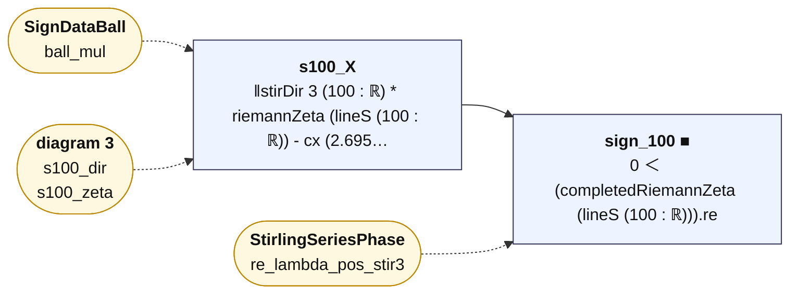

# `lean_stage3/Stage3/StirlingSeriesPt100.lean`

> **Read from the source text.** This file changed after the last `python3 utilities/lean_map.py --dump`, so the arrows on this page are names occurring in each proof and have not been confirmed by Lean.

StirlingSeriesPt100 — block S14 of `lean_stage3/design/stencil.md`, Turing at scale: the sign of `Re Λ(1/2 + it)` at `t = 100.0` through Stirling's series. 2026-11-25. Generated by `lean_stage3/checks/stirlingseries/gen_stirlingseries.py`; do not edit by hand.

92 theorems, 0 definitions, 502 lines. 

**Imports:** [`SignDataLog`](../lean_stage3/SignDataLog.md), [`StirlingSeriesLog`](../lean_stage3/StirlingSeriesLog.md), [`StirlingSeriesPhase`](../lean_stage3/StirlingSeriesPhase.md)  
**Imported by:** [`StirlingSeries`](../lean_stage3/StirlingSeries.md), [`StirlingSeriesGammaPhase`](../lean_stage3/StirlingSeriesGammaPhase.md)

## The picture

### Diagram 1 of 4: `s100_E2` to `s100_T16`

```mermaid
flowchart LR
  n0["<b>s100_E2</b><br/>‖cexp ((((-((100 : ℝ) * Real.log (((2 : ℕ)) : ℝ))) : ℝ) : ℂ) * C…"]:::shp
  n1["<b>s100_T2</b><br/>‖(((2 : ℕ)) : ℂ) ^ (-lineS (100 : ℝ)) - cx (0.693056686901120549…"]:::shp
  n2["<b>s100_E3</b><br/>‖cexp ((((-((100 : ℝ) * Real.log (((3 : ℕ)) : ℝ))) : ℝ) : ℂ) * C…"]:::shp
  n3["<b>s100_T3</b><br/>‖(((3 : ℕ)) : ℂ) ^ (-lineS (100 : ℝ)) - cx (-0.57477348267970559…"]:::shp
  n4["<b>s100_E4</b><br/>‖cexp ((((-((100 : ℝ) * Real.log (((4 : ℕ)) : ℝ))) : ℝ) : ℂ) * C…"]:::shp
  n5["<b>s100_T4</b><br/>‖(((4 : ℕ)) : ℂ) ^ (-lineS (100 : ℝ)) - cx (0.460655142323373283…"]:::shp
  n6["<b>s100_E5</b><br/>‖cexp ((((-((100 : ℝ) * Real.log (((5 : ℕ)) : ℝ))) : ℝ) : ℂ) * C…"]:::shp
  n7["<b>s100_T5</b><br/>‖(((5 : ℕ)) : ℂ) ^ (-lineS (100 : ℝ)) - cx (-0.33545998706548164…"]:::shp
  n8["<b>s100_E6</b><br/>‖cexp ((((-((100 : ℝ) * Real.log (((6 : ℕ)) : ℝ))) : ℝ) : ℂ) * C…"]:::shp
  n9["<b>s100_T6</b><br/>‖(((6 : ℕ)) : ℂ) ^ (-lineS (100 : ℝ)) - cx (-0.40599279458993009…"]:::shp
  n10["<b>s100_E7</b><br/>‖cexp ((((-((100 : ℝ) * Real.log (((7 : ℕ)) : ℝ))) : ℝ) : ℂ) * C…"]:::shp
  n11["<b>s100_T7</b><br/>‖(((7 : ℕ)) : ℂ) ^ (-lineS (100 : ℝ)) - cx (0.371323820774473768…"]:::shp
  n12["<b>s100_E8</b><br/>‖cexp ((((-((100 : ℝ) * Real.log (((8 : ℕ)) : ℝ))) : ℝ) : ℂ) * C…"]:::shp
  n13["<b>s100_T8</b><br/>‖(((8 : ℕ)) : ℂ) ^ (-lineS (100 : ℝ)) - cx (0.291991909906139700…"]:::shp
  n14["<b>s100_E9</b><br/>‖cexp ((((-((100 : ℝ) * Real.log (((9 : ℕ)) : ℝ))) : ℝ) : ℂ) * C…"]:::shp
  n15["<b>s100_T9</b><br/>‖(((9 : ℕ)) : ℂ) ^ (-lineS (100 : ℝ)) - cx (0.327395779512467722…"]:::shp
  n16["<b>s100_E10</b><br/>‖cexp ((((-((100 : ℝ) * Real.log (((10 : ℕ)) : ℝ))) : ℝ) : ℂ) * …"]:::shp
  n17["<b>s100_T10</b><br/>‖(((10 : ℕ)) : ℂ) ^ (-lineS (100 : ℝ)) - cx (-0.1910117021474876…"]:::shp
  n18["<b>s100_E11</b><br/>‖cexp ((((-((100 : ℝ) * Real.log (((11 : ℕ)) : ℝ))) : ℝ) : ℂ) * …"]:::shp
  n19["<b>s100_T11</b><br/>‖(((11 : ℕ)) : ℂ) ^ (-lineS (100 : ℝ)) - cx (0.15561499270723967…"]:::shp
  n20["<b>s100_E12</b><br/>‖cexp ((((-((100 : ℝ) * Real.log (((12 : ℕ)) : ℝ))) : ℝ) : ℂ) * …"]:::shp
  n21["<b>s100_T12</b><br/>‖(((12 : ℕ)) : ℂ) ^ (-lineS (100 : ℝ)) - cx (-0.2753653007953424…"]:::shp
  n22["<b>s100_E13</b><br/>‖cexp ((((-((100 : ℝ) * Real.log (((13 : ℕ)) : ℝ))) : ℝ) : ℂ) * …"]:::shp
  n23["<b>s100_T13</b><br/>‖(((13 : ℕ)) : ℂ) ^ (-lineS (100 : ℝ)) - cx (0.12191841752526748…"]:::shp
  n24["<b>s100_E14</b><br/>‖cexp ((((-((100 : ℝ) * Real.log (((14 : ℕ)) : ℝ))) : ℝ) : ℂ) * …"]:::shp
  n25["<b>s100_T14</b><br/>‖(((14 : ℕ)) : ℂ) ^ (-lineS (100 : ℝ)) - cx (0.26724215916437164…"]:::shp
  n26["<b>s100_E15</b><br/>‖cexp ((((-((100 : ℝ) * Real.log (((15 : ℕ)) : ℝ))) : ℝ) : ℂ) * …"]:::shp
  n27["<b>s100_T15</b><br/>‖(((15 : ℕ)) : ℂ) ^ (-lineS (100 : ℝ)) - cx (0.20892774757626706…"]:::shp
  n28["<b>s100_E16</b><br/>‖cexp ((((-((100 : ℝ) * Real.log (((16 : ℕ)) : ℝ))) : ℝ) : ℂ) * …"]:::shp
  n29["<b>s100_T16</b><br/>‖(((16 : ℕ)) : ℂ) ^ (-lineS (100 : ℝ)) - cx (0.17440632011984170…"]:::shp
  x0(["<b>SignDataBall</b><br/>7 theorems"]):::ext
  x1(["<b>SignDataLog</b><br/>30 theorems"]):::ext
  x2(["<b>SignDataZeta</b><br/>natCast_cpow_line"]):::ext
  x3(["<b>diagram 2</b><br/>4 theorems"]):::ext
  x4(["<b>diagram 3</b><br/>11 theorems"]):::ext
  n0 --> n1
  n10 --> n11
  n12 --> n13
  n14 --> n15
  n16 --> n17
  n18 --> n19
  n2 --> n3
  n20 --> n21
  n22 --> n23
  n24 --> n25
  n26 --> n27
  n28 --> n29
  n4 --> n5
  n6 --> n7
  n8 --> n9
  n1 -.-> x3
  n11 -.-> x4
  n13 -.-> x4
  n15 -.-> x4
  n17 -.-> x4
  n19 -.-> x4
  n21 -.-> x4
  n23 -.-> x4
  n25 -.-> x4
  n27 -.-> x4
  n29 -.-> x4
  n3 -.-> x3
  n5 -.-> x3
  n7 -.-> x3
  n9 -.-> x4
  x0 -.-> n0
  x0 -.-> n1
  x0 -.-> n10
  x0 -.-> n11
  x0 -.-> n12
  x0 -.-> n13
  x0 -.-> n14
  x0 -.-> n15
  x0 -.-> n16
  x0 -.-> n17
  x0 -.-> n18
  x0 -.-> n19
  x0 -.-> n2
  x0 -.-> n20
  x0 -.-> n21
  x0 -.-> n22
  x0 -.-> n23
  x0 -.-> n24
  x0 -.-> n25
  x0 -.-> n26
  x0 -.-> n27
  x0 -.-> n28
  x0 -.-> n29
  x0 -.-> n3
  x0 -.-> n4
  x0 -.-> n5
  x0 -.-> n6
  x0 -.-> n7
  x0 -.-> n8
  x0 -.-> n9
  x1 -.-> n0
  x1 -.-> n1
  x1 -.-> n10
  x1 -.-> n11
  x1 -.-> n12
  x1 -.-> n13
  x1 -.-> n14
  x1 -.-> n15
  x1 -.-> n16
  x1 -.-> n17
  x1 -.-> n18
  x1 -.-> n19
  x1 -.-> n2
  x1 -.-> n20
  x1 -.-> n21
  x1 -.-> n22
  x1 -.-> n23
  x1 -.-> n24
  x1 -.-> n25
  x1 -.-> n26
  x1 -.-> n27
  x1 -.-> n28
  x1 -.-> n29
  x1 -.-> n3
  x1 -.-> n4
  x1 -.-> n5
  x1 -.-> n6
  x1 -.-> n7
  x1 -.-> n8
  x1 -.-> n9
  x2 -.-> n1
  x2 -.-> n11
  x2 -.-> n13
  x2 -.-> n15
  x2 -.-> n17
  x2 -.-> n19
  x2 -.-> n21
  x2 -.-> n23
  x2 -.-> n25
  x2 -.-> n27
  x2 -.-> n29
  x2 -.-> n3
  x2 -.-> n5
  x2 -.-> n7
  x2 -.-> n9
  classDef cnt fill:#dff5ec,stroke:#17694a,color:#111
  classDef shp fill:#f1ecfb,stroke:#5b3fa0,color:#111
  classDef rh fill:#ffe5e5,stroke:#c22,color:#111,stroke-width:2px
  classDef thm fill:#eef4ff,stroke:#335,color:#111
  classDef end_ fill:#e7f7e7,stroke:#2a7,color:#111,stroke-width:2px
  classDef lone fill:#fff,stroke:#999,color:#111,stroke-dasharray:4 3
  classDef bad fill:#ffe5e5,stroke:#c22,color:#111,stroke-width:2px
  classDef ext fill:#fff8e1,stroke:#b80,color:#111
```



### Diagram 2 of 4: `s100_E17` to `s100_S5`

```mermaid
flowchart LR
  n0["<b>s100_E17</b><br/>‖cexp ((((-((100 : ℝ) * Real.log (((17 : ℕ)) : ℝ))) : ℝ) : ℂ) * …"]:::shp
  n1["<b>s100_T17</b><br/>‖(((17 : ℕ)) : ℂ) ^ (-lineS (100 : ℝ)) - cx (0.20313800183618082…"]:::shp
  n2["<b>s100_E18</b><br/>‖cexp ((((-((100 : ℝ) * Real.log (((18 : ℕ)) : ℝ))) : ℝ) : ℂ) * …"]:::shp
  n3["<b>s100_T18</b><br/>‖(((18 : ℕ)) : ℂ) ^ (-lineS (100 : ℝ)) - cx (0.23568888938893302…"]:::shp
  n4["<b>s100_E19</b><br/>‖cexp ((((-((100 : ℝ) * Real.log (((19 : ℕ)) : ℝ))) : ℝ) : ℂ) * …"]:::shp
  n5["<b>s100_T19</b><br/>‖(((19 : ℕ)) : ℂ) ^ (-lineS (100 : ℝ)) - cx (0.14866650160269326…"]:::shp
  n6["<b>s100_E20</b><br/>‖cexp ((((-((100 : ℝ) * Real.log (((20 : ℕ)) : ℝ))) : ℝ) : ℂ) * …"]:::shp
  n7["<b>s100_T20</b><br/>‖(((20 : ℕ)) : ℂ) ^ (-lineS (100 : ℝ)) - cx (-0.0970338813133806…"]:::shp
  n8["<b>s100_E21</b><br/>‖cexp ((((-((100 : ℝ) * Real.log (((21 : ℕ)) : ℝ))) : ℝ) : ℂ) * …"]:::shp
  n9["<b>s100_T21</b><br/>‖(((21 : ℕ)) : ℂ) ^ (-lineS (100 : ℝ)) - cx (-0.2095836588192968…"]:::shp
  n10["<b>s100_E22</b><br/>‖cexp ((((-((100 : ℝ) * Real.log (((22 : ℕ)) : ℝ))) : ℝ) : ℂ) * …"]:::shp
  n11["<b>s100_T22</b><br/>‖(((22 : ℕ)) : ℂ) ^ (-lineS (100 : ℝ)) - cx (0.07162826943223335…"]:::shp
  n12["<b>s100_E23</b><br/>‖cexp ((((-((100 : ℝ) * Real.log (((23 : ℕ)) : ℝ))) : ℝ) : ℂ) * …"]:::shp
  n13["<b>s100_T23</b><br/>‖(((23 : ℕ)) : ℂ) ^ (-lineS (100 : ℝ)) - cx (0.17092708628835499…"]:::shp
  n14["<b>s100_E24</b><br/>‖cexp ((((-((100 : ℝ) * Real.log (((24 : ℕ)) : ℝ))) : ℝ) : ℂ) * …"]:::shp
  n15["<b>s100_T24</b><br/>‖(((24 : ℕ)) : ℂ) ^ (-lineS (100 : ℝ)) - cx (-0.1786911287417455…"]:::shp
  n16["<b>s100_E25</b><br/>‖cexp ((((-((100 : ℝ) * Real.log (((25 : ℕ)) : ℝ))) : ℝ) : ℂ) * …"]:::shp
  n17["<b>s100_T25</b><br/>‖(((25 : ℕ)) : ℂ) ^ (-lineS (100 : ℝ)) - cx (0.02506680564669408…"]:::shp
  n18["<b>s100_E26</b><br/>‖cexp ((((-((100 : ℝ) * Real.log (((26 : ℕ)) : ℝ))) : ℝ) : ℂ) * …"]:::shp
  n19["<b>s100_T26</b><br/>‖(((26 : ℕ)) : ℂ) ^ (-lineS (100 : ℝ)) - cx (0.11943704998287177…"]:::shp
  n20["<b>s100_E27</b><br/>‖cexp ((((-((100 : ℝ) * Real.log (((27 : ℕ)) : ℝ))) : ℝ) : ℂ) * …"]:::shp
  n21["<b>s100_T27</b><br/>‖(((27 : ℕ)) : ℂ) ^ (-lineS (100 : ℝ)) - cx (-0.1847656639522589…"]:::shp
  n22["<b>s100_E28</b><br/>‖cexp ((((-((100 : ℝ) * Real.log (((28 : ℕ)) : ℝ))) : ℝ) : ℂ) * …"]:::shp
  n23["<b>s100_T28</b><br/>‖(((28 : ℕ)) : ℂ) ^ (-lineS (100 : ℝ)) - cx (0.18476602039975333…"]:::shp
  n24["<b>s100_E29</b><br/>‖cexp ((((-((100 : ℝ) * Real.log (((29 : ℕ)) : ℝ))) : ℝ) : ℂ) * …"]:::shp
  n25["<b>s100_T29</b><br/>‖(((29 : ℕ)) : ℂ) ^ (-lineS (100 : ℝ)) - cx (-0.1554117216712912…"]:::shp
  n26["<b>s100_S2</b><br/>‖∑ m ∈ Finset.Icc 1 (1 + 1), ((m : ℕ) : ℂ) ^ (-lineS (100 : ℝ)) …"]:::shp
  n27["<b>s100_S3</b><br/>‖∑ m ∈ Finset.Icc 1 (2 + 1), ((m : ℕ) : ℂ) ^ (-lineS (100 : ℝ)) …"]:::shp
  n28["<b>s100_S4</b><br/>‖∑ m ∈ Finset.Icc 1 (3 + 1), ((m : ℕ) : ℂ) ^ (-lineS (100 : ℝ)) …"]:::shp
  n29["<b>s100_S5</b><br/>‖∑ m ∈ Finset.Icc 1 (4 + 1), ((m : ℕ) : ℂ) ^ (-lineS (100 : ℝ)) …"]:::shp
  x0(["<b>SignDataBall</b><br/>8 theorems"]):::ext
  x1(["<b>SignDataLog</b><br/>6 theorems"]):::ext
  x2(["<b>SignDataZeta</b><br/>natCast_cpow_line<br/>sum_one_ball"]):::ext
  x3(["<b>diagram 3</b><br/>15 theorems"]):::ext
  x4(["<b>StirlingSeriesLog</b><br/>20 theorems"]):::ext
  x5(["<b>diagram 1</b><br/>4 theorems"]):::ext
  n0 --> n1
  n10 --> n11
  n12 --> n13
  n14 --> n15
  n16 --> n17
  n18 --> n19
  n2 --> n3
  n20 --> n21
  n22 --> n23
  n24 --> n25
  n26 --> n27
  n27 --> n28
  n28 --> n29
  n4 --> n5
  n6 --> n7
  n8 --> n9
  n1 -.-> x3
  n11 -.-> x3
  n13 -.-> x3
  n15 -.-> x3
  n17 -.-> x3
  n19 -.-> x3
  n21 -.-> x3
  n23 -.-> x3
  n25 -.-> x3
  n29 -.-> x3
  n3 -.-> x3
  n5 -.-> x3
  n7 -.-> x3
  n9 -.-> x3
  x0 -.-> n0
  x0 -.-> n1
  x0 -.-> n10
  x0 -.-> n11
  x0 -.-> n12
  x0 -.-> n13
  x0 -.-> n14
  x0 -.-> n15
  x0 -.-> n16
  x0 -.-> n17
  x0 -.-> n18
  x0 -.-> n19
  x0 -.-> n2
  x0 -.-> n20
  x0 -.-> n21
  x0 -.-> n22
  x0 -.-> n23
  x0 -.-> n24
  x0 -.-> n25
  x0 -.-> n26
  x0 -.-> n27
  x0 -.-> n28
  x0 -.-> n29
  x0 -.-> n3
  x0 -.-> n4
  x0 -.-> n5
  x0 -.-> n6
  x0 -.-> n7
  x0 -.-> n8
  x0 -.-> n9
  x1 -.-> n0
  x1 -.-> n1
  x1 -.-> n2
  x1 -.-> n3
  x1 -.-> n4
  x1 -.-> n5
  x2 -.-> n1
  x2 -.-> n11
  x2 -.-> n13
  x2 -.-> n15
  x2 -.-> n17
  x2 -.-> n19
  x2 -.-> n21
  x2 -.-> n23
  x2 -.-> n25
  x2 -.-> n26
  x2 -.-> n3
  x2 -.-> n5
  x2 -.-> n7
  x2 -.-> n9
  x4 -.-> n10
  x4 -.-> n11
  x4 -.-> n12
  x4 -.-> n13
  x4 -.-> n14
  x4 -.-> n15
  x4 -.-> n16
  x4 -.-> n17
  x4 -.-> n18
  x4 -.-> n19
  x4 -.-> n20
  x4 -.-> n21
  x4 -.-> n22
  x4 -.-> n23
  x4 -.-> n24
  x4 -.-> n25
  x4 -.-> n6
  x4 -.-> n7
  x4 -.-> n8
  x4 -.-> n9
  x5 -.-> n26
  x5 -.-> n27
  x5 -.-> n28
  x5 -.-> n29
  classDef cnt fill:#dff5ec,stroke:#17694a,color:#111
  classDef shp fill:#f1ecfb,stroke:#5b3fa0,color:#111
  classDef rh fill:#ffe5e5,stroke:#c22,color:#111,stroke-width:2px
  classDef thm fill:#eef4ff,stroke:#335,color:#111
  classDef end_ fill:#e7f7e7,stroke:#2a7,color:#111,stroke-width:2px
  classDef lone fill:#fff,stroke:#999,color:#111,stroke-dasharray:4 3
  classDef bad fill:#ffe5e5,stroke:#c22,color:#111,stroke-width:2px
  classDef ext fill:#fff8e1,stroke:#b80,color:#111
```



### Diagram 3 of 4: `s100_S6` to `s100_dir`

```mermaid
flowchart LR
  n0["<b>s100_S6</b><br/>‖∑ m ∈ Finset.Icc 1 (5 + 1), ((m : ℕ) : ℂ) ^ (-lineS (100 : ℝ)) …"]:::shp
  n1["<b>s100_S7</b><br/>‖∑ m ∈ Finset.Icc 1 (6 + 1), ((m : ℕ) : ℂ) ^ (-lineS (100 : ℝ)) …"]:::shp
  n2["<b>s100_S8</b><br/>‖∑ m ∈ Finset.Icc 1 (7 + 1), ((m : ℕ) : ℂ) ^ (-lineS (100 : ℝ)) …"]:::shp
  n3["<b>s100_S9</b><br/>‖∑ m ∈ Finset.Icc 1 (8 + 1), ((m : ℕ) : ℂ) ^ (-lineS (100 : ℝ)) …"]:::shp
  n4["<b>s100_S10</b><br/>‖∑ m ∈ Finset.Icc 1 (9 + 1), ((m : ℕ) : ℂ) ^ (-lineS (100 : ℝ)) …"]:::shp
  n5["<b>s100_S11</b><br/>‖∑ m ∈ Finset.Icc 1 (10 + 1), ((m : ℕ) : ℂ) ^ (-lineS (100 : ℝ))…"]:::shp
  n6["<b>s100_S12</b><br/>‖∑ m ∈ Finset.Icc 1 (11 + 1), ((m : ℕ) : ℂ) ^ (-lineS (100 : ℝ))…"]:::shp
  n7["<b>s100_S13</b><br/>‖∑ m ∈ Finset.Icc 1 (12 + 1), ((m : ℕ) : ℂ) ^ (-lineS (100 : ℝ))…"]:::shp
  n8["<b>s100_S14</b><br/>‖∑ m ∈ Finset.Icc 1 (13 + 1), ((m : ℕ) : ℂ) ^ (-lineS (100 : ℝ))…"]:::shp
  n9["<b>s100_S15</b><br/>‖∑ m ∈ Finset.Icc 1 (14 + 1), ((m : ℕ) : ℂ) ^ (-lineS (100 : ℝ))…"]:::shp
  n10["<b>s100_S16</b><br/>‖∑ m ∈ Finset.Icc 1 (15 + 1), ((m : ℕ) : ℂ) ^ (-lineS (100 : ℝ))…"]:::shp
  n11["<b>s100_S17</b><br/>‖∑ m ∈ Finset.Icc 1 (16 + 1), ((m : ℕ) : ℂ) ^ (-lineS (100 : ℝ))…"]:::shp
  n12["<b>s100_S18</b><br/>‖∑ m ∈ Finset.Icc 1 (17 + 1), ((m : ℕ) : ℂ) ^ (-lineS (100 : ℝ))…"]:::shp
  n13["<b>s100_S19</b><br/>‖∑ m ∈ Finset.Icc 1 (18 + 1), ((m : ℕ) : ℂ) ^ (-lineS (100 : ℝ))…"]:::shp
  n14["<b>s100_S20</b><br/>‖∑ m ∈ Finset.Icc 1 (19 + 1), ((m : ℕ) : ℂ) ^ (-lineS (100 : ℝ))…"]:::shp
  n15["<b>s100_S21</b><br/>‖∑ m ∈ Finset.Icc 1 (20 + 1), ((m : ℕ) : ℂ) ^ (-lineS (100 : ℝ))…"]:::shp
  n16["<b>s100_S22</b><br/>‖∑ m ∈ Finset.Icc 1 (21 + 1), ((m : ℕ) : ℂ) ^ (-lineS (100 : ℝ))…"]:::shp
  n17["<b>s100_S23</b><br/>‖∑ m ∈ Finset.Icc 1 (22 + 1), ((m : ℕ) : ℂ) ^ (-lineS (100 : ℝ))…"]:::shp
  n18["<b>s100_S24</b><br/>‖∑ m ∈ Finset.Icc 1 (23 + 1), ((m : ℕ) : ℂ) ^ (-lineS (100 : ℝ))…"]:::shp
  n19["<b>s100_S25</b><br/>‖∑ m ∈ Finset.Icc 1 (24 + 1), ((m : ℕ) : ℂ) ^ (-lineS (100 : ℝ))…"]:::shp
  n20["<b>s100_S26</b><br/>‖∑ m ∈ Finset.Icc 1 (25 + 1), ((m : ℕ) : ℂ) ^ (-lineS (100 : ℝ))…"]:::shp
  n21["<b>s100_S27</b><br/>‖∑ m ∈ Finset.Icc 1 (26 + 1), ((m : ℕ) : ℂ) ^ (-lineS (100 : ℝ))…"]:::shp
  n22["<b>s100_S28</b><br/>‖∑ m ∈ Finset.Icc 1 (27 + 1), ((m : ℕ) : ℂ) ^ (-lineS (100 : ℝ))…"]:::shp
  n23["<b>s100_S29</b><br/>‖∑ m ∈ Finset.Icc 1 (28 + 1), ((m : ℕ) : ℂ) ^ (-lineS (100 : ℝ))…"]:::shp
  n24["<b>s100_NB</b><br/>‖(((29 : ℕ)) : ℂ) ^ (-lineS (100 : ℝ)) * emB (100 : ℝ) 29 - cx (…"]:::shp
  n25["<b>s100_Y</b><br/>‖(∑ m ∈ Finset.Icc 1 (28 + 1), ((m : ℕ) : ℂ) ^ (-lineS (100 : ℝ)…"]:::shp
  n26["<b>s100_zeta</b><br/>‖riemannZeta (lineS (100 : ℝ)) - cx (2.6955553048230024613499657…"]:::thm
  n27["<b>s100_logt</b><br/>|Real.log ((100 : ℝ) / 2) - (3.912023005398309015776372746574)| …"]:::shp
  n28["<b>s100_phase</b><br/>|stirPhase 3 (100 : ℝ) - (87.972165230795065475414495752782)| ≤ …"]:::shp
  n29["<b>s100_dir</b><br/>‖stirDir 3 (100 : ℝ) - cx (0.999971340644235376295815569429) (0.…"]:::shp
  x0(["<b>SignDataBall</b><br/>ball_add<br/>ball_mul<br/>exp_ball0"]):::ext
  x1(["<b>diagram 2</b><br/>14 theorems"]):::ext
  x2(["<b>diagram 1</b><br/>11 theorems"]):::ext
  x3(["<b>SignDataZeta</b><br/>emB_ball<br/>rem_le<br/>zeta_ball"]):::ext
  x4(["<b>diagram 4</b><br/>s100_X"]):::ext
  x5(["<b>SignDataLog</b><br/>log_ball_2<br/>log_ball_5<br/>log_pi_ball'"]):::ext
  x6(["<b>StirlingSeriesGammaPhase</b><br/>gamma_phase_100"]):::ext
  x7(["<b>StirlingSeriesPhase</b><br/>stirPhase3_ball"]):::ext
  n0 --> n1
  n1 --> n2
  n10 --> n11
  n11 --> n12
  n12 --> n13
  n13 --> n14
  n14 --> n15
  n15 --> n16
  n16 --> n17
  n17 --> n18
  n18 --> n19
  n19 --> n20
  n2 --> n3
  n20 --> n21
  n21 --> n22
  n22 --> n23
  n23 --> n25
  n24 --> n25
  n25 --> n26
  n27 --> n28
  n28 --> n29
  n3 --> n4
  n4 --> n5
  n5 --> n6
  n6 --> n7
  n7 --> n8
  n8 --> n9
  n9 --> n10
  n26 -.-> x4
  n27 -.-> x6
  n29 -.-> x4
  x0 -.-> n0
  x0 -.-> n1
  x0 -.-> n10
  x0 -.-> n11
  x0 -.-> n12
  x0 -.-> n13
  x0 -.-> n14
  x0 -.-> n15
  x0 -.-> n16
  x0 -.-> n17
  x0 -.-> n18
  x0 -.-> n19
  x0 -.-> n2
  x0 -.-> n20
  x0 -.-> n21
  x0 -.-> n22
  x0 -.-> n23
  x0 -.-> n24
  x0 -.-> n25
  x0 -.-> n29
  x0 -.-> n3
  x0 -.-> n4
  x0 -.-> n5
  x0 -.-> n6
  x0 -.-> n7
  x0 -.-> n8
  x0 -.-> n9
  x1 -.-> n0
  x1 -.-> n11
  x1 -.-> n12
  x1 -.-> n13
  x1 -.-> n14
  x1 -.-> n15
  x1 -.-> n16
  x1 -.-> n17
  x1 -.-> n18
  x1 -.-> n19
  x1 -.-> n20
  x1 -.-> n21
  x1 -.-> n22
  x1 -.-> n23
  x1 -.-> n24
  x2 -.-> n0
  x2 -.-> n1
  x2 -.-> n10
  x2 -.-> n2
  x2 -.-> n3
  x2 -.-> n4
  x2 -.-> n5
  x2 -.-> n6
  x2 -.-> n7
  x2 -.-> n8
  x2 -.-> n9
  x3 -.-> n24
  x3 -.-> n26
  x5 -.-> n27
  x5 -.-> n28
  x7 -.-> n28
  classDef cnt fill:#dff5ec,stroke:#17694a,color:#111
  classDef shp fill:#f1ecfb,stroke:#5b3fa0,color:#111
  classDef rh fill:#ffe5e5,stroke:#c22,color:#111,stroke-width:2px
  classDef thm fill:#eef4ff,stroke:#335,color:#111
  classDef end_ fill:#e7f7e7,stroke:#2a7,color:#111,stroke-width:2px
  classDef lone fill:#fff,stroke:#999,color:#111,stroke-dasharray:4 3
  classDef bad fill:#ffe5e5,stroke:#c22,color:#111,stroke-width:2px
  classDef ext fill:#fff8e1,stroke:#b80,color:#111
```



### Diagram 4 of 4: `s100_X` to `sign_100`



An arrow A → B reads "A is used in the proof of B". Green: counting, integers only. Violet: shape, analysis with no ζ. Blue: reads ζ. A name ending in ■ is an end: nothing else uses it. Red: contains `sorry`. Yellow: theorems in another file, counted; a dotted arrow crosses files. Definitions are not drawn; they are listed below the diagram.

## Theorems

<a name="StirlingSeries-s100_E2"></a>
### `StirlingSeries.s100_E2`

line 34 · arrows read from text

**Shape.** Uses real or complex analysis; nothing in it or beneath it reads ζ.

**Proves**

```lean
‖cexp ((((-((100 : ℝ) * Real.log (((2 : ℕ)) : ℝ))) : ℝ) : ℂ) * Complex.I) - cx (0.980130166108928452346011677602) (-0.198355381785532403103887577243)‖ ≤ (0.000000025000000000220000000001)
```

**Fed by** (3 theorems its proof uses)

  - [`SignData.exp_ball0`](../lean_stage3/SignDataBall.md#SignData-exp_ball0) (SignDataBall) — `` ‖cexp ((x : ℂ) * I) - cx e f‖ ≤ R ``
  - [`SignData.neg_mul_ball`](../lean_stage3/SignDataBall.md#SignData-neg_mul_ball) (SignDataBall) — `` |-(t * x) - -(t * a)| ≤ |t| * e ``
  - [`SignData.log_ball_2`](../lean_stage3/SignDataLog.md#SignData-log_ball_2) (SignDataLog) — `` |Real.log ((2 : ℕ) : ℝ) - (0.69314718055)| ≤ (0.00000000025) ``

**Definitions its proof touches:** [`SignData.cosP`](../lean_stage3/SignDataBall.md#SignData-cosP), [`SignData.cx`](../lean_stage3/SignDataBall.md#SignData-cx), [`SignData.sinP`](../lean_stage3/SignDataBall.md#SignData-sinP)

**Feeds** (1 that use it)

  - [`StirlingSeries.s100_T2`](#StirlingSeries-s100_T2) — `` ‖(((2 : ℕ)) : ℂ) ^ (-lineS (100 : ℝ)) - cx (0.693056686901120549375909183829) (-0.140258435545396555353659758633)‖ ≤ (0.000000017677669529819251601885… ``

<a name="StirlingSeries-s100_T2"></a>
### `StirlingSeries.s100_T2`

line 40 · arrows read from text

**Shape.** Uses real or complex analysis; nothing in it or beneath it reads ζ.

**Proves**

```lean
‖(((2 : ℕ)) : ℂ) ^ (-lineS (100 : ℝ)) - cx (0.693056686901120549375909183829) (-0.140258435545396555353659758633)‖ ≤ (0.000000017677669529819251601885)
```

**Fed by** (5 theorems its proof uses)

  - [`SignData.ball_mul`](../lean_stage3/SignDataBall.md#SignData-ball_mul) (SignDataBall) — `` ‖z * w - cx e f‖ ≤ R ``
  - [`SignData.ball_ofReal`](../lean_stage3/SignDataBall.md#SignData-ball_ofReal) (SignDataBall) — `` ‖(x : ℂ) - cx c 0‖ ≤ e ``
  - [`SignData.isqrt_ball_2`](../lean_stage3/SignDataLog.md#SignData-isqrt_ball_2) (SignDataLog) — `` |(Real.sqrt (((2 : ℕ)) : ℝ))⁻¹ - (0.707106781186547524400844362104)| ≤ (0.000000000000000000000000000001) ``
  - [`SignData.natCast_cpow_line`](../lean_stage3/SignDataZeta.md#SignData-natCast_cpow_line) (SignDataZeta) — `` (m : ℂ) ^ (-lineS t) = (((Real.sqrt m)⁻¹ : ℝ) : ℂ) * cexp (((-(t * Real.log m)) : ℝ) * I) ``
  - [`StirlingSeries.s100_E2`](#StirlingSeries-s100_E2) — `` ‖cexp ((((-((100 : ℝ) * Real.log (((2 : ℕ)) : ℝ))) : ℝ) : ℂ) * Complex.I) - cx (0.980130166108928452346011677602) (-0.198355381785532403103887577243)‖… ``

**Definitions its proof touches:** [`SignData.cx`](../lean_stage3/SignDataBall.md#SignData-cx), [`SignData.lineS`](../lean_stage3/SignDataZeta.md#SignData-lineS)

**Feeds** (1 that use it)

  - [`StirlingSeries.s100_S2`](#StirlingSeries-s100_S2) — `` ‖∑ m ∈ Finset.Icc 1 (1 + 1), ((m : ℕ) : ℂ) ^ (-lineS (100 : ℝ)) - cx (1.693056686901120549375909183829) (-0.140258435545396555353659758633)‖ ≤ (0.0000… ``

<a name="StirlingSeries-s100_E3"></a>
### `StirlingSeries.s100_E3`

line 44 · arrows read from text

**Shape.** Uses real or complex analysis; nothing in it or beneath it reads ζ.

**Proves**

```lean
‖cexp ((((-((100 : ℝ) * Real.log (((3 : ℕ)) : ℝ))) : ℝ) : ℂ) * Complex.I) - cx (-(0.995536874844560175044276063213)) (-(0.094373358659775006175324633608))‖ ≤ (0.000000025000728540715966798601)
```

**Fed by** (3 theorems its proof uses)

  - [`SignData.exp_ball2`](../lean_stage3/SignDataBall.md#SignData-exp_ball2) (SignDataBall) — `` ‖cexp ((x : ℂ) * I) - cx (-e) (-f)‖ ≤ R ``
  - [`SignData.neg_mul_ball`](../lean_stage3/SignDataBall.md#SignData-neg_mul_ball) (SignDataBall) — `` |-(t * x) - -(t * a)| ≤ |t| * e ``
  - [`SignData.log_ball_3`](../lean_stage3/SignDataLog.md#SignData-log_ball_3) (SignDataLog) — `` |Real.log (((3 : ℕ)) : ℝ) - (1.098612288658164142930964760306)| ≤ (0.000000000250007285403624428292) ``

**Definitions its proof touches:** [`SignData.cosP`](../lean_stage3/SignDataBall.md#SignData-cosP), [`SignData.cx`](../lean_stage3/SignDataBall.md#SignData-cx), [`SignData.sinP`](../lean_stage3/SignDataBall.md#SignData-sinP)

**Feeds** (1 that use it)

  - [`StirlingSeries.s100_T3`](#StirlingSeries-s100_T3) — `` ‖(((3 : ℕ)) : ℂ) ^ (-lineS (100 : ℝ)) - cx (-0.574773482679705591237948362215) (-0.054486484026550199579956270464)‖ ≤ (0.00000001443417735291912314658… ``

<a name="StirlingSeries-s100_T3"></a>
### `StirlingSeries.s100_T3`

line 50 · arrows read from text

**Shape.** Uses real or complex analysis; nothing in it or beneath it reads ζ.

**Proves**

```lean
‖(((3 : ℕ)) : ℂ) ^ (-lineS (100 : ℝ)) - cx (-0.574773482679705591237948362215) (-0.054486484026550199579956270464)‖ ≤ (0.000000014434177352919123146588)
```

**Fed by** (5 theorems its proof uses)

  - [`SignData.ball_mul`](../lean_stage3/SignDataBall.md#SignData-ball_mul) (SignDataBall) — `` ‖z * w - cx e f‖ ≤ R ``
  - [`SignData.ball_ofReal`](../lean_stage3/SignDataBall.md#SignData-ball_ofReal) (SignDataBall) — `` ‖(x : ℂ) - cx c 0‖ ≤ e ``
  - [`SignData.isqrt_ball_3`](../lean_stage3/SignDataLog.md#SignData-isqrt_ball_3) (SignDataLog) — `` |(Real.sqrt (((3 : ℕ)) : ℝ))⁻¹ - (0.577350269189625764509148780502)| ≤ (0.000000000000000000000000000001) ``
  - [`SignData.natCast_cpow_line`](../lean_stage3/SignDataZeta.md#SignData-natCast_cpow_line) (SignDataZeta) — `` (m : ℂ) ^ (-lineS t) = (((Real.sqrt m)⁻¹ : ℝ) : ℂ) * cexp (((-(t * Real.log m)) : ℝ) * I) ``
  - [`StirlingSeries.s100_E3`](#StirlingSeries-s100_E3) — `` ‖cexp ((((-((100 : ℝ) * Real.log (((3 : ℕ)) : ℝ))) : ℝ) : ℂ) * Complex.I) - cx (-(0.995536874844560175044276063213)) (-(0.0943733586597750061753246336… ``

**Definitions its proof touches:** [`SignData.cx`](../lean_stage3/SignDataBall.md#SignData-cx), [`SignData.lineS`](../lean_stage3/SignDataZeta.md#SignData-lineS)

**Feeds** (1 that use it)

  - [`StirlingSeries.s100_S3`](#StirlingSeries-s100_S3) — `` ‖∑ m ∈ Finset.Icc 1 (2 + 1), ((m : ℕ) : ℂ) ^ (-lineS (100 : ℝ)) - cx (1.118283204221414958137960821614) (-0.194744919571946754933616029097)‖ ≤ (0.0000… ``

<a name="StirlingSeries-s100_E4"></a>
### `StirlingSeries.s100_E4`

line 54 · arrows read from text

**Shape.** Uses real or complex analysis; nothing in it or beneath it reads ζ.

**Proves**

```lean
‖cexp ((((-((100 : ℝ) * Real.log (((4 : ℕ)) : ℝ))) : ℝ) : ℂ) * Complex.I) - cx (0.921310284646746566748588693713) (-0.388828187512339204648366963227)‖ ≤ (0.000000025001202235964614251696)
```

**Fed by** (3 theorems its proof uses)

  - [`SignData.exp_ball0`](../lean_stage3/SignDataBall.md#SignData-exp_ball0) (SignDataBall) — `` ‖cexp ((x : ℂ) * I) - cx e f‖ ≤ R ``
  - [`SignData.neg_mul_ball`](../lean_stage3/SignDataBall.md#SignData-neg_mul_ball) (SignDataBall) — `` |-(t * x) - -(t * a)| ≤ |t| * e ``
  - [`SignData.log_ball_4`](../lean_stage3/SignDataLog.md#SignData-log_ball_4) (SignDataLog) — `` |Real.log (((4 : ℕ)) : ℝ) - (1.386294361109944875563750019823)| ≤ (0.000000000250012022355196162294) ``

**Definitions its proof touches:** [`SignData.cosP`](../lean_stage3/SignDataBall.md#SignData-cosP), [`SignData.cx`](../lean_stage3/SignDataBall.md#SignData-cx), [`SignData.sinP`](../lean_stage3/SignDataBall.md#SignData-sinP)

**Feeds** (1 that use it)

  - [`StirlingSeries.s100_T4`](#StirlingSeries-s100_T4) — `` ‖(((4 : ℕ)) : ℂ) ^ (-lineS (100 : ℝ)) - cx (0.460655142323373283374294346856) (-0.194414093756169602324183481614)‖ ≤ (0.000000012500601117982307125851… ``

<a name="StirlingSeries-s100_T4"></a>
### `StirlingSeries.s100_T4`

line 60 · arrows read from text

**Shape.** Uses real or complex analysis; nothing in it or beneath it reads ζ.

**Proves**

```lean
‖(((4 : ℕ)) : ℂ) ^ (-lineS (100 : ℝ)) - cx (0.460655142323373283374294346856) (-0.194414093756169602324183481614)‖ ≤ (0.000000012500601117982307125851)
```

**Fed by** (5 theorems its proof uses)

  - [`SignData.ball_mul`](../lean_stage3/SignDataBall.md#SignData-ball_mul) (SignDataBall) — `` ‖z * w - cx e f‖ ≤ R ``
  - [`SignData.ball_ofReal`](../lean_stage3/SignDataBall.md#SignData-ball_ofReal) (SignDataBall) — `` ‖(x : ℂ) - cx c 0‖ ≤ e ``
  - [`SignData.isqrt_ball_4`](../lean_stage3/SignDataLog.md#SignData-isqrt_ball_4) (SignDataLog) — `` |(Real.sqrt (((4 : ℕ)) : ℝ))⁻¹ - (0.5)| ≤ (0.000000000000000000000000000001) ``
  - [`SignData.natCast_cpow_line`](../lean_stage3/SignDataZeta.md#SignData-natCast_cpow_line) (SignDataZeta) — `` (m : ℂ) ^ (-lineS t) = (((Real.sqrt m)⁻¹ : ℝ) : ℂ) * cexp (((-(t * Real.log m)) : ℝ) * I) ``
  - [`StirlingSeries.s100_E4`](#StirlingSeries-s100_E4) — `` ‖cexp ((((-((100 : ℝ) * Real.log (((4 : ℕ)) : ℝ))) : ℝ) : ℂ) * Complex.I) - cx (0.921310284646746566748588693713) (-0.388828187512339204648366963227)‖… ``

**Definitions its proof touches:** [`SignData.cx`](../lean_stage3/SignDataBall.md#SignData-cx), [`SignData.lineS`](../lean_stage3/SignDataZeta.md#SignData-lineS)

**Feeds** (1 that use it)

  - [`StirlingSeries.s100_S4`](#StirlingSeries-s100_S4) — `` ‖∑ m ∈ Finset.Icc 1 (3 + 1), ((m : ℕ) : ℂ) ^ (-lineS (100 : ℝ)) - cx (1.57893834654478824151225516847) (-0.389159013328116357257799510711)‖ ≤ (0.00000… ``

<a name="StirlingSeries-s100_E5"></a>
### `StirlingSeries.s100_E5`

line 64 · arrows read from text

**Shape.** Uses real or complex analysis; nothing in it or beneath it reads ζ.

**Proves**

```lean
‖cexp ((((-((100 : ℝ) * Real.log (((5 : ℕ)) : ℝ))) : ℝ) : ℂ) * Complex.I) - cx (-(0.750111334809617160772942341066)) (-(-0.661311564536818323399243094368))‖ ≤ (0.000000025001464380031628452968)
```

**Fed by** (3 theorems its proof uses)

  - [`SignData.exp_ball2`](../lean_stage3/SignDataBall.md#SignData-exp_ball2) (SignDataBall) — `` ‖cexp ((x : ℂ) * I) - cx (-e) (-f)‖ ≤ R ``
  - [`SignData.neg_mul_ball`](../lean_stage3/SignDataBall.md#SignData-neg_mul_ball) (SignDataBall) — `` |-(t * x) - -(t * a)| ≤ |t| * e ``
  - [`SignData.log_ball_5`](../lean_stage3/SignDataLog.md#SignData-log_ball_5) (SignDataLog) — `` |Real.log (((5 : ℕ)) : ℝ) - (1.609437912424154507888186373287)| ≤ (0.000000000250014643795196162295) ``

**Definitions its proof touches:** [`SignData.cosP`](../lean_stage3/SignDataBall.md#SignData-cosP), [`SignData.cx`](../lean_stage3/SignDataBall.md#SignData-cx), [`SignData.sinP`](../lean_stage3/SignDataBall.md#SignData-sinP)

**Feeds** (1 that use it)

  - [`StirlingSeries.s100_T5`](#StirlingSeries-s100_T5) — `` ‖(((5 : ℕ)) : ℂ) ^ (-lineS (100 : ℝ)) - cx (-0.335459987065481648226323104481) (0.29574752252221299929832187181)‖ ≤ (0.000000011180994778158071384627) ``

<a name="StirlingSeries-s100_T5"></a>
### `StirlingSeries.s100_T5`

line 70 · arrows read from text

**Shape.** Uses real or complex analysis; nothing in it or beneath it reads ζ.

**Proves**

```lean
‖(((5 : ℕ)) : ℂ) ^ (-lineS (100 : ℝ)) - cx (-0.335459987065481648226323104481) (0.29574752252221299929832187181)‖ ≤ (0.000000011180994778158071384627)
```

**Fed by** (5 theorems its proof uses)

  - [`SignData.ball_mul`](../lean_stage3/SignDataBall.md#SignData-ball_mul) (SignDataBall) — `` ‖z * w - cx e f‖ ≤ R ``
  - [`SignData.ball_ofReal`](../lean_stage3/SignDataBall.md#SignData-ball_ofReal) (SignDataBall) — `` ‖(x : ℂ) - cx c 0‖ ≤ e ``
  - [`SignData.isqrt_ball_5`](../lean_stage3/SignDataLog.md#SignData-isqrt_ball_5) (SignDataLog) — `` |(Real.sqrt (((5 : ℕ)) : ℝ))⁻¹ - (0.447213595499957939281834733746)| ≤ (0.000000000000000000000000000001) ``
  - [`SignData.natCast_cpow_line`](../lean_stage3/SignDataZeta.md#SignData-natCast_cpow_line) (SignDataZeta) — `` (m : ℂ) ^ (-lineS t) = (((Real.sqrt m)⁻¹ : ℝ) : ℂ) * cexp (((-(t * Real.log m)) : ℝ) * I) ``
  - [`StirlingSeries.s100_E5`](#StirlingSeries-s100_E5) — `` ‖cexp ((((-((100 : ℝ) * Real.log (((5 : ℕ)) : ℝ))) : ℝ) : ℂ) * Complex.I) - cx (-(0.750111334809617160772942341066)) (-(-0.661311564536818323399243094… ``

**Definitions its proof touches:** [`SignData.cx`](../lean_stage3/SignDataBall.md#SignData-cx), [`SignData.lineS`](../lean_stage3/SignDataZeta.md#SignData-lineS)

**Feeds** (1 that use it)

  - [`StirlingSeries.s100_S5`](#StirlingSeries-s100_S5) — `` ‖∑ m ∈ Finset.Icc 1 (4 + 1), ((m : ℕ) : ℂ) ^ (-lineS (100 : ℝ)) - cx (1.243478359479306593285932063989) (-0.093411490805903357959477638901)‖ ≤ (0.0000… ``

<a name="StirlingSeries-s100_E6"></a>
### `StirlingSeries.s100_E6`

line 74 · arrows read from text

**Shape.** Uses real or complex analysis; nothing in it or beneath it reads ζ.

**Proves**

```lean
‖cexp ((((-((100 : ℝ) * Real.log (((6 : ℕ)) : ℝ))) : ℝ) : ℂ) * Complex.I) - cx (-(0.994475185991911525436531192815)) (-(-0.104971922180900252827291743628))‖ ≤ (0.000000025001661308100584475901)
```

**Fed by** (3 theorems its proof uses)

  - [`SignData.exp_ball2`](../lean_stage3/SignDataBall.md#SignData-exp_ball2) (SignDataBall) — `` ‖cexp ((x : ℂ) * I) - cx (-e) (-f)‖ ≤ R ``
  - [`SignData.neg_mul_ball`](../lean_stage3/SignDataBall.md#SignData-neg_mul_ball) (SignDataBall) — `` |-(t * x) - -(t * a)| ≤ |t| * e ``
  - [`SignData.log_ball_6`](../lean_stage3/SignDataLog.md#SignData-log_ball_6) (SignDataLog) — `` |Real.log (((6 : ℕ)) : ℝ) - (1.791759469218109031470825672761)| ≤ (0.000000000250016613075280171998) ``

**Definitions its proof touches:** [`SignData.cosP`](../lean_stage3/SignDataBall.md#SignData-cosP), [`SignData.cx`](../lean_stage3/SignDataBall.md#SignData-cx), [`SignData.sinP`](../lean_stage3/SignDataBall.md#SignData-sinP)

**Feeds** (1 that use it)

  - [`StirlingSeries.s100_T6`](#StirlingSeries-s100_T6) — `` ‖(((6 : ℕ)) : ℂ) ^ (-lineS (100 : ℝ)) - cx (-0.405992794589930093566315142937) (0.042854607777058191333901397355)‖ ≤ (0.000000010206885487788572788831… ``

<a name="StirlingSeries-s100_T6"></a>
### `StirlingSeries.s100_T6`

line 80 · arrows read from text

**Shape.** Uses real or complex analysis; nothing in it or beneath it reads ζ.

**Proves**

```lean
‖(((6 : ℕ)) : ℂ) ^ (-lineS (100 : ℝ)) - cx (-0.405992794589930093566315142937) (0.042854607777058191333901397355)‖ ≤ (0.000000010206885487788572788831)
```

**Fed by** (5 theorems its proof uses)

  - [`SignData.ball_mul`](../lean_stage3/SignDataBall.md#SignData-ball_mul) (SignDataBall) — `` ‖z * w - cx e f‖ ≤ R ``
  - [`SignData.ball_ofReal`](../lean_stage3/SignDataBall.md#SignData-ball_ofReal) (SignDataBall) — `` ‖(x : ℂ) - cx c 0‖ ≤ e ``
  - [`SignData.isqrt_ball_6`](../lean_stage3/SignDataLog.md#SignData-isqrt_ball_6) (SignDataLog) — `` |(Real.sqrt (((6 : ℕ)) : ℝ))⁻¹ - (0.40824829046386301636621401245)| ≤ (0.000000000000000000000000000001) ``
  - [`SignData.natCast_cpow_line`](../lean_stage3/SignDataZeta.md#SignData-natCast_cpow_line) (SignDataZeta) — `` (m : ℂ) ^ (-lineS t) = (((Real.sqrt m)⁻¹ : ℝ) : ℂ) * cexp (((-(t * Real.log m)) : ℝ) * I) ``
  - [`StirlingSeries.s100_E6`](#StirlingSeries-s100_E6) — `` ‖cexp ((((-((100 : ℝ) * Real.log (((6 : ℕ)) : ℝ))) : ℝ) : ℂ) * Complex.I) - cx (-(0.994475185991911525436531192815)) (-(-0.104971922180900252827291743… ``

**Definitions its proof touches:** [`SignData.cx`](../lean_stage3/SignDataBall.md#SignData-cx), [`SignData.lineS`](../lean_stage3/SignDataZeta.md#SignData-lineS)

**Feeds** (1 that use it)

  - [`StirlingSeries.s100_S6`](#StirlingSeries-s100_S6) — `` ‖∑ m ∈ Finset.Icc 1 (5 + 1), ((m : ℕ) : ℂ) ^ (-lineS (100 : ℝ)) - cx (0.837485564889376499719616921052) (-0.050556883028845166625576241546)‖ ≤ (0.0000… ``

<a name="StirlingSeries-s100_E7"></a>
### `StirlingSeries.s100_E7`

line 84 · arrows read from text

**Shape.** Uses real or complex analysis; nothing in it or beneath it reads ζ.

**Proves**

```lean
‖cexp ((((-((100 : ℝ) * Real.log (((7 : ℕ)) : ℝ))) : ℝ) : ℂ) * Complex.I) - cx (0.98243048564357703340061174777) (0.186628885433432786357525054262)‖ ≤ (0.000000025002162818744459436301)
```

**Fed by** (3 theorems its proof uses)

  - [`SignData.exp_ball0`](../lean_stage3/SignDataBall.md#SignData-exp_ball0) (SignDataBall) — `` ‖cexp ((x : ℂ) * I) - cx e f‖ ≤ R ``
  - [`SignData.neg_mul_ball`](../lean_stage3/SignDataBall.md#SignData-neg_mul_ball) (SignDataBall) — `` |-(t * x) - -(t * a)| ≤ |t| * e ``
  - [`SignData.log_ball_7`](../lean_stage3/SignDataLog.md#SignData-log_ball_7) (SignDataLog) — `` |Real.log (((7 : ℕ)) : ℝ) - (1.945910149045367043442249594592)| ≤ (0.000000000250021628181194999771) ``

**Definitions its proof touches:** [`SignData.cosP`](../lean_stage3/SignDataBall.md#SignData-cosP), [`SignData.cx`](../lean_stage3/SignDataBall.md#SignData-cx), [`SignData.sinP`](../lean_stage3/SignDataBall.md#SignData-sinP)

**Feeds** (1 that use it)

  - [`StirlingSeries.s100_T7`](#StirlingSeries-s100_T7) — `` ‖(((7 : ℕ)) : ℂ) ^ (-lineS (100 : ℝ)) - cx (0.371323820774473768577666728374) (0.070539088331146866807229806492)‖ ≤ (0.000000009449929293877644769697) ``

<a name="StirlingSeries-s100_T7"></a>
### `StirlingSeries.s100_T7`

line 90 · arrows read from text

**Shape.** Uses real or complex analysis; nothing in it or beneath it reads ζ.

**Proves**

```lean
‖(((7 : ℕ)) : ℂ) ^ (-lineS (100 : ℝ)) - cx (0.371323820774473768577666728374) (0.070539088331146866807229806492)‖ ≤ (0.000000009449929293877644769697)
```

**Fed by** (5 theorems its proof uses)

  - [`SignData.ball_mul`](../lean_stage3/SignDataBall.md#SignData-ball_mul) (SignDataBall) — `` ‖z * w - cx e f‖ ≤ R ``
  - [`SignData.ball_ofReal`](../lean_stage3/SignDataBall.md#SignData-ball_ofReal) (SignDataBall) — `` ‖(x : ℂ) - cx c 0‖ ≤ e ``
  - [`SignData.isqrt_ball_7`](../lean_stage3/SignDataLog.md#SignData-isqrt_ball_7) (SignDataLog) — `` |(Real.sqrt (((7 : ℕ)) : ℝ))⁻¹ - (0.377964473009227227214516536234)| ≤ (0.000000000000000000000000000001) ``
  - [`SignData.natCast_cpow_line`](../lean_stage3/SignDataZeta.md#SignData-natCast_cpow_line) (SignDataZeta) — `` (m : ℂ) ^ (-lineS t) = (((Real.sqrt m)⁻¹ : ℝ) : ℂ) * cexp (((-(t * Real.log m)) : ℝ) * I) ``
  - [`StirlingSeries.s100_E7`](#StirlingSeries-s100_E7) — `` ‖cexp ((((-((100 : ℝ) * Real.log (((7 : ℕ)) : ℝ))) : ℝ) : ℂ) * Complex.I) - cx (0.98243048564357703340061174777) (0.186628885433432786357525054262)‖ ≤… ``

**Definitions its proof touches:** [`SignData.cx`](../lean_stage3/SignDataBall.md#SignData-cx), [`SignData.lineS`](../lean_stage3/SignDataZeta.md#SignData-lineS)

**Feeds** (1 that use it)

  - [`StirlingSeries.s100_S7`](#StirlingSeries-s100_S7) — `` ‖∑ m ∈ Finset.Icc 1 (6 + 1), ((m : ℕ) : ℂ) ^ (-lineS (100 : ℝ)) - cx (1.208809385663850268297283649426) (0.019982205302301700181653564946)‖ ≤ (0.00000… ``

<a name="StirlingSeries-s100_E8"></a>
### `StirlingSeries.s100_E8`

line 94 · arrows read from text

**Shape.** Uses real or complex analysis; nothing in it or beneath it reads ζ.

**Proves**

```lean
‖cexp ((((-((100 : ℝ) * Real.log (((8 : ℕ)) : ℝ))) : ℝ) : ℂ) * Complex.I) - cx (0.825877838184971295114613296044) (-0.563849090089643018981454486578)‖ ≤ (0.000000025002568843200464083839)
```

**Fed by** (3 theorems its proof uses)

  - [`SignData.exp_ball0`](../lean_stage3/SignDataBall.md#SignData-exp_ball0) (SignDataBall) — `` ‖cexp ((x : ℂ) * I) - cx e f‖ ≤ R ``
  - [`SignData.neg_mul_ball`](../lean_stage3/SignDataBall.md#SignData-neg_mul_ball) (SignDataBall) — `` |-(t * x) - -(t * a)| ≤ |t| * e ``
  - [`SignData.log_ball_8`](../lean_stage3/SignDataLog.md#SignData-log_ball_8) (SignDataLog) — `` |Real.log (((8 : ℕ)) : ℝ) - (2.079441541669889414922705144822)| ≤ (0.000000000250025688425399343201) ``

**Definitions its proof touches:** [`SignData.cosP`](../lean_stage3/SignDataBall.md#SignData-cosP), [`SignData.cx`](../lean_stage3/SignDataBall.md#SignData-cx), [`SignData.sinP`](../lean_stage3/SignDataBall.md#SignData-sinP)

**Feeds** (1 that use it)

  - [`StirlingSeries.s100_T8`](#StirlingSeries-s100_T8) — `` ‖(((8 : ℕ)) : ℂ) ^ (-lineS (100 : ℝ)) - cx (0.291991909906139700618411379082) (-0.199350757584125564241494876388)‖ ≤ (0.000000008839742988055270608698… ``

<a name="StirlingSeries-s100_T8"></a>
### `StirlingSeries.s100_T8`

line 100 · arrows read from text

**Shape.** Uses real or complex analysis; nothing in it or beneath it reads ζ.

**Proves**

```lean
‖(((8 : ℕ)) : ℂ) ^ (-lineS (100 : ℝ)) - cx (0.291991909906139700618411379082) (-0.199350757584125564241494876388)‖ ≤ (0.000000008839742988055270608698)
```

**Fed by** (5 theorems its proof uses)

  - [`SignData.ball_mul`](../lean_stage3/SignDataBall.md#SignData-ball_mul) (SignDataBall) — `` ‖z * w - cx e f‖ ≤ R ``
  - [`SignData.ball_ofReal`](../lean_stage3/SignDataBall.md#SignData-ball_ofReal) (SignDataBall) — `` ‖(x : ℂ) - cx c 0‖ ≤ e ``
  - [`SignData.isqrt_ball_8`](../lean_stage3/SignDataLog.md#SignData-isqrt_ball_8) (SignDataLog) — `` |(Real.sqrt (((8 : ℕ)) : ℝ))⁻¹ - (0.353553390593273762200422181052)| ≤ (0.000000000000000000000000000001) ``
  - [`SignData.natCast_cpow_line`](../lean_stage3/SignDataZeta.md#SignData-natCast_cpow_line) (SignDataZeta) — `` (m : ℂ) ^ (-lineS t) = (((Real.sqrt m)⁻¹ : ℝ) : ℂ) * cexp (((-(t * Real.log m)) : ℝ) * I) ``
  - [`StirlingSeries.s100_E8`](#StirlingSeries-s100_E8) — `` ‖cexp ((((-((100 : ℝ) * Real.log (((8 : ℕ)) : ℝ))) : ℝ) : ℂ) * Complex.I) - cx (0.825877838184971295114613296044) (-0.563849090089643018981454486578)‖… ``

**Definitions its proof touches:** [`SignData.cx`](../lean_stage3/SignDataBall.md#SignData-cx), [`SignData.lineS`](../lean_stage3/SignDataZeta.md#SignData-lineS)

**Feeds** (1 that use it)

  - [`StirlingSeries.s100_S8`](#StirlingSeries-s100_S8) — `` ‖∑ m ∈ Finset.Icc 1 (7 + 1), ((m : ℕ) : ℂ) ^ (-lineS (100 : ℝ)) - cx (1.500801295569989968915695028508) (-0.179368552281823864059841311442)‖ ≤ (0.0000… ``

<a name="StirlingSeries-s100_E9"></a>
### `StirlingSeries.s100_E9`

line 104 · arrows read from text

**Shape.** Uses real or complex analysis; nothing in it or beneath it reads ζ.

**Proves**

```lean
‖cexp ((((-((100 : ℝ) * Real.log (((9 : ℕ)) : ℝ))) : ℝ) : ℂ) * Complex.I) - cx (0.982187338537403166134062957709) (0.187904316120765531912102083428)‖ ≤ (0.000000025003115248514009329101)
```

**Fed by** (3 theorems its proof uses)

  - [`SignData.exp_ball0`](../lean_stage3/SignDataBall.md#SignData-exp_ball0) (SignDataBall) — `` ‖cexp ((x : ℂ) * I) - cx e f‖ ≤ R ``
  - [`SignData.neg_mul_ball`](../lean_stage3/SignDataBall.md#SignData-neg_mul_ball) (SignDataBall) — `` |-(t * x) - -(t * a)| ≤ |t| * e ``
  - [`SignData.log_ball_9`](../lean_stage3/SignDataLog.md#SignData-log_ball_9) (SignDataLog) — `` |Real.log (((9 : ℕ)) : ℝ) - (2.19722457732627250799617757113)| ≤ (0.000000000250031152478117664421) ``

**Definitions its proof touches:** [`SignData.cosP`](../lean_stage3/SignDataBall.md#SignData-cosP), [`SignData.cx`](../lean_stage3/SignDataBall.md#SignData-cx), [`SignData.sinP`](../lean_stage3/SignDataBall.md#SignData-sinP)

**Feeds** (1 that use it)

  - [`StirlingSeries.s100_T9`](#StirlingSeries-s100_T9) — `` ‖(((9 : ℕ)) : ℂ) ^ (-lineS (100 : ℝ)) - cx (0.32739577951246772204468765257) (0.062634772040255177304034027809)‖ ≤ (0.000000008334371749504669776369) ``

<a name="StirlingSeries-s100_T9"></a>
### `StirlingSeries.s100_T9`

line 110 · arrows read from text

**Shape.** Uses real or complex analysis; nothing in it or beneath it reads ζ.

**Proves**

```lean
‖(((9 : ℕ)) : ℂ) ^ (-lineS (100 : ℝ)) - cx (0.32739577951246772204468765257) (0.062634772040255177304034027809)‖ ≤ (0.000000008334371749504669776369)
```

**Fed by** (5 theorems its proof uses)

  - [`SignData.ball_mul`](../lean_stage3/SignDataBall.md#SignData-ball_mul) (SignDataBall) — `` ‖z * w - cx e f‖ ≤ R ``
  - [`SignData.ball_ofReal`](../lean_stage3/SignDataBall.md#SignData-ball_ofReal) (SignDataBall) — `` ‖(x : ℂ) - cx c 0‖ ≤ e ``
  - [`SignData.isqrt_ball_9`](../lean_stage3/SignDataLog.md#SignData-isqrt_ball_9) (SignDataLog) — `` |(Real.sqrt (((9 : ℕ)) : ℝ))⁻¹ - (0.333333333333333333333333333334)| ≤ (0.000000000000000000000000000001) ``
  - [`SignData.natCast_cpow_line`](../lean_stage3/SignDataZeta.md#SignData-natCast_cpow_line) (SignDataZeta) — `` (m : ℂ) ^ (-lineS t) = (((Real.sqrt m)⁻¹ : ℝ) : ℂ) * cexp (((-(t * Real.log m)) : ℝ) * I) ``
  - [`StirlingSeries.s100_E9`](#StirlingSeries-s100_E9) — `` ‖cexp ((((-((100 : ℝ) * Real.log (((9 : ℕ)) : ℝ))) : ℝ) : ℂ) * Complex.I) - cx (0.982187338537403166134062957709) (0.187904316120765531912102083428)‖ … ``

**Definitions its proof touches:** [`SignData.cx`](../lean_stage3/SignDataBall.md#SignData-cx), [`SignData.lineS`](../lean_stage3/SignDataZeta.md#SignData-lineS)

**Feeds** (1 that use it)

  - [`StirlingSeries.s100_S9`](#StirlingSeries-s100_S9) — `` ‖∑ m ∈ Finset.Icc 1 (8 + 1), ((m : ℕ) : ℂ) ^ (-lineS (100 : ℝ)) - cx (1.828197075082457690960382681078) (-0.116733780241568686755807283633)‖ ≤ (0.0000… ``

<a name="StirlingSeries-s100_E10"></a>
### `StirlingSeries.s100_E10`

line 114 · arrows read from text

**Shape.** Uses real or complex analysis; nothing in it or beneath it reads ζ.

**Proves**

```lean
‖cexp ((((-((100 : ℝ) * Real.log (((10 : ℕ)) : ℝ))) : ℝ) : ℂ) * Complex.I) - cx (-(0.604032038531736553214384362705)) (0.796960034397707252986671720858)‖ ≤ (0.000000025003226359658475596383)
```

**Fed by** (3 theorems its proof uses)

  - [`SignData.exp_ball1`](../lean_stage3/SignDataBall.md#SignData-exp_ball1) (SignDataBall) — `` ‖cexp ((x : ℂ) * I) - cx (-f) e‖ ≤ R ``
  - [`SignData.neg_mul_ball`](../lean_stage3/SignDataBall.md#SignData-neg_mul_ball) (SignDataBall) — `` |-(t * x) - -(t * a)| ≤ |t| * e ``
  - [`SignData.log_ball_10`](../lean_stage3/SignDataLog.md#SignData-log_ball_10) (SignDataLog) — `` |Real.log (((10 : ℕ)) : ℝ) - (2.302585092984098735657405232358)| ≤ (0.000000000250032263589228775533) ``

**Definitions its proof touches:** [`SignData.cosP`](../lean_stage3/SignDataBall.md#SignData-cosP), [`SignData.cx`](../lean_stage3/SignDataBall.md#SignData-cx), [`SignData.sinP`](../lean_stage3/SignDataBall.md#SignData-sinP)

**Feeds** (1 that use it)

  - [`StirlingSeries.s100_T10`](#StirlingSeries-s100_T10) — `` ‖(((10 : ℕ)) : ℂ) ^ (-lineS (100 : ℝ)) - cx (-0.191011702147487621438915258786) (0.252020891282289279956142142935)‖ ≤ (0.00000000790671441492811491603… ``

<a name="StirlingSeries-s100_T10"></a>
### `StirlingSeries.s100_T10`

line 120 · arrows read from text

**Shape.** Uses real or complex analysis; nothing in it or beneath it reads ζ.

**Proves**

```lean
‖(((10 : ℕ)) : ℂ) ^ (-lineS (100 : ℝ)) - cx (-0.191011702147487621438915258786) (0.252020891282289279956142142935)‖ ≤ (0.000000007906714414928114916038)
```

**Fed by** (5 theorems its proof uses)

  - [`SignData.ball_mul`](../lean_stage3/SignDataBall.md#SignData-ball_mul) (SignDataBall) — `` ‖z * w - cx e f‖ ≤ R ``
  - [`SignData.ball_ofReal`](../lean_stage3/SignDataBall.md#SignData-ball_ofReal) (SignDataBall) — `` ‖(x : ℂ) - cx c 0‖ ≤ e ``
  - [`SignData.isqrt_ball_10`](../lean_stage3/SignDataLog.md#SignData-isqrt_ball_10) (SignDataLog) — `` |(Real.sqrt (((10 : ℕ)) : ℝ))⁻¹ - (0.316227766016837933199889354444)| ≤ (0.000000000000000000000000000001) ``
  - [`SignData.natCast_cpow_line`](../lean_stage3/SignDataZeta.md#SignData-natCast_cpow_line) (SignDataZeta) — `` (m : ℂ) ^ (-lineS t) = (((Real.sqrt m)⁻¹ : ℝ) : ℂ) * cexp (((-(t * Real.log m)) : ℝ) * I) ``
  - [`StirlingSeries.s100_E10`](#StirlingSeries-s100_E10) — `` ‖cexp ((((-((100 : ℝ) * Real.log (((10 : ℕ)) : ℝ))) : ℝ) : ℂ) * Complex.I) - cx (-(0.604032038531736553214384362705)) (0.79696003439770725298667172085… ``

**Definitions its proof touches:** [`SignData.cx`](../lean_stage3/SignDataBall.md#SignData-cx), [`SignData.lineS`](../lean_stage3/SignDataZeta.md#SignData-lineS)

**Feeds** (1 that use it)

  - [`StirlingSeries.s100_S10`](#StirlingSeries-s100_S10) — `` ‖∑ m ∈ Finset.Icc 1 (9 + 1), ((m : ℕ) : ℂ) ^ (-lineS (100 : ℝ)) - cx (1.637185372934970069521467422292) (0.135287111040720593200334859302)‖ ≤ (0.00000… ``

<a name="StirlingSeries-s100_E11"></a>
### `StirlingSeries.s100_E11`

line 124 · arrows read from text

**Shape.** Uses real or complex analysis; nothing in it or beneath it reads ζ.

**Proves**

```lean
‖cexp ((((-((100 : ℝ) * Real.log (((11 : ℕ)) : ℝ))) : ℝ) : ℂ) * Complex.I) - cx (0.516116542563805878832381028375) (-(0.85651836786608561007515218839))‖ ≤ (0.000000025003516024071507799034)
```

**Fed by** (3 theorems its proof uses)

  - [`SignData.exp_ball3`](../lean_stage3/SignDataBall.md#SignData-exp_ball3) (SignDataBall) — `` ‖cexp ((x : ℂ) * I) - cx f (-e)‖ ≤ R ``
  - [`SignData.neg_mul_ball`](../lean_stage3/SignDataBall.md#SignData-neg_mul_ball) (SignDataBall) — `` |-(t * x) - -(t * a)| ≤ |t| * e ``
  - [`SignData.log_ball_11`](../lean_stage3/SignDataLog.md#SignData-log_ball_11) (SignDataLog) — `` |Real.log (((11 : ℕ)) : ℝ) - (2.397895272788423390160638914682)| ≤ (0.000000000250035160233026142414) ``

**Definitions its proof touches:** [`SignData.cosP`](../lean_stage3/SignDataBall.md#SignData-cosP), [`SignData.cx`](../lean_stage3/SignDataBall.md#SignData-cx), [`SignData.sinP`](../lean_stage3/SignDataBall.md#SignData-sinP)

**Feeds** (1 that use it)

  - [`StirlingSeries.s100_T11`](#StirlingSeries-s100_T11) — `` ‖(((11 : ℕ)) : ℂ) ^ (-lineS (100 : ℝ)) - cx (0.155614992707239679621464412938) (-0.258250004750855039394663526282)‖ ≤ (0.00000000753884373558945866557… ``

<a name="StirlingSeries-s100_T11"></a>
### `StirlingSeries.s100_T11`

line 130 · arrows read from text

**Shape.** Uses real or complex analysis; nothing in it or beneath it reads ζ.

**Proves**

```lean
‖(((11 : ℕ)) : ℂ) ^ (-lineS (100 : ℝ)) - cx (0.155614992707239679621464412938) (-0.258250004750855039394663526282)‖ ≤ (0.000000007538843735589458665571)
```

**Fed by** (5 theorems its proof uses)

  - [`SignData.ball_mul`](../lean_stage3/SignDataBall.md#SignData-ball_mul) (SignDataBall) — `` ‖z * w - cx e f‖ ≤ R ``
  - [`SignData.ball_ofReal`](../lean_stage3/SignDataBall.md#SignData-ball_ofReal) (SignDataBall) — `` ‖(x : ℂ) - cx c 0‖ ≤ e ``
  - [`SignData.isqrt_ball_11`](../lean_stage3/SignDataLog.md#SignData-isqrt_ball_11) (SignDataLog) — `` |(Real.sqrt (((11 : ℕ)) : ℝ))⁻¹ - (0.30151134457776362264681206697)| ≤ (0.000000000000000000000000000001) ``
  - [`SignData.natCast_cpow_line`](../lean_stage3/SignDataZeta.md#SignData-natCast_cpow_line) (SignDataZeta) — `` (m : ℂ) ^ (-lineS t) = (((Real.sqrt m)⁻¹ : ℝ) : ℂ) * cexp (((-(t * Real.log m)) : ℝ) * I) ``
  - [`StirlingSeries.s100_E11`](#StirlingSeries-s100_E11) — `` ‖cexp ((((-((100 : ℝ) * Real.log (((11 : ℕ)) : ℝ))) : ℝ) : ℂ) * Complex.I) - cx (0.516116542563805878832381028375) (-(0.85651836786608561007515218839)… ``

**Definitions its proof touches:** [`SignData.cx`](../lean_stage3/SignDataBall.md#SignData-cx), [`SignData.lineS`](../lean_stage3/SignDataZeta.md#SignData-lineS)

**Feeds** (1 that use it)

  - [`StirlingSeries.s100_S11`](#StirlingSeries-s100_S11) — `` ‖∑ m ∈ Finset.Icc 1 (10 + 1), ((m : ℕ) : ℂ) ^ (-lineS (100 : ℝ)) - cx (1.79280036564220974914293183523) (-0.12296289371013444619432866698)‖ ≤ (0.00000… ``

<a name="StirlingSeries-s100_E12"></a>
### `StirlingSeries.s100_E12`

line 134 · arrows read from text

**Shape.** Uses real or complex analysis; nothing in it or beneath it reads ζ.

**Proves**

```lean
‖cexp ((((-((100 : ℝ) * Real.log (((12 : ℕ)) : ℝ))) : ℝ) : ℂ) * Complex.I) - cx (-(0.953893383238039319739366048696)) (-(-0.300145653666160968043674665418))‖ ≤ (0.000000025003600991256985458222)
```

**Fed by** (3 theorems its proof uses)

  - [`SignData.exp_ball2`](../lean_stage3/SignDataBall.md#SignData-exp_ball2) (SignDataBall) — `` ‖cexp ((x : ℂ) * I) - cx (-e) (-f)‖ ≤ R ``
  - [`SignData.neg_mul_ball`](../lean_stage3/SignDataBall.md#SignData-neg_mul_ball) (SignDataBall) — `` |-(t * x) - -(t * a)| ≤ |t| * e ``
  - [`SignData.log_ball_12`](../lean_stage3/SignDataLog.md#SignData-log_ball_12) (SignDataLog) — `` |Real.log (((12 : ℕ)) : ℝ) - (2.484906649778053096001283444008)| ≤ (0.00000000025003600990465329859) ``

**Definitions its proof touches:** [`SignData.cosP`](../lean_stage3/SignDataBall.md#SignData-cosP), [`SignData.cx`](../lean_stage3/SignDataBall.md#SignData-cx), [`SignData.sinP`](../lean_stage3/SignDataBall.md#SignData-sinP)

**Feeds** (1 that use it)

  - [`StirlingSeries.s100_T12`](#StirlingSeries-s100_T12) — `` ‖(((12 : ℕ)) : ℂ) ^ (-lineS (100 : ℝ)) - cx (-0.275365300795342427170415825387) (0.086644586970127110068929969938)‖ ≤ (0.00000000721791788150610707794… ``

<a name="StirlingSeries-s100_T12"></a>
### `StirlingSeries.s100_T12`

line 140 · arrows read from text

**Shape.** Uses real or complex analysis; nothing in it or beneath it reads ζ.

**Proves**

```lean
‖(((12 : ℕ)) : ℂ) ^ (-lineS (100 : ℝ)) - cx (-0.275365300795342427170415825387) (0.086644586970127110068929969938)‖ ≤ (0.000000007217917881506107077943)
```

**Fed by** (5 theorems its proof uses)

  - [`SignData.ball_mul`](../lean_stage3/SignDataBall.md#SignData-ball_mul) (SignDataBall) — `` ‖z * w - cx e f‖ ≤ R ``
  - [`SignData.ball_ofReal`](../lean_stage3/SignDataBall.md#SignData-ball_ofReal) (SignDataBall) — `` ‖(x : ℂ) - cx c 0‖ ≤ e ``
  - [`SignData.isqrt_ball_12`](../lean_stage3/SignDataLog.md#SignData-isqrt_ball_12) (SignDataLog) — `` |(Real.sqrt (((12 : ℕ)) : ℝ))⁻¹ - (0.28867513459481288225457439025)| ≤ (0.000000000000000000000000000001) ``
  - [`SignData.natCast_cpow_line`](../lean_stage3/SignDataZeta.md#SignData-natCast_cpow_line) (SignDataZeta) — `` (m : ℂ) ^ (-lineS t) = (((Real.sqrt m)⁻¹ : ℝ) : ℂ) * cexp (((-(t * Real.log m)) : ℝ) * I) ``
  - [`StirlingSeries.s100_E12`](#StirlingSeries-s100_E12) — `` ‖cexp ((((-((100 : ℝ) * Real.log (((12 : ℕ)) : ℝ))) : ℝ) : ℂ) * Complex.I) - cx (-(0.953893383238039319739366048696)) (-(-0.30014565366616096804367466… ``

**Definitions its proof touches:** [`SignData.cx`](../lean_stage3/SignDataBall.md#SignData-cx), [`SignData.lineS`](../lean_stage3/SignDataZeta.md#SignData-lineS)

**Feeds** (1 that use it)

  - [`StirlingSeries.s100_S12`](#StirlingSeries-s100_S12) — `` ‖∑ m ∈ Finset.Icc 1 (11 + 1), ((m : ℕ) : ℂ) ^ (-lineS (100 : ℝ)) - cx (1.517435064846867321972516009843) (-0.036318306740007336125398697042)‖ ≤ (0.000… ``

<a name="StirlingSeries-s100_E13"></a>
### `StirlingSeries.s100_E13`

line 144 · arrows read from text

**Shape.** Uses real or complex analysis; nothing in it or beneath it reads ζ.

**Proves**

```lean
‖cexp ((((-((100 : ℝ) * Real.log (((13 : ℕ)) : ℝ))) : ℝ) : ℂ) * Complex.I) - cx (-(-0.43958310581077937969014945169)) (0.898201922223365729952426427711)‖ ≤ (0.000000025003958674469773511587)
```

**Fed by** (3 theorems its proof uses)

  - [`SignData.exp_ball1`](../lean_stage3/SignDataBall.md#SignData-exp_ball1) (SignDataBall) — `` ‖cexp ((x : ℂ) * I) - cx (-f) e‖ ≤ R ``
  - [`SignData.neg_mul_ball`](../lean_stage3/SignDataBall.md#SignData-neg_mul_ball) (SignDataBall) — `` |-(t * x) - -(t * a)| ≤ |t| * e ``
  - [`SignData.log_ball_13`](../lean_stage3/SignDataLog.md#SignData-log_ball_13) (SignDataLog) — `` |Real.log (((13 : ℕ)) : ℝ) - (2.564949357451589248303973730065)| ≤ (0.000000000250039586736521464553) ``

**Definitions its proof touches:** [`SignData.cosP`](../lean_stage3/SignDataBall.md#SignData-cosP), [`SignData.cx`](../lean_stage3/SignDataBall.md#SignData-cx), [`SignData.sinP`](../lean_stage3/SignDataBall.md#SignData-sinP)

**Feeds** (1 that use it)

  - [`StirlingSeries.s100_T13`](#StirlingSeries-s100_T13) — `` ‖(((13 : ℕ)) : ℂ) ^ (-lineS (100 : ℝ)) - cx (0.121918417525267488901370987052) (0.249116391253589478260924770808)‖ ≤ (0.000000006934850391567951611095… ``

<a name="StirlingSeries-s100_T13"></a>
### `StirlingSeries.s100_T13`

line 150 · arrows read from text

**Shape.** Uses real or complex analysis; nothing in it or beneath it reads ζ.

**Proves**

```lean
‖(((13 : ℕ)) : ℂ) ^ (-lineS (100 : ℝ)) - cx (0.121918417525267488901370987052) (0.249116391253589478260924770808)‖ ≤ (0.000000006934850391567951611095)
```

**Fed by** (5 theorems its proof uses)

  - [`SignData.ball_mul`](../lean_stage3/SignDataBall.md#SignData-ball_mul) (SignDataBall) — `` ‖z * w - cx e f‖ ≤ R ``
  - [`SignData.ball_ofReal`](../lean_stage3/SignDataBall.md#SignData-ball_ofReal) (SignDataBall) — `` ‖(x : ℂ) - cx c 0‖ ≤ e ``
  - [`SignData.isqrt_ball_13`](../lean_stage3/SignDataLog.md#SignData-isqrt_ball_13) (SignDataLog) — `` |(Real.sqrt (((13 : ℕ)) : ℝ))⁻¹ - (0.277350098112614561009170866728)| ≤ (0.000000000000000000000000000001) ``
  - [`SignData.natCast_cpow_line`](../lean_stage3/SignDataZeta.md#SignData-natCast_cpow_line) (SignDataZeta) — `` (m : ℂ) ^ (-lineS t) = (((Real.sqrt m)⁻¹ : ℝ) : ℂ) * cexp (((-(t * Real.log m)) : ℝ) * I) ``
  - [`StirlingSeries.s100_E13`](#StirlingSeries-s100_E13) — `` ‖cexp ((((-((100 : ℝ) * Real.log (((13 : ℕ)) : ℝ))) : ℝ) : ℂ) * Complex.I) - cx (-(-0.43958310581077937969014945169)) (0.89820192222336572995242642771… ``

**Definitions its proof touches:** [`SignData.cx`](../lean_stage3/SignDataBall.md#SignData-cx), [`SignData.lineS`](../lean_stage3/SignDataZeta.md#SignData-lineS)

**Feeds** (1 that use it)

  - [`StirlingSeries.s100_S13`](#StirlingSeries-s100_S13) — `` ‖∑ m ∈ Finset.Icc 1 (12 + 1), ((m : ℕ) : ℂ) ^ (-lineS (100 : ℝ)) - cx (1.639353482372134810873886996895) (0.212798084513582142135526073766)‖ ≤ (0.0000… ``

<a name="StirlingSeries-s100_E14"></a>
### `StirlingSeries.s100_E14`

line 154 · arrows read from text

**Shape.** Uses real or complex analysis; nothing in it or beneath it reads ζ.

**Proves**

```lean
‖cexp ((((-((100 : ℝ) * Real.log (((14 : ℕ)) : ℝ))) : ℝ) : ℂ) * Complex.I) - cx (0.999928598894788523382275345387) (-0.011949774571310030160433977041)‖ ≤ (0.000000025004094355866837763601)
```

**Fed by** (3 theorems its proof uses)

  - [`SignData.exp_ball0`](../lean_stage3/SignDataBall.md#SignData-exp_ball0) (SignDataBall) — `` ‖cexp ((x : ℂ) * I) - cx e f‖ ≤ R ``
  - [`SignData.neg_mul_ball`](../lean_stage3/SignDataBall.md#SignData-neg_mul_ball) (SignDataBall) — `` |-(t * x) - -(t * a)| ≤ |t| * e ``
  - [`SignData.log_ball_14`](../lean_stage3/SignDataLog.md#SignData-log_ball_14) (SignDataLog) — `` |Real.log (((14 : ℕ)) : ℝ) - (2.639057329605311022970451423173)| ≤ (0.000000000250040943550219800809) ``

**Definitions its proof touches:** [`SignData.cosP`](../lean_stage3/SignDataBall.md#SignData-cosP), [`SignData.cx`](../lean_stage3/SignDataBall.md#SignData-cx), [`SignData.sinP`](../lean_stage3/SignDataBall.md#SignData-sinP)

**Feeds** (1 that use it)

  - [`StirlingSeries.s100_T14`](#StirlingSeries-s100_T14) — `` ‖(((14 : ℕ)) : ℂ) ^ (-lineS (100 : ℝ)) - cx (0.267242159164371645766769528474) (-0.003193711592501827366771691923)‖ ≤ (0.00000000668262531044441209869… ``

<a name="StirlingSeries-s100_T14"></a>
### `StirlingSeries.s100_T14`

line 160 · arrows read from text

**Shape.** Uses real or complex analysis; nothing in it or beneath it reads ζ.

**Proves**

```lean
‖(((14 : ℕ)) : ℂ) ^ (-lineS (100 : ℝ)) - cx (0.267242159164371645766769528474) (-0.003193711592501827366771691923)‖ ≤ (0.000000006682625310444412098694)
```

**Fed by** (5 theorems its proof uses)

  - [`SignData.ball_mul`](../lean_stage3/SignDataBall.md#SignData-ball_mul) (SignDataBall) — `` ‖z * w - cx e f‖ ≤ R ``
  - [`SignData.ball_ofReal`](../lean_stage3/SignDataBall.md#SignData-ball_ofReal) (SignDataBall) — `` ‖(x : ℂ) - cx c 0‖ ≤ e ``
  - [`SignData.isqrt_ball_14`](../lean_stage3/SignDataLog.md#SignData-isqrt_ball_14) (SignDataLog) — `` |(Real.sqrt (((14 : ℕ)) : ℝ))⁻¹ - (0.26726124191242438468455348088)| ≤ (0.000000000000000000000000000001) ``
  - [`SignData.natCast_cpow_line`](../lean_stage3/SignDataZeta.md#SignData-natCast_cpow_line) (SignDataZeta) — `` (m : ℂ) ^ (-lineS t) = (((Real.sqrt m)⁻¹ : ℝ) : ℂ) * cexp (((-(t * Real.log m)) : ℝ) * I) ``
  - [`StirlingSeries.s100_E14`](#StirlingSeries-s100_E14) — `` ‖cexp ((((-((100 : ℝ) * Real.log (((14 : ℕ)) : ℝ))) : ℝ) : ℂ) * Complex.I) - cx (0.999928598894788523382275345387) (-0.011949774571310030160433977041)… ``

**Definitions its proof touches:** [`SignData.cx`](../lean_stage3/SignDataBall.md#SignData-cx), [`SignData.lineS`](../lean_stage3/SignDataZeta.md#SignData-lineS)

**Feeds** (1 that use it)

  - [`StirlingSeries.s100_S14`](#StirlingSeries-s100_S14) — `` ‖∑ m ∈ Finset.Icc 1 (13 + 1), ((m : ℕ) : ℂ) ^ (-lineS (100 : ℝ)) - cx (1.906595641536506456640656525369) (0.209604372921080314768754381843)‖ ≤ (0.0000… ``

<a name="StirlingSeries-s100_E15"></a>
### `StirlingSeries.s100_E15`

line 164 · arrows read from text

**Shape.** Uses real or complex analysis; nothing in it or beneath it reads ζ.

**Proves**

```lean
‖cexp ((((-((100 : ℝ) * Real.log (((15 : ℕ)) : ℝ))) : ℝ) : ℂ) * Complex.I) - cx (0.809173686923509358986734929129) (-0.587569523027372871425065571484)‖ ≤ (0.000000025004920143025083337976)
```

**Fed by** (3 theorems its proof uses)

  - [`SignData.exp_ball0`](../lean_stage3/SignDataBall.md#SignData-exp_ball0) (SignDataBall) — `` ‖cexp ((x : ℂ) * I) - cx e f‖ ≤ R ``
  - [`SignData.neg_mul_ball`](../lean_stage3/SignDataBall.md#SignData-neg_mul_ball) (SignDataBall) — `` |-(t * x) - -(t * a)| ≤ |t| * e ``
  - [`SignData.log_ball_15`](../lean_stage3/SignDataLog.md#SignData-log_ball_15) (SignDataLog) — `` |Real.log (((15 : ℕ)) : ℝ) - (2.708050201092261790030957852678)| ≤ (0.00000000025004920142160829253) ``

**Definitions its proof touches:** [`SignData.cosP`](../lean_stage3/SignDataBall.md#SignData-cosP), [`SignData.cx`](../lean_stage3/SignDataBall.md#SignData-cx), [`SignData.sinP`](../lean_stage3/SignDataBall.md#SignData-sinP)

**Feeds** (1 that use it)

  - [`StirlingSeries.s100_T15`](#StirlingSeries-s100_T15) — `` ‖(((15 : ℕ)) : ℂ) ^ (-lineS (100 : ℝ)) - cx (0.208927747576267067262763746961) (-0.151709798494936698230272172099)‖ ≤ (0.00000000645624261914550189856… ``

<a name="StirlingSeries-s100_T15"></a>
### `StirlingSeries.s100_T15`

line 170 · arrows read from text

**Shape.** Uses real or complex analysis; nothing in it or beneath it reads ζ.

**Proves**

```lean
‖(((15 : ℕ)) : ℂ) ^ (-lineS (100 : ℝ)) - cx (0.208927747576267067262763746961) (-0.151709798494936698230272172099)‖ ≤ (0.000000006456242619145501898567)
```

**Fed by** (5 theorems its proof uses)

  - [`SignData.ball_mul`](../lean_stage3/SignDataBall.md#SignData-ball_mul) (SignDataBall) — `` ‖z * w - cx e f‖ ≤ R ``
  - [`SignData.ball_ofReal`](../lean_stage3/SignDataBall.md#SignData-ball_ofReal) (SignDataBall) — `` ‖(x : ℂ) - cx c 0‖ ≤ e ``
  - [`SignData.isqrt_ball_15`](../lean_stage3/SignDataLog.md#SignData-isqrt_ball_15) (SignDataLog) — `` |(Real.sqrt (((15 : ℕ)) : ℝ))⁻¹ - (0.258198889747161125678617693318)| ≤ (0.000000000000000000000000000001) ``
  - [`SignData.natCast_cpow_line`](../lean_stage3/SignDataZeta.md#SignData-natCast_cpow_line) (SignDataZeta) — `` (m : ℂ) ^ (-lineS t) = (((Real.sqrt m)⁻¹ : ℝ) : ℂ) * cexp (((-(t * Real.log m)) : ℝ) * I) ``
  - [`StirlingSeries.s100_E15`](#StirlingSeries-s100_E15) — `` ‖cexp ((((-((100 : ℝ) * Real.log (((15 : ℕ)) : ℝ))) : ℝ) : ℂ) * Complex.I) - cx (0.809173686923509358986734929129) (-0.587569523027372871425065571484)… ``

**Definitions its proof touches:** [`SignData.cx`](../lean_stage3/SignDataBall.md#SignData-cx), [`SignData.lineS`](../lean_stage3/SignDataZeta.md#SignData-lineS)

**Feeds** (1 that use it)

  - [`StirlingSeries.s100_S15`](#StirlingSeries-s100_S15) — `` ‖∑ m ∈ Finset.Icc 1 (14 + 1), ((m : ℕ) : ℂ) ^ (-lineS (100 : ℝ)) - cx (2.11552338911277352390342027233) (0.057894574426143616538482209744)‖ ≤ (0.00000… ``

<a name="StirlingSeries-s100_E16"></a>
### `StirlingSeries.s100_E16`

line 174 · arrows read from text

**Shape.** Uses real or complex analysis; nothing in it or beneath it reads ζ.

**Proves**

```lean
‖cexp ((((-((100 : ℝ) * Real.log (((16 : ℕ)) : ℝ))) : ℝ) : ℂ) * Complex.I) - cx (0.697625280479366810375979321229) (-(0.716462816924985151140529848865))‖ ≤ (0.000000025005299099178043215673)
```

**Fed by** (3 theorems its proof uses)

  - [`SignData.exp_ball3`](../lean_stage3/SignDataBall.md#SignData-exp_ball3) (SignDataBall) — `` ‖cexp ((x : ℂ) * I) - cx f (-e)‖ ≤ R ``
  - [`SignData.neg_mul_ball`](../lean_stage3/SignDataBall.md#SignData-neg_mul_ball) (SignDataBall) — `` |-(t * x) - -(t * a)| ≤ |t| * e ``
  - [`SignData.log_ball_16`](../lean_stage3/SignDataLog.md#SignData-log_ball_16) (SignDataLog) — `` |Real.log (((16 : ℕ)) : ℝ) - (2.772588722229832647511359697862)| ≤ (0.000000000250052990982865679732) ``

**Definitions its proof touches:** [`SignData.cosP`](../lean_stage3/SignDataBall.md#SignData-cosP), [`SignData.cx`](../lean_stage3/SignDataBall.md#SignData-cx), [`SignData.sinP`](../lean_stage3/SignDataBall.md#SignData-sinP)

**Feeds** (1 that use it)

  - [`StirlingSeries.s100_T16`](#StirlingSeries-s100_T16) — `` ‖(((16 : ℕ)) : ℂ) ^ (-lineS (100 : ℝ)) - cx (0.174406320119841702593994830307) (-0.179115704231246287785132462216)‖ ≤ (0.00000000625132477479451080392… ``

<a name="StirlingSeries-s100_T16"></a>
### `StirlingSeries.s100_T16`

line 180 · arrows read from text

**Shape.** Uses real or complex analysis; nothing in it or beneath it reads ζ.

**Proves**

```lean
‖(((16 : ℕ)) : ℂ) ^ (-lineS (100 : ℝ)) - cx (0.174406320119841702593994830307) (-0.179115704231246287785132462216)‖ ≤ (0.000000006251324774794510803921)
```

**Fed by** (5 theorems its proof uses)

  - [`SignData.ball_mul`](../lean_stage3/SignDataBall.md#SignData-ball_mul) (SignDataBall) — `` ‖z * w - cx e f‖ ≤ R ``
  - [`SignData.ball_ofReal`](../lean_stage3/SignDataBall.md#SignData-ball_ofReal) (SignDataBall) — `` ‖(x : ℂ) - cx c 0‖ ≤ e ``
  - [`SignData.isqrt_ball_16`](../lean_stage3/SignDataLog.md#SignData-isqrt_ball_16) (SignDataLog) — `` |(Real.sqrt (((16 : ℕ)) : ℝ))⁻¹ - (0.25)| ≤ (0.000000000000000000000000000001) ``
  - [`SignData.natCast_cpow_line`](../lean_stage3/SignDataZeta.md#SignData-natCast_cpow_line) (SignDataZeta) — `` (m : ℂ) ^ (-lineS t) = (((Real.sqrt m)⁻¹ : ℝ) : ℂ) * cexp (((-(t * Real.log m)) : ℝ) * I) ``
  - [`StirlingSeries.s100_E16`](#StirlingSeries-s100_E16) — `` ‖cexp ((((-((100 : ℝ) * Real.log (((16 : ℕ)) : ℝ))) : ℝ) : ℂ) * Complex.I) - cx (0.697625280479366810375979321229) (-(0.716462816924985151140529848865… ``

**Definitions its proof touches:** [`SignData.cx`](../lean_stage3/SignDataBall.md#SignData-cx), [`SignData.lineS`](../lean_stage3/SignDataZeta.md#SignData-lineS)

**Feeds** (1 that use it)

  - [`StirlingSeries.s100_S16`](#StirlingSeries-s100_S16) — `` ‖∑ m ∈ Finset.Icc 1 (15 + 1), ((m : ℕ) : ℂ) ^ (-lineS (100 : ℝ)) - cx (2.289929709232615226497415102637) (-0.121221129805102671246650252472)‖ ≤ (0.000… ``

<a name="StirlingSeries-s100_E17"></a>
### `StirlingSeries.s100_E17`

line 184 · arrows read from text

**Shape.** Uses real or complex analysis; nothing in it or beneath it reads ζ.

**Proves**

```lean
‖cexp ((((-((100 : ℝ) * Real.log (((17 : ℕ)) : ℝ))) : ℝ) : ℂ) * Complex.I) - cx (0.837559438147487834790799894218) (-0.546346215846750877758720948247)‖ ≤ (0.000000025005481464352637631435)
```

**Fed by** (3 theorems its proof uses)

  - [`SignData.exp_ball0`](../lean_stage3/SignDataBall.md#SignData-exp_ball0) (SignDataBall) — `` ‖cexp ((x : ℂ) * I) - cx e f‖ ≤ R ``
  - [`SignData.neg_mul_ball`](../lean_stage3/SignDataBall.md#SignData-neg_mul_ball) (SignDataBall) — `` |-(t * x) - -(t * a)| ≤ |t| * e ``
  - [`SignData.log_ball_17`](../lean_stage3/SignDataLog.md#SignData-log_ball_17) (SignDataLog) — `` |Real.log (((17 : ℕ)) : ℝ) - (2.833213344046267338845182082273)| ≤ (0.000000000250054814634508383847) ``

**Definitions its proof touches:** [`SignData.cosP`](../lean_stage3/SignDataBall.md#SignData-cosP), [`SignData.cx`](../lean_stage3/SignDataBall.md#SignData-cx), [`SignData.sinP`](../lean_stage3/SignDataBall.md#SignData-sinP)

**Feeds** (1 that use it)

  - [`StirlingSeries.s100_T17`](#StirlingSeries-s100_T17) — `` ‖(((17 : ℕ)) : ℂ) ^ (-lineS (100 : ℝ)) - cx (0.203138001836180829077606246974) (-0.132508420946627010949024738119)‖ ≤ (0.00000000606472007629120568421… ``

<a name="StirlingSeries-s100_T17"></a>
### `StirlingSeries.s100_T17`

line 190 · arrows read from text

**Shape.** Uses real or complex analysis; nothing in it or beneath it reads ζ.

**Proves**

```lean
‖(((17 : ℕ)) : ℂ) ^ (-lineS (100 : ℝ)) - cx (0.203138001836180829077606246974) (-0.132508420946627010949024738119)‖ ≤ (0.000000006064720076291205684213)
```

**Fed by** (5 theorems its proof uses)

  - [`SignData.ball_mul`](../lean_stage3/SignDataBall.md#SignData-ball_mul) (SignDataBall) — `` ‖z * w - cx e f‖ ≤ R ``
  - [`SignData.ball_ofReal`](../lean_stage3/SignDataBall.md#SignData-ball_ofReal) (SignDataBall) — `` ‖(x : ℂ) - cx c 0‖ ≤ e ``
  - [`SignData.isqrt_ball_17`](../lean_stage3/SignDataLog.md#SignData-isqrt_ball_17) (SignDataLog) — `` |(Real.sqrt (((17 : ℕ)) : ℝ))⁻¹ - (0.242535625036332973518906462116)| ≤ (0.000000000000000000000000000001) ``
  - [`SignData.natCast_cpow_line`](../lean_stage3/SignDataZeta.md#SignData-natCast_cpow_line) (SignDataZeta) — `` (m : ℂ) ^ (-lineS t) = (((Real.sqrt m)⁻¹ : ℝ) : ℂ) * cexp (((-(t * Real.log m)) : ℝ) * I) ``
  - [`StirlingSeries.s100_E17`](#StirlingSeries-s100_E17) — `` ‖cexp ((((-((100 : ℝ) * Real.log (((17 : ℕ)) : ℝ))) : ℝ) : ℂ) * Complex.I) - cx (0.837559438147487834790799894218) (-0.546346215846750877758720948247)… ``

**Definitions its proof touches:** [`SignData.cx`](../lean_stage3/SignDataBall.md#SignData-cx), [`SignData.lineS`](../lean_stage3/SignDataZeta.md#SignData-lineS)

**Feeds** (1 that use it)

  - [`StirlingSeries.s100_S17`](#StirlingSeries-s100_S17) — `` ‖∑ m ∈ Finset.Icc 1 (16 + 1), ((m : ℕ) : ℂ) ^ (-lineS (100 : ℝ)) - cx (2.493067711068796055575021349611) (-0.253729550751729682195674990591)‖ ≤ (0.000… ``

<a name="StirlingSeries-s100_E18"></a>
### `StirlingSeries.s100_E18`

line 194 · arrows read from text

**Shape.** Uses real or complex analysis; nothing in it or beneath it reads ζ.

**Proves**

```lean
‖cexp ((((-((100 : ℝ) * Real.log (((18 : ℕ)) : ℝ))) : ℝ) : ℂ) * Complex.I) - cx (0.999943271623443993302203723715) (-0.010651456942752325443595414821)‖ ≤ (0.000000025005572992278275779401)
```

**Fed by** (3 theorems its proof uses)

  - [`SignData.exp_ball0`](../lean_stage3/SignDataBall.md#SignData-exp_ball0) (SignDataBall) — `` ‖cexp ((x : ℂ) * I) - cx e f‖ ≤ R ``
  - [`SignData.neg_mul_ball`](../lean_stage3/SignDataBall.md#SignData-neg_mul_ball) (SignDataBall) — `` |-(t * x) - -(t * a)| ≤ |t| * e ``
  - [`SignData.log_ball_18`](../lean_stage3/SignDataLog.md#SignData-log_ball_18) (SignDataLog) — `` |Real.log (((18 : ℕ)) : ℝ) - (2.890371757886215874872377017636)| ≤ (0.00000000025005572991355977543) ``

**Definitions its proof touches:** [`SignData.cosP`](../lean_stage3/SignDataBall.md#SignData-cosP), [`SignData.cx`](../lean_stage3/SignDataBall.md#SignData-cx), [`SignData.sinP`](../lean_stage3/SignDataBall.md#SignData-sinP)

**Feeds** (1 that use it)

  - [`StirlingSeries.s100_T18`](#StirlingSeries-s100_T18) — `` ‖(((18 : ℕ)) : ℂ) ^ (-lineS (100 : ℝ)) - cx (0.235688889388933022700113798481) (-0.002510572477912233682872594454)‖ ≤ (0.00000000589387007676505239351… ``

<a name="StirlingSeries-s100_T18"></a>
### `StirlingSeries.s100_T18`

line 200 · arrows read from text

**Shape.** Uses real or complex analysis; nothing in it or beneath it reads ζ.

**Proves**

```lean
‖(((18 : ℕ)) : ℂ) ^ (-lineS (100 : ℝ)) - cx (0.235688889388933022700113798481) (-0.002510572477912233682872594454)‖ ≤ (0.000000005893870076765052393515)
```

**Fed by** (5 theorems its proof uses)

  - [`SignData.ball_mul`](../lean_stage3/SignDataBall.md#SignData-ball_mul) (SignDataBall) — `` ‖z * w - cx e f‖ ≤ R ``
  - [`SignData.ball_ofReal`](../lean_stage3/SignDataBall.md#SignData-ball_ofReal) (SignDataBall) — `` ‖(x : ℂ) - cx c 0‖ ≤ e ``
  - [`SignData.isqrt_ball_18`](../lean_stage3/SignDataLog.md#SignData-isqrt_ball_18) (SignDataLog) — `` |(Real.sqrt (((18 : ℕ)) : ℝ))⁻¹ - (0.235702260395515841466948120702)| ≤ (0.000000000000000000000000000001) ``
  - [`SignData.natCast_cpow_line`](../lean_stage3/SignDataZeta.md#SignData-natCast_cpow_line) (SignDataZeta) — `` (m : ℂ) ^ (-lineS t) = (((Real.sqrt m)⁻¹ : ℝ) : ℂ) * cexp (((-(t * Real.log m)) : ℝ) * I) ``
  - [`StirlingSeries.s100_E18`](#StirlingSeries-s100_E18) — `` ‖cexp ((((-((100 : ℝ) * Real.log (((18 : ℕ)) : ℝ))) : ℝ) : ℂ) * Complex.I) - cx (0.999943271623443993302203723715) (-0.010651456942752325443595414821)… ``

**Definitions its proof touches:** [`SignData.cx`](../lean_stage3/SignDataBall.md#SignData-cx), [`SignData.lineS`](../lean_stage3/SignDataZeta.md#SignData-lineS)

**Feeds** (1 that use it)

  - [`StirlingSeries.s100_S18`](#StirlingSeries-s100_S18) — `` ‖∑ m ∈ Finset.Icc 1 (17 + 1), ((m : ℕ) : ℂ) ^ (-lineS (100 : ℝ)) - cx (2.728756600457729078275135148092) (-0.256240123229641915878547585045)‖ ≤ (0.000… ``

<a name="StirlingSeries-s100_E19"></a>
### `StirlingSeries.s100_E19`

line 204 · arrows read from text

**Shape.** Uses real or complex analysis; nothing in it or beneath it reads ζ.

**Proves**

```lean
‖cexp ((((-((100 : ℝ) * Real.log (((19 : ℕ)) : ℝ))) : ℝ) : ℂ) * Complex.I) - cx (-(-0.648022256775867527270215681679)) (0.761621398545964970604585670705)‖ ≤ (0.000000025006479124332250239147)
```

**Fed by** (3 theorems its proof uses)

  - [`SignData.exp_ball1`](../lean_stage3/SignDataBall.md#SignData-exp_ball1) (SignDataBall) — `` ‖cexp ((x : ℂ) * I) - cx (-f) e‖ ≤ R ``
  - [`SignData.neg_mul_ball`](../lean_stage3/SignDataBall.md#SignData-neg_mul_ball) (SignDataBall) — `` |-(t * x) - -(t * a)| ≤ |t| * e ``
  - [`SignData.log_ball_19`](../lean_stage3/SignDataLog.md#SignData-log_ball_19) (SignDataLog) — `` |Real.log (((19 : ℕ)) : ℝ) - (2.944438979156490822698758619737)| ≤ (0.000000000250064791233927153323) ``

**Definitions its proof touches:** [`SignData.cosP`](../lean_stage3/SignDataBall.md#SignData-cosP), [`SignData.cx`](../lean_stage3/SignDataBall.md#SignData-cx), [`SignData.sinP`](../lean_stage3/SignDataBall.md#SignData-sinP)

**Feeds** (1 that use it)

  - [`StirlingSeries.s100_T19`](#StirlingSeries-s100_T19) — `` ‖(((19 : ℕ)) : ℂ) ^ (-lineS (100 : ℝ)) - cx (0.148666501602693265685568461795) (0.174727932078946157594468400889)‖ ≤ (0.000000005736879759827565949756… ``

<a name="StirlingSeries-s100_T19"></a>
### `StirlingSeries.s100_T19`

line 210 · arrows read from text

**Shape.** Uses real or complex analysis; nothing in it or beneath it reads ζ.

**Proves**

```lean
‖(((19 : ℕ)) : ℂ) ^ (-lineS (100 : ℝ)) - cx (0.148666501602693265685568461795) (0.174727932078946157594468400889)‖ ≤ (0.000000005736879759827565949756)
```

**Fed by** (5 theorems its proof uses)

  - [`SignData.ball_mul`](../lean_stage3/SignDataBall.md#SignData-ball_mul) (SignDataBall) — `` ‖z * w - cx e f‖ ≤ R ``
  - [`SignData.ball_ofReal`](../lean_stage3/SignDataBall.md#SignData-ball_ofReal) (SignDataBall) — `` ‖(x : ℂ) - cx c 0‖ ≤ e ``
  - [`SignData.isqrt_ball_19`](../lean_stage3/SignDataLog.md#SignData-isqrt_ball_19) (SignDataLog) — `` |(Real.sqrt (((19 : ℕ)) : ℝ))⁻¹ - (0.229415733870561765907209578098)| ≤ (0.000000000000000000000000000001) ``
  - [`SignData.natCast_cpow_line`](../lean_stage3/SignDataZeta.md#SignData-natCast_cpow_line) (SignDataZeta) — `` (m : ℂ) ^ (-lineS t) = (((Real.sqrt m)⁻¹ : ℝ) : ℂ) * cexp (((-(t * Real.log m)) : ℝ) * I) ``
  - [`StirlingSeries.s100_E19`](#StirlingSeries-s100_E19) — `` ‖cexp ((((-((100 : ℝ) * Real.log (((19 : ℕ)) : ℝ))) : ℝ) : ℂ) * Complex.I) - cx (-(-0.648022256775867527270215681679)) (0.7616213985459649706045856707… ``

**Definitions its proof touches:** [`SignData.cx`](../lean_stage3/SignDataBall.md#SignData-cx), [`SignData.lineS`](../lean_stage3/SignDataZeta.md#SignData-lineS)

**Feeds** (1 that use it)

  - [`StirlingSeries.s100_S19`](#StirlingSeries-s100_S19) — `` ‖∑ m ∈ Finset.Icc 1 (18 + 1), ((m : ℕ) : ℂ) ^ (-lineS (100 : ℝ)) - cx (2.877423102060422343960703609887) (-0.081512191150695758284079184156)‖ ≤ (0.000… ``

<a name="StirlingSeries-s100_E20"></a>
### `StirlingSeries.s100_E20`

line 214 · arrows read from text

**Shape.** Uses real or complex analysis; nothing in it or beneath it reads ζ.

**Proves**

```lean
‖cexp ((((-((100 : ℝ) * Real.log (((20 : ℕ)) : ℝ))) : ℝ) : ℂ) * Complex.I) - cx (-(0.433948709474731235154872988879)) (0.900937576941496710674075058516)‖ ≤ (0.000000025006993104613243184889)
```

**Fed by** (3 theorems its proof uses)

  - [`SignData.exp_ball1`](../lean_stage3/SignDataBall.md#SignData-exp_ball1) (SignDataBall) — `` ‖cexp ((x : ℂ) * I) - cx (-f) e‖ ≤ R ``
  - [`SignData.neg_mul_ball`](../lean_stage3/SignDataBall.md#SignData-neg_mul_ball) (SignDataBall) — `` |-(t * x) - -(t * a)| ≤ |t| * e ``
  - [`StirlingSeries.log_ball_20`](../lean_stage3/StirlingSeriesLog.md#StirlingSeries-log_ball_20) (StirlingSeriesLog) — `` |Real.log (((20 : ℕ)) : ℝ) - (2.995732273544040890903123699102)| ≤ (0.000000000250069931036558732271) ``

**Definitions its proof touches:** [`SignData.cosP`](../lean_stage3/SignDataBall.md#SignData-cosP), [`SignData.cx`](../lean_stage3/SignDataBall.md#SignData-cx), [`SignData.sinP`](../lean_stage3/SignDataBall.md#SignData-sinP)

**Feeds** (1 that use it)

  - [`StirlingSeries.s100_T20`](#StirlingSeries-s100_T20) — `` ‖(((20 : ℕ)) : ℂ) ^ (-lineS (100 : ℝ)) - cx (-0.097033881313380609937699675514) (0.201455766552513371525234050692)‖ ≤ (0.00000000559173364947837215477… ``

<a name="StirlingSeries-s100_T20"></a>
### `StirlingSeries.s100_T20`

line 220 · arrows read from text

**Shape.** Uses real or complex analysis; nothing in it or beneath it reads ζ.

**Proves**

```lean
‖(((20 : ℕ)) : ℂ) ^ (-lineS (100 : ℝ)) - cx (-0.097033881313380609937699675514) (0.201455766552513371525234050692)‖ ≤ (0.000000005591733649478372154773)
```

**Fed by** (5 theorems its proof uses)

  - [`SignData.ball_mul`](../lean_stage3/SignDataBall.md#SignData-ball_mul) (SignDataBall) — `` ‖z * w - cx e f‖ ≤ R ``
  - [`SignData.ball_ofReal`](../lean_stage3/SignDataBall.md#SignData-ball_ofReal) (SignDataBall) — `` ‖(x : ℂ) - cx c 0‖ ≤ e ``
  - [`SignData.natCast_cpow_line`](../lean_stage3/SignDataZeta.md#SignData-natCast_cpow_line) (SignDataZeta) — `` (m : ℂ) ^ (-lineS t) = (((Real.sqrt m)⁻¹ : ℝ) : ℂ) * cexp (((-(t * Real.log m)) : ℝ) * I) ``
  - [`StirlingSeries.isqrt_ball_20`](../lean_stage3/StirlingSeriesLog.md#StirlingSeries-isqrt_ball_20) (StirlingSeriesLog) — `` |(Real.sqrt (((20 : ℕ)) : ℝ))⁻¹ - (0.223606797749978969640917366874)| ≤ (0.000000000000000000000000000001) ``
  - [`StirlingSeries.s100_E20`](#StirlingSeries-s100_E20) — `` ‖cexp ((((-((100 : ℝ) * Real.log (((20 : ℕ)) : ℝ))) : ℝ) : ℂ) * Complex.I) - cx (-(0.433948709474731235154872988879)) (0.90093757694149671067407505851… ``

**Definitions its proof touches:** [`SignData.cx`](../lean_stage3/SignDataBall.md#SignData-cx), [`SignData.lineS`](../lean_stage3/SignDataZeta.md#SignData-lineS)

**Feeds** (1 that use it)

  - [`StirlingSeries.s100_S20`](#StirlingSeries-s100_S20) — `` ‖∑ m ∈ Finset.Icc 1 (19 + 1), ((m : ℕ) : ℂ) ^ (-lineS (100 : ℝ)) - cx (2.780389220747041734023003934373) (0.119943575401817613241154866536)‖ ≤ (0.0000… ``

<a name="StirlingSeries-s100_E21"></a>
### `StirlingSeries.s100_E21`

line 224 · arrows read from text

**Shape.** Uses real or complex analysis; nothing in it or beneath it reads ζ.

**Proves**

```lean
‖cexp ((((-((100 : ℝ) * Real.log (((21 : ℕ)) : ℝ))) : ℝ) : ℂ) * Complex.I) - cx (-(0.960432980965226943714830415552)) (-(0.278511200985253049502066134429))‖ ≤ (0.000000025007292866957668847505)
```

**Fed by** (3 theorems its proof uses)

  - [`SignData.exp_ball2`](../lean_stage3/SignDataBall.md#SignData-exp_ball2) (SignDataBall) — `` ‖cexp ((x : ℂ) * I) - cx (-e) (-f)‖ ≤ R ``
  - [`SignData.neg_mul_ball`](../lean_stage3/SignDataBall.md#SignData-neg_mul_ball) (SignDataBall) — `` |-(t * x) - -(t * a)| ≤ |t| * e ``
  - [`StirlingSeries.log_ball_21`](../lean_stage3/StirlingSeriesLog.md#StirlingSeries-log_ball_21) (StirlingSeriesLog) — `` |Real.log (((21 : ℕ)) : ℝ) - (3.044522437713472622584109651714)| ≤ (0.000000000250072928659867036761) ``

**Definitions its proof touches:** [`SignData.cosP`](../lean_stage3/SignDataBall.md#SignData-cosP), [`SignData.cx`](../lean_stage3/SignDataBall.md#SignData-cx), [`SignData.sinP`](../lean_stage3/SignDataBall.md#SignData-sinP)

**Feeds** (1 that use it)

  - [`StirlingSeries.s100_T21`](#StirlingSeries-s100_T21) — `` ‖(((21 : ℕ)) : ℂ) ^ (-lineS (100 : ℝ)) - cx (-0.209583658819296853253079440788) (-0.060776126686094363108196965777)‖ ≤ (0.0000000054570386899410838079… ``

<a name="StirlingSeries-s100_T21"></a>
### `StirlingSeries.s100_T21`

line 230 · arrows read from text

**Shape.** Uses real or complex analysis; nothing in it or beneath it reads ζ.

**Proves**

```lean
‖(((21 : ℕ)) : ℂ) ^ (-lineS (100 : ℝ)) - cx (-0.209583658819296853253079440788) (-0.060776126686094363108196965777)‖ ≤ (0.000000005457038689941083807916)
```

**Fed by** (5 theorems its proof uses)

  - [`SignData.ball_mul`](../lean_stage3/SignDataBall.md#SignData-ball_mul) (SignDataBall) — `` ‖z * w - cx e f‖ ≤ R ``
  - [`SignData.ball_ofReal`](../lean_stage3/SignDataBall.md#SignData-ball_ofReal) (SignDataBall) — `` ‖(x : ℂ) - cx c 0‖ ≤ e ``
  - [`SignData.natCast_cpow_line`](../lean_stage3/SignDataZeta.md#SignData-natCast_cpow_line) (SignDataZeta) — `` (m : ℂ) ^ (-lineS t) = (((Real.sqrt m)⁻¹ : ℝ) : ℂ) * cexp (((-(t * Real.log m)) : ℝ) * I) ``
  - [`StirlingSeries.isqrt_ball_21`](../lean_stage3/StirlingSeriesLog.md#StirlingSeries-isqrt_ball_21) (StirlingSeriesLog) — `` |(Real.sqrt (((21 : ℕ)) : ℝ))⁻¹ - (0.218217890235992381266097485416)| ≤ (0.000000000000000000000000000001) ``
  - [`StirlingSeries.s100_E21`](#StirlingSeries-s100_E21) — `` ‖cexp ((((-((100 : ℝ) * Real.log (((21 : ℕ)) : ℝ))) : ℝ) : ℂ) * Complex.I) - cx (-(0.960432980965226943714830415552)) (-(0.278511200985253049502066134… ``

**Definitions its proof touches:** [`SignData.cx`](../lean_stage3/SignDataBall.md#SignData-cx), [`SignData.lineS`](../lean_stage3/SignDataZeta.md#SignData-lineS)

**Feeds** (1 that use it)

  - [`StirlingSeries.s100_S21`](#StirlingSeries-s100_S21) — `` ‖∑ m ∈ Finset.Icc 1 (20 + 1), ((m : ℕ) : ℂ) ^ (-lineS (100 : ℝ)) - cx (2.570805561927744880769924493585) (0.059167448715723250132957900759)‖ ≤ (0.0000… ``

<a name="StirlingSeries-s100_E22"></a>
### `StirlingSeries.s100_E22`

line 234 · arrows read from text

**Shape.** Uses real or complex analysis; nothing in it or beneath it reads ζ.

**Proves**

```lean
‖cexp ((((-((100 : ℝ) * Real.log (((22 : ℕ)) : ℝ))) : ℝ) : ℂ) * Complex.I) - cx (0.335966363793826153353671169857) (-(0.941873984352022783470837265696))‖ ≤ (0.000000025007472156076968906616)
```

**Fed by** (3 theorems its proof uses)

  - [`SignData.exp_ball3`](../lean_stage3/SignDataBall.md#SignData-exp_ball3) (SignDataBall) — `` ‖cexp ((x : ℂ) * I) - cx f (-e)‖ ≤ R ``
  - [`SignData.neg_mul_ball`](../lean_stage3/SignDataBall.md#SignData-neg_mul_ball) (SignDataBall) — `` |-(t * x) - -(t * a)| ≤ |t| * e ``
  - [`StirlingSeries.log_ball_22`](../lean_stage3/StirlingSeriesLog.md#StirlingSeries-log_ball_22) (StirlingSeriesLog) — `` |Real.log (((22 : ℕ)) : ℝ) - (3.091042453348365317214688221636)| ≤ (0.0000000002500747215509079107) ``

**Definitions its proof touches:** [`SignData.cosP`](../lean_stage3/SignDataBall.md#SignData-cosP), [`SignData.cx`](../lean_stage3/SignDataBall.md#SignData-cx), [`SignData.sinP`](../lean_stage3/SignDataBall.md#SignData-sinP)

**Feeds** (1 that use it)

  - [`StirlingSeries.s100_T22`](#StirlingSeries-s100_T22) — `` ‖(((22 : ℕ)) : ℂ) ^ (-lineS (100 : ℝ)) - cx (0.071628269432233356812917939341) (-0.200808208180564270114118237102)‖ ≤ (0.00000000533161097791859155613… ``

<a name="StirlingSeries-s100_T22"></a>
### `StirlingSeries.s100_T22`

line 240 · arrows read from text

**Shape.** Uses real or complex analysis; nothing in it or beneath it reads ζ.

**Proves**

```lean
‖(((22 : ℕ)) : ℂ) ^ (-lineS (100 : ℝ)) - cx (0.071628269432233356812917939341) (-0.200808208180564270114118237102)‖ ≤ (0.000000005331610977918591556132)
```

**Fed by** (5 theorems its proof uses)

  - [`SignData.ball_mul`](../lean_stage3/SignDataBall.md#SignData-ball_mul) (SignDataBall) — `` ‖z * w - cx e f‖ ≤ R ``
  - [`SignData.ball_ofReal`](../lean_stage3/SignDataBall.md#SignData-ball_ofReal) (SignDataBall) — `` ‖(x : ℂ) - cx c 0‖ ≤ e ``
  - [`SignData.natCast_cpow_line`](../lean_stage3/SignDataZeta.md#SignData-natCast_cpow_line) (SignDataZeta) — `` (m : ℂ) ^ (-lineS t) = (((Real.sqrt m)⁻¹ : ℝ) : ℂ) * cexp (((-(t * Real.log m)) : ℝ) * I) ``
  - [`StirlingSeries.isqrt_ball_22`](../lean_stage3/StirlingSeriesLog.md#StirlingSeries-isqrt_ball_22) (StirlingSeriesLog) — `` |(Real.sqrt (((22 : ℕ)) : ℝ))⁻¹ - (0.213200716355610434298437732434)| ≤ (0.000000000000000000000000000001) ``
  - [`StirlingSeries.s100_E22`](#StirlingSeries-s100_E22) — `` ‖cexp ((((-((100 : ℝ) * Real.log (((22 : ℕ)) : ℝ))) : ℝ) : ℂ) * Complex.I) - cx (0.335966363793826153353671169857) (-(0.941873984352022783470837265696… ``

**Definitions its proof touches:** [`SignData.cx`](../lean_stage3/SignDataBall.md#SignData-cx), [`SignData.lineS`](../lean_stage3/SignDataZeta.md#SignData-lineS)

**Feeds** (1 that use it)

  - [`StirlingSeries.s100_S22`](#StirlingSeries-s100_S22) — `` ‖∑ m ∈ Finset.Icc 1 (21 + 1), ((m : ℕ) : ℂ) ^ (-lineS (100 : ℝ)) - cx (2.642433831359978237582842432926) (-0.141640759464841019981160336343)‖ ≤ (0.000… ``

<a name="StirlingSeries-s100_E23"></a>
### `StirlingSeries.s100_E23`

line 244 · arrows read from text

**Shape.** Uses real or complex analysis; nothing in it or beneath it reads ζ.

**Proves**

```lean
‖cexp ((((-((100 : ℝ) * Real.log (((23 : ℕ)) : ℝ))) : ℝ) : ℂ) * Complex.I) - cx (0.819737508609686202067943426674) (0.572739397089448212630923824822)‖ ≤ (0.000000025007581879416280734747)
```

**Fed by** (3 theorems its proof uses)

  - [`SignData.exp_ball0`](../lean_stage3/SignDataBall.md#SignData-exp_ball0) (SignDataBall) — `` ‖cexp ((x : ℂ) * I) - cx e f‖ ≤ R ``
  - [`SignData.neg_mul_ball`](../lean_stage3/SignDataBall.md#SignData-neg_mul_ball) (SignDataBall) — `` |-(t * x) - -(t * a)| ≤ |t| * e ``
  - [`StirlingSeries.log_ball_23`](../lean_stage3/StirlingSeriesLog.md#StirlingSeries-log_ball_23) (StirlingSeriesLog) — `` |Real.log (((23 : ℕ)) : ℝ) - (3.135494215919199055169006622998)| ≤ (0.000000000250075818784155965857) ``

**Definitions its proof touches:** [`SignData.cosP`](../lean_stage3/SignDataBall.md#SignData-cosP), [`SignData.cx`](../lean_stage3/SignDataBall.md#SignData-cx), [`SignData.sinP`](../lean_stage3/SignDataBall.md#SignData-sinP)

**Feeds** (1 that use it)

  - [`StirlingSeries.s100_T23`](#StirlingSeries-s100_T23) — `` ‖(((23 : ℕ)) : ℂ) ^ (-lineS (100 : ℝ)) - cx (0.170927086288354996910358168737) (0.119424419791508564805391153972)‖ ≤ (0.00000000521444128257080624039) ``

<a name="StirlingSeries-s100_T23"></a>
### `StirlingSeries.s100_T23`

line 250 · arrows read from text

**Shape.** Uses real or complex analysis; nothing in it or beneath it reads ζ.

**Proves**

```lean
‖(((23 : ℕ)) : ℂ) ^ (-lineS (100 : ℝ)) - cx (0.170927086288354996910358168737) (0.119424419791508564805391153972)‖ ≤ (0.00000000521444128257080624039)
```

**Fed by** (5 theorems its proof uses)

  - [`SignData.ball_mul`](../lean_stage3/SignDataBall.md#SignData-ball_mul) (SignDataBall) — `` ‖z * w - cx e f‖ ≤ R ``
  - [`SignData.ball_ofReal`](../lean_stage3/SignDataBall.md#SignData-ball_ofReal) (SignDataBall) — `` ‖(x : ℂ) - cx c 0‖ ≤ e ``
  - [`SignData.natCast_cpow_line`](../lean_stage3/SignDataZeta.md#SignData-natCast_cpow_line) (SignDataZeta) — `` (m : ℂ) ^ (-lineS t) = (((Real.sqrt m)⁻¹ : ℝ) : ℂ) * cexp (((-(t * Real.log m)) : ℝ) * I) ``
  - [`StirlingSeries.isqrt_ball_23`](../lean_stage3/StirlingSeriesLog.md#StirlingSeries-isqrt_ball_23) (StirlingSeriesLog) — `` |(Real.sqrt (((23 : ℕ)) : ℝ))⁻¹ - (0.20851441405707476267814948105)| ≤ (0.000000000000000000000000000001) ``
  - [`StirlingSeries.s100_E23`](#StirlingSeries-s100_E23) — `` ‖cexp ((((-((100 : ℝ) * Real.log (((23 : ℕ)) : ℝ))) : ℝ) : ℂ) * Complex.I) - cx (0.819737508609686202067943426674) (0.572739397089448212630923824822)‖… ``

**Definitions its proof touches:** [`SignData.cx`](../lean_stage3/SignDataBall.md#SignData-cx), [`SignData.lineS`](../lean_stage3/SignDataZeta.md#SignData-lineS)

**Feeds** (1 that use it)

  - [`StirlingSeries.s100_S23`](#StirlingSeries-s100_S23) — `` ‖∑ m ∈ Finset.Icc 1 (22 + 1), ((m : ℕ) : ℂ) ^ (-lineS (100 : ℝ)) - cx (2.813360917648333234493200601663) (-0.022216339673332455175769182371)‖ ≤ (0.000… ``

<a name="StirlingSeries-s100_E24"></a>
### `StirlingSeries.s100_E24`

line 254 · arrows read from text

**Shape.** Uses real or complex analysis; nothing in it or beneath it reads ζ.

**Proves**

```lean
‖cexp ((((-((100 : ℝ) * Real.log (((24 : ℕ)) : ℝ))) : ℝ) : ℂ) * Complex.I) - cx (-(0.875404173958508075709450900972)) (-(-0.483391696469873312842318662763))‖ ≤ (0.000000025007650453470276663655)
```

**Fed by** (3 theorems its proof uses)

  - [`SignData.exp_ball2`](../lean_stage3/SignDataBall.md#SignData-exp_ball2) (SignDataBall) — `` ‖cexp ((x : ℂ) * I) - cx (-e) (-f)‖ ≤ R ``
  - [`SignData.neg_mul_ball`](../lean_stage3/SignDataBall.md#SignData-neg_mul_ball) (SignDataBall) — `` |-(t * x) - -(t * a)| ≤ |t| * e ``
  - [`StirlingSeries.log_ball_24`](../lean_stage3/StirlingSeriesLog.md#StirlingSeries-log_ball_24) (StirlingSeriesLog) — `` |Real.log (((24 : ℕ)) : ℝ) - (3.178053830337994921893530313829)| ≤ (0.000000000250076504524572447879) ``

**Definitions its proof touches:** [`SignData.cosP`](../lean_stage3/SignDataBall.md#SignData-cosP), [`SignData.cx`](../lean_stage3/SignDataBall.md#SignData-cx), [`SignData.sinP`](../lean_stage3/SignDataBall.md#SignData-sinP)

**Feeds** (1 that use it)

  - [`StirlingSeries.s100_T24`](#StirlingSeries-s100_T24) — `` ‖(((24 : ℕ)) : ℂ) ^ (-lineS (100 : ℝ)) - cx (-0.178691128741745536765770678541) (0.098671916854126173447704217246)‖ ≤ (0.00000000510466527307354459267… ``

<a name="StirlingSeries-s100_T24"></a>
### `StirlingSeries.s100_T24`

line 260 · arrows read from text

**Shape.** Uses real or complex analysis; nothing in it or beneath it reads ζ.

**Proves**

```lean
‖(((24 : ℕ)) : ℂ) ^ (-lineS (100 : ℝ)) - cx (-0.178691128741745536765770678541) (0.098671916854126173447704217246)‖ ≤ (0.000000005104665273073544592674)
```

**Fed by** (5 theorems its proof uses)

  - [`SignData.ball_mul`](../lean_stage3/SignDataBall.md#SignData-ball_mul) (SignDataBall) — `` ‖z * w - cx e f‖ ≤ R ``
  - [`SignData.ball_ofReal`](../lean_stage3/SignDataBall.md#SignData-ball_ofReal) (SignDataBall) — `` ‖(x : ℂ) - cx c 0‖ ≤ e ``
  - [`SignData.natCast_cpow_line`](../lean_stage3/SignDataZeta.md#SignData-natCast_cpow_line) (SignDataZeta) — `` (m : ℂ) ^ (-lineS t) = (((Real.sqrt m)⁻¹ : ℝ) : ℂ) * cexp (((-(t * Real.log m)) : ℝ) * I) ``
  - [`StirlingSeries.isqrt_ball_24`](../lean_stage3/StirlingSeriesLog.md#StirlingSeries-isqrt_ball_24) (StirlingSeriesLog) — `` |(Real.sqrt (((24 : ℕ)) : ℝ))⁻¹ - (0.204124145231931508183107006226)| ≤ (0.000000000000000000000000000001) ``
  - [`StirlingSeries.s100_E24`](#StirlingSeries-s100_E24) — `` ‖cexp ((((-((100 : ℝ) * Real.log (((24 : ℕ)) : ℝ))) : ℝ) : ℂ) * Complex.I) - cx (-(0.875404173958508075709450900972)) (-(-0.48339169646987331284231866… ``

**Definitions its proof touches:** [`SignData.cx`](../lean_stage3/SignDataBall.md#SignData-cx), [`SignData.lineS`](../lean_stage3/SignDataZeta.md#SignData-lineS)

**Feeds** (1 that use it)

  - [`StirlingSeries.s100_S24`](#StirlingSeries-s100_S24) — `` ‖∑ m ∈ Finset.Icc 1 (23 + 1), ((m : ℕ) : ℂ) ^ (-lineS (100 : ℝ)) - cx (2.634669788906587697727429923122) (0.076455577180793718271935034875)‖ ≤ (0.0000… ``

<a name="StirlingSeries-s100_E25"></a>
### `StirlingSeries.s100_E25`

line 264 · arrows read from text

**Shape.** Uses real or complex analysis; nothing in it or beneath it reads ζ.

**Proves**

```lean
‖cexp ((((-((100 : ℝ) * Real.log (((25 : ℕ)) : ℝ))) : ℝ) : ℂ) * Complex.I) - cx (0.125334028233470410498337793327) (-(0.992114600924092660847045288773))‖ ≤ (0.000000025007694144153340389301)
```

**Fed by** (3 theorems its proof uses)

  - [`SignData.exp_ball3`](../lean_stage3/SignDataBall.md#SignData-exp_ball3) (SignDataBall) — `` ‖cexp ((x : ℂ) * I) - cx f (-e)‖ ≤ R ``
  - [`SignData.neg_mul_ball`](../lean_stage3/SignDataBall.md#SignData-neg_mul_ball) (SignDataBall) — `` |-(t * x) - -(t * a)| ≤ |t| * e ``
  - [`StirlingSeries.log_ball_25`](../lean_stage3/StirlingSeriesLog.md#StirlingSeries-log_ball_25) (StirlingSeriesLog) — `` |Real.log (((25 : ℕ)) : ℝ) - (3.218875824858250011866355710654)| ≤ (0.000000000250076941431239114547) ``

**Definitions its proof touches:** [`SignData.cosP`](../lean_stage3/SignDataBall.md#SignData-cosP), [`SignData.cx`](../lean_stage3/SignDataBall.md#SignData-cx), [`SignData.sinP`](../lean_stage3/SignDataBall.md#SignData-sinP)

**Feeds** (1 that use it)

  - [`StirlingSeries.s100_T25`](#StirlingSeries-s100_T25) — `` ‖(((25 : ℕ)) : ℂ) ^ (-lineS (100 : ℝ)) - cx (0.025066805646694082099667558665) (-0.198422920184818532169409057755)‖ ≤ (0.00000000500153882883066807786… ``

<a name="StirlingSeries-s100_T25"></a>
### `StirlingSeries.s100_T25`

line 270 · arrows read from text

**Shape.** Uses real or complex analysis; nothing in it or beneath it reads ζ.

**Proves**

```lean
‖(((25 : ℕ)) : ℂ) ^ (-lineS (100 : ℝ)) - cx (0.025066805646694082099667558665) (-0.198422920184818532169409057755)‖ ≤ (0.000000005001538828830668077863)
```

**Fed by** (5 theorems its proof uses)

  - [`SignData.ball_mul`](../lean_stage3/SignDataBall.md#SignData-ball_mul) (SignDataBall) — `` ‖z * w - cx e f‖ ≤ R ``
  - [`SignData.ball_ofReal`](../lean_stage3/SignDataBall.md#SignData-ball_ofReal) (SignDataBall) — `` ‖(x : ℂ) - cx c 0‖ ≤ e ``
  - [`SignData.natCast_cpow_line`](../lean_stage3/SignDataZeta.md#SignData-natCast_cpow_line) (SignDataZeta) — `` (m : ℂ) ^ (-lineS t) = (((Real.sqrt m)⁻¹ : ℝ) : ℂ) * cexp (((-(t * Real.log m)) : ℝ) * I) ``
  - [`StirlingSeries.isqrt_ball_25`](../lean_stage3/StirlingSeriesLog.md#StirlingSeries-isqrt_ball_25) (StirlingSeriesLog) — `` |(Real.sqrt (((25 : ℕ)) : ℝ))⁻¹ - (0.2)| ≤ (0.000000000000000000000000000001) ``
  - [`StirlingSeries.s100_E25`](#StirlingSeries-s100_E25) — `` ‖cexp ((((-((100 : ℝ) * Real.log (((25 : ℕ)) : ℝ))) : ℝ) : ℂ) * Complex.I) - cx (0.125334028233470410498337793327) (-(0.992114600924092660847045288773… ``

**Definitions its proof touches:** [`SignData.cx`](../lean_stage3/SignDataBall.md#SignData-cx), [`SignData.lineS`](../lean_stage3/SignDataZeta.md#SignData-lineS)

**Feeds** (1 that use it)

  - [`StirlingSeries.s100_S25`](#StirlingSeries-s100_S25) — `` ‖∑ m ∈ Finset.Icc 1 (24 + 1), ((m : ℕ) : ℂ) ^ (-lineS (100 : ℝ)) - cx (2.659736594553281779827097481787) (-0.12196734300402481389747402288)‖ ≤ (0.0000… ``

<a name="StirlingSeries-s100_E26"></a>
### `StirlingSeries.s100_E26`

line 274 · arrows read from text

**Shape.** Uses real or complex analysis; nothing in it or beneath it reads ζ.

**Proves**

```lean
‖cexp ((((-((100 : ℝ) * Real.log (((26 : ℕ)) : ℝ))) : ℝ) : ℂ) * Complex.I) - cx (-(-0.609011848508619969196626619559)) (0.793161123843140537594149287714)‖ ≤ (0.000000025008430859751525101518)
```

**Fed by** (3 theorems its proof uses)

  - [`SignData.exp_ball1`](../lean_stage3/SignDataBall.md#SignData-exp_ball1) (SignDataBall) — `` ‖cexp ((x : ℂ) * I) - cx (-f) e‖ ≤ R ``
  - [`SignData.neg_mul_ball`](../lean_stage3/SignDataBall.md#SignData-neg_mul_ball) (SignDataBall) — `` |-(t * x) - -(t * a)| ≤ |t| * e ``
  - [`StirlingSeries.log_ball_26`](../lean_stage3/StirlingSeriesLog.md#StirlingSeries-log_ball_26) (StirlingSeriesLog) — `` |Real.log (((26 : ℕ)) : ℝ) - (3.258096538011530574081236766765)| ≤ (0.000000000250084308587127577629) ``

**Definitions its proof touches:** [`SignData.cosP`](../lean_stage3/SignDataBall.md#SignData-cosP), [`SignData.cx`](../lean_stage3/SignDataBall.md#SignData-cx), [`SignData.sinP`](../lean_stage3/SignDataBall.md#SignData-sinP)

**Feeds** (1 that use it)

  - [`StirlingSeries.s100_T26`](#StirlingSeries-s100_T26) — `` ‖(((26 : ℕ)) : ℂ) ^ (-lineS (100 : ℝ)) - cx (0.119437049982871775259169804834) (0.155551694149975270552931868037)‖ ≤ (0.000000004904556806084961971565… ``

<a name="StirlingSeries-s100_T26"></a>
### `StirlingSeries.s100_T26`

line 280 · arrows read from text

**Shape.** Uses real or complex analysis; nothing in it or beneath it reads ζ.

**Proves**

```lean
‖(((26 : ℕ)) : ℂ) ^ (-lineS (100 : ℝ)) - cx (0.119437049982871775259169804834) (0.155551694149975270552931868037)‖ ≤ (0.000000004904556806084961971565)
```

**Fed by** (5 theorems its proof uses)

  - [`SignData.ball_mul`](../lean_stage3/SignDataBall.md#SignData-ball_mul) (SignDataBall) — `` ‖z * w - cx e f‖ ≤ R ``
  - [`SignData.ball_ofReal`](../lean_stage3/SignDataBall.md#SignData-ball_ofReal) (SignDataBall) — `` ‖(x : ℂ) - cx c 0‖ ≤ e ``
  - [`SignData.natCast_cpow_line`](../lean_stage3/SignDataZeta.md#SignData-natCast_cpow_line) (SignDataZeta) — `` (m : ℂ) ^ (-lineS t) = (((Real.sqrt m)⁻¹ : ℝ) : ℂ) * cexp (((-(t * Real.log m)) : ℝ) * I) ``
  - [`StirlingSeries.isqrt_ball_26`](../lean_stage3/StirlingSeriesLog.md#StirlingSeries-isqrt_ball_26) (StirlingSeriesLog) — `` |(Real.sqrt (((26 : ℕ)) : ℝ))⁻¹ - (0.196116135138184031924162465732)| ≤ (0.000000000000000000000000000001) ``
  - [`StirlingSeries.s100_E26`](#StirlingSeries-s100_E26) — `` ‖cexp ((((-((100 : ℝ) * Real.log (((26 : ℕ)) : ℝ))) : ℝ) : ℂ) * Complex.I) - cx (-(-0.609011848508619969196626619559)) (0.7931611238431405375941492877… ``

**Definitions its proof touches:** [`SignData.cx`](../lean_stage3/SignDataBall.md#SignData-cx), [`SignData.lineS`](../lean_stage3/SignDataZeta.md#SignData-lineS)

**Feeds** (1 that use it)

  - [`StirlingSeries.s100_S26`](#StirlingSeries-s100_S26) — `` ‖∑ m ∈ Finset.Icc 1 (25 + 1), ((m : ℕ) : ℂ) ^ (-lineS (100 : ℝ)) - cx (2.779173644536153555086267286621) (0.033584351145950456655457845157)‖ ≤ (0.0000… ``

<a name="StirlingSeries-s100_E27"></a>
### `StirlingSeries.s100_E27`

line 284 · arrows read from text

**Shape.** Uses real or complex analysis; nothing in it or beneath it reads ζ.

**Proves**

```lean
‖cexp ((((-((100 : ℝ) * Real.log (((27 : ℕ)) : ℝ))) : ℝ) : ℂ) * Complex.I) - cx (-(0.960070552378529655773954541115)) (-(0.279757992657198169141607255933))‖ ≤ (0.000000025008935233860223412606)
```

**Fed by** (3 theorems its proof uses)

  - [`SignData.exp_ball2`](../lean_stage3/SignDataBall.md#SignData-exp_ball2) (SignDataBall) — `` ‖cexp ((x : ℂ) * I) - cx (-e) (-f)‖ ≤ R ``
  - [`SignData.neg_mul_ball`](../lean_stage3/SignDataBall.md#SignData-neg_mul_ball) (SignDataBall) — `` |-(t * x) - -(t * a)| ≤ |t| * e ``
  - [`StirlingSeries.log_ball_27`](../lean_stage3/StirlingSeriesLog.md#StirlingSeries-log_ball_27) (StirlingSeriesLog) — `` |Real.log (((27 : ℕ)) : ℝ) - (3.295836865994377100174496101552)| ≤ (0.000000000250089352328098335678) ``

**Definitions its proof touches:** [`SignData.cosP`](../lean_stage3/SignDataBall.md#SignData-cosP), [`SignData.cx`](../lean_stage3/SignDataBall.md#SignData-cx), [`SignData.sinP`](../lean_stage3/SignDataBall.md#SignData-sinP)

**Feeds** (1 that use it)

  - [`StirlingSeries.s100_T27`](#StirlingSeries-s100_T27) — `` ‖(((27 : ℕ)) : ℂ) ^ (-lineS (100 : ℝ)) - cx (-0.18476566395225893302102317054) (-0.053839450789527570325126827342)‖ ≤ (0.00000000481297182980503878631… ``

<a name="StirlingSeries-s100_T27"></a>
### `StirlingSeries.s100_T27`

line 290 · arrows read from text

**Shape.** Uses real or complex analysis; nothing in it or beneath it reads ζ.

**Proves**

```lean
‖(((27 : ℕ)) : ℂ) ^ (-lineS (100 : ℝ)) - cx (-0.18476566395225893302102317054) (-0.053839450789527570325126827342)‖ ≤ (0.000000004812971829805038786319)
```

**Fed by** (5 theorems its proof uses)

  - [`SignData.ball_mul`](../lean_stage3/SignDataBall.md#SignData-ball_mul) (SignDataBall) — `` ‖z * w - cx e f‖ ≤ R ``
  - [`SignData.ball_ofReal`](../lean_stage3/SignDataBall.md#SignData-ball_ofReal) (SignDataBall) — `` ‖(x : ℂ) - cx c 0‖ ≤ e ``
  - [`SignData.natCast_cpow_line`](../lean_stage3/SignDataZeta.md#SignData-natCast_cpow_line) (SignDataZeta) — `` (m : ℂ) ^ (-lineS t) = (((Real.sqrt m)⁻¹ : ℝ) : ℂ) * cexp (((-(t * Real.log m)) : ℝ) * I) ``
  - [`StirlingSeries.isqrt_ball_27`](../lean_stage3/StirlingSeriesLog.md#StirlingSeries-isqrt_ball_27) (StirlingSeriesLog) — `` |(Real.sqrt (((27 : ℕ)) : ℝ))⁻¹ - (0.192450089729875254836382926834)| ≤ (0.000000000000000000000000000001) ``
  - [`StirlingSeries.s100_E27`](#StirlingSeries-s100_E27) — `` ‖cexp ((((-((100 : ℝ) * Real.log (((27 : ℕ)) : ℝ))) : ℝ) : ℂ) * Complex.I) - cx (-(0.960070552378529655773954541115)) (-(0.279757992657198169141607255… ``

**Definitions its proof touches:** [`SignData.cx`](../lean_stage3/SignDataBall.md#SignData-cx), [`SignData.lineS`](../lean_stage3/SignDataZeta.md#SignData-lineS)

**Feeds** (1 that use it)

  - [`StirlingSeries.s100_S27`](#StirlingSeries-s100_S27) — `` ‖∑ m ∈ Finset.Icc 1 (26 + 1), ((m : ℕ) : ℂ) ^ (-lineS (100 : ℝ)) - cx (2.594407980583894622065244116081) (-0.020255099643577113669668982185)‖ ≤ (0.000… ``

<a name="StirlingSeries-s100_E28"></a>
### `StirlingSeries.s100_E28`

line 294 · arrows read from text

**Shape.** Uses real or complex analysis; nothing in it or beneath it reads ζ.

**Proves**

```lean
‖cexp ((((-((100 : ℝ) * Real.log (((28 : ℕ)) : ℝ))) : ℝ) : ℂ) * Complex.I) - cx (0.977689881425668544815507998064) (-0.210053554499470874739640853872)‖ ≤ (0.000000025009285351478721702801)
```

**Fed by** (3 theorems its proof uses)

  - [`SignData.exp_ball0`](../lean_stage3/SignDataBall.md#SignData-exp_ball0) (SignDataBall) — `` ‖cexp ((x : ℂ) * I) - cx e f‖ ≤ R ``
  - [`SignData.neg_mul_ball`](../lean_stage3/SignDataBall.md#SignData-neg_mul_ball) (SignDataBall) — `` |-(t * x) - -(t * a)| ≤ |t| * e ``
  - [`StirlingSeries.log_ball_28`](../lean_stage3/StirlingSeriesLog.md#StirlingSeries-log_ball_28) (StirlingSeriesLog) — `` |Real.log (((28 : ℕ)) : ℝ) - (3.33220451016525160098260040834)| ≤ (0.000000000250092853504186808688) ``

**Definitions its proof touches:** [`SignData.cosP`](../lean_stage3/SignDataBall.md#SignData-cosP), [`SignData.cx`](../lean_stage3/SignDataBall.md#SignData-cx), [`SignData.sinP`](../lean_stage3/SignDataBall.md#SignData-sinP)

**Feeds** (1 that use it)

  - [`StirlingSeries.s100_T28`](#StirlingSeries-s100_T28) — `` ‖(((28 : ℕ)) : ℂ) ^ (-lineS (100 : ℝ)) - cx (0.184766020399753333447559368441) (-0.03969639051505374991220040881)‖ ≤ (0.000000004726310679104520588764… ``

<a name="StirlingSeries-s100_T28"></a>
### `StirlingSeries.s100_T28`

line 300 · arrows read from text

**Shape.** Uses real or complex analysis; nothing in it or beneath it reads ζ.

**Proves**

```lean
‖(((28 : ℕ)) : ℂ) ^ (-lineS (100 : ℝ)) - cx (0.184766020399753333447559368441) (-0.03969639051505374991220040881)‖ ≤ (0.000000004726310679104520588764)
```

**Fed by** (5 theorems its proof uses)

  - [`SignData.ball_mul`](../lean_stage3/SignDataBall.md#SignData-ball_mul) (SignDataBall) — `` ‖z * w - cx e f‖ ≤ R ``
  - [`SignData.ball_ofReal`](../lean_stage3/SignDataBall.md#SignData-ball_ofReal) (SignDataBall) — `` ‖(x : ℂ) - cx c 0‖ ≤ e ``
  - [`SignData.natCast_cpow_line`](../lean_stage3/SignDataZeta.md#SignData-natCast_cpow_line) (SignDataZeta) — `` (m : ℂ) ^ (-lineS t) = (((Real.sqrt m)⁻¹ : ℝ) : ℂ) * cexp (((-(t * Real.log m)) : ℝ) * I) ``
  - [`StirlingSeries.isqrt_ball_28`](../lean_stage3/StirlingSeriesLog.md#StirlingSeries-isqrt_ball_28) (StirlingSeriesLog) — `` |(Real.sqrt (((28 : ℕ)) : ℝ))⁻¹ - (0.188982236504613613607258268118)| ≤ (0.000000000000000000000000000001) ``
  - [`StirlingSeries.s100_E28`](#StirlingSeries-s100_E28) — `` ‖cexp ((((-((100 : ℝ) * Real.log (((28 : ℕ)) : ℝ))) : ℝ) : ℂ) * Complex.I) - cx (0.977689881425668544815507998064) (-0.210053554499470874739640853872)… ``

**Definitions its proof touches:** [`SignData.cx`](../lean_stage3/SignDataBall.md#SignData-cx), [`SignData.lineS`](../lean_stage3/SignDataZeta.md#SignData-lineS)

**Feeds** (1 that use it)

  - [`StirlingSeries.s100_S28`](#StirlingSeries-s100_S28) — `` ‖∑ m ∈ Finset.Icc 1 (27 + 1), ((m : ℕ) : ℂ) ^ (-lineS (100 : ℝ)) - cx (2.779174000983647955512803484522) (-0.059951490158630863581869390995)‖ ≤ (0.000… ``

<a name="StirlingSeries-s100_E29"></a>
### `StirlingSeries.s100_E29`

line 304 · arrows read from text

**Shape.** Uses real or complex analysis; nothing in it or beneath it reads ζ.

**Proves**

```lean
‖cexp ((((-((100 : ℝ) * Real.log (((29 : ℕ)) : ℝ))) : ℝ) : ℂ) * Complex.I) - cx (-(0.836917734160420441869366372007)) (-(-0.547328700369154603481235208341))‖ ≤ (0.000000025009531535585777820345)
```

**Fed by** (3 theorems its proof uses)

  - [`SignData.exp_ball2`](../lean_stage3/SignDataBall.md#SignData-exp_ball2) (SignDataBall) — `` ‖cexp ((x : ℂ) * I) - cx (-e) (-f)‖ ≤ R ``
  - [`SignData.neg_mul_ball`](../lean_stage3/SignDataBall.md#SignData-neg_mul_ball) (SignDataBall) — `` |-(t * x) - -(t * a)| ≤ |t| * e ``
  - [`StirlingSeries.log_ball_29`](../lean_stage3/StirlingSeriesLog.md#StirlingSeries-log_ball_29) (StirlingSeriesLog) — `` |Real.log (((29 : ℕ)) : ℝ) - (3.367295829976521458836542724803)| ≤ (0.000000000250095315345114975566) ``

**Definitions its proof touches:** [`SignData.cosP`](../lean_stage3/SignDataBall.md#SignData-cosP), [`SignData.cx`](../lean_stage3/SignDataBall.md#SignData-cx), [`SignData.sinP`](../lean_stage3/SignDataBall.md#SignData-sinP)

**Feeds** (1 that use it)

  - [`StirlingSeries.s100_T29`](#StirlingSeries-s100_T29) — `` ‖(((29 : ℕ)) : ℂ) ^ (-lineS (100 : ℝ)) - cx (-0.155411721671291264308554761535) (0.101636388109056455021656933054)‖ ≤ (0.00000000464415341615024419514… ``

<a name="StirlingSeries-s100_T29"></a>
### `StirlingSeries.s100_T29`

line 310 · arrows read from text

**Shape.** Uses real or complex analysis; nothing in it or beneath it reads ζ.

**Proves**

```lean
‖(((29 : ℕ)) : ℂ) ^ (-lineS (100 : ℝ)) - cx (-0.155411721671291264308554761535) (0.101636388109056455021656933054)‖ ≤ (0.000000004644153416150244195143)
```

**Fed by** (5 theorems its proof uses)

  - [`SignData.ball_mul`](../lean_stage3/SignDataBall.md#SignData-ball_mul) (SignDataBall) — `` ‖z * w - cx e f‖ ≤ R ``
  - [`SignData.ball_ofReal`](../lean_stage3/SignDataBall.md#SignData-ball_ofReal) (SignDataBall) — `` ‖(x : ℂ) - cx c 0‖ ≤ e ``
  - [`SignData.natCast_cpow_line`](../lean_stage3/SignDataZeta.md#SignData-natCast_cpow_line) (SignDataZeta) — `` (m : ℂ) ^ (-lineS t) = (((Real.sqrt m)⁻¹ : ℝ) : ℂ) * cexp (((-(t * Real.log m)) : ℝ) * I) ``
  - [`StirlingSeries.isqrt_ball_29`](../lean_stage3/StirlingSeriesLog.md#StirlingSeries-isqrt_ball_29) (StirlingSeriesLog) — `` |(Real.sqrt (((29 : ℕ)) : ℝ))⁻¹ - (0.185695338177051863146576223846)| ≤ (0.000000000000000000000000000001) ``
  - [`StirlingSeries.s100_E29`](#StirlingSeries-s100_E29) — `` ‖cexp ((((-((100 : ℝ) * Real.log (((29 : ℕ)) : ℝ))) : ℝ) : ℂ) * Complex.I) - cx (-(0.836917734160420441869366372007)) (-(-0.54732870036915460348123520… ``

**Definitions its proof touches:** [`SignData.cx`](../lean_stage3/SignDataBall.md#SignData-cx), [`SignData.lineS`](../lean_stage3/SignDataZeta.md#SignData-lineS)

**Feeds** (2 that use it)

  - [`StirlingSeries.s100_NB`](#StirlingSeries-s100_NB) — `` ‖(((29 : ℕ)) : ℂ) ^ (-lineS (100 : ℝ)) * emB (100 : ℝ) 29 - cx (0.071793025510645770145717039946) (-0.058994552897739652591341601372)‖ ≤ (0.0000000025… ``
  - [`StirlingSeries.s100_S29`](#StirlingSeries-s100_S29) — `` ‖∑ m ∈ Finset.Icc 1 (28 + 1), ((m : ℕ) : ℂ) ^ (-lineS (100 : ℝ)) - cx (2.623762279312356691204248722987) (0.041684897950425591439787542059)‖ ≤ (0.0000… ``

<a name="StirlingSeries-s100_S2"></a>
### `StirlingSeries.s100_S2`

line 314 · arrows read from text

**Shape.** Uses real or complex analysis; nothing in it or beneath it reads ζ.

**Proves**

```lean
‖∑ m ∈ Finset.Icc 1 (1 + 1), ((m : ℕ) : ℂ) ^ (-lineS (100 : ℝ)) - cx (1.693056686901120549375909183829) (-0.140258435545396555353659758633)‖ ≤ (0.000000017677669529819251601885)
```

**Fed by** (3 theorems its proof uses)

  - [`SignData.ball_add`](../lean_stage3/SignDataBall.md#SignData-ball_add) (SignDataBall) — `` ‖z + w - cx e f‖ ≤ R ``
  - [`SignData.sum_one_ball`](../lean_stage3/SignDataZeta.md#SignData-sum_one_ball) (SignDataZeta) — `` ‖∑ m ∈ Finset.Icc 1 1, ((m : ℕ) : ℂ) ^ (-lineS t) - cx 1 0‖ ≤ 0 ``
  - [`StirlingSeries.s100_T2`](#StirlingSeries-s100_T2) — `` ‖(((2 : ℕ)) : ℂ) ^ (-lineS (100 : ℝ)) - cx (0.693056686901120549375909183829) (-0.140258435545396555353659758633)‖ ≤ (0.000000017677669529819251601885… ``

**Definitions its proof touches:** [`SignData.cx`](../lean_stage3/SignDataBall.md#SignData-cx), [`SignData.lineS`](../lean_stage3/SignDataZeta.md#SignData-lineS)

**Feeds** (1 that use it)

  - [`StirlingSeries.s100_S3`](#StirlingSeries-s100_S3) — `` ‖∑ m ∈ Finset.Icc 1 (2 + 1), ((m : ℕ) : ℂ) ^ (-lineS (100 : ℝ)) - cx (1.118283204221414958137960821614) (-0.194744919571946754933616029097)‖ ≤ (0.0000… ``

<a name="StirlingSeries-s100_S3"></a>
### `StirlingSeries.s100_S3`

line 319 · arrows read from text

**Shape.** Uses real or complex analysis; nothing in it or beneath it reads ζ.

**Proves**

```lean
‖∑ m ∈ Finset.Icc 1 (2 + 1), ((m : ℕ) : ℂ) ^ (-lineS (100 : ℝ)) - cx (1.118283204221414958137960821614) (-0.194744919571946754933616029097)‖ ≤ (0.000000032111846882738374748473)
```

**Fed by** (3 theorems its proof uses)

  - [`SignData.ball_add`](../lean_stage3/SignDataBall.md#SignData-ball_add) (SignDataBall) — `` ‖z + w - cx e f‖ ≤ R ``
  - [`StirlingSeries.s100_S2`](#StirlingSeries-s100_S2) — `` ‖∑ m ∈ Finset.Icc 1 (1 + 1), ((m : ℕ) : ℂ) ^ (-lineS (100 : ℝ)) - cx (1.693056686901120549375909183829) (-0.140258435545396555353659758633)‖ ≤ (0.0000… ``
  - [`StirlingSeries.s100_T3`](#StirlingSeries-s100_T3) — `` ‖(((3 : ℕ)) : ℂ) ^ (-lineS (100 : ℝ)) - cx (-0.574773482679705591237948362215) (-0.054486484026550199579956270464)‖ ≤ (0.00000001443417735291912314658… ``

**Definitions its proof touches:** [`SignData.cx`](../lean_stage3/SignDataBall.md#SignData-cx), [`SignData.lineS`](../lean_stage3/SignDataZeta.md#SignData-lineS)

**Feeds** (1 that use it)

  - [`StirlingSeries.s100_S4`](#StirlingSeries-s100_S4) — `` ‖∑ m ∈ Finset.Icc 1 (3 + 1), ((m : ℕ) : ℂ) ^ (-lineS (100 : ℝ)) - cx (1.57893834654478824151225516847) (-0.389159013328116357257799510711)‖ ≤ (0.00000… ``

<a name="StirlingSeries-s100_S4"></a>
### `StirlingSeries.s100_S4`

line 324 · arrows read from text

**Shape.** Uses real or complex analysis; nothing in it or beneath it reads ζ.

**Proves**

```lean
‖∑ m ∈ Finset.Icc 1 (3 + 1), ((m : ℕ) : ℂ) ^ (-lineS (100 : ℝ)) - cx (1.57893834654478824151225516847) (-0.389159013328116357257799510711)‖ ≤ (0.000000044612448000720681874324)
```

**Fed by** (3 theorems its proof uses)

  - [`SignData.ball_add`](../lean_stage3/SignDataBall.md#SignData-ball_add) (SignDataBall) — `` ‖z + w - cx e f‖ ≤ R ``
  - [`StirlingSeries.s100_S3`](#StirlingSeries-s100_S3) — `` ‖∑ m ∈ Finset.Icc 1 (2 + 1), ((m : ℕ) : ℂ) ^ (-lineS (100 : ℝ)) - cx (1.118283204221414958137960821614) (-0.194744919571946754933616029097)‖ ≤ (0.0000… ``
  - [`StirlingSeries.s100_T4`](#StirlingSeries-s100_T4) — `` ‖(((4 : ℕ)) : ℂ) ^ (-lineS (100 : ℝ)) - cx (0.460655142323373283374294346856) (-0.194414093756169602324183481614)‖ ≤ (0.000000012500601117982307125851… ``

**Definitions its proof touches:** [`SignData.cx`](../lean_stage3/SignDataBall.md#SignData-cx), [`SignData.lineS`](../lean_stage3/SignDataZeta.md#SignData-lineS)

**Feeds** (1 that use it)

  - [`StirlingSeries.s100_S5`](#StirlingSeries-s100_S5) — `` ‖∑ m ∈ Finset.Icc 1 (4 + 1), ((m : ℕ) : ℂ) ^ (-lineS (100 : ℝ)) - cx (1.243478359479306593285932063989) (-0.093411490805903357959477638901)‖ ≤ (0.0000… ``

<a name="StirlingSeries-s100_S5"></a>
### `StirlingSeries.s100_S5`

line 329 · arrows read from text

**Shape.** Uses real or complex analysis; nothing in it or beneath it reads ζ.

**Proves**

```lean
‖∑ m ∈ Finset.Icc 1 (4 + 1), ((m : ℕ) : ℂ) ^ (-lineS (100 : ℝ)) - cx (1.243478359479306593285932063989) (-0.093411490805903357959477638901)‖ ≤ (0.000000055793442778878753258951)
```

**Fed by** (3 theorems its proof uses)

  - [`SignData.ball_add`](../lean_stage3/SignDataBall.md#SignData-ball_add) (SignDataBall) — `` ‖z + w - cx e f‖ ≤ R ``
  - [`StirlingSeries.s100_S4`](#StirlingSeries-s100_S4) — `` ‖∑ m ∈ Finset.Icc 1 (3 + 1), ((m : ℕ) : ℂ) ^ (-lineS (100 : ℝ)) - cx (1.57893834654478824151225516847) (-0.389159013328116357257799510711)‖ ≤ (0.00000… ``
  - [`StirlingSeries.s100_T5`](#StirlingSeries-s100_T5) — `` ‖(((5 : ℕ)) : ℂ) ^ (-lineS (100 : ℝ)) - cx (-0.335459987065481648226323104481) (0.29574752252221299929832187181)‖ ≤ (0.000000011180994778158071384627) ``

**Definitions its proof touches:** [`SignData.cx`](../lean_stage3/SignDataBall.md#SignData-cx), [`SignData.lineS`](../lean_stage3/SignDataZeta.md#SignData-lineS)

**Feeds** (1 that use it)

  - [`StirlingSeries.s100_S6`](#StirlingSeries-s100_S6) — `` ‖∑ m ∈ Finset.Icc 1 (5 + 1), ((m : ℕ) : ℂ) ^ (-lineS (100 : ℝ)) - cx (0.837485564889376499719616921052) (-0.050556883028845166625576241546)‖ ≤ (0.0000… ``

<a name="StirlingSeries-s100_S6"></a>
### `StirlingSeries.s100_S6`

line 334 · arrows read from text

**Shape.** Uses real or complex analysis; nothing in it or beneath it reads ζ.

**Proves**

```lean
‖∑ m ∈ Finset.Icc 1 (5 + 1), ((m : ℕ) : ℂ) ^ (-lineS (100 : ℝ)) - cx (0.837485564889376499719616921052) (-0.050556883028845166625576241546)‖ ≤ (0.000000066000328266667326047782)
```

**Fed by** (3 theorems its proof uses)

  - [`SignData.ball_add`](../lean_stage3/SignDataBall.md#SignData-ball_add) (SignDataBall) — `` ‖z + w - cx e f‖ ≤ R ``
  - [`StirlingSeries.s100_S5`](#StirlingSeries-s100_S5) — `` ‖∑ m ∈ Finset.Icc 1 (4 + 1), ((m : ℕ) : ℂ) ^ (-lineS (100 : ℝ)) - cx (1.243478359479306593285932063989) (-0.093411490805903357959477638901)‖ ≤ (0.0000… ``
  - [`StirlingSeries.s100_T6`](#StirlingSeries-s100_T6) — `` ‖(((6 : ℕ)) : ℂ) ^ (-lineS (100 : ℝ)) - cx (-0.405992794589930093566315142937) (0.042854607777058191333901397355)‖ ≤ (0.000000010206885487788572788831… ``

**Definitions its proof touches:** [`SignData.cx`](../lean_stage3/SignDataBall.md#SignData-cx), [`SignData.lineS`](../lean_stage3/SignDataZeta.md#SignData-lineS)

**Feeds** (1 that use it)

  - [`StirlingSeries.s100_S7`](#StirlingSeries-s100_S7) — `` ‖∑ m ∈ Finset.Icc 1 (6 + 1), ((m : ℕ) : ℂ) ^ (-lineS (100 : ℝ)) - cx (1.208809385663850268297283649426) (0.019982205302301700181653564946)‖ ≤ (0.00000… ``

<a name="StirlingSeries-s100_S7"></a>
### `StirlingSeries.s100_S7`

line 339 · arrows read from text

**Shape.** Uses real or complex analysis; nothing in it or beneath it reads ζ.

**Proves**

```lean
‖∑ m ∈ Finset.Icc 1 (6 + 1), ((m : ℕ) : ℂ) ^ (-lineS (100 : ℝ)) - cx (1.208809385663850268297283649426) (0.019982205302301700181653564946)‖ ≤ (0.000000075450257560544970817479)
```

**Fed by** (3 theorems its proof uses)

  - [`SignData.ball_add`](../lean_stage3/SignDataBall.md#SignData-ball_add) (SignDataBall) — `` ‖z + w - cx e f‖ ≤ R ``
  - [`StirlingSeries.s100_S6`](#StirlingSeries-s100_S6) — `` ‖∑ m ∈ Finset.Icc 1 (5 + 1), ((m : ℕ) : ℂ) ^ (-lineS (100 : ℝ)) - cx (0.837485564889376499719616921052) (-0.050556883028845166625576241546)‖ ≤ (0.0000… ``
  - [`StirlingSeries.s100_T7`](#StirlingSeries-s100_T7) — `` ‖(((7 : ℕ)) : ℂ) ^ (-lineS (100 : ℝ)) - cx (0.371323820774473768577666728374) (0.070539088331146866807229806492)‖ ≤ (0.000000009449929293877644769697) ``

**Definitions its proof touches:** [`SignData.cx`](../lean_stage3/SignDataBall.md#SignData-cx), [`SignData.lineS`](../lean_stage3/SignDataZeta.md#SignData-lineS)

**Feeds** (1 that use it)

  - [`StirlingSeries.s100_S8`](#StirlingSeries-s100_S8) — `` ‖∑ m ∈ Finset.Icc 1 (7 + 1), ((m : ℕ) : ℂ) ^ (-lineS (100 : ℝ)) - cx (1.500801295569989968915695028508) (-0.179368552281823864059841311442)‖ ≤ (0.0000… ``

<a name="StirlingSeries-s100_S8"></a>
### `StirlingSeries.s100_S8`

line 344 · arrows read from text

**Shape.** Uses real or complex analysis; nothing in it or beneath it reads ζ.

**Proves**

```lean
‖∑ m ∈ Finset.Icc 1 (7 + 1), ((m : ℕ) : ℂ) ^ (-lineS (100 : ℝ)) - cx (1.500801295569989968915695028508) (-0.179368552281823864059841311442)‖ ≤ (0.000000084290000548600241426177)
```

**Fed by** (3 theorems its proof uses)

  - [`SignData.ball_add`](../lean_stage3/SignDataBall.md#SignData-ball_add) (SignDataBall) — `` ‖z + w - cx e f‖ ≤ R ``
  - [`StirlingSeries.s100_S7`](#StirlingSeries-s100_S7) — `` ‖∑ m ∈ Finset.Icc 1 (6 + 1), ((m : ℕ) : ℂ) ^ (-lineS (100 : ℝ)) - cx (1.208809385663850268297283649426) (0.019982205302301700181653564946)‖ ≤ (0.00000… ``
  - [`StirlingSeries.s100_T8`](#StirlingSeries-s100_T8) — `` ‖(((8 : ℕ)) : ℂ) ^ (-lineS (100 : ℝ)) - cx (0.291991909906139700618411379082) (-0.199350757584125564241494876388)‖ ≤ (0.000000008839742988055270608698… ``

**Definitions its proof touches:** [`SignData.cx`](../lean_stage3/SignDataBall.md#SignData-cx), [`SignData.lineS`](../lean_stage3/SignDataZeta.md#SignData-lineS)

**Feeds** (1 that use it)

  - [`StirlingSeries.s100_S9`](#StirlingSeries-s100_S9) — `` ‖∑ m ∈ Finset.Icc 1 (8 + 1), ((m : ℕ) : ℂ) ^ (-lineS (100 : ℝ)) - cx (1.828197075082457690960382681078) (-0.116733780241568686755807283633)‖ ≤ (0.0000… ``

<a name="StirlingSeries-s100_S9"></a>
### `StirlingSeries.s100_S9`

line 349 · arrows read from text

**Shape.** Uses real or complex analysis; nothing in it or beneath it reads ζ.

**Proves**

```lean
‖∑ m ∈ Finset.Icc 1 (8 + 1), ((m : ℕ) : ℂ) ^ (-lineS (100 : ℝ)) - cx (1.828197075082457690960382681078) (-0.116733780241568686755807283633)‖ ≤ (0.000000092624372298104911202546)
```

**Fed by** (3 theorems its proof uses)

  - [`SignData.ball_add`](../lean_stage3/SignDataBall.md#SignData-ball_add) (SignDataBall) — `` ‖z + w - cx e f‖ ≤ R ``
  - [`StirlingSeries.s100_S8`](#StirlingSeries-s100_S8) — `` ‖∑ m ∈ Finset.Icc 1 (7 + 1), ((m : ℕ) : ℂ) ^ (-lineS (100 : ℝ)) - cx (1.500801295569989968915695028508) (-0.179368552281823864059841311442)‖ ≤ (0.0000… ``
  - [`StirlingSeries.s100_T9`](#StirlingSeries-s100_T9) — `` ‖(((9 : ℕ)) : ℂ) ^ (-lineS (100 : ℝ)) - cx (0.32739577951246772204468765257) (0.062634772040255177304034027809)‖ ≤ (0.000000008334371749504669776369) ``

**Definitions its proof touches:** [`SignData.cx`](../lean_stage3/SignDataBall.md#SignData-cx), [`SignData.lineS`](../lean_stage3/SignDataZeta.md#SignData-lineS)

**Feeds** (1 that use it)

  - [`StirlingSeries.s100_S10`](#StirlingSeries-s100_S10) — `` ‖∑ m ∈ Finset.Icc 1 (9 + 1), ((m : ℕ) : ℂ) ^ (-lineS (100 : ℝ)) - cx (1.637185372934970069521467422292) (0.135287111040720593200334859302)‖ ≤ (0.00000… ``

<a name="StirlingSeries-s100_S10"></a>
### `StirlingSeries.s100_S10`

line 354 · arrows read from text

**Shape.** Uses real or complex analysis; nothing in it or beneath it reads ζ.

**Proves**

```lean
‖∑ m ∈ Finset.Icc 1 (9 + 1), ((m : ℕ) : ℂ) ^ (-lineS (100 : ℝ)) - cx (1.637185372934970069521467422292) (0.135287111040720593200334859302)‖ ≤ (0.000000100531086713033026118584)
```

**Fed by** (3 theorems its proof uses)

  - [`SignData.ball_add`](../lean_stage3/SignDataBall.md#SignData-ball_add) (SignDataBall) — `` ‖z + w - cx e f‖ ≤ R ``
  - [`StirlingSeries.s100_S9`](#StirlingSeries-s100_S9) — `` ‖∑ m ∈ Finset.Icc 1 (8 + 1), ((m : ℕ) : ℂ) ^ (-lineS (100 : ℝ)) - cx (1.828197075082457690960382681078) (-0.116733780241568686755807283633)‖ ≤ (0.0000… ``
  - [`StirlingSeries.s100_T10`](#StirlingSeries-s100_T10) — `` ‖(((10 : ℕ)) : ℂ) ^ (-lineS (100 : ℝ)) - cx (-0.191011702147487621438915258786) (0.252020891282289279956142142935)‖ ≤ (0.00000000790671441492811491603… ``

**Definitions its proof touches:** [`SignData.cx`](../lean_stage3/SignDataBall.md#SignData-cx), [`SignData.lineS`](../lean_stage3/SignDataZeta.md#SignData-lineS)

**Feeds** (1 that use it)

  - [`StirlingSeries.s100_S11`](#StirlingSeries-s100_S11) — `` ‖∑ m ∈ Finset.Icc 1 (10 + 1), ((m : ℕ) : ℂ) ^ (-lineS (100 : ℝ)) - cx (1.79280036564220974914293183523) (-0.12296289371013444619432866698)‖ ≤ (0.00000… ``

<a name="StirlingSeries-s100_S11"></a>
### `StirlingSeries.s100_S11`

line 359 · arrows read from text

**Shape.** Uses real or complex analysis; nothing in it or beneath it reads ζ.

**Proves**

```lean
‖∑ m ∈ Finset.Icc 1 (10 + 1), ((m : ℕ) : ℂ) ^ (-lineS (100 : ℝ)) - cx (1.79280036564220974914293183523) (-0.12296289371013444619432866698)‖ ≤ (0.000000108069930448622484784155)
```

**Fed by** (3 theorems its proof uses)

  - [`SignData.ball_add`](../lean_stage3/SignDataBall.md#SignData-ball_add) (SignDataBall) — `` ‖z + w - cx e f‖ ≤ R ``
  - [`StirlingSeries.s100_S10`](#StirlingSeries-s100_S10) — `` ‖∑ m ∈ Finset.Icc 1 (9 + 1), ((m : ℕ) : ℂ) ^ (-lineS (100 : ℝ)) - cx (1.637185372934970069521467422292) (0.135287111040720593200334859302)‖ ≤ (0.00000… ``
  - [`StirlingSeries.s100_T11`](#StirlingSeries-s100_T11) — `` ‖(((11 : ℕ)) : ℂ) ^ (-lineS (100 : ℝ)) - cx (0.155614992707239679621464412938) (-0.258250004750855039394663526282)‖ ≤ (0.00000000753884373558945866557… ``

**Definitions its proof touches:** [`SignData.cx`](../lean_stage3/SignDataBall.md#SignData-cx), [`SignData.lineS`](../lean_stage3/SignDataZeta.md#SignData-lineS)

**Feeds** (1 that use it)

  - [`StirlingSeries.s100_S12`](#StirlingSeries-s100_S12) — `` ‖∑ m ∈ Finset.Icc 1 (11 + 1), ((m : ℕ) : ℂ) ^ (-lineS (100 : ℝ)) - cx (1.517435064846867321972516009843) (-0.036318306740007336125398697042)‖ ≤ (0.000… ``

<a name="StirlingSeries-s100_S12"></a>
### `StirlingSeries.s100_S12`

line 364 · arrows read from text

**Shape.** Uses real or complex analysis; nothing in it or beneath it reads ζ.

**Proves**

```lean
‖∑ m ∈ Finset.Icc 1 (11 + 1), ((m : ℕ) : ℂ) ^ (-lineS (100 : ℝ)) - cx (1.517435064846867321972516009843) (-0.036318306740007336125398697042)‖ ≤ (0.000000115287848330128591862098)
```

**Fed by** (3 theorems its proof uses)

  - [`SignData.ball_add`](../lean_stage3/SignDataBall.md#SignData-ball_add) (SignDataBall) — `` ‖z + w - cx e f‖ ≤ R ``
  - [`StirlingSeries.s100_S11`](#StirlingSeries-s100_S11) — `` ‖∑ m ∈ Finset.Icc 1 (10 + 1), ((m : ℕ) : ℂ) ^ (-lineS (100 : ℝ)) - cx (1.79280036564220974914293183523) (-0.12296289371013444619432866698)‖ ≤ (0.00000… ``
  - [`StirlingSeries.s100_T12`](#StirlingSeries-s100_T12) — `` ‖(((12 : ℕ)) : ℂ) ^ (-lineS (100 : ℝ)) - cx (-0.275365300795342427170415825387) (0.086644586970127110068929969938)‖ ≤ (0.00000000721791788150610707794… ``

**Definitions its proof touches:** [`SignData.cx`](../lean_stage3/SignDataBall.md#SignData-cx), [`SignData.lineS`](../lean_stage3/SignDataZeta.md#SignData-lineS)

**Feeds** (1 that use it)

  - [`StirlingSeries.s100_S13`](#StirlingSeries-s100_S13) — `` ‖∑ m ∈ Finset.Icc 1 (12 + 1), ((m : ℕ) : ℂ) ^ (-lineS (100 : ℝ)) - cx (1.639353482372134810873886996895) (0.212798084513582142135526073766)‖ ≤ (0.0000… ``

<a name="StirlingSeries-s100_S13"></a>
### `StirlingSeries.s100_S13`

line 369 · arrows read from text

**Shape.** Uses real or complex analysis; nothing in it or beneath it reads ζ.

**Proves**

```lean
‖∑ m ∈ Finset.Icc 1 (12 + 1), ((m : ℕ) : ℂ) ^ (-lineS (100 : ℝ)) - cx (1.639353482372134810873886996895) (0.212798084513582142135526073766)‖ ≤ (0.000000122222698721696543473193)
```

**Fed by** (3 theorems its proof uses)

  - [`SignData.ball_add`](../lean_stage3/SignDataBall.md#SignData-ball_add) (SignDataBall) — `` ‖z + w - cx e f‖ ≤ R ``
  - [`StirlingSeries.s100_S12`](#StirlingSeries-s100_S12) — `` ‖∑ m ∈ Finset.Icc 1 (11 + 1), ((m : ℕ) : ℂ) ^ (-lineS (100 : ℝ)) - cx (1.517435064846867321972516009843) (-0.036318306740007336125398697042)‖ ≤ (0.000… ``
  - [`StirlingSeries.s100_T13`](#StirlingSeries-s100_T13) — `` ‖(((13 : ℕ)) : ℂ) ^ (-lineS (100 : ℝ)) - cx (0.121918417525267488901370987052) (0.249116391253589478260924770808)‖ ≤ (0.000000006934850391567951611095… ``

**Definitions its proof touches:** [`SignData.cx`](../lean_stage3/SignDataBall.md#SignData-cx), [`SignData.lineS`](../lean_stage3/SignDataZeta.md#SignData-lineS)

**Feeds** (1 that use it)

  - [`StirlingSeries.s100_S14`](#StirlingSeries-s100_S14) — `` ‖∑ m ∈ Finset.Icc 1 (13 + 1), ((m : ℕ) : ℂ) ^ (-lineS (100 : ℝ)) - cx (1.906595641536506456640656525369) (0.209604372921080314768754381843)‖ ≤ (0.0000… ``

<a name="StirlingSeries-s100_S14"></a>
### `StirlingSeries.s100_S14`

line 374 · arrows read from text

**Shape.** Uses real or complex analysis; nothing in it or beneath it reads ζ.

**Proves**

```lean
‖∑ m ∈ Finset.Icc 1 (13 + 1), ((m : ℕ) : ℂ) ^ (-lineS (100 : ℝ)) - cx (1.906595641536506456640656525369) (0.209604372921080314768754381843)‖ ≤ (0.000000128905324032140955571887)
```

**Fed by** (3 theorems its proof uses)

  - [`SignData.ball_add`](../lean_stage3/SignDataBall.md#SignData-ball_add) (SignDataBall) — `` ‖z + w - cx e f‖ ≤ R ``
  - [`StirlingSeries.s100_S13`](#StirlingSeries-s100_S13) — `` ‖∑ m ∈ Finset.Icc 1 (12 + 1), ((m : ℕ) : ℂ) ^ (-lineS (100 : ℝ)) - cx (1.639353482372134810873886996895) (0.212798084513582142135526073766)‖ ≤ (0.0000… ``
  - [`StirlingSeries.s100_T14`](#StirlingSeries-s100_T14) — `` ‖(((14 : ℕ)) : ℂ) ^ (-lineS (100 : ℝ)) - cx (0.267242159164371645766769528474) (-0.003193711592501827366771691923)‖ ≤ (0.00000000668262531044441209869… ``

**Definitions its proof touches:** [`SignData.cx`](../lean_stage3/SignDataBall.md#SignData-cx), [`SignData.lineS`](../lean_stage3/SignDataZeta.md#SignData-lineS)

**Feeds** (1 that use it)

  - [`StirlingSeries.s100_S15`](#StirlingSeries-s100_S15) — `` ‖∑ m ∈ Finset.Icc 1 (14 + 1), ((m : ℕ) : ℂ) ^ (-lineS (100 : ℝ)) - cx (2.11552338911277352390342027233) (0.057894574426143616538482209744)‖ ≤ (0.00000… ``

<a name="StirlingSeries-s100_S15"></a>
### `StirlingSeries.s100_S15`

line 379 · arrows read from text

**Shape.** Uses real or complex analysis; nothing in it or beneath it reads ζ.

**Proves**

```lean
‖∑ m ∈ Finset.Icc 1 (14 + 1), ((m : ℕ) : ℂ) ^ (-lineS (100 : ℝ)) - cx (2.11552338911277352390342027233) (0.057894574426143616538482209744)‖ ≤ (0.000000135361566651286457470454)
```

**Fed by** (3 theorems its proof uses)

  - [`SignData.ball_add`](../lean_stage3/SignDataBall.md#SignData-ball_add) (SignDataBall) — `` ‖z + w - cx e f‖ ≤ R ``
  - [`StirlingSeries.s100_S14`](#StirlingSeries-s100_S14) — `` ‖∑ m ∈ Finset.Icc 1 (13 + 1), ((m : ℕ) : ℂ) ^ (-lineS (100 : ℝ)) - cx (1.906595641536506456640656525369) (0.209604372921080314768754381843)‖ ≤ (0.0000… ``
  - [`StirlingSeries.s100_T15`](#StirlingSeries-s100_T15) — `` ‖(((15 : ℕ)) : ℂ) ^ (-lineS (100 : ℝ)) - cx (0.208927747576267067262763746961) (-0.151709798494936698230272172099)‖ ≤ (0.00000000645624261914550189856… ``

**Definitions its proof touches:** [`SignData.cx`](../lean_stage3/SignDataBall.md#SignData-cx), [`SignData.lineS`](../lean_stage3/SignDataZeta.md#SignData-lineS)

**Feeds** (1 that use it)

  - [`StirlingSeries.s100_S16`](#StirlingSeries-s100_S16) — `` ‖∑ m ∈ Finset.Icc 1 (15 + 1), ((m : ℕ) : ℂ) ^ (-lineS (100 : ℝ)) - cx (2.289929709232615226497415102637) (-0.121221129805102671246650252472)‖ ≤ (0.000… ``

<a name="StirlingSeries-s100_S16"></a>
### `StirlingSeries.s100_S16`

line 384 · arrows read from text

**Shape.** Uses real or complex analysis; nothing in it or beneath it reads ζ.

**Proves**

```lean
‖∑ m ∈ Finset.Icc 1 (15 + 1), ((m : ℕ) : ℂ) ^ (-lineS (100 : ℝ)) - cx (2.289929709232615226497415102637) (-0.121221129805102671246650252472)‖ ≤ (0.000000141612891426080968274375)
```

**Fed by** (3 theorems its proof uses)

  - [`SignData.ball_add`](../lean_stage3/SignDataBall.md#SignData-ball_add) (SignDataBall) — `` ‖z + w - cx e f‖ ≤ R ``
  - [`StirlingSeries.s100_S15`](#StirlingSeries-s100_S15) — `` ‖∑ m ∈ Finset.Icc 1 (14 + 1), ((m : ℕ) : ℂ) ^ (-lineS (100 : ℝ)) - cx (2.11552338911277352390342027233) (0.057894574426143616538482209744)‖ ≤ (0.00000… ``
  - [`StirlingSeries.s100_T16`](#StirlingSeries-s100_T16) — `` ‖(((16 : ℕ)) : ℂ) ^ (-lineS (100 : ℝ)) - cx (0.174406320119841702593994830307) (-0.179115704231246287785132462216)‖ ≤ (0.00000000625132477479451080392… ``

**Definitions its proof touches:** [`SignData.cx`](../lean_stage3/SignDataBall.md#SignData-cx), [`SignData.lineS`](../lean_stage3/SignDataZeta.md#SignData-lineS)

**Feeds** (1 that use it)

  - [`StirlingSeries.s100_S17`](#StirlingSeries-s100_S17) — `` ‖∑ m ∈ Finset.Icc 1 (16 + 1), ((m : ℕ) : ℂ) ^ (-lineS (100 : ℝ)) - cx (2.493067711068796055575021349611) (-0.253729550751729682195674990591)‖ ≤ (0.000… ``

<a name="StirlingSeries-s100_S17"></a>
### `StirlingSeries.s100_S17`

line 389 · arrows read from text

**Shape.** Uses real or complex analysis; nothing in it or beneath it reads ζ.

**Proves**

```lean
‖∑ m ∈ Finset.Icc 1 (16 + 1), ((m : ℕ) : ℂ) ^ (-lineS (100 : ℝ)) - cx (2.493067711068796055575021349611) (-0.253729550751729682195674990591)‖ ≤ (0.000000147677611502372173958588)
```

**Fed by** (3 theorems its proof uses)

  - [`SignData.ball_add`](../lean_stage3/SignDataBall.md#SignData-ball_add) (SignDataBall) — `` ‖z + w - cx e f‖ ≤ R ``
  - [`StirlingSeries.s100_S16`](#StirlingSeries-s100_S16) — `` ‖∑ m ∈ Finset.Icc 1 (15 + 1), ((m : ℕ) : ℂ) ^ (-lineS (100 : ℝ)) - cx (2.289929709232615226497415102637) (-0.121221129805102671246650252472)‖ ≤ (0.000… ``
  - [`StirlingSeries.s100_T17`](#StirlingSeries-s100_T17) — `` ‖(((17 : ℕ)) : ℂ) ^ (-lineS (100 : ℝ)) - cx (0.203138001836180829077606246974) (-0.132508420946627010949024738119)‖ ≤ (0.00000000606472007629120568421… ``

**Definitions its proof touches:** [`SignData.cx`](../lean_stage3/SignDataBall.md#SignData-cx), [`SignData.lineS`](../lean_stage3/SignDataZeta.md#SignData-lineS)

**Feeds** (1 that use it)

  - [`StirlingSeries.s100_S18`](#StirlingSeries-s100_S18) — `` ‖∑ m ∈ Finset.Icc 1 (17 + 1), ((m : ℕ) : ℂ) ^ (-lineS (100 : ℝ)) - cx (2.728756600457729078275135148092) (-0.256240123229641915878547585045)‖ ≤ (0.000… ``

<a name="StirlingSeries-s100_S18"></a>
### `StirlingSeries.s100_S18`

line 394 · arrows read from text

**Shape.** Uses real or complex analysis; nothing in it or beneath it reads ζ.

**Proves**

```lean
‖∑ m ∈ Finset.Icc 1 (17 + 1), ((m : ℕ) : ℂ) ^ (-lineS (100 : ℝ)) - cx (2.728756600457729078275135148092) (-0.256240123229641915878547585045)‖ ≤ (0.000000153571481579137226352103)
```

**Fed by** (3 theorems its proof uses)

  - [`SignData.ball_add`](../lean_stage3/SignDataBall.md#SignData-ball_add) (SignDataBall) — `` ‖z + w - cx e f‖ ≤ R ``
  - [`StirlingSeries.s100_S17`](#StirlingSeries-s100_S17) — `` ‖∑ m ∈ Finset.Icc 1 (16 + 1), ((m : ℕ) : ℂ) ^ (-lineS (100 : ℝ)) - cx (2.493067711068796055575021349611) (-0.253729550751729682195674990591)‖ ≤ (0.000… ``
  - [`StirlingSeries.s100_T18`](#StirlingSeries-s100_T18) — `` ‖(((18 : ℕ)) : ℂ) ^ (-lineS (100 : ℝ)) - cx (0.235688889388933022700113798481) (-0.002510572477912233682872594454)‖ ≤ (0.00000000589387007676505239351… ``

**Definitions its proof touches:** [`SignData.cx`](../lean_stage3/SignDataBall.md#SignData-cx), [`SignData.lineS`](../lean_stage3/SignDataZeta.md#SignData-lineS)

**Feeds** (1 that use it)

  - [`StirlingSeries.s100_S19`](#StirlingSeries-s100_S19) — `` ‖∑ m ∈ Finset.Icc 1 (18 + 1), ((m : ℕ) : ℂ) ^ (-lineS (100 : ℝ)) - cx (2.877423102060422343960703609887) (-0.081512191150695758284079184156)‖ ≤ (0.000… ``

<a name="StirlingSeries-s100_S19"></a>
### `StirlingSeries.s100_S19`

line 399 · arrows read from text

**Shape.** Uses real or complex analysis; nothing in it or beneath it reads ζ.

**Proves**

```lean
‖∑ m ∈ Finset.Icc 1 (18 + 1), ((m : ℕ) : ℂ) ^ (-lineS (100 : ℝ)) - cx (2.877423102060422343960703609887) (-0.081512191150695758284079184156)‖ ≤ (0.000000159308361338964792301859)
```

**Fed by** (3 theorems its proof uses)

  - [`SignData.ball_add`](../lean_stage3/SignDataBall.md#SignData-ball_add) (SignDataBall) — `` ‖z + w - cx e f‖ ≤ R ``
  - [`StirlingSeries.s100_S18`](#StirlingSeries-s100_S18) — `` ‖∑ m ∈ Finset.Icc 1 (17 + 1), ((m : ℕ) : ℂ) ^ (-lineS (100 : ℝ)) - cx (2.728756600457729078275135148092) (-0.256240123229641915878547585045)‖ ≤ (0.000… ``
  - [`StirlingSeries.s100_T19`](#StirlingSeries-s100_T19) — `` ‖(((19 : ℕ)) : ℂ) ^ (-lineS (100 : ℝ)) - cx (0.148666501602693265685568461795) (0.174727932078946157594468400889)‖ ≤ (0.000000005736879759827565949756… ``

**Definitions its proof touches:** [`SignData.cx`](../lean_stage3/SignDataBall.md#SignData-cx), [`SignData.lineS`](../lean_stage3/SignDataZeta.md#SignData-lineS)

**Feeds** (1 that use it)

  - [`StirlingSeries.s100_S20`](#StirlingSeries-s100_S20) — `` ‖∑ m ∈ Finset.Icc 1 (19 + 1), ((m : ℕ) : ℂ) ^ (-lineS (100 : ℝ)) - cx (2.780389220747041734023003934373) (0.119943575401817613241154866536)‖ ≤ (0.0000… ``

<a name="StirlingSeries-s100_S20"></a>
### `StirlingSeries.s100_S20`

line 404 · arrows read from text

**Shape.** Uses real or complex analysis; nothing in it or beneath it reads ζ.

**Proves**

```lean
‖∑ m ∈ Finset.Icc 1 (19 + 1), ((m : ℕ) : ℂ) ^ (-lineS (100 : ℝ)) - cx (2.780389220747041734023003934373) (0.119943575401817613241154866536)‖ ≤ (0.000000164900094988443164456632)
```

**Fed by** (3 theorems its proof uses)

  - [`SignData.ball_add`](../lean_stage3/SignDataBall.md#SignData-ball_add) (SignDataBall) — `` ‖z + w - cx e f‖ ≤ R ``
  - [`StirlingSeries.s100_S19`](#StirlingSeries-s100_S19) — `` ‖∑ m ∈ Finset.Icc 1 (18 + 1), ((m : ℕ) : ℂ) ^ (-lineS (100 : ℝ)) - cx (2.877423102060422343960703609887) (-0.081512191150695758284079184156)‖ ≤ (0.000… ``
  - [`StirlingSeries.s100_T20`](#StirlingSeries-s100_T20) — `` ‖(((20 : ℕ)) : ℂ) ^ (-lineS (100 : ℝ)) - cx (-0.097033881313380609937699675514) (0.201455766552513371525234050692)‖ ≤ (0.00000000559173364947837215477… ``

**Definitions its proof touches:** [`SignData.cx`](../lean_stage3/SignDataBall.md#SignData-cx), [`SignData.lineS`](../lean_stage3/SignDataZeta.md#SignData-lineS)

**Feeds** (1 that use it)

  - [`StirlingSeries.s100_S21`](#StirlingSeries-s100_S21) — `` ‖∑ m ∈ Finset.Icc 1 (20 + 1), ((m : ℕ) : ℂ) ^ (-lineS (100 : ℝ)) - cx (2.570805561927744880769924493585) (0.059167448715723250132957900759)‖ ≤ (0.0000… ``

<a name="StirlingSeries-s100_S21"></a>
### `StirlingSeries.s100_S21`

line 409 · arrows read from text

**Shape.** Uses real or complex analysis; nothing in it or beneath it reads ζ.

**Proves**

```lean
‖∑ m ∈ Finset.Icc 1 (20 + 1), ((m : ℕ) : ℂ) ^ (-lineS (100 : ℝ)) - cx (2.570805561927744880769924493585) (0.059167448715723250132957900759)‖ ≤ (0.000000170357133678384248264548)
```

**Fed by** (3 theorems its proof uses)

  - [`SignData.ball_add`](../lean_stage3/SignDataBall.md#SignData-ball_add) (SignDataBall) — `` ‖z + w - cx e f‖ ≤ R ``
  - [`StirlingSeries.s100_S20`](#StirlingSeries-s100_S20) — `` ‖∑ m ∈ Finset.Icc 1 (19 + 1), ((m : ℕ) : ℂ) ^ (-lineS (100 : ℝ)) - cx (2.780389220747041734023003934373) (0.119943575401817613241154866536)‖ ≤ (0.0000… ``
  - [`StirlingSeries.s100_T21`](#StirlingSeries-s100_T21) — `` ‖(((21 : ℕ)) : ℂ) ^ (-lineS (100 : ℝ)) - cx (-0.209583658819296853253079440788) (-0.060776126686094363108196965777)‖ ≤ (0.0000000054570386899410838079… ``

**Definitions its proof touches:** [`SignData.cx`](../lean_stage3/SignDataBall.md#SignData-cx), [`SignData.lineS`](../lean_stage3/SignDataZeta.md#SignData-lineS)

**Feeds** (1 that use it)

  - [`StirlingSeries.s100_S22`](#StirlingSeries-s100_S22) — `` ‖∑ m ∈ Finset.Icc 1 (21 + 1), ((m : ℕ) : ℂ) ^ (-lineS (100 : ℝ)) - cx (2.642433831359978237582842432926) (-0.141640759464841019981160336343)‖ ≤ (0.000… ``

<a name="StirlingSeries-s100_S22"></a>
### `StirlingSeries.s100_S22`

line 414 · arrows read from text

**Shape.** Uses real or complex analysis; nothing in it or beneath it reads ζ.

**Proves**

```lean
‖∑ m ∈ Finset.Icc 1 (21 + 1), ((m : ℕ) : ℂ) ^ (-lineS (100 : ℝ)) - cx (2.642433831359978237582842432926) (-0.141640759464841019981160336343)‖ ≤ (0.00000017568874465630283982068)
```

**Fed by** (3 theorems its proof uses)

  - [`SignData.ball_add`](../lean_stage3/SignDataBall.md#SignData-ball_add) (SignDataBall) — `` ‖z + w - cx e f‖ ≤ R ``
  - [`StirlingSeries.s100_S21`](#StirlingSeries-s100_S21) — `` ‖∑ m ∈ Finset.Icc 1 (20 + 1), ((m : ℕ) : ℂ) ^ (-lineS (100 : ℝ)) - cx (2.570805561927744880769924493585) (0.059167448715723250132957900759)‖ ≤ (0.0000… ``
  - [`StirlingSeries.s100_T22`](#StirlingSeries-s100_T22) — `` ‖(((22 : ℕ)) : ℂ) ^ (-lineS (100 : ℝ)) - cx (0.071628269432233356812917939341) (-0.200808208180564270114118237102)‖ ≤ (0.00000000533161097791859155613… ``

**Definitions its proof touches:** [`SignData.cx`](../lean_stage3/SignDataBall.md#SignData-cx), [`SignData.lineS`](../lean_stage3/SignDataZeta.md#SignData-lineS)

**Feeds** (1 that use it)

  - [`StirlingSeries.s100_S23`](#StirlingSeries-s100_S23) — `` ‖∑ m ∈ Finset.Icc 1 (22 + 1), ((m : ℕ) : ℂ) ^ (-lineS (100 : ℝ)) - cx (2.813360917648333234493200601663) (-0.022216339673332455175769182371)‖ ≤ (0.000… ``

<a name="StirlingSeries-s100_S23"></a>
### `StirlingSeries.s100_S23`

line 419 · arrows read from text

**Shape.** Uses real or complex analysis; nothing in it or beneath it reads ζ.

**Proves**

```lean
‖∑ m ∈ Finset.Icc 1 (22 + 1), ((m : ℕ) : ℂ) ^ (-lineS (100 : ℝ)) - cx (2.813360917648333234493200601663) (-0.022216339673332455175769182371)‖ ≤ (0.00000018090318593887364606107)
```

**Fed by** (3 theorems its proof uses)

  - [`SignData.ball_add`](../lean_stage3/SignDataBall.md#SignData-ball_add) (SignDataBall) — `` ‖z + w - cx e f‖ ≤ R ``
  - [`StirlingSeries.s100_S22`](#StirlingSeries-s100_S22) — `` ‖∑ m ∈ Finset.Icc 1 (21 + 1), ((m : ℕ) : ℂ) ^ (-lineS (100 : ℝ)) - cx (2.642433831359978237582842432926) (-0.141640759464841019981160336343)‖ ≤ (0.000… ``
  - [`StirlingSeries.s100_T23`](#StirlingSeries-s100_T23) — `` ‖(((23 : ℕ)) : ℂ) ^ (-lineS (100 : ℝ)) - cx (0.170927086288354996910358168737) (0.119424419791508564805391153972)‖ ≤ (0.00000000521444128257080624039) ``

**Definitions its proof touches:** [`SignData.cx`](../lean_stage3/SignDataBall.md#SignData-cx), [`SignData.lineS`](../lean_stage3/SignDataZeta.md#SignData-lineS)

**Feeds** (1 that use it)

  - [`StirlingSeries.s100_S24`](#StirlingSeries-s100_S24) — `` ‖∑ m ∈ Finset.Icc 1 (23 + 1), ((m : ℕ) : ℂ) ^ (-lineS (100 : ℝ)) - cx (2.634669788906587697727429923122) (0.076455577180793718271935034875)‖ ≤ (0.0000… ``

<a name="StirlingSeries-s100_S24"></a>
### `StirlingSeries.s100_S24`

line 424 · arrows read from text

**Shape.** Uses real or complex analysis; nothing in it or beneath it reads ζ.

**Proves**

```lean
‖∑ m ∈ Finset.Icc 1 (23 + 1), ((m : ℕ) : ℂ) ^ (-lineS (100 : ℝ)) - cx (2.634669788906587697727429923122) (0.076455577180793718271935034875)‖ ≤ (0.000000186007851211947190653744)
```

**Fed by** (3 theorems its proof uses)

  - [`SignData.ball_add`](../lean_stage3/SignDataBall.md#SignData-ball_add) (SignDataBall) — `` ‖z + w - cx e f‖ ≤ R ``
  - [`StirlingSeries.s100_S23`](#StirlingSeries-s100_S23) — `` ‖∑ m ∈ Finset.Icc 1 (22 + 1), ((m : ℕ) : ℂ) ^ (-lineS (100 : ℝ)) - cx (2.813360917648333234493200601663) (-0.022216339673332455175769182371)‖ ≤ (0.000… ``
  - [`StirlingSeries.s100_T24`](#StirlingSeries-s100_T24) — `` ‖(((24 : ℕ)) : ℂ) ^ (-lineS (100 : ℝ)) - cx (-0.178691128741745536765770678541) (0.098671916854126173447704217246)‖ ≤ (0.00000000510466527307354459267… ``

**Definitions its proof touches:** [`SignData.cx`](../lean_stage3/SignDataBall.md#SignData-cx), [`SignData.lineS`](../lean_stage3/SignDataZeta.md#SignData-lineS)

**Feeds** (1 that use it)

  - [`StirlingSeries.s100_S25`](#StirlingSeries-s100_S25) — `` ‖∑ m ∈ Finset.Icc 1 (24 + 1), ((m : ℕ) : ℂ) ^ (-lineS (100 : ℝ)) - cx (2.659736594553281779827097481787) (-0.12196734300402481389747402288)‖ ≤ (0.0000… ``

<a name="StirlingSeries-s100_S25"></a>
### `StirlingSeries.s100_S25`

line 429 · arrows read from text

**Shape.** Uses real or complex analysis; nothing in it or beneath it reads ζ.

**Proves**

```lean
‖∑ m ∈ Finset.Icc 1 (24 + 1), ((m : ℕ) : ℂ) ^ (-lineS (100 : ℝ)) - cx (2.659736594553281779827097481787) (-0.12196734300402481389747402288)‖ ≤ (0.000000191009390040777858731607)
```

**Fed by** (3 theorems its proof uses)

  - [`SignData.ball_add`](../lean_stage3/SignDataBall.md#SignData-ball_add) (SignDataBall) — `` ‖z + w - cx e f‖ ≤ R ``
  - [`StirlingSeries.s100_S24`](#StirlingSeries-s100_S24) — `` ‖∑ m ∈ Finset.Icc 1 (23 + 1), ((m : ℕ) : ℂ) ^ (-lineS (100 : ℝ)) - cx (2.634669788906587697727429923122) (0.076455577180793718271935034875)‖ ≤ (0.0000… ``
  - [`StirlingSeries.s100_T25`](#StirlingSeries-s100_T25) — `` ‖(((25 : ℕ)) : ℂ) ^ (-lineS (100 : ℝ)) - cx (0.025066805646694082099667558665) (-0.198422920184818532169409057755)‖ ≤ (0.00000000500153882883066807786… ``

**Definitions its proof touches:** [`SignData.cx`](../lean_stage3/SignDataBall.md#SignData-cx), [`SignData.lineS`](../lean_stage3/SignDataZeta.md#SignData-lineS)

**Feeds** (1 that use it)

  - [`StirlingSeries.s100_S26`](#StirlingSeries-s100_S26) — `` ‖∑ m ∈ Finset.Icc 1 (25 + 1), ((m : ℕ) : ℂ) ^ (-lineS (100 : ℝ)) - cx (2.779173644536153555086267286621) (0.033584351145950456655457845157)‖ ≤ (0.0000… ``

<a name="StirlingSeries-s100_S26"></a>
### `StirlingSeries.s100_S26`

line 434 · arrows read from text

**Shape.** Uses real or complex analysis; nothing in it or beneath it reads ζ.

**Proves**

```lean
‖∑ m ∈ Finset.Icc 1 (25 + 1), ((m : ℕ) : ℂ) ^ (-lineS (100 : ℝ)) - cx (2.779173644536153555086267286621) (0.033584351145950456655457845157)‖ ≤ (0.000000195913946846862820703172)
```

**Fed by** (3 theorems its proof uses)

  - [`SignData.ball_add`](../lean_stage3/SignDataBall.md#SignData-ball_add) (SignDataBall) — `` ‖z + w - cx e f‖ ≤ R ``
  - [`StirlingSeries.s100_S25`](#StirlingSeries-s100_S25) — `` ‖∑ m ∈ Finset.Icc 1 (24 + 1), ((m : ℕ) : ℂ) ^ (-lineS (100 : ℝ)) - cx (2.659736594553281779827097481787) (-0.12196734300402481389747402288)‖ ≤ (0.0000… ``
  - [`StirlingSeries.s100_T26`](#StirlingSeries-s100_T26) — `` ‖(((26 : ℕ)) : ℂ) ^ (-lineS (100 : ℝ)) - cx (0.119437049982871775259169804834) (0.155551694149975270552931868037)‖ ≤ (0.000000004904556806084961971565… ``

**Definitions its proof touches:** [`SignData.cx`](../lean_stage3/SignDataBall.md#SignData-cx), [`SignData.lineS`](../lean_stage3/SignDataZeta.md#SignData-lineS)

**Feeds** (1 that use it)

  - [`StirlingSeries.s100_S27`](#StirlingSeries-s100_S27) — `` ‖∑ m ∈ Finset.Icc 1 (26 + 1), ((m : ℕ) : ℂ) ^ (-lineS (100 : ℝ)) - cx (2.594407980583894622065244116081) (-0.020255099643577113669668982185)‖ ≤ (0.000… ``

<a name="StirlingSeries-s100_S27"></a>
### `StirlingSeries.s100_S27`

line 439 · arrows read from text

**Shape.** Uses real or complex analysis; nothing in it or beneath it reads ζ.

**Proves**

```lean
‖∑ m ∈ Finset.Icc 1 (26 + 1), ((m : ℕ) : ℂ) ^ (-lineS (100 : ℝ)) - cx (2.594407980583894622065244116081) (-0.020255099643577113669668982185)‖ ≤ (0.000000200726918676667859489491)
```

**Fed by** (3 theorems its proof uses)

  - [`SignData.ball_add`](../lean_stage3/SignDataBall.md#SignData-ball_add) (SignDataBall) — `` ‖z + w - cx e f‖ ≤ R ``
  - [`StirlingSeries.s100_S26`](#StirlingSeries-s100_S26) — `` ‖∑ m ∈ Finset.Icc 1 (25 + 1), ((m : ℕ) : ℂ) ^ (-lineS (100 : ℝ)) - cx (2.779173644536153555086267286621) (0.033584351145950456655457845157)‖ ≤ (0.0000… ``
  - [`StirlingSeries.s100_T27`](#StirlingSeries-s100_T27) — `` ‖(((27 : ℕ)) : ℂ) ^ (-lineS (100 : ℝ)) - cx (-0.18476566395225893302102317054) (-0.053839450789527570325126827342)‖ ≤ (0.00000000481297182980503878631… ``

**Definitions its proof touches:** [`SignData.cx`](../lean_stage3/SignDataBall.md#SignData-cx), [`SignData.lineS`](../lean_stage3/SignDataZeta.md#SignData-lineS)

**Feeds** (1 that use it)

  - [`StirlingSeries.s100_S28`](#StirlingSeries-s100_S28) — `` ‖∑ m ∈ Finset.Icc 1 (27 + 1), ((m : ℕ) : ℂ) ^ (-lineS (100 : ℝ)) - cx (2.779174000983647955512803484522) (-0.059951490158630863581869390995)‖ ≤ (0.000… ``

<a name="StirlingSeries-s100_S28"></a>
### `StirlingSeries.s100_S28`

line 444 · arrows read from text

**Shape.** Uses real or complex analysis; nothing in it or beneath it reads ζ.

**Proves**

```lean
‖∑ m ∈ Finset.Icc 1 (27 + 1), ((m : ℕ) : ℂ) ^ (-lineS (100 : ℝ)) - cx (2.779174000983647955512803484522) (-0.059951490158630863581869390995)‖ ≤ (0.000000205453229355772380078255)
```

**Fed by** (3 theorems its proof uses)

  - [`SignData.ball_add`](../lean_stage3/SignDataBall.md#SignData-ball_add) (SignDataBall) — `` ‖z + w - cx e f‖ ≤ R ``
  - [`StirlingSeries.s100_S27`](#StirlingSeries-s100_S27) — `` ‖∑ m ∈ Finset.Icc 1 (26 + 1), ((m : ℕ) : ℂ) ^ (-lineS (100 : ℝ)) - cx (2.594407980583894622065244116081) (-0.020255099643577113669668982185)‖ ≤ (0.000… ``
  - [`StirlingSeries.s100_T28`](#StirlingSeries-s100_T28) — `` ‖(((28 : ℕ)) : ℂ) ^ (-lineS (100 : ℝ)) - cx (0.184766020399753333447559368441) (-0.03969639051505374991220040881)‖ ≤ (0.000000004726310679104520588764… ``

**Definitions its proof touches:** [`SignData.cx`](../lean_stage3/SignDataBall.md#SignData-cx), [`SignData.lineS`](../lean_stage3/SignDataZeta.md#SignData-lineS)

**Feeds** (1 that use it)

  - [`StirlingSeries.s100_S29`](#StirlingSeries-s100_S29) — `` ‖∑ m ∈ Finset.Icc 1 (28 + 1), ((m : ℕ) : ℂ) ^ (-lineS (100 : ℝ)) - cx (2.623762279312356691204248722987) (0.041684897950425591439787542059)‖ ≤ (0.0000… ``

<a name="StirlingSeries-s100_S29"></a>
### `StirlingSeries.s100_S29`

line 449 · arrows read from text

**Shape.** Uses real or complex analysis; nothing in it or beneath it reads ζ.

**Proves**

```lean
‖∑ m ∈ Finset.Icc 1 (28 + 1), ((m : ℕ) : ℂ) ^ (-lineS (100 : ℝ)) - cx (2.623762279312356691204248722987) (0.041684897950425591439787542059)‖ ≤ (0.000000210097382771922624273398)
```

**Fed by** (3 theorems its proof uses)

  - [`SignData.ball_add`](../lean_stage3/SignDataBall.md#SignData-ball_add) (SignDataBall) — `` ‖z + w - cx e f‖ ≤ R ``
  - [`StirlingSeries.s100_S28`](#StirlingSeries-s100_S28) — `` ‖∑ m ∈ Finset.Icc 1 (27 + 1), ((m : ℕ) : ℂ) ^ (-lineS (100 : ℝ)) - cx (2.779174000983647955512803484522) (-0.059951490158630863581869390995)‖ ≤ (0.000… ``
  - [`StirlingSeries.s100_T29`](#StirlingSeries-s100_T29) — `` ‖(((29 : ℕ)) : ℂ) ^ (-lineS (100 : ℝ)) - cx (-0.155411721671291264308554761535) (0.101636388109056455021656933054)‖ ≤ (0.00000000464415341615024419514… ``

**Definitions its proof touches:** [`SignData.cx`](../lean_stage3/SignDataBall.md#SignData-cx), [`SignData.lineS`](../lean_stage3/SignDataZeta.md#SignData-lineS)

**Feeds** (1 that use it)

  - [`StirlingSeries.s100_Y`](#StirlingSeries-s100_Y) — `` ‖(∑ m ∈ Finset.Icc 1 (28 + 1), ((m : ℕ) : ℂ) ^ (-lineS (100 : ℝ)) + (((28 + 1 : ℕ)) : ℂ) ^ (-lineS (100 : ℝ)) * emB (100 : ℝ) (28 + 1)) - cx (2.695555… ``

<a name="StirlingSeries-s100_NB"></a>
### `StirlingSeries.s100_NB`

line 454 · arrows read from text

**Shape.** Uses real or complex analysis; nothing in it or beneath it reads ζ.

**Proves**

```lean
‖(((29 : ℕ)) : ℂ) ^ (-lineS (100 : ℝ)) * emB (100 : ℝ) 29 - cx (0.071793025510645770145717039946) (-0.058994552897739652591341601372)‖ ≤ (0.000000002562313348816581730273)
```

**Fed by** (3 theorems its proof uses)

  - [`SignData.ball_mul`](../lean_stage3/SignDataBall.md#SignData-ball_mul) (SignDataBall) — `` ‖z * w - cx e f‖ ≤ R ``
  - [`SignData.emB_ball`](../lean_stage3/SignDataZeta.md#SignData-emB_ball) (SignDataZeta) — `` ‖emB t N - cx (Bre t N) (Bim t N)‖ ≤ 0 ``
  - [`StirlingSeries.s100_T29`](#StirlingSeries-s100_T29) — `` ‖(((29 : ℕ)) : ℂ) ^ (-lineS (100 : ℝ)) - cx (-0.155411721671291264308554761535) (0.101636388109056455021656933054)‖ ≤ (0.00000000464415341615024419514… ``

**Definitions its proof touches:** [`SignData.cx`](../lean_stage3/SignDataBall.md#SignData-cx), [`SignData.Bim`](../lean_stage3/SignDataZeta.md#SignData-Bim), [`SignData.Bre`](../lean_stage3/SignDataZeta.md#SignData-Bre), [`SignData.emB`](../lean_stage3/SignDataZeta.md#SignData-emB), [`SignData.lineS`](../lean_stage3/SignDataZeta.md#SignData-lineS)

**Feeds** (1 that use it)

  - [`StirlingSeries.s100_Y`](#StirlingSeries-s100_Y) — `` ‖(∑ m ∈ Finset.Icc 1 (28 + 1), ((m : ℕ) : ℂ) ^ (-lineS (100 : ℝ)) + (((28 + 1 : ℕ)) : ℂ) ^ (-lineS (100 : ℝ)) * emB (100 : ℝ) (28 + 1)) - cx (2.695555… ``

<a name="StirlingSeries-s100_Y"></a>
### `StirlingSeries.s100_Y`

line 457 · arrows read from text

**Shape.** Uses real or complex analysis; nothing in it or beneath it reads ζ.

**Proves**

```lean
‖(∑ m ∈ Finset.Icc 1 (28 + 1), ((m : ℕ) : ℂ) ^ (-lineS (100 : ℝ)) + (((28 + 1 : ℕ)) : ℂ) ^ (-lineS (100 : ℝ)) * emB (100 : ℝ) (28 + 1)) - cx (2.695555304823002461349965762933) (-0.017309654947314061151554059313)‖ ≤ (0.000000212659696120739206003671)
```

**Fed by** (3 theorems its proof uses)

  - [`SignData.ball_add`](../lean_stage3/SignDataBall.md#SignData-ball_add) (SignDataBall) — `` ‖z + w - cx e f‖ ≤ R ``
  - [`StirlingSeries.s100_NB`](#StirlingSeries-s100_NB) — `` ‖(((29 : ℕ)) : ℂ) ^ (-lineS (100 : ℝ)) * emB (100 : ℝ) 29 - cx (0.071793025510645770145717039946) (-0.058994552897739652591341601372)‖ ≤ (0.0000000025… ``
  - [`StirlingSeries.s100_S29`](#StirlingSeries-s100_S29) — `` ‖∑ m ∈ Finset.Icc 1 (28 + 1), ((m : ℕ) : ℂ) ^ (-lineS (100 : ℝ)) - cx (2.623762279312356691204248722987) (0.041684897950425591439787542059)‖ ≤ (0.0000… ``

**Definitions its proof touches:** [`SignData.cx`](../lean_stage3/SignDataBall.md#SignData-cx), [`SignData.emB`](../lean_stage3/SignDataZeta.md#SignData-emB), [`SignData.lineS`](../lean_stage3/SignDataZeta.md#SignData-lineS)

**Feeds** (1 that use it)

  - [`StirlingSeries.s100_zeta`](#StirlingSeries-s100_zeta) — `` ‖riemannZeta (lineS (100 : ℝ)) - cx (2.695555304823002461349965762933) (-0.017309654947314061151554059313)‖ ≤ (0.302456254959454166002267479195) ``

<a name="StirlingSeries-s100_zeta"></a>
### `StirlingSeries.s100_zeta`

line 461 · arrows read from text

**Reads ζ.** It, or something it rests on, uses the zeta function, its zeros or the Riemann hypothesis.

**Proves**

```lean
‖riemannZeta (lineS (100 : ℝ)) - cx (2.695555304823002461349965762933) (-0.017309654947314061151554059313)‖ ≤ (0.302456254959454166002267479195)
```

**Fed by** (3 theorems its proof uses)

  - [`SignData.rem_le`](../lean_stage3/SignDataZeta.md#SignData-rem_le) (SignDataZeta) — `` (∏ i ∈ Finset.range 4, ‖lineS t + i‖) / 24 * ((1 / 30) * ((N : ℝ) ^ (-(7 / 2) : ℝ) / (7 / 2))) ≤ Q ``
  - [`SignData.zeta_ball`](../lean_stage3/SignDataZeta.md#SignData-zeta_ball) (SignDataZeta) — `` ‖riemannZeta (lineS t) - cx a b‖ ≤ R ``
  - [`StirlingSeries.s100_Y`](#StirlingSeries-s100_Y) — `` ‖(∑ m ∈ Finset.Icc 1 (28 + 1), ((m : ℕ) : ℂ) ^ (-lineS (100 : ℝ)) + (((28 + 1 : ℕ)) : ℂ) ^ (-lineS (100 : ℝ)) * emB (100 : ℝ) (28 + 1)) - cx (2.695555… ``

**Definitions its proof touches:** [`SignData.cx`](../lean_stage3/SignDataBall.md#SignData-cx), [`SignData.lineS`](../lean_stage3/SignDataZeta.md#SignData-lineS)

**Feeds** (1 that use it)

  - [`StirlingSeries.s100_X`](#StirlingSeries-s100_X) — `` ‖stirDir 3 (100 : ℝ) * riemannZeta (lineS (100 : ℝ)) - cx (2.695609100883389682686282288789) (0.003098507458157048473460490364)‖ ≤ (0.3047375908742361… ``

<a name="StirlingSeries-s100_logt"></a>
### `StirlingSeries.s100_logt`

line 468 · arrows read from text

**Shape.** Uses real or complex analysis; nothing in it or beneath it reads ζ.

**Proves**

```lean
|Real.log ((100 : ℝ) / 2) - (3.912023005398309015776372746574)| ≤ (0.00000000075002928759039232459)
```

**Fed by** (2 theorems its proof uses)

  - [`SignData.log_ball_2`](../lean_stage3/SignDataLog.md#SignData-log_ball_2) (SignDataLog) — `` |Real.log ((2 : ℕ) : ℝ) - (0.69314718055)| ≤ (0.00000000025) ``
  - [`SignData.log_ball_5`](../lean_stage3/SignDataLog.md#SignData-log_ball_5) (SignDataLog) — `` |Real.log (((5 : ℕ)) : ℝ) - (1.609437912424154507888186373287)| ≤ (0.000000000250014643795196162295) ``

**Feeds** (2 that use it)

  - [`StirlingSeries.gamma_phase_100`](../lean_stage3/StirlingSeriesGammaPhase.md#StirlingSeries-gamma_phase_100) (StirlingSeriesGammaPhase) — `` |(Stirling.logG (zz (100 : ℝ))).im - (145.208659522765245987864957748603)| ≤ (0.000000037501695896480665224476) ``
  - [`StirlingSeries.s100_phase`](#StirlingSeries-s100_phase) — `` |stirPhase 3 (100 : ℝ) - (87.972165230795065475414495752782)| ≤ (0.000000050002096023926636294426) ``

<a name="StirlingSeries-s100_phase"></a>
### `StirlingSeries.s100_phase`

line 479 · arrows read from text

**Shape.** Uses real or complex analysis; nothing in it or beneath it reads ζ.

**Proves**

```lean
|stirPhase 3 (100 : ℝ) - (87.972165230795065475414495752782)| ≤ (0.000000050002096023926636294426)
```

**Fed by** (3 theorems its proof uses)

  - [`SignData.log_pi_ball'`](../lean_stage3/SignDataLog.md#SignData-log_pi_ball-) (SignDataLog) — `` |Real.log Real.pi - (1.144729885839454400081836469865)| ≤ (0.000000000250010002548919421399) ``
  - [`StirlingSeries.stirPhase3_ball`](../lean_stage3/StirlingSeriesPhase.md#StirlingSeries-stirPhase3_ball) (StirlingSeriesPhase) — `` |stirPhase 3 t - φ₀| ≤ E ``
  - [`StirlingSeries.s100_logt`](#StirlingSeries-s100_logt) — `` |Real.log ((100 : ℝ) / 2) - (3.912023005398309015776372746574)| ≤ (0.00000000075002928759039232459) ``

**Definitions its proof touches:** [`StirlingSeries.sig3`](../lean_stage3/StirlingSeriesPhase.md#StirlingSeries-sig3), [`StirlingSeries.stirPhase`](../lean_stage3/StirlingSeriesPhase.md#StirlingSeries-stirPhase)

**Feeds** (1 that use it)

  - [`StirlingSeries.s100_dir`](#StirlingSeries-s100_dir) — `` ‖stirDir 3 (100 : ℝ) - cx (0.999971340644235376295815569429) (0.007570857954721813765943243867)‖ ≤ (0.000000050002096024211132047209) ``

<a name="StirlingSeries-s100_dir"></a>
### `StirlingSeries.s100_dir`

line 482 · arrows read from text

**Shape.** Uses real or complex analysis; nothing in it or beneath it reads ζ.

**Proves**

```lean
‖stirDir 3 (100 : ℝ) - cx (0.999971340644235376295815569429) (0.007570857954721813765943243867)‖ ≤ (0.000000050002096024211132047209)
```

**Fed by** (2 theorems its proof uses)

  - [`SignData.exp_ball0`](../lean_stage3/SignDataBall.md#SignData-exp_ball0) (SignDataBall) — `` ‖cexp ((x : ℂ) * I) - cx e f‖ ≤ R ``
  - [`StirlingSeries.s100_phase`](#StirlingSeries-s100_phase) — `` |stirPhase 3 (100 : ℝ) - (87.972165230795065475414495752782)| ≤ (0.000000050002096023926636294426) ``

**Definitions its proof touches:** [`SignData.cosP`](../lean_stage3/SignDataBall.md#SignData-cosP), [`SignData.cx`](../lean_stage3/SignDataBall.md#SignData-cx), [`SignData.sinP`](../lean_stage3/SignDataBall.md#SignData-sinP), [`StirlingSeries.stirDir`](../lean_stage3/StirlingSeriesPhase.md#StirlingSeries-stirDir)

**Feeds** (1 that use it)

  - [`StirlingSeries.s100_X`](#StirlingSeries-s100_X) — `` ‖stirDir 3 (100 : ℝ) * riemannZeta (lineS (100 : ℝ)) - cx (2.695609100883389682686282288789) (0.003098507458157048473460490364)‖ ≤ (0.3047375908742361… ``

<a name="StirlingSeries-s100_X"></a>
### `StirlingSeries.s100_X`

line 488 · arrows read from text

**Reads ζ.** It, or something it rests on, uses the zeta function, its zeros or the Riemann hypothesis.

**Proves**

```lean
‖stirDir 3 (100 : ℝ) * riemannZeta (lineS (100 : ℝ)) - cx (2.695609100883389682686282288789) (0.003098507458157048473460490364)‖ ≤ (0.304737590874236122640247138681)
```

**Fed by** (3 theorems its proof uses)

  - [`SignData.ball_mul`](../lean_stage3/SignDataBall.md#SignData-ball_mul) (SignDataBall) — `` ‖z * w - cx e f‖ ≤ R ``
  - [`StirlingSeries.s100_dir`](#StirlingSeries-s100_dir) — `` ‖stirDir 3 (100 : ℝ) - cx (0.999971340644235376295815569429) (0.007570857954721813765943243867)‖ ≤ (0.000000050002096024211132047209) ``
  - [`StirlingSeries.s100_zeta`](#StirlingSeries-s100_zeta) — `` ‖riemannZeta (lineS (100 : ℝ)) - cx (2.695555304823002461349965762933) (-0.017309654947314061151554059313)‖ ≤ (0.302456254959454166002267479195) ``

**Definitions its proof touches:** [`SignData.cx`](../lean_stage3/SignDataBall.md#SignData-cx), [`SignData.lineS`](../lean_stage3/SignDataZeta.md#SignData-lineS), [`StirlingSeries.stirDir`](../lean_stage3/StirlingSeriesPhase.md#StirlingSeries-stirDir)

**Feeds** (1 that use it)

  - [`StirlingSeries.sign_100`](#StirlingSeries-sign_100) — `` 0 < (completedRiemannZeta (lineS (100 : ℝ))).re ``

<a name="StirlingSeries-sign_100"></a>
### `StirlingSeries.sign_100`

line 492 · arrows read from text

**Reads ζ.** It, or something it rests on, uses the zeta function, its zeros or the Riemann hypothesis.

**Why.** The sign at `t = 100.0` through Stirling's series: `Re Λ(1/2 + it) > 0`.

**Proves**

```lean
0 < (completedRiemannZeta (lineS (100 : ℝ))).re
```

**Fed by** (2 theorems its proof uses)

  - [`StirlingSeries.re_lambda_pos_stir3`](../lean_stage3/StirlingSeriesPhase.md#StirlingSeries-re_lambda_pos_stir3) (StirlingSeriesPhase) — `` 0 < (completedRiemannZeta (lineS t)).re ``
  - [`StirlingSeries.s100_X`](#StirlingSeries-s100_X) — `` ‖stirDir 3 (100 : ℝ) * riemannZeta (lineS (100 : ℝ)) - cx (2.695609100883389682686282288789) (0.003098507458157048473460490364)‖ ≤ (0.3047375908742361… ``

**Definitions its proof touches:** [`SignData.lineS`](../lean_stage3/SignDataZeta.md#SignData-lineS)

**Feeds:** nothing. It is an end.

