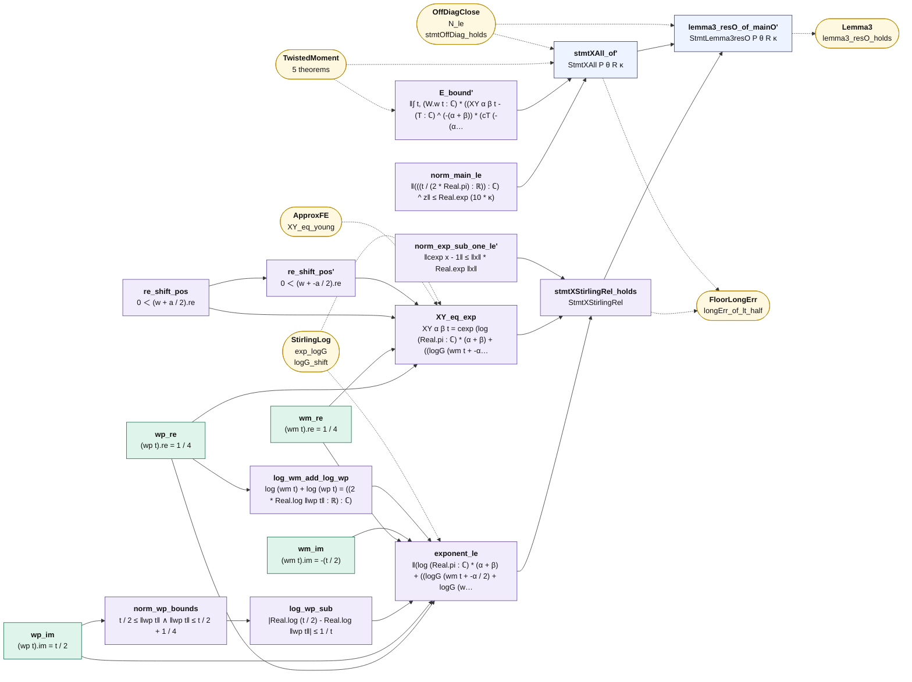

# `lean_stage3/Stage3/StirlingX.lean`

> **Read from the source text.** This file changed after the last `python3 utilities/lean_map.py --dump`, so the arrows on this page are names occurring in each proof and have not been confirmed by Lean.

# StirlingX — block S12 of `lean_stage3/design/stencil.md`, Stirling with the phase for `X_{α,β,t}`. 2026-11-25.

17 theorems, 3 definitions, 544 lines. 

**Imports:** [`StirlingLog`](../lean_stage3/StirlingLog.md), [`SwapX`](../lean_stage3/SwapX.md)  
**Imported by:** [`Stage3`](../lean_stage3/Stage3.md), [`Lemma3`](../lean_stage3/Lemma3.md)

## The picture



An arrow A → B reads "A is used in the proof of B". Green: counting, integers only. Violet: shape, analysis with no ζ. Blue: reads ζ. A name ending in ■ is an end: nothing else uses it. Red: contains `sorry`. Yellow: theorems in another file, counted; a dotted arrow crosses files. Definitions are not drawn; they are listed below the diagram.

## Definitions

<a name="Stirling-wp"></a>
### `Stirling.wp`

def · line 60

`w₊ = 1/4 + it/2`.

- **Is:** `` wp (t : ℝ) : ℂ := 1 / 4 + (t : ℂ) / 2 * I ``
- **Used by 8:** [`Stirling.XY_eq_exp`](#Stirling-XY_eq_exp), [`Stirling.exponent_le`](#Stirling-exponent_le), [`Stirling.log_wm_add_log_wp`](#Stirling-log_wm_add_log_wp), [`Stirling.log_wp_sub`](#Stirling-log_wp_sub), [`Stirling.norm_wp_bounds`](#Stirling-norm_wp_bounds), [`Stirling.stmtXStirlingRel_holds`](#Stirling-stmtXStirlingRel_holds), [`Stirling.wp_im`](#Stirling-wp_im), [`Stirling.wp_re`](#Stirling-wp_re)

<a name="Stirling-wm"></a>
### `Stirling.wm`

def · line 63

`w₋ = 1/4 − it/2`.

- **Is:** `` wm (t : ℝ) : ℂ := 1 / 4 - (t : ℂ) / 2 * I ``
- **Used by 6:** [`Stirling.XY_eq_exp`](#Stirling-XY_eq_exp), [`Stirling.exponent_le`](#Stirling-exponent_le), [`Stirling.log_wm_add_log_wp`](#Stirling-log_wm_add_log_wp), [`Stirling.stmtXStirlingRel_holds`](#Stirling-stmtXStirlingRel_holds), [`Stirling.wm_im`](#Stirling-wm_im), [`Stirling.wm_re`](#Stirling-wm_re)

<a name="Stirling-StmtXStirlingRel"></a>
### `Stirling.StmtXStirlingRel`

def · line 164

(4.2) with the phase, relative form. `X_{α,β,t} = (t/2π)^(−α−β) (1 + O(1/t))`, uniformly in `‖α‖, ‖β‖ ≤ 1/10`, `t ≥ 1`.

- **Is:** `` StmtXStirlingRel : Prop := ∃ C : ℝ, 0 ≤ C ∧ ∀ α β : ℂ, ‖α‖ ≤ 1 / 10 → ‖β‖ ≤ 1 / 10 → ∀ t : ℝ, 1 ≤ t → ‖XY α β t - (((t / (2 * Real.pi) : ℝ)) : ℂ) ^ (-(α + β))‖ ≤ C * ‖(((t / (2 * Real.pi) : ℝ)) : ℂ) ^ (-(α + β))‖ / t ``
- **Built from:** [`ApproxFE.XY`](../lean_stage3/ApproxFE.md#ApproxFE-XY)
- **Used by 2:** [`Stirling.stmtXAll_of'`](#Stirling-stmtXAll_of-), [`Stirling.stmtXStirlingRel_holds`](#Stirling-stmtXStirlingRel_holds)

## Theorems

<a name="Stirling-wp_re"></a>
### `Stirling.wp_re`

line 65 · arrows read from text

**Counting.** Integers only: nothing in its statement or proof, or in anything it rests on, uses analysis or ζ.

**Proves**

```lean
(wp t).re = 1 / 4
```

**Needs** (its hypotheses)

  - `` t : ℝ ``

**Fed by:** no theorem of this repo; it stands on Mathlib and the definitions below.

**Definitions its proof touches:** [`Stirling.wp`](#Stirling-wp)

**Feeds** (3 that use it)

  - [`Stirling.XY_eq_exp`](#Stirling-XY_eq_exp) — `` XY α β t = cexp (log (Real.pi : ℂ) * (α + β) + ((logG (wm t + -α / 2) + logG (wp t + -β / 2)) - (logG (wp t + α / 2) + logG (wm t + β / 2)))) ``
  - [`Stirling.exponent_le`](#Stirling-exponent_le) — `` ‖(log (Real.pi : ℂ) * (α + β) + ((logG (wm t + -α / 2) + logG (wp t + -β / 2)) - (logG (wp t + α / 2) + logG (wm t + β / 2)))) - log (((t / (2 * Real.… ``
  - [`Stirling.log_wm_add_log_wp`](#Stirling-log_wm_add_log_wp) — `` log (wm t) + log (wp t) = ((2 * Real.log ‖wp t‖ : ℝ) : ℂ) ``

<a name="Stirling-wp_im"></a>
### `Stirling.wp_im`

line 66 · arrows read from text

**Counting.** Integers only: nothing in its statement or proof, or in anything it rests on, uses analysis or ζ.

**Proves**

```lean
(wp t).im = t / 2
```

**Needs** (its hypotheses)

  - `` t : ℝ ``

**Fed by:** no theorem of this repo; it stands on Mathlib and the definitions below.

**Definitions its proof touches:** [`Stirling.wp`](#Stirling-wp)

**Feeds** (2 that use it)

  - [`Stirling.exponent_le`](#Stirling-exponent_le) — `` ‖(log (Real.pi : ℂ) * (α + β) + ((logG (wm t + -α / 2) + logG (wp t + -β / 2)) - (logG (wp t + α / 2) + logG (wm t + β / 2)))) - log (((t / (2 * Real.… ``
  - [`Stirling.norm_wp_bounds`](#Stirling-norm_wp_bounds) — `` t / 2 ≤ ‖wp t‖ ∧ ‖wp t‖ ≤ t / 2 + 1 / 4 ``

<a name="Stirling-wm_re"></a>
### `Stirling.wm_re`

line 67 · arrows read from text

**Counting.** Integers only: nothing in its statement or proof, or in anything it rests on, uses analysis or ζ.

**Proves**

```lean
(wm t).re = 1 / 4
```

**Needs** (its hypotheses)

  - `` t : ℝ ``

**Fed by:** no theorem of this repo; it stands on Mathlib and the definitions below.

**Definitions its proof touches:** [`Stirling.wm`](#Stirling-wm)

**Feeds** (2 that use it)

  - [`Stirling.XY_eq_exp`](#Stirling-XY_eq_exp) — `` XY α β t = cexp (log (Real.pi : ℂ) * (α + β) + ((logG (wm t + -α / 2) + logG (wp t + -β / 2)) - (logG (wp t + α / 2) + logG (wm t + β / 2)))) ``
  - [`Stirling.exponent_le`](#Stirling-exponent_le) — `` ‖(log (Real.pi : ℂ) * (α + β) + ((logG (wm t + -α / 2) + logG (wp t + -β / 2)) - (logG (wp t + α / 2) + logG (wm t + β / 2)))) - log (((t / (2 * Real.… ``

<a name="Stirling-wm_im"></a>
### `Stirling.wm_im`

line 68 · arrows read from text

**Counting.** Integers only: nothing in its statement or proof, or in anything it rests on, uses analysis or ζ.

**Proves**

```lean
(wm t).im = -(t / 2)
```

**Needs** (its hypotheses)

  - `` t : ℝ ``

**Fed by:** no theorem of this repo; it stands on Mathlib and the definitions below.

**Definitions its proof touches:** [`Stirling.wm`](#Stirling-wm)

**Feeds** (1 that use it)

  - [`Stirling.exponent_le`](#Stirling-exponent_le) — `` ‖(log (Real.pi : ℂ) * (α + β) + ((logG (wm t + -α / 2) + logG (wp t + -β / 2)) - (logG (wp t + α / 2) + logG (wm t + β / 2)))) - log (((t / (2 * Real.… ``

<a name="Stirling-re_shift_pos"></a>
### `Stirling.re_shift_pos`

line 70 · arrows read from text

**Shape.** Uses real or complex analysis; nothing in it or beneath it reads ζ.

**Proves**

```lean
0 < (w + a / 2).re
```

**Needs** (its hypotheses)

  - `` hw : w.re = 1 / 4 ``
  - `` ha : ‖a‖ ≤ 1 / 10 ``

**Fed by:** no theorem of this repo; it stands on Mathlib.

**Feeds** (2 that use it)

  - [`Stirling.XY_eq_exp`](#Stirling-XY_eq_exp) — `` XY α β t = cexp (log (Real.pi : ℂ) * (α + β) + ((logG (wm t + -α / 2) + logG (wp t + -β / 2)) - (logG (wp t + α / 2) + logG (wm t + β / 2)))) ``
  - [`Stirling.re_shift_pos'`](#Stirling-re_shift_pos-) — `` 0 < (w + -a / 2).re ``

<a name="Stirling-re_shift_pos-"></a>
### `Stirling.re_shift_pos'`

line 75 · arrows read from text

**Shape.** Uses real or complex analysis; nothing in it or beneath it reads ζ.

**Proves**

```lean
0 < (w + -a / 2).re
```

**Needs** (its hypotheses)

  - `` hw : w.re = 1 / 4 ``
  - `` ha : ‖a‖ ≤ 1 / 10 ``

**Fed by** (1 theorem its proof uses)

  - [`Stirling.re_shift_pos`](#Stirling-re_shift_pos) — `` 0 < (w + a / 2).re ``

**Feeds** (1 that use it)

  - [`Stirling.XY_eq_exp`](#Stirling-XY_eq_exp) — `` XY α β t = cexp (log (Real.pi : ℂ) * (α + β) + ((logG (wm t + -α / 2) + logG (wp t + -β / 2)) - (logG (wp t + α / 2) + logG (wm t + β / 2)))) ``

<a name="Stirling-XY_eq_exp"></a>
### `Stirling.XY_eq_exp`

line 81 · arrows read from text

**Shape.** Uses real or complex analysis; nothing in it or beneath it reads ζ.

**Why.** `X = exp(log π·(α+β) + logG(w₋−α/2) + logG(w₊−β/2) − logG(w₊+α/2) − logG(w₋+β/2))`.

**Proves**

```lean
XY α β t = cexp (log (Real.pi : ℂ) * (α + β) + ((logG (wm t + -α / 2) + logG (wp t + -β / 2)) - (logG (wp t + α / 2) + logG (wm t + β / 2))))
```

**Needs** (its hypotheses)

  - `` hα : ‖α‖ ≤ 1 / 10 ``
  - `` hβ : ‖β‖ ≤ 1 / 10 ``
  - `` t : ℝ ``

**Fed by** (6 theorems its proof uses)

  - [`ApproxFE.XY_eq_young`](../lean_stage3/ApproxFE.md#ApproxFE-XY_eq_young) (ApproxFE) — `` XY α β t = (Real.pi : ℂ) ^ (α + β) * (Gamma ((1 / 2 - α - t * I) / 2) * Gamma ((1 / 2 - β + t * I) / 2)) / (Gamma ((1 / 2 + α + t * I) / 2) * Gamma ((… ``
  - [`Stirling.exp_logG`](../lean_stage3/StirlingLog.md#Stirling-exp_logG) (StirlingLog) — `` cexp (logG z) = Gamma z ``
  - [`Stirling.re_shift_pos`](#Stirling-re_shift_pos) — `` 0 < (w + a / 2).re ``
  - [`Stirling.re_shift_pos'`](#Stirling-re_shift_pos-) — `` 0 < (w + -a / 2).re ``
  - [`Stirling.wm_re`](#Stirling-wm_re) — `` (wm t).re = 1 / 4 ``
  - [`Stirling.wp_re`](#Stirling-wp_re) — `` (wp t).re = 1 / 4 ``

**Definitions its proof touches:** [`ApproxFE.XY`](../lean_stage3/ApproxFE.md#ApproxFE-XY), [`Stirling.logG`](../lean_stage3/StirlingLog.md#Stirling-logG), [`Stirling.wm`](#Stirling-wm), [`Stirling.wp`](#Stirling-wp)

**Feeds** (1 that use it)

  - [`Stirling.stmtXStirlingRel_holds`](#Stirling-stmtXStirlingRel_holds) — `` StmtXStirlingRel ``

<a name="Stirling-log_wm_add_log_wp"></a>
### `Stirling.log_wm_add_log_wp`

line 97 · arrows read from text

**Shape.** Uses real or complex analysis; nothing in it or beneath it reads ζ.

**Why.** `log w₋ + log w₊ = 2 log‖w₊‖`.

**Proves**

```lean
log (wm t) + log (wp t) = ((2 * Real.log ‖wp t‖ : ℝ) : ℂ)
```

**Needs** (its hypotheses)

  - `` t : ℝ ``

**Fed by** (1 theorem its proof uses)

  - [`Stirling.wp_re`](#Stirling-wp_re) — `` (wp t).re = 1 / 4 ``

**Definitions its proof touches:** [`Stirling.wm`](#Stirling-wm), [`Stirling.wp`](#Stirling-wp)

**Feeds** (1 that use it)

  - [`Stirling.exponent_le`](#Stirling-exponent_le) — `` ‖(log (Real.pi : ℂ) * (α + β) + ((logG (wm t + -α / 2) + logG (wp t + -β / 2)) - (logG (wp t + α / 2) + logG (wm t + β / 2)))) - log (((t / (2 * Real.… ``

<a name="Stirling-norm_exp_sub_one_le-"></a>
### `Stirling.norm_exp_sub_one_le'`

line 107 · arrows read from text

**Shape.** Uses real or complex analysis; nothing in it or beneath it reads ζ.

**Why.** `‖exp x − 1‖ ≤ ‖x‖ e^‖x‖`.

**Proves**

```lean
‖cexp x - 1‖ ≤ ‖x‖ * Real.exp ‖x‖
```

**Needs** (its hypotheses)

  - `` x : ℂ ``

**Fed by:** no theorem of this repo; it stands on Mathlib.

**Feeds** (1 that use it)

  - [`Stirling.stmtXStirlingRel_holds`](#Stirling-stmtXStirlingRel_holds) — `` StmtXStirlingRel ``

<a name="Stirling-norm_wp_bounds"></a>
### `Stirling.norm_wp_bounds`

line 130 · arrows read from text

**Shape.** Uses real or complex analysis; nothing in it or beneath it reads ζ.

**Why.** `t/2 ≤ ‖w₊‖ ≤ t/2 + 1/4`.

**Proves**

```lean
t / 2 ≤ ‖wp t‖ ∧ ‖wp t‖ ≤ t / 2 + 1 / 4
```

**Needs** (its hypotheses)

  - `` ht : 1 ≤ t ``

**Fed by** (1 theorem its proof uses)

  - [`Stirling.wp_im`](#Stirling-wp_im) — `` (wp t).im = t / 2 ``

**Definitions its proof touches:** [`Stirling.wp`](#Stirling-wp)

**Feeds** (1 that use it)

  - [`Stirling.log_wp_sub`](#Stirling-log_wp_sub) — `` |Real.log (t / 2) - Real.log ‖wp t‖| ≤ 1 / t ``

<a name="Stirling-log_wp_sub"></a>
### `Stirling.log_wp_sub`

line 146 · arrows read from text

**Shape.** Uses real or complex analysis; nothing in it or beneath it reads ζ.

**Why.** `0 ≤ log‖w₊‖ − log(t/2) ≤ 1/(2t)`.

**Proves**

```lean
|Real.log (t / 2) - Real.log ‖wp t‖| ≤ 1 / t
```

**Needs** (its hypotheses)

  - `` ht : 1 ≤ t ``

**Fed by** (1 theorem its proof uses)

  - [`Stirling.norm_wp_bounds`](#Stirling-norm_wp_bounds) — `` t / 2 ≤ ‖wp t‖ ∧ ‖wp t‖ ≤ t / 2 + 1 / 4 ``

**Definitions its proof touches:** [`Stirling.wp`](#Stirling-wp)

**Feeds** (1 that use it)

  - [`Stirling.exponent_le`](#Stirling-exponent_le) — `` ‖(log (Real.pi : ℂ) * (α + β) + ((logG (wm t + -α / 2) + logG (wp t + -β / 2)) - (logG (wp t + α / 2) + logG (wm t + β / 2)))) - log (((t / (2 * Real.… ``

<a name="Stirling-exponent_le"></a>
### `Stirling.exponent_le`

line 170 · arrows read from text

**Shape.** Uses real or complex analysis; nothing in it or beneath it reads ζ.

**Why.** The exponent of `X` minus the exponent of `(t/2π)^(−α−β)` is `O(1/t)`, constant `17`.

**Proves**

```lean
‖(log (Real.pi : ℂ) * (α + β) + ((logG (wm t + -α / 2) + logG (wp t + -β / 2)) - (logG (wp t + α / 2) + logG (wm t + β / 2)))) - log (((t / (2 * Real.pi) : ℝ)) : ℂ) * (-(α + β))‖ ≤ 17 / t
```

**Needs** (its hypotheses)

  - `` hα : ‖α‖ ≤ 1 / 10 ``
  - `` hβ : ‖β‖ ≤ 1 / 10 ``
  - `` ht : 1 ≤ t ``

**Fed by** (7 theorems its proof uses)

  - [`Stirling.logG_shift`](../lean_stage3/StirlingLog.md#Stirling-logG_shift) (StirlingLog) — `` ‖logG (z + a) - logG z - a * log z‖ ≤ 2 / |z.im| ``
  - [`Stirling.log_wm_add_log_wp`](#Stirling-log_wm_add_log_wp) — `` log (wm t) + log (wp t) = ((2 * Real.log ‖wp t‖ : ℝ) : ℂ) ``
  - [`Stirling.log_wp_sub`](#Stirling-log_wp_sub) — `` |Real.log (t / 2) - Real.log ‖wp t‖| ≤ 1 / t ``
  - [`Stirling.wm_im`](#Stirling-wm_im) — `` (wm t).im = -(t / 2) ``
  - [`Stirling.wm_re`](#Stirling-wm_re) — `` (wm t).re = 1 / 4 ``
  - [`Stirling.wp_im`](#Stirling-wp_im) — `` (wp t).im = t / 2 ``
  - [`Stirling.wp_re`](#Stirling-wp_re) — `` (wp t).re = 1 / 4 ``

**Definitions its proof touches:** [`Stirling.logG`](../lean_stage3/StirlingLog.md#Stirling-logG), [`Stirling.wm`](#Stirling-wm), [`Stirling.wp`](#Stirling-wp)

**Feeds** (1 that use it)

  - [`Stirling.stmtXStirlingRel_holds`](#Stirling-stmtXStirlingRel_holds) — `` StmtXStirlingRel ``

<a name="Stirling-stmtXStirlingRel_holds"></a>
### `Stirling.stmtXStirlingRel_holds`

line 228 · arrows read from text

**Shape.** Uses real or complex analysis; nothing in it or beneath it reads ζ.

**Why.** Stirling with the phase: `StmtXStirlingRel` holds, constant `17 e^17`.

**Proves**

```lean
StmtXStirlingRel
```

**Fed by** (3 theorems its proof uses)

  - [`Stirling.XY_eq_exp`](#Stirling-XY_eq_exp) — `` XY α β t = cexp (log (Real.pi : ℂ) * (α + β) + ((logG (wm t + -α / 2) + logG (wp t + -β / 2)) - (logG (wp t + α / 2) + logG (wm t + β / 2)))) ``
  - [`Stirling.exponent_le`](#Stirling-exponent_le) — `` ‖(log (Real.pi : ℂ) * (α + β) + ((logG (wm t + -α / 2) + logG (wp t + -β / 2)) - (logG (wp t + α / 2) + logG (wm t + β / 2)))) - log (((t / (2 * Real.… ``
  - [`Stirling.norm_exp_sub_one_le'`](#Stirling-norm_exp_sub_one_le-) — `` ‖cexp x - 1‖ ≤ ‖x‖ * Real.exp ‖x‖ ``

**Definitions its proof touches:** [`ApproxFE.XY`](../lean_stage3/ApproxFE.md#ApproxFE-XY), [`Stirling.logG`](../lean_stage3/StirlingLog.md#Stirling-logG), [`Stirling.StmtXStirlingRel`](#Stirling-StmtXStirlingRel), [`Stirling.wm`](#Stirling-wm), [`Stirling.wp`](#Stirling-wp)

**Feeds** (2 that use it)

  - [`FloorLong.longErr_of_lt_half`](../lean_stage3/FloorLongErr.md#FloorLong-longErr_of_lt_half) (FloorLongErr) — `` StmtLongErr P θ R ``
  - [`Stirling.lemma3_resO_of_mainO'`](#Stirling-lemma3_resO_of_mainO-) — `` StmtLemma3resO P θ R κ ``

<a name="Stirling-norm_main_le"></a>
### `Stirling.norm_main_le`

line 258 · arrows read from text

**Shape.** Uses real or complex analysis; nothing in it or beneath it reads ζ.

**Why.** `‖(t/2π)^z‖ ≤ e^(10κ)` for `t ∈ [T/4, 2T]`, `‖z‖ ≤ 2κ/L`, `T ≥ 8`, `L ≥ 1`.

**Proves**

```lean
‖(((t / (2 * Real.pi) : ℝ)) : ℂ) ^ z‖ ≤ Real.exp (10 * κ)
```

**Needs** (its hypotheses)

  - `` hκ : 0 < κ ``
  - `` hT8 : 8 ≤ T ``
  - `` hL1 : 1 ≤ Real.log T ``
  - `` hz : ‖z‖ ≤ 2 * κ / Real.log T ``
  - `` ht : t ∈ Set.Icc (T / 4) (2 * T) ``

**Fed by:** no theorem of this repo; it stands on Mathlib.

**Feeds** (1 that use it)

  - [`Stirling.stmtXAll_of'`](#Stirling-stmtXAll_of-) — `` StmtXAll P θ R κ ``

<a name="Stirling-E_bound-"></a>
### `Stirling.E_bound'`

line 293 · arrows read from text

**Shape.** Uses real or complex analysis; nothing in it or beneath it reads ζ.

**Why.** `SwapX.E_bound` with the Stirling hypothesis on the support `[T/4, 2T]` only.

**Proves**

```lean
‖∫ t, (W.w t : ℂ) * ((XY α β t - (T : ℂ) ^ (-(α + β)) * (cT (-(α + β)) T * Gk (-(α + β)) 0 t)) * S1 (-β) (-α) 1 t) * (msq M a σ₀ t : ℂ)‖ ≤ 8 * Cst * CS * N * (2 * T) ^ e * Bm
```

**Needs** (its hypotheses)

  - `` hT8 : 8 ≤ T ``
  - `` W : Weight T L ``
  - `` M : ℕ ``
  - `` a : ℕ → ℂ ``
  - `` σ₀ : ℝ ``
  - `` hCst : 0 ≤ Cst ``
  - `` hCS : 0 ≤ CS ``
  - `` hN : 0 ≤ N ``
  - `` hBm : 0 ≤ Bm ``
  - `` he : 0 ≤ e ``
  - `` hst : ∀ t ∈ Set.Icc (T / 4) (2 * T), ‖XY α β t - (((t / (2 * Real.pi) : ℝ)) : ℂ) ^ (-(α + β))‖ ≤ Cst / t ``
  - `` hS1 : ∀ t : ℝ, 1 ≤ t → ‖S1 (-β) (-α) 1 t‖ ≤ CS * N * t ^ e ``
  - `` hmsq : ∀ t, msq M a σ₀ t ≤ Bm ``

**Fed by** (3 theorems its proof uses)

  - [`TwistedMoment.msq_nonneg`](../lean_stage3/TwistedMoment.md#TwistedMoment-msq_nonneg) (TwistedMoment) — `` 0 ≤ msq M a σ₀ t ``
  - [`TwistedMoment.norm_integral_le_Icc`](../lean_stage3/TwistedMoment.md#TwistedMoment-norm_integral_le_Icc) (TwistedMoment) — `` ‖∫ t, f t‖ ≤ K * (b - a) ``
  - [`TwistedMoment.w_zero_mul`](../lean_stage3/TwistedMoment.md#TwistedMoment-w_zero_mul) (TwistedMoment) — `` (W.w t : ℂ) * F * G = 0 ``

**Definitions its proof touches:** [`ApproxFE.XY`](../lean_stage3/ApproxFE.md#ApproxFE-XY), [`TwistedMoment.S1`](../lean_stage3/TwistedMoment.md#TwistedMoment-S1), [`TwistedMoment.Weight`](../lean_stage3/TwistedMoment.md#TwistedMoment-Weight), [`TwistedMoment.msq`](../lean_stage3/TwistedMoment.md#TwistedMoment-msq)

**Feeds** (1 that use it)

  - [`Stirling.stmtXAll_of'`](#Stirling-stmtXAll_of-) — `` StmtXAll P θ R κ ``

<a name="Stirling-stmtXAll_of-"></a>
### `Stirling.stmtXAll_of'`

line 336 · arrows read from text

**Reads ζ.** It, or something it rests on, uses the zeta function, its zeros or the Riemann hypothesis.

**Why.** `SwapX.stmtXAll_of` from `StmtXStirlingRel`: on `Regime κ T`, `‖(t/2π)^(−α−β)‖ ≤ e^(10κ)` on the support (`norm_main_le`), so the relative remainder is `≤ C e^(10κ)/t` there.

**Proves**

```lean
StmtXAll P θ R κ
```

**Needs** (its hypotheses)

  - `` P : Polynomial ℝ ``
  - `` hθ : θ < 1 / 2 ``
  - `` R : ℝ ``
  - `` hκ : 0 < κ ``
  - `` hS : StmtXStirlingRel ``
  - `` hmain : StmtDiagMainO P θ R κ ``

**Fed by** (6 theorems its proof uses)

  - [`OffDiagClose.N_le`](../lean_stage3/OffDiagClose.md#OffDiagClose-N_le) (OffDiagClose) — `` 1 + 1 / ‖α + β‖ ^ 2 ≤ 1 + κ ^ 2 * Real.log T ^ 2 ``
  - [`OffDiagClose.stmtOffDiag_holds`](../lean_stage3/OffDiagClose.md#OffDiagClose-stmtOffDiag_holds) (OffDiagClose) — `` StmtOffDiagAll P θ R κ ``
  - [`Stirling.E_bound'`](#Stirling-E_bound-) — `` ‖∫ t, (W.w t : ℂ) * ((XY α β t - (T : ℂ) ^ (-(α + β)) * (cT (-(α + β)) T * Gk (-(α + β)) 0 t)) * S1 (-β) (-α) 1 t) * (msq M a σ₀ t : ℂ)‖ ≤ 8 * Cst * C… ``
  - [`Stirling.norm_main_le`](#Stirling-norm_main_le) — `` ‖(((t / (2 * Real.pi) : ℝ)) : ℂ) ^ z‖ ≤ Real.exp (10 * κ) ``
  - [`TwistedMoment.integrable_I1`](../lean_stage3/TwistedMoment.md#TwistedMoment-integrable_I1) (TwistedMoment) — `` Integrable fun t => (W.w t : ℂ) * S1 α β c t * (msq M a σ₀ t : ℂ) ``
  - [`TwistedMoment.norm_Tpow_le`](../lean_stage3/TwistedMoment.md#TwistedMoment-norm_Tpow_le) (TwistedMoment) — `` ‖(T : ℂ) ^ (-(α + β))‖ ≤ Real.exp (2 * κ) ``

**Definitions its proof touches:** [`ApproxFE.XY`](../lean_stage3/ApproxFE.md#ApproxFE-XY), [`OffDiagClose.WeightAll`](../lean_stage3/OffDiagClose.md#OffDiagClose-WeightAll), [`Stirling.StmtXStirlingRel`](#Stirling-StmtXStirlingRel), [`TwistedMoment.I1`](../lean_stage3/TwistedMoment.md#TwistedMoment-I1), [`TwistedMoment.IX`](../lean_stage3/TwistedMoment.md#TwistedMoment-IX), [`TwistedMoment.Mof`](../lean_stage3/TwistedMoment.md#TwistedMoment-Mof), [`TwistedMoment.S1`](../lean_stage3/TwistedMoment.md#TwistedMoment-S1), [`TwistedMoment.aY`](../lean_stage3/TwistedMoment.md#TwistedMoment-aY), [`TwistedMoment.c1Y`](../lean_stage3/TwistedMoment.md#TwistedMoment-c1Y), [`TwistedMoment.errY`](../lean_stage3/TwistedMoment.md#TwistedMoment-errY), [`TwistedMoment.msq`](../lean_stage3/TwistedMoment.md#TwistedMoment-msq), [`TwistedMoment.sig0`](../lean_stage3/TwistedMoment.md#TwistedMoment-sig0)

**Feeds** (2 that use it)

  - [`FloorLong.longErr_of_lt_half`](../lean_stage3/FloorLongErr.md#FloorLong-longErr_of_lt_half) (FloorLongErr) — `` StmtLongErr P θ R ``
  - [`Stirling.lemma3_resO_of_mainO'`](#Stirling-lemma3_resO_of_mainO-) — `` StmtLemma3resO P θ R κ ``

<a name="Stirling-lemma3_resO_of_mainO-"></a>
### `Stirling.lemma3_resO_of_mainO'`

line 514 · arrows read from text

**Reads ζ.** It, or something it rests on, uses the zeta function, its zeros or the Riemann hypothesis.

**Why.** Lemma 3 up to `I_res`, `o(T)`, from the main term alone: `SwapX.lemma3_resO_of_mainO`'s route with the Stirling input discharged in its relative form (`stmtXStirlingRel_holds`), through `stmtXAll_of'`. `StmtDiagMainO → StmtLemma3resO`, `θ < 1/2`, `κ > 0`.

**Proves**

```lean
StmtLemma3resO P θ R κ
```

**Needs** (its hypotheses)

  - `` P : Polynomial ℝ ``
  - `` hθ : θ < 1 / 2 ``
  - `` R : ℝ ``
  - `` hκ : 0 < κ ``
  - `` hmain : StmtDiagMainO P θ R κ ``

**Fed by** (3 theorems its proof uses)

  - [`OffDiagClose.stmtOffDiag_holds`](../lean_stage3/OffDiagClose.md#OffDiagClose-stmtOffDiag_holds) (OffDiagClose) — `` StmtOffDiagAll P θ R κ ``
  - [`Stirling.stmtXAll_of'`](#Stirling-stmtXAll_of-) — `` StmtXAll P θ R κ ``
  - [`Stirling.stmtXStirlingRel_holds`](#Stirling-stmtXStirlingRel_holds) — `` StmtXStirlingRel ``

**Feeds** (1 that use it)

  - [`Lemma3.lemma3_resO_holds`](../lean_stage3/Lemma3.md#Lemma3-lemma3_resO_holds) (Lemma3) — `` StmtLemma3resO P θ R κ ``

