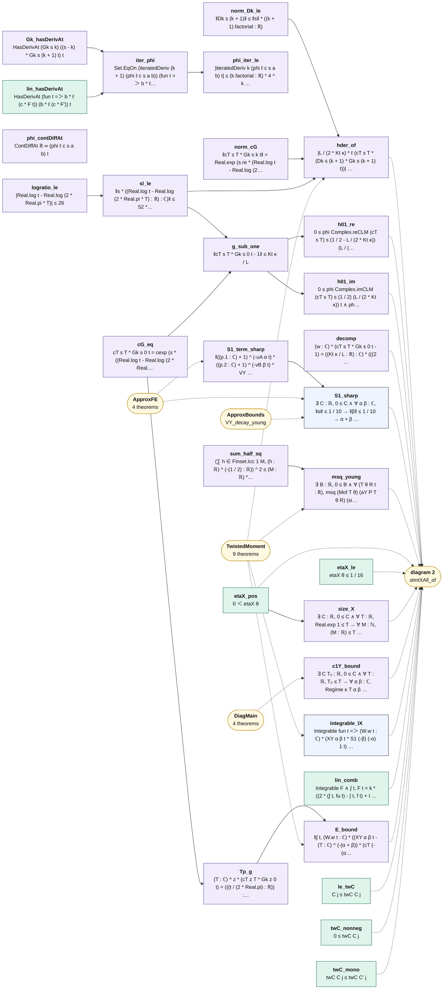
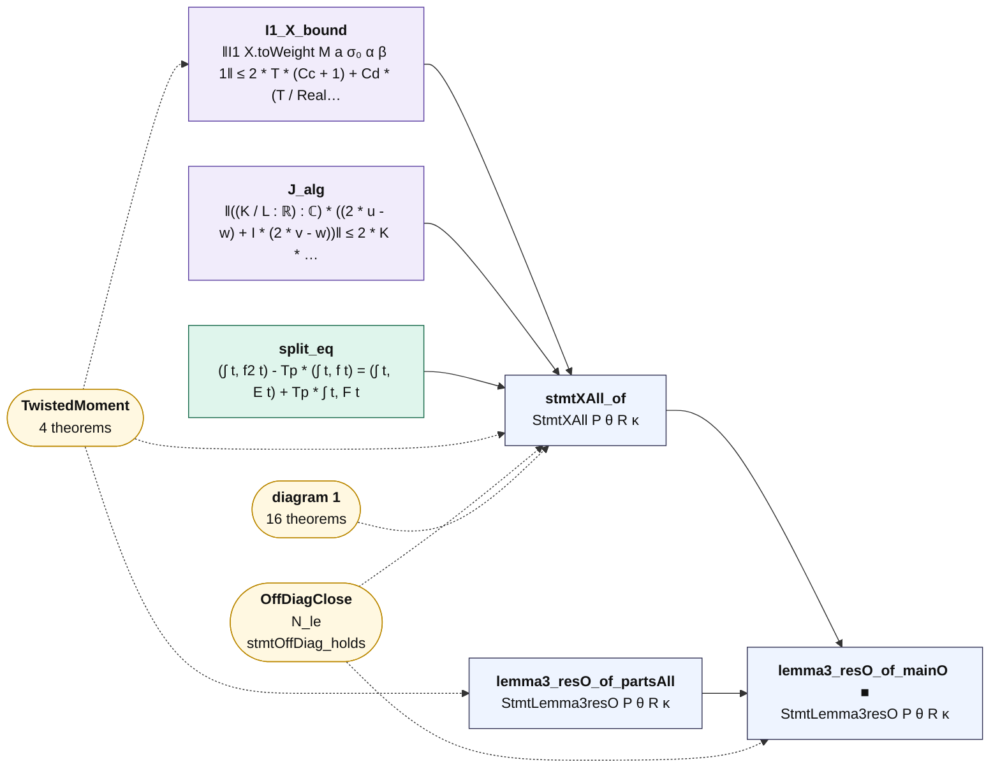

# `lean_stage3/Stage3/SwapX.lean`

> **Read from the source text.** This file changed after the last `python3 utilities/lean_map.py --dump`, so the arrows on this page are names occurring in each proof and have not been confirmed by Lean.

# SwapX — block S12 of `lean_stage3/design/stencil.md`, Part 5 of the twisted moment, the X-term. 2026-11-25.

36 theorems, 10 definitions, 1275 lines. 

**Imports:** [`DiagMain`](../lean_stage3/DiagMain.md), [`DiagonalO`](../lean_stage3/DiagonalO.md)  
**Imported by:** [`Stage3`](../lean_stage3/Stage3.md), [`StirlingX`](../lean_stage3/StirlingX.md)

## The picture

### Diagram 1 of 2: `Gk_hasDerivAt` to `le_twC`



### Diagram 2 of 2: `I1_X_bound` to `lemma3_resO_of_mainO`



An arrow A → B reads "A is used in the proof of B". Green: counting, integers only. Violet: shape, analysis with no ζ. Blue: reads ζ. A name ending in ■ is an end: nothing else uses it. Red: contains `sorry`. Yellow: theorems in another file, counted; a dotted arrow crosses files. Definitions are not drawn; they are listed below the diagram.

## Definitions

<a name="SwapX-Gk"></a>
### `SwapX.Gk`

def · line 84

`G_k(t) = exp((s − k) log t)`, so `G_k(t) = t^(s−k)` for `t > 0`.

- **Is:** `` Gk (s : ℂ) (k : ℕ) (t : ℝ) : ℂ := cexp ((s - k) * (Real.log t : ℂ)) ``
- **Used by 16:** [`SwapX.E_bound`](#SwapX-E_bound), [`SwapX.Gk_hasDerivAt`](#SwapX-Gk_hasDerivAt), [`SwapX.Tp_g`](#SwapX-Tp_g), [`SwapX.cG_eq`](#SwapX-cG_eq), [`SwapX.decomp`](#SwapX-decomp), [`SwapX.g_sub_one`](#SwapX-g_sub_one), [`SwapX.h01_im`](#SwapX-h01_im), [`SwapX.h01_re`](#SwapX-h01_re), [`SwapX.hder_of`](#SwapX-hder_of), [`SwapX.iter_phi`](#SwapX-iter_phi), [`SwapX.norm_cG`](#SwapX-norm_cG), [`SwapX.phi`](#SwapX-phi), [`SwapX.phi_contDiffAt`](#SwapX-phi_contDiffAt), [`SwapX.phi_iter_le`](#SwapX-phi_iter_le), [`SwapX.stmtXAll_of`](#SwapX-stmtXAll_of), [`SwapX.twist`](#SwapX-twist)

<a name="SwapX-Dk"></a>
### `SwapX.Dk`

def · line 87

`D_k = s(s−1)⋯(s−k+1)`.

- **Is:** `` Dk (s : ℂ) : ℕ → ℂ | 0 => 1 | k + 1 => Dk s k * (s - k) ``
- **Used by 5:** [`SwapX.hder_of`](#SwapX-hder_of), [`SwapX.iter_phi`](#SwapX-iter_phi), [`SwapX.norm_Dk_le`](#SwapX-norm_Dk_le), [`SwapX.phi_iter_le`](#SwapX-phi_iter_le), [`SwapX.twist`](#SwapX-twist)

<a name="SwapX-cT"></a>
### `SwapX.cT`

def · line 92

The constant `c_T = exp(−s log(2πT))`, so `c_T G_0(t) = (t/(2πT))^s`.

- **Is:** `` cT (s : ℂ) (T : ℝ) : ℂ := cexp (-(s * (Real.log (2 * Real.pi * T) : ℂ))) ``
- **Used by 10:** [`SwapX.E_bound`](#SwapX-E_bound), [`SwapX.Tp_g`](#SwapX-Tp_g), [`SwapX.cG_eq`](#SwapX-cG_eq), [`SwapX.decomp`](#SwapX-decomp), [`SwapX.g_sub_one`](#SwapX-g_sub_one), [`SwapX.h01_im`](#SwapX-h01_im), [`SwapX.h01_re`](#SwapX-h01_re), [`SwapX.hder_of`](#SwapX-hder_of), [`SwapX.norm_cG`](#SwapX-norm_cG), [`SwapX.stmtXAll_of`](#SwapX-stmtXAll_of)

<a name="SwapX-phi"></a>
### `SwapX.phi`

def · line 129

The real twist `φ(t) = a + b·ℓ(c·G_0(t))`, `ℓ` a real-linear functional (`re` or `im`).

- **Is:** `` phi (ℓ : ℂ →L[ℝ] ℝ) (c s : ℂ) (a b : ℝ) (t : ℝ) : ℝ := a + b * ℓ (c * Gk s 0 t) ``
- **Built from:** [`SwapX.Gk`](#SwapX-Gk)
- **Used by 8:** [`SwapX.decomp`](#SwapX-decomp), [`SwapX.h01_im`](#SwapX-h01_im), [`SwapX.h01_re`](#SwapX-h01_re), [`SwapX.iter_phi`](#SwapX-iter_phi), [`SwapX.phi_contDiffAt`](#SwapX-phi_contDiffAt), [`SwapX.phi_iter_le`](#SwapX-phi_iter_le), [`SwapX.stmtXAll_of`](#SwapX-stmtXAll_of), [`SwapX.twist`](#SwapX-twist)

<a name="SwapX-twC"></a>
### `SwapX.twC`

def · line 171

The twisted constants `C'_j = Σ_{i ≤ j} C(j,i) C_i (j−i)! 4^(j−i)`.

- **Is:** `` twC (C : ℕ → ℝ) (j : ℕ) : ℝ := ∑ i ∈ Finset.range (j + 1), (j.choose i : ℝ) * C i * (((j - i).factorial : ℝ) * 4 ^ (j - i)) ``
- **Used by 5:** [`SwapX.le_twC`](#SwapX-le_twC), [`SwapX.stmtXAll_of`](#SwapX-stmtXAll_of), [`SwapX.twC_mono`](#SwapX-twC_mono), [`SwapX.twC_nonneg`](#SwapX-twC_nonneg), [`SwapX.twist`](#SwapX-twist)

<a name="SwapX-twist"></a>
### `SwapX.twist`

def · line 205

The twisted weight `w·φ`, a `WeightAll T L`.

- **Is:** `` twist (hT : 0 < T) (hΔ : 0 < T / L) (h01 : ∀ t ∈ Set.Icc (T / 4) (2 * T), 0 ≤ phi ℓ c s a b t ∧ phi ℓ c s a b t ≤ 1) (hder : ∀ k : ℕ, ∀ t ∈ Set.Icc (T / 4) (2 * T), |b * ℓ (c * (Dk s (k + 1) * Gk s (k + 1) t))| ≤ ((k + 1).factorial : ℝ) * 4 ^ (k + 1) * ((T / L) ^ (k + 1))⁻¹) : WeightAll T L := have hsm : ContDiff ℝ ∞ (fun t => W.w t * phi ℓ c s a b t) := by rw [contDiff_iff_contDiffAt] intro t by_cases ht : t ≤ 0 · r… ``
- **Built from:** [`OffDiagClose.WeightAll`](../lean_stage3/OffDiagClose.md#OffDiagClose-WeightAll), [`SwapX.Dk`](#SwapX-Dk), [`SwapX.Gk`](#SwapX-Gk), [`SwapX.phi`](#SwapX-phi), [`SwapX.phi_contDiffAt`](#SwapX-phi_contDiffAt), [`SwapX.phi_iter_le`](#SwapX-phi_iter_le), [`SwapX.twC`](#SwapX-twC), [`SwapX.twC_nonneg`](#SwapX-twC_nonneg)
- **Used by 1:** [`SwapX.stmtXAll_of`](#SwapX-stmtXAll_of)

<a name="SwapX-Kt"></a>
### `SwapX.Kt`

def · line 341

The size constant `K = 104κ`: `‖(t/(2πT))^s − 1‖ ≤ K/L` on the support.

- **Is:** `` Kt (κ : ℝ) : ℝ := 104 * κ ``
- **Used by 6:** [`SwapX.decomp`](#SwapX-decomp), [`SwapX.g_sub_one`](#SwapX-g_sub_one), [`SwapX.h01_im`](#SwapX-h01_im), [`SwapX.h01_re`](#SwapX-h01_re), [`SwapX.hder_of`](#SwapX-hder_of), [`SwapX.stmtXAll_of`](#SwapX-stmtXAll_of)

<a name="SwapX-etaX"></a>
### `SwapX.etaX`

def · line 624

The exponent margin `η = (1/2 − θ⁺)/8`.

- **Is:** `` etaX (θ : ℝ) : ℝ := (1 / 2 - max θ 0) / 8 ``
- **Used by 4:** [`SwapX.etaX_le`](#SwapX-etaX_le), [`SwapX.etaX_pos`](#SwapX-etaX_pos), [`SwapX.size_X`](#SwapX-size_X), [`SwapX.stmtXAll_of`](#SwapX-stmtXAll_of)

<a name="SwapX-StmtXStirling"></a>
### `SwapX.StmtXStirling`

def · line 755

OPEN, (4.2) in its asymptotic form, with the phase: `X_{α,β,t} = (t/2π)^(−α−β) + O(1/t)`, uniformly in `‖α‖, ‖β‖ ≤ 1/10`, `t ≥ 1`. `XY_size` gives only the size, `log_norm_Gamma_approx` only `log‖Γ‖` up to `O(1)`, PNT+'s `StripBounds` upper bounds; none carries the argument. Route: `X = π^(α+β) Γ(z−α/2)Γ(z̄'−β/2)/(Γ(z+α/2)Γ(z̄'+β/2))`, `z = 1/4 − it/2`; each ratio is `exp(−∫_{−a}^{a} ψ(z+u) du)` along the segment, and `ψ(w) = log w + O(1/|w|)` on `1/5 ≤ Re w ≤ 3/10` from the digamma series (`digamma_eq_tsum`, PNT+ `DigammaSeries`, with no open proofs), the `Stirling.lean` comparison (`re_digam…

- **Is:** `` StmtXStirling : Prop := ∃ C : ℝ, 0 ≤ C ∧ ∀ α β : ℂ, ‖α‖ ≤ 1 / 10 → ‖β‖ ≤ 1 / 10 → ∀ t : ℝ, 1 ≤ t → ‖XY α β t - (((t / (2 * Real.pi) : ℝ)) : ℂ) ^ (-(α + β))‖ ≤ C / t ``
- **Built from:** [`ApproxFE.XY`](../lean_stage3/ApproxFE.md#ApproxFE-XY)
- **Used by 2:** [`SwapX.lemma3_resO_of_mainO`](#SwapX-lemma3_resO_of_mainO), [`SwapX.stmtXAll_of`](#SwapX-stmtXAll_of)

<a name="SwapX-StmtXAll"></a>
### `SwapX.StmtXAll`

def · line 940

The X-term over `WeightAll` (the shape of `StmtOffDiagAll`): `I_X(α,β) = T^(−α−β) I₁(−β,−α) + O(T/L)`, the constant depending on a family `Cs` fixed first.

- **Is:** `` StmtXAll (P : Polynomial ℝ) (θ R κ : ℝ) : Prop := ∀ Cs : ℕ → ℝ, ∃ C T₀ : ℝ, 0 ≤ C ∧ ∀ T : ℝ, T₀ ≤ T → ∀ W : WeightAll T (Real.log T), (∀ j, W.Cj j ≤ Cs j) → ∀ α β : ℂ, Regime κ T α β → ‖IX W.toWeight (Mof T θ) (aY P T θ R) (sig0 T R) α β 1 - (T : ℂ) ^ (-(α + β)) * I1 W.toWeight (Mof T θ) (aY P T θ R) (sig0 T R) (-β) (-α) 1‖ ≤ C * errY W.toWeight ``
- **Built from:** [`OffDiagClose.WeightAll`](../lean_stage3/OffDiagClose.md#OffDiagClose-WeightAll), [`TwistedMoment.I1`](../lean_stage3/TwistedMoment.md#TwistedMoment-I1), [`TwistedMoment.IX`](../lean_stage3/TwistedMoment.md#TwistedMoment-IX), [`TwistedMoment.Mof`](../lean_stage3/TwistedMoment.md#TwistedMoment-Mof), [`TwistedMoment.Regime`](../lean_stage3/TwistedMoment.md#TwistedMoment-Regime), [`TwistedMoment.aY`](../lean_stage3/TwistedMoment.md#TwistedMoment-aY), [`TwistedMoment.errY`](../lean_stage3/TwistedMoment.md#TwistedMoment-errY), [`TwistedMoment.sig0`](../lean_stage3/TwistedMoment.md#TwistedMoment-sig0)
- **Used by 2:** [`SwapX.lemma3_resO_of_partsAll`](#SwapX-lemma3_resO_of_partsAll), [`SwapX.stmtXAll_of`](#SwapX-stmtXAll_of)

## Theorems

<a name="SwapX-Gk_hasDerivAt"></a>
### `SwapX.Gk_hasDerivAt`

line 94 · arrows read from text

**Shape.** Uses real or complex analysis; nothing in it or beneath it reads ζ.

**Proves**

```lean
HasDerivAt (Gk s k) ((s - k) * Gk s (k + 1) t) t
```

**Needs** (its hypotheses)

  - `` s : ℂ ``
  - `` k : ℕ ``
  - `` ht : 0 < t ``

**Fed by:** no theorem of this repo; it stands on Mathlib and the definitions below.

**Definitions its proof touches:** [`SwapX.Gk`](#SwapX-Gk)

**Feeds** (1 that use it)

  - [`SwapX.iter_phi`](#SwapX-iter_phi) — `` Set.EqOn (iteratedDeriv (k + 1) (phi ℓ c s a b)) (fun t => b * ℓ (c * (Dk s (k + 1) * Gk s (k + 1) t))) (Set.Ioi 0) ``

<a name="SwapX-norm_Dk_le"></a>
### `SwapX.norm_Dk_le`

line 110 · arrows read from text

**Shape.** Uses real or complex analysis; nothing in it or beneath it reads ζ.

**Proves**

```lean
‖Dk s (k + 1)‖ ≤ ‖s‖ * ((k + 1).factorial : ℝ)
```

**Needs** (its hypotheses)

  - `` hs : ‖s‖ ≤ 1 ``
  - `` k : ℕ ``

**Fed by:** no theorem of this repo; it stands on Mathlib and the definitions below.

**Definitions its proof touches:** [`SwapX.Dk`](#SwapX-Dk)

**Feeds** (1 that use it)

  - [`SwapX.hder_of`](#SwapX-hder_of) — `` |L / (2 * Kt κ) * ℓ (cT s T * (Dk s (k + 1) * Gk s (k + 1) t))| ≤ ((k + 1).factorial : ℝ) * 4 ^ (k + 1) * ((T / L) ^ (k + 1))⁻¹ ``

<a name="SwapX-lin_hasDerivAt"></a>
### `SwapX.lin_hasDerivAt`

line 131 · arrows read from text

**Counting.** Integers only: nothing in its statement or proof, or in anything it rests on, uses analysis or ζ.

**Proves**

```lean
HasDerivAt (fun t => b * ℓ (c * F t)) (b * ℓ (c * F')) t
```

**Needs** (its hypotheses)

  - `` ℓ : ℂ →L[ℝ] ℝ ``
  - `` c : ℂ ``
  - `` b : ℝ ``
  - `` hF : HasDerivAt F F' t ``

**Fed by:** no theorem of this repo; it stands on Mathlib.

**Feeds** (1 that use it)

  - [`SwapX.iter_phi`](#SwapX-iter_phi) — `` Set.EqOn (iteratedDeriv (k + 1) (phi ℓ c s a b)) (fun t => b * ℓ (c * (Dk s (k + 1) * Gk s (k + 1) t))) (Set.Ioi 0) ``

<a name="SwapX-iter_phi"></a>
### `SwapX.iter_phi`

line 136 · arrows read from text

**Shape.** Uses real or complex analysis; nothing in it or beneath it reads ζ.

**Proves**

```lean
Set.EqOn (iteratedDeriv (k + 1) (phi ℓ c s a b)) (fun t => b * ℓ (c * (Dk s (k + 1) * Gk s (k + 1) t))) (Set.Ioi 0)
```

**Needs** (its hypotheses)

  - `` ℓ : ℂ →L[ℝ] ℝ ``
  - `` c s : ℂ ``
  - `` a b : ℝ ``
  - `` k : ℕ ``

**Fed by** (2 theorems its proof uses)

  - [`SwapX.Gk_hasDerivAt`](#SwapX-Gk_hasDerivAt) — `` HasDerivAt (Gk s k) ((s - k) * Gk s (k + 1) t) t ``
  - [`SwapX.lin_hasDerivAt`](#SwapX-lin_hasDerivAt) — `` HasDerivAt (fun t => b * ℓ (c * F t)) (b * ℓ (c * F')) t ``

**Definitions its proof touches:** [`SwapX.Dk`](#SwapX-Dk), [`SwapX.Gk`](#SwapX-Gk), [`SwapX.phi`](#SwapX-phi)

**Feeds** (1 that use it)

  - [`SwapX.phi_iter_le`](#SwapX-phi_iter_le) — `` |iteratedDeriv k (phi ℓ c s a b) t| ≤ (k.factorial : ℝ) * 4 ^ k * ((T / L) ^ k)⁻¹ ``

<a name="SwapX-phi_contDiffAt"></a>
### `SwapX.phi_contDiffAt`

line 161 · arrows read from text

**Shape.** Uses real or complex analysis; nothing in it or beneath it reads ζ.

**Proves**

```lean
ContDiffAt ℝ ∞ (phi ℓ c s a b) t
```

**Needs** (its hypotheses)

  - `` ℓ : ℂ →L[ℝ] ℝ ``
  - `` c s : ℂ ``
  - `` a b : ℝ ``
  - `` ht : t ≠ 0 ``

**Fed by:** no theorem of this repo; it stands on Mathlib and the definitions below.

**Definitions its proof touches:** [`SwapX.Gk`](#SwapX-Gk), [`SwapX.phi`](#SwapX-phi)

**Feeds** (1 that use it)

  - [`SwapX.twist`](#SwapX-twist) — def

<a name="SwapX-twC_nonneg"></a>
### `SwapX.twC_nonneg`

line 174 · arrows read from text

**Counting.** Integers only: nothing in its statement or proof, or in anything it rests on, uses analysis or ζ.

**Proves**

```lean
0 ≤ twC C j
```

**Needs** (its hypotheses)

  - `` hC : ∀ j, 0 ≤ C j ``
  - `` j : ℕ ``

**Fed by:** no theorem of this repo; it stands on Mathlib and the definitions below.

**Definitions its proof touches:** [`SwapX.twC`](#SwapX-twC)

**Feeds** (2 that use it)

  - [`SwapX.stmtXAll_of`](#SwapX-stmtXAll_of) — `` StmtXAll P θ R κ ``
  - [`SwapX.twist`](#SwapX-twist) — def

<a name="SwapX-twC_mono"></a>
### `SwapX.twC_mono`

line 177 · arrows read from text

**Counting.** Integers only: nothing in its statement or proof, or in anything it rests on, uses analysis or ζ.

**Proves**

```lean
twC C j ≤ twC C' j
```

**Needs** (its hypotheses)

  - `` h : ∀ j, C j ≤ C' j ``
  - `` j : ℕ ``

**Fed by:** no theorem of this repo; it stands on Mathlib and the definitions below.

**Definitions its proof touches:** [`SwapX.twC`](#SwapX-twC)

**Feeds** (1 that use it)

  - [`SwapX.stmtXAll_of`](#SwapX-stmtXAll_of) — `` StmtXAll P θ R κ ``

<a name="SwapX-phi_iter_le"></a>
### `SwapX.phi_iter_le`

line 188 · arrows read from text

**Shape.** Uses real or complex analysis; nothing in it or beneath it reads ζ.

**Why.** The derivative bounds of `φ` on the support: `|φ^(k)| ≤ k! 4^k Δ^(−k)`.

**Proves**

```lean
|iteratedDeriv k (phi ℓ c s a b) t| ≤ (k.factorial : ℝ) * 4 ^ k * ((T / L) ^ k)⁻¹
```

**Needs** (its hypotheses)

  - `` hT : 0 < T ``
  - `` h01 : ∀ t ∈ Set.Icc (T / 4) (2 * T), 0 ≤ phi ℓ c s a b t ∧ phi ℓ c s a b t ≤ 1 ``
  - `` hder : ∀ k : ℕ, ∀ t ∈ Set.Icc (T / 4) (2 * T), |b * ℓ (c * (Dk s (k + 1) * Gk s (k + 1) t))| ≤ ((k + 1).factorial : ℝ) * 4 ^ (k + 1) * ((T / L) ^ (k + 1))⁻¹ ``
  - `` k : ℕ ``
  - `` ht : t ∈ Set.Icc (T / 4) (2 * T) ``

**Fed by** (1 theorem its proof uses)

  - [`SwapX.iter_phi`](#SwapX-iter_phi) — `` Set.EqOn (iteratedDeriv (k + 1) (phi ℓ c s a b)) (fun t => b * ℓ (c * (Dk s (k + 1) * Gk s (k + 1) t))) (Set.Ioi 0) ``

**Definitions its proof touches:** [`SwapX.Dk`](#SwapX-Dk), [`SwapX.Gk`](#SwapX-Gk), [`SwapX.phi`](#SwapX-phi)

**Feeds** (1 that use it)

  - [`SwapX.twist`](#SwapX-twist) — def

<a name="SwapX-logratio_le"></a>
### `SwapX.logratio_le`

line 287 · arrows read from text

**Shape.** Uses real or complex analysis; nothing in it or beneath it reads ζ.

**Why.** `|log(t/(2πT))| ≤ 26` on `[T/4, 2T]`.

**Proves**

```lean
|Real.log t - Real.log (2 * Real.pi * T)| ≤ 26
```

**Needs** (its hypotheses)

  - `` hT : 0 < T ``
  - `` ht : t ∈ Set.Icc (T / 4) (2 * T) ``

**Fed by:** no theorem of this repo; it stands on Mathlib.

**Feeds** (1 that use it)

  - [`SwapX.sl_le`](#SwapX-sl_le) — `` ‖s * ((Real.log t - Real.log (2 * Real.pi * T) : ℝ) : ℂ)‖ ≤ 52 * κ / L ``

<a name="SwapX-cG_eq"></a>
### `SwapX.cG_eq`

line 310 · arrows read from text

**Shape.** Uses real or complex analysis; nothing in it or beneath it reads ζ.

**Why.** `c_T G_0(t) = exp(s (log t − log(2πT)))`.

**Proves**

```lean
cT s T * Gk s 0 t = cexp (s * ((Real.log t - Real.log (2 * Real.pi * T) : ℝ) : ℂ))
```

**Needs** (its hypotheses)

  - `` s : ℂ ``
  - `` T t : ℝ ``

**Fed by:** no theorem of this repo; it stands on Mathlib and the definitions below.

**Definitions its proof touches:** [`SwapX.Gk`](#SwapX-Gk), [`SwapX.cT`](#SwapX-cT)

**Feeds** (2 that use it)

  - [`SwapX.Tp_g`](#SwapX-Tp_g) — `` (T : ℂ) ^ z * (cT z T * Gk z 0 t) = (((t / (2 * Real.pi) : ℝ)) : ℂ) ^ z ``
  - [`SwapX.g_sub_one`](#SwapX-g_sub_one) — `` ‖cT s T * Gk s 0 t - 1‖ ≤ Kt κ / L ``

<a name="SwapX-norm_cG"></a>
### `SwapX.norm_cG`

line 319 · arrows read from text

**Shape.** Uses real or complex analysis; nothing in it or beneath it reads ζ.

**Why.** `‖c_T G_k(t)‖ = e^(Re s (log t − log(2πT))) t^(−k)`, `t > 0`.

**Proves**

```lean
‖cT s T * Gk s k t‖ = Real.exp (s.re * (Real.log t - Real.log (2 * Real.pi * T))) * (t⁻¹) ^ k
```

**Needs** (its hypotheses)

  - `` s : ℂ ``
  - `` T : ℝ ``
  - `` k : ℕ ``
  - `` ht : 0 < t ``

**Fed by:** no theorem of this repo; it stands on Mathlib and the definitions below.

**Definitions its proof touches:** [`SwapX.Gk`](#SwapX-Gk), [`SwapX.cT`](#SwapX-cT)

**Feeds** (1 that use it)

  - [`SwapX.hder_of`](#SwapX-hder_of) — `` |L / (2 * Kt κ) * ℓ (cT s T * (Dk s (k + 1) * Gk s (k + 1) t))| ≤ ((k + 1).factorial : ℝ) * 4 ^ (k + 1) * ((T / L) ^ (k + 1))⁻¹ ``

<a name="SwapX-sl_le"></a>
### `SwapX.sl_le`

line 343 · arrows read from text

**Shape.** Uses real or complex analysis; nothing in it or beneath it reads ζ.

**Proves**

```lean
‖s * ((Real.log t - Real.log (2 * Real.pi * T) : ℝ) : ℂ)‖ ≤ 52 * κ / L
```

**Needs** (its hypotheses)

  - `` hκ : 0 < κ ``
  - `` hT : 0 < T ``
  - `` hL : 52 * κ ≤ L ``
  - `` hs : ‖s‖ ≤ 2 * κ / L ``
  - `` ht : t ∈ Set.Icc (T / 4) (2 * T) ``

**Fed by** (1 theorem its proof uses)

  - [`SwapX.logratio_le`](#SwapX-logratio_le) — `` |Real.log t - Real.log (2 * Real.pi * T)| ≤ 26 ``

**Feeds** (2 that use it)

  - [`SwapX.g_sub_one`](#SwapX-g_sub_one) — `` ‖cT s T * Gk s 0 t - 1‖ ≤ Kt κ / L ``
  - [`SwapX.hder_of`](#SwapX-hder_of) — `` |L / (2 * Kt κ) * ℓ (cT s T * (Dk s (k + 1) * Gk s (k + 1) t))| ≤ ((k + 1).factorial : ℝ) * 4 ^ (k + 1) * ((T / L) ^ (k + 1))⁻¹ ``

<a name="SwapX-g_sub_one"></a>
### `SwapX.g_sub_one`

line 353 · arrows read from text

**Shape.** Uses real or complex analysis; nothing in it or beneath it reads ζ.

**Proves**

```lean
‖cT s T * Gk s 0 t - 1‖ ≤ Kt κ / L
```

**Needs** (its hypotheses)

  - `` hκ : 0 < κ ``
  - `` hT : 0 < T ``
  - `` hL : 52 * κ ≤ L ``
  - `` hs : ‖s‖ ≤ 2 * κ / L ``
  - `` ht : t ∈ Set.Icc (T / 4) (2 * T) ``

**Fed by** (2 theorems its proof uses)

  - [`SwapX.cG_eq`](#SwapX-cG_eq) — `` cT s T * Gk s 0 t = cexp (s * ((Real.log t - Real.log (2 * Real.pi * T) : ℝ) : ℂ)) ``
  - [`SwapX.sl_le`](#SwapX-sl_le) — `` ‖s * ((Real.log t - Real.log (2 * Real.pi * T) : ℝ) : ℂ)‖ ≤ 52 * κ / L ``

**Definitions its proof touches:** [`SwapX.Gk`](#SwapX-Gk), [`SwapX.Kt`](#SwapX-Kt), [`SwapX.cT`](#SwapX-cT)

**Feeds** (2 that use it)

  - [`SwapX.h01_im`](#SwapX-h01_im) — `` 0 ≤ phi Complex.imCLM (cT s T) s (1 / 2) (L / (2 * Kt κ)) t ∧ phi Complex.imCLM (cT s T) s (1 / 2) (L / (2 * Kt κ)) t ≤ 1 ``
  - [`SwapX.h01_re`](#SwapX-h01_re) — `` 0 ≤ phi Complex.reCLM (cT s T) s (1 / 2 - L / (2 * Kt κ)) (L / (2 * Kt κ)) t ∧ phi Complex.reCLM (cT s T) s (1 / 2 - L / (2 * Kt κ)) (L / (2 * Kt κ)) … ``

<a name="SwapX-hder_of"></a>
### `SwapX.hder_of`

line 366 · arrows read from text

**Shape.** Uses real or complex analysis; nothing in it or beneath it reads ζ.

**Why.** The derivative bound `hder` of `twist`, for any `ℓ` with `|ℓ z| ≤ ‖z‖`, `b = L/(2K)`.

**Proves**

```lean
|L / (2 * Kt κ) * ℓ (cT s T * (Dk s (k + 1) * Gk s (k + 1) t))| ≤ ((k + 1).factorial : ℝ) * 4 ^ (k + 1) * ((T / L) ^ (k + 1))⁻¹
```

**Needs** (its hypotheses)

  - `` ℓ : ℂ →L[ℝ] ℝ ``
  - `` hℓ : ∀ z, |ℓ z| ≤ ‖z‖ ``
  - `` hκ : 0 < κ ``
  - `` hT : 0 < T ``
  - `` hL1 : 1 ≤ L ``
  - `` hL : 52 * κ ≤ L ``
  - `` hs : ‖s‖ ≤ 2 * κ / L ``
  - `` k : ℕ ``
  - `` t : ℝ ``
  - `` ht : t ∈ Set.Icc (T / 4) (2 * T) ``

**Fed by** (4 theorems its proof uses)

  - [`SwapX.norm_Dk_le`](#SwapX-norm_Dk_le) — `` ‖Dk s (k + 1)‖ ≤ ‖s‖ * ((k + 1).factorial : ℝ) ``
  - [`SwapX.norm_cG`](#SwapX-norm_cG) — `` ‖cT s T * Gk s k t‖ = Real.exp (s.re * (Real.log t - Real.log (2 * Real.pi * T))) * (t⁻¹) ^ k ``
  - [`SwapX.sl_le`](#SwapX-sl_le) — `` ‖s * ((Real.log t - Real.log (2 * Real.pi * T) : ℝ) : ℂ)‖ ≤ 52 * κ / L ``
  - [`TwistedMoment.inv_t_le`](../lean_stage3/TwistedMoment.md#TwistedMoment-inv_t_le) (TwistedMoment) — `` t⁻¹ ≤ 4 * (T / L)⁻¹ ``

**Definitions its proof touches:** [`SwapX.Dk`](#SwapX-Dk), [`SwapX.Gk`](#SwapX-Gk), [`SwapX.Kt`](#SwapX-Kt), [`SwapX.cT`](#SwapX-cT)

**Feeds** (1 that use it)

  - [`SwapX.stmtXAll_of`](#SwapX-stmtXAll_of) — `` StmtXAll P θ R κ ``

<a name="SwapX-h01_re"></a>
### `SwapX.h01_re`

line 419 · arrows read from text

**Shape.** Uses real or complex analysis; nothing in it or beneath it reads ζ.

**Proves**

```lean
0 ≤ phi Complex.reCLM (cT s T) s (1 / 2 - L / (2 * Kt κ)) (L / (2 * Kt κ)) t ∧ phi Complex.reCLM (cT s T) s (1 / 2 - L / (2 * Kt κ)) (L / (2 * Kt κ)) t ≤ 1
```

**Needs** (its hypotheses)

  - `` hκ : 0 < κ ``
  - `` hT : 0 < T ``
  - `` hL : 52 * κ ≤ L ``
  - `` hs : ‖s‖ ≤ 2 * κ / L ``
  - `` t : ℝ ``
  - `` ht : t ∈ Set.Icc (T / 4) (2 * T) ``

**Fed by** (1 theorem its proof uses)

  - [`SwapX.g_sub_one`](#SwapX-g_sub_one) — `` ‖cT s T * Gk s 0 t - 1‖ ≤ Kt κ / L ``

**Definitions its proof touches:** [`SwapX.Gk`](#SwapX-Gk), [`SwapX.Kt`](#SwapX-Kt), [`SwapX.cT`](#SwapX-cT), [`SwapX.phi`](#SwapX-phi)

**Feeds** (1 that use it)

  - [`SwapX.stmtXAll_of`](#SwapX-stmtXAll_of) — `` StmtXAll P θ R κ ``

<a name="SwapX-h01_im"></a>
### `SwapX.h01_im`

line 443 · arrows read from text

**Shape.** Uses real or complex analysis; nothing in it or beneath it reads ζ.

**Proves**

```lean
0 ≤ phi Complex.imCLM (cT s T) s (1 / 2) (L / (2 * Kt κ)) t ∧ phi Complex.imCLM (cT s T) s (1 / 2) (L / (2 * Kt κ)) t ≤ 1
```

**Needs** (its hypotheses)

  - `` hκ : 0 < κ ``
  - `` hT : 0 < T ``
  - `` hL : 52 * κ ≤ L ``
  - `` hs : ‖s‖ ≤ 2 * κ / L ``
  - `` t : ℝ ``
  - `` ht : t ∈ Set.Icc (T / 4) (2 * T) ``

**Fed by** (1 theorem its proof uses)

  - [`SwapX.g_sub_one`](#SwapX-g_sub_one) — `` ‖cT s T * Gk s 0 t - 1‖ ≤ Kt κ / L ``

**Definitions its proof touches:** [`SwapX.Gk`](#SwapX-Gk), [`SwapX.Kt`](#SwapX-Kt), [`SwapX.cT`](#SwapX-cT), [`SwapX.phi`](#SwapX-phi)

**Feeds** (1 that use it)

  - [`SwapX.stmtXAll_of`](#SwapX-stmtXAll_of) — `` StmtXAll P θ R κ ``

<a name="SwapX-decomp"></a>
### `SwapX.decomp`

line 467 · arrows read from text

**Shape.** Uses real or complex analysis; nothing in it or beneath it reads ζ.

**Why.** The pointwise decomposition: `w (g − 1) = (K/L) ((2 w φ_re − w) + i (2 w φ_im − w))`.

**Proves**

```lean
(w : ℂ) * (cT s T * Gk s 0 t - 1) = ((Kt κ / L : ℝ) : ℂ) * (((2 * (w * phi Complex.reCLM (cT s T) s (1 / 2 - L / (2 * Kt κ)) (L / (2 * Kt κ)) t) - w : ℝ) : ℂ) + I * (((2 * (w * phi Complex.imCLM (cT s T) s (1 / 2) (L / (2 * Kt κ)) t) - w : ℝ) : ℂ)))
```

**Needs** (its hypotheses)

  - `` hκ : 0 < κ ``
  - `` hL0 : 0 < L ``
  - `` w : ℝ ``
  - `` t : ℝ ``

**Fed by:** no theorem of this repo; it stands on Mathlib and the definitions below.

**Definitions its proof touches:** [`SwapX.Gk`](#SwapX-Gk), [`SwapX.Kt`](#SwapX-Kt), [`SwapX.cT`](#SwapX-cT), [`SwapX.phi`](#SwapX-phi)

**Feeds** (1 that use it)

  - [`SwapX.stmtXAll_of`](#SwapX-stmtXAll_of) — `` StmtXAll P θ R κ ``

<a name="SwapX-S1_term_sharp"></a>
### `SwapX.S1_term_sharp`

line 493 · arrows read from text

**Shape.** Uses real or complex analysis; nothing in it or beneath it reads ζ.

**Why.** A term of `S1` on Young's range: `≤ C_V N t^(1/2+2η) ((m+1)(n+1))^(−1−η)`.

**Proves**

```lean
‖((p.1 : ℂ) + 1) ^ (-uA α t) * ((p.2 : ℂ) + 1) ^ (-vB β t) * VY α β 1 (((p.1 : ℝ) + 1) * ((p.2 : ℝ) + 1)) t‖ ≤ CV * (1 + 1 / ‖α + β‖ ^ 2) * t ^ (1 / 2 + 2 * η) * (((p.1 : ℝ) + 1) ^ (-(1 + η)) * ((p.2 : ℝ) + 1) ^ (-(1 + η)))
```

**Needs** (its hypotheses)

  - `` hη : 0 < η ``
  - `` hη4 : η ≤ 1 / 4 ``
  - `` hCV0 : 0 ≤ CV ``
  - `` hαη : ‖α‖ ≤ η ``
  - `` hβη : ‖β‖ ≤ η ``
  - `` ht : 1 ≤ t ``
  - `` hV : ∀ x : ℝ, 0 < x → ‖VY α β 1 x t‖ ≤ CV * (1 + 1 / ‖α + β‖ ^ 2) * (1 + x / t) ^ (-(1 : ℝ)) ``
  - `` p : ℕ × ℕ ``

**Fed by** (3 theorems its proof uses)

  - [`ApproxFE.norm_succ_cpow`](../lean_stage3/ApproxFE.md#ApproxFE-norm_succ_cpow) (ApproxFE) — `` ‖((m : ℂ) + 1) ^ z‖ = ((m : ℝ) + 1) ^ z.re ``
  - [`ApproxFE.uA_re`](../lean_stage3/ApproxFE.md#ApproxFE-uA_re) (ApproxFE) — `` (uA α t).re = 1 / 2 + α.re ``
  - [`ApproxFE.vB_re`](../lean_stage3/ApproxFE.md#ApproxFE-vB_re) (ApproxFE) — `` (vB β t).re = 1 / 2 + β.re ``

**Definitions its proof touches:** [`ApproxFE.VY`](../lean_stage3/ApproxFE.md#ApproxFE-VY), [`ApproxFE.uA`](../lean_stage3/ApproxFE.md#ApproxFE-uA), [`ApproxFE.vB`](../lean_stage3/ApproxFE.md#ApproxFE-vB)

**Feeds** (1 that use it)

  - [`SwapX.S1_sharp`](#SwapX-S1_sharp) — `` ∃ C : ℝ, 0 ≤ C ∧ ∀ α β : ℂ, ‖α‖ ≤ 1 / 10 → ‖β‖ ≤ 1 / 10 → α + β ≠ 0 → ‖α‖ ≤ η → ‖β‖ ≤ η → ∀ t : ℝ, 1 ≤ t → ‖S1 α β 1 t‖ ≤ C * (1 + 1 / ‖α + β‖ ^ 2) * … ``

<a name="SwapX-S1_sharp"></a>
### `SwapX.S1_sharp`

line 562 · arrows read from text

**Reads ζ.** It, or something it rests on, uses the zeta function, its zeros or the Riemann hypothesis.

**Why.** `S1` pointwise, sharp in the range: for `‖α‖, ‖β‖ ≤ η ≤ 1/4`, `‖S1(α,β,1,t)‖ ≤ C N t^(1/2+2η)` (the exponent `1/2 + ‖α‖` of each sum, the decay traded at `(mn)^(−1−η)`). The `‖α‖ ≤ 1/10` bound `S1_term_bound` gives `t^(3/5+…)`, too large here.

**Proves**

```lean
∃ C : ℝ, 0 ≤ C ∧ ∀ α β : ℂ, ‖α‖ ≤ 1 / 10 → ‖β‖ ≤ 1 / 10 → α + β ≠ 0 → ‖α‖ ≤ η → ‖β‖ ≤ η → ∀ t : ℝ, 1 ≤ t → ‖S1 α β 1 t‖ ≤ C * (1 + 1 / ‖α + β‖ ^ 2) * t ^ (1 / 2 + 2 * η)
```

**Needs** (its hypotheses)

  - `` hη : 0 < η ``
  - `` hη4 : η ≤ 1 / 4 ``

**Fed by** (3 theorems its proof uses)

  - [`ApproxBounds.VY_decay_young`](../lean_stage3/ApproxBounds.md#ApproxBounds-VY_decay_young) (ApproxBounds) — `` ∃ C : ℝ, 0 ≤ C ∧ ∀ α β : ℂ, ‖α‖ ≤ 1 / 10 → ‖β‖ ≤ 1 / 10 → α + β ≠ 0 → ∀ t : ℝ, 1 ≤ t → ∀ x : ℝ, 0 < x → ∀ c : ℝ, 0 < c → ‖VY α β c x t‖ ≤ C * (1 + 1 /… ``
  - [`ApproxFE.summable_succ_rpow`](../lean_stage3/ApproxFE.md#ApproxFE-summable_succ_rpow) (ApproxFE) — `` Summable fun m : ℕ => ((m : ℝ) + 1) ^ r ``
  - [`SwapX.S1_term_sharp`](#SwapX-S1_term_sharp) — `` ‖((p.1 : ℂ) + 1) ^ (-uA α t) * ((p.2 : ℂ) + 1) ^ (-vB β t) * VY α β 1 (((p.1 : ℝ) + 1) * ((p.2 : ℝ) + 1)) t‖ ≤ CV * (1 + 1 / ‖α + β‖ ^ 2) * t ^ (1 / 2… ``

**Definitions its proof touches:** [`TwistedMoment.S1`](../lean_stage3/TwistedMoment.md#TwistedMoment-S1)

**Feeds** (1 that use it)

  - [`SwapX.stmtXAll_of`](#SwapX-stmtXAll_of) — `` StmtXAll P θ R κ ``

<a name="SwapX-sum_half_sq"></a>
### `SwapX.sum_half_sq`

line 590 · arrows read from text

**Shape.** Uses real or complex analysis; nothing in it or beneath it reads ζ.

**Why.** `(Σ_{h ≤ M} h^(−1/2))² ≤ M (1 + log M)` (Cauchy–Schwarz and `harm_le`).

**Proves**

```lean
(∑ h ∈ Finset.Icc 1 M, (h : ℝ) ^ (-(1 / 2) : ℝ)) ^ 2 ≤ (M : ℝ) * (1 + Real.log M)
```

**Needs** (its hypotheses)

  - `` M : ℕ ``

**Fed by:** no theorem of this repo; it stands on Mathlib.

**Feeds** (1 that use it)

  - [`SwapX.msq_young`](#SwapX-msq_young) — `` ∃ B : ℝ, 0 ≤ B ∧ ∀ (T θ R t : ℝ), msq (Mof T θ) (aY P T θ R) (sig0 T R) t ≤ B ^ 2 * ((Mof T θ : ℝ) * (1 + Real.log (Mof T θ))) ``

<a name="SwapX-msq_young"></a>
### `SwapX.msq_young`

line 604 · arrows read from text

**Shape.** Uses real or complex analysis; nothing in it or beneath it reads ζ.

**Why.** Young's mollifier: `|ψ(σ₀+it)|² ≤ B² M (1 + log M)`.

**Proves**

```lean
∃ B : ℝ, 0 ≤ B ∧ ∀ (T θ R t : ℝ), msq (Mof T θ) (aY P T θ R) (sig0 T R) t ≤ B ^ 2 * ((Mof T θ : ℝ) * (1 + Real.log (Mof T θ)))
```

**Needs** (its hypotheses)

  - `` P : Polynomial ℝ ``

**Fed by** (2 theorems its proof uses)

  - [`SwapX.sum_half_sq`](#SwapX-sum_half_sq) — `` (∑ h ∈ Finset.Icc 1 M, (h : ℝ) ^ (-(1 / 2) : ℝ)) ^ 2 ≤ (M : ℝ) * (1 + Real.log M) ``
  - [`TwistedMoment.msq_le`](../lean_stage3/TwistedMoment.md#TwistedMoment-msq_le) (TwistedMoment) — `` msq M a σ₀ t ≤ (∑ h ∈ Finset.Icc 1 M, ‖a h‖ * (h : ℝ) ^ (-σ₀)) ^ 2 ``

**Definitions its proof touches:** [`TwistedMoment.Mof`](../lean_stage3/TwistedMoment.md#TwistedMoment-Mof), [`TwistedMoment.aY`](../lean_stage3/TwistedMoment.md#TwistedMoment-aY), [`TwistedMoment.msq`](../lean_stage3/TwistedMoment.md#TwistedMoment-msq), [`TwistedMoment.sig0`](../lean_stage3/TwistedMoment.md#TwistedMoment-sig0)

**Feeds** (1 that use it)

  - [`SwapX.stmtXAll_of`](#SwapX-stmtXAll_of) — `` StmtXAll P θ R κ ``

<a name="SwapX-etaX_pos"></a>
### `SwapX.etaX_pos`

line 626 · arrows read from text

**Counting.** Integers only: nothing in its statement or proof, or in anything it rests on, uses analysis or ζ.

**Proves**

```lean
0 < etaX θ
```

**Needs** (its hypotheses)

  - `` hθ : θ < 1 / 2 ``

**Fed by:** no theorem of this repo; it stands on Mathlib and the definitions below.

**Definitions its proof touches:** [`SwapX.etaX`](#SwapX-etaX)

**Feeds** (2 that use it)

  - [`SwapX.size_X`](#SwapX-size_X) — `` ∃ C : ℝ, 0 ≤ C ∧ ∀ T : ℝ, Real.exp 1 ≤ T → ∀ M : ℕ, (M : ℝ) ≤ T ^ θ → (1 + κ ^ 2 * Real.log T ^ 2) * (2 * T) ^ (1 / 2 + 2 * etaX θ) * ((M : ℝ) * (1 + … ``
  - [`SwapX.stmtXAll_of`](#SwapX-stmtXAll_of) — `` StmtXAll P θ R κ ``

<a name="SwapX-etaX_le"></a>
### `SwapX.etaX_le`

line 631 · arrows read from text

**Counting.** Integers only: nothing in its statement or proof, or in anything it rests on, uses analysis or ζ.

**Proves**

```lean
etaX θ ≤ 1 / 16
```

**Fed by:** no theorem of this repo; it stands on Mathlib and the definitions below.

**Definitions its proof touches:** [`SwapX.etaX`](#SwapX-etaX)

**Feeds** (1 that use it)

  - [`SwapX.stmtXAll_of`](#SwapX-stmtXAll_of) — `` StmtXAll P θ R κ ``

<a name="SwapX-size_X"></a>
### `SwapX.size_X`

line 638 · arrows read from text

**Shape.** Uses real or complex analysis; nothing in it or beneath it reads ζ.

**Why.** The size of the `O(1/t)` part: `N (2T)^(1/2+2η) M (1 + log M) ≤ C T/L`, `θ < 1/2`, `η = etaX θ`. The power of `T` is `1 − (3/4)(1/2 − θ⁺) < 1`; the logs are absorbed.

**Proves**

```lean
∃ C : ℝ, 0 ≤ C ∧ ∀ T : ℝ, Real.exp 1 ≤ T → ∀ M : ℕ, (M : ℝ) ≤ T ^ θ → (1 + κ ^ 2 * Real.log T ^ 2) * (2 * T) ^ (1 / 2 + 2 * etaX θ) * ((M : ℝ) * (1 + Real.log M)) ≤ C * (T / Real.log T)
```

**Needs** (its hypotheses)

  - `` hθ : θ < 1 / 2 ``
  - `` κ : ℝ ``

**Fed by** (1 theorem its proof uses)

  - [`SwapX.etaX_pos`](#SwapX-etaX_pos) — `` 0 < etaX θ ``

**Definitions its proof touches:** [`SwapX.etaX`](#SwapX-etaX)

**Feeds** (1 that use it)

  - [`SwapX.stmtXAll_of`](#SwapX-stmtXAll_of) — `` StmtXAll P θ R κ ``

<a name="SwapX-c1Y_bound"></a>
### `SwapX.c1Y_bound`

line 697 · arrows read from text

**Shape.** Uses real or complex analysis; nothing in it or beneath it reads ζ.

**Why.** `‖c₁(α,β)‖ ≤ C` on the range: `1/((α+β) log M) ≤ 2κ/θ` and `IY_bound` for `θ > 0`; `log M = 0`, so `c₁ = 0`, for `θ ≤ 0`.

**Proves**

```lean
∃ C T₀ : ℝ, 0 ≤ C ∧ ∀ T : ℝ, T₀ ≤ T → ∀ α β : ℂ, Regime κ T α β → ‖c1Y P (Mof T θ) α β‖ ≤ C
```

**Needs** (its hypotheses)

  - `` P : Polynomial ℝ ``
  - `` hθ : θ < 1 / 2 ``
  - `` hκ : 0 < κ ``

**Fed by** (4 theorems its proof uses)

  - [`DiagMain.IY_bound`](../lean_stage3/DiagMain.md#DiagMain-IY_bound) (DiagMain) — `` ∃ C : ℝ, 0 ≤ C ∧ ∀ (M : ℕ) (α β : ℂ), ‖α‖ * Real.log M ≤ A → ‖β‖ * Real.log M ≤ A → ‖IY P M α β‖ ≤ C ``
  - [`DiagMain.c1Y_eq`](../lean_stage3/DiagMain.md#DiagMain-c1Y_eq) (DiagMain) — `` c1Y P M α β = 1 / ((α + β) * Real.log M) * IY P M α β ``
  - [`DiagMain.logM_ge`](../lean_stage3/DiagMain.md#DiagMain-logM_ge) (DiagMain) — `` θ * Real.log T / 2 ≤ Real.log (Mof T θ) ``
  - [`DiagMain.logM_le`](../lean_stage3/DiagMain.md#DiagMain-logM_le) (DiagMain) — `` Real.log (Mof T θ) ≤ θ * Real.log T ``

**Definitions its proof touches:** [`TwistedMoment.Mof`](../lean_stage3/TwistedMoment.md#TwistedMoment-Mof), [`TwistedMoment.Regime`](../lean_stage3/TwistedMoment.md#TwistedMoment-Regime), [`TwistedMoment.c1Y`](../lean_stage3/TwistedMoment.md#TwistedMoment-c1Y)

**Feeds** (1 that use it)

  - [`SwapX.stmtXAll_of`](#SwapX-stmtXAll_of) — `` StmtXAll P θ R κ ``

<a name="SwapX-Tp_g"></a>
### `SwapX.Tp_g`

line 760 · arrows read from text

**Shape.** Uses real or complex analysis; nothing in it or beneath it reads ζ.

**Why.** `T^z (t/(2πT))^z = (t/2π)^z`.

**Proves**

```lean
(T : ℂ) ^ z * (cT z T * Gk z 0 t) = (((t / (2 * Real.pi) : ℝ)) : ℂ) ^ z
```

**Needs** (its hypotheses)

  - `` hT : 0 < T ``
  - `` ht : 0 < t ``
  - `` z : ℂ ``

**Fed by** (1 theorem its proof uses)

  - [`SwapX.cG_eq`](#SwapX-cG_eq) — `` cT s T * Gk s 0 t = cexp (s * ((Real.log t - Real.log (2 * Real.pi * T) : ℝ) : ℂ)) ``

**Definitions its proof touches:** [`SwapX.Gk`](#SwapX-Gk), [`SwapX.cT`](#SwapX-cT)

**Feeds** (1 that use it)

  - [`SwapX.E_bound`](#SwapX-E_bound) — `` ‖∫ t, (W.w t : ℂ) * ((XY α β t - (T : ℂ) ^ (-(α + β)) * (cT (-(α + β)) T * Gk (-(α + β)) 0 t)) * S1 (-β) (-α) 1 t) * (msq M a σ₀ t : ℂ)‖ ≤ 8 * Cst * C… ``

<a name="SwapX-integrable_IX"></a>
### `SwapX.integrable_IX`

line 772 · arrows read from text

**Reads ζ.** It, or something it rests on, uses the zeta function, its zeros or the Riemann hypothesis.

**Why.** The `X`-integrand is integrable (as in `I_split`).

**Proves**

```lean
Integrable fun t => (W.w t : ℂ) * (XY α β t * S1 (-β) (-α) 1 t) * (msq M a σ₀ t : ℂ)
```

**Needs** (its hypotheses)

  - `` W : Weight T L ``
  - `` hT : 4 ≤ T ``
  - `` M : ℕ ``
  - `` a : ℕ → ℂ ``
  - `` σ₀ : ℝ ``
  - `` hα : ‖α‖ ≤ 1 / 10 ``
  - `` hβ : ‖β‖ ≤ 1 / 10 ``
  - `` hαβ : α + β ≠ 0 ``

**Fed by** (4 theorems its proof uses)

  - [`TwistedMoment.integrable_I1`](../lean_stage3/TwistedMoment.md#TwistedMoment-integrable_I1) (TwistedMoment) — `` Integrable fun t => (W.w t : ℂ) * S1 α β c t * (msq M a σ₀ t : ℂ) ``
  - [`TwistedMoment.integrable_Imom`](../lean_stage3/TwistedMoment.md#TwistedMoment-integrable_Imom) (TwistedMoment) — `` Integrable fun t => (W.w t : ℂ) * (riemannZeta (uA α t) * riemannZeta (vB β t)) * (msq M a σ₀ t : ℂ) ``
  - [`TwistedMoment.integrable_Ires`](../lean_stage3/TwistedMoment.md#TwistedMoment-integrable_Ires) (TwistedMoment) — `` Integrable fun t => (W.w t : ℂ) * resY α β t * (msq M a σ₀ t : ℂ) ``
  - [`TwistedMoment.integrand_split`](../lean_stage3/TwistedMoment.md#TwistedMoment-integrand_split) (TwistedMoment) — `` (W.w t : ℂ) * (riemannZeta (uA α t) * riemannZeta (vB β t)) * (msq M a σ₀ t : ℂ) = (W.w t : ℂ) * S1 α β c t * (msq M a σ₀ t : ℂ) + (W.w t : ℂ) * (XY α… ``

**Definitions its proof touches:** [`ApproxFE.XY`](../lean_stage3/ApproxFE.md#ApproxFE-XY), [`TwistedMoment.S1`](../lean_stage3/TwistedMoment.md#TwistedMoment-S1), [`TwistedMoment.Weight`](../lean_stage3/TwistedMoment.md#TwistedMoment-Weight), [`TwistedMoment.msq`](../lean_stage3/TwistedMoment.md#TwistedMoment-msq)

**Feeds** (1 that use it)

  - [`SwapX.stmtXAll_of`](#SwapX-stmtXAll_of) — `` StmtXAll P θ R κ ``

<a name="SwapX-lin_comb"></a>
### `SwapX.lin_comb`

line 785 · arrows read from text

**Counting.** Integers only: nothing in its statement or proof, or in anything it rests on, uses analysis or ζ.

**Why.** Linearity: `∫ k((2f_u − f) + i(2f_v − f)) = k((2∫f_u − ∫f) + i(2∫f_v − ∫f))`.

**Proves**

```lean
Integrable F ∧ ∫ t, F t = k * ((2 * (∫ t, fu t) - ∫ t, f t) + I * (2 * (∫ t, fv t) - ∫ t, f t))
```

**Needs** (its hypotheses)

  - `` hf : Integrable f ``
  - `` hfu : Integrable fu ``
  - `` hfv : Integrable fv ``
  - `` k : ℂ ``
  - `` h : ∀ t, F t = k * ((2 * fu t - f t) + I * (2 * fv t - f t)) ``

**Fed by:** no theorem of this repo; it stands on Mathlib.

**Feeds** (1 that use it)

  - [`SwapX.stmtXAll_of`](#SwapX-stmtXAll_of) — `` StmtXAll P θ R κ ``

<a name="SwapX-E_bound"></a>
### `SwapX.E_bound`

line 800 · arrows read from text

**Shape.** Uses real or complex analysis; nothing in it or beneath it reads ζ.

**Why.** The `O(1/t)` part, bounded with the pointwise `S1` and `|ψ|²`.

**Proves**

```lean
‖∫ t, (W.w t : ℂ) * ((XY α β t - (T : ℂ) ^ (-(α + β)) * (cT (-(α + β)) T * Gk (-(α + β)) 0 t)) * S1 (-β) (-α) 1 t) * (msq M a σ₀ t : ℂ)‖ ≤ 8 * Cst * CS * N * (2 * T) ^ e * Bm
```

**Needs** (its hypotheses)

  - `` hT8 : 8 ≤ T ``
  - `` W : Weight T L ``
  - `` M : ℕ ``
  - `` a : ℕ → ℂ ``
  - `` σ₀ : ℝ ``
  - `` hCst : 0 ≤ Cst ``
  - `` hCS : 0 ≤ CS ``
  - `` hN : 0 ≤ N ``
  - `` hBm : 0 ≤ Bm ``
  - `` he : 0 ≤ e ``
  - `` hst : ∀ t : ℝ, 1 ≤ t → ‖XY α β t - (((t / (2 * Real.pi) : ℝ)) : ℂ) ^ (-(α + β))‖ ≤ Cst / t ``
  - `` hS1 : ∀ t : ℝ, 1 ≤ t → ‖S1 (-β) (-α) 1 t‖ ≤ CS * N * t ^ e ``
  - `` hmsq : ∀ t, msq M a σ₀ t ≤ Bm ``

**Fed by** (4 theorems its proof uses)

  - [`SwapX.Tp_g`](#SwapX-Tp_g) — `` (T : ℂ) ^ z * (cT z T * Gk z 0 t) = (((t / (2 * Real.pi) : ℝ)) : ℂ) ^ z ``
  - [`TwistedMoment.msq_nonneg`](../lean_stage3/TwistedMoment.md#TwistedMoment-msq_nonneg) (TwistedMoment) — `` 0 ≤ msq M a σ₀ t ``
  - [`TwistedMoment.norm_integral_le_Icc`](../lean_stage3/TwistedMoment.md#TwistedMoment-norm_integral_le_Icc) (TwistedMoment) — `` ‖∫ t, f t‖ ≤ K * (b - a) ``
  - [`TwistedMoment.w_zero_mul`](../lean_stage3/TwistedMoment.md#TwistedMoment-w_zero_mul) (TwistedMoment) — `` (W.w t : ℂ) * F * G = 0 ``

**Definitions its proof touches:** [`ApproxFE.XY`](../lean_stage3/ApproxFE.md#ApproxFE-XY), [`SwapX.Gk`](#SwapX-Gk), [`SwapX.cT`](#SwapX-cT), [`TwistedMoment.S1`](../lean_stage3/TwistedMoment.md#TwistedMoment-S1), [`TwistedMoment.Weight`](../lean_stage3/TwistedMoment.md#TwistedMoment-Weight), [`TwistedMoment.msq`](../lean_stage3/TwistedMoment.md#TwistedMoment-msq)

**Feeds** (1 that use it)

  - [`SwapX.stmtXAll_of`](#SwapX-stmtXAll_of) — `` StmtXAll P θ R κ ``

<a name="SwapX-le_twC"></a>
### `SwapX.le_twC`

line 841 · arrows read from text

**Counting.** Integers only: nothing in its statement or proof, or in anything it rests on, uses analysis or ζ.

**Proves**

```lean
C j ≤ twC C j
```

**Needs** (its hypotheses)

  - `` hC : ∀ j, 0 ≤ C j ``
  - `` j : ℕ ``

**Fed by:** no theorem of this repo; it stands on Mathlib and the definitions below.

**Definitions its proof touches:** [`SwapX.twC`](#SwapX-twC)

**Feeds** (1 that use it)

  - [`SwapX.stmtXAll_of`](#SwapX-stmtXAll_of) — `` StmtXAll P θ R κ ``

<a name="SwapX-I1_X_bound"></a>
### `SwapX.I1_X_bound`

line 850 · arrows read from text

**Shape.** Uses real or complex analysis; nothing in it or beneath it reads ζ.

**Why.** `‖I₁‖ ≤ 2T(C_c+1) + C_d T/L + C_o errY` for one weight, from the diagonal, the main term bounded, and the off-diagonal.

**Proves**

```lean
‖I1 X.toWeight M a σ₀ α β 1‖ ≤ 2 * T * (Cc + 1) + Cd * (T / Real.log T) + Co * errY X.toWeight
```

**Needs** (its hypotheses)

  - `` hT8 : 8 ≤ T ``
  - `` X : WeightAll T (Real.log T) ``
  - `` M : ℕ ``
  - `` a : ℕ → ℂ ``
  - `` σ₀ : ℝ ``
  - `` hα : ‖α‖ ≤ 1 / 10 ``
  - `` hβ : ‖β‖ ≤ 1 / 10 ``
  - `` bd : ‖diagSum X.toWeight M a σ₀ α β 1 - (what0 X.toWeight : ℂ) * Z‖ ≤ Cd * (T / Real.log T) ``
  - `` bo : ‖offSum X.toWeight M a σ₀ α β 1‖ ≤ Co * errY X.toWeight ``
  - `` hZ : ‖Z‖ ≤ Cc + 1 ``

**Fed by** (1 theorem its proof uses)

  - [`TwistedMoment.I1_diag_off`](../lean_stage3/TwistedMoment.md#TwistedMoment-I1_diag_off) (TwistedMoment) — `` I1 W M a σ₀ α β c = diagSum W M a σ₀ α β c + offSum W M a σ₀ α β c ``

**Definitions its proof touches:** [`OffDiagClose.WeightAll`](../lean_stage3/OffDiagClose.md#OffDiagClose-WeightAll), [`TwistedMoment.I1`](../lean_stage3/TwistedMoment.md#TwistedMoment-I1), [`TwistedMoment.diagSum`](../lean_stage3/TwistedMoment.md#TwistedMoment-diagSum), [`TwistedMoment.errY`](../lean_stage3/TwistedMoment.md#TwistedMoment-errY), [`TwistedMoment.offSum`](../lean_stage3/TwistedMoment.md#TwistedMoment-offSum), [`TwistedMoment.what0`](../lean_stage3/TwistedMoment.md#TwistedMoment-what0)

**Feeds** (1 that use it)

  - [`SwapX.stmtXAll_of`](#SwapX-stmtXAll_of) — `` StmtXAll P θ R κ ``

<a name="SwapX-J_alg"></a>
### `SwapX.J_alg`

line 874 · arrows read from text

**Shape.** Uses real or complex analysis; nothing in it or beneath it reads ζ.

**Why.** The algebra of the twisted part: `(K/L)((2u − w) + i(2v − w))` with each `‖·‖ = O(T)`.

**Proves**

```lean
‖((K / L : ℝ) : ℂ) * ((2 * u - w) + I * (2 * v - w))‖ ≤ 2 * K * (6 * (Cc + 1) + 3 * Cd + 2 * Co * Cu + Co) * eW
```

**Needs** (its hypotheses)

  - `` hK : 0 ≤ K ``
  - `` hL1 : 1 ≤ L ``
  - `` hT : 0 ≤ T ``
  - `` hCc : 0 ≤ Cc ``
  - `` hCd : 0 ≤ Cd ``
  - `` hCo : 0 ≤ Co ``
  - `` hCu : 0 ≤ Cu ``
  - `` hu : ‖u‖ ≤ 2 * T * (Cc + 1) + Cd * (T / L) + Co * eu ``
  - `` hv : ‖v‖ ≤ 2 * T * (Cc + 1) + Cd * (T / L) + Co * ev ``
  - `` hw : ‖w‖ ≤ 2 * T * (Cc + 1) + Cd * (T / L) + Co * eW ``
  - `` heu : eu ≤ Cu * (T / L) ``
  - `` hev : ev ≤ Cu * (T / L) ``
  - `` hTL : T / L ≤ eW ``

**Fed by:** no theorem of this repo; it stands on Mathlib.

**Feeds** (1 that use it)

  - [`SwapX.stmtXAll_of`](#SwapX-stmtXAll_of) — `` StmtXAll P θ R κ ``

<a name="SwapX-split_eq"></a>
### `SwapX.split_eq`

line 928 · arrows read from text

**Counting.** Integers only: nothing in its statement or proof, or in anything it rests on, uses analysis or ζ.

**Why.** The split `I_X − T^z I₁ = ∫ w (X − T^z g) S₁ |ψ|² + T^z ∫ w (g − 1) S₁ |ψ|²`.

**Proves**

```lean
(∫ t, f2 t) - Tp * (∫ t, f t) = (∫ t, E t) + Tp * ∫ t, F t
```

**Needs** (its hypotheses)

  - `` Tp : ℂ ``
  - `` i2 : Integrable f2 ``
  - `` i1 : Integrable f ``
  - `` iF : Integrable F ``
  - `` h : ∀ t, E t = f2 t - (Tp * f t + Tp * F t) ``

**Fed by:** no theorem of this repo; it stands on Mathlib.

**Feeds** (1 that use it)

  - [`SwapX.stmtXAll_of`](#SwapX-stmtXAll_of) — `` StmtXAll P θ R κ ``

<a name="SwapX-stmtXAll_of"></a>
### `SwapX.stmtXAll_of`

line 953 · arrows read from text

**Reads ζ.** It, or something it rests on, uses the zeta function, its zeros or the Riemann hypothesis.

**Why.** The X-term, from Stirling's phase and the main term. For `θ < 1/2`, `κ > 0`: the twist `(t/(2πT))^(−α−β) = 1 + O(1/L)` is carried by two weights `w φ_re`, `w φ_im` of the same class (`twist`), so `T^(−α−β) ∫ w ((t/(2πT))^(−α−β) − 1) S₁(−β,−α) |ψ|²` is `(K/L)` times three `I₁`'s, each `O(T)` by `diag_young`, `stmtOffDiag_holds` and `‖ζ(1−α−β) S(−β,−α,0)‖ ≤ ‖c₁‖ + 1` (`StmtDiagMainO`, `c1Y_bound`); the Stirling remainder `O(1/t)` against the pointwise `S1_sharp` and `msq_young` is `O(L³ T^(1 − (3/4)(1/2−θ⁺)))` (`size_X`).

**Proves**

```lean
StmtXAll P θ R κ
```

**Needs** (its hypotheses)

  - `` P : Polynomial ℝ ``
  - `` hθ : θ < 1 / 2 ``
  - `` R : ℝ ``
  - `` hκ : 0 < κ ``
  - `` hS : StmtXStirling ``
  - `` hmain : StmtDiagMainO P θ R κ ``

**Fed by** (23 theorems its proof uses)

  - [`OffDiagClose.N_le`](../lean_stage3/OffDiagClose.md#OffDiagClose-N_le) (OffDiagClose) — `` 1 + 1 / ‖α + β‖ ^ 2 ≤ 1 + κ ^ 2 * Real.log T ^ 2 ``
  - [`OffDiagClose.stmtOffDiag_holds`](../lean_stage3/OffDiagClose.md#OffDiagClose-stmtOffDiag_holds) (OffDiagClose) — `` StmtOffDiagAll P θ R κ ``
  - [`SwapX.E_bound`](#SwapX-E_bound) — `` ‖∫ t, (W.w t : ℂ) * ((XY α β t - (T : ℂ) ^ (-(α + β)) * (cT (-(α + β)) T * Gk (-(α + β)) 0 t)) * S1 (-β) (-α) 1 t) * (msq M a σ₀ t : ℂ)‖ ≤ 8 * Cst * C… ``
  - [`SwapX.I1_X_bound`](#SwapX-I1_X_bound) — `` ‖I1 X.toWeight M a σ₀ α β 1‖ ≤ 2 * T * (Cc + 1) + Cd * (T / Real.log T) + Co * errY X.toWeight ``
  - [`SwapX.J_alg`](#SwapX-J_alg) — `` ‖((K / L : ℝ) : ℂ) * ((2 * u - w) + I * (2 * v - w))‖ ≤ 2 * K * (6 * (Cc + 1) + 3 * Cd + 2 * Co * Cu + Co) * eW ``
  - [`SwapX.S1_sharp`](#SwapX-S1_sharp) — `` ∃ C : ℝ, 0 ≤ C ∧ ∀ α β : ℂ, ‖α‖ ≤ 1 / 10 → ‖β‖ ≤ 1 / 10 → α + β ≠ 0 → ‖α‖ ≤ η → ‖β‖ ≤ η → ∀ t : ℝ, 1 ≤ t → ‖S1 α β 1 t‖ ≤ C * (1 + 1 / ‖α + β‖ ^ 2) * … ``
  - [`SwapX.c1Y_bound`](#SwapX-c1Y_bound) — `` ∃ C T₀ : ℝ, 0 ≤ C ∧ ∀ T : ℝ, T₀ ≤ T → ∀ α β : ℂ, Regime κ T α β → ‖c1Y P (Mof T θ) α β‖ ≤ C ``
  - [`SwapX.decomp`](#SwapX-decomp) — `` (w : ℂ) * (cT s T * Gk s 0 t - 1) = ((Kt κ / L : ℝ) : ℂ) * (((2 * (w * phi Complex.reCLM (cT s T) s (1 / 2 - L / (2 * Kt κ)) (L / (2 * Kt κ)) t) - w :… ``
  - [`SwapX.etaX_le`](#SwapX-etaX_le) — `` etaX θ ≤ 1 / 16 ``
  - [`SwapX.etaX_pos`](#SwapX-etaX_pos) — `` 0 < etaX θ ``
  - [`SwapX.h01_im`](#SwapX-h01_im) — `` 0 ≤ phi Complex.imCLM (cT s T) s (1 / 2) (L / (2 * Kt κ)) t ∧ phi Complex.imCLM (cT s T) s (1 / 2) (L / (2 * Kt κ)) t ≤ 1 ``
  - [`SwapX.h01_re`](#SwapX-h01_re) — `` 0 ≤ phi Complex.reCLM (cT s T) s (1 / 2 - L / (2 * Kt κ)) (L / (2 * Kt κ)) t ∧ phi Complex.reCLM (cT s T) s (1 / 2 - L / (2 * Kt κ)) (L / (2 * Kt κ)) … ``
  - [`SwapX.hder_of`](#SwapX-hder_of) — `` |L / (2 * Kt κ) * ℓ (cT s T * (Dk s (k + 1) * Gk s (k + 1) t))| ≤ ((k + 1).factorial : ℝ) * 4 ^ (k + 1) * ((T / L) ^ (k + 1))⁻¹ ``
  - [`SwapX.integrable_IX`](#SwapX-integrable_IX) — `` Integrable fun t => (W.w t : ℂ) * (XY α β t * S1 (-β) (-α) 1 t) * (msq M a σ₀ t : ℂ) ``
  - [`SwapX.le_twC`](#SwapX-le_twC) — `` C j ≤ twC C j ``
  - [`SwapX.lin_comb`](#SwapX-lin_comb) — `` Integrable F ∧ ∫ t, F t = k * ((2 * (∫ t, fu t) - ∫ t, f t) + I * (2 * (∫ t, fv t) - ∫ t, f t)) ``
  - [`SwapX.msq_young`](#SwapX-msq_young) — `` ∃ B : ℝ, 0 ≤ B ∧ ∀ (T θ R t : ℝ), msq (Mof T θ) (aY P T θ R) (sig0 T R) t ≤ B ^ 2 * ((Mof T θ : ℝ) * (1 + Real.log (Mof T θ))) ``
  - [`SwapX.size_X`](#SwapX-size_X) — `` ∃ C : ℝ, 0 ≤ C ∧ ∀ T : ℝ, Real.exp 1 ≤ T → ∀ M : ℕ, (M : ℝ) ≤ T ^ θ → (1 + κ ^ 2 * Real.log T ^ 2) * (2 * T) ^ (1 / 2 + 2 * etaX θ) * ((M : ℝ) * (1 + … ``
  - [`SwapX.split_eq`](#SwapX-split_eq) — `` (∫ t, f2 t) - Tp * (∫ t, f t) = (∫ t, E t) + Tp * ∫ t, F t ``
  - [`SwapX.twC_mono`](#SwapX-twC_mono) — `` twC C j ≤ twC C' j ``
  - [`SwapX.twC_nonneg`](#SwapX-twC_nonneg) — `` 0 ≤ twC C j ``
  - [`TwistedMoment.integrable_I1`](../lean_stage3/TwistedMoment.md#TwistedMoment-integrable_I1) (TwistedMoment) — `` Integrable fun t => (W.w t : ℂ) * S1 α β c t * (msq M a σ₀ t : ℂ) ``
  - [`TwistedMoment.norm_Tpow_le`](../lean_stage3/TwistedMoment.md#TwistedMoment-norm_Tpow_le) (TwistedMoment) — `` ‖(T : ℂ) ^ (-(α + β))‖ ≤ Real.exp (2 * κ) ``

**Definitions its proof touches:** [`ApproxFE.XY`](../lean_stage3/ApproxFE.md#ApproxFE-XY), [`OffDiagClose.WeightAll`](../lean_stage3/OffDiagClose.md#OffDiagClose-WeightAll), [`SwapX.Gk`](#SwapX-Gk), [`SwapX.Kt`](#SwapX-Kt), [`SwapX.StmtXAll`](#SwapX-StmtXAll), [`SwapX.StmtXStirling`](#SwapX-StmtXStirling), [`SwapX.cT`](#SwapX-cT), [`SwapX.etaX`](#SwapX-etaX), [`SwapX.phi`](#SwapX-phi), [`SwapX.twC`](#SwapX-twC), [`SwapX.twist`](#SwapX-twist), [`TwistedMoment.I1`](../lean_stage3/TwistedMoment.md#TwistedMoment-I1), [`TwistedMoment.IX`](../lean_stage3/TwistedMoment.md#TwistedMoment-IX), [`TwistedMoment.Mof`](../lean_stage3/TwistedMoment.md#TwistedMoment-Mof), [`TwistedMoment.S1`](../lean_stage3/TwistedMoment.md#TwistedMoment-S1), [`TwistedMoment.aY`](../lean_stage3/TwistedMoment.md#TwistedMoment-aY), [`TwistedMoment.c1Y`](../lean_stage3/TwistedMoment.md#TwistedMoment-c1Y), [`TwistedMoment.errY`](../lean_stage3/TwistedMoment.md#TwistedMoment-errY), [`TwistedMoment.msq`](../lean_stage3/TwistedMoment.md#TwistedMoment-msq), [`TwistedMoment.sig0`](../lean_stage3/TwistedMoment.md#TwistedMoment-sig0)

**Feeds** (1 that use it)

  - [`SwapX.lemma3_resO_of_mainO`](#SwapX-lemma3_resO_of_mainO) — `` StmtLemma3resO P θ R κ ``

<a name="SwapX-lemma3_resO_of_partsAll"></a>
### `SwapX.lemma3_resO_of_partsAll`

line 1119 · arrows read from text

**Reads ζ.** It, or something it rests on, uses the zeta function, its zeros or the Riemann hypothesis.

**Why.** The assembly, `o(T)`, with the X-term over `WeightAll`: `lemma3_resO_of_parts` with `StmtXAll` in place of `StmtX` (the weights there are already `WeightAll`).

**Proves**

```lean
StmtLemma3resO P θ R κ
```

**Needs** (its hypotheses)

  - `` hκ : 0 < κ ``
  - `` hD : StmtDiagO P θ R κ ``
  - `` hO : StmtOffDiagAll P θ R κ ``
  - `` hX : StmtXAll P θ R κ ``

**Fed by** (3 theorems its proof uses)

  - [`TwistedMoment.I1_diag_off`](../lean_stage3/TwistedMoment.md#TwistedMoment-I1_diag_off) (TwistedMoment) — `` I1 W M a σ₀ α β c = diagSum W M a σ₀ α β c + offSum W M a σ₀ α β c ``
  - [`TwistedMoment.I_split`](../lean_stage3/TwistedMoment.md#TwistedMoment-I_split) (TwistedMoment) — `` Imom W M a σ₀ α β = I1 W M a σ₀ α β c + IX W M a σ₀ α β c - Ires W M a σ₀ α β ``
  - [`TwistedMoment.norm_Tpow_le`](../lean_stage3/TwistedMoment.md#TwistedMoment-norm_Tpow_le) (TwistedMoment) — `` ‖(T : ℂ) ^ (-(α + β))‖ ≤ Real.exp (2 * κ) ``

**Definitions its proof touches:** [`OffDiagClose.StmtOffDiagAll`](../lean_stage3/OffDiagClose.md#OffDiagClose-StmtOffDiagAll), [`SwapX.StmtXAll`](#SwapX-StmtXAll), [`TwistedMoment.I1`](../lean_stage3/TwistedMoment.md#TwistedMoment-I1), [`TwistedMoment.IX`](../lean_stage3/TwistedMoment.md#TwistedMoment-IX), [`TwistedMoment.Imom`](../lean_stage3/TwistedMoment.md#TwistedMoment-Imom), [`TwistedMoment.Ires`](../lean_stage3/TwistedMoment.md#TwistedMoment-Ires), [`TwistedMoment.Mof`](../lean_stage3/TwistedMoment.md#TwistedMoment-Mof), [`TwistedMoment.aY`](../lean_stage3/TwistedMoment.md#TwistedMoment-aY), [`TwistedMoment.c1Y`](../lean_stage3/TwistedMoment.md#TwistedMoment-c1Y), [`TwistedMoment.cY`](../lean_stage3/TwistedMoment.md#TwistedMoment-cY), [`TwistedMoment.diagSum`](../lean_stage3/TwistedMoment.md#TwistedMoment-diagSum), [`TwistedMoment.errY`](../lean_stage3/TwistedMoment.md#TwistedMoment-errY), [`TwistedMoment.offSum`](../lean_stage3/TwistedMoment.md#TwistedMoment-offSum), [`TwistedMoment.sig0`](../lean_stage3/TwistedMoment.md#TwistedMoment-sig0), [`TwistedMoment.what0`](../lean_stage3/TwistedMoment.md#TwistedMoment-what0)

**Feeds** (1 that use it)

  - [`SwapX.lemma3_resO_of_mainO`](#SwapX-lemma3_resO_of_mainO) — `` StmtLemma3resO P θ R κ ``

<a name="SwapX-lemma3_resO_of_mainO"></a>
### `SwapX.lemma3_resO_of_mainO`

line 1196 · arrows read from text

**Reads ζ.** It, or something it rests on, uses the zeta function, its zeros or the Riemann hypothesis.

**Why.** Lemma 3 up to `I_res`, `o(T)`, from the main term and Stirling's phase: the diagonal by `stmtDiagO_of_mainO`, the off-diagonal by `stmtOffDiag_holds`, the X-term by `stmtXAll_of`, for `θ < 1/2`, `κ > 0`. `lemma3_resO_of_mainO_X` with its X-hypothesis discharged.

**Proves**

```lean
StmtLemma3resO P θ R κ
```

**Needs** (its hypotheses)

  - `` P : Polynomial ℝ ``
  - `` hθ : θ < 1 / 2 ``
  - `` R : ℝ ``
  - `` hκ : 0 < κ ``
  - `` hS : StmtXStirling ``
  - `` hmain : StmtDiagMainO P θ R κ ``

**Fed by** (3 theorems its proof uses)

  - [`OffDiagClose.stmtOffDiag_holds`](../lean_stage3/OffDiagClose.md#OffDiagClose-stmtOffDiag_holds) (OffDiagClose) — `` StmtOffDiagAll P θ R κ ``
  - [`SwapX.lemma3_resO_of_partsAll`](#SwapX-lemma3_resO_of_partsAll) — `` StmtLemma3resO P θ R κ ``
  - [`SwapX.stmtXAll_of`](#SwapX-stmtXAll_of) — `` StmtXAll P θ R κ ``

**Definitions its proof touches:** [`SwapX.StmtXStirling`](#SwapX-StmtXStirling)

**Feeds:** nothing. It is an end.

