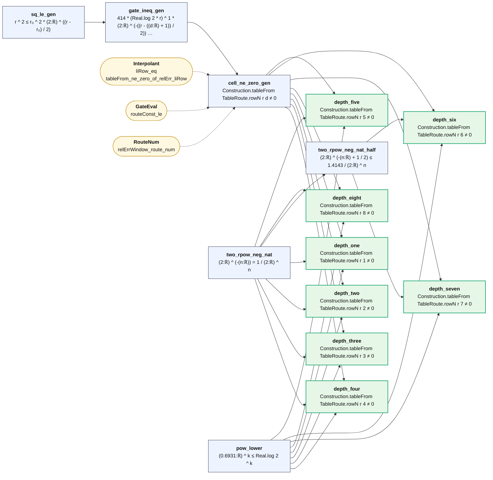

# `lean_stage3/Stage3/TableDepths.lean`

TableDepths — block E11 of `lean_stage3/design/joints.md`. 2026-11-22. `TableRoute.cell_ne_zero_of_RH` is depth six. The same route and gate at any depth, from one numeric check at one row, and the instances that fall inside the computed table.

14 theorems, 0 definitions, 313 lines. Arrows are Lean's own record of what each proof uses.

**Imports:** [`TableRoute`](../lean_stage3/TableRoute.md)  
**Imported by:** [`Stage3`](../lean_stage3/Stage3.md)

## The picture



An arrow A → B reads "A is used in the proof of B". Blue: theorem. Green: a theorem nothing else uses (an end). Dashed: connects to nothing. Red: contains `sorry`. Yellow: theorems in another file, counted; a dotted arrow crosses files. Definitions are not drawn; they are listed below the diagram.

## Theorems

<a name="TableDepths-sq_le_gen"></a>
### `TableDepths.sq_le_gen`

line 27

**Proves**

```lean
r ^ 2 ≤ r₀ ^ 2 * (2:ℝ) ^ ((r - r₀) / 2)
```

**Needs** (its hypotheses)

  - `` h6 : 6 ≤ r₀ ``
  - `` hr : r₀ ≤ r ``

**Fed by:** no theorem of this repo; it stands on Mathlib.

**Feeds** (1 that use it)

  - [`TableDepths.gate_ineq_gen`](#TableDepths-gate_ineq_gen) — `` 414 * (Real.log 2 * r) ^ 1 * (2:ℝ) ^ (-((r - ((d:ℝ) + 1)) / 2)) < Real.log 2 ^ d / (2 * r * 3 ^ (d + 1)) ``

<a name="TableDepths-gate_ineq_gen"></a>
### `TableDepths.gate_ineq_gen`

line 62

**Proves**

```lean
414 * (Real.log 2 * r) ^ 1 * (2:ℝ) ^ (-((r - ((d:ℝ) + 1)) / 2)) < Real.log 2 ^ d / (2 * r * 3 ^ (d + 1))
```

**Needs** (its hypotheses)

  - `` d : ℕ ``
  - `` h6 : 6 ≤ r₀ ``
  - `` hr : r₀ ≤ r ``
  - `` hA : 414 * (2 * 3 ^ (d + 1)) * (r₀ ^ 2 * (2:ℝ) ^ (-((r₀ - ((d:ℝ) + 1)) / 2))) ≤ a ``
  - `` ha : a * Real.log 2 < Real.log 2 ^ d ``

**Fed by** (1 theorem its proof uses)

  - [`TableDepths.sq_le_gen`](#TableDepths-sq_le_gen) — `` r ^ 2 ≤ r₀ ^ 2 * (2:ℝ) ^ ((r - r₀) / 2) ``

**Feeds** (1 that use it)

  - [`TableDepths.cell_ne_zero_gen`](#TableDepths-cell_ne_zero_gen) — `` Construction.tableFrom TableRoute.rowN r d ≠ 0 ``

<a name="TableDepths-cell_ne_zero_gen"></a>
### `TableDepths.cell_ne_zero_gen`

line 92

**Why.** The route and the gate at depth `d`.

**Proves**

```lean
Construction.tableFrom TableRoute.rowN r d ≠ 0
```

**Needs** (its hypotheses)

  - `` hRH : RiemannHypothesis ``
  - `` d : ℕ ``
  - `` hd : d ≤ 24 ``
  - `` hfloor : 72 + ((d:ℝ) + 1) ≤ r₀ ``
  - `` hA : 414 * (2 * 3 ^ (d + 1)) * (r₀ ^ 2 * (2:ℝ) ^ (-((r₀ - ((d:ℝ) + 1)) / 2))) ≤ a ``
  - `` ha : a * Real.log 2 < Real.log 2 ^ d ``
  - `` hr : r₀ ≤ (r:ℝ) ``

**Stated with:** [`Construction.tableFrom`](../lean/Construction.md#Construction-tableFrom), [`TableRoute.rowN`](../lean_stage3/TableRoute.md#TableRoute-rowN)

**Fed by** (5 theorems its proof uses)

  - [`Interpolant.liRow_eq`](../lean/Interpolant.md#Interpolant-liRow_eq) (Interpolant) — `` liRow x = 2 / Real.log 2 + ∫ t in (1 : ℝ)..x, Expansion.f2x t ``
  - [`Interpolant.tableFrom_ne_zero_of_relErr_liRow`](../lean/Interpolant.md#Interpolant-tableFrom_ne_zero_of_relErr_liRow) (Interpolant) — `` Construction.tableFrom N r d ≠ 0 ``
  - [`GateEval.routeConst_le`](../lean_stage3/GateEval.md#GateEval-routeConst_le) (GateEval) — `` Stage3.routeConst ((2:ℝ) ^ (36:ℕ)) ≤ 414 ``
  - [`RouteNum.relErrWindow_route_num`](../lean_stage3/RouteNum.md#RouteNum-relErrWindow_route_num) (RouteNum) — `` JointDialGate.StmtRelErrWindow (fun m : ℤ => (Nat.primeCounting ⌊(2 : ℝ) ^ (m : ℝ)⌋₊ : ℝ)) (fun m : ℤ => 2 / Real.log 2 + ∫ t in (1 : ℝ)..(m : ℝ), Rea… ``
  - [`TableDepths.gate_ineq_gen`](#TableDepths-gate_ineq_gen) — `` 414 * (Real.log 2 * r) ^ 1 * (2:ℝ) ^ (-((r - ((d:ℝ) + 1)) / 2)) < Real.log 2 ^ d / (2 * r * 3 ^ (d + 1)) ``

**Definitions its proof touches:** [`Expansion.f2x`](../lean/Expansion.md#Expansion-f2x), [`Interpolant.liRow`](../lean/Interpolant.md#Interpolant-liRow), [`Nonvanishing.bdiffZ`](../lean/Nonvanishing.md#Nonvanishing-bdiffZ), [`RelativeGate.StmtRelErrWindow`](../lean/RelativeGate.md#RelativeGate-StmtRelErrWindow), [`JointDialGate.StmtRelErrWindow`](../lean_stage3/JointDialGate.md#JointDialGate-StmtRelErrWindow), [`Stage3.routeConst`](../lean_stage3/RouteNum.md#Stage3-routeConst)

**Feeds** (8 that use it)

  - [`TableDepths.depth_eight`](#TableDepths-depth_eight) — `` Construction.tableFrom TableRoute.rowN r 8 ≠ 0 ``
  - [`TableDepths.depth_five`](#TableDepths-depth_five) — `` Construction.tableFrom TableRoute.rowN r 5 ≠ 0 ``
  - [`TableDepths.depth_four`](#TableDepths-depth_four) — `` Construction.tableFrom TableRoute.rowN r 4 ≠ 0 ``
  - [`TableDepths.depth_one`](#TableDepths-depth_one) — `` Construction.tableFrom TableRoute.rowN r 1 ≠ 0 ``
  - [`TableDepths.depth_seven`](#TableDepths-depth_seven) — `` Construction.tableFrom TableRoute.rowN r 7 ≠ 0 ``
  - [`TableDepths.depth_six`](#TableDepths-depth_six) — `` Construction.tableFrom TableRoute.rowN r 6 ≠ 0 ``
  - [`TableDepths.depth_three`](#TableDepths-depth_three) — `` Construction.tableFrom TableRoute.rowN r 3 ≠ 0 ``
  - [`TableDepths.depth_two`](#TableDepths-depth_two) — `` Construction.tableFrom TableRoute.rowN r 2 ≠ 0 ``

<a name="TableDepths-two_rpow_neg_nat"></a>
### `TableDepths.two_rpow_neg_nat`

line 152

**Proves**

```lean
(2:ℝ) ^ (-(n:ℝ)) = 1 / (2:ℝ) ^ n
```

**Needs** (its hypotheses)

  - `` n : ℕ ``

**Fed by:** no theorem of this repo; it stands on Mathlib.

**Feeds** (7 that use it)

  - [`TableDepths.depth_eight`](#TableDepths-depth_eight) — `` Construction.tableFrom TableRoute.rowN r 8 ≠ 0 ``
  - [`TableDepths.depth_five`](#TableDepths-depth_five) — `` Construction.tableFrom TableRoute.rowN r 5 ≠ 0 ``
  - [`TableDepths.depth_four`](#TableDepths-depth_four) — `` Construction.tableFrom TableRoute.rowN r 4 ≠ 0 ``
  - [`TableDepths.depth_one`](#TableDepths-depth_one) — `` Construction.tableFrom TableRoute.rowN r 1 ≠ 0 ``
  - [`TableDepths.depth_three`](#TableDepths-depth_three) — `` Construction.tableFrom TableRoute.rowN r 3 ≠ 0 ``
  - [`TableDepths.depth_two`](#TableDepths-depth_two) — `` Construction.tableFrom TableRoute.rowN r 2 ≠ 0 ``
  - [`TableDepths.two_rpow_neg_nat_half`](#TableDepths-two_rpow_neg_nat_half) — `` (2:ℝ) ^ (-(n:ℝ) + 1 / 2) ≤ 1.4143 / (2:ℝ) ^ n ``

<a name="TableDepths-two_rpow_neg_nat_half"></a>
### `TableDepths.two_rpow_neg_nat_half`

line 155

**Proves**

```lean
(2:ℝ) ^ (-(n:ℝ) + 1 / 2) ≤ 1.4143 / (2:ℝ) ^ n
```

**Needs** (its hypotheses)

  - `` n : ℕ ``

**Fed by** (1 theorem its proof uses)

  - [`TableDepths.two_rpow_neg_nat`](#TableDepths-two_rpow_neg_nat) — `` (2:ℝ) ^ (-(n:ℝ)) = 1 / (2:ℝ) ^ n ``

**Feeds** (2 that use it)

  - [`TableDepths.depth_seven`](#TableDepths-depth_seven) — `` Construction.tableFrom TableRoute.rowN r 7 ≠ 0 ``
  - [`TableDepths.depth_six`](#TableDepths-depth_six) — `` Construction.tableFrom TableRoute.rowN r 6 ≠ 0 ``

<a name="TableDepths-pow_lower"></a>
### `TableDepths.pow_lower`

line 164

**Proves**

```lean
(0.6931:ℝ) ^ k ≤ Real.log 2 ^ k
```

**Needs** (its hypotheses)

  - `` k : ℕ ``

**Fed by:** no theorem of this repo; it stands on Mathlib.

**Feeds** (8 that use it)

  - [`TableDepths.depth_eight`](#TableDepths-depth_eight) — `` Construction.tableFrom TableRoute.rowN r 8 ≠ 0 ``
  - [`TableDepths.depth_five`](#TableDepths-depth_five) — `` Construction.tableFrom TableRoute.rowN r 5 ≠ 0 ``
  - [`TableDepths.depth_four`](#TableDepths-depth_four) — `` Construction.tableFrom TableRoute.rowN r 4 ≠ 0 ``
  - [`TableDepths.depth_one`](#TableDepths-depth_one) — `` Construction.tableFrom TableRoute.rowN r 1 ≠ 0 ``
  - [`TableDepths.depth_seven`](#TableDepths-depth_seven) — `` Construction.tableFrom TableRoute.rowN r 7 ≠ 0 ``
  - [`TableDepths.depth_six`](#TableDepths-depth_six) — `` Construction.tableFrom TableRoute.rowN r 6 ≠ 0 ``
  - [`TableDepths.depth_three`](#TableDepths-depth_three) — `` Construction.tableFrom TableRoute.rowN r 3 ≠ 0 ``
  - [`TableDepths.depth_two`](#TableDepths-depth_two) — `` Construction.tableFrom TableRoute.rowN r 2 ≠ 0 ``

<a name="TableDepths-depth_one"></a>
### `TableDepths.depth_one`

line 168

**Why.** Depth one, from row 74.

**Proves**

```lean
Construction.tableFrom TableRoute.rowN r 1 ≠ 0
```

**Needs** (its hypotheses)

  - `` hRH : RiemannHypothesis ``
  - `` hr : 74 ≤ r ``

**Stated with:** [`Construction.tableFrom`](../lean/Construction.md#Construction-tableFrom), [`TableRoute.rowN`](../lean_stage3/TableRoute.md#TableRoute-rowN)

**Fed by** (3 theorems its proof uses)

  - [`TableDepths.cell_ne_zero_gen`](#TableDepths-cell_ne_zero_gen) — `` Construction.tableFrom TableRoute.rowN r d ≠ 0 ``
  - [`TableDepths.pow_lower`](#TableDepths-pow_lower) — `` (0.6931:ℝ) ^ k ≤ Real.log 2 ^ k ``
  - [`TableDepths.two_rpow_neg_nat`](#TableDepths-two_rpow_neg_nat) — `` (2:ℝ) ^ (-(n:ℝ)) = 1 / (2:ℝ) ^ n ``

**Feeds:** nothing. It is an end.

<a name="TableDepths-depth_two"></a>
### `TableDepths.depth_two`

line 180

**Why.** Depth two, from row 75.

**Proves**

```lean
Construction.tableFrom TableRoute.rowN r 2 ≠ 0
```

**Needs** (its hypotheses)

  - `` hRH : RiemannHypothesis ``
  - `` hr : 75 ≤ r ``

**Stated with:** [`Construction.tableFrom`](../lean/Construction.md#Construction-tableFrom), [`TableRoute.rowN`](../lean_stage3/TableRoute.md#TableRoute-rowN)

**Fed by** (3 theorems its proof uses)

  - [`TableDepths.cell_ne_zero_gen`](#TableDepths-cell_ne_zero_gen) — `` Construction.tableFrom TableRoute.rowN r d ≠ 0 ``
  - [`TableDepths.pow_lower`](#TableDepths-pow_lower) — `` (0.6931:ℝ) ^ k ≤ Real.log 2 ^ k ``
  - [`TableDepths.two_rpow_neg_nat`](#TableDepths-two_rpow_neg_nat) — `` (2:ℝ) ^ (-(n:ℝ)) = 1 / (2:ℝ) ^ n ``

**Feeds:** nothing. It is an end.

<a name="TableDepths-depth_three"></a>
### `TableDepths.depth_three`

line 195

**Why.** Depth three, from row 76.

**Proves**

```lean
Construction.tableFrom TableRoute.rowN r 3 ≠ 0
```

**Needs** (its hypotheses)

  - `` hRH : RiemannHypothesis ``
  - `` hr : 76 ≤ r ``

**Stated with:** [`Construction.tableFrom`](../lean/Construction.md#Construction-tableFrom), [`TableRoute.rowN`](../lean_stage3/TableRoute.md#TableRoute-rowN)

**Fed by** (3 theorems its proof uses)

  - [`TableDepths.cell_ne_zero_gen`](#TableDepths-cell_ne_zero_gen) — `` Construction.tableFrom TableRoute.rowN r d ≠ 0 ``
  - [`TableDepths.pow_lower`](#TableDepths-pow_lower) — `` (0.6931:ℝ) ^ k ≤ Real.log 2 ^ k ``
  - [`TableDepths.two_rpow_neg_nat`](#TableDepths-two_rpow_neg_nat) — `` (2:ℝ) ^ (-(n:ℝ)) = 1 / (2:ℝ) ^ n ``

**Feeds:** nothing. It is an end.

<a name="TableDepths-depth_four"></a>
### `TableDepths.depth_four`

line 210

**Why.** Depth four, from row 77.

**Proves**

```lean
Construction.tableFrom TableRoute.rowN r 4 ≠ 0
```

**Needs** (its hypotheses)

  - `` hRH : RiemannHypothesis ``
  - `` hr : 77 ≤ r ``

**Stated with:** [`Construction.tableFrom`](../lean/Construction.md#Construction-tableFrom), [`TableRoute.rowN`](../lean_stage3/TableRoute.md#TableRoute-rowN)

**Fed by** (3 theorems its proof uses)

  - [`TableDepths.cell_ne_zero_gen`](#TableDepths-cell_ne_zero_gen) — `` Construction.tableFrom TableRoute.rowN r d ≠ 0 ``
  - [`TableDepths.pow_lower`](#TableDepths-pow_lower) — `` (0.6931:ℝ) ^ k ≤ Real.log 2 ^ k ``
  - [`TableDepths.two_rpow_neg_nat`](#TableDepths-two_rpow_neg_nat) — `` (2:ℝ) ^ (-(n:ℝ)) = 1 / (2:ℝ) ^ n ``

**Feeds:** nothing. It is an end.

<a name="TableDepths-depth_five"></a>
### `TableDepths.depth_five`

line 225

**Why.** Depth five, from row 78.

**Proves**

```lean
Construction.tableFrom TableRoute.rowN r 5 ≠ 0
```

**Needs** (its hypotheses)

  - `` hRH : RiemannHypothesis ``
  - `` hr : 78 ≤ r ``

**Stated with:** [`Construction.tableFrom`](../lean/Construction.md#Construction-tableFrom), [`TableRoute.rowN`](../lean_stage3/TableRoute.md#TableRoute-rowN)

**Fed by** (3 theorems its proof uses)

  - [`TableDepths.cell_ne_zero_gen`](#TableDepths-cell_ne_zero_gen) — `` Construction.tableFrom TableRoute.rowN r d ≠ 0 ``
  - [`TableDepths.pow_lower`](#TableDepths-pow_lower) — `` (0.6931:ℝ) ^ k ≤ Real.log 2 ^ k ``
  - [`TableDepths.two_rpow_neg_nat`](#TableDepths-two_rpow_neg_nat) — `` (2:ℝ) ^ (-(n:ℝ)) = 1 / (2:ℝ) ^ n ``

**Feeds:** nothing. It is an end.

<a name="TableDepths-depth_six"></a>
### `TableDepths.depth_six`

line 240

**Why.** Depth six, from row 80.

**Proves**

```lean
Construction.tableFrom TableRoute.rowN r 6 ≠ 0
```

**Needs** (its hypotheses)

  - `` hRH : RiemannHypothesis ``
  - `` hr : 80 ≤ r ``

**Stated with:** [`Construction.tableFrom`](../lean/Construction.md#Construction-tableFrom), [`TableRoute.rowN`](../lean_stage3/TableRoute.md#TableRoute-rowN)

**Fed by** (3 theorems its proof uses)

  - [`TableDepths.cell_ne_zero_gen`](#TableDepths-cell_ne_zero_gen) — `` Construction.tableFrom TableRoute.rowN r d ≠ 0 ``
  - [`TableDepths.pow_lower`](#TableDepths-pow_lower) — `` (0.6931:ℝ) ^ k ≤ Real.log 2 ^ k ``
  - [`TableDepths.two_rpow_neg_nat_half`](#TableDepths-two_rpow_neg_nat_half) — `` (2:ℝ) ^ (-(n:ℝ) + 1 / 2) ≤ 1.4143 / (2:ℝ) ^ n ``

**Feeds:** nothing. It is an end.

<a name="TableDepths-depth_seven"></a>
### `TableDepths.depth_seven`

line 260

**Why.** Depth seven, from row 85.

**Proves**

```lean
Construction.tableFrom TableRoute.rowN r 7 ≠ 0
```

**Needs** (its hypotheses)

  - `` hRH : RiemannHypothesis ``
  - `` hr : 85 ≤ r ``

**Stated with:** [`Construction.tableFrom`](../lean/Construction.md#Construction-tableFrom), [`TableRoute.rowN`](../lean_stage3/TableRoute.md#TableRoute-rowN)

**Fed by** (3 theorems its proof uses)

  - [`TableDepths.cell_ne_zero_gen`](#TableDepths-cell_ne_zero_gen) — `` Construction.tableFrom TableRoute.rowN r d ≠ 0 ``
  - [`TableDepths.pow_lower`](#TableDepths-pow_lower) — `` (0.6931:ℝ) ^ k ≤ Real.log 2 ^ k ``
  - [`TableDepths.two_rpow_neg_nat_half`](#TableDepths-two_rpow_neg_nat_half) — `` (2:ℝ) ^ (-(n:ℝ) + 1 / 2) ≤ 1.4143 / (2:ℝ) ^ n ``

**Feeds:** nothing. It is an end.

<a name="TableDepths-depth_eight"></a>
### `TableDepths.depth_eight`

line 280

**Why.** Depth eight, from row 91.

**Proves**

```lean
Construction.tableFrom TableRoute.rowN r 8 ≠ 0
```

**Needs** (its hypotheses)

  - `` hRH : RiemannHypothesis ``
  - `` hr : 91 ≤ r ``

**Stated with:** [`Construction.tableFrom`](../lean/Construction.md#Construction-tableFrom), [`TableRoute.rowN`](../lean_stage3/TableRoute.md#TableRoute-rowN)

**Fed by** (3 theorems its proof uses)

  - [`TableDepths.cell_ne_zero_gen`](#TableDepths-cell_ne_zero_gen) — `` Construction.tableFrom TableRoute.rowN r d ≠ 0 ``
  - [`TableDepths.pow_lower`](#TableDepths-pow_lower) — `` (0.6931:ℝ) ^ k ≤ Real.log 2 ^ k ``
  - [`TableDepths.two_rpow_neg_nat`](#TableDepths-two_rpow_neg_nat) — `` (2:ℝ) ^ (-(n:ℝ)) = 1 / (2:ℝ) ^ n ``

**Feeds:** nothing. It is an end.

