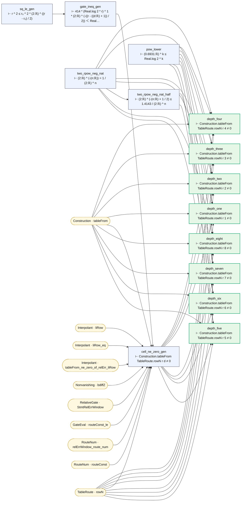

# `lean_stage3/Stage3/TableDepths.lean`

**What it does** (its own header): TableDepths — block E11 of `lean_stage3/design/joints.md`. 2026-11-22. `TableRoute.cell_ne_zero_of_RH` is depth six. The same route and gate at any depth, from one numeric check at one row, and the instances that fall inside the computed table.

**Imports:** [`TableRoute`](../lean_stage3/TableRoute.md).
**Imported by:** [`Stage3`](../lean_stage3/Stage3.md).

Blue: theorem. Green: a theorem nothing else uses (an end). Dashed white: connects to nothing. Grey: definition. Red: contains `sorry`. Yellow: in another file. An arrow A → B reads "A is used by B".

## Every declaration

| declaration | proves (output) | needs (input) | why (its own docstring) | uses | used by |
|---|---|---|---|---|---|
| `TableDepths.sq_le_gen` theorem, line 27 | r ^ 2 ≤ r₀ ^ 2 * (2:ℝ) ^ ((r - r₀) / 2) | h6 : 6 ≤ r₀; hr : r₀ ≤ r | — | — | `TableDepths.gate_ineq_gen` |
| `TableDepths.gate_ineq_gen` theorem, line 62 | 414 * (Real.log 2 * r) ^ 1 * (2:ℝ) ^ (-((r - ((d:ℝ) + 1)) / 2)) &lt; Real.log 2 ^ d / (2 * r * 3 ^ (d + 1)) | d : ℕ; h6 : 6 ≤ r₀; hr : r₀ ≤ r; hA : 414 * (2 * 3 ^ (d + 1)) * (r₀ ^ 2 * (2:ℝ) ^ (-((r₀ - ((d:ℝ) + 1)) / 2))) ≤ a; ha : a * Real.log 2 &lt; Real.log 2 ^ d | — | `TableDepths.sq_le_gen` | `TableDepths.cell_ne_zero_gen` |
| `TableDepths.cell_ne_zero_gen` theorem, line 92 | Construction.tableFrom TableRoute.rowN r d ≠ 0 | hRH : RiemannHypothesis; d : ℕ; hd : d ≤ 24; hfloor : 72 + ((d:ℝ) + 1) ≤ r₀; hA : 414 * (2 * 3 ^ (d + 1)) * (r₀ ^ 2 * (2:ℝ) ^ (-((r₀ - ((d:ℝ) + 1)) / 2))) ≤ a; ha : a * Real.log 2 &lt; Real.log 2 ^ d; hr : r₀ ≤ (r:ℝ) | The route and the gate at depth `d`. | `Construction.tableFrom`, `Interpolant.liRow`, `Interpolant.liRow_eq`, `Interpolant.tableFrom_ne_zero_of_relErr_liRow`, `Nonvanishing.bdiffZ`, `RelativeGate.StmtRelErrWindow`, `GateEval.routeConst_le`, `RouteNum.relErrWindow_route_num`, `Stage3.routeConst`, `TableDepths.gate_ineq_gen`, `TableRoute.rowN` | `TableDepths.depth_eight`, `TableDepths.depth_five`, `TableDepths.depth_four`, `TableDepths.depth_one`, `TableDepths.depth_seven`, `TableDepths.depth_six`, `TableDepths.depth_three`, `TableDepths.depth_two` |
| `TableDepths.two_rpow_neg_nat` theorem, line 152 | (2:ℝ) ^ (-(n:ℝ)) = 1 / (2:ℝ) ^ n | n : ℕ | — | — | `TableDepths.depth_eight`, `TableDepths.depth_five`, `TableDepths.depth_four`, `TableDepths.depth_one`, `TableDepths.depth_three`, `TableDepths.depth_two`, `TableDepths.two_rpow_neg_nat_half` |
| `TableDepths.two_rpow_neg_nat_half` theorem, line 155 | (2:ℝ) ^ (-(n:ℝ) + 1 / 2) ≤ 1.4143 / (2:ℝ) ^ n | n : ℕ | — | `TableDepths.two_rpow_neg_nat` | `TableDepths.depth_seven`, `TableDepths.depth_six` |
| `TableDepths.pow_lower` theorem, line 164 | (0.6931:ℝ) ^ k ≤ Real.log 2 ^ k | k : ℕ | — | — | `TableDepths.depth_eight`, `TableDepths.depth_five`, `TableDepths.depth_four`, `TableDepths.depth_one`, `TableDepths.depth_seven`, `TableDepths.depth_six`, `TableDepths.depth_three`, `TableDepths.depth_two` |
| `TableDepths.depth_one` theorem, line 168 | Construction.tableFrom TableRoute.rowN r 1 ≠ 0 | hRH : RiemannHypothesis; hr : 74 ≤ r | Depth one, from row 74. | `Construction.tableFrom`, `TableDepths.cell_ne_zero_gen`, `TableDepths.pow_lower`, `TableDepths.two_rpow_neg_nat`, `TableRoute.rowN` | — |
| `TableDepths.depth_two` theorem, line 180 | Construction.tableFrom TableRoute.rowN r 2 ≠ 0 | hRH : RiemannHypothesis; hr : 75 ≤ r | Depth two, from row 75. | `Construction.tableFrom`, `TableDepths.cell_ne_zero_gen`, `TableDepths.pow_lower`, `TableDepths.two_rpow_neg_nat`, `TableRoute.rowN` | — |
| `TableDepths.depth_three` theorem, line 195 | Construction.tableFrom TableRoute.rowN r 3 ≠ 0 | hRH : RiemannHypothesis; hr : 76 ≤ r | Depth three, from row 76. | `Construction.tableFrom`, `TableDepths.cell_ne_zero_gen`, `TableDepths.pow_lower`, `TableDepths.two_rpow_neg_nat`, `TableRoute.rowN` | — |
| `TableDepths.depth_four` theorem, line 210 | Construction.tableFrom TableRoute.rowN r 4 ≠ 0 | hRH : RiemannHypothesis; hr : 77 ≤ r | Depth four, from row 77. | `Construction.tableFrom`, `TableDepths.cell_ne_zero_gen`, `TableDepths.pow_lower`, `TableDepths.two_rpow_neg_nat`, `TableRoute.rowN` | — |
| `TableDepths.depth_five` theorem, line 225 | Construction.tableFrom TableRoute.rowN r 5 ≠ 0 | hRH : RiemannHypothesis; hr : 78 ≤ r | Depth five, from row 78. | `Construction.tableFrom`, `TableDepths.cell_ne_zero_gen`, `TableDepths.pow_lower`, `TableDepths.two_rpow_neg_nat`, `TableRoute.rowN` | — |
| `TableDepths.depth_six` theorem, line 240 | Construction.tableFrom TableRoute.rowN r 6 ≠ 0 | hRH : RiemannHypothesis; hr : 80 ≤ r | Depth six, from row 80. | `Construction.tableFrom`, `TableDepths.cell_ne_zero_gen`, `TableDepths.pow_lower`, `TableDepths.two_rpow_neg_nat_half`, `TableRoute.rowN` | — |
| `TableDepths.depth_seven` theorem, line 260 | Construction.tableFrom TableRoute.rowN r 7 ≠ 0 | hRH : RiemannHypothesis; hr : 85 ≤ r | Depth seven, from row 85. | `Construction.tableFrom`, `TableDepths.cell_ne_zero_gen`, `TableDepths.pow_lower`, `TableDepths.two_rpow_neg_nat_half`, `TableRoute.rowN` | — |
| `TableDepths.depth_eight` theorem, line 280 | Construction.tableFrom TableRoute.rowN r 8 ≠ 0 | hRH : RiemannHypothesis; hr : 91 ≤ r | Depth eight, from row 91. | `Construction.tableFrom`, `TableDepths.cell_ne_zero_gen`, `TableDepths.pow_lower`, `TableDepths.two_rpow_neg_nat`, `TableRoute.rowN` | — |
