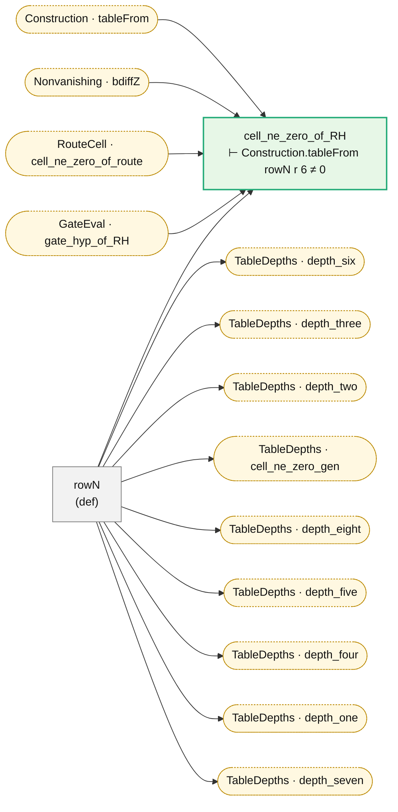

# `lean_stage3/Stage3/TableRoute.lean`

**What it does** (its own header): TableRoute — block E10 of `lean_stage3/design/joints.md`: the join between the two trees, closed for the explicit-formula route. 2026-11-22.

**Imports:** [`GateEval`](../lean_stage3/GateEval.md), [`RouteCell`](../lean_stage3/TablePort_RouteCell.md).
**Imported by:** [`Stage3`](../lean_stage3/Stage3.md), [`TableDepths`](../lean_stage3/TableDepths.md).

Blue: theorem. Green: a theorem nothing else uses (an end). Dashed white: connects to nothing. Grey: definition. Red: contains `sorry`. Yellow: in another file. An arrow A → B reads "A is used by B".

## Every declaration

| declaration | proves (output) | needs (input) | why (its own docstring) | uses | used by |
|---|---|---|---|---|---|
| `TableRoute.rowN` def, line 27 | ℤ | m : ℤ | The table's row: the number of primes in the dyadic block `(2^(m−1), 2^m]`. | — | `TableDepths.cell_ne_zero_gen`, `TableDepths.depth_eight`, `TableDepths.depth_five`, `TableDepths.depth_four`, `TableDepths.depth_one`, `TableDepths.depth_seven`, `TableDepths.depth_six`, `TableDepths.depth_three`, `TableDepths.depth_two`, `TableRoute.cell_ne_zero_of_RH` |
| `TableRoute.cell_ne_zero_of_RH` theorem, line 32 | Construction.tableFrom rowN r 6 ≠ 0 | hRH : RiemannHypothesis; hr : 80 ≤ r | Under RH, depth six has no zero from row 80 on. | `Construction.tableFrom`, `Nonvanishing.bdiffZ`, `RouteCell.cell_ne_zero_of_route`, `GateEval.gate_hyp_of_RH`, `TableRoute.rowN` | — |
