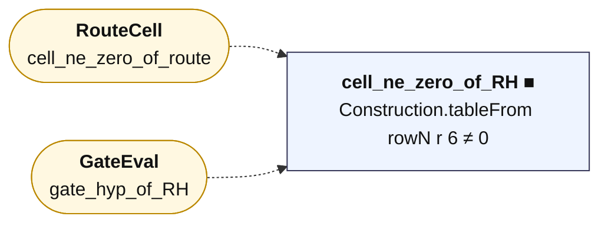

# `lean_stage3/Stage3/TableRoute.lean`

TableRoute — block E10 of `lean_stage3/design/joints.md`: the join between the two trees, closed for the explicit-formula route. 2026-11-22.

1 theorem, 1 definition, 49 lines. Arrows are Lean's own record of what each proof uses.

**Imports:** [`GateEval`](../lean_stage3/GateEval.md), [`RouteCell`](../lean_stage3/TablePort_RouteCell.md)  
**Imported by:** [`Stage3`](../lean_stage3/Stage3.md), [`CellResidual`](../lean_stage3/CellResidual.md), [`TableDepths`](../lean_stage3/TableDepths.md)

## The picture



An arrow A → B reads "A is used in the proof of B". Green: counting, integers only. Violet: shape, analysis with no ζ. Blue: reads ζ. A name ending in ■ is an end: nothing else uses it. Red: contains `sorry`. Yellow: theorems in another file, counted; a dotted arrow crosses files. Definitions are not drawn; they are listed below the diagram.

## Definitions

<a name="TableRoute-rowN"></a>
### `TableRoute.rowN`

def · line 27

The table's row: the number of primes in the dyadic block `(2^(m−1), 2^m]`.

- **Is:** `` rowN (m : ℤ) : ℤ := (Nat.primeCounting ⌊(2 : ℝ) ^ (m : ℝ)⌋₊ : ℤ) - (Nat.primeCounting ⌊(2 : ℝ) ^ ((m - 1 : ℤ) : ℝ)⌋₊ : ℤ) ``
- **Used by 12:** [`CellResidual.table_cell_eq`](../lean_stage3/CellResidual.md#CellResidual-table_cell_eq), [`CellResidual.table_cell_resid`](../lean_stage3/CellResidual.md#CellResidual-table_cell_resid), [`TableDepths.cell_ne_zero_gen`](../lean_stage3/TableDepths.md#TableDepths-cell_ne_zero_gen), [`TableDepths.depth_eight`](../lean_stage3/TableDepths.md#TableDepths-depth_eight), [`TableDepths.depth_five`](../lean_stage3/TableDepths.md#TableDepths-depth_five), [`TableDepths.depth_four`](../lean_stage3/TableDepths.md#TableDepths-depth_four), [`TableDepths.depth_one`](../lean_stage3/TableDepths.md#TableDepths-depth_one), [`TableDepths.depth_seven`](../lean_stage3/TableDepths.md#TableDepths-depth_seven), [`TableDepths.depth_six`](../lean_stage3/TableDepths.md#TableDepths-depth_six), [`TableDepths.depth_three`](../lean_stage3/TableDepths.md#TableDepths-depth_three), [`TableDepths.depth_two`](../lean_stage3/TableDepths.md#TableDepths-depth_two), [`TableRoute.cell_ne_zero_of_RH`](#TableRoute-cell_ne_zero_of_RH)

## Theorems

<a name="TableRoute-cell_ne_zero_of_RH"></a>
### `TableRoute.cell_ne_zero_of_RH`

line 32

**Reads ζ.** It, or something it rests on, uses the zeta function, its zeros or the Riemann hypothesis.

**Why.** Under RH, depth six has no zero from row 80 on.

**Proves**

```lean
Construction.tableFrom rowN r 6 ≠ 0
```

**Needs** (its hypotheses)

  - `` hRH : RiemannHypothesis ``
  - `` hr : 80 ≤ r ``

**Stated with:** [`Construction.tableFrom`](../lean/Construction.md#Construction-tableFrom), [`TableRoute.rowN`](#TableRoute-rowN)

**Fed by** (2 theorems its proof uses)

  - [`RouteCell.cell_ne_zero_of_route`](../lean/RouteCell.md#RouteCell-cell_ne_zero_of_route) (RouteCell) — `` Construction.tableFrom N r 6 ≠ 0 ``
  - [`GateEval.gate_hyp_of_RH`](../lean_stage3/GateEval.md#GateEval-gate_hyp_of_RH) (GateEval) — `` ∃ ρ : ℝ, JointDialGate.StmtRelErrWindow (fun m : ℤ => (Nat.primeCounting ⌊(2 : ℝ) ^ (m : ℝ)⌋₊ : ℝ)) (fun m : ℤ => 2 / Real.log 2 + ∫ t in (1 : ℝ)..(m … ``

**Definitions its proof touches:** [`Nonvanishing.bdiffZ`](../lean/Nonvanishing.md#Nonvanishing-bdiffZ), [`RelativeGate.StmtRelErrWindow`](../lean/RelativeGate.md#RelativeGate-StmtRelErrWindow), [`JointDialGate.StmtRelErrWindow`](../lean_stage3/JointDialGate.md#JointDialGate-StmtRelErrWindow)

**Feeds:** nothing. It is an end.

