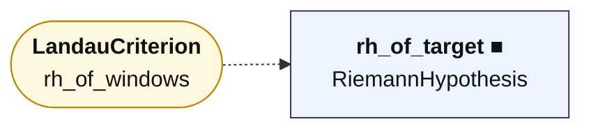

# `lean_stage3/Stage3/Target.lean`

> **Read from the source text.** This file changed after the last `python3 utilities/lean_map.py --dump`, so the arrows on this page are names occurring in each proof and have not been confirmed by Lean.

Target — the one open statement of the chain, fixed. 2026-11-24. Julian, 2026-11-24: the target is not to move. It is the window bound on `G` (`LandauWindow.WindowBound`, the ramp sum of the von Mangoldt function less its main terms) at every `θ` in `(1/2, 1)`: upper side only, on windows `[Y, Y^(1+δ)]` for arbitrarily large `Y`. Proved, it gives Mathlib's `RiemannHypothesis` by `LandauCriterion.rh_of_windows`.

1 theorem, 1 definition, 35 lines. 

**Imports:** [`LandauCriterion`](../lean_stage3/LandauCriterion.md)  
**Imported by:** [`Stage3`](../lean_stage3/Stage3.md)

## The picture



An arrow A → B reads "A is used in the proof of B". Green: counting, integers only. Violet: shape, analysis with no ζ. Blue: reads ζ. A name ending in ■ is an end: nothing else uses it. Red: contains `sorry`. Yellow: theorems in another file, counted; a dotted arrow crosses files. Definitions are not drawn; they are listed below the diagram.

## Definitions

<a name="Stage3-Target"></a>
### `Stage3.Target`

def · line 23

The target. For every `θ` in `(1/2, 1)` there are `δ > 0` and `C` with `G y ≤ C·y^θ` on windows `[Y, Y^(1+δ)]` for arbitrarily large `Y`.

- **Is:** `` Target : Prop := ∀ θ : ℝ, 1 / 2 < θ → θ < 1 → ∃ δ C : ℝ, 0 < δ ∧ LandauWindow.WindowBound θ δ C ``
- **Built from:** [`LandauWindow.WindowBound`](../lean_stage3/LandauWindow.md#LandauWindow-WindowBound)
- **Used by 1:** [`Stage3.rh_of_target`](#Stage3-rh_of_target)

## Theorems

<a name="Stage3-rh_of_target"></a>
### `Stage3.rh_of_target`

line 27 · arrows read from text

**Reads ζ.** It, or something it rests on, uses the zeta function, its zeros or the Riemann hypothesis.

**Why.** The target gives the Riemann hypothesis.

**Proves**

```lean
RiemannHypothesis
```

**Needs** (its hypotheses)

  - `` h : Target ``

**Fed by** (1 theorem its proof uses)

  - [`LandauCriterion.rh_of_windows`](../lean_stage3/LandauCriterion.md#LandauCriterion-rh_of_windows) (LandauCriterion) — `` RiemannHypothesis ``

**Definitions its proof touches:** [`Stage3.Target`](#Stage3-Target)

**Feeds:** nothing. It is an end.

