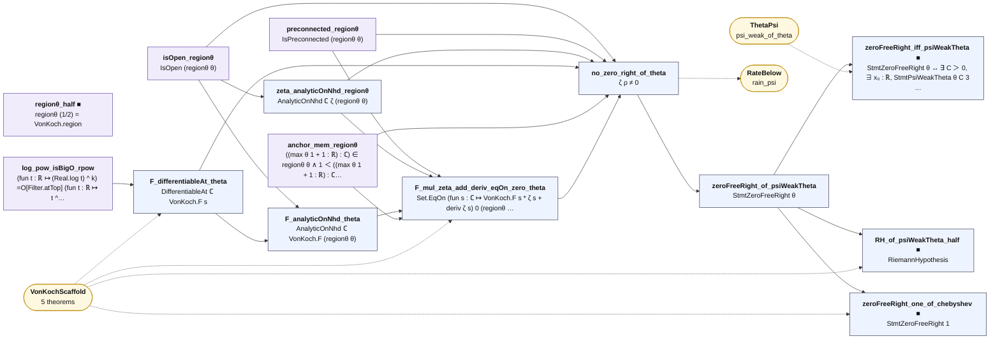

# `lean_stage3/Stage3/ThetaConverse.lean`

ThetaConverse — the Landau converse of the θ-dial. 2026-09-01. `ThetaPsi.psi_weak_of_theta` and `ThetaPi.schoenfeldWeakTheta_of_zeroFree` run one way: a zero-free half-plane `re s > θ` gives `|ψ − x| ≤ C·x^θ·log^k x`. This file runs the other way:

14 theorems, 1 definition, 451 lines. Arrows are Lean's own record of what each proof uses.

**Imports:** [`ThetaPi`](../lean_stage3/ThetaPi.md), [`VonKochScaffold`](../lean_stage3/VonKochScaffold.md)  
**Imported by:** [`Stage3`](../lean_stage3/Stage3.md), [`RateBelow`](../lean_stage3/RateBelow.md), [`StepsBelow`](../lean_stage3/StepsBelow.md)

## The picture



An arrow A → B reads "A is used in the proof of B". Green: counting, integers only. Violet: shape, analysis with no ζ. Blue: reads ζ. A name ending in ■ is an end: nothing else uses it. Red: contains `sorry`. Yellow: theorems in another file, counted; a dotted arrow crosses files. Definitions are not drawn; they are listed below the diagram.

## Definitions

<a name="Stage3-region-"></a>
### `Stage3.regionθ`

def · line 49

The working region at abscissa `θ`: right of `θ`, minus the pole. `VonKoch.region` is the `θ = 1/2` case.

- **Is:** `` regionθ (θ : ℝ) : Set ℂ := {s : ℂ | θ < s.re ∧ s ≠ 1} ``
- **Used by 8:** [`Stage3.F_analyticOnNhd_theta`](#Stage3-F_analyticOnNhd_theta), [`Stage3.F_mul_zeta_add_deriv_eqOn_zero_theta`](#Stage3-F_mul_zeta_add_deriv_eqOn_zero_theta), [`Stage3.anchor_mem_regionθ`](#Stage3-anchor_mem_region-), [`Stage3.isOpen_regionθ`](#Stage3-isOpen_region-), [`Stage3.no_zero_right_of_theta`](#Stage3-no_zero_right_of_theta), [`Stage3.preconnected_regionθ`](#Stage3-preconnected_region-), [`Stage3.regionθ_half`](#Stage3-region-_half), [`Stage3.zeta_analyticOnNhd_regionθ`](#Stage3-zeta_analyticOnNhd_region-)

## Theorems

<a name="Stage3-region-_half"></a>
### `Stage3.regionθ_half`

line 52

**Shape.** Uses real or complex analysis; nothing in it or beneath it reads ζ.

**Why.** At `θ = 1/2` the working region `regionθ` is `VonKoch.region`.

**Proves**

```lean
regionθ (1/2) = VonKoch.region
```

**Stated with:** [`Stage3.regionθ`](#Stage3-region-), [`VonKoch.region`](../lean_stage3/VonKochScaffold.md#VonKoch-region)

**Fed by:** no theorem of this repo; it stands on Mathlib and the definitions below.

**Feeds:** nothing. It is an end.

<a name="Stage3-isOpen_region-"></a>
### `Stage3.isOpen_regionθ`

line 55

**Shape.** Uses real or complex analysis; nothing in it or beneath it reads ζ.

**Why.** For every `θ`, the working region `regionθ θ` is open.

**Proves**

```lean
IsOpen (regionθ θ)
```

**Needs** (its hypotheses)

  - `` θ : ℝ ``

**Stated with:** [`Stage3.regionθ`](#Stage3-region-)

**Fed by:** no theorem of this repo; it stands on Mathlib and the definitions below.

**Feeds** (3 that use it)

  - [`Stage3.F_analyticOnNhd_theta`](#Stage3-F_analyticOnNhd_theta) — `` AnalyticOnNhd ℂ VonKoch.F (regionθ θ) ``
  - [`Stage3.no_zero_right_of_theta`](#Stage3-no_zero_right_of_theta) — `` ζ ρ ≠ 0 ``
  - [`Stage3.zeta_analyticOnNhd_regionθ`](#Stage3-zeta_analyticOnNhd_region-) — `` AnalyticOnNhd ℂ ζ (regionθ θ) ``

<a name="Stage3-preconnected_region-"></a>
### `Stage3.preconnected_regionθ`

line 67

**Shape.** Uses real or complex analysis; nothing in it or beneath it reads ζ.

**Why.** The region is connected, for every `θ`. For `θ < 1`: four convex pieces — upper half, lower half, the strip `θ < re < 1`, and `re > 1` — glued at `((θ+1)/2, ±1)` and `(2, 1)`; this is `VonKoch.preconnected_region` with the gluing point `3/4` replaced by `(θ+1)/2`. For `θ ≥ 1` the pole is already outside the half-plane and the region is the convex set `{re > θ}`.

**Proves**

```lean
IsPreconnected (regionθ θ)
```

**Needs** (its hypotheses)

  - `` θ : ℝ ``

**Stated with:** [`Stage3.regionθ`](#Stage3-region-)

**Fed by:** no theorem of this repo; it stands on Mathlib and the definitions below.

**Feeds** (2 that use it)

  - [`Stage3.F_mul_zeta_add_deriv_eqOn_zero_theta`](#Stage3-F_mul_zeta_add_deriv_eqOn_zero_theta) — `` Set.EqOn (fun s : ℂ ↦ VonKoch.F s * ζ s + deriv ζ s) 0 (regionθ θ) ``
  - [`Stage3.no_zero_right_of_theta`](#Stage3-no_zero_right_of_theta) — `` ζ ρ ≠ 0 ``

<a name="Stage3-zeta_analyticOnNhd_region-"></a>
### `Stage3.zeta_analyticOnNhd_regionθ`

line 134

**Reads ζ.** It, or something it rests on, uses the zeta function, its zeros or the Riemann hypothesis.

**Why.** For every `θ`, `ζ` is analytic on the working region `regionθ θ`.

**Proves**

```lean
AnalyticOnNhd ℂ ζ (regionθ θ)
```

**Needs** (its hypotheses)

  - `` θ : ℝ ``

**Stated with:** [`Stage3.regionθ`](#Stage3-region-)

**Fed by** (1 theorem its proof uses)

  - [`Stage3.isOpen_regionθ`](#Stage3-isOpen_region-) — `` IsOpen (regionθ θ) ``

**Feeds** (2 that use it)

  - [`Stage3.F_mul_zeta_add_deriv_eqOn_zero_theta`](#Stage3-F_mul_zeta_add_deriv_eqOn_zero_theta) — `` Set.EqOn (fun s : ℂ ↦ VonKoch.F s * ζ s + deriv ζ s) 0 (regionθ θ) ``
  - [`Stage3.no_zero_right_of_theta`](#Stage3-no_zero_right_of_theta) — `` ζ ρ ≠ 0 ``

<a name="Stage3-log_pow_isBigO_rpow"></a>
### `Stage3.log_pow_isBigO_rpow`

line 142

**Shape.** Uses real or complex analysis; nothing in it or beneath it reads ζ.

**Why.** `(log t)^k = O(t^δ)` at `∞` for every `δ > 0` and every `k`. The `k = 0` case is `1 ≤ t^δ`; for `k ≥ 1`, `log = o(t^(δ/k))` raised to the `k`.

**Proves**

```lean
(fun t : ℝ ↦ (Real.log t) ^ k) =O[Filter.atTop] (fun t : ℝ ↦ t ^ δ)
```

**Needs** (its hypotheses)

  - `` hδ : 0 < δ ``
  - `` k : ℕ ``

**Fed by:** no theorem of this repo; it stands on Mathlib.

**Feeds** (1 that use it)

  - [`Stage3.F_differentiableAt_theta`](#Stage3-F_differentiableAt_theta) — `` DifferentiableAt ℂ VonKoch.F s ``

<a name="Stage3-F_differentiableAt_theta"></a>
### `Stage3.F_differentiableAt_theta`

line 164

**Reads ζ.** It, or something it rests on, uses the zeta function, its zeros or the Riemann hypothesis.

**Why.** V1 at `θ`. `E = O(t^(θ+δ))` at `∞` for `δ := (re s − θ)/2 > 0`, and `Etr = 0` below `1`, so `mellin Etr` is differentiable at `−s`. This is `VonKoch.F_differentiableAt` with `t^θ·log^k t` for `√t·log³ t`; the hypothesis is consumed here and nowhere else.

**Proves**

```lean
DifferentiableAt ℂ VonKoch.F s
```

**Needs** (its hypotheses)

  - `` h : StmtPsiWeakTheta θ C k x₀ ``
  - `` hs : θ < s.re ``
  - `` hs1 : s ≠ 1 ``

**Stated with:** [`Stage3.StmtPsiWeakTheta`](../lean_stage3/ThetaPi.md#Stage3-StmtPsiWeakTheta), [`VonKoch.F`](../lean_stage3/VonKochScaffold.md#VonKoch-F)

**Fed by** (3 theorems its proof uses)

  - [`Stage3.log_pow_isBigO_rpow`](#Stage3-log_pow_isBigO_rpow) — `` (fun t : ℝ ↦ (Real.log t) ^ k) =O[Filter.atTop] (fun t : ℝ ↦ t ^ δ) ``
  - [`VonKoch.E_integral_eq_mellin`](../lean_stage3/VonKochScaffold.md#VonKoch-E_integral_eq_mellin) (VonKochScaffold) — `` ∫ x in Set.Ioi (1:ℝ), (E x : ℂ) * (x : ℂ) ^ (-s - 1) = mellin Etr (-s) ``
  - [`VonKoch.Etr_locallyIntegrable`](../lean_stage3/VonKochScaffold.md#VonKoch-Etr_locallyIntegrable) (VonKochScaffold) — `` MeasureTheory.LocallyIntegrableOn Etr (Set.Ioi 0) ``

**Definitions its proof touches:** [`VonKoch.E`](../lean_stage3/VonKochScaffold.md#VonKoch-E), [`VonKoch.Etr`](../lean_stage3/VonKochScaffold.md#VonKoch-Etr)

**Feeds** (2 that use it)

  - [`Stage3.F_analyticOnNhd_theta`](#Stage3-F_analyticOnNhd_theta) — `` AnalyticOnNhd ℂ VonKoch.F (regionθ θ) ``
  - [`Stage3.no_zero_right_of_theta`](#Stage3-no_zero_right_of_theta) — `` ζ ρ ≠ 0 ``

<a name="Stage3-F_analyticOnNhd_theta"></a>
### `Stage3.F_analyticOnNhd_theta`

line 232

**Reads ζ.** It, or something it rests on, uses the zeta function, its zeros or the Riemann hypothesis.

**Why.** Given the bound `StmtPsiWeakTheta θ C k x₀` on the error of `ψ`, the function `VonKoch.F` is analytic on the working region `regionθ θ`.

**Proves**

```lean
AnalyticOnNhd ℂ VonKoch.F (regionθ θ)
```

**Needs** (its hypotheses)

  - `` h : StmtPsiWeakTheta θ C k x₀ ``

**Stated with:** [`Stage3.regionθ`](#Stage3-region-), [`Stage3.StmtPsiWeakTheta`](../lean_stage3/ThetaPi.md#Stage3-StmtPsiWeakTheta), [`VonKoch.F`](../lean_stage3/VonKochScaffold.md#VonKoch-F)

**Fed by** (2 theorems its proof uses)

  - [`Stage3.F_differentiableAt_theta`](#Stage3-F_differentiableAt_theta) — `` DifferentiableAt ℂ VonKoch.F s ``
  - [`Stage3.isOpen_regionθ`](#Stage3-isOpen_region-) — `` IsOpen (regionθ θ) ``

**Feeds** (1 that use it)

  - [`Stage3.F_mul_zeta_add_deriv_eqOn_zero_theta`](#Stage3-F_mul_zeta_add_deriv_eqOn_zero_theta) — `` Set.EqOn (fun s : ℂ ↦ VonKoch.F s * ζ s + deriv ζ s) 0 (regionθ θ) ``

<a name="Stage3-anchor_mem_region-"></a>
### `Stage3.anchor_mem_regionθ`

line 247

**Shape.** Uses real or complex analysis; nothing in it or beneath it reads ζ.

**Why.** The anchor `max θ 1 + 1`: in the region, with `re > 1`, for every `θ`. `VonKoch` used `2`, which leaves the region once `θ ≥ 2`.

**Proves**

```lean
((max θ 1 + 1 : ℝ) : ℂ) ∈ regionθ θ ∧ 1 < ((max θ 1 + 1 : ℝ) : ℂ).re
```

**Needs** (its hypotheses)

  - `` θ : ℝ ``

**Stated with:** [`Stage3.regionθ`](#Stage3-region-)

**Fed by:** no theorem of this repo; it stands on Mathlib and the definitions below.

**Feeds** (2 that use it)

  - [`Stage3.F_mul_zeta_add_deriv_eqOn_zero_theta`](#Stage3-F_mul_zeta_add_deriv_eqOn_zero_theta) — `` Set.EqOn (fun s : ℂ ↦ VonKoch.F s * ζ s + deriv ζ s) 0 (regionθ θ) ``
  - [`Stage3.no_zero_right_of_theta`](#Stage3-no_zero_right_of_theta) — `` ζ ρ ≠ 0 ``

<a name="Stage3-F_mul_zeta_add_deriv_eqOn_zero_theta"></a>
### `Stage3.F_mul_zeta_add_deriv_eqOn_zero_theta`

line 258

**Reads ζ.** It, or something it rests on, uses the zeta function, its zeros or the Riemann hypothesis.

**Why.** The load-bearing identity: `F·ζ + ζ′` vanishes on the whole region.

**Proves**

```lean
Set.EqOn (fun s : ℂ ↦ VonKoch.F s * ζ s + deriv ζ s) 0 (regionθ θ)
```

**Needs** (its hypotheses)

  - `` h : StmtPsiWeakTheta θ C k x₀ ``

**Stated with:** [`Stage3.regionθ`](#Stage3-region-), [`Stage3.StmtPsiWeakTheta`](../lean_stage3/ThetaPi.md#Stage3-StmtPsiWeakTheta), [`VonKoch.F`](../lean_stage3/VonKochScaffold.md#VonKoch-F)

**Fed by** (5 theorems its proof uses)

  - [`Stage3.F_analyticOnNhd_theta`](#Stage3-F_analyticOnNhd_theta) — `` AnalyticOnNhd ℂ VonKoch.F (regionθ θ) ``
  - [`Stage3.anchor_mem_regionθ`](#Stage3-anchor_mem_region-) — `` ((max θ 1 + 1 : ℝ) : ℂ) ∈ regionθ θ ∧ 1 < ((max θ 1 + 1 : ℝ) : ℂ).re ``
  - [`Stage3.preconnected_regionθ`](#Stage3-preconnected_region-) — `` IsPreconnected (regionθ θ) ``
  - [`Stage3.zeta_analyticOnNhd_regionθ`](#Stage3-zeta_analyticOnNhd_region-) — `` AnalyticOnNhd ℂ ζ (regionθ θ) ``
  - [`VonKoch.F_eq_neg_logDeriv`](../lean_stage3/VonKochScaffold.md#VonKoch-F_eq_neg_logDeriv) (VonKochScaffold) — `` F s = -deriv riemannZeta s / riemannZeta s ``

**Feeds** (1 that use it)

  - [`Stage3.no_zero_right_of_theta`](#Stage3-no_zero_right_of_theta) — `` ζ ρ ≠ 0 ``

<a name="Stage3-no_zero_right_of_theta"></a>
### `Stage3.no_zero_right_of_theta`

line 285

**Reads ζ.** It, or something it rests on, uses the zeta function, its zeros or the Riemann hypothesis.

**Why.** V4 at `θ`. At a hypothetical zero `ρ` with `re ρ > θ`, factor `ζ = (z−ρ)^(k+1)·g` with `g ρ ≠ 0`. The identity `F·ζ + ζ′ = 0` factors as `(z−ρ)^k · [(k+1)·g + (z−ρ)·(F·g + g′)] = 0`; off `ρ` the power is nonzero, so the bracket vanishes on the punctured neighbourhood — yet it is continuous at `ρ` with value `(k+1)·g ρ ≠ 0`. Order `⊤` would make `ζ` vanish identically on the region, against `ζ ≠ 0` at the anchor. `VonKoch.no_zero_right_of_half`, with the region at `θ`.

**Proves**

```lean
ζ ρ ≠ 0
```

**Needs** (its hypotheses)

  - `` h : StmtPsiWeakTheta θ C k x₀ ``
  - `` hρ : θ < ρ.re ``
  - `` hρ1 : ρ ≠ 1 ``

**Stated with:** [`Stage3.StmtPsiWeakTheta`](../lean_stage3/ThetaPi.md#Stage3-StmtPsiWeakTheta)

**Fed by** (6 theorems its proof uses)

  - [`Stage3.F_differentiableAt_theta`](#Stage3-F_differentiableAt_theta) — `` DifferentiableAt ℂ VonKoch.F s ``
  - [`Stage3.F_mul_zeta_add_deriv_eqOn_zero_theta`](#Stage3-F_mul_zeta_add_deriv_eqOn_zero_theta) — `` Set.EqOn (fun s : ℂ ↦ VonKoch.F s * ζ s + deriv ζ s) 0 (regionθ θ) ``
  - [`Stage3.anchor_mem_regionθ`](#Stage3-anchor_mem_region-) — `` ((max θ 1 + 1 : ℝ) : ℂ) ∈ regionθ θ ∧ 1 < ((max θ 1 + 1 : ℝ) : ℂ).re ``
  - [`Stage3.isOpen_regionθ`](#Stage3-isOpen_region-) — `` IsOpen (regionθ θ) ``
  - [`Stage3.preconnected_regionθ`](#Stage3-preconnected_region-) — `` IsPreconnected (regionθ θ) ``
  - [`Stage3.zeta_analyticOnNhd_regionθ`](#Stage3-zeta_analyticOnNhd_region-) — `` AnalyticOnNhd ℂ ζ (regionθ θ) ``

**Definitions its proof touches:** [`Stage3.regionθ`](#Stage3-region-), [`VonKoch.F`](../lean_stage3/VonKochScaffold.md#VonKoch-F)

**Feeds** (2 that use it)

  - [`RateBelow.rain_psi`](../lean_stage3/RateBelow.md#RateBelow-rain_psi) (RateBelow) — `` ∃ x : ℝ, x₀ ≤ x ∧ C * x ^ θ * Real.log x ^ k < |Chebyshev.psi x - x| ``
  - [`Stage3.zeroFreeRight_of_psiWeakTheta`](#Stage3-zeroFreeRight_of_psiWeakTheta) — `` StmtZeroFreeRight θ ``

<a name="Stage3-zeroFreeRight_of_psiWeakTheta"></a>
### `Stage3.zeroFreeRight_of_psiWeakTheta`

line 379

**Reads ζ.** It, or something it rests on, uses the zeta function, its zeros or the Riemann hypothesis.

**Why.** The Landau converse of the θ-dial. A ψ-bound at exponent `θ` — any `C`, any `k`, any floor `x₀` — forces `ζ ≠ 0` on `re s > θ`, `s ≠ 1`. No side hypothesis: `θ`, `C`, `x₀` are unconstrained, because the bound is only read through `‖·‖` above `max x₀ 1`, and the region is connected for every `θ`.

**Proves**

```lean
StmtZeroFreeRight θ
```

**Needs** (its hypotheses)

  - `` h : StmtPsiWeakTheta θ C k x₀ ``

**Stated with:** [`Stage3.StmtZeroFreeRight`](../lean_stage3/Abscissa.md#Stage3-StmtZeroFreeRight), [`Stage3.StmtPsiWeakTheta`](../lean_stage3/ThetaPi.md#Stage3-StmtPsiWeakTheta)

**Fed by** (1 theorem its proof uses)

  - [`Stage3.no_zero_right_of_theta`](#Stage3-no_zero_right_of_theta) — `` ζ ρ ≠ 0 ``

**Feeds** (3 that use it)

  - [`Stage3.RH_of_psiWeakTheta_half`](#Stage3-RH_of_psiWeakTheta_half) — `` RiemannHypothesis ``
  - [`Stage3.zeroFreeRight_iff_psiWeakTheta`](#Stage3-zeroFreeRight_iff_psiWeakTheta) — `` StmtZeroFreeRight θ ↔ ∃ C > 0, ∃ x₀ : ℝ, StmtPsiWeakTheta θ C 3 x₀ ``
  - [`Stage3.zeroFreeRight_one_of_chebyshev`](#Stage3-zeroFreeRight_one_of_chebyshev) — `` StmtZeroFreeRight 1 ``

<a name="Stage3-zeroFreeRight_iff_psiWeakTheta"></a>
### `Stage3.zeroFreeRight_iff_psiWeakTheta`

line 387

**Reads ζ.** It, or something it rests on, uses the zeta function, its zeros or the Riemann hypothesis.

**Why.** The abscissa of ψ's error is the supremum of the zeros' real parts. For `θ ∈ [1/2, 1)`: a zero-free half-plane at `θ` holds iff ψ has a `C·t^θ·log³ t` bound. Forward is `ThetaPsi.psi_weak_of_theta` (which is where `[1/2, 1)` is needed); the converse is this file, and holds for every `θ`.

**Proves**

```lean
StmtZeroFreeRight θ ↔ ∃ C > 0, ∃ x₀ : ℝ, StmtPsiWeakTheta θ C 3 x₀
```

**Needs** (its hypotheses)

  - `` hθlo : 1/2 ≤ θ ``
  - `` hθhi : θ < 1 ``

**Stated with:** [`Stage3.StmtZeroFreeRight`](../lean_stage3/Abscissa.md#Stage3-StmtZeroFreeRight), [`Stage3.StmtPsiWeakTheta`](../lean_stage3/ThetaPi.md#Stage3-StmtPsiWeakTheta)

**Fed by** (2 theorems its proof uses)

  - [`Stage3.zeroFreeRight_of_psiWeakTheta`](#Stage3-zeroFreeRight_of_psiWeakTheta) — `` StmtZeroFreeRight θ ``
  - [`Stage3.psi_weak_of_theta`](../lean_stage3/ThetaPsi.md#Stage3-psi_weak_of_theta) (ThetaPsi) — `` ∃ C > 0, ∃ x₀ : ℝ, ∀ t : ℝ, x₀ ≤ t → |ψ t - t| ≤ C * t ^ θ * (Real.log t) ^ 3 ``

**Feeds:** nothing. It is an end.

<a name="Stage3-RH_of_psiWeakTheta_half"></a>
### `Stage3.RH_of_psiWeakTheta_half`

line 394

**Reads ζ.** It, or something it rests on, uses the zeta function, its zeros or the Riemann hypothesis.

**Why.** The weld at `θ = 1/2`: `VonKoch.RH_of_psiWeak`'s statement through the dial, via `Abscissa`'s `StmtZeroFreeRight (1/2)` and V5's reflection.

**Proves**

```lean
RiemannHypothesis
```

**Needs** (its hypotheses)

  - `` h : StmtPsiWeakTheta (1/2) C k x₀ ``

**Stated with:** [`Stage3.StmtPsiWeakTheta`](../lean_stage3/ThetaPi.md#Stage3-StmtPsiWeakTheta)

**Fed by** (2 theorems its proof uses)

  - [`Stage3.zeroFreeRight_of_psiWeakTheta`](#Stage3-zeroFreeRight_of_psiWeakTheta) — `` StmtZeroFreeRight θ ``
  - [`VonKoch.RH_of_no_zero_right_of_half`](../lean_stage3/VonKochScaffold.md#VonKoch-RH_of_no_zero_right_of_half) (VonKochScaffold) — `` RiemannHypothesis ``

**Feeds:** nothing. It is an end.

<a name="Stage3-zeroFreeRight_one_of_chebyshev"></a>
### `Stage3.zeroFreeRight_one_of_chebyshev`

line 406

**Reads ζ.** It, or something it rests on, uses the zeta function, its zeros or the Riemann hypothesis.

**Why.** The primes are a subset of the numbers, so `ψ(x) ≤ c·x` (`Chebyshev.psi_le_const_mul_self`, `c = log 4 + 4`), so the count's fluctuation is at most `x`, so no zero has real part above `1`. The Euler-product wall as a corollary of the converse: this is the `θ = 1`, `k = 0` instance, with `C = log 4 + 5` and floor `1`; the hypothesis is genuinely opened at `θ = 1` since the region `{re > 1}` is convex.

**Proves**

```lean
StmtZeroFreeRight 1
```

**Stated with:** [`Stage3.StmtZeroFreeRight`](../lean_stage3/Abscissa.md#Stage3-StmtZeroFreeRight)

**Fed by** (2 theorems its proof uses)

  - [`Stage3.zeroFreeRight_of_psiWeakTheta`](#Stage3-zeroFreeRight_of_psiWeakTheta) — `` StmtZeroFreeRight θ ``
  - [`VonKoch.E_le_linear`](../lean_stage3/VonKochScaffold.md#VonKoch-E_le_linear) (VonKochScaffold) — `` ‖(E t : ℝ)‖ ≤ (Real.log 4 + 5) * t ``

**Definitions its proof touches:** [`VonKoch.E`](../lean_stage3/VonKochScaffold.md#VonKoch-E)

**Feeds:** nothing. It is an end.

