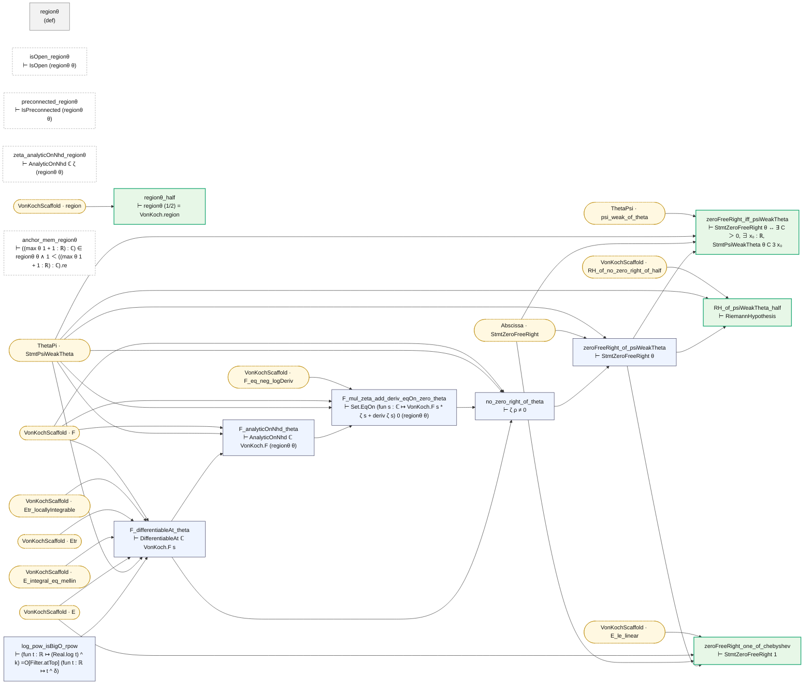

# `lean_stage3/Stage3/ThetaConverse.lean`

**What it does** (its own header): ThetaConverse — the Landau converse of the θ-dial. 2026-09-01. `ThetaPsi.psi_weak_of_theta` and `ThetaPi.schoenfeldWeakTheta_of_zeroFree` run one way: a zero-free half-plane `re s > θ` gives `|ψ − x| ≤ C·x^θ·log^k x`. This file runs the other way:

**Imports:** [`ThetaPi`](../lean_stage3/ThetaPi.md), [`VonKochScaffold`](../lean_stage3/VonKochScaffold.md).
**Imported by:** [`Stage3`](../lean_stage3/Stage3.md).

Blue: theorem. Green: a theorem nothing else uses (an end). Dashed white: connects to nothing. Grey: definition. Red: contains `sorry`. Yellow: in another file. An arrow A → B reads "A is used by B".

## Every declaration

| declaration | proves (output) | needs (input) | why (its own docstring) | uses | used by |
|---|---|---|---|---|---|
| `Stage3.regionθ` def, line 49 | Set ℂ | θ : ℝ | The working region at abscissa `θ`: right of `θ`, minus the pole. `VonKoch.region` is the `θ = 1/2` case. | — | — |
| `Stage3.regionθ_half` theorem, line 51 | regionθ (1/2) = VonKoch.region | — | — | `VonKoch.region` | — |
| `Stage3.isOpen_regionθ` theorem, line 53 | IsOpen (regionθ θ) | θ : ℝ | — | — | — |
| `Stage3.preconnected_regionθ` theorem, line 65 | IsPreconnected (regionθ θ) | θ : ℝ | The region is connected, for every `θ`. For `θ &lt; 1`: four convex pieces — upper half, lower half, the strip `θ &lt; re &lt; 1`, and `re &gt; 1` — glued at `((θ+1)/2, ±1)` and `(2, 1)`; this is `VonKoch.preconnected_region` with the gluing point `3/4` replaced by `(θ+1)/2`. For `θ ≥ 1` the pole is already outside the half-plane and the region is the convex set `{re &gt; … | — | — |
| `Stage3.zeta_analyticOnNhd_regionθ` theorem, line 131 | AnalyticOnNhd ℂ ζ (regionθ θ) | θ : ℝ | — | — | — |
| `Stage3.log_pow_isBigO_rpow` theorem, line 139 | (fun t : ℝ ↦ (Real.log t) ^ k) =O[Filter.atTop] (fun t : ℝ ↦ t ^ δ) | hδ : 0 &lt; δ; k : ℕ | `(log t)^k = O(t^δ)` at `∞` for every `δ &gt; 0` and every `k`. The `k = 0` case is `1 ≤ t^δ`; for `k ≥ 1`, `log = o(t^(δ/k))` raised to the `k`. | — | `Stage3.F_differentiableAt_theta` |
| `Stage3.F_differentiableAt_theta` theorem, line 161 | DifferentiableAt ℂ VonKoch.F s | h : StmtPsiWeakTheta θ C k x₀; hs : θ &lt; s.re; hs1 : s ≠ 1 | V1 at `θ`. `E = O(t^(θ+δ))` at `∞` for `δ := (re s − θ)/2 &gt; 0`, and `Etr = 0` below `1`, so `mellin Etr` is differentiable at `−s`. This is `VonKoch.F_differentiableAt` with `t^θ·log^k t` for `√t·log³ t`; the hypothesis is consumed here and nowhere else. | `Stage3.log_pow_isBigO_rpow`, `Stage3.StmtPsiWeakTheta`, `VonKoch.E`, `VonKoch.E_integral_eq_mellin`, `VonKoch.Etr`, `VonKoch.Etr_locallyIntegrable`, `VonKoch.F` | `Stage3.F_analyticOnNhd_theta`, `Stage3.no_zero_right_of_theta` |
| `Stage3.F_analyticOnNhd_theta` theorem, line 227 | AnalyticOnNhd ℂ VonKoch.F (regionθ θ) | h : StmtPsiWeakTheta θ C k x₀ | — | `Stage3.F_differentiableAt_theta`, `Stage3.StmtPsiWeakTheta`, `VonKoch.F` | `Stage3.F_mul_zeta_add_deriv_eqOn_zero_theta` |
| `Stage3.anchor_mem_regionθ` theorem, line 242 | ((max θ 1 + 1 : ℝ) : ℂ) ∈ regionθ θ ∧ 1 &lt; ((max θ 1 + 1 : ℝ) : ℂ).re | θ : ℝ | The anchor `max θ 1 + 1`: in the region, with `re &gt; 1`, for every `θ`. `VonKoch` used `2`, which leaves the region once `θ ≥ 2`. | — | — |
| `Stage3.F_mul_zeta_add_deriv_eqOn_zero_theta` theorem, line 253 | Set.EqOn (fun s : ℂ ↦ VonKoch.F s * ζ s + deriv ζ s) 0 (regionθ θ) | h : StmtPsiWeakTheta θ C k x₀ | The load-bearing identity: `F·ζ + ζ′` vanishes on the whole region. | `Stage3.F_analyticOnNhd_theta`, `Stage3.StmtPsiWeakTheta`, `VonKoch.F`, `VonKoch.F_eq_neg_logDeriv` | `Stage3.no_zero_right_of_theta` |
| `Stage3.no_zero_right_of_theta` theorem, line 280 | ζ ρ ≠ 0 | h : StmtPsiWeakTheta θ C k x₀; hρ : θ &lt; ρ.re; hρ1 : ρ ≠ 1 | V4 at `θ`. At a hypothetical zero `ρ` with `re ρ &gt; θ`, factor `ζ = (z−ρ)^(k+1)·g` with `g ρ ≠ 0`. The identity `F·ζ + ζ′ = 0` factors as `(z−ρ)^k · [(k+1)·g + (z−ρ)·(F·g + g′)] = 0`; off `ρ` the power is nonzero, so the bracket vanishes on the punctured neighbourhood — yet it is continuous at `ρ` with value `(k+1)·g ρ ≠ 0`. Order `⊤` would make `ζ` vanish id… | `Stage3.F_differentiableAt_theta`, `Stage3.F_mul_zeta_add_deriv_eqOn_zero_theta`, `Stage3.StmtPsiWeakTheta`, `VonKoch.F` | `Stage3.zeroFreeRight_of_psiWeakTheta` |
| `Stage3.zeroFreeRight_of_psiWeakTheta` theorem, line 374 | StmtZeroFreeRight θ | h : StmtPsiWeakTheta θ C k x₀ | The Landau converse of the θ-dial. A ψ-bound at exponent `θ` — any `C`, any `k`, any floor `x₀` — forces `ζ ≠ 0` on `re s &gt; θ`, `s ≠ 1`. No side hypothesis: `θ`, `C`, `x₀` are unconstrained, because the bound is only read through `‖·‖` above `max x₀ 1`, and the region is connected for every `θ`. | `Stage3.StmtZeroFreeRight`, `Stage3.no_zero_right_of_theta`, `Stage3.StmtPsiWeakTheta` | `Stage3.RH_of_psiWeakTheta_half`, `Stage3.zeroFreeRight_iff_psiWeakTheta`, `Stage3.zeroFreeRight_one_of_chebyshev` |
| `Stage3.zeroFreeRight_iff_psiWeakTheta` theorem, line 382 | StmtZeroFreeRight θ ↔ ∃ C &gt; 0, ∃ x₀ : ℝ, StmtPsiWeakTheta θ C 3 x₀ | hθlo : 1/2 ≤ θ; hθhi : θ &lt; 1 | The abscissa of ψ's error is the supremum of the zeros' real parts. For `θ ∈ [1/2, 1)`: a zero-free half-plane at `θ` holds iff ψ has a `C·t^θ·log³ t` bound. Forward is `ThetaPsi.psi_weak_of_theta` (which is where `[1/2, 1)` is needed); the converse is this file, and holds for every `θ`. | `Stage3.StmtZeroFreeRight`, `Stage3.zeroFreeRight_of_psiWeakTheta`, `Stage3.StmtPsiWeakTheta`, `Stage3.psi_weak_of_theta` | — |
| `Stage3.RH_of_psiWeakTheta_half` theorem, line 389 | RiemannHypothesis | h : StmtPsiWeakTheta (1/2) C k x₀ | The weld at `θ = 1/2`: `VonKoch.RH_of_psiWeak`'s statement through the dial, via `Abscissa`'s `StmtZeroFreeRight (1/2)` and V5's reflection. | `Stage3.zeroFreeRight_of_psiWeakTheta`, `Stage3.StmtPsiWeakTheta`, `VonKoch.RH_of_no_zero_right_of_half` | — |
| `Stage3.zeroFreeRight_one_of_chebyshev` theorem, line 401 | StmtZeroFreeRight 1 | — | The primes are a subset of the numbers, so `ψ(x) ≤ c·x` (`Chebyshev.psi_le_const_mul_self`, `c = log 4 + 4`), so the count's fluctuation is at most `x`, so no zero has real part above `1`. The Euler-product wall as a corollary of the converse: this is the `θ = 1`, `k = 0` instance, with `C = log 4 + 5` and floor `1`; the hypothesis is genuinely opened at `θ … | `Stage3.StmtZeroFreeRight`, `Stage3.zeroFreeRight_of_psiWeakTheta`, `VonKoch.E`, `VonKoch.E_le_linear` | — |
