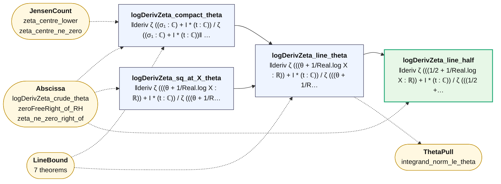

# `lean_stage3/Stage3/ThetaLine.lean`

ThetaLine — the vertical-line bound on `ζ'/ζ`, at a general abscissa `θ`. WHAT THIS PORTS. `RHPull.integrand_norm_le` (`LineBound.lean:1096`) draws its line bound from `Slice4b.logDerivZeta_line` (`:801`), which splits on `|t| ≤ 2`:

4 theorems, 0 definitions, 422 lines. Arrows are Lean's own record of what each proof uses.

**Imports:** [`Abscissa`](../lean_stage3/Abscissa.md)  
**Imported by:** [`Stage3`](../lean_stage3/Stage3.md), [`ThetaPull`](../lean_stage3/ThetaPull.md)

## The picture



An arrow A → B reads "A is used in the proof of B". Blue: theorem. Green: a theorem nothing else uses (an end). Dashed: connects to nothing. Red: contains `sorry`. Yellow: theorems in another file, counted; a dotted arrow crosses files. Definitions are not drawn; they are listed below the diagram.

## Theorems

<a name="Stage3-logDerivZeta_compact_theta"></a>
### `Stage3.logDerivZeta_compact_theta`

line 60

**Why.** The compact patch at a general zero-free abscissa. `|t| ≤ 2`, `θ < σ₁ ≤ (1+θ)/2`: `‖ζ'/ζ (σ₁ + it)‖ ≤ 14530 + 2/(1−θ) + 212/(σ₁ − θ)`. `Slice4.logDerivZeta_compact` is the `θ = 1/2` instance (where the pole term is `4` and `14534 ≤ 14535`).

**Proves**

```lean
‖deriv ζ ((σ₁ : ℂ) + I * (t : ℂ)) / ζ ((σ₁ : ℂ) + I * (t : ℂ))‖ ≤ 14530 + 2 / (1 - θ) + 212 / (σ₁ - θ)
```

**Needs** (its hypotheses)

  - `` hθ : StmtZeroFreeRight θ ``
  - `` hθlo : 1/2 ≤ θ ``
  - `` hθhi : θ < 1 ``
  - `` ht : |t| ≤ 2 ``
  - `` hlo : θ < σ₁ ``
  - `` hhi : σ₁ ≤ (1 + θ)/2 ``

**Stated with:** [`Stage3.StmtZeroFreeRight`](../lean_stage3/Abscissa.md#Stage3-StmtZeroFreeRight)

**Fed by** (9 theorems its proof uses)

  - [`Stage3.zeta_ne_zero_right_of`](../lean_stage3/Abscissa.md#Stage3-zeta_ne_zero_right_of) (Abscissa) — `` ζ s ≠ 0 ``
  - [`Stage3.zeta_centre_lower`](../lean_stage3/JensenCount.md#Stage3-zeta_centre_lower) (JensenCount) — `` (1 : ℝ) / 3 ≤ ‖ζ (2 + Complex.I * T)‖ ``
  - [`Stage3.zeta_centre_ne_zero`](../lean_stage3/JensenCount.md#Stage3-zeta_centre_ne_zero) (JensenCount) — `` ζ (2 + Complex.I * (T : ℂ)) ≠ 0 ``
  - [`Slice3.finalBoundConst_le`](../lean_stage3/LineBound.md#Slice3-finalBoundConst_le) (LineBound) — `` 16 * ((181:ℝ)/200) ^ 2 / ((181/200) - (3/4)) ^ 3 + 1 / (((15/16:ℝ) ^ 2 / (29/32) - 29/32) * Real.log ((15/16)/(29/32))) ≤ 3991 ``
  - [`Slice4.logDeriv_zetaE`](../lean_stage3/LineBound.md#Slice4-logDeriv_zetaE) (LineBound) — `` deriv zetaE s / zetaE s = 1 / (s - 1) + deriv ζ s / ζ s ``
  - [`Slice4.log_1300_le`](../lean_stage3/LineBound.md#Slice4-log_1300_le) (LineBound) — `` Real.log 1300 ≤ 7.28 ``
  - [`Slice4.zetaE_differentiable`](../lean_stage3/LineBound.md#Slice4-zetaE_differentiable) (LineBound) — `` Differentiable ℂ zetaE ``
  - [`Slice4.zetaE_disk_upper`](../lean_stage3/LineBound.md#Slice4-zetaE_disk_upper) (LineBound) — `` ‖zetaE w‖ ≤ 430 ``
  - [`Slice4.zetaE_eq`](../lean_stage3/LineBound.md#Slice4-zetaE_eq) (LineBound) — `` zetaE s = (s - 1) * ζ s ``

**Definitions its proof touches:** [`Slice4.zetaE`](../lean_stage3/LineBound.md#Slice4-zetaE)

**Feeds** (1 that use it)

  - [`Stage3.logDerivZeta_line_theta`](#Stage3-logDerivZeta_line_theta) — `` ‖deriv ζ (((θ + 1/Real.log X : ℝ)) + I * (t : ℂ)) / ζ (((θ + 1/Real.log X : ℝ)) + I * (t : ℂ))‖ ≤ 11100 * (Real.log X) ^ 2 ``

<a name="Stage3-logDerivZeta_sq_at_X_theta"></a>
### `Stage3.logDerivZeta_sq_at_X_theta`

line 296

**Why.** `logDerivZeta_sq_at_X` at general `θ`. On `σ₁ = θ + 1/log X` the denominator `σ₁ − θ` is `1/log X` for EVERY `θ`, so `11100` survives unchanged. `Slice3.logDerivZeta_sq_at_X` is the `θ = 1/2` instance.

**Proves**

```lean
‖deriv ζ (((θ + 1/Real.log X : ℝ)) + I * (t : ℂ)) / ζ (((θ + 1/Real.log X : ℝ)) + I * (t : ℂ))‖ ≤ 11100 * (Real.log X) ^ 2
```

**Needs** (its hypotheses)

  - `` hθ : StmtZeroFreeRight θ ``
  - `` hθlo : 1/2 ≤ θ ``
  - `` hθhi : θ ≤ 1 ``
  - `` ht : 2 ≤ t ``
  - `` hLX : 1 ≤ Real.log X ``
  - `` htX : Real.log t ≤ Real.log X ``

**Stated with:** [`Stage3.StmtZeroFreeRight`](../lean_stage3/Abscissa.md#Stage3-StmtZeroFreeRight)

**Fed by** (1 theorem its proof uses)

  - [`Stage3.logDerivZeta_crude_theta`](../lean_stage3/Abscissa.md#Stage3-logDerivZeta_crude_theta) (Abscissa) — `` ‖deriv ζ ((σ₁ : ℂ) + I * (t : ℂ)) / ζ ((σ₁ : ℂ) + I * (t : ℂ))‖ ≤ 1996 * Real.log (84 * t) + (29 * Real.log t + 129) / (σ₁ - θ) ``

**Feeds** (1 that use it)

  - [`Stage3.logDerivZeta_line_theta`](#Stage3-logDerivZeta_line_theta) — `` ‖deriv ζ (((θ + 1/Real.log X : ℝ)) + I * (t : ℂ)) / ζ (((θ + 1/Real.log X : ℝ)) + I * (t : ℂ))‖ ≤ 11100 * (Real.log X) ^ 2 ``

<a name="Stage3-logDerivZeta_line_theta"></a>
### `Stage3.logDerivZeta_line_theta`

line 343

**Why.** The vertical line at abscissa `θ`, uniform in `|t| ≤ X`. On `σ₁ = θ + 1/log X` with `log X ≥ 2/(1−θ)` and `|t| ≤ X`: `‖ζ'/ζ‖ ≤ 11100 (log X)²`.

**Proves**

```lean
‖deriv ζ (((θ + 1/Real.log X : ℝ)) + I * (t : ℂ)) / ζ (((θ + 1/Real.log X : ℝ)) + I * (t : ℂ))‖ ≤ 11100 * (Real.log X) ^ 2
```

**Needs** (its hypotheses)

  - `` hθ : StmtZeroFreeRight θ ``
  - `` hθlo : 1/2 ≤ θ ``
  - `` hθhi : θ < 1 ``
  - `` hLX : 2 / (1 - θ) ≤ Real.log X ``
  - `` htX : |t| ≤ X ``

**Stated with:** [`Stage3.StmtZeroFreeRight`](../lean_stage3/Abscissa.md#Stage3-StmtZeroFreeRight)

**Fed by** (3 theorems its proof uses)

  - [`Slice4b.logDerivZeta_norm_neg`](../lean_stage3/LineBound.md#Slice4b-logDerivZeta_norm_neg) (LineBound) — `` ‖deriv ζ ((σ : ℂ) + I * ((-t : ℝ) : ℂ)) / ζ ((σ : ℂ) + I * ((-t : ℝ) : ℂ))‖ = ‖deriv ζ ((σ : ℂ) + I * (t : ℂ)) / ζ ((σ : ℂ) + I * (t : ℂ))‖ ``
  - [`Stage3.logDerivZeta_compact_theta`](#Stage3-logDerivZeta_compact_theta) — `` ‖deriv ζ ((σ₁ : ℂ) + I * (t : ℂ)) / ζ ((σ₁ : ℂ) + I * (t : ℂ))‖ ≤ 14530 + 2 / (1 - θ) + 212 / (σ₁ - θ) ``
  - [`Stage3.logDerivZeta_sq_at_X_theta`](#Stage3-logDerivZeta_sq_at_X_theta) — `` ‖deriv ζ (((θ + 1/Real.log X : ℝ)) + I * (t : ℂ)) / ζ (((θ + 1/Real.log X : ℝ)) + I * (t : ℂ))‖ ≤ 11100 * (Real.log X) ^ 2 ``

**Feeds** (2 that use it)

  - [`Stage3.logDerivZeta_line_half`](#Stage3-logDerivZeta_line_half) — `` ‖deriv ζ (((1/2 + 1/Real.log X : ℝ)) + I * (t : ℂ)) / ζ (((1/2 + 1/Real.log X : ℝ)) + I * (t : ℂ))‖ ≤ 11100 * (Real.log X) ^ 2 ``
  - [`Stage3.integrand_norm_le_theta`](../lean_stage3/ThetaPull.md#Stage3-integrand_norm_le_theta) (ThetaPull) — `` ‖SmoothedChebyshevIntegrand ν ε X ((σθ θ X : ℂ) + I * (t : ℂ))‖ ≤ 11100 * (Real.log X) ^ 2 * M * X ^ (σθ θ X) ``

<a name="Stage3-logDerivZeta_line_half"></a>
### `Stage3.logDerivZeta_line_half`

line 393

**Why.** The weld at `θ = 1/2`. Under RH the general line bound is `Slice4b.logDerivZeta_line`'s statement, with `2/(1 − 1/2) = 4`.

**Proves**

```lean
‖deriv ζ (((1/2 + 1/Real.log X : ℝ)) + I * (t : ℂ)) / ζ (((1/2 + 1/Real.log X : ℝ)) + I * (t : ℂ))‖ ≤ 11100 * (Real.log X) ^ 2
```

**Needs** (its hypotheses)

  - `` hRH : RiemannHypothesis ``
  - `` hLX : 4 ≤ Real.log X ``
  - `` htX : |t| ≤ X ``

**Fed by** (2 theorems its proof uses)

  - [`Stage3.zeroFreeRight_of_RH`](../lean_stage3/Abscissa.md#Stage3-zeroFreeRight_of_RH) (Abscissa) — `` StmtZeroFreeRight (1/2) ``
  - [`Stage3.logDerivZeta_line_theta`](#Stage3-logDerivZeta_line_theta) — `` ‖deriv ζ (((θ + 1/Real.log X : ℝ)) + I * (t : ℂ)) / ζ (((θ + 1/Real.log X : ℝ)) + I * (t : ℂ))‖ ≤ 11100 * (Real.log X) ^ 2 ``

**Feeds:** nothing. It is an end.

