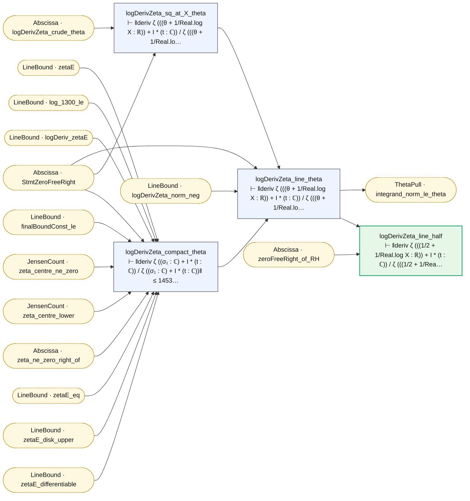

# `lean_stage3/Stage3/ThetaLine.lean`

**What it does** (its own header): ThetaLine — the vertical-line bound on `ζ'/ζ`, at a general abscissa `θ`. WHAT THIS PORTS. `RHPull.integrand_norm_le` (`LineBound.lean:1096`) draws its line bound from `Slice4b.logDerivZeta_line` (`:801`), which splits on `|t| ≤ 2`:

**Imports:** [`Abscissa`](../lean_stage3/Abscissa.md).
**Imported by:** [`Stage3`](../lean_stage3/Stage3.md), [`ThetaPull`](../lean_stage3/ThetaPull.md).

Blue: theorem. Green: a theorem nothing else uses (an end). Dashed white: connects to nothing. Grey: definition. Red: contains `sorry`. Yellow: in another file. An arrow A → B reads "A is used by B".

## Every declaration

| declaration | proves (output) | needs (input) | why (its own docstring) | uses | used by |
|---|---|---|---|---|---|
| `Stage3.logDerivZeta_compact_theta` theorem, line 60 | ‖deriv ζ ((σ₁ : ℂ) + I * (t : ℂ)) / ζ ((σ₁ : ℂ) + I * (t : ℂ))‖ ≤ 14530 + 2 / (1 - θ) + 212 / (σ₁ - θ) | hθ : StmtZeroFreeRight θ; hθlo : 1/2 ≤ θ; hθhi : θ &lt; 1; ht : \|t\| ≤ 2; hlo : θ &lt; σ₁; hhi : σ₁ ≤ (1 + θ)/2 | The compact patch at a general zero-free abscissa. `\|t\| ≤ 2`, `θ &lt; σ₁ ≤ (1+θ)/2`: `‖ζ'/ζ (σ₁ + it)‖ ≤ 14530 + 2/(1−θ) + 212/(σ₁ − θ)`. `Slice4.logDerivZeta_compact` is the `θ = 1/2` instance (where the pole term is `4` and `14534 ≤ 14535`). | `Stage3.StmtZeroFreeRight`, `Stage3.zeta_ne_zero_right_of`, `Stage3.zeta_centre_lower`, `Stage3.zeta_centre_ne_zero`, `Slice3.finalBoundConst_le`, `Slice4.logDeriv_zetaE`, `Slice4.log_1300_le`, `Slice4.zetaE`, `Slice4.zetaE_differentiable`, `Slice4.zetaE_disk_upper`, `Slice4.zetaE_eq` | `Stage3.logDerivZeta_line_theta` |
| `Stage3.logDerivZeta_sq_at_X_theta` theorem, line 296 | ‖deriv ζ (((θ + 1/Real.log X : ℝ)) + I * (t : ℂ)) / ζ (((θ + 1/Real.log X : ℝ)) + I * (t : ℂ))‖ ≤ 11100 * (Real.log X) ^ 2 | hθ : StmtZeroFreeRight θ; hθlo : 1/2 ≤ θ; hθhi : θ ≤ 1; ht : 2 ≤ t; hLX : 1 ≤ Real.log X; htX : Real.log t ≤ Real.log X | `logDerivZeta_sq_at_X` at general `θ`. On `σ₁ = θ + 1/log X` the denominator `σ₁ − θ` is `1/log X` for EVERY `θ`, so `11100` survives unchanged. `Slice3.logDerivZeta_sq_at_X` is the `θ = 1/2` instance. | `Stage3.StmtZeroFreeRight`, `Stage3.logDerivZeta_crude_theta` | `Stage3.logDerivZeta_line_theta` |
| `Stage3.logDerivZeta_line_theta` theorem, line 343 | ‖deriv ζ (((θ + 1/Real.log X : ℝ)) + I * (t : ℂ)) / ζ (((θ + 1/Real.log X : ℝ)) + I * (t : ℂ))‖ ≤ 11100 * (Real.log X) ^ 2 | hθ : StmtZeroFreeRight θ; hθlo : 1/2 ≤ θ; hθhi : θ &lt; 1; hLX : 2 / (1 - θ) ≤ Real.log X; htX : \|t\| ≤ X | The vertical line at abscissa `θ`, uniform in `\|t\| ≤ X`. On `σ₁ = θ + 1/log X` with `log X ≥ 2/(1−θ)` and `\|t\| ≤ X`: `‖ζ'/ζ‖ ≤ 11100 (log X)²`. | `Stage3.StmtZeroFreeRight`, `Slice4b.logDerivZeta_norm_neg`, `Stage3.logDerivZeta_compact_theta`, `Stage3.logDerivZeta_sq_at_X_theta` | `Stage3.logDerivZeta_line_half`, `Stage3.integrand_norm_le_theta` |
| `Stage3.logDerivZeta_line_half` theorem, line 393 | ‖deriv ζ (((1/2 + 1/Real.log X : ℝ)) + I * (t : ℂ)) / ζ (((1/2 + 1/Real.log X : ℝ)) + I * (t : ℂ))‖ ≤ 11100 * (Real.log X) ^ 2 | hRH : RiemannHypothesis; hLX : 4 ≤ Real.log X; htX : \|t\| ≤ X | The weld at `θ = 1/2`. Under RH the general line bound is `Slice4b.logDerivZeta_line`'s statement, with `2/(1 − 1/2) = 4`. | `Stage3.zeroFreeRight_of_RH`, `Stage3.logDerivZeta_line_theta` | — |
