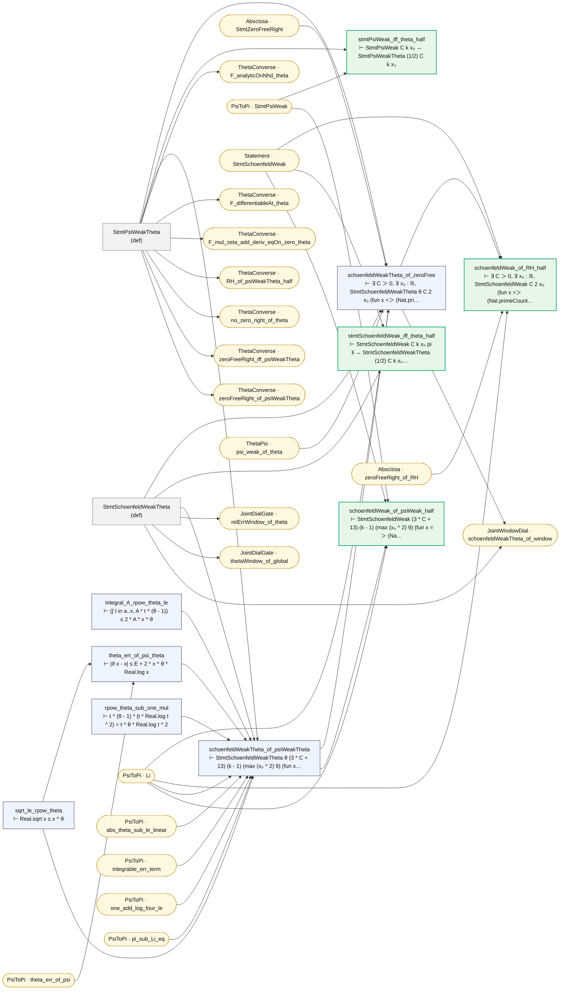

# `lean_stage3/Stage3/ThetaPi.lean`

**What it does** (its own header): ThetaPi — the ψ → π transfer at a general abscissa θ. `PsiToPi.schoenfeldWeak_of_psiWeak` is hardwired to exponent `1/2`: `StmtPsiWeak` carries a literal `Real.sqrt t`, and the envelope integral `integral_A_rpow_le` integrates `t^(−1/2)` to `2A·√x`. This file is the same proof with `x^θ` in place of `√x`, for `θ ∈ [1/2, 1)`:

**Imports:** [`PsiToPi`](../lean_stage3/PsiToPi.md), [`ThetaPsi`](../lean_stage3/ThetaPsi.md).
**Imported by:** [`Stage3`](../lean_stage3/Stage3.md), [`JointWindowDial`](../lean_stage3/JointWindowDial.md), [`ThetaConverse`](../lean_stage3/ThetaConverse.md).

Blue: theorem. Green: a theorem nothing else uses (an end). Dashed white: connects to nothing. Grey: definition. Red: contains `sorry`. Yellow: in another file. An arrow A → B reads "A is used by B".

## Every declaration

| declaration | proves (output) | needs (input) | why (its own docstring) | uses | used by |
|---|---|---|---|---|---|
| `Stage3.StmtPsiWeakTheta` def, line 43 | Prop | θ C : ℝ; k : ℕ; x₀ : ℝ | The ψ-side weak bound at exponent `θ`. `StmtPsiWeak` is the `θ = 1/2` member, `√t` written as `t^(1/2)`. | — | `Stage3.F_analyticOnNhd_theta`, `Stage3.F_differentiableAt_theta`, `Stage3.F_mul_zeta_add_deriv_eqOn_zero_theta`, `Stage3.RH_of_psiWeakTheta_half`, `Stage3.no_zero_right_of_theta`, `Stage3.zeroFreeRight_iff_psiWeakTheta`, `Stage3.zeroFreeRight_of_psiWeakTheta`, `Stage3.schoenfeldWeakTheta_of_psiWeakTheta`, `Stage3.schoenfeldWeakTheta_of_zeroFree`, `Stage3.stmtPsiWeak_iff_theta_half` |
| `Stage3.StmtSchoenfeldWeakTheta` def, line 47 | Prop | θ C : ℝ; k : ℕ; x₀ : ℝ; pi li : ℝ → ℝ | The π-side weak bound at exponent `θ`. | — | `JointDialGate.relErrWindow_of_theta`, `JointDialGate.thetaWindow_of_global`, `JointWindowDial.schoenfeldWeakTheta_of_window`, `Stage3.schoenfeldWeakTheta_of_psiWeakTheta`, `Stage3.schoenfeldWeakTheta_of_zeroFree`, `Stage3.stmtSchoenfeldWeak_iff_theta_half` |
| `Stage3.stmtPsiWeak_iff_theta_half` theorem, line 50 | StmtPsiWeak C k x₀ ↔ StmtPsiWeakTheta (1/2) C k x₀ | — | — | `Stage3.StmtPsiWeak`, `Stage3.StmtPsiWeakTheta` | — |
| `Stage3.stmtSchoenfeldWeak_iff_theta_half` theorem, line 56 | StmtSchoenfeldWeak C k x₀ pi li ↔ StmtSchoenfeldWeakTheta (1/2) C k x₀ pi li | — | — | `Stage3.StmtSchoenfeldWeak`, `Stage3.StmtSchoenfeldWeakTheta` | — |
| `Stage3.sqrt_le_rpow_theta` theorem, line 64 | Real.sqrt x ≤ x ^ θ | hx : 1 ≤ x; hθlo : 1/2 ≤ θ | `√x ≤ x^θ` for `x ≥ 1`, `θ ≥ 1/2`. This is where `1/2 ≤ θ` enters the transfer: Mathlib's `\|ψ − ϑ\| ≤ 2√x·log x` folds under the `x^θ` envelope. | — | `Stage3.schoenfeldWeakTheta_of_psiWeakTheta`, `Stage3.theta_err_of_psi_theta` |
| `Stage3.integral_A_rpow_theta_le` theorem, line 71 | (∫ t in a..x, A * t ^ (θ - 1)) ≤ 2 * A * x ^ θ | ha : 0 &lt; a; hx : a ≤ x; hA : 0 ≤ A; hθlo : 1/2 ≤ θ | The envelope integral at `θ`: `∫ₐˣ A·t^(θ−1) dt ≤ 2A·x^θ`. The exact value is `A·(x^θ − a^θ)/θ`; `1/θ ≤ 2` keeps PsiToPi's constant. | — | `Stage3.schoenfeldWeakTheta_of_psiWeakTheta` |
| `Stage3.theta_err_of_psi_theta` theorem, line 88 | \|ϑ x - x\| ≤ E + 2 * x ^ θ * Real.log x | hx : 1 ≤ x; hθlo : 1/2 ≤ θ; hψ : \|ψ x - x\| ≤ E | `ϑ`-error from `ψ`-error at `θ`, by Mathlib's `\|ψ − ϑ\| ≤ 2√x·log x` and `√x ≤ x^θ`. | `Stage3.theta_err_of_psi`, `Stage3.sqrt_le_rpow_theta` | `Stage3.schoenfeldWeakTheta_of_psiWeakTheta` |
| `Stage3.rpow_theta_sub_one_mul` theorem, line 101 | t ^ (θ - 1) * (t * Real.log t ^ 2) = t ^ θ * Real.log t ^ 2 | ht : 0 &lt; t | `t^(θ−1)` times the denominator is the `t^θ` envelope: `t^(θ−1)·(t·log²t) = t^θ·log²t` on `t &gt; 0`. | — | `Stage3.schoenfeldWeakTheta_of_psiWeakTheta` |
| `Stage3.schoenfeldWeakTheta_of_psiWeakTheta` theorem, line 111 | StmtSchoenfeldWeakTheta θ (3 * C + 13) (k - 1) (max (x₀ ^ 2) 9) (fun x =&gt; (Nat.primeCounting ⌊x⌋₊ : ℝ)) Li | hθlo : 1/2 ≤ θ; hk : 2 ≤ k; hx₀ : 2 ≤ x₀; hC : 0 ≤ C; h : StmtPsiWeakTheta θ C k x₀ | The transfer at `θ`. A ψ-side weak bound `(C, k, x₀)` at exponent `θ ≥ 1/2` with `k ≥ 2, x₀ ≥ 2` delivers the π-side weak bound at the same exponent with `C′ = 3C + 13`, exponent `k − 1`, floor `max(x₀², 9)`. The proof is `PsiToPi.schoenfeldWeak_of_psiWeak` with `x^θ` for `√x`. | `Stage3.Li`, `Stage3.abs_theta_sub_le_linear`, `Stage3.integrable_err_term`, `Stage3.one_add_log_four_le`, `Stage3.pi_sub_Li_eq`, `Stage3.StmtPsiWeakTheta`, `Stage3.StmtSchoenfeldWeakTheta`, `Stage3.integral_A_rpow_theta_le`, `Stage3.rpow_theta_sub_one_mul`, `Stage3.sqrt_le_rpow_theta`, `Stage3.theta_err_of_psi_theta` | `Stage3.schoenfeldWeakTheta_of_zeroFree`, `Stage3.schoenfeldWeak_of_psiWeak_half` |
| `Stage3.schoenfeldWeak_of_psiWeak_half` theorem, line 266 | StmtSchoenfeldWeak (3 * C + 13) (k - 1) (max (x₀ ^ 2) 9) (fun x =&gt; (Nat.primeCounting ⌊x⌋₊ : ℝ)) Li | hk : 2 ≤ k; hx₀ : 2 ≤ x₀; hC : 0 ≤ C; h : StmtPsiWeak C k x₀ | `PsiToPi.schoenfeldWeak_of_psiWeak` recovered through the dial. | `Stage3.Li`, `Stage3.StmtPsiWeak`, `Stage3.StmtSchoenfeldWeak`, `Stage3.schoenfeldWeakTheta_of_psiWeakTheta` | — |
| `Stage3.schoenfeldWeakTheta_of_zeroFree` theorem, line 280 | ∃ C &gt; 0, ∃ x₀ : ℝ, StmtSchoenfeldWeakTheta θ C 2 x₀ (fun x =&gt; (Nat.primeCounting ⌊x⌋₊ : ℝ)) Li | hθ : StmtZeroFreeRight θ; hθlo : 1/2 ≤ θ; hθhi : θ &lt; 1 | From a zero-free half-plane to the π-side bound. `StmtZeroFreeRight θ` for `θ ∈ [1/2, 1)` gives `\|π(⌊x⌋) − Li x\| ≤ C·x^θ·(log x)²` beyond some `x₀`. Constant `3C_ψ + 13` with `C_ψ` from `psi_weak_of_theta`. | `Stage3.StmtZeroFreeRight`, `Stage3.Li`, `Stage3.StmtPsiWeakTheta`, `Stage3.StmtSchoenfeldWeakTheta`, `Stage3.schoenfeldWeakTheta_of_psiWeakTheta`, `Stage3.psi_weak_of_theta` | `JointWindowDial.schoenfeldWeakTheta_of_window`, `Stage3.schoenfeldWeak_of_RH_half` |
| `Stage3.schoenfeldWeak_of_RH_half` theorem, line 293 | ∃ C &gt; 0, ∃ x₀ : ℝ, StmtSchoenfeldWeak C 2 x₀ (fun x =&gt; (Nat.primeCounting ⌊x⌋₊ : ℝ)) Li | hRH : RiemannHypothesis | The same under RH at `θ = 1/2`: `\|π − Li\| ≤ C·√x·(log x)²`. | `Stage3.zeroFreeRight_of_RH`, `Stage3.Li`, `Stage3.StmtSchoenfeldWeak`, `Stage3.schoenfeldWeakTheta_of_zeroFree` | — |
