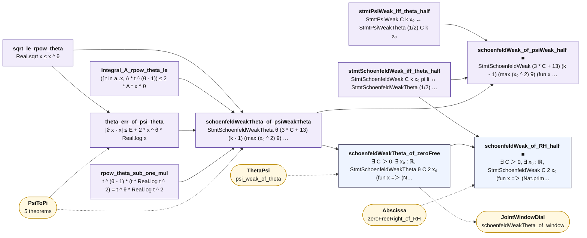

# `lean_stage3/Stage3/ThetaPi.lean`

ThetaPi — the ψ → π transfer at a general abscissa θ. `PsiToPi.schoenfeldWeak_of_psiWeak` is hardwired to exponent `1/2`: `StmtPsiWeak` carries a literal `Real.sqrt t`, and the envelope integral `integral_A_rpow_le` integrates `t^(−1/2)` to `2A·√x`. This file is the same proof with `x^θ` in place of `√x`, for `θ ∈ [1/2, 1)`:

10 theorems, 2 definitions, 333 lines. Arrows are Lean's own record of what each proof uses.

**Imports:** [`PsiToPi`](../lean_stage3/PsiToPi.md), [`ThetaPsi`](../lean_stage3/ThetaPsi.md)  
**Imported by:** [`Stage3`](../lean_stage3/Stage3.md), [`JointWindowDial`](../lean_stage3/JointWindowDial.md), [`ThetaConverse`](../lean_stage3/ThetaConverse.md)

## The picture



An arrow A → B reads "A is used in the proof of B". Green: counting, integers only. Violet: shape, analysis with no ζ. Blue: reads ζ. A name ending in ■ is an end: nothing else uses it. Red: contains `sorry`. Yellow: theorems in another file, counted; a dotted arrow crosses files. Definitions are not drawn; they are listed below the diagram.

## Definitions

<a name="Stage3-StmtPsiWeakTheta"></a>
### `Stage3.StmtPsiWeakTheta`

def · line 43

The ψ-side weak bound at exponent `θ`. `StmtPsiWeak` is the `θ = 1/2` member, `√t` written as `t^(1/2)`.

- **Is:** `` StmtPsiWeakTheta (θ C : ℝ) (k : ℕ) (x₀ : ℝ) : Prop := ∀ t : ℝ, x₀ ≤ t → |ψ t - t| ≤ C * t ^ θ * Real.log t ^ k ``
- **Used by 12:** [`RateBelow.rain_psi`](../lean_stage3/RateBelow.md#RateBelow-rain_psi), [`Stage3.F_analyticOnNhd_theta`](../lean_stage3/ThetaConverse.md#Stage3-F_analyticOnNhd_theta), [`Stage3.F_differentiableAt_theta`](../lean_stage3/ThetaConverse.md#Stage3-F_differentiableAt_theta), [`Stage3.F_mul_zeta_add_deriv_eqOn_zero_theta`](../lean_stage3/ThetaConverse.md#Stage3-F_mul_zeta_add_deriv_eqOn_zero_theta), [`Stage3.RH_of_psiWeakTheta_half`](../lean_stage3/ThetaConverse.md#Stage3-RH_of_psiWeakTheta_half), [`Stage3.no_zero_right_of_theta`](../lean_stage3/ThetaConverse.md#Stage3-no_zero_right_of_theta), [`Stage3.zeroFreeRight_iff_psiWeakTheta`](../lean_stage3/ThetaConverse.md#Stage3-zeroFreeRight_iff_psiWeakTheta), [`Stage3.zeroFreeRight_of_psiWeakTheta`](../lean_stage3/ThetaConverse.md#Stage3-zeroFreeRight_of_psiWeakTheta), [`Stage3.schoenfeldWeakTheta_of_psiWeakTheta`](#Stage3-schoenfeldWeakTheta_of_psiWeakTheta), [`Stage3.schoenfeldWeakTheta_of_zeroFree`](#Stage3-schoenfeldWeakTheta_of_zeroFree), [`Stage3.schoenfeldWeak_of_psiWeak_half`](#Stage3-schoenfeldWeak_of_psiWeak_half), [`Stage3.stmtPsiWeak_iff_theta_half`](#Stage3-stmtPsiWeak_iff_theta_half)

<a name="Stage3-StmtSchoenfeldWeakTheta"></a>
### `Stage3.StmtSchoenfeldWeakTheta`

def · line 47

The π-side weak bound at exponent `θ`.

- **Is:** `` StmtSchoenfeldWeakTheta (θ C : ℝ) (k : ℕ) (x₀ : ℝ) (pi li : ℝ → ℝ) : Prop := ∀ x : ℝ, x₀ ≤ x → |pi x - li x| ≤ C * x ^ θ * Real.log x ^ k ``
- **Used by 9:** [`JointDialGate.relErrWindow_of_theta`](../lean_stage3/JointDialGate.md#JointDialGate-relErrWindow_of_theta), [`JointDialGate.relErrWindow_of_window`](../lean_stage3/JointDialGate.md#JointDialGate-relErrWindow_of_window), [`JointDialGate.thetaWindow_of_global`](../lean_stage3/JointDialGate.md#JointDialGate-thetaWindow_of_global), [`JointWindowDial.schoenfeldWeakTheta_of_window`](../lean_stage3/JointWindowDial.md#JointWindowDial-schoenfeldWeakTheta_of_window), [`Stage3.schoenfeldWeakTheta_of_psiWeakTheta`](#Stage3-schoenfeldWeakTheta_of_psiWeakTheta), [`Stage3.schoenfeldWeakTheta_of_zeroFree`](#Stage3-schoenfeldWeakTheta_of_zeroFree), [`Stage3.schoenfeldWeak_of_RH_half`](#Stage3-schoenfeldWeak_of_RH_half), [`Stage3.schoenfeldWeak_of_psiWeak_half`](#Stage3-schoenfeldWeak_of_psiWeak_half), [`Stage3.stmtSchoenfeldWeak_iff_theta_half`](#Stage3-stmtSchoenfeldWeak_iff_theta_half)

## Theorems

<a name="Stage3-stmtPsiWeak_iff_theta_half"></a>
### `Stage3.stmtPsiWeak_iff_theta_half`

line 52

**Shape.** Uses real or complex analysis; nothing in it or beneath it reads ζ.

**Why.** The ψ-side weak bound `StmtPsiWeak C k x₀` is equivalent to `StmtPsiWeakTheta` at exponent `θ = 1/2` with the same `C`, `k`, `x₀`.

**Proves**

```lean
StmtPsiWeak C k x₀ ↔ StmtPsiWeakTheta (1/2) C k x₀
```

**Stated with:** [`Stage3.StmtPsiWeak`](../lean_stage3/PsiToPi.md#Stage3-StmtPsiWeak), [`Stage3.StmtPsiWeakTheta`](#Stage3-StmtPsiWeakTheta)

**Fed by:** no theorem of this repo; it stands on Mathlib and the definitions below.

**Feeds** (1 that use it)

  - [`Stage3.schoenfeldWeak_of_psiWeak_half`](#Stage3-schoenfeldWeak_of_psiWeak_half) — `` StmtSchoenfeldWeak (3 * C + 13) (k - 1) (max (x₀ ^ 2) 9) (fun x => (Nat.primeCounting ⌊x⌋₊ : ℝ)) Li ``

<a name="Stage3-stmtSchoenfeldWeak_iff_theta_half"></a>
### `Stage3.stmtSchoenfeldWeak_iff_theta_half`

line 60

**Shape.** Uses real or complex analysis; nothing in it or beneath it reads ζ.

**Why.** The π-side weak bound `StmtSchoenfeldWeak C k x₀ pi li` is equivalent to `StmtSchoenfeldWeakTheta` at exponent `θ = 1/2` with the same data.

**Proves**

```lean
StmtSchoenfeldWeak C k x₀ pi li ↔ StmtSchoenfeldWeakTheta (1/2) C k x₀ pi li
```

**Stated with:** [`Stage3.StmtSchoenfeldWeak`](../lean_stage3/Statement.md#Stage3-StmtSchoenfeldWeak), [`Stage3.StmtSchoenfeldWeakTheta`](#Stage3-StmtSchoenfeldWeakTheta)

**Fed by:** no theorem of this repo; it stands on Mathlib and the definitions below.

**Feeds** (2 that use it)

  - [`Stage3.schoenfeldWeak_of_RH_half`](#Stage3-schoenfeldWeak_of_RH_half) — `` ∃ C > 0, ∃ x₀ : ℝ, StmtSchoenfeldWeak C 2 x₀ (fun x => (Nat.primeCounting ⌊x⌋₊ : ℝ)) Li ``
  - [`Stage3.schoenfeldWeak_of_psiWeak_half`](#Stage3-schoenfeldWeak_of_psiWeak_half) — `` StmtSchoenfeldWeak (3 * C + 13) (k - 1) (max (x₀ ^ 2) 9) (fun x => (Nat.primeCounting ⌊x⌋₊ : ℝ)) Li ``

<a name="Stage3-sqrt_le_rpow_theta"></a>
### `Stage3.sqrt_le_rpow_theta`

line 68

**Shape.** Uses real or complex analysis; nothing in it or beneath it reads ζ.

**Why.** `√x ≤ x^θ` for `x ≥ 1`, `θ ≥ 1/2`. This is where `1/2 ≤ θ` enters the transfer: Mathlib's `|ψ − ϑ| ≤ 2√x·log x` folds under the `x^θ` envelope.

**Proves**

```lean
Real.sqrt x ≤ x ^ θ
```

**Needs** (its hypotheses)

  - `` hx : 1 ≤ x ``
  - `` hθlo : 1/2 ≤ θ ``

**Fed by:** no theorem of this repo; it stands on Mathlib.

**Feeds** (2 that use it)

  - [`Stage3.schoenfeldWeakTheta_of_psiWeakTheta`](#Stage3-schoenfeldWeakTheta_of_psiWeakTheta) — `` StmtSchoenfeldWeakTheta θ (3 * C + 13) (k - 1) (max (x₀ ^ 2) 9) (fun x => (Nat.primeCounting ⌊x⌋₊ : ℝ)) Li ``
  - [`Stage3.theta_err_of_psi_theta`](#Stage3-theta_err_of_psi_theta) — `` |ϑ x - x| ≤ E + 2 * x ^ θ * Real.log x ``

<a name="Stage3-integral_A_rpow_theta_le"></a>
### `Stage3.integral_A_rpow_theta_le`

line 75

**Shape.** Uses real or complex analysis; nothing in it or beneath it reads ζ.

**Why.** The envelope integral at `θ`: `∫ₐˣ A·t^(θ−1) dt ≤ 2A·x^θ`. The exact value is `A·(x^θ − a^θ)/θ`; `1/θ ≤ 2` keeps PsiToPi's constant.

**Proves**

```lean
(∫ t in a..x, A * t ^ (θ - 1)) ≤ 2 * A * x ^ θ
```

**Needs** (its hypotheses)

  - `` ha : 0 < a ``
  - `` hx : a ≤ x ``
  - `` hA : 0 ≤ A ``
  - `` hθlo : 1/2 ≤ θ ``

**Fed by:** no theorem of this repo; it stands on Mathlib.

**Feeds** (1 that use it)

  - [`Stage3.schoenfeldWeakTheta_of_psiWeakTheta`](#Stage3-schoenfeldWeakTheta_of_psiWeakTheta) — `` StmtSchoenfeldWeakTheta θ (3 * C + 13) (k - 1) (max (x₀ ^ 2) 9) (fun x => (Nat.primeCounting ⌊x⌋₊ : ℝ)) Li ``

<a name="Stage3-theta_err_of_psi_theta"></a>
### `Stage3.theta_err_of_psi_theta`

line 92

**Shape.** Uses real or complex analysis; nothing in it or beneath it reads ζ.

**Why.** `ϑ`-error from `ψ`-error at `θ`, by Mathlib's `|ψ − ϑ| ≤ 2√x·log x` and `√x ≤ x^θ`.

**Proves**

```lean
|ϑ x - x| ≤ E + 2 * x ^ θ * Real.log x
```

**Needs** (its hypotheses)

  - `` hx : 1 ≤ x ``
  - `` hθlo : 1/2 ≤ θ ``
  - `` hψ : |ψ x - x| ≤ E ``

**Fed by** (2 theorems its proof uses)

  - [`Stage3.theta_err_of_psi`](../lean_stage3/PsiToPi.md#Stage3-theta_err_of_psi) (PsiToPi) — `` |θ x - x| ≤ E + 2 * Real.sqrt x * Real.log x ``
  - [`Stage3.sqrt_le_rpow_theta`](#Stage3-sqrt_le_rpow_theta) — `` Real.sqrt x ≤ x ^ θ ``

**Feeds** (1 that use it)

  - [`Stage3.schoenfeldWeakTheta_of_psiWeakTheta`](#Stage3-schoenfeldWeakTheta_of_psiWeakTheta) — `` StmtSchoenfeldWeakTheta θ (3 * C + 13) (k - 1) (max (x₀ ^ 2) 9) (fun x => (Nat.primeCounting ⌊x⌋₊ : ℝ)) Li ``

<a name="Stage3-rpow_theta_sub_one_mul"></a>
### `Stage3.rpow_theta_sub_one_mul`

line 105

**Shape.** Uses real or complex analysis; nothing in it or beneath it reads ζ.

**Why.** `t^(θ−1)` times the denominator is the `t^θ` envelope: `t^(θ−1)·(t·log²t) = t^θ·log²t` on `t > 0`.

**Proves**

```lean
t ^ (θ - 1) * (t * Real.log t ^ 2) = t ^ θ * Real.log t ^ 2
```

**Needs** (its hypotheses)

  - `` ht : 0 < t ``

**Fed by:** no theorem of this repo; it stands on Mathlib.

**Feeds** (1 that use it)

  - [`Stage3.schoenfeldWeakTheta_of_psiWeakTheta`](#Stage3-schoenfeldWeakTheta_of_psiWeakTheta) — `` StmtSchoenfeldWeakTheta θ (3 * C + 13) (k - 1) (max (x₀ ^ 2) 9) (fun x => (Nat.primeCounting ⌊x⌋₊ : ℝ)) Li ``

<a name="Stage3-schoenfeldWeakTheta_of_psiWeakTheta"></a>
### `Stage3.schoenfeldWeakTheta_of_psiWeakTheta`

line 115

**Shape.** Uses real or complex analysis; nothing in it or beneath it reads ζ.

**Why.** The transfer at `θ`. A ψ-side weak bound `(C, k, x₀)` at exponent `θ ≥ 1/2` with `k ≥ 2, x₀ ≥ 2` delivers the π-side weak bound at the same exponent with `C′ = 3C + 13`, exponent `k − 1`, floor `max(x₀², 9)`. The proof is `PsiToPi.schoenfeldWeak_of_psiWeak` with `x^θ` for `√x`.

**Proves**

```lean
StmtSchoenfeldWeakTheta θ (3 * C + 13) (k - 1) (max (x₀ ^ 2) 9) (fun x => (Nat.primeCounting ⌊x⌋₊ : ℝ)) Li
```

**Needs** (its hypotheses)

  - `` hθlo : 1/2 ≤ θ ``
  - `` hk : 2 ≤ k ``
  - `` hx₀ : 2 ≤ x₀ ``
  - `` hC : 0 ≤ C ``
  - `` h : StmtPsiWeakTheta θ C k x₀ ``

**Stated with:** [`Stage3.Li`](../lean_stage3/PsiToPi.md#Stage3-Li), [`Stage3.StmtPsiWeakTheta`](#Stage3-StmtPsiWeakTheta), [`Stage3.StmtSchoenfeldWeakTheta`](#Stage3-StmtSchoenfeldWeakTheta)

**Fed by** (8 theorems its proof uses)

  - [`Stage3.abs_theta_sub_le_linear`](../lean_stage3/PsiToPi.md#Stage3-abs_theta_sub_le_linear) (PsiToPi) — `` |θ t - t| ≤ (1 + Real.log 4) * t ``
  - [`Stage3.integrable_err_term`](../lean_stage3/PsiToPi.md#Stage3-integrable_err_term) (PsiToPi) — `` IntervalIntegrable (fun t => (θ t - t) / (t * Real.log t ^ 2)) volume a x ``
  - [`Stage3.one_add_log_four_le`](../lean_stage3/PsiToPi.md#Stage3-one_add_log_four_le) (PsiToPi) — `` 1 + Real.log 4 ≤ 5 * Real.log 2 ^ 2 ``
  - [`Stage3.pi_sub_Li_eq`](../lean_stage3/PsiToPi.md#Stage3-pi_sub_Li_eq) (PsiToPi) — `` (Nat.primeCounting ⌊x⌋₊ : ℝ) - Li x = (θ x - x) / Real.log x + ∫ t in (2 : ℝ)..x, (θ t - t) / (t * Real.log t ^ 2) ``
  - [`Stage3.integral_A_rpow_theta_le`](#Stage3-integral_A_rpow_theta_le) — `` (∫ t in a..x, A * t ^ (θ - 1)) ≤ 2 * A * x ^ θ ``
  - [`Stage3.rpow_theta_sub_one_mul`](#Stage3-rpow_theta_sub_one_mul) — `` t ^ (θ - 1) * (t * Real.log t ^ 2) = t ^ θ * Real.log t ^ 2 ``
  - [`Stage3.sqrt_le_rpow_theta`](#Stage3-sqrt_le_rpow_theta) — `` Real.sqrt x ≤ x ^ θ ``
  - [`Stage3.theta_err_of_psi_theta`](#Stage3-theta_err_of_psi_theta) — `` |ϑ x - x| ≤ E + 2 * x ^ θ * Real.log x ``

**Feeds** (2 that use it)

  - [`Stage3.schoenfeldWeakTheta_of_zeroFree`](#Stage3-schoenfeldWeakTheta_of_zeroFree) — `` ∃ C > 0, ∃ x₀ : ℝ, StmtSchoenfeldWeakTheta θ C 2 x₀ (fun x => (Nat.primeCounting ⌊x⌋₊ : ℝ)) Li ``
  - [`Stage3.schoenfeldWeak_of_psiWeak_half`](#Stage3-schoenfeldWeak_of_psiWeak_half) — `` StmtSchoenfeldWeak (3 * C + 13) (k - 1) (max (x₀ ^ 2) 9) (fun x => (Nat.primeCounting ⌊x⌋₊ : ℝ)) Li ``

<a name="Stage3-schoenfeldWeak_of_psiWeak_half"></a>
### `Stage3.schoenfeldWeak_of_psiWeak_half`

line 270

**Shape.** Uses real or complex analysis; nothing in it or beneath it reads ζ.

**Why.** `PsiToPi.schoenfeldWeak_of_psiWeak` recovered through the dial.

**Proves**

```lean
StmtSchoenfeldWeak (3 * C + 13) (k - 1) (max (x₀ ^ 2) 9) (fun x => (Nat.primeCounting ⌊x⌋₊ : ℝ)) Li
```

**Needs** (its hypotheses)

  - `` hk : 2 ≤ k ``
  - `` hx₀ : 2 ≤ x₀ ``
  - `` hC : 0 ≤ C ``
  - `` h : StmtPsiWeak C k x₀ ``

**Stated with:** [`Stage3.Li`](../lean_stage3/PsiToPi.md#Stage3-Li), [`Stage3.StmtPsiWeak`](../lean_stage3/PsiToPi.md#Stage3-StmtPsiWeak), [`Stage3.StmtSchoenfeldWeak`](../lean_stage3/Statement.md#Stage3-StmtSchoenfeldWeak)

**Fed by** (3 theorems its proof uses)

  - [`Stage3.schoenfeldWeakTheta_of_psiWeakTheta`](#Stage3-schoenfeldWeakTheta_of_psiWeakTheta) — `` StmtSchoenfeldWeakTheta θ (3 * C + 13) (k - 1) (max (x₀ ^ 2) 9) (fun x => (Nat.primeCounting ⌊x⌋₊ : ℝ)) Li ``
  - [`Stage3.stmtPsiWeak_iff_theta_half`](#Stage3-stmtPsiWeak_iff_theta_half) — `` StmtPsiWeak C k x₀ ↔ StmtPsiWeakTheta (1/2) C k x₀ ``
  - [`Stage3.stmtSchoenfeldWeak_iff_theta_half`](#Stage3-stmtSchoenfeldWeak_iff_theta_half) — `` StmtSchoenfeldWeak C k x₀ pi li ↔ StmtSchoenfeldWeakTheta (1/2) C k x₀ pi li ``

**Definitions its proof touches:** [`Stage3.StmtPsiWeakTheta`](#Stage3-StmtPsiWeakTheta), [`Stage3.StmtSchoenfeldWeakTheta`](#Stage3-StmtSchoenfeldWeakTheta)

**Feeds:** nothing. It is an end.

<a name="Stage3-schoenfeldWeakTheta_of_zeroFree"></a>
### `Stage3.schoenfeldWeakTheta_of_zeroFree`

line 284

**Reads ζ.** It, or something it rests on, uses the zeta function, its zeros or the Riemann hypothesis.

**Why.** From a zero-free half-plane to the π-side bound. `StmtZeroFreeRight θ` for `θ ∈ [1/2, 1)` gives `|π(⌊x⌋) − Li x| ≤ C·x^θ·(log x)²` beyond some `x₀`. Constant `3C_ψ + 13` with `C_ψ` from `psi_weak_of_theta`.

**Proves**

```lean
∃ C > 0, ∃ x₀ : ℝ, StmtSchoenfeldWeakTheta θ C 2 x₀ (fun x => (Nat.primeCounting ⌊x⌋₊ : ℝ)) Li
```

**Needs** (its hypotheses)

  - `` hθ : StmtZeroFreeRight θ ``
  - `` hθlo : 1/2 ≤ θ ``
  - `` hθhi : θ < 1 ``

**Stated with:** [`Stage3.StmtZeroFreeRight`](../lean_stage3/Abscissa.md#Stage3-StmtZeroFreeRight), [`Stage3.Li`](../lean_stage3/PsiToPi.md#Stage3-Li), [`Stage3.StmtSchoenfeldWeakTheta`](#Stage3-StmtSchoenfeldWeakTheta)

**Fed by** (2 theorems its proof uses)

  - [`Stage3.schoenfeldWeakTheta_of_psiWeakTheta`](#Stage3-schoenfeldWeakTheta_of_psiWeakTheta) — `` StmtSchoenfeldWeakTheta θ (3 * C + 13) (k - 1) (max (x₀ ^ 2) 9) (fun x => (Nat.primeCounting ⌊x⌋₊ : ℝ)) Li ``
  - [`Stage3.psi_weak_of_theta`](../lean_stage3/ThetaPsi.md#Stage3-psi_weak_of_theta) (ThetaPsi) — `` ∃ C > 0, ∃ x₀ : ℝ, ∀ t : ℝ, x₀ ≤ t → |ψ t - t| ≤ C * t ^ θ * (Real.log t) ^ 3 ``

**Definitions its proof touches:** [`Stage3.StmtPsiWeakTheta`](#Stage3-StmtPsiWeakTheta)

**Feeds** (2 that use it)

  - [`JointWindowDial.schoenfeldWeakTheta_of_window`](../lean_stage3/JointWindowDial.md#JointWindowDial-schoenfeldWeakTheta_of_window) (JointWindowDial) — `` ∃ C' > 0, ∃ x₀ : ℝ, Stage3.StmtSchoenfeldWeakTheta θ C' 2 x₀ (fun x => (Nat.primeCounting ⌊x⌋₊ : ℝ)) Stage3.Li ``
  - [`Stage3.schoenfeldWeak_of_RH_half`](#Stage3-schoenfeldWeak_of_RH_half) — `` ∃ C > 0, ∃ x₀ : ℝ, StmtSchoenfeldWeak C 2 x₀ (fun x => (Nat.primeCounting ⌊x⌋₊ : ℝ)) Li ``

<a name="Stage3-schoenfeldWeak_of_RH_half"></a>
### `Stage3.schoenfeldWeak_of_RH_half`

line 297

**Reads ζ.** It, or something it rests on, uses the zeta function, its zeros or the Riemann hypothesis.

**Why.** The same under RH at `θ = 1/2`: `|π − Li| ≤ C·√x·(log x)²`.

**Proves**

```lean
∃ C > 0, ∃ x₀ : ℝ, StmtSchoenfeldWeak C 2 x₀ (fun x => (Nat.primeCounting ⌊x⌋₊ : ℝ)) Li
```

**Needs** (its hypotheses)

  - `` hRH : RiemannHypothesis ``

**Stated with:** [`Stage3.Li`](../lean_stage3/PsiToPi.md#Stage3-Li), [`Stage3.StmtSchoenfeldWeak`](../lean_stage3/Statement.md#Stage3-StmtSchoenfeldWeak)

**Fed by** (3 theorems its proof uses)

  - [`Stage3.zeroFreeRight_of_RH`](../lean_stage3/Abscissa.md#Stage3-zeroFreeRight_of_RH) (Abscissa) — `` StmtZeroFreeRight (1/2) ``
  - [`Stage3.schoenfeldWeakTheta_of_zeroFree`](#Stage3-schoenfeldWeakTheta_of_zeroFree) — `` ∃ C > 0, ∃ x₀ : ℝ, StmtSchoenfeldWeakTheta θ C 2 x₀ (fun x => (Nat.primeCounting ⌊x⌋₊ : ℝ)) Li ``
  - [`Stage3.stmtSchoenfeldWeak_iff_theta_half`](#Stage3-stmtSchoenfeldWeak_iff_theta_half) — `` StmtSchoenfeldWeak C k x₀ pi li ↔ StmtSchoenfeldWeakTheta (1/2) C k x₀ pi li ``

**Definitions its proof touches:** [`Stage3.StmtSchoenfeldWeakTheta`](#Stage3-StmtSchoenfeldWeakTheta)

**Feeds:** nothing. It is an end.

