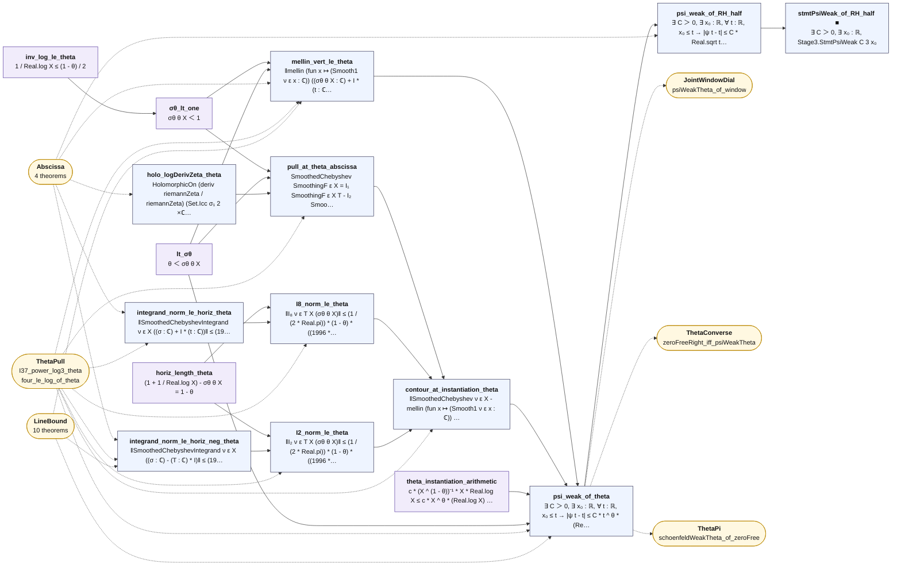

# `lean_stage3/Stage3/ThetaPsi.lean`

ThetaPsi — `|ψ(X) − X| ≤ C·X^θ·log³X` from a zero-free half-plane `re > θ`. WHAT THIS PORTS. The last stretch of `RHPull` (`LineBound.lean`):

16 theorems, 0 definitions, 653 lines. Arrows are Lean's own record of what each proof uses.

**Imports:** [`ThetaPull`](../lean_stage3/ThetaPull.md)  
**Imported by:** [`Stage3`](../lean_stage3/Stage3.md), [`ThetaPi`](../lean_stage3/ThetaPi.md)

## The picture



An arrow A → B reads "A is used in the proof of B". Green: counting, integers only. Violet: shape, analysis with no ζ. Blue: reads ζ. A name ending in ■ is an end: nothing else uses it. Red: contains `sorry`. Yellow: theorems in another file, counted; a dotted arrow crosses files. Definitions are not drawn; they are listed below the diagram.

## Theorems

<a name="Stage3-inv_log_le_theta"></a>
### `Stage3.inv_log_le_theta`

line 63

**Shape.** Uses real or complex analysis; nothing in it or beneath it reads ζ.

**Why.** If `θ < 1` and `2/(1 − θ) ≤ log X`, then `1/log X ≤ (1 − θ)/2`.

**Proves**

```lean
1 / Real.log X ≤ (1 - θ) / 2
```

**Needs** (its hypotheses)

  - `` hθhi : θ < 1 ``
  - `` hLX : 2 / (1 - θ) ≤ Real.log X ``

**Fed by:** no theorem of this repo; it stands on Mathlib.

**Feeds** (1 that use it)

  - [`Stage3.σθ_lt_one`](#Stage3---_lt_one) — `` σθ θ X < 1 ``

<a name="Stage3---_lt_one"></a>
### `Stage3.σθ_lt_one`

line 74

**Shape.** Uses real or complex analysis; nothing in it or beneath it reads ζ.

**Why.** If `θ < 1` and `2/(1 − θ) ≤ log X`, then the abscissa `σθ θ X = θ + 1/log X` is below `1`.

**Proves**

```lean
σθ θ X < 1
```

**Needs** (its hypotheses)

  - `` hθhi : θ < 1 ``
  - `` hLX : 2 / (1 - θ) ≤ Real.log X ``

**Stated with:** [`Stage3.σθ`](../lean_stage3/Abscissa.md#Stage3---)

**Fed by** (1 theorem its proof uses)

  - [`Stage3.inv_log_le_theta`](#Stage3-inv_log_le_theta) — `` 1 / Real.log X ≤ (1 - θ) / 2 ``

**Feeds** (2 that use it)

  - [`Stage3.mellin_vert_le_theta`](#Stage3-mellin_vert_le_theta) — `` ‖mellin (fun x ↦ (Smooth1 ν ε x : ℂ)) ((σθ θ X : ℂ) + I * (t : ℂ))‖ ≤ B * ‖((σθ θ X : ℂ)) + I * (t : ℂ)‖⁻¹ ``
  - [`Stage3.pull_at_theta_abscissa`](#Stage3-pull_at_theta_abscissa) — `` SmoothedChebyshev SmoothingF ε X = I₁ SmoothingF ε X T - I₂ SmoothingF ε T X (σθ θ X) + I₃₇ SmoothingF ε T X (σθ θ X) + I₈ SmoothingF ε T X (σθ θ X) +… ``

<a name="Stage3-lt_--"></a>
### `Stage3.lt_σθ`

line 80

**Shape.** Uses real or complex analysis; nothing in it or beneath it reads ζ.

**Why.** If `0 < log X`, then `θ` is strictly below the abscissa `σθ θ X = θ + 1/log X`.

**Proves**

```lean
θ < σθ θ X
```

**Needs** (its hypotheses)

  - `` hLX : 0 < Real.log X ``

**Stated with:** [`Stage3.σθ`](../lean_stage3/Abscissa.md#Stage3---)

**Fed by:** no theorem of this repo; it stands on Mathlib and the definitions below.

**Feeds** (3 that use it)

  - [`Stage3.mellin_vert_le_theta`](#Stage3-mellin_vert_le_theta) — `` ‖mellin (fun x ↦ (Smooth1 ν ε x : ℂ)) ((σθ θ X : ℂ) + I * (t : ℂ))‖ ≤ B * ‖((σθ θ X : ℂ)) + I * (t : ℂ)‖⁻¹ ``
  - [`Stage3.psi_weak_of_theta`](#Stage3-psi_weak_of_theta) — `` ∃ C > 0, ∃ x₀ : ℝ, ∀ t : ℝ, x₀ ≤ t → |ψ t - t| ≤ C * t ^ θ * (Real.log t) ^ 3 ``
  - [`Stage3.pull_at_theta_abscissa`](#Stage3-pull_at_theta_abscissa) — `` SmoothedChebyshev SmoothingF ε X = I₁ SmoothingF ε X T - I₂ SmoothingF ε T X (σθ θ X) + I₃₇ SmoothingF ε T X (σθ θ X) + I₈ SmoothingF ε T X (σθ θ X) +… ``

<a name="Stage3-horiz_length_theta"></a>
### `Stage3.horiz_length_theta`

line 85

**Shape.** Uses real or complex analysis; nothing in it or beneath it reads ζ.

**Why.** The horizontal segment has length exactly `1 − θ`.

**Proves**

```lean
(1 + 1 / Real.log X) - σθ θ X = 1 - θ
```

**Needs** (its hypotheses)

  - `` θ X : ℝ ``

**Stated with:** [`Stage3.σθ`](../lean_stage3/Abscissa.md#Stage3---)

**Fed by:** no theorem of this repo; it stands on Mathlib and the definitions below.

**Feeds** (2 that use it)

  - [`Stage3.I2_norm_le_theta`](#Stage3-I2_norm_le_theta) — `` ‖I₂ ν ε T X (σθ θ X)‖ ≤ (1 / (2 * Real.pi)) * (1 - θ) * ((1996 * Real.log (84 * T) + (29 * Real.log T + 129) * Real.log X) * M * X ^ (1 + 1 / Real.log… ``
  - [`Stage3.I8_norm_le_theta`](#Stage3-I8_norm_le_theta) — `` ‖I₈ ν ε T X (σθ θ X)‖ ≤ (1 / (2 * Real.pi)) * (1 - θ) * ((1996 * Real.log (84 * T) + (29 * Real.log T + 129) * Real.log X) * M * X ^ (1 + 1 / Real.log… ``

<a name="Stage3-holo_logDerivZeta_theta"></a>
### `Stage3.holo_logDerivZeta_theta`

line 91

**Reads ζ.** It, or something it rests on, uses the zeta function, its zeros or the Riemann hypothesis.

**Why.** The holomorphy hypothesis is free right of a zero-free abscissa.

**Proves**

```lean
HolomorphicOn (deriv riemannZeta / riemannZeta) (Set.Icc σ₁ 2 ×ℂ Set.Icc (-T) T \ {1})
```

**Needs** (its hypotheses)

  - `` hθ : StmtZeroFreeRight θ ``
  - `` hσ : θ < σ₁ ``

**Stated with:** [`Stage3.StmtZeroFreeRight`](../lean_stage3/Abscissa.md#Stage3-StmtZeroFreeRight)

**Fed by** (1 theorem its proof uses)

  - [`Stage3.zeta_ne_zero_right_of`](../lean_stage3/Abscissa.md#Stage3-zeta_ne_zero_right_of) (Abscissa) — `` ζ s ≠ 0 ``

**Feeds** (1 that use it)

  - [`Stage3.pull_at_theta_abscissa`](#Stage3-pull_at_theta_abscissa) — `` SmoothedChebyshev SmoothingF ε X = I₁ SmoothingF ε X T - I₂ SmoothingF ε T X (σθ θ X) + I₃₇ SmoothingF ε T X (σθ θ X) + I₈ SmoothingF ε T X (σθ θ X) +… ``

<a name="Stage3-pull_at_theta_abscissa"></a>
### `Stage3.pull_at_theta_abscissa`

line 106

**Reads ζ.** It, or something it rests on, uses the zeta function, its zeros or the Riemann hypothesis.

**Why.** The pull, instantiated at abscissa `θ`. `RHPull.pull_at_RH_abscissa` with `σθ θ X` for `σRH X`.

**Proves**

```lean
SmoothedChebyshev SmoothingF ε X = I₁ SmoothingF ε X T - I₂ SmoothingF ε T X (σθ θ X) + I₃₇ SmoothingF ε T X (σθ θ X) + I₈ SmoothingF ε T X (σθ θ X) + I₉ SmoothingF ε X T + mellin (fun x ↦ (Smooth1 SmoothingF ε x : ℂ)) 1 * X
```

**Needs** (its hypotheses)

  - `` hθ : StmtZeroFreeRight θ ``
  - `` hθlo : 1/2 ≤ θ ``
  - `` hθhi : θ < 1 ``
  - `` ε_pos : 0 < ε ``
  - `` ε_lt_one : ε < 1 ``
  - `` X : ℝ ``
  - `` X_gt : 3 < X ``
  - `` T_pos : 0 < T ``
  - `` hLX : 2 / (1 - θ) ≤ Real.log X ``
  - `` suppSmoothingF : Function.support SmoothingF ⊆ Set.Icc (1 / 2) 2 ``
  - `` SmoothingFnonneg : ∀ x > 0, 0 ≤ SmoothingF x ``
  - `` mass_one : ∫ x in Set.Ioi 0, SmoothingF x / x = 1 ``
  - `` ContDiffSmoothingF : ContDiff ℝ 1 SmoothingF ``

**Stated with:** [`Stage3.StmtZeroFreeRight`](../lean_stage3/Abscissa.md#Stage3-StmtZeroFreeRight), [`Stage3.σθ`](../lean_stage3/Abscissa.md#Stage3---)

**Fed by** (4 theorems its proof uses)

  - [`Stage3.holo_logDerivZeta_theta`](#Stage3-holo_logDerivZeta_theta) — `` HolomorphicOn (deriv riemannZeta / riemannZeta) (Set.Icc σ₁ 2 ×ℂ Set.Icc (-T) T \ {1}) ``
  - [`Stage3.lt_σθ`](#Stage3-lt_--) — `` θ < σθ θ X ``
  - [`Stage3.σθ_lt_one`](#Stage3---_lt_one) — `` σθ θ X < 1 ``
  - [`Stage3.four_le_log_of_theta`](../lean_stage3/ThetaPull.md#Stage3-four_le_log_of_theta) (ThetaPull) — `` (4:ℝ) ≤ Real.log X ``

**Feeds** (1 that use it)

  - [`Stage3.contour_at_instantiation_theta`](#Stage3-contour_at_instantiation_theta) — `` ‖SmoothedChebyshev ν ε X - mellin (fun x ↦ (Smooth1 ν ε x : ℂ)) 1 * X‖ ≤ B₁ + B₉ + (66600 * Real.exp 1 * B / Real.pi) * X ^ θ * (Real.log X) ^ 3 + (1 … ``

<a name="Stage3-integrand_norm_le_horiz_theta"></a>
### `Stage3.integrand_norm_le_horiz_theta`

line 134

**Reads ζ.** It, or something it rests on, uses the zeta function, its zeros or the Riemann hypothesis.

**Why.** Pointwise bound on the upper horizontal segment, from the crude bound at `θ`. Every numeral is `RHPull.integrand_norm_le_horiz`'s.

**Proves**

```lean
‖SmoothedChebyshevIntegrand ν ε X ((σ : ℂ) + I * (t : ℂ))‖ ≤ (1996 * Real.log (84 * t) + (29 * Real.log t + 129) * Real.log X) * M * X ^ σ
```

**Needs** (its hypotheses)

  - `` hθ : StmtZeroFreeRight θ ``
  - `` hθlo : 1/2 ≤ θ ``
  - `` hθhi : θ < 1 ``
  - `` hX : 0 < X ``
  - `` hLX : 2 / (1 - θ) ≤ Real.log X ``
  - `` ht : 2 ≤ t ``
  - `` hσlo : σθ θ X ≤ σ ``
  - `` hσhi : σ ≤ 1 + 1 / Real.log X ``
  - `` hMel : ‖mellin (fun x ↦ (Smooth1 ν ε x : ℂ)) ((σ : ℂ) + I * (t : ℂ))‖ ≤ M ``

**Stated with:** [`Stage3.StmtZeroFreeRight`](../lean_stage3/Abscissa.md#Stage3-StmtZeroFreeRight), [`Stage3.σθ`](../lean_stage3/Abscissa.md#Stage3---)

**Fed by** (2 theorems its proof uses)

  - [`Stage3.logDerivZeta_crude_theta`](../lean_stage3/Abscissa.md#Stage3-logDerivZeta_crude_theta) (Abscissa) — `` ‖deriv ζ ((σ₁ : ℂ) + I * (t : ℂ)) / ζ ((σ₁ : ℂ) + I * (t : ℂ))‖ ≤ 1996 * Real.log (84 * t) + (29 * Real.log t + 129) / (σ₁ - θ) ``
  - [`Stage3.four_le_log_of_theta`](../lean_stage3/ThetaPull.md#Stage3-four_le_log_of_theta) (ThetaPull) — `` (4:ℝ) ≤ Real.log X ``

**Feeds** (1 that use it)

  - [`Stage3.I8_norm_le_theta`](#Stage3-I8_norm_le_theta) — `` ‖I₈ ν ε T X (σθ θ X)‖ ≤ (1 / (2 * Real.pi)) * (1 - θ) * ((1996 * Real.log (84 * T) + (29 * Real.log T + 129) * Real.log X) * M * X ^ (1 + 1 / Real.log… ``

<a name="Stage3-integrand_norm_le_horiz_neg_theta"></a>
### `Stage3.integrand_norm_le_horiz_neg_theta`

line 181

**Reads ζ.** It, or something it rests on, uses the zeta function, its zeros or the Riemann hypothesis.

**Why.** Pointwise bound on the lower horizontal segment, through the conjugate symmetry `Slice4b.logDerivZeta_norm_neg`.

**Proves**

```lean
‖SmoothedChebyshevIntegrand ν ε X ((σ : ℂ) - (T : ℂ) * I)‖ ≤ (1996 * Real.log (84 * T) + (29 * Real.log T + 129) * Real.log X) * M * X ^ σ
```

**Needs** (its hypotheses)

  - `` hθ : StmtZeroFreeRight θ ``
  - `` hθlo : 1/2 ≤ θ ``
  - `` hθhi : θ < 1 ``
  - `` hX : 0 < X ``
  - `` hLX : 2 / (1 - θ) ≤ Real.log X ``
  - `` hT : 2 ≤ T ``
  - `` hσlo : σθ θ X ≤ σ ``
  - `` hσhi : σ ≤ 1 + 1 / Real.log X ``
  - `` hMel : ‖mellin (fun x ↦ (Smooth1 ν ε x : ℂ)) ((σ : ℂ) - (T : ℂ) * I)‖ ≤ M ``

**Stated with:** [`Stage3.StmtZeroFreeRight`](../lean_stage3/Abscissa.md#Stage3-StmtZeroFreeRight), [`Stage3.σθ`](../lean_stage3/Abscissa.md#Stage3---)

**Fed by** (3 theorems its proof uses)

  - [`Stage3.logDerivZeta_crude_theta`](../lean_stage3/Abscissa.md#Stage3-logDerivZeta_crude_theta) (Abscissa) — `` ‖deriv ζ ((σ₁ : ℂ) + I * (t : ℂ)) / ζ ((σ₁ : ℂ) + I * (t : ℂ))‖ ≤ 1996 * Real.log (84 * t) + (29 * Real.log t + 129) / (σ₁ - θ) ``
  - [`Slice4b.logDerivZeta_norm_neg`](../lean_stage3/LineBound.md#Slice4b-logDerivZeta_norm_neg) (LineBound) — `` ‖deriv ζ ((σ : ℂ) + I * ((-t : ℝ) : ℂ)) / ζ ((σ : ℂ) + I * ((-t : ℝ) : ℂ))‖ = ‖deriv ζ ((σ : ℂ) + I * (t : ℂ)) / ζ ((σ : ℂ) + I * (t : ℂ))‖ ``
  - [`Stage3.four_le_log_of_theta`](../lean_stage3/ThetaPull.md#Stage3-four_le_log_of_theta) (ThetaPull) — `` (4:ℝ) ≤ Real.log X ``

**Feeds** (1 that use it)

  - [`Stage3.I2_norm_le_theta`](#Stage3-I2_norm_le_theta) — `` ‖I₂ ν ε T X (σθ θ X)‖ ≤ (1 / (2 * Real.pi)) * (1 - θ) * ((1996 * Real.log (84 * T) + (29 * Real.log T + 129) * Real.log X) * M * X ^ (1 + 1 / Real.log… ``

<a name="Stage3-I8_norm_le_theta"></a>
### `Stage3.I8_norm_le_theta`

line 230

**Reads ζ.** It, or something it rests on, uses the zeta function, its zeros or the Riemann hypothesis.

**Why.** I₈ bounded at abscissa `θ` — the upper horizontal segment, length `1 − θ`.

**Proves**

```lean
‖I₈ ν ε T X (σθ θ X)‖ ≤ (1 / (2 * Real.pi)) * (1 - θ) * ((1996 * Real.log (84 * T) + (29 * Real.log T + 129) * Real.log X) * M * X ^ (1 + 1 / Real.log X))
```

**Needs** (its hypotheses)

  - `` hθ : StmtZeroFreeRight θ ``
  - `` hθlo : 1/2 ≤ θ ``
  - `` hθhi : θ < 1 ``
  - `` hX : 0 < X ``
  - `` hLX : 2 / (1 - θ) ≤ Real.log X ``
  - `` hT : 2 ≤ T ``
  - `` hMel : ∀ σ : ℝ, σθ θ X ≤ σ → σ ≤ 1 + 1 / Real.log X → ‖mellin (fun x ↦ (Smooth1 ν ε x : ℂ)) ((σ : ℂ) + I * (T : ℂ))‖ ≤ M ``

**Stated with:** [`Stage3.StmtZeroFreeRight`](../lean_stage3/Abscissa.md#Stage3-StmtZeroFreeRight), [`Stage3.σθ`](../lean_stage3/Abscissa.md#Stage3---)

**Fed by** (3 theorems its proof uses)

  - [`Stage3.horiz_length_theta`](#Stage3-horiz_length_theta) — `` (1 + 1 / Real.log X) - σθ θ X = 1 - θ ``
  - [`Stage3.integrand_norm_le_horiz_theta`](#Stage3-integrand_norm_le_horiz_theta) — `` ‖SmoothedChebyshevIntegrand ν ε X ((σ : ℂ) + I * (t : ℂ))‖ ≤ (1996 * Real.log (84 * t) + (29 * Real.log t + 129) * Real.log X) * M * X ^ σ ``
  - [`Stage3.four_le_log_of_theta`](../lean_stage3/ThetaPull.md#Stage3-four_le_log_of_theta) (ThetaPull) — `` (4:ℝ) ≤ Real.log X ``

**Feeds** (1 that use it)

  - [`Stage3.contour_at_instantiation_theta`](#Stage3-contour_at_instantiation_theta) — `` ‖SmoothedChebyshev ν ε X - mellin (fun x ↦ (Smooth1 ν ε x : ℂ)) 1 * X‖ ≤ B₁ + B₉ + (66600 * Real.exp 1 * B / Real.pi) * X ^ θ * (Real.log X) ^ 3 + (1 … ``

<a name="Stage3-I2_norm_le_theta"></a>
### `Stage3.I2_norm_le_theta`

line 285

**Reads ζ.** It, or something it rests on, uses the zeta function, its zeros or the Riemann hypothesis.

**Why.** I₂ bounded at abscissa `θ` — the lower horizontal segment, length `1 − θ`.

**Proves**

```lean
‖I₂ ν ε T X (σθ θ X)‖ ≤ (1 / (2 * Real.pi)) * (1 - θ) * ((1996 * Real.log (84 * T) + (29 * Real.log T + 129) * Real.log X) * M * X ^ (1 + 1 / Real.log X))
```

**Needs** (its hypotheses)

  - `` hθ : StmtZeroFreeRight θ ``
  - `` hθlo : 1/2 ≤ θ ``
  - `` hθhi : θ < 1 ``
  - `` hX : 0 < X ``
  - `` hLX : 2 / (1 - θ) ≤ Real.log X ``
  - `` hT : 2 ≤ T ``
  - `` hMel : ∀ σ : ℝ, σθ θ X ≤ σ → σ ≤ 1 + 1 / Real.log X → ‖mellin (fun x ↦ (Smooth1 ν ε x : ℂ)) ((σ : ℂ) - (T : ℂ) * I)‖ ≤ M ``

**Stated with:** [`Stage3.StmtZeroFreeRight`](../lean_stage3/Abscissa.md#Stage3-StmtZeroFreeRight), [`Stage3.σθ`](../lean_stage3/Abscissa.md#Stage3---)

**Fed by** (3 theorems its proof uses)

  - [`Stage3.horiz_length_theta`](#Stage3-horiz_length_theta) — `` (1 + 1 / Real.log X) - σθ θ X = 1 - θ ``
  - [`Stage3.integrand_norm_le_horiz_neg_theta`](#Stage3-integrand_norm_le_horiz_neg_theta) — `` ‖SmoothedChebyshevIntegrand ν ε X ((σ : ℂ) - (T : ℂ) * I)‖ ≤ (1996 * Real.log (84 * T) + (29 * Real.log T + 129) * Real.log X) * M * X ^ σ ``
  - [`Stage3.four_le_log_of_theta`](../lean_stage3/ThetaPull.md#Stage3-four_le_log_of_theta) (ThetaPull) — `` (4:ℝ) ≤ Real.log X ``

**Feeds** (1 that use it)

  - [`Stage3.contour_at_instantiation_theta`](#Stage3-contour_at_instantiation_theta) — `` ‖SmoothedChebyshev ν ε X - mellin (fun x ↦ (Smooth1 ν ε x : ℂ)) 1 * X‖ ≤ B₁ + B₉ + (66600 * Real.exp 1 * B / Real.pi) * X ^ θ * (Real.log X) ^ 3 + (1 … ``

<a name="Stage3-mellin_vert_le_theta"></a>
### `Stage3.mellin_vert_le_theta`

line 343

**Reads ζ.** It, or something it rests on, uses the zeta function, its zeros or the Riemann hypothesis.

**Why.** For `1/2 ≤ θ < 1`, a `C¹` bump `ν` supported in `[1/2, 2]` whose Mellin transform is bounded by `B` on `0 < Re w ≤ 2`, `0 < ε < 1` and `2/(1 − θ) ≤ log X`: the Mellin transform of the smoothed bump at the point `s = σθ θ X + i·t` of the line has norm at most `B·‖s‖⁻¹`.

**Proves**

```lean
‖mellin (fun x ↦ (Smooth1 ν ε x : ℂ)) ((σθ θ X : ℂ) + I * (t : ℂ))‖ ≤ B * ‖((σθ θ X : ℂ)) + I * (t : ℂ)‖⁻¹
```

**Needs** (its hypotheses)

  - `` hθlo : 1/2 ≤ θ ``
  - `` hθhi : θ < 1 ``
  - `` diffν : ContDiff ℝ 1 ν ``
  - `` suppν : ν.support ⊆ Set.Icc (1/2 : ℝ) 2 ``
  - `` hB : ∀ w : ℂ, 0 < w.re → w.re ≤ 2 → ‖mellin (fun x ↦ (ν x : ℂ)) w‖ ≤ B ``
  - `` hε : 0 < ε ``
  - `` hε1 : ε < 1 ``
  - `` hLX : 2 / (1 - θ) ≤ Real.log X ``
  - `` t : ℝ ``

**Stated with:** [`Stage3.σθ`](../lean_stage3/Abscissa.md#Stage3---)

**Fed by** (5 theorems its proof uses)

  - [`Stage3.σθ_re`](../lean_stage3/Abscissa.md#Stage3---_re) (Abscissa) — `` ((σθ θ X : ℂ) + I * (t : ℂ)).re = σθ θ X ``
  - [`RHPull.mellin_smooth1_le`](../lean_stage3/LineBound.md#RHPull-mellin_smooth1_le) (LineBound) — `` ‖mellin (fun x ↦ (Smooth1 ν ε x : ℂ)) s‖ ≤ B * ‖s‖⁻¹ ``
  - [`Stage3.lt_σθ`](#Stage3-lt_--) — `` θ < σθ θ X ``
  - [`Stage3.σθ_lt_one`](#Stage3---_lt_one) — `` σθ θ X < 1 ``
  - [`Stage3.four_le_log_of_theta`](../lean_stage3/ThetaPull.md#Stage3-four_le_log_of_theta) (ThetaPull) — `` (4:ℝ) ≤ Real.log X ``

**Feeds** (1 that use it)

  - [`Stage3.psi_weak_of_theta`](#Stage3-psi_weak_of_theta) — `` ∃ C > 0, ∃ x₀ : ℝ, ∀ t : ℝ, x₀ ≤ t → |ψ t - t| ≤ C * t ^ θ * (Real.log t) ^ 3 ``

<a name="Stage3-contour_at_instantiation_theta"></a>
### `Stage3.contour_at_instantiation_theta`

line 365

**Reads ζ.** It, or something it rests on, uses the zeta function, its zeros or the Riemann hypothesis.

**Why.** Every contour piece summed at abscissa `θ`. `RHPull.contour_at_instantiation` with `X^θ` for `√X` on the vertical piece and `1 − θ` for `1/2` on the horizontal lengths.

**Proves**

```lean
‖SmoothedChebyshev ν ε X - mellin (fun x ↦ (Smooth1 ν ε x : ℂ)) 1 * X‖ ≤ B₁ + B₉ + (66600 * Real.exp 1 * B / Real.pi) * X ^ θ * (Real.log X) ^ 3 + (1 / (2 * Real.pi)) * (1 - θ) * ((1996 * Real.log (84 * T) + (29 * Real.log T + 129) * Real.log X) * M₈ * X ^ (1 + 1 / Real.log X)) + (1 / (2 * Real.pi)) * (1 - θ) * ((1996 * Real.log (84 * T) + (29 * Real.log T + 129) * Real.log X) * M₂ * X ^ (1 + 1 / Real.log X))
```

**Needs** (its hypotheses)

  - `` hθ : StmtZeroFreeRight θ ``
  - `` hθlo : 1/2 ≤ θ ``
  - `` hθhi : θ < 1 ``
  - `` ε_pos : 0 < ε ``
  - `` ε_lt_one : ε < 1 ``
  - `` X_gt : 3 < X ``
  - `` hX : 0 < X ``
  - `` hLX : 2 / (1 - θ) ≤ Real.log X ``
  - `` hT2 : 2 ≤ T ``
  - `` hTX : T ≤ X ``
  - `` hB : 0 ≤ B ``
  - `` suppν : Function.support ν ⊆ Set.Icc (1 / 2) 2 ``
  - `` νnonneg : ∀ x > 0, 0 ≤ ν x ``
  - `` mass_one : ∫ x in Set.Ioi 0, ν x / x = 1 ``
  - `` diffν : ContDiff ℝ 1 ν ``
  - `` hB1 : ‖I₁ ν ε X T‖ ≤ B₁ ``
  - `` hB9 : ‖I₉ ν ε X T‖ ≤ B₉ ``
  - `` hMel37 : ∀ t : ℝ, ‖mellin (fun x ↦ (Smooth1 ν ε x : ℂ)) ((σθ θ X : ℂ) + I * (t : ℂ))‖ ≤ B * ‖((σθ θ X : ℂ)) + I * (t : ℂ)‖⁻¹ ``
  - `` hMel8 : ∀ σ : ℝ, σθ θ X ≤ σ → σ ≤ 1 + 1 / Real.log X → ‖mellin (fun x ↦ (Smooth1 ν ε x : ℂ)) ((σ : ℂ) + I * (T : ℂ))‖ ≤ M₈ ``
  - `` hMel2 : ∀ σ : ℝ, σθ θ X ≤ σ → σ ≤ 1 + 1 / Real.log X → ‖mellin (fun x ↦ (Smooth1 ν ε x : ℂ)) ((σ : ℂ) - (T : ℂ) * I)‖ ≤ M₂ ``

**Stated with:** [`Stage3.StmtZeroFreeRight`](../lean_stage3/Abscissa.md#Stage3-StmtZeroFreeRight), [`Stage3.σθ`](../lean_stage3/Abscissa.md#Stage3---)

**Fed by** (4 theorems its proof uses)

  - [`Stage3.I2_norm_le_theta`](#Stage3-I2_norm_le_theta) — `` ‖I₂ ν ε T X (σθ θ X)‖ ≤ (1 / (2 * Real.pi)) * (1 - θ) * ((1996 * Real.log (84 * T) + (29 * Real.log T + 129) * Real.log X) * M * X ^ (1 + 1 / Real.log… ``
  - [`Stage3.I8_norm_le_theta`](#Stage3-I8_norm_le_theta) — `` ‖I₈ ν ε T X (σθ θ X)‖ ≤ (1 / (2 * Real.pi)) * (1 - θ) * ((1996 * Real.log (84 * T) + (29 * Real.log T + 129) * Real.log X) * M * X ^ (1 + 1 / Real.log… ``
  - [`Stage3.pull_at_theta_abscissa`](#Stage3-pull_at_theta_abscissa) — `` SmoothedChebyshev SmoothingF ε X = I₁ SmoothingF ε X T - I₂ SmoothingF ε T X (σθ θ X) + I₃₇ SmoothingF ε T X (σθ θ X) + I₈ SmoothingF ε T X (σθ θ X) +… ``
  - [`Stage3.I37_power_log3_theta`](../lean_stage3/ThetaPull.md#Stage3-I37_power_log3_theta) (ThetaPull) — `` ‖I₃₇ ν ε T X (σθ θ X)‖ ≤ (66600 * Real.exp 1 * B / Real.pi) * X ^ θ * (Real.log X) ^ 3 ``

**Feeds** (1 that use it)

  - [`Stage3.psi_weak_of_theta`](#Stage3-psi_weak_of_theta) — `` ∃ C > 0, ∃ x₀ : ℝ, ∀ t : ℝ, x₀ ≤ t → |ψ t - t| ≤ C * t ^ θ * (Real.log t) ^ 3 ``

<a name="Stage3-theta_instantiation_arithmetic"></a>
### `Stage3.theta_instantiation_arithmetic`

line 421

**Shape.** Uses real or complex analysis; nothing in it or beneath it reads ζ.

**Why.** The instantiation arithmetic at `θ`. With `ε = X^(θ−1)` and `T = X`, `ε·X = X^θ`, and every error piece lands under `c·X^θ·log³X`:

**Proves**

```lean
c * (X ^ (1 - θ))⁻¹ * X * Real.log X ≤ c * X ^ θ * (Real.log X) ^ 3 ∧ c * X * Real.log X / ((X ^ (1 - θ))⁻¹ * X) ≤ c * X ^ θ * (Real.log X) ^ 3 ∧ c * ((X ^ (1 - θ))⁻¹ * X) ≤ c * X ^ θ * (Real.log X) ^ 3
```

**Needs** (its hypotheses)

  - `` hX1 : 1 < X ``
  - `` hθlo : 1/2 ≤ θ ``
  - `` hθhi : θ ≤ 1 ``
  - `` hLX : 1 ≤ Real.log X ``
  - `` hc : 0 ≤ c ``

**Fed by:** no theorem of this repo; it stands on Mathlib.

**Feeds** (1 that use it)

  - [`Stage3.psi_weak_of_theta`](#Stage3-psi_weak_of_theta) — `` ∃ C > 0, ∃ x₀ : ℝ, ∀ t : ℝ, x₀ ≤ t → |ψ t - t| ≤ C * t ^ θ * (Real.log t) ^ 3 ``

<a name="Stage3-psi_weak_of_theta"></a>
### `Stage3.psi_weak_of_theta`

line 460

**Reads ζ.** It, or something it rests on, uses the zeta function, its zeros or the Riemann hypothesis.

**Why.** `|ψ X − X| ≤ C·X^θ·log³X` from a zero-free half-plane `re > θ`. `RHPull.psi_weak_of_RH` with `StmtZeroFreeRight θ` for RH, `ε = X^(θ−1)` for `X^(−1/2)`, `T = X` as before. Every constant is obtained: `B` from `mellin_bump_bounded`, `Cclose` from `SmoothedChebyshevClose`, `C₁`/`C₉` from `I1Bound`/`I9Bound`, `Cmain` from `MellinOfSmooth1c`.

**Proves**

```lean
∃ C > 0, ∃ x₀ : ℝ, ∀ t : ℝ, x₀ ≤ t → |ψ t - t| ≤ C * t ^ θ * (Real.log t) ^ 3
```

**Needs** (its hypotheses)

  - `` hθ : StmtZeroFreeRight θ ``
  - `` hθlo : 1/2 ≤ θ ``
  - `` hθhi : θ < 1 ``

**Stated with:** [`Stage3.StmtZeroFreeRight`](../lean_stage3/Abscissa.md#Stage3-StmtZeroFreeRight)

**Fed by** (13 theorems its proof uses)

  - [`RHPull.bump_exists`](../lean_stage3/LineBound.md#RHPull-bump_exists) (LineBound) — `` ∃ ν : ℝ → ℝ, ContDiff ℝ 1 ν ∧ (∀ x > 0, 0 ≤ ν x) ∧ ν.support ⊆ Set.Icc (1/2 : ℝ) 2 ∧ ∫ x in Set.Ioi (0:ℝ), ν x / x = 1 ``
  - [`RHPull.horiz_small`](../lean_stage3/LineBound.md#RHPull-horiz_small) (LineBound) — `` (1 / (2 * Real.pi)) * (1 / 2) * ((1996 * Real.log (84 * X) + (29 * Real.log X + 129) * Real.log X) * (B / X) * (Real.exp 1 * X)) ≤ (900 * Real.exp 1 *… ``
  - [`RHPull.mellin_bump_bounded`](../lean_stage3/LineBound.md#RHPull-mellin_bump_bounded) (LineBound) — `` ∃ B > 0, ∀ w : ℂ, 0 < w.re → w.re ≤ 2 → ‖mellin (fun x ↦ (ν x : ℂ)) w‖ ≤ B ``
  - [`RHPull.mellin_horiz_le`](../lean_stage3/LineBound.md#RHPull-mellin_horiz_le) (LineBound) — `` ‖mellin (fun x ↦ (Smooth1 ν ε x : ℂ)) ((σ : ℂ) + I * (T : ℂ))‖ ≤ B / T ``
  - [`RHPull.mellin_horiz_le_neg`](../lean_stage3/LineBound.md#RHPull-mellin_horiz_le_neg) (LineBound) — `` ‖mellin (fun x ↦ (Smooth1 ν ε x : ℂ)) ((σ : ℂ) - (T : ℂ) * I)‖ ≤ B / T ``
  - [`RHPull.mellin_main_const`](../lean_stage3/LineBound.md#RHPull-mellin_main_const) (LineBound) — `` ∃ Cmain > 0, ∃ ε₀ > 0, ∀ ε : ℝ, 0 < ε → ε < ε₀ → ‖mellin (fun x ↦ (Smooth1 ν ε x : ℂ)) 1 - 1‖ ≤ Cmain * ε ``
  - [`RHPull.psi_sub_self_le`](../lean_stage3/LineBound.md#RHPull-psi_sub_self_le) (LineBound) — `` |ψ X - X| ≤ E₁ + E₂ + E₃ ``
  - [`RHPull.rpow_one_add`](../lean_stage3/LineBound.md#RHPull-rpow_one_add) (LineBound) — `` X ^ (1 + 1 / Real.log X) = Real.exp 1 * X ``
  - [`Stage3.contour_at_instantiation_theta`](#Stage3-contour_at_instantiation_theta) — `` ‖SmoothedChebyshev ν ε X - mellin (fun x ↦ (Smooth1 ν ε x : ℂ)) 1 * X‖ ≤ B₁ + B₉ + (66600 * Real.exp 1 * B / Real.pi) * X ^ θ * (Real.log X) ^ 3 + (1 … ``
  - [`Stage3.lt_σθ`](#Stage3-lt_--) — `` θ < σθ θ X ``
  - [`Stage3.mellin_vert_le_theta`](#Stage3-mellin_vert_le_theta) — `` ‖mellin (fun x ↦ (Smooth1 ν ε x : ℂ)) ((σθ θ X : ℂ) + I * (t : ℂ))‖ ≤ B * ‖((σθ θ X : ℂ)) + I * (t : ℂ)‖⁻¹ ``
  - [`Stage3.theta_instantiation_arithmetic`](#Stage3-theta_instantiation_arithmetic) — `` c * (X ^ (1 - θ))⁻¹ * X * Real.log X ≤ c * X ^ θ * (Real.log X) ^ 3 ∧ c * X * Real.log X / ((X ^ (1 - θ))⁻¹ * X) ≤ c * X ^ θ * (Real.log X) ^ 3 ∧ c * … ``
  - [`Stage3.four_le_log_of_theta`](../lean_stage3/ThetaPull.md#Stage3-four_le_log_of_theta) (ThetaPull) — `` (4:ℝ) ≤ Real.log X ``

**Definitions its proof touches:** [`Stage3.σθ`](../lean_stage3/Abscissa.md#Stage3---)

**Feeds** (4 that use it)

  - [`JointWindowDial.psiWeakTheta_of_window`](../lean_stage3/JointWindowDial.md#JointWindowDial-psiWeakTheta_of_window) (JointWindowDial) — `` ∃ C' > 0, ∃ x₀ : ℝ, ∀ t : ℝ, x₀ ≤ t → |Chebyshev.psi t - t| ≤ C' * t ^ θ * Real.log t ^ 3 ``
  - [`Stage3.zeroFreeRight_iff_psiWeakTheta`](../lean_stage3/ThetaConverse.md#Stage3-zeroFreeRight_iff_psiWeakTheta) (ThetaConverse) — `` StmtZeroFreeRight θ ↔ ∃ C > 0, ∃ x₀ : ℝ, StmtPsiWeakTheta θ C 3 x₀ ``
  - [`Stage3.schoenfeldWeakTheta_of_zeroFree`](../lean_stage3/ThetaPi.md#Stage3-schoenfeldWeakTheta_of_zeroFree) (ThetaPi) — `` ∃ C > 0, ∃ x₀ : ℝ, StmtSchoenfeldWeakTheta θ C 2 x₀ (fun x => (Nat.primeCounting ⌊x⌋₊ : ℝ)) Li ``
  - [`Stage3.psi_weak_of_RH_half`](#Stage3-psi_weak_of_RH_half) — `` ∃ C > 0, ∃ x₀ : ℝ, ∀ t : ℝ, x₀ ≤ t → |ψ t - t| ≤ C * Real.sqrt t * (Real.log t) ^ 3 ``

<a name="Stage3-psi_weak_of_RH_half"></a>
### `Stage3.psi_weak_of_RH_half`

line 613

**Reads ζ.** It, or something it rests on, uses the zeta function, its zeros or the Riemann hypothesis.

**Why.** `psi_weak_of_RH` recovered. At `θ = 1/2` under RH, the general bound is `RHPull.psi_weak_of_RH`'s statement, `√t` included.

**Proves**

```lean
∃ C > 0, ∃ x₀ : ℝ, ∀ t : ℝ, x₀ ≤ t → |ψ t - t| ≤ C * Real.sqrt t * (Real.log t) ^ 3
```

**Needs** (its hypotheses)

  - `` hRH : RiemannHypothesis ``

**Fed by** (2 theorems its proof uses)

  - [`Stage3.zeroFreeRight_of_RH`](../lean_stage3/Abscissa.md#Stage3-zeroFreeRight_of_RH) (Abscissa) — `` StmtZeroFreeRight (1/2) ``
  - [`Stage3.psi_weak_of_theta`](#Stage3-psi_weak_of_theta) — `` ∃ C > 0, ∃ x₀ : ℝ, ∀ t : ℝ, x₀ ≤ t → |ψ t - t| ≤ C * t ^ θ * (Real.log t) ^ 3 ``

**Feeds** (1 that use it)

  - [`Stage3.stmtPsiWeak_of_RH_half`](#Stage3-stmtPsiWeak_of_RH_half) — `` ∃ C > 0, ∃ x₀ : ℝ, Stage3.StmtPsiWeak C 3 x₀ ``

<a name="Stage3-stmtPsiWeak_of_RH_half"></a>
### `Stage3.stmtPsiWeak_of_RH_half`

line 624

**Reads ζ.** It, or something it rests on, uses the zeta function, its zeros or the Riemann hypothesis.

**Why.** `StmtPsiWeak` at `k = 3` from RH, through the `θ`-dial. Same statement as `RHPull.stmtPsiWeak_of_RH`.

**Proves**

```lean
∃ C > 0, ∃ x₀ : ℝ, Stage3.StmtPsiWeak C 3 x₀
```

**Needs** (its hypotheses)

  - `` hRH : RiemannHypothesis ``

**Stated with:** [`Stage3.StmtPsiWeak`](../lean_stage3/PsiToPi.md#Stage3-StmtPsiWeak)

**Fed by** (1 theorem its proof uses)

  - [`Stage3.psi_weak_of_RH_half`](#Stage3-psi_weak_of_RH_half) — `` ∃ C > 0, ∃ x₀ : ℝ, ∀ t : ℝ, x₀ ≤ t → |ψ t - t| ≤ C * Real.sqrt t * (Real.log t) ^ 3 ``

**Feeds:** nothing. It is an end.

