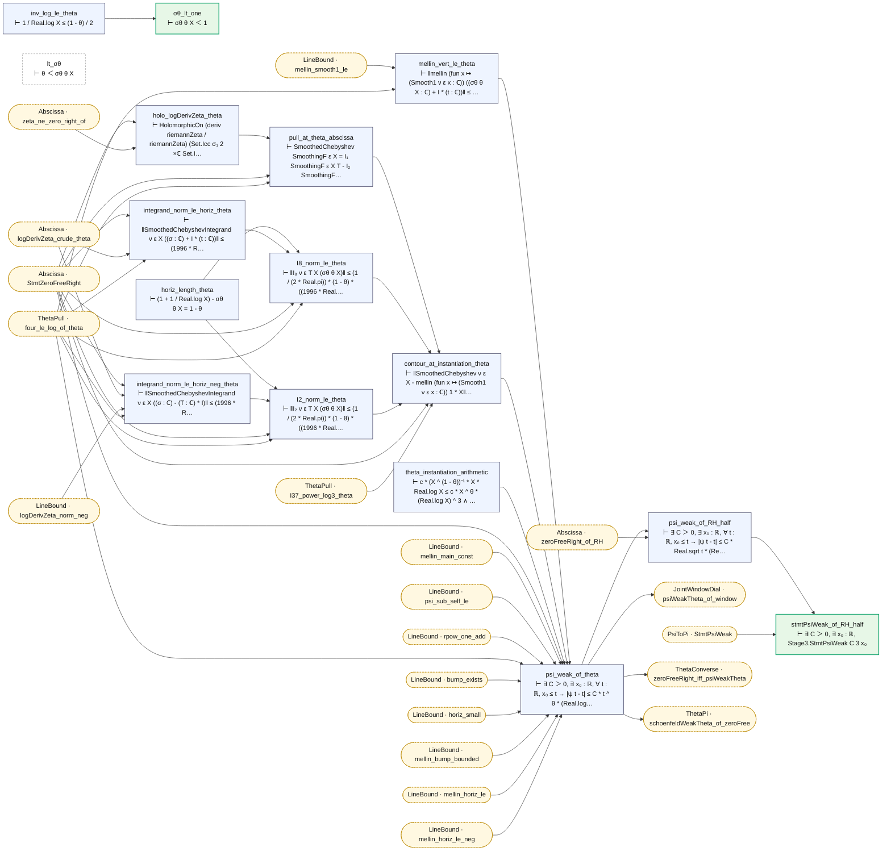

# `lean_stage3/Stage3/ThetaPsi.lean`

**What it does** (its own header): ThetaPsi — `|ψ(X) − X| ≤ C·X^θ·log³X` from a zero-free half-plane `re > θ`. WHAT THIS PORTS. The last stretch of `RHPull` (`LineBound.lean`):

**Imports:** [`ThetaPull`](../lean_stage3/ThetaPull.md).
**Imported by:** [`Stage3`](../lean_stage3/Stage3.md), [`ThetaPi`](../lean_stage3/ThetaPi.md).

Blue: theorem. Green: a theorem nothing else uses (an end). Dashed white: connects to nothing. Grey: definition. Red: contains `sorry`. Yellow: in another file. An arrow A → B reads "A is used by B".

## Every declaration

| declaration | proves (output) | needs (input) | why (its own docstring) | uses | used by |
|---|---|---|---|---|---|
| `Stage3.inv_log_le_theta` theorem, line 62 | 1 / Real.log X ≤ (1 - θ) / 2 | hθhi : θ &lt; 1; hLX : 2 / (1 - θ) ≤ Real.log X | — | — | `Stage3.σθ_lt_one` |
| `Stage3.σθ_lt_one` theorem, line 72 | σθ θ X &lt; 1 | hθhi : θ &lt; 1; hLX : 2 / (1 - θ) ≤ Real.log X | — | `Stage3.inv_log_le_theta` | — |
| `Stage3.lt_σθ` theorem, line 77 | θ &lt; σθ θ X | hLX : 0 &lt; Real.log X | — | — | — |
| `Stage3.horiz_length_theta` theorem, line 82 | (1 + 1 / Real.log X) - σθ θ X = 1 - θ | θ X : ℝ | The horizontal segment has length exactly `1 − θ`. | — | `Stage3.I2_norm_le_theta`, `Stage3.I8_norm_le_theta` |
| `Stage3.holo_logDerivZeta_theta` theorem, line 88 | HolomorphicOn (deriv riemannZeta / riemannZeta) (Set.Icc σ₁ 2 ×ℂ Set.Icc (-T) T \ {1}) | hθ : StmtZeroFreeRight θ; hσ : θ &lt; σ₁ | The holomorphy hypothesis is free right of a zero-free abscissa. | `Stage3.StmtZeroFreeRight`, `Stage3.zeta_ne_zero_right_of` | `Stage3.pull_at_theta_abscissa` |
| `Stage3.pull_at_theta_abscissa` theorem, line 103 | SmoothedChebyshev SmoothingF ε X = I₁ SmoothingF ε X T - I₂ SmoothingF ε T X (σθ θ X) + I₃₇ SmoothingF ε T X (σθ θ X) + I₈ SmoothingF ε T X (σθ θ X) + I₉ SmoothingF ε X T + mellin (fun x ↦ (Smooth1 SmoothingF ε x : ℂ)) 1 * X | hθ : StmtZeroFreeRight θ; hθlo : 1/2 ≤ θ; hθhi : θ &lt; 1; ε_pos : 0 &lt; ε; ε_lt_one : ε &lt; 1; X : ℝ; X_gt : 3 &lt; X; T_pos : 0 &lt; T; hLX : 2 / (1 - θ) ≤ Real.log X; suppSmoothingF : Function.support SmoothingF ⊆ Set.Icc (1 / 2) 2; SmoothingFnonneg : ∀ x &gt; 0, 0 ≤ SmoothingF x; mass_one : ∫ x in Set.Ioi 0, SmoothingF x / x = 1; ContDiffSmoothingF : ContDiff ℝ 1 SmoothingF | The pull, instantiated at abscissa `θ`. `RHPull.pull_at_RH_abscissa` with `σθ θ X` for `σRH X`. | `Stage3.StmtZeroFreeRight`, `Stage3.holo_logDerivZeta_theta`, `Stage3.four_le_log_of_theta` | `Stage3.contour_at_instantiation_theta` |
| `Stage3.integrand_norm_le_horiz_theta` theorem, line 131 | ‖SmoothedChebyshevIntegrand ν ε X ((σ : ℂ) + I * (t : ℂ))‖ ≤ (1996 * Real.log (84 * t) + (29 * Real.log t + 129) * Real.log X) * M * X ^ σ | hθ : StmtZeroFreeRight θ; hθlo : 1/2 ≤ θ; hθhi : θ &lt; 1; hX : 0 &lt; X; hLX : 2 / (1 - θ) ≤ Real.log X; ht : 2 ≤ t; hσlo : σθ θ X ≤ σ; hσhi : σ ≤ 1 + 1 / Real.log X; hMel : ‖mellin (fun x ↦ (Smooth1 ν ε x : ℂ)) ((σ : ℂ) + I * (t : ℂ))‖ ≤ M | Pointwise bound on the upper horizontal segment, from the crude bound at `θ`. Every numeral is `RHPull.integrand_norm_le_horiz`'s. | `Stage3.StmtZeroFreeRight`, `Stage3.logDerivZeta_crude_theta`, `Stage3.four_le_log_of_theta` | `Stage3.I8_norm_le_theta` |
| `Stage3.integrand_norm_le_horiz_neg_theta` theorem, line 178 | ‖SmoothedChebyshevIntegrand ν ε X ((σ : ℂ) - (T : ℂ) * I)‖ ≤ (1996 * Real.log (84 * T) + (29 * Real.log T + 129) * Real.log X) * M * X ^ σ | hθ : StmtZeroFreeRight θ; hθlo : 1/2 ≤ θ; hθhi : θ &lt; 1; hX : 0 &lt; X; hLX : 2 / (1 - θ) ≤ Real.log X; hT : 2 ≤ T; hσlo : σθ θ X ≤ σ; hσhi : σ ≤ 1 + 1 / Real.log X; hMel : ‖mellin (fun x ↦ (Smooth1 ν ε x : ℂ)) ((σ : ℂ) - (T : ℂ) * I)‖ ≤ M | Pointwise bound on the lower horizontal segment, through the conjugate symmetry `Slice4b.logDerivZeta_norm_neg`. | `Stage3.StmtZeroFreeRight`, `Stage3.logDerivZeta_crude_theta`, `Slice4b.logDerivZeta_norm_neg`, `Stage3.four_le_log_of_theta` | `Stage3.I2_norm_le_theta` |
| `Stage3.I8_norm_le_theta` theorem, line 227 | ‖I₈ ν ε T X (σθ θ X)‖ ≤ (1 / (2 * Real.pi)) * (1 - θ) * ((1996 * Real.log (84 * T) + (29 * Real.log T + 129) * Real.log X) * M * X ^ (1 + 1 / Real.log X)) | hθ : StmtZeroFreeRight θ; hθlo : 1/2 ≤ θ; hθhi : θ &lt; 1; hX : 0 &lt; X; hLX : 2 / (1 - θ) ≤ Real.log X; hT : 2 ≤ T; hMel : ∀ σ : ℝ, σθ θ X ≤ σ → σ ≤ 1 + 1 / Real.log X → ‖mellin (fun x ↦ (Smooth1 ν ε x : ℂ)) ((σ : ℂ) + I * (T : ℂ))‖ ≤ M | I₈ bounded at abscissa `θ` — the upper horizontal segment, length `1 − θ`. | `Stage3.StmtZeroFreeRight`, `Stage3.horiz_length_theta`, `Stage3.integrand_norm_le_horiz_theta`, `Stage3.four_le_log_of_theta` | `Stage3.contour_at_instantiation_theta` |
| `Stage3.I2_norm_le_theta` theorem, line 282 | ‖I₂ ν ε T X (σθ θ X)‖ ≤ (1 / (2 * Real.pi)) * (1 - θ) * ((1996 * Real.log (84 * T) + (29 * Real.log T + 129) * Real.log X) * M * X ^ (1 + 1 / Real.log X)) | hθ : StmtZeroFreeRight θ; hθlo : 1/2 ≤ θ; hθhi : θ &lt; 1; hX : 0 &lt; X; hLX : 2 / (1 - θ) ≤ Real.log X; hT : 2 ≤ T; hMel : ∀ σ : ℝ, σθ θ X ≤ σ → σ ≤ 1 + 1 / Real.log X → ‖mellin (fun x ↦ (Smooth1 ν ε x : ℂ)) ((σ : ℂ) - (T : ℂ) * I)‖ ≤ M | I₂ bounded at abscissa `θ` — the lower horizontal segment, length `1 − θ`. | `Stage3.StmtZeroFreeRight`, `Stage3.horiz_length_theta`, `Stage3.integrand_norm_le_horiz_neg_theta`, `Stage3.four_le_log_of_theta` | `Stage3.contour_at_instantiation_theta` |
| `Stage3.mellin_vert_le_theta` theorem, line 337 | ‖mellin (fun x ↦ (Smooth1 ν ε x : ℂ)) ((σθ θ X : ℂ) + I * (t : ℂ))‖ ≤ B * ‖((σθ θ X : ℂ)) + I * (t : ℂ)‖⁻¹ | hθlo : 1/2 ≤ θ; hθhi : θ &lt; 1; diffν : ContDiff ℝ 1 ν; suppν : ν.support ⊆ Set.Icc (1/2 : ℝ) 2; hB : ∀ w : ℂ, 0 &lt; w.re → w.re ≤ 2 → ‖mellin (fun x ↦ (ν x : ℂ)) w‖ ≤ B; hε : 0 &lt; ε; hε1 : ε &lt; 1; hLX : 2 / (1 - θ) ≤ Real.log X; t : ℝ | — | `RHPull.mellin_smooth1_le`, `Stage3.four_le_log_of_theta` | `Stage3.psi_weak_of_theta` |
| `Stage3.contour_at_instantiation_theta` theorem, line 359 | ‖SmoothedChebyshev ν ε X - mellin (fun x ↦ (Smooth1 ν ε x : ℂ)) 1 * X‖ ≤ B₁ + B₉ + (66600 * Real.exp 1 * B / Real.pi) * X ^ θ * (Real.log X) ^ 3 + (1 / (2 * Real.pi)) * (1 - θ) * ((1996 * Real.log (84 * T) + (29 * Real.log T + 129) * Real.log X) * M₈ * X ^ (1 + 1 / Real.log X)) + (1 / (2 * Real.pi)) * (1 - θ) * ((1996 * Real.log (84 * T) + (29 * Real.log T + 129) * Real.log X) * M₂ * X ^ (1 + 1 / Real.log X)) | hθ : StmtZeroFreeRight θ; hθlo : 1/2 ≤ θ; hθhi : θ &lt; 1; ε_pos : 0 &lt; ε; ε_lt_one : ε &lt; 1; X_gt : 3 &lt; X; hX : 0 &lt; X; hLX : 2 / (1 - θ) ≤ Real.log X; hT2 : 2 ≤ T; hTX : T ≤ X; hB : 0 ≤ B; suppν : Function.support ν ⊆ Set.Icc (1 / 2) 2; νnonneg : ∀ x &gt; 0, 0 ≤ ν x; mass_one : ∫ x in Set.Ioi 0, ν x / x = 1; diffν : ContDiff ℝ 1 ν; hB1 : ‖I₁ ν ε X T‖ ≤ B₁; hB9 : ‖I₉ ν ε X T‖ ≤ B₉; hMel37 : ∀ t : ℝ, ‖mellin (fun x ↦ (Smooth1 ν ε x : ℂ)) ((σθ θ X : ℂ) + I * (t : ℂ))‖ ≤ B * ‖((σθ θ X : ℂ)) + I * (t : ℂ)‖⁻¹; hMel8 : ∀ σ : ℝ, σθ θ X ≤ σ → σ ≤ 1 + 1 / Real.log X → ‖mellin (fun x ↦ (Smooth1 ν ε x : ℂ)) ((σ : ℂ) + I * (T : ℂ))‖ ≤ M₈; hMel2 : ∀ σ : ℝ, σθ θ X ≤ σ → σ ≤ 1 + 1 / Real.log X → ‖mellin (fun x ↦ (Smooth1 ν ε x : ℂ)) ((σ : ℂ) - (T : ℂ) * I)‖ ≤ M₂ | Every contour piece summed at abscissa `θ`. `RHPull.contour_at_instantiation` with `X^θ` for `√X` on the vertical piece and `1 − θ` for `1/2` on the horizontal lengths. | `Stage3.StmtZeroFreeRight`, `Stage3.I2_norm_le_theta`, `Stage3.I8_norm_le_theta`, `Stage3.pull_at_theta_abscissa`, `Stage3.I37_power_log3_theta` | `Stage3.psi_weak_of_theta` |
| `Stage3.theta_instantiation_arithmetic` theorem, line 415 | c * (X ^ (1 - θ))⁻¹ * X * Real.log X ≤ c * X ^ θ * (Real.log X) ^ 3 ∧ c * X * Real.log X / ((X ^ (1 - θ))⁻¹ * X) ≤ c * X ^ θ * (Real.log X) ^ 3 ∧ c * ((X ^ (1 - θ))⁻¹ * X) ≤ c * X ^ θ * (Real.log X) ^ 3 | hX1 : 1 &lt; X; hθlo : 1/2 ≤ θ; hθhi : θ ≤ 1; hLX : 1 ≤ Real.log X; hc : 0 ≤ c | The instantiation arithmetic at `θ`. With `ε = X^(θ−1)` and `T = X`, `ε·X = X^θ`, and every error piece lands under `c·X^θ·log³X`: | — | `Stage3.psi_weak_of_theta` |
| `Stage3.psi_weak_of_theta` theorem, line 454 | ∃ C &gt; 0, ∃ x₀ : ℝ, ∀ t : ℝ, x₀ ≤ t → \|ψ t - t\| ≤ C * t ^ θ * (Real.log t) ^ 3 | hθ : StmtZeroFreeRight θ; hθlo : 1/2 ≤ θ; hθhi : θ &lt; 1 | `\|ψ X − X\| ≤ C·X^θ·log³X` from a zero-free half-plane `re &gt; θ`. `RHPull.psi_weak_of_RH` with `StmtZeroFreeRight θ` for RH, `ε = X^(θ−1)` for `X^(−1/2)`, `T = X` as before. Every constant is obtained: `B` from `mellin_bump_bounded`, `Cclose` from `SmoothedChebyshevClose`, `C₁`/`C₉` from `I1Bound`/`I9Bound`, `Cmain` from `MellinOfSmooth1c`. | `Stage3.StmtZeroFreeRight`, `RHPull.bump_exists`, `RHPull.horiz_small`, `RHPull.mellin_bump_bounded`, `RHPull.mellin_horiz_le`, `RHPull.mellin_horiz_le_neg`, `RHPull.mellin_main_const`, `RHPull.psi_sub_self_le`, `RHPull.rpow_one_add`, `Stage3.contour_at_instantiation_theta`, `Stage3.mellin_vert_le_theta`, `Stage3.theta_instantiation_arithmetic`, `Stage3.four_le_log_of_theta` | `JointWindowDial.psiWeakTheta_of_window`, `Stage3.zeroFreeRight_iff_psiWeakTheta`, `Stage3.schoenfeldWeakTheta_of_zeroFree`, `Stage3.psi_weak_of_RH_half` |
| `Stage3.psi_weak_of_RH_half` theorem, line 607 | ∃ C &gt; 0, ∃ x₀ : ℝ, ∀ t : ℝ, x₀ ≤ t → \|ψ t - t\| ≤ C * Real.sqrt t * (Real.log t) ^ 3 | hRH : RiemannHypothesis | `psi_weak_of_RH` recovered. At `θ = 1/2` under RH, the general bound is `RHPull.psi_weak_of_RH`'s statement, `√t` included. | `Stage3.zeroFreeRight_of_RH`, `Stage3.psi_weak_of_theta` | `Stage3.stmtPsiWeak_of_RH_half` |
| `Stage3.stmtPsiWeak_of_RH_half` theorem, line 618 | ∃ C &gt; 0, ∃ x₀ : ℝ, Stage3.StmtPsiWeak C 3 x₀ | hRH : RiemannHypothesis | `StmtPsiWeak` at `k = 3` from RH, through the `θ`-dial. Same statement as `RHPull.stmtPsiWeak_of_RH`. | `Stage3.StmtPsiWeak`, `Stage3.psi_weak_of_RH_half` | — |
