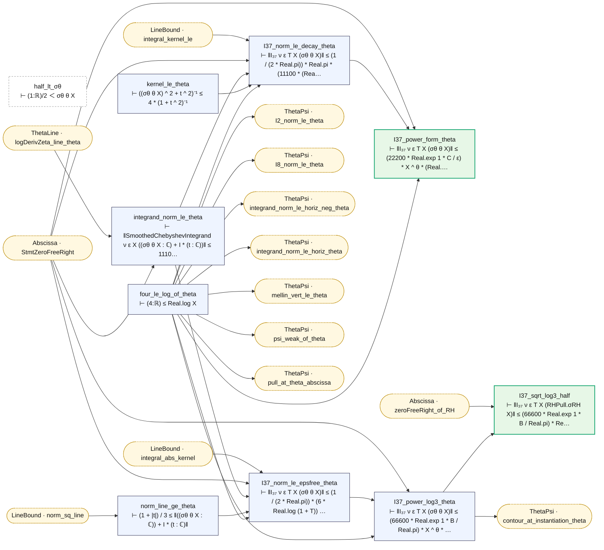

# `lean_stage3/Stage3/ThetaPull.lean`

**What it does** (its own header): ThetaPull — the vertical segment `I₃₇` at a general abscissa `θ`. WHAT THIS PORTS. `RHPull` (`LineBound.lean:1085` onward) bounds the vertical segment of the Perron contour at `σRH X = 1/2 + 1/log X`:

**Imports:** [`ThetaLine`](../lean_stage3/ThetaLine.md).
**Imported by:** [`Stage3`](../lean_stage3/Stage3.md), [`ThetaPsi`](../lean_stage3/ThetaPsi.md).

Blue: theorem. Green: a theorem nothing else uses (an end). Dashed white: connects to nothing. Grey: definition. Red: contains `sorry`. Yellow: in another file. An arrow A → B reads "A is used by B".

## Every declaration

| declaration | proves (output) | needs (input) | why (its own docstring) | uses | used by |
|---|---|---|---|---|---|
| `Stage3.half_lt_σθ` theorem, line 51 | (1:ℝ)/2 &lt; σθ θ X | hθlo : 1/2 ≤ θ; hLX : 0 &lt; Real.log X | — | — | — |
| `Stage3.four_le_log_of_theta` theorem, line 57 | (4:ℝ) ≤ Real.log X | hθlo : 1/2 ≤ θ; hθhi : θ &lt; 1; hLX : 2 / (1 - θ) ≤ Real.log X | `4 ≤ log X` follows from the `θ`-hypothesis whenever `θ ≥ 1/2`. | — | `Stage3.I2_norm_le_theta`, `Stage3.I8_norm_le_theta`, `Stage3.integrand_norm_le_horiz_neg_theta`, `Stage3.integrand_norm_le_horiz_theta`, `Stage3.mellin_vert_le_theta`, `Stage3.psi_weak_of_theta`, `Stage3.pull_at_theta_abscissa`, `Stage3.I37_norm_le_decay_theta`, `Stage3.I37_norm_le_epsfree_theta`, `Stage3.I37_power_form_theta`, `Stage3.I37_power_log3_theta` |
| `Stage3.kernel_le_theta` theorem, line 65 | ((σθ θ X) ^ 2 + t ^ 2)⁻¹ ≤ 4 * (1 + t ^ 2)⁻¹ | hθlo : 1/2 ≤ θ; hLX : 0 &lt; Real.log X | The Cauchy kernel on the line is dominated by `4/(1+t²)`, at any `θ ≥ 1/2`. | — | `Stage3.I37_norm_le_decay_theta` |
| `Stage3.norm_line_ge_theta` theorem, line 75 | (1 + \|t\|) / 3 ≤ ‖((σθ θ X : ℂ)) + I * (t : ℂ)‖ | hθlo : 1/2 ≤ θ; hLX : 0 &lt; Real.log X | — | `RHPull.norm_sq_line` | `Stage3.I37_norm_le_epsfree_theta` |
| `Stage3.integrand_norm_le_theta` theorem, line 88 | ‖SmoothedChebyshevIntegrand ν ε X ((σθ θ X : ℂ) + I * (t : ℂ))‖ ≤ 11100 * (Real.log X) ^ 2 * M * X ^ (σθ θ X) | hθ : StmtZeroFreeRight θ; hθlo : 1/2 ≤ θ; hθhi : θ &lt; 1; hX : 0 &lt; X; hLX : 2 / (1 - θ) ≤ Real.log X; htX : \|t\| ≤ X; hMel : ‖mellin (fun x ↦ (Smooth1 ν ε x : ℂ)) ((σθ θ X : ℂ) + I * (t : ℂ))‖ ≤ M | Pointwise bound on the pull integrand at abscissa `θ`. | `Stage3.StmtZeroFreeRight`, `Stage3.logDerivZeta_line_theta` | `Stage3.I37_norm_le_decay_theta`, `Stage3.I37_norm_le_epsfree_theta` |
| `Stage3.I37_norm_le_decay_theta` theorem, line 116 | ‖I₃₇ ν ε T X (σθ θ X)‖ ≤ (1 / (2 * Real.pi)) * Real.pi * (11100 * (Real.log X) ^ 2 * (4 * C / ε) * X ^ (σθ θ X)) | hθ : StmtZeroFreeRight θ; hθlo : 1/2 ≤ θ; hθhi : θ &lt; 1; hX : 0 &lt; X; hLX : 2 / (1 - θ) ≤ Real.log X; hT : 0 &lt; T; hTX : T ≤ X; hC : 0 &lt; C; hε : 0 &lt; ε; hMel : ∀ t : ℝ, ‖mellin (fun x ↦ (Smooth1 ν ε x : ℂ)) ((σθ θ X : ℂ) + I * (t : ℂ))‖ ≤ C * (ε * ((σθ θ X) ^ 2 + t ^ 2))⁻¹ | I₃₇, T-free, at abscissa `θ`. | `Stage3.StmtZeroFreeRight`, `RHPull.integral_kernel_le`, `Stage3.four_le_log_of_theta`, `Stage3.integrand_norm_le_theta`, `Stage3.kernel_le_theta` | `Stage3.I37_power_form_theta` |
| `Stage3.I37_power_form_theta` theorem, line 179 | ‖I₃₇ ν ε T X (σθ θ X)‖ ≤ (22200 * Real.exp 1 * C / ε) * X ^ θ * (Real.log X) ^ 2 | hθ : StmtZeroFreeRight θ; hθlo : 1/2 ≤ θ; hθhi : θ &lt; 1; hX : 0 &lt; X; hLX : 2 / (1 - θ) ≤ Real.log X; hT : 0 &lt; T; hTX : T ≤ X; hC : 0 &lt; C; hε : 0 &lt; ε; hMel : ∀ t : ℝ, ‖mellin (fun x ↦ (Smooth1 ν ε x : ℂ)) ((σθ θ X : ℂ) + I * (t : ℂ))‖ ≤ C * (ε * ((σθ θ X) ^ 2 + t ^ 2))⁻¹ | The vertical segment in `X^θ log²X` form. `RHPull.I37_sqrt_form` with `X^θ` where it had `√X`. | `Stage3.StmtZeroFreeRight`, `Stage3.I37_norm_le_decay_theta`, `Stage3.four_le_log_of_theta` | — |
| `Stage3.I37_norm_le_epsfree_theta` theorem, line 203 | ‖I₃₇ ν ε T X (σθ θ X)‖ ≤ (1 / (2 * Real.pi)) * (6 * Real.log (1 + T)) * (11100 * (Real.log X) ^ 2 * B * X ^ (σθ θ X)) | hθ : StmtZeroFreeRight θ; hθlo : 1/2 ≤ θ; hθhi : θ &lt; 1; hX : 0 &lt; X; hLX : 2 / (1 - θ) ≤ Real.log X; hT : 0 &lt; T; hTX : T ≤ X; hB : 0 ≤ B; hMel : ∀ t : ℝ, ‖mellin (fun x ↦ (Smooth1 ν ε x : ℂ)) ((σθ θ X : ℂ) + I * (t : ℂ))‖ ≤ B * ‖((σθ θ X : ℂ)) + I * (t : ℂ)‖⁻¹ | I₃₇ with the ε-free Mellin bound, at abscissa `θ`. | `Stage3.StmtZeroFreeRight`, `RHPull.integral_abs_kernel`, `Stage3.four_le_log_of_theta`, `Stage3.integrand_norm_le_theta`, `Stage3.norm_line_ge_theta` | `Stage3.I37_power_log3_theta` |
| `Stage3.I37_power_log3_theta` theorem, line 263 | ‖I₃₇ ν ε T X (σθ θ X)‖ ≤ (66600 * Real.exp 1 * B / Real.pi) * X ^ θ * (Real.log X) ^ 3 | hθ : StmtZeroFreeRight θ; hθlo : 1/2 ≤ θ; hθhi : θ &lt; 1; hX : 0 &lt; X; hLX : 2 / (1 - θ) ≤ Real.log X; hT : 0 &lt; T; hTX : T ≤ X; hB : 0 ≤ B; hMel : ∀ t : ℝ, ‖mellin (fun x ↦ (Smooth1 ν ε x : ℂ)) ((σθ θ X : ℂ) + I * (t : ℂ))‖ ≤ B * ‖((σθ θ X : ℂ)) + I * (t : ℂ)‖⁻¹ | The vertical segment at `X^θ log³X`, ε-free. `RHPull.I37_sqrt_log3` with `X^θ` where it had `√X`. The `66600 = 6·11100` is untouched by `θ`. | `Stage3.StmtZeroFreeRight`, `Stage3.I37_norm_le_epsfree_theta`, `Stage3.four_le_log_of_theta` | `Stage3.contour_at_instantiation_theta`, `Stage3.I37_sqrt_log3_half` |
| `Stage3.I37_sqrt_log3_half` theorem, line 309 | ‖I₃₇ ν ε T X (RHPull.σRH X)‖ ≤ (66600 * Real.exp 1 * B / Real.pi) * Real.sqrt X * (Real.log X) ^ 3 | hRH : RiemannHypothesis; hX : 0 &lt; X; hLX : 4 ≤ Real.log X; hT : 0 &lt; T; hTX : T ≤ X; hB : 0 ≤ B; hMel : ∀ t : ℝ, ‖mellin (fun x ↦ (Smooth1 ν ε x : ℂ)) ((RHPull.σRH X : ℂ) + I * (t : ℂ))‖ ≤ B * ‖((RHPull.σRH X : ℂ)) + I * (t : ℂ)‖⁻¹ | `I37_sqrt_log3` recovered. Under RH, at `θ = 1/2`, the general bound is `RHPull.I37_sqrt_log3`'s statement — `σθ (1/2) X` is `σRH X` by `rfl`, and `X^(1/2) = √X`. | `Stage3.zeroFreeRight_of_RH`, `Stage3.I37_power_log3_theta` | — |
