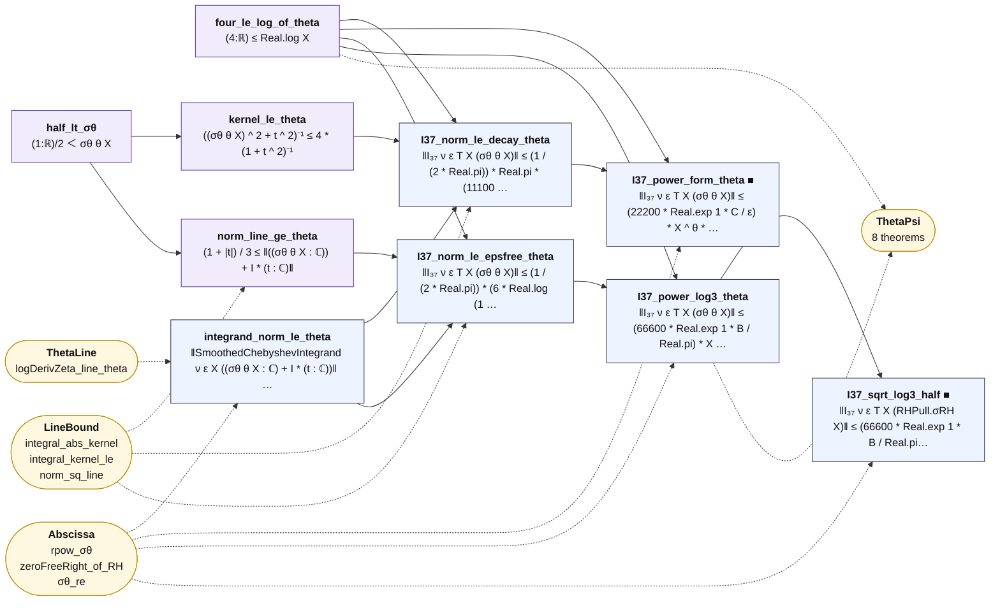

# `lean_stage3/Stage3/ThetaPull.lean`

ThetaPull — the vertical segment `I₃₇` at a general abscissa `θ`. WHAT THIS PORTS. `RHPull` (`LineBound.lean:1085` onward) bounds the vertical segment of the Perron contour at `σRH X = 1/2 + 1/log X`:

10 theorems, 0 definitions, 344 lines. Arrows are Lean's own record of what each proof uses.

**Imports:** [`ThetaLine`](../lean_stage3/ThetaLine.md)  
**Imported by:** [`Stage3`](../lean_stage3/Stage3.md), [`ThetaPsi`](../lean_stage3/ThetaPsi.md)

## The picture



An arrow A → B reads "A is used in the proof of B". Green: counting, integers only. Violet: shape, analysis with no ζ. Blue: reads ζ. A name ending in ■ is an end: nothing else uses it. Red: contains `sorry`. Yellow: theorems in another file, counted; a dotted arrow crosses files. Definitions are not drawn; they are listed below the diagram.

## Theorems

<a name="Stage3-half_lt_--"></a>
### `Stage3.half_lt_σθ`

line 52

**Shape.** Uses real or complex analysis; nothing in it or beneath it reads ζ.

**Why.** If `1/2 ≤ θ` and `0 < log X`, then the abscissa `σθ θ X = θ + 1/log X` exceeds `1/2`.

**Proves**

```lean
(1:ℝ)/2 < σθ θ X
```

**Needs** (its hypotheses)

  - `` hθlo : 1/2 ≤ θ ``
  - `` hLX : 0 < Real.log X ``

**Stated with:** [`Stage3.σθ`](../lean_stage3/Abscissa.md#Stage3---)

**Fed by:** no theorem of this repo; it stands on Mathlib and the definitions below.

**Feeds** (2 that use it)

  - [`Stage3.kernel_le_theta`](#Stage3-kernel_le_theta) — `` ((σθ θ X) ^ 2 + t ^ 2)⁻¹ ≤ 4 * (1 + t ^ 2)⁻¹ ``
  - [`Stage3.norm_line_ge_theta`](#Stage3-norm_line_ge_theta) — `` (1 + |t|) / 3 ≤ ‖((σθ θ X : ℂ)) + I * (t : ℂ)‖ ``

<a name="Stage3-four_le_log_of_theta"></a>
### `Stage3.four_le_log_of_theta`

line 58

**Shape.** Uses real or complex analysis; nothing in it or beneath it reads ζ.

**Why.** `4 ≤ log X` follows from the `θ`-hypothesis whenever `θ ≥ 1/2`.

**Proves**

```lean
(4:ℝ) ≤ Real.log X
```

**Needs** (its hypotheses)

  - `` hθlo : 1/2 ≤ θ ``
  - `` hθhi : θ < 1 ``
  - `` hLX : 2 / (1 - θ) ≤ Real.log X ``

**Fed by:** no theorem of this repo; it stands on Mathlib.

**Feeds** (11 that use it)

  - [`Stage3.I2_norm_le_theta`](../lean_stage3/ThetaPsi.md#Stage3-I2_norm_le_theta) (ThetaPsi) — `` ‖I₂ ν ε T X (σθ θ X)‖ ≤ (1 / (2 * Real.pi)) * (1 - θ) * ((1996 * Real.log (84 * T) + (29 * Real.log T + 129) * Real.log X) * M * X ^ (1 + 1 / Real.log… ``
  - [`Stage3.I8_norm_le_theta`](../lean_stage3/ThetaPsi.md#Stage3-I8_norm_le_theta) (ThetaPsi) — `` ‖I₈ ν ε T X (σθ θ X)‖ ≤ (1 / (2 * Real.pi)) * (1 - θ) * ((1996 * Real.log (84 * T) + (29 * Real.log T + 129) * Real.log X) * M * X ^ (1 + 1 / Real.log… ``
  - [`Stage3.integrand_norm_le_horiz_neg_theta`](../lean_stage3/ThetaPsi.md#Stage3-integrand_norm_le_horiz_neg_theta) (ThetaPsi) — `` ‖SmoothedChebyshevIntegrand ν ε X ((σ : ℂ) - (T : ℂ) * I)‖ ≤ (1996 * Real.log (84 * T) + (29 * Real.log T + 129) * Real.log X) * M * X ^ σ ``
  - [`Stage3.integrand_norm_le_horiz_theta`](../lean_stage3/ThetaPsi.md#Stage3-integrand_norm_le_horiz_theta) (ThetaPsi) — `` ‖SmoothedChebyshevIntegrand ν ε X ((σ : ℂ) + I * (t : ℂ))‖ ≤ (1996 * Real.log (84 * t) + (29 * Real.log t + 129) * Real.log X) * M * X ^ σ ``
  - [`Stage3.mellin_vert_le_theta`](../lean_stage3/ThetaPsi.md#Stage3-mellin_vert_le_theta) (ThetaPsi) — `` ‖mellin (fun x ↦ (Smooth1 ν ε x : ℂ)) ((σθ θ X : ℂ) + I * (t : ℂ))‖ ≤ B * ‖((σθ θ X : ℂ)) + I * (t : ℂ)‖⁻¹ ``
  - [`Stage3.psi_weak_of_theta`](../lean_stage3/ThetaPsi.md#Stage3-psi_weak_of_theta) (ThetaPsi) — `` ∃ C > 0, ∃ x₀ : ℝ, ∀ t : ℝ, x₀ ≤ t → |ψ t - t| ≤ C * t ^ θ * (Real.log t) ^ 3 ``
  - [`Stage3.pull_at_theta_abscissa`](../lean_stage3/ThetaPsi.md#Stage3-pull_at_theta_abscissa) (ThetaPsi) — `` SmoothedChebyshev SmoothingF ε X = I₁ SmoothingF ε X T - I₂ SmoothingF ε T X (σθ θ X) + I₃₇ SmoothingF ε T X (σθ θ X) + I₈ SmoothingF ε T X (σθ θ X) +… ``
  - [`Stage3.I37_norm_le_decay_theta`](#Stage3-I37_norm_le_decay_theta) — `` ‖I₃₇ ν ε T X (σθ θ X)‖ ≤ (1 / (2 * Real.pi)) * Real.pi * (11100 * (Real.log X) ^ 2 * (4 * C / ε) * X ^ (σθ θ X)) ``
  - [`Stage3.I37_norm_le_epsfree_theta`](#Stage3-I37_norm_le_epsfree_theta) — `` ‖I₃₇ ν ε T X (σθ θ X)‖ ≤ (1 / (2 * Real.pi)) * (6 * Real.log (1 + T)) * (11100 * (Real.log X) ^ 2 * B * X ^ (σθ θ X)) ``
  - [`Stage3.I37_power_form_theta`](#Stage3-I37_power_form_theta) — `` ‖I₃₇ ν ε T X (σθ θ X)‖ ≤ (22200 * Real.exp 1 * C / ε) * X ^ θ * (Real.log X) ^ 2 ``
  - [`Stage3.I37_power_log3_theta`](#Stage3-I37_power_log3_theta) — `` ‖I₃₇ ν ε T X (σθ θ X)‖ ≤ (66600 * Real.exp 1 * B / Real.pi) * X ^ θ * (Real.log X) ^ 3 ``

<a name="Stage3-kernel_le_theta"></a>
### `Stage3.kernel_le_theta`

line 66

**Shape.** Uses real or complex analysis; nothing in it or beneath it reads ζ.

**Why.** The Cauchy kernel on the line is dominated by `4/(1+t²)`, at any `θ ≥ 1/2`.

**Proves**

```lean
((σθ θ X) ^ 2 + t ^ 2)⁻¹ ≤ 4 * (1 + t ^ 2)⁻¹
```

**Needs** (its hypotheses)

  - `` hθlo : 1/2 ≤ θ ``
  - `` hLX : 0 < Real.log X ``

**Stated with:** [`Stage3.σθ`](../lean_stage3/Abscissa.md#Stage3---)

**Fed by** (1 theorem its proof uses)

  - [`Stage3.half_lt_σθ`](#Stage3-half_lt_--) — `` (1:ℝ)/2 < σθ θ X ``

**Feeds** (1 that use it)

  - [`Stage3.I37_norm_le_decay_theta`](#Stage3-I37_norm_le_decay_theta) — `` ‖I₃₇ ν ε T X (σθ θ X)‖ ≤ (1 / (2 * Real.pi)) * Real.pi * (11100 * (Real.log X) ^ 2 * (4 * C / ε) * X ^ (σθ θ X)) ``

<a name="Stage3-norm_line_ge_theta"></a>
### `Stage3.norm_line_ge_theta`

line 78

**Shape.** Uses real or complex analysis; nothing in it or beneath it reads ζ.

**Why.** If `1/2 ≤ θ` and `0 < log X`, then the point `σθ θ X + i·t` of the line has norm at least `(1 + |t|)/3`.

**Proves**

```lean
(1 + |t|) / 3 ≤ ‖((σθ θ X : ℂ)) + I * (t : ℂ)‖
```

**Needs** (its hypotheses)

  - `` hθlo : 1/2 ≤ θ ``
  - `` hLX : 0 < Real.log X ``

**Stated with:** [`Stage3.σθ`](../lean_stage3/Abscissa.md#Stage3---)

**Fed by** (2 theorems its proof uses)

  - [`RHPull.norm_sq_line`](../lean_stage3/LineBound.md#RHPull-norm_sq_line) (LineBound) — `` ‖((σ : ℂ) + I * (t : ℂ))‖ ^ 2 = σ ^ 2 + t ^ 2 ``
  - [`Stage3.half_lt_σθ`](#Stage3-half_lt_--) — `` (1:ℝ)/2 < σθ θ X ``

**Feeds** (1 that use it)

  - [`Stage3.I37_norm_le_epsfree_theta`](#Stage3-I37_norm_le_epsfree_theta) — `` ‖I₃₇ ν ε T X (σθ θ X)‖ ≤ (1 / (2 * Real.pi)) * (6 * Real.log (1 + T)) * (11100 * (Real.log X) ^ 2 * B * X ^ (σθ θ X)) ``

<a name="Stage3-integrand_norm_le_theta"></a>
### `Stage3.integrand_norm_le_theta`

line 91

**Reads ζ.** It, or something it rests on, uses the zeta function, its zeros or the Riemann hypothesis.

**Why.** Pointwise bound on the pull integrand at abscissa `θ`.

**Proves**

```lean
‖SmoothedChebyshevIntegrand ν ε X ((σθ θ X : ℂ) + I * (t : ℂ))‖ ≤ 11100 * (Real.log X) ^ 2 * M * X ^ (σθ θ X)
```

**Needs** (its hypotheses)

  - `` hθ : StmtZeroFreeRight θ ``
  - `` hθlo : 1/2 ≤ θ ``
  - `` hθhi : θ < 1 ``
  - `` hX : 0 < X ``
  - `` hLX : 2 / (1 - θ) ≤ Real.log X ``
  - `` htX : |t| ≤ X ``
  - `` hMel : ‖mellin (fun x ↦ (Smooth1 ν ε x : ℂ)) ((σθ θ X : ℂ) + I * (t : ℂ))‖ ≤ M ``

**Stated with:** [`Stage3.StmtZeroFreeRight`](../lean_stage3/Abscissa.md#Stage3-StmtZeroFreeRight), [`Stage3.σθ`](../lean_stage3/Abscissa.md#Stage3---)

**Fed by** (2 theorems its proof uses)

  - [`Stage3.σθ_re`](../lean_stage3/Abscissa.md#Stage3---_re) (Abscissa) — `` ((σθ θ X : ℂ) + I * (t : ℂ)).re = σθ θ X ``
  - [`Stage3.logDerivZeta_line_theta`](../lean_stage3/ThetaLine.md#Stage3-logDerivZeta_line_theta) (ThetaLine) — `` ‖deriv ζ (((θ + 1/Real.log X : ℝ)) + I * (t : ℂ)) / ζ (((θ + 1/Real.log X : ℝ)) + I * (t : ℂ))‖ ≤ 11100 * (Real.log X) ^ 2 ``

**Feeds** (2 that use it)

  - [`Stage3.I37_norm_le_decay_theta`](#Stage3-I37_norm_le_decay_theta) — `` ‖I₃₇ ν ε T X (σθ θ X)‖ ≤ (1 / (2 * Real.pi)) * Real.pi * (11100 * (Real.log X) ^ 2 * (4 * C / ε) * X ^ (σθ θ X)) ``
  - [`Stage3.I37_norm_le_epsfree_theta`](#Stage3-I37_norm_le_epsfree_theta) — `` ‖I₃₇ ν ε T X (σθ θ X)‖ ≤ (1 / (2 * Real.pi)) * (6 * Real.log (1 + T)) * (11100 * (Real.log X) ^ 2 * B * X ^ (σθ θ X)) ``

<a name="Stage3-I37_norm_le_decay_theta"></a>
### `Stage3.I37_norm_le_decay_theta`

line 119

**Reads ζ.** It, or something it rests on, uses the zeta function, its zeros or the Riemann hypothesis.

**Why.** I₃₇, T-free, at abscissa `θ`.

**Proves**

```lean
‖I₃₇ ν ε T X (σθ θ X)‖ ≤ (1 / (2 * Real.pi)) * Real.pi * (11100 * (Real.log X) ^ 2 * (4 * C / ε) * X ^ (σθ θ X))
```

**Needs** (its hypotheses)

  - `` hθ : StmtZeroFreeRight θ ``
  - `` hθlo : 1/2 ≤ θ ``
  - `` hθhi : θ < 1 ``
  - `` hX : 0 < X ``
  - `` hLX : 2 / (1 - θ) ≤ Real.log X ``
  - `` hT : 0 < T ``
  - `` hTX : T ≤ X ``
  - `` hC : 0 < C ``
  - `` hε : 0 < ε ``
  - `` hMel : ∀ t : ℝ, ‖mellin (fun x ↦ (Smooth1 ν ε x : ℂ)) ((σθ θ X : ℂ) + I * (t : ℂ))‖ ≤ C * (ε * ((σθ θ X) ^ 2 + t ^ 2))⁻¹ ``

**Stated with:** [`Stage3.StmtZeroFreeRight`](../lean_stage3/Abscissa.md#Stage3-StmtZeroFreeRight), [`Stage3.σθ`](../lean_stage3/Abscissa.md#Stage3---)

**Fed by** (4 theorems its proof uses)

  - [`RHPull.integral_kernel_le`](../lean_stage3/LineBound.md#RHPull-integral_kernel_le) (LineBound) — `` ∫ t in (-T)..T, ((1:ℝ) + t ^ 2)⁻¹ ≤ Real.pi ``
  - [`Stage3.four_le_log_of_theta`](#Stage3-four_le_log_of_theta) — `` (4:ℝ) ≤ Real.log X ``
  - [`Stage3.integrand_norm_le_theta`](#Stage3-integrand_norm_le_theta) — `` ‖SmoothedChebyshevIntegrand ν ε X ((σθ θ X : ℂ) + I * (t : ℂ))‖ ≤ 11100 * (Real.log X) ^ 2 * M * X ^ (σθ θ X) ``
  - [`Stage3.kernel_le_theta`](#Stage3-kernel_le_theta) — `` ((σθ θ X) ^ 2 + t ^ 2)⁻¹ ≤ 4 * (1 + t ^ 2)⁻¹ ``

**Feeds** (1 that use it)

  - [`Stage3.I37_power_form_theta`](#Stage3-I37_power_form_theta) — `` ‖I₃₇ ν ε T X (σθ θ X)‖ ≤ (22200 * Real.exp 1 * C / ε) * X ^ θ * (Real.log X) ^ 2 ``

<a name="Stage3-I37_power_form_theta"></a>
### `Stage3.I37_power_form_theta`

line 182

**Reads ζ.** It, or something it rests on, uses the zeta function, its zeros or the Riemann hypothesis.

**Why.** The vertical segment in `X^θ log²X` form. `RHPull.I37_sqrt_form` with `X^θ` where it had `√X`.

**Proves**

```lean
‖I₃₇ ν ε T X (σθ θ X)‖ ≤ (22200 * Real.exp 1 * C / ε) * X ^ θ * (Real.log X) ^ 2
```

**Needs** (its hypotheses)

  - `` hθ : StmtZeroFreeRight θ ``
  - `` hθlo : 1/2 ≤ θ ``
  - `` hθhi : θ < 1 ``
  - `` hX : 0 < X ``
  - `` hLX : 2 / (1 - θ) ≤ Real.log X ``
  - `` hT : 0 < T ``
  - `` hTX : T ≤ X ``
  - `` hC : 0 < C ``
  - `` hε : 0 < ε ``
  - `` hMel : ∀ t : ℝ, ‖mellin (fun x ↦ (Smooth1 ν ε x : ℂ)) ((σθ θ X : ℂ) + I * (t : ℂ))‖ ≤ C * (ε * ((σθ θ X) ^ 2 + t ^ 2))⁻¹ ``

**Stated with:** [`Stage3.StmtZeroFreeRight`](../lean_stage3/Abscissa.md#Stage3-StmtZeroFreeRight), [`Stage3.σθ`](../lean_stage3/Abscissa.md#Stage3---)

**Fed by** (3 theorems its proof uses)

  - [`Stage3.rpow_σθ`](../lean_stage3/Abscissa.md#Stage3-rpow_--) (Abscissa) — `` X ^ (σθ θ X) = Real.exp 1 * X ^ θ ``
  - [`Stage3.I37_norm_le_decay_theta`](#Stage3-I37_norm_le_decay_theta) — `` ‖I₃₇ ν ε T X (σθ θ X)‖ ≤ (1 / (2 * Real.pi)) * Real.pi * (11100 * (Real.log X) ^ 2 * (4 * C / ε) * X ^ (σθ θ X)) ``
  - [`Stage3.four_le_log_of_theta`](#Stage3-four_le_log_of_theta) — `` (4:ℝ) ≤ Real.log X ``

**Feeds:** nothing. It is an end.

<a name="Stage3-I37_norm_le_epsfree_theta"></a>
### `Stage3.I37_norm_le_epsfree_theta`

line 206

**Reads ζ.** It, or something it rests on, uses the zeta function, its zeros or the Riemann hypothesis.

**Why.** I₃₇ with the ε-free Mellin bound, at abscissa `θ`.

**Proves**

```lean
‖I₃₇ ν ε T X (σθ θ X)‖ ≤ (1 / (2 * Real.pi)) * (6 * Real.log (1 + T)) * (11100 * (Real.log X) ^ 2 * B * X ^ (σθ θ X))
```

**Needs** (its hypotheses)

  - `` hθ : StmtZeroFreeRight θ ``
  - `` hθlo : 1/2 ≤ θ ``
  - `` hθhi : θ < 1 ``
  - `` hX : 0 < X ``
  - `` hLX : 2 / (1 - θ) ≤ Real.log X ``
  - `` hT : 0 < T ``
  - `` hTX : T ≤ X ``
  - `` hB : 0 ≤ B ``
  - `` hMel : ∀ t : ℝ, ‖mellin (fun x ↦ (Smooth1 ν ε x : ℂ)) ((σθ θ X : ℂ) + I * (t : ℂ))‖ ≤ B * ‖((σθ θ X : ℂ)) + I * (t : ℂ)‖⁻¹ ``

**Stated with:** [`Stage3.StmtZeroFreeRight`](../lean_stage3/Abscissa.md#Stage3-StmtZeroFreeRight), [`Stage3.σθ`](../lean_stage3/Abscissa.md#Stage3---)

**Fed by** (4 theorems its proof uses)

  - [`RHPull.integral_abs_kernel`](../lean_stage3/LineBound.md#RHPull-integral_abs_kernel) (LineBound) — `` ∫ t in (-T)..T, (1 + |t|)⁻¹ = 2 * Real.log (1 + T) ``
  - [`Stage3.four_le_log_of_theta`](#Stage3-four_le_log_of_theta) — `` (4:ℝ) ≤ Real.log X ``
  - [`Stage3.integrand_norm_le_theta`](#Stage3-integrand_norm_le_theta) — `` ‖SmoothedChebyshevIntegrand ν ε X ((σθ θ X : ℂ) + I * (t : ℂ))‖ ≤ 11100 * (Real.log X) ^ 2 * M * X ^ (σθ θ X) ``
  - [`Stage3.norm_line_ge_theta`](#Stage3-norm_line_ge_theta) — `` (1 + |t|) / 3 ≤ ‖((σθ θ X : ℂ)) + I * (t : ℂ)‖ ``

**Feeds** (1 that use it)

  - [`Stage3.I37_power_log3_theta`](#Stage3-I37_power_log3_theta) — `` ‖I₃₇ ν ε T X (σθ θ X)‖ ≤ (66600 * Real.exp 1 * B / Real.pi) * X ^ θ * (Real.log X) ^ 3 ``

<a name="Stage3-I37_power_log3_theta"></a>
### `Stage3.I37_power_log3_theta`

line 266

**Reads ζ.** It, or something it rests on, uses the zeta function, its zeros or the Riemann hypothesis.

**Why.** The vertical segment at `X^θ log³X`, ε-free. `RHPull.I37_sqrt_log3` with `X^θ` where it had `√X`. The `66600 = 6·11100` is untouched by `θ`.

**Proves**

```lean
‖I₃₇ ν ε T X (σθ θ X)‖ ≤ (66600 * Real.exp 1 * B / Real.pi) * X ^ θ * (Real.log X) ^ 3
```

**Needs** (its hypotheses)

  - `` hθ : StmtZeroFreeRight θ ``
  - `` hθlo : 1/2 ≤ θ ``
  - `` hθhi : θ < 1 ``
  - `` hX : 0 < X ``
  - `` hLX : 2 / (1 - θ) ≤ Real.log X ``
  - `` hT : 0 < T ``
  - `` hTX : T ≤ X ``
  - `` hB : 0 ≤ B ``
  - `` hMel : ∀ t : ℝ, ‖mellin (fun x ↦ (Smooth1 ν ε x : ℂ)) ((σθ θ X : ℂ) + I * (t : ℂ))‖ ≤ B * ‖((σθ θ X : ℂ)) + I * (t : ℂ)‖⁻¹ ``

**Stated with:** [`Stage3.StmtZeroFreeRight`](../lean_stage3/Abscissa.md#Stage3-StmtZeroFreeRight), [`Stage3.σθ`](../lean_stage3/Abscissa.md#Stage3---)

**Fed by** (3 theorems its proof uses)

  - [`Stage3.rpow_σθ`](../lean_stage3/Abscissa.md#Stage3-rpow_--) (Abscissa) — `` X ^ (σθ θ X) = Real.exp 1 * X ^ θ ``
  - [`Stage3.I37_norm_le_epsfree_theta`](#Stage3-I37_norm_le_epsfree_theta) — `` ‖I₃₇ ν ε T X (σθ θ X)‖ ≤ (1 / (2 * Real.pi)) * (6 * Real.log (1 + T)) * (11100 * (Real.log X) ^ 2 * B * X ^ (σθ θ X)) ``
  - [`Stage3.four_le_log_of_theta`](#Stage3-four_le_log_of_theta) — `` (4:ℝ) ≤ Real.log X ``

**Feeds** (2 that use it)

  - [`Stage3.contour_at_instantiation_theta`](../lean_stage3/ThetaPsi.md#Stage3-contour_at_instantiation_theta) (ThetaPsi) — `` ‖SmoothedChebyshev ν ε X - mellin (fun x ↦ (Smooth1 ν ε x : ℂ)) 1 * X‖ ≤ B₁ + B₉ + (66600 * Real.exp 1 * B / Real.pi) * X ^ θ * (Real.log X) ^ 3 + (1 … ``
  - [`Stage3.I37_sqrt_log3_half`](#Stage3-I37_sqrt_log3_half) — `` ‖I₃₇ ν ε T X (RHPull.σRH X)‖ ≤ (66600 * Real.exp 1 * B / Real.pi) * Real.sqrt X * (Real.log X) ^ 3 ``

<a name="Stage3-I37_sqrt_log3_half"></a>
### `Stage3.I37_sqrt_log3_half`

line 312

**Reads ζ.** It, or something it rests on, uses the zeta function, its zeros or the Riemann hypothesis.

**Why.** `I37_sqrt_log3` recovered. Under RH, at `θ = 1/2`, the general bound is `RHPull.I37_sqrt_log3`'s statement — `σθ (1/2) X` is `σRH X` by `rfl`, and `X^(1/2) = √X`.

**Proves**

```lean
‖I₃₇ ν ε T X (RHPull.σRH X)‖ ≤ (66600 * Real.exp 1 * B / Real.pi) * Real.sqrt X * (Real.log X) ^ 3
```

**Needs** (its hypotheses)

  - `` hRH : RiemannHypothesis ``
  - `` hX : 0 < X ``
  - `` hLX : 4 ≤ Real.log X ``
  - `` hT : 0 < T ``
  - `` hTX : T ≤ X ``
  - `` hB : 0 ≤ B ``
  - `` hMel : ∀ t : ℝ, ‖mellin (fun x ↦ (Smooth1 ν ε x : ℂ)) ((RHPull.σRH X : ℂ) + I * (t : ℂ))‖ ≤ B * ‖((RHPull.σRH X : ℂ)) + I * (t : ℂ)‖⁻¹ ``

**Stated with:** [`RHPull.σRH`](../lean_stage3/LineBound.md#RHPull--RH)

**Fed by** (2 theorems its proof uses)

  - [`Stage3.zeroFreeRight_of_RH`](../lean_stage3/Abscissa.md#Stage3-zeroFreeRight_of_RH) (Abscissa) — `` StmtZeroFreeRight (1/2) ``
  - [`Stage3.I37_power_log3_theta`](#Stage3-I37_power_log3_theta) — `` ‖I₃₇ ν ε T X (σθ θ X)‖ ≤ (66600 * Real.exp 1 * B / Real.pi) * X ^ θ * (Real.log X) ^ 3 ``

**Definitions its proof touches:** [`Stage3.σθ`](../lean_stage3/Abscissa.md#Stage3---)

**Feeds:** nothing. It is an end.

