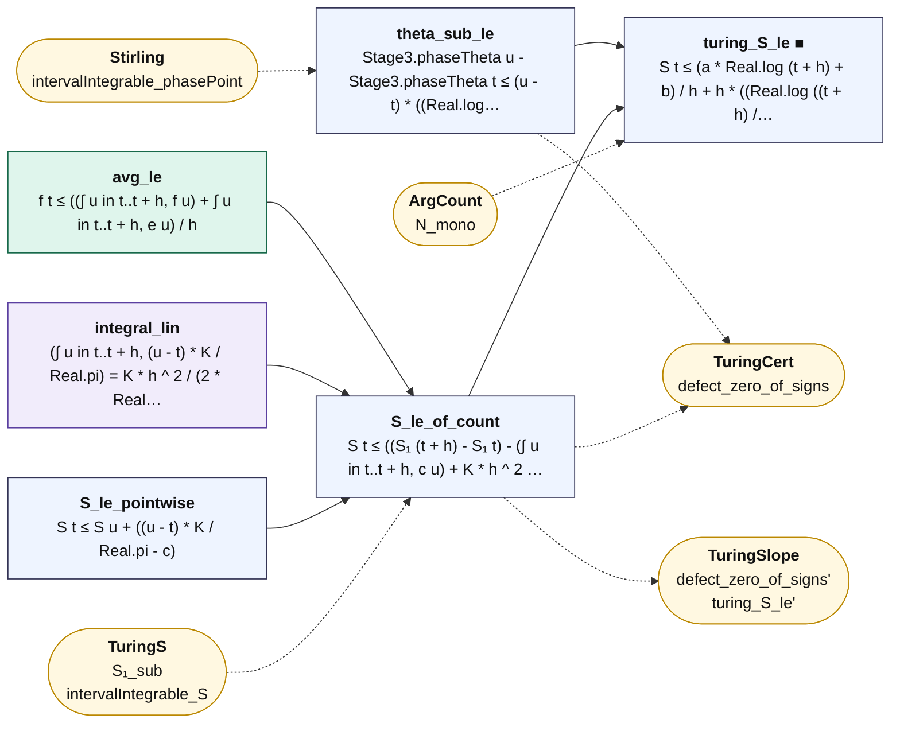

# `lean_stage3/Stage3/TuringAvg.lean`

> **Read from the source text.** This file changed after the last `python3 utilities/lean_map.py --dump`, so the arrows on this page are names occurring in each proof and have not been confirmed by Lean.

TuringAvg — block S14 of `lean_stage3/design/stencil.md`, Turing's method, step 2: Turing's lemma, the averaging of `S` over a length `h`. 2026-11-25.

6 theorems, 0 definitions, 178 lines. 

**Imports:** [`TuringS`](../lean_stage3/TuringS.md)  
**Imported by:** [`Turing`](../lean_stage3/Turing.md), [`TuringCert`](../lean_stage3/TuringCert.md)

## The picture



An arrow A → B reads "A is used in the proof of B". Green: counting, integers only. Violet: shape, analysis with no ζ. Blue: reads ζ. A name ending in ■ is an end: nothing else uses it. Red: contains `sorry`. Yellow: theorems in another file, counted; a dotted arrow crosses files. Definitions are not drawn; they are listed below the diagram.

## Theorems

<a name="Turing-theta_sub_le"></a>
### `Turing.theta_sub_le`

line 51 · arrows read from text

**Reads ζ.** It, or something it rests on, uses the zeta function, its zeros or the Riemann hypothesis.

**Why.** The slope of the horizon, from Stirling's digamma bound.

**Proves**

```lean
Stage3.phaseTheta u - Stage3.phaseTheta t ≤ (u - t) * ((Real.log (u / 2) - Real.log Real.pi + 97 / t) / 2)
```

**Needs** (its hypotheses)

  - `` ht : 1 ≤ t ``
  - `` htu : t ≤ u ``

**Fed by** (1 theorem its proof uses)

  - [`Stage3.intervalIntegrable_phasePoint`](../lean_stage3/Stirling.md#Stage3-intervalIntegrable_phasePoint) (Stirling) — `` IntervalIntegrable phasePoint MeasureTheory.volume a b ``

**Definitions its proof touches:** [`Stage3.phasePoint`](../lean_stage3/Stirling.md#Stage3-phasePoint), [`Stage3.phaseTheta`](../lean_stage3/Stirling.md#Stage3-phaseTheta)

**Feeds** (2 that use it)

  - [`Turing.turing_S_le`](#Turing-turing_S_le) — `` S t ≤ (a * Real.log (t + h) + b) / h + h * ((Real.log ((t + h) / 2) - Real.log Real.pi + 97 / t) / 2) / (2 * Real.pi) ``
  - [`Turing.defect_zero_of_signs`](../lean_stage3/TuringCert.md#Turing-defect_zero_of_signs) (TuringCert) — `` ∀ T ≤ T₁, defect T = 0 ``

<a name="Turing-avg_le"></a>
### `Turing.avg_le`

line 78 · arrows read from text

**Counting.** Integers only: nothing in its statement or proof, or in anything it rests on, uses analysis or ζ.

**Why.** Averaging. A pointwise comparison on `[t, t + h]` averages to a bound at `t`.

**Proves**

```lean
f t ≤ ((∫ u in t..t + h, f u) + ∫ u in t..t + h, e u) / h
```

**Needs** (its hypotheses)

  - `` hh : 0 < h ``
  - `` hf : IntervalIntegrable f volume t (t + h) ``
  - `` he : IntervalIntegrable e volume t (t + h) ``
  - `` hle : ∀ u ∈ Set.Icc t (t + h), f t ≤ f u + e u ``

**Fed by:** no theorem of this repo; it stands on Mathlib.

**Feeds** (1 that use it)

  - [`Turing.S_le_of_count`](#Turing-S_le_of_count) — `` S t ≤ ((S₁ (t + h) - S₁ t) - (∫ u in t..t + h, c u) + K * h ^ 2 / (2 * Real.pi)) / h ``

<a name="Turing-integral_lin"></a>
### `Turing.integral_lin`

line 92 · arrows read from text

**Shape.** Uses real or complex analysis; nothing in it or beneath it reads ζ.

**Why.** The linear weight integrates to `K h²/(2π)`.

**Proves**

```lean
(∫ u in t..t + h, (u - t) * K / Real.pi) = K * h ^ 2 / (2 * Real.pi)
```

**Needs** (its hypotheses)

  - `` t h K : ℝ ``

**Fed by:** no theorem of this repo; it stands on Mathlib.

**Feeds** (1 that use it)

  - [`Turing.S_le_of_count`](#Turing-S_le_of_count) — `` S t ≤ ((S₁ (t + h) - S₁ t) - (∫ u in t..t + h, c u) + K * h ^ 2 / (2 * Real.pi)) / h ``

<a name="Turing-S_le_pointwise"></a>
### `Turing.S_le_pointwise`

line 103 · arrows read from text

**Reads ζ.** It, or something it rests on, uses the zeta function, its zeros or the Riemann hypothesis.

**Why.** The pointwise comparison behind Turing's lemma.

**Proves**

```lean
S t ≤ S u + ((u - t) * K / Real.pi - c)
```

**Needs** (its hypotheses)

  - `` hθ : Stage3.phaseTheta u - Stage3.phaseTheta t ≤ (u - t) * K ``
  - `` hcN : c ≤ riemannZeta.N u - riemannZeta.N t ``

**Fed by:** no theorem of this repo; it stands on Mathlib and the definitions below.

**Definitions its proof touches:** [`Stage3.phaseTheta`](../lean_stage3/Stirling.md#Stage3-phaseTheta), [`Turing.S`](../lean_stage3/TuringS.md#Turing-S)

**Feeds** (1 that use it)

  - [`Turing.S_le_of_count`](#Turing-S_le_of_count) — `` S t ≤ ((S₁ (t + h) - S₁ t) - (∫ u in t..t + h, c u) + K * h ^ 2 / (2 * Real.pi)) / h ``

<a name="Turing-S_le_of_count"></a>
### `Turing.S_le_of_count`

line 115 · arrows read from text

**Reads ζ.** It, or something it rests on, uses the zeta function, its zeros or the Riemann hypothesis.

**Why.** Turing's lemma, with a lower count.

**Proves**

```lean
S t ≤ ((S₁ (t + h) - S₁ t) - (∫ u in t..t + h, c u) + K * h ^ 2 / (2 * Real.pi)) / h
```

**Needs** (its hypotheses)

  - `` hh : 0 < h ``
  - `` hK : ∀ u ∈ Set.Icc t (t + h), Stage3.phaseTheta u - Stage3.phaseTheta t ≤ (u - t) * K ``
  - `` hc : IntervalIntegrable c volume t (t + h) ``
  - `` hcN : ∀ u ∈ Set.Icc t (t + h), c u ≤ riemannZeta.N u - riemannZeta.N t ``

**Fed by** (5 theorems its proof uses)

  - [`Turing.S_le_pointwise`](#Turing-S_le_pointwise) — `` S t ≤ S u + ((u - t) * K / Real.pi - c) ``
  - [`Turing.avg_le`](#Turing-avg_le) — `` f t ≤ ((∫ u in t..t + h, f u) + ∫ u in t..t + h, e u) / h ``
  - [`Turing.integral_lin`](#Turing-integral_lin) — `` (∫ u in t..t + h, (u - t) * K / Real.pi) = K * h ^ 2 / (2 * Real.pi) ``
  - [`Turing.S₁_sub`](../lean_stage3/TuringS.md#Turing-S-_sub) (TuringS) — `` S₁ t₂ - S₁ t₁ = ∫ t in t₁..t₂, S t ``
  - [`Turing.intervalIntegrable_S`](../lean_stage3/TuringS.md#Turing-intervalIntegrable_S) (TuringS) — `` IntervalIntegrable S volume a b ``

**Definitions its proof touches:** [`Stage3.phaseTheta`](../lean_stage3/Stirling.md#Stage3-phaseTheta), [`Turing.S`](../lean_stage3/TuringS.md#Turing-S), [`Turing.S₁`](../lean_stage3/TuringS.md#Turing-S-)

**Feeds** (4 that use it)

  - [`Turing.turing_S_le`](#Turing-turing_S_le) — `` S t ≤ (a * Real.log (t + h) + b) / h + h * ((Real.log ((t + h) / 2) - Real.log Real.pi + 97 / t) / 2) / (2 * Real.pi) ``
  - [`Turing.defect_zero_of_signs`](../lean_stage3/TuringCert.md#Turing-defect_zero_of_signs) (TuringCert) — `` ∀ T ≤ T₁, defect T = 0 ``
  - [`TuringSlope.defect_zero_of_signs'`](../lean_stage3/TuringSlope.md#TuringSlope-defect_zero_of_signs-) (TuringSlope) — `` ∀ T ≤ T₁, defect T = 0 ``
  - [`TuringSlope.turing_S_le'`](../lean_stage3/TuringSlope.md#TuringSlope-turing_S_le-) (TuringSlope) — `` S t ≤ (a * Real.log (t + h) + b) / h + h * (Real.log ((t + h) / (2 * Real.pi)) / 2 + (4 / 5) / t) / (2 * Real.pi) ``

<a name="Turing-turing_S_le"></a>
### `Turing.turing_S_le`

line 136 · arrows read from text

**Reads ζ.** It, or something it rests on, uses the zeta function, its zeros or the Riemann hypothesis.

**Why.** Turing's lemma, the standard form: Littlewood's bound and the slope of the horizon bound `S` above at a point.

**Proves**

```lean
S t ≤ (a * Real.log (t + h) + b) / h + h * ((Real.log ((t + h) / 2) - Real.log Real.pi + 97 / t) / 2) / (2 * Real.pi)
```

**Needs** (its hypotheses)

  - `` hL : StmtLittlewood a b t₀ ``
  - `` ht₀ : t₀ ≤ t ``
  - `` ht : 1 ≤ t ``
  - `` hh : 0 < h ``

**Fed by** (3 theorems its proof uses)

  - [`ArgCount.N_mono`](../lean_stage3/ArgCount.md#ArgCount-N_mono) (ArgCount) — `` riemannZeta.N T ≤ riemannZeta.N T' ``
  - [`Turing.S_le_of_count`](#Turing-S_le_of_count) — `` S t ≤ ((S₁ (t + h) - S₁ t) - (∫ u in t..t + h, c u) + K * h ^ 2 / (2 * Real.pi)) / h ``
  - [`Turing.theta_sub_le`](#Turing-theta_sub_le) — `` Stage3.phaseTheta u - Stage3.phaseTheta t ≤ (u - t) * ((Real.log (u / 2) - Real.log Real.pi + 97 / t) / 2) ``

**Definitions its proof touches:** [`Stage3.phaseTheta`](../lean_stage3/Stirling.md#Stage3-phaseTheta), [`Turing.S`](../lean_stage3/TuringS.md#Turing-S), [`Turing.StmtLittlewood`](../lean_stage3/TuringS.md#Turing-StmtLittlewood), [`Turing.S₁`](../lean_stage3/TuringS.md#Turing-S-)

**Feeds:** nothing. It is an end.

