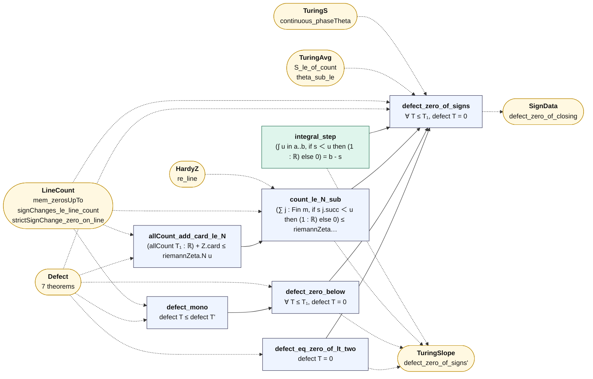

# `lean_stage3/Stage3/TuringCert.lean`

> **Read from the source text.** This file changed after the last `python3 utilities/lean_map.py --dump`, so the arrows on this page are names occurring in each proof and have not been confirmed by Lean.

TuringCert — block S14 of `lean_stage3/design/stencil.md`, Turing's method, step 3: the certificate, signs of `Z` at finitely many points ⊢ the defect is `0` up to a height. 2026-11-25.

7 theorems, 3 definitions, 345 lines. 

**Imports:** [`TuringAvg`](../lean_stage3/TuringAvg.md)  
**Imported by:** [`SignData`](../lean_stage3/SignData.md), [`Turing`](../lean_stage3/Turing.md), [`TuringSlope`](../lean_stage3/TuringSlope.md)

## The picture



An arrow A → B reads "A is used in the proof of B". Green: counting, integers only. Violet: shape, analysis with no ζ. Blue: reads ζ. A name ending in ■ is an end: nothing else uses it. Red: contains `sorry`. Yellow: theorems in another file, counted; a dotted arrow crosses files. Definitions are not drawn; they are listed below the diagram.

## Definitions

<a name="Turing-StmtSignData"></a>
### `Turing.StmtSignData`

def · line 67

The certificate's data: strict sign changes of `t ↦ Λ(1/2 + it)` (Hardy's `Z` up to a positive factor, `HardyZ`) between consecutive points of a strictly increasing run in `(0, ∞)`. A finite computation; its rigorous evaluation is not in this tree.

- **Is:** `` StmtSignData (k : ℕ) (t : Fin (k + 1) → ℝ) : Prop := StrictMono t ∧ 0 < t 0 ∧ ∀ i : Fin k, (completedRiemannZeta (1/2 + t i.castSucc * I)).re * (completedRiemannZeta (1/2 + t i.succ * I)).re < 0 ``
- **Used by 7:** [`SignData.StmtClosingData`](../lean_stage3/SignData.md#SignData-StmtClosingData), [`SignData.first_zero_signs`](../lean_stage3/SignData.md#SignData-first_zero_signs), [`SignData.run_signs`](../lean_stage3/SignData.md#SignData-run_signs), [`Turing.count_le_N_sub`](#Turing-count_le_N_sub), [`Turing.defect_zero_of_signs`](#Turing-defect_zero_of_signs), [`TuringSlope.StmtClosingData'`](../lean_stage3/TuringSlope.md#TuringSlope-StmtClosingData-), [`TuringSlope.defect_zero_of_signs'`](../lean_stage3/TuringSlope.md#TuringSlope-defect_zero_of_signs-)

<a name="Turing-turingK"></a>
### `Turing.turingK`

def · line 73

The slope of the horizon on `[T₁, T₁ + 1 + h]`.

- **Is:** `` turingK (T₁ h : ℝ) : ℝ := (Real.log ((T₁ + 1 + h) / 2) - Real.log Real.pi + 97 / T₁) / 2 ``
- **Used by 2:** [`Turing.defect_zero_of_signs`](#Turing-defect_zero_of_signs), [`Turing.turingErr`](#Turing-turingErr)

<a name="Turing-turingErr"></a>
### `Turing.turingErr`

def · line 76

Turing's error at `T₁`, window `h`, Littlewood constants `a, b`, sign points `s` above.

- **Is:** `` turingErr (a b h T₁ : ℝ) {m : ℕ} (s : Fin (m + 1) → ℝ) : ℝ := (a * Real.log (T₁ + 1 + h) + b - ∑ j : Fin m, (T₁ + h - s j.succ)) / h + h * turingK T₁ h / (2 * Real.pi) ``
- **Built from:** [`Turing.turingK`](#Turing-turingK)
- **Used by 2:** [`SignData.StmtClosingData`](../lean_stage3/SignData.md#SignData-StmtClosingData), [`Turing.defect_zero_of_signs`](#Turing-defect_zero_of_signs)

## Theorems

<a name="Turing-defect_mono"></a>
### `Turing.defect_mono`

line 82 · arrows read from text

**Reads ζ.** It, or something it rests on, uses the zeta function, its zeros or the Riemann hypothesis.

**Proves**

```lean
defect T ≤ defect T'
```

**Needs** (its hypotheses)

  - `` h : T ≤ T' ``

**Fed by** (2 theorems its proof uses)

  - [`Defect.defect_eq_offCount`](../lean_stage3/Defect.md#Defect-defect_eq_offCount) (Defect) — `` defect T = offCount T ``
  - [`LineCount.mem_zerosUpTo`](../lean_stage3/LineCount.md#LineCount-mem_zerosUpTo) (LineCount) — `` ρ ∈ zerosUpTo T ↔ 0 < (ρ : ℂ).im ∧ (ρ : ℂ).im ≤ T ``

**Definitions its proof touches:** [`Defect.defect`](../lean_stage3/Defect.md#Defect-defect), [`Defect.offCount`](../lean_stage3/Defect.md#Defect-offCount)

**Feeds** (1 that use it)

  - [`Turing.defect_zero_below`](#Turing-defect_zero_below) — `` ∀ T ≤ T₁, defect T = 0 ``

<a name="Turing-defect_eq_zero_of_lt_two"></a>
### `Turing.defect_eq_zero_of_lt_two`

line 92 · arrows read from text

**Reads ζ.** It, or something it rests on, uses the zeta function, its zeros or the Riemann hypothesis.

**Proves**

```lean
defect T = 0
```

**Needs** (its hypotheses)

  - `` h : defect T < 2 ``

**Fed by** (2 theorems its proof uses)

  - [`Defect.defect_even`](../lean_stage3/Defect.md#Defect-defect_even) (Defect) — `` Even (defect T) ``
  - [`Defect.defect_nonneg`](../lean_stage3/Defect.md#Defect-defect_nonneg) (Defect) — `` 0 ≤ defect T ``

**Definitions its proof touches:** [`Defect.defect`](../lean_stage3/Defect.md#Defect-defect)

**Feeds** (2 that use it)

  - [`Turing.defect_zero_of_signs`](#Turing-defect_zero_of_signs) — `` ∀ T ≤ T₁, defect T = 0 ``
  - [`TuringSlope.defect_zero_of_signs'`](../lean_stage3/TuringSlope.md#TuringSlope-defect_zero_of_signs-) (TuringSlope) — `` ∀ T ≤ T₁, defect T = 0 ``

<a name="Turing-defect_zero_below"></a>
### `Turing.defect_zero_below`

line 97 · arrows read from text

**Reads ζ.** It, or something it rests on, uses the zeta function, its zeros or the Riemann hypothesis.

**Proves**

```lean
∀ T ≤ T₁, defect T = 0
```

**Needs** (its hypotheses)

  - `` h : defect T₁ = 0 ``

**Fed by** (2 theorems its proof uses)

  - [`Defect.defect_nonneg`](../lean_stage3/Defect.md#Defect-defect_nonneg) (Defect) — `` 0 ≤ defect T ``
  - [`Turing.defect_mono`](#Turing-defect_mono) — `` defect T ≤ defect T' ``

**Definitions its proof touches:** [`Defect.defect`](../lean_stage3/Defect.md#Defect-defect)

**Feeds** (2 that use it)

  - [`Turing.defect_zero_of_signs`](#Turing-defect_zero_of_signs) — `` ∀ T ≤ T₁, defect T = 0 ``
  - [`TuringSlope.defect_zero_of_signs'`](../lean_stage3/TuringSlope.md#TuringSlope-defect_zero_of_signs-) (TuringSlope) — `` ∀ T ≤ T₁, defect T = 0 ``

<a name="Turing-allCount_add_card_le_N"></a>
### `Turing.allCount_add_card_le_N`

line 104 · arrows read from text

**Reads ζ.** It, or something it rests on, uses the zeta function, its zeros or the Riemann hypothesis.

**Why.** Zeros strictly between `T₁` and `u` add to the closed count at `T₁`, below `N u`.

**Proves**

```lean
(allCount T₁ : ℝ) + Z.card ≤ riemannZeta.N u
```

**Needs** (its hypotheses)

  - `` hT₁ : 0 ≤ T₁ ``
  - `` hu : T₁ < u ``
  - `` Z : Finset NontrivialZeros ``
  - `` hZ : ∀ ρ ∈ Z, T₁ < (ρ : ℂ).im ∧ (ρ : ℂ).im < u ``

**Fed by** (3 theorems its proof uses)

  - [`Defect.N_eq_sum_lt`](../lean_stage3/Defect.md#Defect-N_eq_sum_lt) (Defect) — `` riemannZeta.N T = ∑ ρ ∈ (zerosUpTo T).filter (fun ρ : NontrivialZeros => (ρ : ℂ).im < T), ((riemannZeta.order (ρ : ℂ) : ℤ) : ℝ) ``
  - [`Defect.allCount_cast`](../lean_stage3/Defect.md#Defect-allCount_cast) (Defect) — `` (allCount T : ℝ) = ∑ ρ ∈ zerosUpTo T, ((riemannZeta.order (ρ : ℂ) : ℤ) : ℝ) ``
  - [`LineCount.mem_zerosUpTo`](../lean_stage3/LineCount.md#LineCount-mem_zerosUpTo) (LineCount) — `` ρ ∈ zerosUpTo T ↔ 0 < (ρ : ℂ).im ∧ (ρ : ℂ).im ≤ T ``

**Definitions its proof touches:** [`LineCount.allCount`](../lean_stage3/LineCount.md#LineCount-allCount), [`LineCount.zerosUpTo`](../lean_stage3/LineCount.md#LineCount-zerosUpTo)

**Feeds** (1 that use it)

  - [`Turing.count_le_N_sub`](#Turing-count_le_N_sub) — `` (∑ j : Fin m, if s j.succ < u then (1 : ℝ) else 0) ≤ riemannZeta.N u - (allCount T₁ : ℝ) ``

<a name="Turing-count_le_N_sub"></a>
### `Turing.count_le_N_sub`

line 134 · arrows read from text

**Reads ζ.** It, or something it rests on, uses the zeta function, its zeros or the Riemann hypothesis.

**Why.** The count above `T₁`. Sign changes on `(s_j, s_{j+1})` above `T₁` give `#{j : s_{j+1} < u} ≤ N u − allCount T₁`.

**Proves**

```lean
(∑ j : Fin m, if s j.succ < u then (1 : ℝ) else 0) ≤ riemannZeta.N u - (allCount T₁ : ℝ)
```

**Needs** (its hypotheses)

  - `` hT₁ : 0 ≤ T₁ ``
  - `` hs : StmtSignData m s ``
  - `` hsT : T₁ < s 0 ``
  - `` hu : T₁ < u ``

**Fed by** (3 theorems its proof uses)

  - [`HardyZ.re_line`](../lean_stage3/HardyZ.md#HardyZ-re_line) (HardyZ) — `` ((1 / 2 : ℂ) + t * I).re = 1 / 2 ``
  - [`LineCount.strictSignChange_zero_on_line`](../lean_stage3/LineCount.md#LineCount-strictSignChange_zero_on_line) (LineCount) — `` ∃ γ ∈ Set.Ioo t₁ t₂, riemannZeta (1/2 + γ * I) = 0 ``
  - [`Turing.allCount_add_card_le_N`](#Turing-allCount_add_card_le_N) — `` (allCount T₁ : ℝ) + Z.card ≤ riemannZeta.N u ``

**Definitions its proof touches:** [`LineCount.allCount`](../lean_stage3/LineCount.md#LineCount-allCount), [`Turing.StmtSignData`](#Turing-StmtSignData)

**Feeds** (2 that use it)

  - [`Turing.defect_zero_of_signs`](#Turing-defect_zero_of_signs) — `` ∀ T ≤ T₁, defect T = 0 ``
  - [`TuringSlope.defect_zero_of_signs'`](../lean_stage3/TuringSlope.md#TuringSlope-defect_zero_of_signs-) (TuringSlope) — `` ∀ T ≤ T₁, defect T = 0 ``

<a name="Turing-integral_step"></a>
### `Turing.integral_step`

line 183 · arrows read from text

**Counting.** Integers only: nothing in its statement or proof, or in anything it rests on, uses analysis or ζ.

**Why.** The step function `[s < u]` integrates to `b − s` over `[a, b] ∋ s`.

**Proves**

```lean
(∫ u in a..b, if s < u then (1 : ℝ) else 0) = b - s
```

**Needs** (its hypotheses)

  - `` has : a ≤ s ``
  - `` hsb : s ≤ b ``

**Fed by:** no theorem of this repo; it stands on Mathlib.

**Feeds** (2 that use it)

  - [`Turing.defect_zero_of_signs`](#Turing-defect_zero_of_signs) — `` ∀ T ≤ T₁, defect T = 0 ``
  - [`TuringSlope.defect_zero_of_signs'`](../lean_stage3/TuringSlope.md#TuringSlope-defect_zero_of_signs-) (TuringSlope) — `` ∀ T ≤ T₁, defect T = 0 ``

<a name="Turing-defect_zero_of_signs"></a>
### `Turing.defect_zero_of_signs`

line 214 · arrows read from text

**Reads ζ.** It, or something it rests on, uses the zeta function, its zeros or the Riemann hypothesis.

**Why.** Turing's method, the analytic half. Strict sign changes of `Z` at `k + 1` points up to `T₁` and at `m + 1` points in `(T₁, T₁ + h]`, with Littlewood's bound on `S₁`, give the defect `0` at every height up to `T₁`, once `θ T₁/π + 1 + E < k + 2`.

**Proves**

```lean
∀ T ≤ T₁, defect T = 0
```

**Needs** (its hypotheses)

  - `` hbelow : StmtSignData k t ``
  - `` htT : t (Fin.last k) ≤ T₁ ``
  - `` habove : StmtSignData m s ``
  - `` hsT : T₁ < s 0 ``
  - `` hsh : s (Fin.last m) ≤ T₁ + h ``
  - `` hL : StmtLittlewood a b t₀ ``
  - `` ha : 0 ≤ a ``
  - `` ht₀ : t₀ ≤ T₁ ``
  - `` h1 : 1 ≤ T₁ ``
  - `` hh : 0 < h ``
  - `` hnum : Stage3.phaseTheta T₁ / Real.pi + 1 + turingErr a b h T₁ s < k + 2 ``

**Fed by** (10 theorems its proof uses)

  - [`Defect.N_eq_allCount_right`](../lean_stage3/Defect.md#Defect-N_eq_allCount_right) (Defect) — `` riemannZeta.N T' = (allCount T : ℝ) ∧ lineCount T' = lineCount T ``
  - [`Defect.exists_right`](../lean_stage3/Defect.md#Defect-exists_right) (Defect) — `` ∃ T' : ℝ, T < T' ∧ ∀ z : ℂ, riemannZeta z = 0 → 0 < z.im → T < z.im → T' < z.im ``
  - [`LineCount.signChanges_le_line_count`](../lean_stage3/LineCount.md#LineCount-signChanges_le_line_count) (LineCount) — `` (k : ℤ) ≤ lineCount T ``
  - [`Turing.S_le_of_count`](../lean_stage3/TuringAvg.md#Turing-S_le_of_count) (TuringAvg) — `` S t ≤ ((S₁ (t + h) - S₁ t) - (∫ u in t..t + h, c u) + K * h ^ 2 / (2 * Real.pi)) / h ``
  - [`Turing.theta_sub_le`](../lean_stage3/TuringAvg.md#Turing-theta_sub_le) (TuringAvg) — `` Stage3.phaseTheta u - Stage3.phaseTheta t ≤ (u - t) * ((Real.log (u / 2) - Real.log Real.pi + 97 / t) / 2) ``
  - [`Turing.count_le_N_sub`](#Turing-count_le_N_sub) — `` (∑ j : Fin m, if s j.succ < u then (1 : ℝ) else 0) ≤ riemannZeta.N u - (allCount T₁ : ℝ) ``
  - [`Turing.defect_eq_zero_of_lt_two`](#Turing-defect_eq_zero_of_lt_two) — `` defect T = 0 ``
  - [`Turing.defect_zero_below`](#Turing-defect_zero_below) — `` ∀ T ≤ T₁, defect T = 0 ``
  - [`Turing.integral_step`](#Turing-integral_step) — `` (∫ u in a..b, if s < u then (1 : ℝ) else 0) = b - s ``
  - [`Turing.continuous_phaseTheta`](../lean_stage3/TuringS.md#Turing-continuous_phaseTheta) (TuringS) — `` Continuous Stage3.phaseTheta ``

**Definitions its proof touches:** [`Defect.defect`](../lean_stage3/Defect.md#Defect-defect), [`LineCount.allCount`](../lean_stage3/LineCount.md#LineCount-allCount), [`LineCount.lineCount`](../lean_stage3/LineCount.md#LineCount-lineCount), [`Stage3.phaseTheta`](../lean_stage3/Stirling.md#Stage3-phaseTheta), [`Turing.StmtSignData`](#Turing-StmtSignData), [`Turing.turingErr`](#Turing-turingErr), [`Turing.turingK`](#Turing-turingK), [`Turing.S`](../lean_stage3/TuringS.md#Turing-S), [`Turing.StmtLittlewood`](../lean_stage3/TuringS.md#Turing-StmtLittlewood), [`Turing.S₁`](../lean_stage3/TuringS.md#Turing-S-)

**Feeds** (1 that use it)

  - [`SignData.defect_zero_of_closing`](../lean_stage3/SignData.md#SignData-defect_zero_of_closing) (SignData) — `` ∀ T ≤ T₁, Defect.defect T = 0 ``

