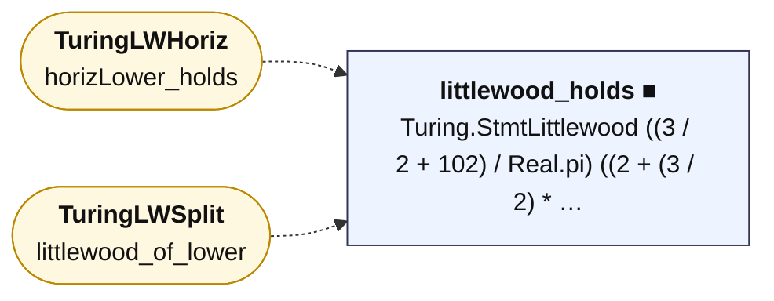

# `lean_stage3/Stage3/TuringLW.lean`

> **Read from the source text.** This file changed after the last `python3 utilities/lean_map.py --dump`, so the arrows on this page are names occurring in each proof and have not been confirmed by Lean.

# TuringLW — block S14 of `lean_stage3/design/stencil.md`, Turing's method, Littlewood's pieces assembled. 2026-11-25.

1 theorem, 0 definitions, 32 lines. 

**Imports:** [`TuringLWHoriz`](../lean_stage3/TuringLWHoriz.md), [`TuringLWSplit`](../lean_stage3/TuringLWSplit.md)  
**Imported by:** [`Stage3`](../lean_stage3/Stage3.md)

## The picture



An arrow A → B reads "A is used in the proof of B". Green: counting, integers only. Violet: shape, analysis with no ζ. Blue: reads ζ. A name ending in ■ is an end: nothing else uses it. Red: contains `sorry`. Yellow: theorems in another file, counted; a dotted arrow crosses files. Definitions are not drawn; they are listed below the diagram.

## Theorems

<a name="TuringLW-littlewood_holds"></a>
### `TuringLW.littlewood_holds`

line 22 · arrows read from text

**Reads ζ.** It, or something it rests on, uses the zeta function, its zeros or the Riemann hypothesis.

**Why.** Littlewood's bound on `∫ S`, unconditional.

**Proves**

```lean
Turing.StmtLittlewood ((3 / 2 + 102) / Real.pi) ((2 + (3 / 2) * Real.log 9 + 500) / Real.pi) 2
```

**Fed by** (2 theorems its proof uses)

  - [`TuringLW.horizLower_holds`](../lean_stage3/TuringLWHoriz.md#TuringLW-horizLower_holds) (TuringLWHoriz) — `` Turing.StmtHorizLower 102 500 ``
  - [`TuringLW.littlewood_of_lower`](../lean_stage3/TuringLWSplit.md#TuringLW-littlewood_of_lower) (TuringLWSplit) — `` Turing.StmtLittlewood ((3 / 2 + a₂) / Real.pi) ((2 + (3 / 2) * Real.log 9 + b₂) / Real.pi) 2 ``

**Definitions its proof touches:** [`Turing.StmtLittlewood`](../lean_stage3/TuringS.md#Turing-StmtLittlewood)

**Feeds:** nothing. It is an end.

