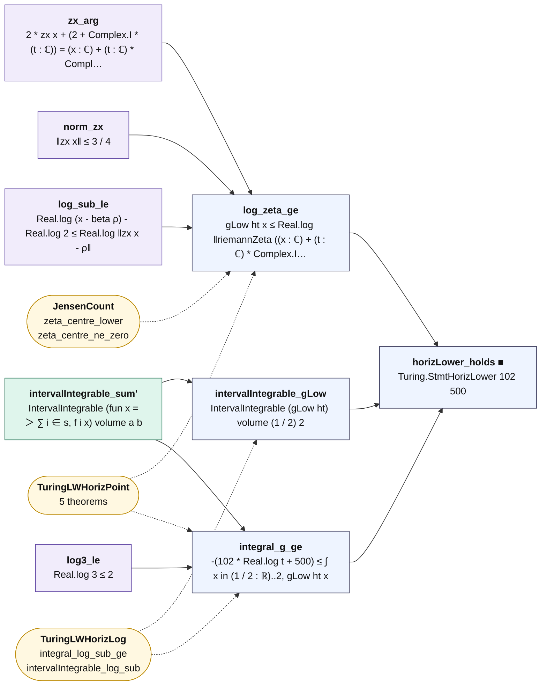

# `lean_stage3/Stage3/TuringLWHoriz.lean`

> **Read from the source text.** This file changed after the last `python3 utilities/lean_map.py --dump`, so the arrows on this page are names occurring in each proof and have not been confirmed by Lean.

TuringLWHoriz — block S14 of `lean_stage3/design/stencil.md`, Turing's method, Littlewood's three pieces: the lower side `Turing.StmtHorizLower a₂ b₂`, proved with `a₂ = 102`, `b₂ = 500`. 2026-11-25.

9 theorems, 3 definitions, 246 lines. 

**Imports:** [`TuringLWHorizLog`](../lean_stage3/TuringLWHorizLog.md), [`TuringLWHorizPoint`](../lean_stage3/TuringLWHorizPoint.md), [`TuringS`](../lean_stage3/TuringS.md)  
**Imported by:** [`Stage3`](../lean_stage3/Stage3.md)

## The picture



An arrow A → B reads "A is used in the proof of B". Green: counting, integers only. Violet: shape, analysis with no ζ. Blue: reads ζ. A name ending in ■ is an end: nothing else uses it. Red: contains `sorry`. Yellow: theorems in another file, counted; a dotted arrow crosses files. Definitions are not drawn; they are listed below the diagram.

## Definitions

<a name="TuringLW-zx"></a>
### `TuringLW.zx`

def · line 61

The point of the model's disc over `x + it`.

- **Is:** `` zx (x : ℝ) : ℂ := (((x - 2) / 2 : ℝ) : ℂ) ``
- **Used by 4:** [`TuringLW.log_sub_le`](#TuringLW-log_sub_le), [`TuringLW.log_zeta_ge`](#TuringLW-log_zeta_ge), [`TuringLW.norm_zx`](#TuringLW-norm_zx), [`TuringLW.zx_arg`](#TuringLW-zx_arg)

<a name="TuringLW-beta"></a>
### `TuringLW.beta`

def · line 64

The real abscissa of a model zero, pulled back to `s`.

- **Is:** `` beta (ρ : ℂ) : ℝ := 2 + 2 * ρ.re ``
- **Used by 6:** [`TuringLW.gLow`](#TuringLW-gLow), [`TuringLW.horizLower_holds`](#TuringLW-horizLower_holds), [`TuringLW.integral_g_ge`](#TuringLW-integral_g_ge), [`TuringLW.intervalIntegrable_gLow`](#TuringLW-intervalIntegrable_gLow), [`TuringLW.log_sub_le`](#TuringLW-log_sub_le), [`TuringLW.log_zeta_ge`](#TuringLW-log_zeta_ge)

<a name="TuringLW-gLow"></a>
### `TuringLW.gLow`

def · line 67

The lower function.

- **Is:** `` gLow {t : ℝ} (ht : 2 ≤ t) (x : ℝ) : ℝ := -12 * Real.log (84 * t) - zeroMass ht * Real.log 2 - Real.log 3 + ∑ ρ ∈ zeroSet ht, (analyticOrderNatAt (jensenF t) ρ : ℝ) * (Real.log (x - beta ρ) - Real.log 2) ``
- **Built from:** [`Stage3.jensenF`](../lean_stage3/JensenCount.md#Stage3-jensenF), [`TuringLW.beta`](#TuringLW-beta), [`TuringLW.zeroMass`](../lean_stage3/TuringLWHorizPoint.md#TuringLW-zeroMass), [`TuringLW.zeroSet`](../lean_stage3/TuringLWHorizPoint.md#TuringLW-zeroSet)
- **Used by 4:** [`TuringLW.horizLower_holds`](#TuringLW-horizLower_holds), [`TuringLW.integral_g_ge`](#TuringLW-integral_g_ge), [`TuringLW.intervalIntegrable_gLow`](#TuringLW-intervalIntegrable_gLow), [`TuringLW.log_zeta_ge`](#TuringLW-log_zeta_ge)

## Theorems

<a name="TuringLW-zx_arg"></a>
### `TuringLW.zx_arg`

line 72 · arrows read from text

**Shape.** Uses real or complex analysis; nothing in it or beneath it reads ζ.

**Proves**

```lean
2 * zx x + (2 + Complex.I * (t : ℂ)) = (x : ℂ) + (t : ℂ) * Complex.I
```

**Needs** (its hypotheses)

  - `` x t : ℝ ``

**Fed by:** no theorem of this repo; it stands on Mathlib and the definitions below.

**Definitions its proof touches:** [`TuringLW.zx`](#TuringLW-zx)

**Feeds** (1 that use it)

  - [`TuringLW.log_zeta_ge`](#TuringLW-log_zeta_ge) — `` gLow ht x ≤ Real.log ‖riemannZeta ((x : ℂ) + (t : ℂ) * Complex.I)‖ ``

<a name="TuringLW-norm_zx"></a>
### `TuringLW.norm_zx`

line 76 · arrows read from text

**Shape.** Uses real or complex analysis; nothing in it or beneath it reads ζ.

**Proves**

```lean
‖zx x‖ ≤ 3 / 4
```

**Needs** (its hypotheses)

  - `` hx1 : 1 / 2 ≤ x ``
  - `` hx2 : x ≤ 2 ``

**Fed by:** no theorem of this repo; it stands on Mathlib and the definitions below.

**Definitions its proof touches:** [`TuringLW.zx`](#TuringLW-zx)

**Feeds** (1 that use it)

  - [`TuringLW.log_zeta_ge`](#TuringLW-log_zeta_ge) — `` gLow ht x ≤ Real.log ‖riemannZeta ((x : ℂ) + (t : ℂ) * Complex.I)‖ ``

<a name="TuringLW-log_sub_le"></a>
### `TuringLW.log_sub_le`

line 82 · arrows read from text

**Shape.** Uses real or complex analysis; nothing in it or beneath it reads ζ.

**Why.** `log(x − β_ρ) − log 2 ≤ log‖z(x) − ρ‖` for `x ≠ β_ρ`.

**Proves**

```lean
Real.log (x - beta ρ) - Real.log 2 ≤ Real.log ‖zx x - ρ‖
```

**Needs** (its hypotheses)

  - `` hx : x ≠ beta ρ ``

**Fed by:** no theorem of this repo; it stands on Mathlib and the definitions below.

**Definitions its proof touches:** [`TuringLW.beta`](#TuringLW-beta), [`TuringLW.zx`](#TuringLW-zx)

**Feeds** (1 that use it)

  - [`TuringLW.log_zeta_ge`](#TuringLW-log_zeta_ge) — `` gLow ht x ≤ Real.log ‖riemannZeta ((x : ℂ) + (t : ℂ) * Complex.I)‖ ``

<a name="TuringLW-log_zeta_ge"></a>
### `TuringLW.log_zeta_ge`

line 97 · arrows read from text

**Reads ζ.** It, or something it rests on, uses the zeta function, its zeros or the Riemann hypothesis.

**Why.** The pointwise lower bound on the segment.

**Proves**

```lean
gLow ht x ≤ Real.log ‖riemannZeta ((x : ℂ) + (t : ℂ) * Complex.I)‖
```

**Needs** (its hypotheses)

  - `` ht : 2 ≤ t ``
  - `` hx1 : 1 / 2 ≤ x ``
  - `` hx2 : x ≤ 2 ``
  - `` hxE : x ∉ (zeroSet ht).image beta ``

**Fed by** (6 theorems its proof uses)

  - [`Stage3.zeta_centre_lower`](../lean_stage3/JensenCount.md#Stage3-zeta_centre_lower) (JensenCount) — `` (1 : ℝ) / 3 ≤ ‖ζ (2 + Complex.I * T)‖ ``
  - [`Stage3.zeta_centre_ne_zero`](../lean_stage3/JensenCount.md#Stage3-zeta_centre_ne_zero) (JensenCount) — `` ζ (2 + Complex.I * (T : ℂ)) ≠ 0 ``
  - [`TuringLW.log_sub_le`](#TuringLW-log_sub_le) — `` Real.log (x - beta ρ) - Real.log 2 ≤ Real.log ‖zx x - ρ‖ ``
  - [`TuringLW.norm_zx`](#TuringLW-norm_zx) — `` ‖zx x‖ ≤ 3 / 4 ``
  - [`TuringLW.zx_arg`](#TuringLW-zx_arg) — `` 2 * zx x + (2 + Complex.I * (t : ℂ)) = (x : ℂ) + (t : ℂ) * Complex.I ``
  - [`TuringLW.log_jensenF_ge`](../lean_stage3/TuringLWHorizPoint.md#TuringLW-log_jensenF_ge) (TuringLWHorizPoint) — `` -12 * Real.log (84 * T) - zeroMass hT * Real.log 2 + ∑ ρ ∈ zeroSet hT, (analyticOrderNatAt (jensenF T) ρ : ℝ) * Real.log ‖z - ρ‖ ≤ Real.log ‖jensenF T… ``

**Definitions its proof touches:** [`Stage3.jensenF`](../lean_stage3/JensenCount.md#Stage3-jensenF), [`TuringLW.beta`](#TuringLW-beta), [`TuringLW.gLow`](#TuringLW-gLow), [`TuringLW.zx`](#TuringLW-zx), [`TuringLW.zeroSet`](../lean_stage3/TuringLWHorizPoint.md#TuringLW-zeroSet)

**Feeds** (1 that use it)

  - [`TuringLW.horizLower_holds`](#TuringLW-horizLower_holds) — `` Turing.StmtHorizLower 102 500 ``

<a name="TuringLW-intervalIntegrable_sum-"></a>
### `TuringLW.intervalIntegrable_sum'`

line 137 · arrows read from text

**Counting.** Integers only: nothing in its statement or proof, or in anything it rests on, uses analysis or ζ.

**Why.** A finite sum of interval-integrable real functions, in lambda form.

**Proves**

```lean
IntervalIntegrable (fun x => ∑ i ∈ s, f i x) volume a b
```

**Needs** (its hypotheses)

  - `` s : Finset ι ``
  - `` f : ι → ℝ → ℝ ``
  - `` h : ∀ i ∈ s, IntervalIntegrable (f i) volume a b ``

**Fed by:** no theorem of this repo; it stands on Mathlib.

**Feeds** (2 that use it)

  - [`TuringLW.integral_g_ge`](#TuringLW-integral_g_ge) — `` -(102 * Real.log t + 500) ≤ ∫ x in (1 / 2 : ℝ)..2, gLow ht x ``
  - [`TuringLW.intervalIntegrable_gLow`](#TuringLW-intervalIntegrable_gLow) — `` IntervalIntegrable (gLow ht) volume (1 / 2) 2 ``

<a name="TuringLW-intervalIntegrable_gLow"></a>
### `TuringLW.intervalIntegrable_gLow`

line 149 · arrows read from text

**Reads ζ.** It, or something it rests on, uses the zeta function, its zeros or the Riemann hypothesis.

**Why.** The lower function is integrable on the segment.

**Proves**

```lean
IntervalIntegrable (gLow ht) volume (1 / 2) 2
```

**Needs** (its hypotheses)

  - `` ht : 2 ≤ t ``

**Fed by** (2 theorems its proof uses)

  - [`TuringLW.intervalIntegrable_sum'`](#TuringLW-intervalIntegrable_sum-) — `` IntervalIntegrable (fun x => ∑ i ∈ s, f i x) volume a b ``
  - [`TuringLW.intervalIntegrable_log_sub`](../lean_stage3/TuringLWHorizLog.md#TuringLW-intervalIntegrable_log_sub) (TuringLWHorizLog) — `` IntervalIntegrable (fun x : ℝ => Real.log (x - β)) volume (1 / 2) 2 ``

**Definitions its proof touches:** [`Stage3.jensenF`](../lean_stage3/JensenCount.md#Stage3-jensenF), [`TuringLW.beta`](#TuringLW-beta), [`TuringLW.gLow`](#TuringLW-gLow), [`TuringLW.zeroSet`](../lean_stage3/TuringLWHorizPoint.md#TuringLW-zeroSet)

**Feeds** (1 that use it)

  - [`TuringLW.horizLower_holds`](#TuringLW-horizLower_holds) — `` Turing.StmtHorizLower 102 500 ``

<a name="TuringLW-log3_le"></a>
### `TuringLW.log3_le`

line 159 · arrows read from text

**Shape.** Uses real or complex analysis; nothing in it or beneath it reads ζ.

**Why.** `log 3 ≤ 2`.

**Proves**

```lean
Real.log 3 ≤ 2
```

**Fed by:** no theorem of this repo; it stands on Mathlib.

**Feeds** (1 that use it)

  - [`TuringLW.integral_g_ge`](#TuringLW-integral_g_ge) — `` -(102 * Real.log t + 500) ≤ ∫ x in (1 / 2 : ℝ)..2, gLow ht x ``

<a name="TuringLW-integral_g_ge"></a>
### `TuringLW.integral_g_ge`

line 164 · arrows read from text

**Reads ζ.** It, or something it rests on, uses the zeta function, its zeros or the Riemann hypothesis.

**Why.** The integral of the lower function.

**Proves**

```lean
-(102 * Real.log t + 500) ≤ ∫ x in (1 / 2 : ℝ)..2, gLow ht x
```

**Needs** (its hypotheses)

  - `` ht : 2 ≤ t ``

**Fed by** (8 theorems its proof uses)

  - [`TuringLW.intervalIntegrable_sum'`](#TuringLW-intervalIntegrable_sum-) — `` IntervalIntegrable (fun x => ∑ i ∈ s, f i x) volume a b ``
  - [`TuringLW.log3_le`](#TuringLW-log3_le) — `` Real.log 3 ≤ 2 ``
  - [`TuringLW.integral_log_sub_ge`](../lean_stage3/TuringLWHorizLog.md#TuringLW-integral_log_sub_ge) (TuringLWHorizLog) — `` -(7 / 2) ≤ ∫ x in (1 / 2 : ℝ)..2, Real.log (x - β) ``
  - [`TuringLW.intervalIntegrable_log_sub`](../lean_stage3/TuringLWHorizLog.md#TuringLW-intervalIntegrable_log_sub) (TuringLWHorizLog) — `` IntervalIntegrable (fun x : ℝ => Real.log (x - β)) volume (1 / 2) 2 ``
  - [`TuringLW.log84T_eq`](../lean_stage3/TuringLWHorizPoint.md#TuringLW-log84T_eq) (TuringLWHorizPoint) — `` Real.log (84 * T) = Real.log 84 + Real.log T ``
  - [`TuringLW.log84T_pos`](../lean_stage3/TuringLWHorizPoint.md#TuringLW-log84T_pos) (TuringLWHorizPoint) — `` 0 < Real.log (84 * T) ``
  - [`TuringLW.log84_le`](../lean_stage3/TuringLWHorizPoint.md#TuringLW-log84_le) (TuringLWHorizPoint) — `` Real.log 84 ≤ 4.86 ``
  - [`TuringLW.zeroMass_le`](../lean_stage3/TuringLWHorizPoint.md#TuringLW-zeroMass_le) (TuringLWHorizPoint) — `` zeroMass hT ≤ 15 * Real.log (84 * T) ``

**Definitions its proof touches:** [`Stage3.jensenF`](../lean_stage3/JensenCount.md#Stage3-jensenF), [`TuringLW.beta`](#TuringLW-beta), [`TuringLW.gLow`](#TuringLW-gLow), [`TuringLW.zeroMass`](../lean_stage3/TuringLWHorizPoint.md#TuringLW-zeroMass), [`TuringLW.zeroSet`](../lean_stage3/TuringLWHorizPoint.md#TuringLW-zeroSet)

**Feeds** (1 that use it)

  - [`TuringLW.horizLower_holds`](#TuringLW-horizLower_holds) — `` Turing.StmtHorizLower 102 500 ``

<a name="TuringLW-horizLower_holds"></a>
### `TuringLW.horizLower_holds`

line 213 · arrows read from text

**Reads ζ.** It, or something it rests on, uses the zeta function, its zeros or the Riemann hypothesis.

**Why.** The lower side, proved. `StmtHorizLower 102 500`.

**Proves**

```lean
Turing.StmtHorizLower 102 500
```

**Fed by** (3 theorems its proof uses)

  - [`TuringLW.integral_g_ge`](#TuringLW-integral_g_ge) — `` -(102 * Real.log t + 500) ≤ ∫ x in (1 / 2 : ℝ)..2, gLow ht x ``
  - [`TuringLW.intervalIntegrable_gLow`](#TuringLW-intervalIntegrable_gLow) — `` IntervalIntegrable (gLow ht) volume (1 / 2) 2 ``
  - [`TuringLW.log_zeta_ge`](#TuringLW-log_zeta_ge) — `` gLow ht x ≤ Real.log ‖riemannZeta ((x : ℂ) + (t : ℂ) * Complex.I)‖ ``

**Definitions its proof touches:** [`TuringLW.beta`](#TuringLW-beta), [`TuringLW.gLow`](#TuringLW-gLow), [`TuringLW.zeroSet`](../lean_stage3/TuringLWHorizPoint.md#TuringLW-zeroSet), [`Turing.StmtHorizLower`](../lean_stage3/TuringS.md#Turing-StmtHorizLower)

**Feeds:** nothing. It is an end.

