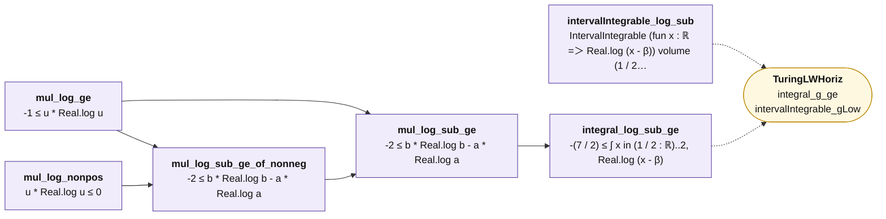

# `lean_stage3/Stage3/TuringLWHorizLog.lean`

> **Read from the source text.** This file changed after the last `python3 utilities/lean_map.py --dump`, so the arrows on this page are names occurring in each proof and have not been confirmed by Lean.

TuringLWHorizLog — block S14 of `lean_stage3/design/stencil.md`, Turing's method, Littlewood's pieces: the lower side `StmtHorizLower`, part 1, the integral of one zero's singularity. 2026-11-25.

6 theorems, 0 definitions, 99 lines. 

**Imports:** nothing in this tree  
**Imported by:** [`TuringLWHoriz`](../lean_stage3/TuringLWHoriz.md)

## The picture



An arrow A → B reads "A is used in the proof of B". Green: counting, integers only. Violet: shape, analysis with no ζ. Blue: reads ζ. A name ending in ■ is an end: nothing else uses it. Red: contains `sorry`. Yellow: theorems in another file, counted; a dotted arrow crosses files. Definitions are not drawn; they are listed below the diagram.

## Theorems

<a name="TuringLW-mul_log_ge"></a>
### `TuringLW.mul_log_ge`

line 33 · arrows read from text

**Shape.** Uses real or complex analysis; nothing in it or beneath it reads ζ.

**Why.** `u log u ≥ −1` for `u ≥ 0`.

**Proves**

```lean
-1 ≤ u * Real.log u
```

**Needs** (its hypotheses)

  - `` hu : 0 ≤ u ``

**Fed by:** no theorem of this repo; it stands on Mathlib.

**Feeds** (2 that use it)

  - [`TuringLW.mul_log_sub_ge`](#TuringLW-mul_log_sub_ge) — `` -2 ≤ b * Real.log b - a * Real.log a ``
  - [`TuringLW.mul_log_sub_ge_of_nonneg`](#TuringLW-mul_log_sub_ge_of_nonneg) — `` -2 ≤ b * Real.log b - a * Real.log a ``

<a name="TuringLW-mul_log_nonpos"></a>
### `TuringLW.mul_log_nonpos`

line 42 · arrows read from text

**Shape.** Uses real or complex analysis; nothing in it or beneath it reads ζ.

**Why.** `u log u ≤ 0` on `[0, 1]`.

**Proves**

```lean
u * Real.log u ≤ 0
```

**Needs** (its hypotheses)

  - `` hu : 0 ≤ u ``
  - `` h1 : u ≤ 1 ``

**Fed by:** no theorem of this repo; it stands on Mathlib.

**Feeds** (1 that use it)

  - [`TuringLW.mul_log_sub_ge_of_nonneg`](#TuringLW-mul_log_sub_ge_of_nonneg) — `` -2 ≤ b * Real.log b - a * Real.log a ``

<a name="TuringLW-mul_log_sub_ge_of_nonneg"></a>
### `TuringLW.mul_log_sub_ge_of_nonneg`

line 46 · arrows read from text

**Shape.** Uses real or complex analysis; nothing in it or beneath it reads ζ.

**Why.** The case `0 ≤ a ≤ b`.

**Proves**

```lean
-2 ≤ b * Real.log b - a * Real.log a
```

**Needs** (its hypotheses)

  - `` ha : 0 ≤ a ``
  - `` hab : a ≤ b ``

**Fed by** (2 theorems its proof uses)

  - [`TuringLW.mul_log_ge`](#TuringLW-mul_log_ge) — `` -1 ≤ u * Real.log u ``
  - [`TuringLW.mul_log_nonpos`](#TuringLW-mul_log_nonpos) — `` u * Real.log u ≤ 0 ``

**Feeds** (1 that use it)

  - [`TuringLW.mul_log_sub_ge`](#TuringLW-mul_log_sub_ge) — `` -2 ≤ b * Real.log b - a * Real.log a ``

<a name="TuringLW-mul_log_sub_ge"></a>
### `TuringLW.mul_log_sub_ge`

line 60 · arrows read from text

**Shape.** Uses real or complex analysis; nothing in it or beneath it reads ζ.

**Why.** `b log b − a log a ≥ −2` for all `a ≤ b` (`Real.log` is even).

**Proves**

```lean
-2 ≤ b * Real.log b - a * Real.log a
```

**Needs** (its hypotheses)

  - `` hab : a ≤ b ``

**Fed by** (2 theorems its proof uses)

  - [`TuringLW.mul_log_ge`](#TuringLW-mul_log_ge) — `` -1 ≤ u * Real.log u ``
  - [`TuringLW.mul_log_sub_ge_of_nonneg`](#TuringLW-mul_log_sub_ge_of_nonneg) — `` -2 ≤ b * Real.log b - a * Real.log a ``

**Feeds** (1 that use it)

  - [`TuringLW.integral_log_sub_ge`](#TuringLW-integral_log_sub_ge) — `` -(7 / 2) ≤ ∫ x in (1 / 2 : ℝ)..2, Real.log (x - β) ``

<a name="TuringLW-intervalIntegrable_log_sub"></a>
### `TuringLW.intervalIntegrable_log_sub`

line 74 · arrows read from text

**Shape.** Uses real or complex analysis; nothing in it or beneath it reads ζ.

**Why.** `x ↦ log(x − β)` is integrable on `[1/2, 2]`.

**Proves**

```lean
IntervalIntegrable (fun x : ℝ => Real.log (x - β)) volume (1 / 2) 2
```

**Needs** (its hypotheses)

  - `` β : ℝ ``

**Fed by:** no theorem of this repo; it stands on Mathlib.

**Feeds** (2 that use it)

  - [`TuringLW.integral_g_ge`](../lean_stage3/TuringLWHoriz.md#TuringLW-integral_g_ge) (TuringLWHoriz) — `` -(102 * Real.log t + 500) ≤ ∫ x in (1 / 2 : ℝ)..2, gLow ht x ``
  - [`TuringLW.intervalIntegrable_gLow`](../lean_stage3/TuringLWHoriz.md#TuringLW-intervalIntegrable_gLow) (TuringLWHoriz) — `` IntervalIntegrable (gLow ht) volume (1 / 2) 2 ``

<a name="TuringLW-integral_log_sub_ge"></a>
### `TuringLW.integral_log_sub_ge`

line 80 · arrows read from text

**Shape.** Uses real or complex analysis; nothing in it or beneath it reads ζ.

**Why.** One zero's singularity, integrated. `∫_{1/2}^{2} log(x − β) dx ≥ −7/2` for every `β`.

**Proves**

```lean
-(7 / 2) ≤ ∫ x in (1 / 2 : ℝ)..2, Real.log (x - β)
```

**Needs** (its hypotheses)

  - `` β : ℝ ``

**Fed by** (1 theorem its proof uses)

  - [`TuringLW.mul_log_sub_ge`](#TuringLW-mul_log_sub_ge) — `` -2 ≤ b * Real.log b - a * Real.log a ``

**Feeds** (1 that use it)

  - [`TuringLW.integral_g_ge`](../lean_stage3/TuringLWHoriz.md#TuringLW-integral_g_ge) (TuringLWHoriz) — `` -(102 * Real.log t + 500) ≤ ∫ x in (1 / 2 : ℝ)..2, gLow ht x ``

