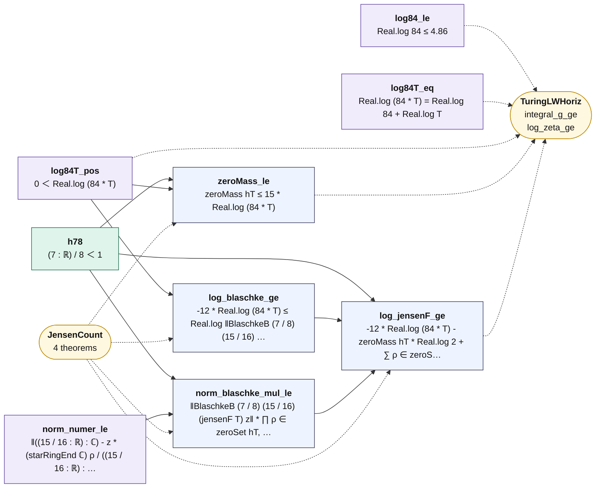

# `lean_stage3/Stage3/TuringLWHorizPoint.lean`

> **Read from the source text.** This file changed after the last `python3 utilities/lean_map.py --dump`, so the arrows on this page are names occurring in each proof and have not been confirmed by Lean.

TuringLWHorizPoint — block S14 of `lean_stage3/design/stencil.md`, Turing's method, Littlewood's pieces: the lower side `StmtHorizLower`, part 2, the pointwise lower bound for `log|ζ|` near the segment. 2026-11-25.

9 theorems, 2 definitions, 245 lines. 

**Imports:** [`JensenCount`](../lean_stage3/JensenCount.md)  
**Imported by:** [`TuringLWHoriz`](../lean_stage3/TuringLWHoriz.md)

## The picture



An arrow A → B reads "A is used in the proof of B". Green: counting, integers only. Violet: shape, analysis with no ζ. Blue: reads ζ. A name ending in ■ is an end: nothing else uses it. Red: contains `sorry`. Yellow: theorems in another file, counted; a dotted arrow crosses files. Definitions are not drawn; they are listed below the diagram.

## Definitions

<a name="TuringLW-zeroSet"></a>
### `TuringLW.zeroSet`

def · line 56

The zeros of `jensenF T` in `‖z‖ ≤ 7/8`.

- **Is:** `` zeroSet {T : ℝ} (hT : 2 ≤ T) : Finset ℂ := (finiteSetOfZeros_mono h78 (jensenF_zeros_finite hT)).toFinset ``
- **Built from:** [`Stage3.jensenF_zeros_finite`](../lean_stage3/JensenCount.md#Stage3-jensenF_zeros_finite), [`TuringLW.h78`](#TuringLW-h78)
- **Used by 9:** [`TuringLW.gLow`](../lean_stage3/TuringLWHoriz.md#TuringLW-gLow), [`TuringLW.horizLower_holds`](../lean_stage3/TuringLWHoriz.md#TuringLW-horizLower_holds), [`TuringLW.integral_g_ge`](../lean_stage3/TuringLWHoriz.md#TuringLW-integral_g_ge), [`TuringLW.intervalIntegrable_gLow`](../lean_stage3/TuringLWHoriz.md#TuringLW-intervalIntegrable_gLow), [`TuringLW.log_zeta_ge`](../lean_stage3/TuringLWHoriz.md#TuringLW-log_zeta_ge), [`TuringLW.log_jensenF_ge`](#TuringLW-log_jensenF_ge), [`TuringLW.norm_blaschke_mul_le`](#TuringLW-norm_blaschke_mul_le), [`TuringLW.zeroMass`](#TuringLW-zeroMass), [`TuringLW.zeroMass_le`](#TuringLW-zeroMass_le)

<a name="TuringLW-zeroMass"></a>
### `TuringLW.zeroMass`

def · line 60

Their total order.

- **Is:** `` zeroMass {T : ℝ} (hT : 2 ≤ T) : ℝ := ∑ ρ ∈ zeroSet hT, (analyticOrderNatAt (jensenF T) ρ : ℝ) ``
- **Built from:** [`Stage3.jensenF`](../lean_stage3/JensenCount.md#Stage3-jensenF), [`TuringLW.zeroSet`](#TuringLW-zeroSet)
- **Used by 4:** [`TuringLW.gLow`](../lean_stage3/TuringLWHoriz.md#TuringLW-gLow), [`TuringLW.integral_g_ge`](../lean_stage3/TuringLWHoriz.md#TuringLW-integral_g_ge), [`TuringLW.log_jensenF_ge`](#TuringLW-log_jensenF_ge), [`TuringLW.zeroMass_le`](#TuringLW-zeroMass_le)

## Theorems

<a name="TuringLW-h78"></a>
### `TuringLW.h78`

line 53 · arrows read from text

**Counting.** Integers only: nothing in its statement or proof, or in anything it rests on, uses analysis or ζ.

**Proves**

```lean
(7 : ℝ) / 8 < 1
```

**Fed by:** no theorem of this repo; it stands on Mathlib.

**Feeds** (4 that use it)

  - [`TuringLW.log_jensenF_ge`](#TuringLW-log_jensenF_ge) — `` -12 * Real.log (84 * T) - zeroMass hT * Real.log 2 + ∑ ρ ∈ zeroSet hT, (analyticOrderNatAt (jensenF T) ρ : ℝ) * Real.log ‖z - ρ‖ ≤ Real.log ‖jensenF T… ``
  - [`TuringLW.norm_blaschke_mul_le`](#TuringLW-norm_blaschke_mul_le) — `` ‖BlaschkeB (7 / 8) (15 / 16) (jensenF T) z‖ * ∏ ρ ∈ zeroSet hT, ‖z - ρ‖ ^ analyticOrderNatAt (jensenF T) ρ ≤ ‖jensenF T z‖ * 2 ^ (∑ ρ ∈ zeroSet hT, an… ``
  - [`TuringLW.zeroMass_le`](#TuringLW-zeroMass_le) — `` zeroMass hT ≤ 15 * Real.log (84 * T) ``
  - [`TuringLW.zeroSet`](#TuringLW-zeroSet) — def

<a name="TuringLW-log84_le"></a>
### `TuringLW.log84_le`

line 64 · arrows read from text

**Shape.** Uses real or complex analysis; nothing in it or beneath it reads ζ.

**Why.** `log 84 ≤ 4.86`.

**Proves**

```lean
Real.log 84 ≤ 4.86
```

**Fed by:** no theorem of this repo; it stands on Mathlib.

**Feeds** (1 that use it)

  - [`TuringLW.integral_g_ge`](../lean_stage3/TuringLWHoriz.md#TuringLW-integral_g_ge) (TuringLWHoriz) — `` -(102 * Real.log t + 500) ≤ ∫ x in (1 / 2 : ℝ)..2, gLow ht x ``

<a name="TuringLW-log84T_eq"></a>
### `TuringLW.log84T_eq`

line 73 · arrows read from text

**Shape.** Uses real or complex analysis; nothing in it or beneath it reads ζ.

**Why.** `log(84 T) = log 84 + log T > 0`.

**Proves**

```lean
Real.log (84 * T) = Real.log 84 + Real.log T
```

**Needs** (its hypotheses)

  - `` hT : 2 ≤ T ``

**Fed by:** no theorem of this repo; it stands on Mathlib.

**Feeds** (1 that use it)

  - [`TuringLW.integral_g_ge`](../lean_stage3/TuringLWHoriz.md#TuringLW-integral_g_ge) (TuringLWHoriz) — `` -(102 * Real.log t + 500) ≤ ∫ x in (1 / 2 : ℝ)..2, gLow ht x ``

<a name="TuringLW-log84T_pos"></a>
### `TuringLW.log84T_pos`

line 76 · arrows read from text

**Shape.** Uses real or complex analysis; nothing in it or beneath it reads ζ.

**Proves**

```lean
0 < Real.log (84 * T)
```

**Needs** (its hypotheses)

  - `` hT : 2 ≤ T ``

**Fed by:** no theorem of this repo; it stands on Mathlib.

**Feeds** (3 that use it)

  - [`TuringLW.integral_g_ge`](../lean_stage3/TuringLWHoriz.md#TuringLW-integral_g_ge) (TuringLWHoriz) — `` -(102 * Real.log t + 500) ≤ ∫ x in (1 / 2 : ℝ)..2, gLow ht x ``
  - [`TuringLW.log_blaschke_ge`](#TuringLW-log_blaschke_ge) — `` -12 * Real.log (84 * T) ≤ Real.log ‖BlaschkeB (7 / 8) (15 / 16) (jensenF T) z‖ ``
  - [`TuringLW.zeroMass_le`](#TuringLW-zeroMass_le) — `` zeroMass hT ≤ 15 * Real.log (84 * T) ``

<a name="TuringLW-zeroMass_le"></a>
### `TuringLW.zeroMass_le`

line 80 · arrows read from text

**Reads ζ.** It, or something it rests on, uses the zeta function, its zeros or the Riemann hypothesis.

**Why.** The zero count in the model's coordinates.

**Proves**

```lean
zeroMass hT ≤ 15 * Real.log (84 * T)
```

**Needs** (its hypotheses)

  - `` hT : 2 ≤ T ``

**Fed by** (6 theorems its proof uses)

  - [`Stage3.jensenF_analytic`](../lean_stage3/JensenCount.md#Stage3-jensenF_analytic) (JensenCount) — `` AnalyticOnNhd ℂ (jensenF T) (Metric.closedBall (0 : ℂ) 1) ``
  - [`Stage3.jensenF_bound`](../lean_stage3/JensenCount.md#Stage3-jensenF_bound) (JensenCount) — `` ‖jensenF T z‖ ≤ 84 * T ``
  - [`Stage3.jensenF_zero_eq_one`](../lean_stage3/JensenCount.md#Stage3-jensenF_zero_eq_one) (JensenCount) — `` jensenF T 0 = 1 ``
  - [`Stage3.jensenF_zeros_finite`](../lean_stage3/JensenCount.md#Stage3-jensenF_zeros_finite) (JensenCount) — `` (SetOfZeros 1 (jensenF T)).Finite ``
  - [`TuringLW.h78`](#TuringLW-h78) — `` (7 : ℝ) / 8 < 1 ``
  - [`TuringLW.log84T_pos`](#TuringLW-log84T_pos) — `` 0 < Real.log (84 * T) ``

**Definitions its proof touches:** [`Stage3.jensenF`](../lean_stage3/JensenCount.md#Stage3-jensenF), [`TuringLW.zeroMass`](#TuringLW-zeroMass), [`TuringLW.zeroSet`](#TuringLW-zeroSet)

**Feeds** (1 that use it)

  - [`TuringLW.integral_g_ge`](../lean_stage3/TuringLWHoriz.md#TuringLW-integral_g_ge) (TuringLWHoriz) — `` -(102 * Real.log t + 500) ≤ ∫ x in (1 / 2 : ℝ)..2, gLow ht x ``

<a name="TuringLW-log_blaschke_ge"></a>
### `TuringLW.log_blaschke_ge`

line 100 · arrows read from text

**Reads ζ.** It, or something it rests on, uses the zeta function, its zeros or the Riemann hypothesis.

**Why.** Borel–Carathéodory on the Blaschke quotient.

**Proves**

```lean
-12 * Real.log (84 * T) ≤ Real.log ‖BlaschkeB (7 / 8) (15 / 16) (jensenF T) z‖
```

**Needs** (its hypotheses)

  - `` hT : 2 ≤ T ``
  - `` hz : ‖z‖ ≤ 3 / 4 ``

**Fed by** (5 theorems its proof uses)

  - [`Stage3.jensenF_analytic`](../lean_stage3/JensenCount.md#Stage3-jensenF_analytic) (JensenCount) — `` AnalyticOnNhd ℂ (jensenF T) (Metric.closedBall (0 : ℂ) 1) ``
  - [`Stage3.jensenF_bound`](../lean_stage3/JensenCount.md#Stage3-jensenF_bound) (JensenCount) — `` ‖jensenF T z‖ ≤ 84 * T ``
  - [`Stage3.jensenF_zero_eq_one`](../lean_stage3/JensenCount.md#Stage3-jensenF_zero_eq_one) (JensenCount) — `` jensenF T 0 = 1 ``
  - [`Stage3.jensenF_zeros_finite`](../lean_stage3/JensenCount.md#Stage3-jensenF_zeros_finite) (JensenCount) — `` (SetOfZeros 1 (jensenF T)).Finite ``
  - [`TuringLW.log84T_pos`](#TuringLW-log84T_pos) — `` 0 < Real.log (84 * T) ``

**Definitions its proof touches:** [`Stage3.jensenF`](../lean_stage3/JensenCount.md#Stage3-jensenF)

**Feeds** (1 that use it)

  - [`TuringLW.log_jensenF_ge`](#TuringLW-log_jensenF_ge) — `` -12 * Real.log (84 * T) - zeroMass hT * Real.log 2 + ∑ ρ ∈ zeroSet hT, (analyticOrderNatAt (jensenF T) ρ : ℝ) * Real.log ‖z - ρ‖ ≤ Real.log ‖jensenF T… ``

<a name="TuringLW-norm_numer_le"></a>
### `TuringLW.norm_numer_le`

line 147 · arrows read from text

**Shape.** Uses real or complex analysis; nothing in it or beneath it reads ζ.

**Why.** Each Blaschke numerator factor is at most `2` on `‖z‖ ≤ 3/4`.

**Proves**

```lean
‖((15 / 16 : ℝ) : ℂ) - z * (starRingEnd ℂ) ρ / ((15 / 16 : ℝ) : ℂ)‖ ≤ 2
```

**Needs** (its hypotheses)

  - `` hz : ‖z‖ ≤ 3 / 4 ``
  - `` hρ : ‖ρ‖ ≤ 7 / 8 ``

**Fed by:** no theorem of this repo; it stands on Mathlib.

**Feeds** (1 that use it)

  - [`TuringLW.norm_blaschke_mul_le`](#TuringLW-norm_blaschke_mul_le) — `` ‖BlaschkeB (7 / 8) (15 / 16) (jensenF T) z‖ * ∏ ρ ∈ zeroSet hT, ‖z - ρ‖ ^ analyticOrderNatAt (jensenF T) ρ ≤ ‖jensenF T z‖ * 2 ^ (∑ ρ ∈ zeroSet hT, an… ``

<a name="TuringLW-norm_blaschke_mul_le"></a>
### `TuringLW.norm_blaschke_mul_le`

line 163 · arrows read from text

**Reads ζ.** It, or something it rests on, uses the zeta function, its zeros or the Riemann hypothesis.

**Why.** Unfolding the Blaschke quotient off the zeros.

**Proves**

```lean
‖BlaschkeB (7 / 8) (15 / 16) (jensenF T) z‖ * ∏ ρ ∈ zeroSet hT, ‖z - ρ‖ ^ analyticOrderNatAt (jensenF T) ρ ≤ ‖jensenF T z‖ * 2 ^ (∑ ρ ∈ zeroSet hT, analyticOrderNatAt (jensenF T) ρ)
```

**Needs** (its hypotheses)

  - `` hT : 2 ≤ T ``
  - `` hz : ‖z‖ ≤ 3 / 4 ``
  - `` hfz : jensenF T z ≠ 0 ``

**Fed by** (3 theorems its proof uses)

  - [`Stage3.jensenF_zeros_finite`](../lean_stage3/JensenCount.md#Stage3-jensenF_zeros_finite) (JensenCount) — `` (SetOfZeros 1 (jensenF T)).Finite ``
  - [`TuringLW.h78`](#TuringLW-h78) — `` (7 : ℝ) / 8 < 1 ``
  - [`TuringLW.norm_numer_le`](#TuringLW-norm_numer_le) — `` ‖((15 / 16 : ℝ) : ℂ) - z * (starRingEnd ℂ) ρ / ((15 / 16 : ℝ) : ℂ)‖ ≤ 2 ``

**Definitions its proof touches:** [`Stage3.jensenF`](../lean_stage3/JensenCount.md#Stage3-jensenF), [`TuringLW.zeroSet`](#TuringLW-zeroSet)

**Feeds** (1 that use it)

  - [`TuringLW.log_jensenF_ge`](#TuringLW-log_jensenF_ge) — `` -12 * Real.log (84 * T) - zeroMass hT * Real.log 2 + ∑ ρ ∈ zeroSet hT, (analyticOrderNatAt (jensenF T) ρ : ℝ) * Real.log ‖z - ρ‖ ≤ Real.log ‖jensenF T… ``

<a name="TuringLW-log_jensenF_ge"></a>
### `TuringLW.log_jensenF_ge`

line 198 · arrows read from text

**Reads ζ.** It, or something it rests on, uses the zeta function, its zeros or the Riemann hypothesis.

**Why.** The pointwise lower bound in the model's coordinates.

**Proves**

```lean
-12 * Real.log (84 * T) - zeroMass hT * Real.log 2 + ∑ ρ ∈ zeroSet hT, (analyticOrderNatAt (jensenF T) ρ : ℝ) * Real.log ‖z - ρ‖ ≤ Real.log ‖jensenF T z‖
```

**Needs** (its hypotheses)

  - `` hT : 2 ≤ T ``
  - `` hz : ‖z‖ ≤ 3 / 4 ``
  - `` hfz : jensenF T z ≠ 0 ``

**Fed by** (6 theorems its proof uses)

  - [`Stage3.jensenF_analytic`](../lean_stage3/JensenCount.md#Stage3-jensenF_analytic) (JensenCount) — `` AnalyticOnNhd ℂ (jensenF T) (Metric.closedBall (0 : ℂ) 1) ``
  - [`Stage3.jensenF_zero_eq_one`](../lean_stage3/JensenCount.md#Stage3-jensenF_zero_eq_one) (JensenCount) — `` jensenF T 0 = 1 ``
  - [`Stage3.jensenF_zeros_finite`](../lean_stage3/JensenCount.md#Stage3-jensenF_zeros_finite) (JensenCount) — `` (SetOfZeros 1 (jensenF T)).Finite ``
  - [`TuringLW.h78`](#TuringLW-h78) — `` (7 : ℝ) / 8 < 1 ``
  - [`TuringLW.log_blaschke_ge`](#TuringLW-log_blaschke_ge) — `` -12 * Real.log (84 * T) ≤ Real.log ‖BlaschkeB (7 / 8) (15 / 16) (jensenF T) z‖ ``
  - [`TuringLW.norm_blaschke_mul_le`](#TuringLW-norm_blaschke_mul_le) — `` ‖BlaschkeB (7 / 8) (15 / 16) (jensenF T) z‖ * ∏ ρ ∈ zeroSet hT, ‖z - ρ‖ ^ analyticOrderNatAt (jensenF T) ρ ≤ ‖jensenF T z‖ * 2 ^ (∑ ρ ∈ zeroSet hT, an… ``

**Definitions its proof touches:** [`Stage3.jensenF`](../lean_stage3/JensenCount.md#Stage3-jensenF), [`TuringLW.zeroMass`](#TuringLW-zeroMass), [`TuringLW.zeroSet`](#TuringLW-zeroSet)

**Feeds** (1 that use it)

  - [`TuringLW.log_zeta_ge`](../lean_stage3/TuringLWHoriz.md#TuringLW-log_zeta_ge) (TuringLWHoriz) — `` gLow ht x ≤ Real.log ‖riemannZeta ((x : ℂ) + (t : ℂ) * Complex.I)‖ ``

