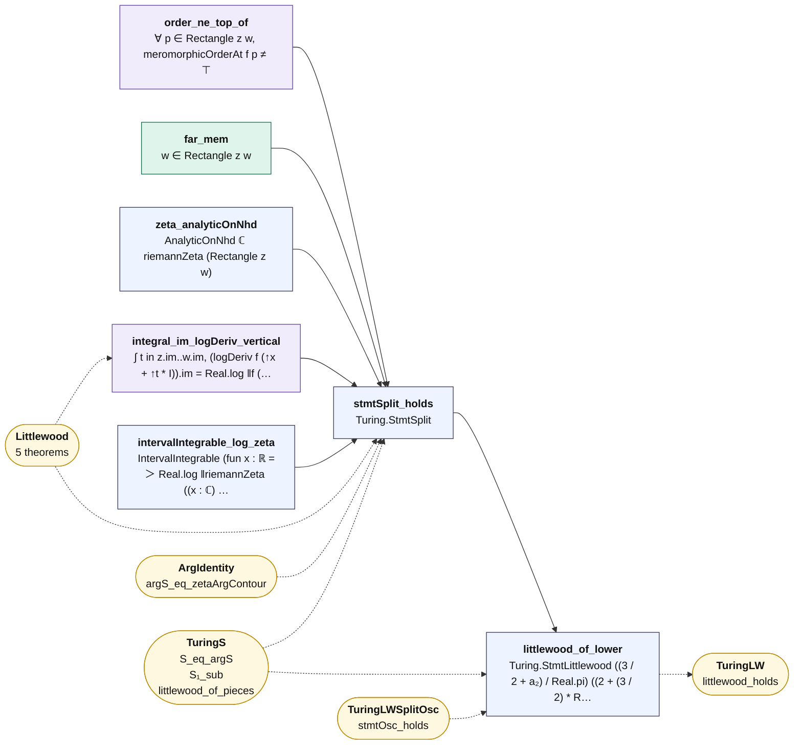

# `lean_stage3/Stage3/TuringLWSplit.lean`

> **Read from the source text.** This file changed after the last `python3 utilities/lean_map.py --dump`, so the arrows on this page are names occurring in each proof and have not been confirmed by Lean.

TuringLWSplit — block S14 of `lean_stage3/design/stencil.md`, Turing's method, Littlewood's pieces: the split identity (`Turing.StmtSplit`) and the oscillating right edge (`Turing.StmtOsc`, from `Stage3/TuringLWSplitOsc.lean`). 2026-11-25.

7 theorems, 0 definitions, 258 lines. 

**Imports:** [`Littlewood`](../lean_stage3/Littlewood.md), [`TuringLWSplitOsc`](../lean_stage3/TuringLWSplitOsc.md)  
**Imported by:** [`Stage3`](../lean_stage3/Stage3.md), [`TuringLW`](../lean_stage3/TuringLW.md)

## The picture



An arrow A → B reads "A is used in the proof of B". Green: counting, integers only. Violet: shape, analysis with no ζ. Blue: reads ζ. A name ending in ■ is an end: nothing else uses it. Red: contains `sorry`. Yellow: theorems in another file, counted; a dotted arrow crosses files. Definitions are not drawn; they are listed below the diagram.

## Theorems

<a name="TuringLW-order_ne_top_of"></a>
### `TuringLW.order_ne_top_of`

line 48 · arrows read from text

**Shape.** Uses real or complex analysis; nothing in it or beneath it reads ζ.

**Why.** `Littlewood.order_ne_top` with any nonvanishing point of the rectangle for the corner.

**Proves**

```lean
∀ p ∈ Rectangle z w, meromorphicOrderAt f p ≠ ⊤
```

**Needs** (its hypotheses)

  - `` hf : AnalyticOnNhd ℂ f (Rectangle z w) ``
  - `` hq : q ∈ Rectangle z w ``
  - `` hfq : f q ≠ 0 ``

**Fed by:** no theorem of this repo; it stands on Mathlib.

**Feeds** (1 that use it)

  - [`TuringLW.stmtSplit_holds`](#TuringLW-stmtSplit_holds) — `` Turing.StmtSplit ``

<a name="TuringLW-far_mem"></a>
### `TuringLW.far_mem`

line 63 · arrows read from text

**Counting.** Integers only: nothing in its statement or proof, or in anything it rests on, uses analysis or ζ.

**Proves**

```lean
w ∈ Rectangle z w
```

**Needs** (its hypotheses)

  - `` z w : ℂ ``

**Fed by:** no theorem of this repo; it stands on Mathlib.

**Feeds** (1 that use it)

  - [`TuringLW.stmtSplit_holds`](#TuringLW-stmtSplit_holds) — `` Turing.StmtSplit ``

<a name="TuringLW-zeta_analyticOnNhd"></a>
### `TuringLW.zeta_analyticOnNhd`

line 66 · arrows read from text

**Reads ζ.** It, or something it rests on, uses the zeta function, its zeros or the Riemann hypothesis.

**Proves**

```lean
AnalyticOnNhd ℂ riemannZeta (Rectangle z w)
```

**Needs** (its hypotheses)

  - `` hz : 0 < z.im ``
  - `` hw : 0 < w.im ``

**Fed by:** no theorem of this repo; it stands on Mathlib.

**Feeds** (1 that use it)

  - [`TuringLW.stmtSplit_holds`](#TuringLW-stmtSplit_holds) — `` Turing.StmtSplit ``

<a name="TuringLW-integral_im_logDeriv_vertical"></a>
### `TuringLW.integral_im_logDeriv_vertical`

line 76 · arrows read from text

**Shape.** Uses real or complex analysis; nothing in it or beneath it reads ζ.

**Why.** The imaginary part along a vertical line is a difference of `log ‖f‖`. No branch.

**Proves**

```lean
∫ t in z.im..w.im, (logDeriv f (↑x + ↑t * I)).im = Real.log ‖f (↑x + ↑z.im * I)‖ - Real.log ‖f (↑x + ↑w.im * I)‖
```

**Needs** (its hypotheses)

  - `` hf : AnalyticOnNhd ℂ f (Rectangle z w) ``
  - `` hx : x ∈ [[z.re, w.re]] ``
  - `` hnz : ∀ t ∈ [[z.im, w.im]], f (↑x + ↑t * I) ≠ 0 ``

**Fed by** (3 theorems its proof uses)

  - [`Littlewood.continuousOn_logDeriv_comp`](../lean_stage3/Littlewood.md#Littlewood-continuousOn_logDeriv_comp) (Littlewood) — `` ContinuousOn (fun x => logDeriv f (γ x)) S ``
  - [`Littlewood.hasDerivAt_log_norm`](../lean_stage3/Littlewood.md#Littlewood-hasDerivAt_log_norm) (Littlewood) — `` HasDerivAt (fun y => Real.log ‖g y‖) (g' / g x).re x ``
  - [`Littlewood.horiz_mem`](../lean_stage3/Littlewood.md#Littlewood-horiz_mem) (Littlewood) — `` (↑x + ↑t * I : ℂ) ∈ Rectangle z w ``

**Feeds** (1 that use it)

  - [`TuringLW.stmtSplit_holds`](#TuringLW-stmtSplit_holds) — `` Turing.StmtSplit ``

<a name="TuringLW-intervalIntegrable_log_zeta"></a>
### `TuringLW.intervalIntegrable_log_zeta`

line 101 · arrows read from text

**Reads ζ.** It, or something it rests on, uses the zeta function, its zeros or the Riemann hypothesis.

**Why.** `x ↦ log ‖ζ(x + it)‖` is interval integrable off the real axis: `ζ(· + it)` is real-analytic, and `log ‖·‖` of a real-meromorphic function is (Mathlib).

**Proves**

```lean
IntervalIntegrable (fun x : ℝ => Real.log ‖riemannZeta ((x : ℂ) + (t : ℂ) * I)‖) volume a b
```

**Needs** (its hypotheses)

  - `` ht : t ≠ 0 ``
  - `` a b : ℝ ``

**Fed by:** no theorem of this repo; it stands on Mathlib.

**Feeds** (1 that use it)

  - [`TuringLW.stmtSplit_holds`](#TuringLW-stmtSplit_holds) — `` Turing.StmtSplit ``

<a name="TuringLW-stmtSplit_holds"></a>
### `TuringLW.stmtSplit_holds`

line 117 · arrows read from text

**Reads ζ.** It, or something it rests on, uses the zeta function, its zeros or the Riemann hypothesis.

**Why.** The split identity, `Turing.StmtSplit`.

**Proves**

```lean
Turing.StmtSplit
```

**Fed by** (12 theorems its proof uses)

  - [`Stage3.argS_eq_zetaArgContour`](../lean_stage3/ArgIdentity.md#Stage3-argS_eq_zetaArgContour) (ArgIdentity) — `` argS T = zetaArgContour T ``
  - [`Littlewood.continuousOn_logDeriv_comp`](../lean_stage3/Littlewood.md#Littlewood-continuousOn_logDeriv_comp) (Littlewood) — `` ContinuousOn (fun x => logDeriv f (γ x)) S ``
  - [`Littlewood.horiz_mem`](../lean_stage3/Littlewood.md#Littlewood-horiz_mem) (Littlewood) — `` (↑x + ↑t * I : ℂ) ∈ Rectangle z w ``
  - [`Littlewood.integrableOn_logDeriv_prod`](../lean_stage3/Littlewood.md#Littlewood-integrableOn_logDeriv_prod) (Littlewood) — `` IntegrableOn (fun q : ℝ × ℝ => logDeriv f (↑q.1 + ↑q.2 * I)) ([[z.re, w.re]] ×ˢ [[z.im, w.im]]) volume ``
  - [`Littlewood.mem_support_divisor`](../lean_stage3/Littlewood.md#Littlewood-mem_support_divisor) (Littlewood) — `` p ∈ (MeromorphicOn.divisor f U).support ↔ p ∈ U ∧ f p = 0 ``
  - [`TuringLW.far_mem`](#TuringLW-far_mem) — `` w ∈ Rectangle z w ``
  - [`TuringLW.integral_im_logDeriv_vertical`](#TuringLW-integral_im_logDeriv_vertical) — `` ∫ t in z.im..w.im, (logDeriv f (↑x + ↑t * I)).im = Real.log ‖f (↑x + ↑z.im * I)‖ - Real.log ‖f (↑x + ↑w.im * I)‖ ``
  - [`TuringLW.intervalIntegrable_log_zeta`](#TuringLW-intervalIntegrable_log_zeta) — `` IntervalIntegrable (fun x : ℝ => Real.log ‖riemannZeta ((x : ℂ) + (t : ℂ) * I)‖) volume a b ``
  - [`TuringLW.order_ne_top_of`](#TuringLW-order_ne_top_of) — `` ∀ p ∈ Rectangle z w, meromorphicOrderAt f p ≠ ⊤ ``
  - [`TuringLW.zeta_analyticOnNhd`](#TuringLW-zeta_analyticOnNhd) — `` AnalyticOnNhd ℂ riemannZeta (Rectangle z w) ``
  - [`Turing.S_eq_argS`](../lean_stage3/TuringS.md#Turing-S_eq_argS) (TuringS) — `` S t = Stage3.argS t ``
  - [`Turing.S₁_sub`](../lean_stage3/TuringS.md#Turing-S-_sub) (TuringS) — `` S₁ t₂ - S₁ t₁ = ∫ t in t₁..t₂, S t ``

**Definitions its proof touches:** [`Stage3.zetaArgContour`](../lean_stage3/ArgIdentity.md#Stage3-zetaArgContour), [`Turing.F`](../lean_stage3/TuringS.md#Turing-F), [`Turing.S`](../lean_stage3/TuringS.md#Turing-S), [`Turing.StmtSplit`](../lean_stage3/TuringS.md#Turing-StmtSplit)

**Feeds** (1 that use it)

  - [`TuringLW.littlewood_of_lower`](#TuringLW-littlewood_of_lower) — `` Turing.StmtLittlewood ((3 / 2 + a₂) / Real.pi) ((2 + (3 / 2) * Real.log 9 + b₂) / Real.pi) 2 ``

<a name="TuringLW-littlewood_of_lower"></a>
### `TuringLW.littlewood_of_lower`

line 236 · arrows read from text

**Reads ζ.** It, or something it rests on, uses the zeta function, its zeros or the Riemann hypothesis.

**Why.** Littlewood's bound from the lower horizontal side alone: (Split) and (Osc) are proved.

**Proves**

```lean
Turing.StmtLittlewood ((3 / 2 + a₂) / Real.pi) ((2 + (3 / 2) * Real.log 9 + b₂) / Real.pi) 2
```

**Needs** (its hypotheses)

  - `` hlow : Turing.StmtHorizLower a₂ b₂ ``
  - `` ha₂ : 0 ≤ a₂ ``

**Fed by** (3 theorems its proof uses)

  - [`TuringLW.stmtSplit_holds`](#TuringLW-stmtSplit_holds) — `` Turing.StmtSplit ``
  - [`TuringLW.stmtOsc_holds`](../lean_stage3/TuringLWSplitOsc.md#TuringLW-stmtOsc_holds) (TuringLWSplitOsc) — `` Turing.StmtOsc 2 ``
  - [`Turing.littlewood_of_pieces`](../lean_stage3/TuringS.md#Turing-littlewood_of_pieces) (TuringS) — `` StmtLittlewood ((3 / 2 + a₂) / Real.pi) ((c₀ + (3 / 2) * Real.log 9 + b₂) / Real.pi) 2 ``

**Definitions its proof touches:** [`Turing.StmtHorizLower`](../lean_stage3/TuringS.md#Turing-StmtHorizLower), [`Turing.StmtLittlewood`](../lean_stage3/TuringS.md#Turing-StmtLittlewood)

**Feeds** (1 that use it)

  - [`TuringLW.littlewood_holds`](../lean_stage3/TuringLW.md#TuringLW-littlewood_holds) (TuringLW) — `` Turing.StmtLittlewood ((3 / 2 + 102) / Real.pi) ((2 + (3 / 2) * Real.log 9 + 500) / Real.pi) 2 ``

