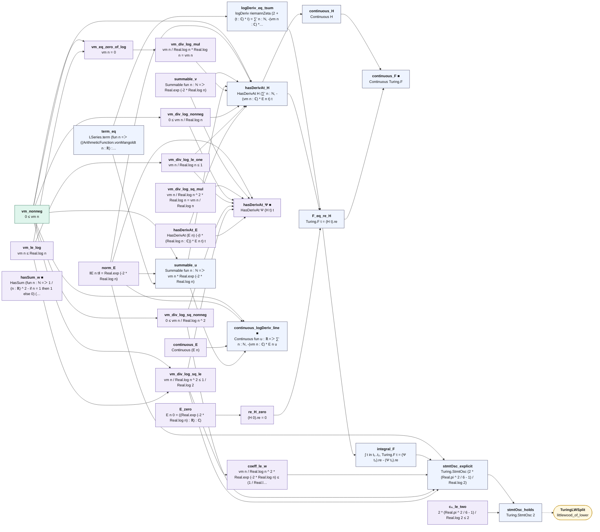

# `lean_stage3/Stage3/TuringLWSplitOsc.lean`

> **Read from the source text.** This file changed after the last `python3 utilities/lean_map.py --dump`, so the arrows on this page are names occurring in each proof and have not been confirmed by Lean.

TuringLWSplitOsc — block S14 of `lean_stage3/design/stencil.md`, Turing's method, Littlewood's pieces: the right edge oscillates (`Turing.StmtOsc`). 2026-11-25.

30 theorems, 4 definitions, 358 lines. 

**Imports:** [`TuringS`](../lean_stage3/TuringS.md)  
**Imported by:** [`TuringLWSplit`](../lean_stage3/TuringLWSplit.md)

## The picture



An arrow A → B reads "A is used in the proof of B". Green: counting, integers only. Violet: shape, analysis with no ζ. Blue: reads ζ. A name ending in ■ is an end: nothing else uses it. Red: contains `sorry`. Yellow: theorems in another file, counted; a dotted arrow crosses files. Definitions are not drawn; they are listed below the diagram.

## Definitions

<a name="TuringLW-vm"></a>
### `TuringLW.vm`

def · line 44

`Λ n` as a real number.

- **Is:** `` vm (n : ℕ) : ℝ := ArithmeticFunction.vonMangoldt n ``
- **Used by 20:** [`TuringLW.H`](#TuringLW-H), [`TuringLW.coeff_le_w`](#TuringLW-coeff_le_w), [`TuringLW.continuous_logDeriv_line`](#TuringLW-continuous_logDeriv_line), [`TuringLW.hasDerivAt_H`](#TuringLW-hasDerivAt_H), [`TuringLW.hasDerivAt_Ψ`](#TuringLW-hasDerivAt_-), [`TuringLW.logDeriv_eq_tsum`](#TuringLW-logDeriv_eq_tsum), [`TuringLW.re_H_zero`](#TuringLW-re_H_zero), [`TuringLW.stmtOsc_explicit`](#TuringLW-stmtOsc_explicit), [`TuringLW.summable_u`](#TuringLW-summable_u), [`TuringLW.term_eq`](#TuringLW-term_eq), [`TuringLW.vm_div_log_le_one`](#TuringLW-vm_div_log_le_one), [`TuringLW.vm_div_log_mul`](#TuringLW-vm_div_log_mul), [`TuringLW.vm_div_log_nonneg`](#TuringLW-vm_div_log_nonneg), [`TuringLW.vm_div_log_sq_le`](#TuringLW-vm_div_log_sq_le), [`TuringLW.vm_div_log_sq_mul`](#TuringLW-vm_div_log_sq_mul), [`TuringLW.vm_div_log_sq_nonneg`](#TuringLW-vm_div_log_sq_nonneg), [`TuringLW.vm_eq_zero_of_log`](#TuringLW-vm_eq_zero_of_log), [`TuringLW.vm_le_log`](#TuringLW-vm_le_log), [`TuringLW.vm_nonneg`](#TuringLW-vm_nonneg), [`TuringLW.Ψ`](#TuringLW--)

<a name="TuringLW-E"></a>
### `TuringLW.E`

def · line 47

`E n t = exp(−(2 + it) log n) = n^{−(2+it)}`.

- **Is:** `` E (n : ℕ) (t : ℝ) : ℂ := Complex.exp (-(2 + (t : ℂ) * I) * (Real.log n : ℂ)) ``
- **Used by 12:** [`TuringLW.E_zero`](#TuringLW-E_zero), [`TuringLW.H`](#TuringLW-H), [`TuringLW.continuous_E`](#TuringLW-continuous_E), [`TuringLW.continuous_logDeriv_line`](#TuringLW-continuous_logDeriv_line), [`TuringLW.hasDerivAt_E`](#TuringLW-hasDerivAt_E), [`TuringLW.hasDerivAt_H`](#TuringLW-hasDerivAt_H), [`TuringLW.hasDerivAt_Ψ`](#TuringLW-hasDerivAt_-), [`TuringLW.logDeriv_eq_tsum`](#TuringLW-logDeriv_eq_tsum), [`TuringLW.norm_E`](#TuringLW-norm_E), [`TuringLW.stmtOsc_explicit`](#TuringLW-stmtOsc_explicit), [`TuringLW.term_eq`](#TuringLW-term_eq), [`TuringLW.Ψ`](#TuringLW--)

<a name="TuringLW-H"></a>
### `TuringLW.H`

def · line 50

The primitive of `ζ′/ζ(2 + it)`.

- **Is:** `` H (t : ℝ) : ℂ := ∑' n : ℕ, (-I * ((vm n / Real.log n : ℝ) : ℂ)) * E n t ``
- **Built from:** [`TuringLW.E`](#TuringLW-E), [`TuringLW.vm`](#TuringLW-vm)
- **Used by 6:** [`TuringLW.F_eq_re_H`](#TuringLW-F_eq_re_H), [`TuringLW.continuous_F`](#TuringLW-continuous_F), [`TuringLW.continuous_H`](#TuringLW-continuous_H), [`TuringLW.hasDerivAt_H`](#TuringLW-hasDerivAt_H), [`TuringLW.hasDerivAt_Ψ`](#TuringLW-hasDerivAt_-), [`TuringLW.re_H_zero`](#TuringLW-re_H_zero)

<a name="TuringLW--"></a>
### `TuringLW.Ψ`

def · line 53

The primitive of `H`.

- **Is:** `` Ψ (t : ℝ) : ℂ := ∑' n : ℕ, ((vm n / Real.log n ^ 2 : ℝ) : ℂ) * E n t ``
- **Built from:** [`TuringLW.E`](#TuringLW-E), [`TuringLW.vm`](#TuringLW-vm)
- **Used by 0:** nothing

## Theorems

<a name="TuringLW-vm_nonneg"></a>
### `TuringLW.vm_nonneg`

line 57 · arrows read from text

**Counting.** Integers only: nothing in its statement or proof, or in anything it rests on, uses analysis or ζ.

**Proves**

```lean
0 ≤ vm n
```

**Needs** (its hypotheses)

  - `` n : ℕ ``

**Fed by:** no theorem of this repo; it stands on Mathlib and the definitions below.

**Definitions its proof touches:** [`TuringLW.vm`](#TuringLW-vm)

**Feeds** (7 that use it)

  - [`TuringLW.continuous_logDeriv_line`](#TuringLW-continuous_logDeriv_line) — `` Continuous fun u : ℝ => ∑' n : ℕ, -(vm n : ℂ) * E n u ``
  - [`TuringLW.hasDerivAt_H`](#TuringLW-hasDerivAt_H) — `` HasDerivAt H (∑' n : ℕ, -(vm n : ℂ) * E n t) t ``
  - [`TuringLW.summable_u`](#TuringLW-summable_u) — `` Summable fun n : ℕ => vm n * Real.exp (-2 * Real.log n) ``
  - [`TuringLW.vm_div_log_nonneg`](#TuringLW-vm_div_log_nonneg) — `` 0 ≤ vm n / Real.log n ``
  - [`TuringLW.vm_div_log_sq_le`](#TuringLW-vm_div_log_sq_le) — `` vm n / Real.log n ^ 2 ≤ 1 / Real.log 2 ``
  - [`TuringLW.vm_div_log_sq_nonneg`](#TuringLW-vm_div_log_sq_nonneg) — `` 0 ≤ vm n / Real.log n ^ 2 ``
  - [`TuringLW.vm_eq_zero_of_log`](#TuringLW-vm_eq_zero_of_log) — `` vm n = 0 ``

<a name="TuringLW-vm_le_log"></a>
### `TuringLW.vm_le_log`

line 59 · arrows read from text

**Shape.** Uses real or complex analysis; nothing in it or beneath it reads ζ.

**Proves**

```lean
vm n ≤ Real.log n
```

**Needs** (its hypotheses)

  - `` n : ℕ ``

**Fed by:** no theorem of this repo; it stands on Mathlib and the definitions below.

**Definitions its proof touches:** [`TuringLW.vm`](#TuringLW-vm)

**Feeds** (3 that use it)

  - [`TuringLW.vm_div_log_le_one`](#TuringLW-vm_div_log_le_one) — `` vm n / Real.log n ≤ 1 ``
  - [`TuringLW.vm_div_log_sq_le`](#TuringLW-vm_div_log_sq_le) — `` vm n / Real.log n ^ 2 ≤ 1 / Real.log 2 ``
  - [`TuringLW.vm_eq_zero_of_log`](#TuringLW-vm_eq_zero_of_log) — `` vm n = 0 ``

<a name="TuringLW-vm_eq_zero_of_log"></a>
### `TuringLW.vm_eq_zero_of_log`

line 61 · arrows read from text

**Shape.** Uses real or complex analysis; nothing in it or beneath it reads ζ.

**Proves**

```lean
vm n = 0
```

**Needs** (its hypotheses)

  - `` h : Real.log n = 0 ``

**Fed by** (2 theorems its proof uses)

  - [`TuringLW.vm_le_log`](#TuringLW-vm_le_log) — `` vm n ≤ Real.log n ``
  - [`TuringLW.vm_nonneg`](#TuringLW-vm_nonneg) — `` 0 ≤ vm n ``

**Definitions its proof touches:** [`TuringLW.vm`](#TuringLW-vm)

**Feeds** (1 that use it)

  - [`TuringLW.vm_div_log_mul`](#TuringLW-vm_div_log_mul) — `` vm n / Real.log n * Real.log n = vm n ``

<a name="TuringLW-vm_div_log_mul"></a>
### `TuringLW.vm_div_log_mul`

line 64 · arrows read from text

**Shape.** Uses real or complex analysis; nothing in it or beneath it reads ζ.

**Proves**

```lean
vm n / Real.log n * Real.log n = vm n
```

**Needs** (its hypotheses)

  - `` n : ℕ ``

**Fed by** (1 theorem its proof uses)

  - [`TuringLW.vm_eq_zero_of_log`](#TuringLW-vm_eq_zero_of_log) — `` vm n = 0 ``

**Definitions its proof touches:** [`TuringLW.vm`](#TuringLW-vm)

**Feeds** (1 that use it)

  - [`TuringLW.hasDerivAt_H`](#TuringLW-hasDerivAt_H) — `` HasDerivAt H (∑' n : ℕ, -(vm n : ℂ) * E n t) t ``

<a name="TuringLW-vm_div_log_sq_mul"></a>
### `TuringLW.vm_div_log_sq_mul`

line 69 · arrows read from text

**Shape.** Uses real or complex analysis; nothing in it or beneath it reads ζ.

**Proves**

```lean
vm n / Real.log n ^ 2 * Real.log n = vm n / Real.log n
```

**Needs** (its hypotheses)

  - `` n : ℕ ``

**Fed by:** no theorem of this repo; it stands on Mathlib and the definitions below.

**Definitions its proof touches:** [`TuringLW.vm`](#TuringLW-vm)

**Feeds** (1 that use it)

  - [`TuringLW.hasDerivAt_Ψ`](#TuringLW-hasDerivAt_-) — `` HasDerivAt Ψ (H t) t ``

<a name="TuringLW-vm_div_log_nonneg"></a>
### `TuringLW.vm_div_log_nonneg`

line 74 · arrows read from text

**Shape.** Uses real or complex analysis; nothing in it or beneath it reads ζ.

**Proves**

```lean
0 ≤ vm n / Real.log n
```

**Needs** (its hypotheses)

  - `` n : ℕ ``

**Fed by** (1 theorem its proof uses)

  - [`TuringLW.vm_nonneg`](#TuringLW-vm_nonneg) — `` 0 ≤ vm n ``

**Definitions its proof touches:** [`TuringLW.vm`](#TuringLW-vm)

**Feeds** (2 that use it)

  - [`TuringLW.hasDerivAt_H`](#TuringLW-hasDerivAt_H) — `` HasDerivAt H (∑' n : ℕ, -(vm n : ℂ) * E n t) t ``
  - [`TuringLW.hasDerivAt_Ψ`](#TuringLW-hasDerivAt_-) — `` HasDerivAt Ψ (H t) t ``

<a name="TuringLW-vm_div_log_le_one"></a>
### `TuringLW.vm_div_log_le_one`

line 77 · arrows read from text

**Shape.** Uses real or complex analysis; nothing in it or beneath it reads ζ.

**Proves**

```lean
vm n / Real.log n ≤ 1
```

**Needs** (its hypotheses)

  - `` n : ℕ ``

**Fed by** (1 theorem its proof uses)

  - [`TuringLW.vm_le_log`](#TuringLW-vm_le_log) — `` vm n ≤ Real.log n ``

**Definitions its proof touches:** [`TuringLW.vm`](#TuringLW-vm)

**Feeds** (2 that use it)

  - [`TuringLW.hasDerivAt_H`](#TuringLW-hasDerivAt_H) — `` HasDerivAt H (∑' n : ℕ, -(vm n : ℂ) * E n t) t ``
  - [`TuringLW.hasDerivAt_Ψ`](#TuringLW-hasDerivAt_-) — `` HasDerivAt Ψ (H t) t ``

<a name="TuringLW-vm_div_log_sq_nonneg"></a>
### `TuringLW.vm_div_log_sq_nonneg`

line 84 · arrows read from text

**Shape.** Uses real or complex analysis; nothing in it or beneath it reads ζ.

**Proves**

```lean
0 ≤ vm n / Real.log n ^ 2
```

**Needs** (its hypotheses)

  - `` n : ℕ ``

**Fed by** (1 theorem its proof uses)

  - [`TuringLW.vm_nonneg`](#TuringLW-vm_nonneg) — `` 0 ≤ vm n ``

**Definitions its proof touches:** [`TuringLW.vm`](#TuringLW-vm)

**Feeds** (2 that use it)

  - [`TuringLW.hasDerivAt_Ψ`](#TuringLW-hasDerivAt_-) — `` HasDerivAt Ψ (H t) t ``
  - [`TuringLW.stmtOsc_explicit`](#TuringLW-stmtOsc_explicit) — `` Turing.StmtOsc (2 * (Real.pi ^ 2 / 6 - 1) / Real.log 2) ``

<a name="TuringLW-vm_div_log_sq_le"></a>
### `TuringLW.vm_div_log_sq_le`

line 87 · arrows read from text

**Shape.** Uses real or complex analysis; nothing in it or beneath it reads ζ.

**Proves**

```lean
vm n / Real.log n ^ 2 ≤ 1 / Real.log 2
```

**Needs** (its hypotheses)

  - `` n : ℕ ``

**Fed by** (2 theorems its proof uses)

  - [`TuringLW.vm_le_log`](#TuringLW-vm_le_log) — `` vm n ≤ Real.log n ``
  - [`TuringLW.vm_nonneg`](#TuringLW-vm_nonneg) — `` 0 ≤ vm n ``

**Definitions its proof touches:** [`TuringLW.vm`](#TuringLW-vm)

**Feeds** (3 that use it)

  - [`TuringLW.coeff_le_w`](#TuringLW-coeff_le_w) — `` vm n / Real.log n ^ 2 * Real.exp (-2 * Real.log n) ≤ (1 / Real.log 2) * (1 / (n : ℝ) ^ 2 - if n = 1 then 1 else 0) ``
  - [`TuringLW.hasDerivAt_Ψ`](#TuringLW-hasDerivAt_-) — `` HasDerivAt Ψ (H t) t ``
  - [`TuringLW.stmtOsc_explicit`](#TuringLW-stmtOsc_explicit) — `` Turing.StmtOsc (2 * (Real.pi ^ 2 / 6 - 1) / Real.log 2) ``

<a name="TuringLW-hasDerivAt_E"></a>
### `TuringLW.hasDerivAt_E`

line 100 · arrows read from text

**Shape.** Uses real or complex analysis; nothing in it or beneath it reads ζ.

**Proves**

```lean
HasDerivAt (E n) (-(I * (Real.log n : ℂ)) * E n t) t
```

**Needs** (its hypotheses)

  - `` n : ℕ ``
  - `` t : ℝ ``

**Fed by:** no theorem of this repo; it stands on Mathlib and the definitions below.

**Definitions its proof touches:** [`TuringLW.E`](#TuringLW-E)

**Feeds** (2 that use it)

  - [`TuringLW.hasDerivAt_H`](#TuringLW-hasDerivAt_H) — `` HasDerivAt H (∑' n : ℕ, -(vm n : ℂ) * E n t) t ``
  - [`TuringLW.hasDerivAt_Ψ`](#TuringLW-hasDerivAt_-) — `` HasDerivAt Ψ (H t) t ``

<a name="TuringLW-norm_E"></a>
### `TuringLW.norm_E`

line 112 · arrows read from text

**Shape.** Uses real or complex analysis; nothing in it or beneath it reads ζ.

**Proves**

```lean
‖E n t‖ = Real.exp (-2 * Real.log n)
```

**Needs** (its hypotheses)

  - `` n : ℕ ``
  - `` t : ℝ ``

**Fed by:** no theorem of this repo; it stands on Mathlib and the definitions below.

**Definitions its proof touches:** [`TuringLW.E`](#TuringLW-E)

**Feeds** (5 that use it)

  - [`TuringLW.continuous_logDeriv_line`](#TuringLW-continuous_logDeriv_line) — `` Continuous fun u : ℝ => ∑' n : ℕ, -(vm n : ℂ) * E n u ``
  - [`TuringLW.hasDerivAt_H`](#TuringLW-hasDerivAt_H) — `` HasDerivAt H (∑' n : ℕ, -(vm n : ℂ) * E n t) t ``
  - [`TuringLW.hasDerivAt_Ψ`](#TuringLW-hasDerivAt_-) — `` HasDerivAt Ψ (H t) t ``
  - [`TuringLW.stmtOsc_explicit`](#TuringLW-stmtOsc_explicit) — `` Turing.StmtOsc (2 * (Real.pi ^ 2 / 6 - 1) / Real.log 2) ``
  - [`TuringLW.summable_u`](#TuringLW-summable_u) — `` Summable fun n : ℕ => vm n * Real.exp (-2 * Real.log n) ``

<a name="TuringLW-E_zero"></a>
### `TuringLW.E_zero`

line 117 · arrows read from text

**Shape.** Uses real or complex analysis; nothing in it or beneath it reads ζ.

**Proves**

```lean
E n 0 = ((Real.exp (-2 * Real.log n) : ℝ) : ℂ)
```

**Needs** (its hypotheses)

  - `` n : ℕ ``

**Fed by:** no theorem of this repo; it stands on Mathlib and the definitions below.

**Definitions its proof touches:** [`TuringLW.E`](#TuringLW-E)

**Feeds** (1 that use it)

  - [`TuringLW.re_H_zero`](#TuringLW-re_H_zero) — `` (H 0).re = 0 ``

<a name="TuringLW-continuous_E"></a>
### `TuringLW.continuous_E`

line 123 · arrows read from text

**Shape.** Uses real or complex analysis; nothing in it or beneath it reads ζ.

**Proves**

```lean
Continuous (E n)
```

**Needs** (its hypotheses)

  - `` n : ℕ ``

**Fed by:** no theorem of this repo; it stands on Mathlib and the definitions below.

**Definitions its proof touches:** [`TuringLW.E`](#TuringLW-E)

**Feeds** (1 that use it)

  - [`TuringLW.continuous_logDeriv_line`](#TuringLW-continuous_logDeriv_line) — `` Continuous fun u : ℝ => ∑' n : ℕ, -(vm n : ℂ) * E n u ``

<a name="TuringLW-term_eq"></a>
### `TuringLW.term_eq`

line 127 · arrows read from text

**Reads ζ.** It, or something it rests on, uses the zeta function, its zeros or the Riemann hypothesis.

**Proves**

```lean
LSeries.term (fun n => ((ArithmeticFunction.vonMangoldt n : ℝ) : ℂ)) (2 + (t : ℂ) * I) n = (vm n : ℂ) * E n t
```

**Needs** (its hypotheses)

  - `` n : ℕ ``
  - `` t : ℝ ``

**Fed by:** no theorem of this repo; it stands on Mathlib and the definitions below.

**Definitions its proof touches:** [`TuringLW.E`](#TuringLW-E), [`TuringLW.vm`](#TuringLW-vm)

**Feeds** (2 that use it)

  - [`TuringLW.logDeriv_eq_tsum`](#TuringLW-logDeriv_eq_tsum) — `` logDeriv riemannZeta (2 + (t : ℂ) * I) = ∑' n : ℕ, -(vm n : ℂ) * E n t ``
  - [`TuringLW.summable_u`](#TuringLW-summable_u) — `` Summable fun n : ℕ => vm n * Real.exp (-2 * Real.log n) ``

<a name="TuringLW-summable_v"></a>
### `TuringLW.summable_v`

line 139 · arrows read from text

**Shape.** Uses real or complex analysis; nothing in it or beneath it reads ζ.

**Why.** `v n = n^{−2}` (and `1` at `n = 0`).

**Proves**

```lean
Summable fun n : ℕ => Real.exp (-2 * Real.log n)
```

**Fed by:** no theorem of this repo; it stands on Mathlib.

**Feeds** (2 that use it)

  - [`TuringLW.hasDerivAt_H`](#TuringLW-hasDerivAt_H) — `` HasDerivAt H (∑' n : ℕ, -(vm n : ℂ) * E n t) t ``
  - [`TuringLW.hasDerivAt_Ψ`](#TuringLW-hasDerivAt_-) — `` HasDerivAt Ψ (H t) t ``

<a name="TuringLW-summable_u"></a>
### `TuringLW.summable_u`

line 148 · arrows read from text

**Reads ζ.** It, or something it rests on, uses the zeta function, its zeros or the Riemann hypothesis.

**Proves**

```lean
Summable fun n : ℕ => vm n * Real.exp (-2 * Real.log n)
```

**Fed by** (3 theorems its proof uses)

  - [`TuringLW.norm_E`](#TuringLW-norm_E) — `` ‖E n t‖ = Real.exp (-2 * Real.log n) ``
  - [`TuringLW.term_eq`](#TuringLW-term_eq) — `` LSeries.term (fun n => ((ArithmeticFunction.vonMangoldt n : ℝ) : ℂ)) (2 + (t : ℂ) * I) n = (vm n : ℂ) * E n t ``
  - [`TuringLW.vm_nonneg`](#TuringLW-vm_nonneg) — `` 0 ≤ vm n ``

**Definitions its proof touches:** [`TuringLW.vm`](#TuringLW-vm)

**Feeds** (2 that use it)

  - [`TuringLW.continuous_logDeriv_line`](#TuringLW-continuous_logDeriv_line) — `` Continuous fun u : ℝ => ∑' n : ℕ, -(vm n : ℂ) * E n u ``
  - [`TuringLW.hasDerivAt_H`](#TuringLW-hasDerivAt_H) — `` HasDerivAt H (∑' n : ℕ, -(vm n : ℂ) * E n t) t ``

<a name="TuringLW-logDeriv_eq_tsum"></a>
### `TuringLW.logDeriv_eq_tsum`

line 155 · arrows read from text

**Reads ζ.** It, or something it rests on, uses the zeta function, its zeros or the Riemann hypothesis.

**Proves**

```lean
logDeriv riemannZeta (2 + (t : ℂ) * I) = ∑' n : ℕ, -(vm n : ℂ) * E n t
```

**Needs** (its hypotheses)

  - `` t : ℝ ``

**Fed by** (1 theorem its proof uses)

  - [`TuringLW.term_eq`](#TuringLW-term_eq) — `` LSeries.term (fun n => ((ArithmeticFunction.vonMangoldt n : ℝ) : ℂ)) (2 + (t : ℂ) * I) n = (vm n : ℂ) * E n t ``

**Definitions its proof touches:** [`TuringLW.E`](#TuringLW-E), [`TuringLW.vm`](#TuringLW-vm)

**Feeds** (1 that use it)

  - [`TuringLW.F_eq_re_H`](#TuringLW-F_eq_re_H) — `` Turing.F t = (H t).re ``

<a name="TuringLW-hasDerivAt_H"></a>
### `TuringLW.hasDerivAt_H`

line 167 · arrows read from text

**Reads ζ.** It, or something it rests on, uses the zeta function, its zeros or the Riemann hypothesis.

**Proves**

```lean
HasDerivAt H (∑' n : ℕ, -(vm n : ℂ) * E n t) t
```

**Needs** (its hypotheses)

  - `` t : ℝ ``

**Fed by** (8 theorems its proof uses)

  - [`TuringLW.hasDerivAt_E`](#TuringLW-hasDerivAt_E) — `` HasDerivAt (E n) (-(I * (Real.log n : ℂ)) * E n t) t ``
  - [`TuringLW.norm_E`](#TuringLW-norm_E) — `` ‖E n t‖ = Real.exp (-2 * Real.log n) ``
  - [`TuringLW.summable_u`](#TuringLW-summable_u) — `` Summable fun n : ℕ => vm n * Real.exp (-2 * Real.log n) ``
  - [`TuringLW.summable_v`](#TuringLW-summable_v) — `` Summable fun n : ℕ => Real.exp (-2 * Real.log n) ``
  - [`TuringLW.vm_div_log_le_one`](#TuringLW-vm_div_log_le_one) — `` vm n / Real.log n ≤ 1 ``
  - [`TuringLW.vm_div_log_mul`](#TuringLW-vm_div_log_mul) — `` vm n / Real.log n * Real.log n = vm n ``
  - [`TuringLW.vm_div_log_nonneg`](#TuringLW-vm_div_log_nonneg) — `` 0 ≤ vm n / Real.log n ``
  - [`TuringLW.vm_nonneg`](#TuringLW-vm_nonneg) — `` 0 ≤ vm n ``

**Definitions its proof touches:** [`TuringLW.E`](#TuringLW-E), [`TuringLW.H`](#TuringLW-H), [`TuringLW.vm`](#TuringLW-vm)

**Feeds** (2 that use it)

  - [`TuringLW.F_eq_re_H`](#TuringLW-F_eq_re_H) — `` Turing.F t = (H t).re ``
  - [`TuringLW.continuous_H`](#TuringLW-continuous_H) — `` Continuous H ``

<a name="TuringLW-hasDerivAt_-"></a>
### `TuringLW.hasDerivAt_Ψ`

line 189 · arrows read from text

**Shape.** Uses real or complex analysis; nothing in it or beneath it reads ζ.

**Proves**

```lean
HasDerivAt Ψ (H t) t
```

**Needs** (its hypotheses)

  - `` t : ℝ ``

**Fed by** (8 theorems its proof uses)

  - [`TuringLW.hasDerivAt_E`](#TuringLW-hasDerivAt_E) — `` HasDerivAt (E n) (-(I * (Real.log n : ℂ)) * E n t) t ``
  - [`TuringLW.norm_E`](#TuringLW-norm_E) — `` ‖E n t‖ = Real.exp (-2 * Real.log n) ``
  - [`TuringLW.summable_v`](#TuringLW-summable_v) — `` Summable fun n : ℕ => Real.exp (-2 * Real.log n) ``
  - [`TuringLW.vm_div_log_le_one`](#TuringLW-vm_div_log_le_one) — `` vm n / Real.log n ≤ 1 ``
  - [`TuringLW.vm_div_log_nonneg`](#TuringLW-vm_div_log_nonneg) — `` 0 ≤ vm n / Real.log n ``
  - [`TuringLW.vm_div_log_sq_le`](#TuringLW-vm_div_log_sq_le) — `` vm n / Real.log n ^ 2 ≤ 1 / Real.log 2 ``
  - [`TuringLW.vm_div_log_sq_mul`](#TuringLW-vm_div_log_sq_mul) — `` vm n / Real.log n ^ 2 * Real.log n = vm n / Real.log n ``
  - [`TuringLW.vm_div_log_sq_nonneg`](#TuringLW-vm_div_log_sq_nonneg) — `` 0 ≤ vm n / Real.log n ^ 2 ``

**Definitions its proof touches:** [`TuringLW.E`](#TuringLW-E), [`TuringLW.H`](#TuringLW-H), [`TuringLW.vm`](#TuringLW-vm)

**Feeds:** nothing. It is an end.

<a name="TuringLW-continuous_H"></a>
### `TuringLW.continuous_H`

line 213 · arrows read from text

**Reads ζ.** It, or something it rests on, uses the zeta function, its zeros or the Riemann hypothesis.

**Proves**

```lean
Continuous H
```

**Fed by** (1 theorem its proof uses)

  - [`TuringLW.hasDerivAt_H`](#TuringLW-hasDerivAt_H) — `` HasDerivAt H (∑' n : ℕ, -(vm n : ℂ) * E n t) t ``

**Definitions its proof touches:** [`TuringLW.H`](#TuringLW-H)

**Feeds** (1 that use it)

  - [`TuringLW.continuous_F`](#TuringLW-continuous_F) — `` Continuous Turing.F ``

<a name="TuringLW-continuous_logDeriv_line"></a>
### `TuringLW.continuous_logDeriv_line`

line 216 · arrows read from text

**Reads ζ.** It, or something it rests on, uses the zeta function, its zeros or the Riemann hypothesis.

**Proves**

```lean
Continuous fun u : ℝ => ∑' n : ℕ, -(vm n : ℂ) * E n u
```

**Fed by** (4 theorems its proof uses)

  - [`TuringLW.continuous_E`](#TuringLW-continuous_E) — `` Continuous (E n) ``
  - [`TuringLW.norm_E`](#TuringLW-norm_E) — `` ‖E n t‖ = Real.exp (-2 * Real.log n) ``
  - [`TuringLW.summable_u`](#TuringLW-summable_u) — `` Summable fun n : ℕ => vm n * Real.exp (-2 * Real.log n) ``
  - [`TuringLW.vm_nonneg`](#TuringLW-vm_nonneg) — `` 0 ≤ vm n ``

**Definitions its proof touches:** [`TuringLW.E`](#TuringLW-E), [`TuringLW.vm`](#TuringLW-vm)

**Feeds:** nothing. It is an end.

<a name="TuringLW-re_H_zero"></a>
### `TuringLW.re_H_zero`

line 224 · arrows read from text

**Shape.** Uses real or complex analysis; nothing in it or beneath it reads ζ.

**Proves**

```lean
(H 0).re = 0
```

**Fed by** (1 theorem its proof uses)

  - [`TuringLW.E_zero`](#TuringLW-E_zero) — `` E n 0 = ((Real.exp (-2 * Real.log n) : ℝ) : ℂ) ``

**Definitions its proof touches:** [`TuringLW.H`](#TuringLW-H), [`TuringLW.vm`](#TuringLW-vm)

**Feeds** (1 that use it)

  - [`TuringLW.F_eq_re_H`](#TuringLW-F_eq_re_H) — `` Turing.F t = (H t).re ``

<a name="TuringLW-F_eq_re_H"></a>
### `TuringLW.F_eq_re_H`

line 235 · arrows read from text

**Reads ζ.** It, or something it rests on, uses the zeta function, its zeros or the Riemann hypothesis.

**Proves**

```lean
Turing.F t = (H t).re
```

**Needs** (its hypotheses)

  - `` t : ℝ ``

**Fed by** (3 theorems its proof uses)

  - [`TuringLW.hasDerivAt_H`](#TuringLW-hasDerivAt_H) — `` HasDerivAt H (∑' n : ℕ, -(vm n : ℂ) * E n t) t ``
  - [`TuringLW.logDeriv_eq_tsum`](#TuringLW-logDeriv_eq_tsum) — `` logDeriv riemannZeta (2 + (t : ℂ) * I) = ∑' n : ℕ, -(vm n : ℂ) * E n t ``
  - [`TuringLW.re_H_zero`](#TuringLW-re_H_zero) — `` (H 0).re = 0 ``

**Definitions its proof touches:** [`TuringLW.H`](#TuringLW-H), [`Turing.F`](../lean_stage3/TuringS.md#Turing-F)

**Feeds** (2 that use it)

  - [`TuringLW.continuous_F`](#TuringLW-continuous_F) — `` Continuous Turing.F ``
  - [`TuringLW.integral_F`](#TuringLW-integral_F) — `` ∫ t in t₁..t₂, Turing.F t = (Ψ t₂).re - (Ψ t₁).re ``

<a name="TuringLW-continuous_F"></a>
### `TuringLW.continuous_F`

line 242 · arrows read from text

**Reads ζ.** It, or something it rests on, uses the zeta function, its zeros or the Riemann hypothesis.

**Proves**

```lean
Continuous Turing.F
```

**Fed by** (2 theorems its proof uses)

  - [`TuringLW.F_eq_re_H`](#TuringLW-F_eq_re_H) — `` Turing.F t = (H t).re ``
  - [`TuringLW.continuous_H`](#TuringLW-continuous_H) — `` Continuous H ``

**Definitions its proof touches:** [`TuringLW.H`](#TuringLW-H), [`Turing.F`](../lean_stage3/TuringS.md#Turing-F)

**Feeds:** nothing. It is an end.

<a name="TuringLW-integral_F"></a>
### `TuringLW.integral_F`

line 247 · arrows read from text

**Reads ζ.** It, or something it rests on, uses the zeta function, its zeros or the Riemann hypothesis.

**Proves**

```lean
∫ t in t₁..t₂, Turing.F t = (Ψ t₂).re - (Ψ t₁).re
```

**Needs** (its hypotheses)

  - `` t₁ t₂ : ℝ ``

**Fed by** (1 theorem its proof uses)

  - [`TuringLW.F_eq_re_H`](#TuringLW-F_eq_re_H) — `` Turing.F t = (H t).re ``

**Definitions its proof touches:** [`Turing.F`](../lean_stage3/TuringS.md#Turing-F)

**Feeds** (1 that use it)

  - [`TuringLW.stmtOsc_explicit`](#TuringLW-stmtOsc_explicit) — `` Turing.StmtOsc (2 * (Real.pi ^ 2 / 6 - 1) / Real.log 2) ``

<a name="TuringLW-hasSum_w"></a>
### `TuringLW.hasSum_w`

line 255 · arrows read from text

**Shape.** Uses real or complex analysis; nothing in it or beneath it reads ζ.

**Why.** `Σ_{n ≥ 2} n^{−2} = π²/6 − 1`, as a sum over all `n`.

**Proves**

```lean
HasSum (fun n : ℕ => 1 / (n : ℝ) ^ 2 - if n = 1 then 1 else 0) (Real.pi ^ 2 / 6 - 1)
```

**Fed by:** no theorem of this repo; it stands on Mathlib.

**Feeds:** nothing. It connects to nothing.

<a name="TuringLW-coeff_le_w"></a>
### `TuringLW.coeff_le_w`

line 260 · arrows read from text

**Shape.** Uses real or complex analysis; nothing in it or beneath it reads ζ.

**Proves**

```lean
vm n / Real.log n ^ 2 * Real.exp (-2 * Real.log n) ≤ (1 / Real.log 2) * (1 / (n : ℝ) ^ 2 - if n = 1 then 1 else 0)
```

**Needs** (its hypotheses)

  - `` n : ℕ ``

**Fed by** (1 theorem its proof uses)

  - [`TuringLW.vm_div_log_sq_le`](#TuringLW-vm_div_log_sq_le) — `` vm n / Real.log n ^ 2 ≤ 1 / Real.log 2 ``

**Definitions its proof touches:** [`TuringLW.vm`](#TuringLW-vm)

**Feeds** (1 that use it)

  - [`TuringLW.stmtOsc_explicit`](#TuringLW-stmtOsc_explicit) — `` Turing.StmtOsc (2 * (Real.pi ^ 2 / 6 - 1) / Real.log 2) ``

<a name="TuringLW-stmtOsc_explicit"></a>
### `TuringLW.stmtOsc_explicit`

line 283 · arrows read from text

**Reads ζ.** It, or something it rests on, uses the zeta function, its zeros or the Riemann hypothesis.

**Why.** The explicit constant `c₀ = 2 (π²/6 − 1)/log 2`.

**Proves**

```lean
Turing.StmtOsc (2 * (Real.pi ^ 2 / 6 - 1) / Real.log 2)
```

**Fed by** (5 theorems its proof uses)

  - [`TuringLW.coeff_le_w`](#TuringLW-coeff_le_w) — `` vm n / Real.log n ^ 2 * Real.exp (-2 * Real.log n) ≤ (1 / Real.log 2) * (1 / (n : ℝ) ^ 2 - if n = 1 then 1 else 0) ``
  - [`TuringLW.integral_F`](#TuringLW-integral_F) — `` ∫ t in t₁..t₂, Turing.F t = (Ψ t₂).re - (Ψ t₁).re ``
  - [`TuringLW.norm_E`](#TuringLW-norm_E) — `` ‖E n t‖ = Real.exp (-2 * Real.log n) ``
  - [`TuringLW.vm_div_log_sq_le`](#TuringLW-vm_div_log_sq_le) — `` vm n / Real.log n ^ 2 ≤ 1 / Real.log 2 ``
  - [`TuringLW.vm_div_log_sq_nonneg`](#TuringLW-vm_div_log_sq_nonneg) — `` 0 ≤ vm n / Real.log n ^ 2 ``

**Definitions its proof touches:** [`TuringLW.E`](#TuringLW-E), [`TuringLW.vm`](#TuringLW-vm), [`Turing.F`](../lean_stage3/TuringS.md#Turing-F), [`Turing.StmtOsc`](../lean_stage3/TuringS.md#Turing-StmtOsc)

**Feeds** (1 that use it)

  - [`TuringLW.stmtOsc_holds`](#TuringLW-stmtOsc_holds) — `` Turing.StmtOsc 2 ``

<a name="TuringLW-c-_le_two"></a>
### `TuringLW.c₀_le_two`

line 330 · arrows read from text

**Shape.** Uses real or complex analysis; nothing in it or beneath it reads ζ.

**Why.** `2 (π²/6 − 1)/log 2 ≤ 2`.

**Proves**

```lean
2 * (Real.pi ^ 2 / 6 - 1) / Real.log 2 ≤ 2
```

**Fed by:** no theorem of this repo; it stands on Mathlib.

**Feeds** (1 that use it)

  - [`TuringLW.stmtOsc_holds`](#TuringLW-stmtOsc_holds) — `` Turing.StmtOsc 2 ``

<a name="TuringLW-stmtOsc_holds"></a>
### `TuringLW.stmtOsc_holds`

line 338 · arrows read from text

**Reads ζ.** It, or something it rests on, uses the zeta function, its zeros or the Riemann hypothesis.

**Why.** The right edge oscillates, `c₀ = 2`.

**Proves**

```lean
Turing.StmtOsc 2
```

**Fed by** (2 theorems its proof uses)

  - [`TuringLW.c₀_le_two`](#TuringLW-c-_le_two) — `` 2 * (Real.pi ^ 2 / 6 - 1) / Real.log 2 ≤ 2 ``
  - [`TuringLW.stmtOsc_explicit`](#TuringLW-stmtOsc_explicit) — `` Turing.StmtOsc (2 * (Real.pi ^ 2 / 6 - 1) / Real.log 2) ``

**Definitions its proof touches:** [`Turing.StmtOsc`](../lean_stage3/TuringS.md#Turing-StmtOsc)

**Feeds** (1 that use it)

  - [`TuringLW.littlewood_of_lower`](../lean_stage3/TuringLWSplit.md#TuringLW-littlewood_of_lower) (TuringLWSplit) — `` Turing.StmtLittlewood ((3 / 2 + a₂) / Real.pi) ((2 + (3 / 2) * Real.log 9 + b₂) / Real.pi) 2 ``

