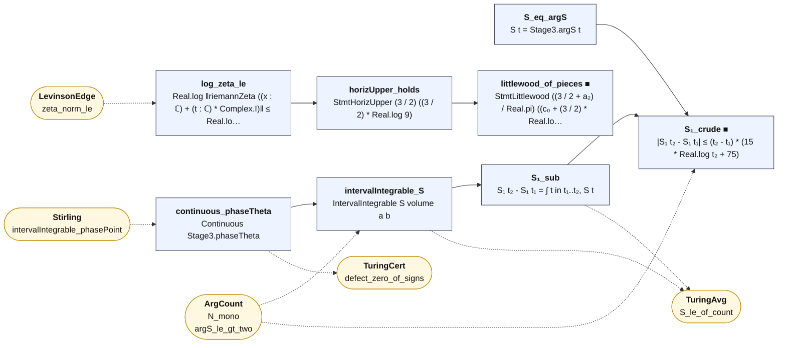

# `lean_stage3/Stage3/TuringS.lean`

> **Read from the source text.** This file changed after the last `python3 utilities/lean_map.py --dump`, so the arrows on this page are names occurring in each proof and have not been confirmed by Lean.

TuringS — block S14 of `lean_stage3/design/stencil.md`, Turing's method, step 1: `S`, `S₁` and Littlewood's bound on `∫ S`. 2026-11-25.

8 theorems, 8 definitions, 240 lines. 

**Imports:** [`Defect`](../lean_stage3/Defect.md), [`LevinsonEdge`](../lean_stage3/LevinsonEdge.md)  
**Imported by:** [`Turing`](../lean_stage3/Turing.md), [`TuringAvg`](../lean_stage3/TuringAvg.md), [`TuringLWHoriz`](../lean_stage3/TuringLWHoriz.md)

## The picture



An arrow A → B reads "A is used in the proof of B". Green: counting, integers only. Violet: shape, analysis with no ζ. Blue: reads ζ. A name ending in ■ is an end: nothing else uses it. Red: contains `sorry`. Yellow: theorems in another file, counted; a dotted arrow crosses files. Definitions are not drawn; they are listed below the diagram.

## Definitions

<a name="Turing-S"></a>
### `Turing.S`

def · line 86

`S(t) = N(t) − θ(t)/π − 1`.

- **Is:** `` S (t : ℝ) : ℝ := riemannZeta.N t - (Stage3.phaseTheta t / Real.pi + 1) ``
- **Built from:** [`Stage3.phaseTheta`](../lean_stage3/Stirling.md#Stage3-phaseTheta)
- **Used by 9:** [`Turing.S_le_of_count`](../lean_stage3/TuringAvg.md#Turing-S_le_of_count), [`Turing.S_le_pointwise`](../lean_stage3/TuringAvg.md#Turing-S_le_pointwise), [`Turing.turing_S_le`](../lean_stage3/TuringAvg.md#Turing-turing_S_le), [`Turing.defect_zero_of_signs`](../lean_stage3/TuringCert.md#Turing-defect_zero_of_signs), [`Turing.S_eq_argS`](#Turing-S_eq_argS), [`Turing.S₁`](#Turing-S-), [`Turing.S₁_crude`](#Turing-S-_crude), [`Turing.S₁_sub`](#Turing-S-_sub), [`Turing.intervalIntegrable_S`](#Turing-intervalIntegrable_S)

<a name="Turing-S-"></a>
### `Turing.S₁`

def · line 89

`S₁(T) = ∫_0^T S`.

- **Is:** `` S₁ (T : ℝ) : ℝ := ∫ t in (0 : ℝ)..T, S t ``
- **Built from:** [`Turing.S`](#Turing-S)
- **Used by 8:** [`Turing.S_le_of_count`](../lean_stage3/TuringAvg.md#Turing-S_le_of_count), [`Turing.turing_S_le`](../lean_stage3/TuringAvg.md#Turing-turing_S_le), [`Turing.defect_zero_of_signs`](../lean_stage3/TuringCert.md#Turing-defect_zero_of_signs), [`Turing.StmtLittlewood`](#Turing-StmtLittlewood), [`Turing.StmtSplit`](#Turing-StmtSplit), [`Turing.S₁_crude`](#Turing-S-_crude), [`Turing.S₁_sub`](#Turing-S-_sub), [`Turing.littlewood_of_pieces`](#Turing-littlewood_of_pieces)

<a name="Turing-F"></a>
### `Turing.F`

def · line 92

The right-edge term: `Re ∫_0^t ζ′/ζ (2 + iu) du`.

- **Is:** `` F (t : ℝ) : ℝ := (∫ u in (0 : ℝ)..t, logDeriv riemannZeta (2 + (u : ℂ) * Complex.I)).re ``
- **Used by 2:** [`Turing.StmtOsc`](#Turing-StmtOsc), [`Turing.StmtSplit`](#Turing-StmtSplit)

<a name="Turing-StmtLittlewood"></a>
### `Turing.StmtLittlewood`

def · line 96

Littlewood's bound on `S₁`, the goal of step 1.

- **Is:** `` StmtLittlewood (a b t₀ : ℝ) : Prop := ∀ t₁ t₂ : ℝ, t₀ ≤ t₁ → t₁ ≤ t₂ → |S₁ t₂ - S₁ t₁| ≤ a * Real.log t₂ + b ``
- **Built from:** [`Turing.S₁`](#Turing-S-)
- **Used by 3:** [`Turing.turing_S_le`](../lean_stage3/TuringAvg.md#Turing-turing_S_le), [`Turing.defect_zero_of_signs`](../lean_stage3/TuringCert.md#Turing-defect_zero_of_signs), [`Turing.littlewood_of_pieces`](#Turing-littlewood_of_pieces)

<a name="Turing-StmtSplit"></a>
### `Turing.StmtSplit`

def · line 100

The imaginary component of the integrated argument principle on `[1/2, 2] × [t₁, t₂]`.

- **Is:** `` StmtSplit : Prop := ∀ t₁ t₂ : ℝ, 2 ≤ t₁ → t₁ ≤ t₂ → Real.pi * (S₁ t₂ - S₁ t₁) = (∫ t in t₁..t₂, F t) + ((∫ x in (1 / 2 : ℝ)..2, Real.log ‖riemannZeta ((x : ℂ) + (t₂ : ℂ) * Complex.I)‖) - ∫ x in (1 / 2 : ℝ)..2, Real.log ‖riemannZeta ((x : ℂ) + (t₁ : ℂ) * Complex.I)‖) ``
- **Built from:** [`Turing.F`](#Turing-F), [`Turing.S₁`](#Turing-S-)
- **Used by 1:** [`Turing.littlewood_of_pieces`](#Turing-littlewood_of_pieces)

<a name="Turing-StmtOsc"></a>
### `Turing.StmtOsc`

def · line 107

The right edge oscillates: its integral is bounded uniformly.

- **Is:** `` StmtOsc (c₀ : ℝ) : Prop := ∀ t₁ t₂ : ℝ, t₁ ≤ t₂ → |∫ t in t₁..t₂, F t| ≤ c₀ ``
- **Built from:** [`Turing.F`](#Turing-F)
- **Used by 1:** [`Turing.littlewood_of_pieces`](#Turing-littlewood_of_pieces)

<a name="Turing-StmtHorizUpper"></a>
### `Turing.StmtHorizUpper`

def · line 111

The upper side of the horizontal `log |ζ|` integral.

- **Is:** `` StmtHorizUpper (a₁ b₁ : ℝ) : Prop := ∀ t : ℝ, 2 ≤ t → (∫ x in (1 / 2 : ℝ)..2, Real.log ‖riemannZeta ((x : ℂ) + (t : ℂ) * Complex.I)‖) ≤ a₁ * Real.log t + b₁ ``
- **Used by 1:** [`Turing.horizUpper_holds`](#Turing-horizUpper_holds)

<a name="Turing-StmtHorizLower"></a>
### `Turing.StmtHorizLower`

def · line 117

The lower side of the horizontal `log |ζ|` integral: the analytic core.

- **Is:** `` StmtHorizLower (a₂ b₂ : ℝ) : Prop := ∀ t : ℝ, 2 ≤ t → -(a₂ * Real.log t + b₂) ≤ ∫ x in (1 / 2 : ℝ)..2, Real.log ‖riemannZeta ((x : ℂ) + (t : ℂ) * Complex.I)‖ ``
- **Used by 2:** [`TuringLW.horizLower_holds`](../lean_stage3/TuringLWHoriz.md#TuringLW-horizLower_holds), [`Turing.littlewood_of_pieces`](#Turing-littlewood_of_pieces)

## Theorems

<a name="Turing-S_eq_argS"></a>
### `Turing.S_eq_argS`

line 124 · arrows read from text

**Reads ζ.** It, or something it rests on, uses the zeta function, its zeros or the Riemann hypothesis.

**Proves**

```lean
S t = Stage3.argS t
```

**Needs** (its hypotheses)

  - `` t : ℝ ``

**Fed by:** no theorem of this repo; it stands on Mathlib and the definitions below.

**Definitions its proof touches:** [`Stage3.argS`](../lean_stage3/ArgIdentity.md#Stage3-argS), [`Turing.S`](#Turing-S)

**Feeds** (1 that use it)

  - [`Turing.S₁_crude`](#Turing-S-_crude) — `` |S₁ t₂ - S₁ t₁| ≤ (t₂ - t₁) * (15 * Real.log t₂ + 75) ``

<a name="Turing-continuous_phaseTheta"></a>
### `Turing.continuous_phaseTheta`

line 126 · arrows read from text

**Reads ζ.** It, or something it rests on, uses the zeta function, its zeros or the Riemann hypothesis.

**Proves**

```lean
Continuous Stage3.phaseTheta
```

**Fed by** (1 theorem its proof uses)

  - [`Stage3.intervalIntegrable_phasePoint`](../lean_stage3/Stirling.md#Stage3-intervalIntegrable_phasePoint) (Stirling) — `` IntervalIntegrable phasePoint MeasureTheory.volume a b ``

**Definitions its proof touches:** [`Stage3.phasePoint`](../lean_stage3/Stirling.md#Stage3-phasePoint), [`Stage3.phaseTheta`](../lean_stage3/Stirling.md#Stage3-phaseTheta)

**Feeds** (2 that use it)

  - [`Turing.defect_zero_of_signs`](../lean_stage3/TuringCert.md#Turing-defect_zero_of_signs) (TuringCert) — `` ∀ T ≤ T₁, defect T = 0 ``
  - [`Turing.intervalIntegrable_S`](#Turing-intervalIntegrable_S) — `` IntervalIntegrable S volume a b ``

<a name="Turing-intervalIntegrable_S"></a>
### `Turing.intervalIntegrable_S`

line 134 · arrows read from text

**Reads ζ.** It, or something it rests on, uses the zeta function, its zeros or the Riemann hypothesis.

**Proves**

```lean
IntervalIntegrable S volume a b
```

**Needs** (its hypotheses)

  - `` a b : ℝ ``

**Fed by** (2 theorems its proof uses)

  - [`ArgCount.N_mono`](../lean_stage3/ArgCount.md#ArgCount-N_mono) (ArgCount) — `` riemannZeta.N T ≤ riemannZeta.N T' ``
  - [`Turing.continuous_phaseTheta`](#Turing-continuous_phaseTheta) — `` Continuous Stage3.phaseTheta ``

**Definitions its proof touches:** [`Stage3.phaseTheta`](../lean_stage3/Stirling.md#Stage3-phaseTheta), [`Turing.S`](#Turing-S)

**Feeds** (2 that use it)

  - [`Turing.S_le_of_count`](../lean_stage3/TuringAvg.md#Turing-S_le_of_count) (TuringAvg) — `` S t ≤ ((S₁ (t + h) - S₁ t) - (∫ u in t..t + h, c u) + K * h ^ 2 / (2 * Real.pi)) / h ``
  - [`Turing.S₁_sub`](#Turing-S-_sub) — `` S₁ t₂ - S₁ t₁ = ∫ t in t₁..t₂, S t ``

<a name="Turing-S-_sub"></a>
### `Turing.S₁_sub`

line 142 · arrows read from text

**Reads ζ.** It, or something it rests on, uses the zeta function, its zeros or the Riemann hypothesis.

**Proves**

```lean
S₁ t₂ - S₁ t₁ = ∫ t in t₁..t₂, S t
```

**Needs** (its hypotheses)

  - `` t₁ t₂ : ℝ ``

**Fed by** (1 theorem its proof uses)

  - [`Turing.intervalIntegrable_S`](#Turing-intervalIntegrable_S) — `` IntervalIntegrable S volume a b ``

**Definitions its proof touches:** [`Turing.S`](#Turing-S), [`Turing.S₁`](#Turing-S-)

**Feeds** (2 that use it)

  - [`Turing.S_le_of_count`](../lean_stage3/TuringAvg.md#Turing-S_le_of_count) (TuringAvg) — `` S t ≤ ((S₁ (t + h) - S₁ t) - (∫ u in t..t + h, c u) + K * h ^ 2 / (2 * Real.pi)) / h ``
  - [`Turing.S₁_crude`](#Turing-S-_crude) — `` |S₁ t₂ - S₁ t₁| ≤ (t₂ - t₁) * (15 * Real.log t₂ + 75) ``

<a name="Turing-S-_crude"></a>
### `Turing.S₁_crude`

line 148 · arrows read from text

**Reads ζ.** It, or something it rests on, uses the zeta function, its zeros or the Riemann hypothesis.

**Why.** The crude bound, from the pointwise `|S| ≤ 15 log t + 75`. It carries the factor `t₂ − t₁`, the lost factor of step 1.

**Proves**

```lean
|S₁ t₂ - S₁ t₁| ≤ (t₂ - t₁) * (15 * Real.log t₂ + 75)
```

**Needs** (its hypotheses)

  - `` h2 : 2 < t₁ ``
  - `` h12 : t₁ ≤ t₂ ``

**Fed by** (3 theorems its proof uses)

  - [`ArgCount.argS_le_gt_two`](../lean_stage3/ArgCount.md#ArgCount-argS_le_gt_two) (ArgCount) — `` |Stage3.argS T| ≤ 15 * Real.log T + 75 ``
  - [`Turing.S_eq_argS`](#Turing-S_eq_argS) — `` S t = Stage3.argS t ``
  - [`Turing.S₁_sub`](#Turing-S-_sub) — `` S₁ t₂ - S₁ t₁ = ∫ t in t₁..t₂, S t ``

**Definitions its proof touches:** [`Turing.S`](#Turing-S), [`Turing.S₁`](#Turing-S-)

**Feeds:** nothing. It is an end.

<a name="Turing-log_zeta_le"></a>
### `Turing.log_zeta_le`

line 164 · arrows read from text

**Reads ζ.** It, or something it rests on, uses the zeta function, its zeros or the Riemann hypothesis.

**Why.** The pointwise bound behind the upper side: `log ‖ζ(x + it)‖ ≤ log 9 + log t`.

**Proves**

```lean
Real.log ‖riemannZeta ((x : ℂ) + (t : ℂ) * Complex.I)‖ ≤ Real.log 9 + Real.log t
```

**Needs** (its hypotheses)

  - `` hx1 : 1 / 2 ≤ x ``
  - `` hx2 : x ≤ 2 ``
  - `` ht : 2 ≤ t ``

**Fed by** (1 theorem its proof uses)

  - [`LevinsonEdge.zeta_norm_le`](../lean_stage3/LevinsonEdge.md#LevinsonEdge-zeta_norm_le) (LevinsonEdge) — `` ‖riemannZeta u‖ ≤ 2 + 4 * ‖u‖ ``

**Feeds** (1 that use it)

  - [`Turing.horizUpper_holds`](#Turing-horizUpper_holds) — `` StmtHorizUpper (3 / 2) ((3 / 2) * Real.log 9) ``

<a name="Turing-horizUpper_holds"></a>
### `Turing.horizUpper_holds`

line 186 · arrows read from text

**Reads ζ.** It, or something it rests on, uses the zeta function, its zeros or the Riemann hypothesis.

**Why.** The upper side, proved.

**Proves**

```lean
StmtHorizUpper (3 / 2) ((3 / 2) * Real.log 9)
```

**Fed by** (1 theorem its proof uses)

  - [`Turing.log_zeta_le`](#Turing-log_zeta_le) — `` Real.log ‖riemannZeta ((x : ℂ) + (t : ℂ) * Complex.I)‖ ≤ Real.log 9 + Real.log t ``

**Definitions its proof touches:** [`Turing.StmtHorizUpper`](#Turing-StmtHorizUpper)

**Feeds** (1 that use it)

  - [`Turing.littlewood_of_pieces`](#Turing-littlewood_of_pieces) — `` StmtLittlewood ((3 / 2 + a₂) / Real.pi) ((c₀ + (3 / 2) * Real.log 9 + b₂) / Real.pi) 2 ``

<a name="Turing-littlewood_of_pieces"></a>
### `Turing.littlewood_of_pieces`

line 201 · arrows read from text

**Reads ζ.** It, or something it rests on, uses the zeta function, its zeros or the Riemann hypothesis.

**Why.** Littlewood's bound from its pieces.

**Proves**

```lean
StmtLittlewood ((3 / 2 + a₂) / Real.pi) ((c₀ + (3 / 2) * Real.log 9 + b₂) / Real.pi) 2
```

**Needs** (its hypotheses)

  - `` hsplit : StmtSplit ``
  - `` hosc : StmtOsc c₀ ``
  - `` hlow : StmtHorizLower a₂ b₂ ``
  - `` ha₂ : 0 ≤ a₂ ``

**Fed by** (1 theorem its proof uses)

  - [`Turing.horizUpper_holds`](#Turing-horizUpper_holds) — `` StmtHorizUpper (3 / 2) ((3 / 2) * Real.log 9) ``

**Definitions its proof touches:** [`Turing.StmtHorizLower`](#Turing-StmtHorizLower), [`Turing.StmtLittlewood`](#Turing-StmtLittlewood), [`Turing.StmtOsc`](#Turing-StmtOsc), [`Turing.StmtSplit`](#Turing-StmtSplit), [`Turing.S₁`](#Turing-S-)

**Feeds:** nothing. It is an end.

