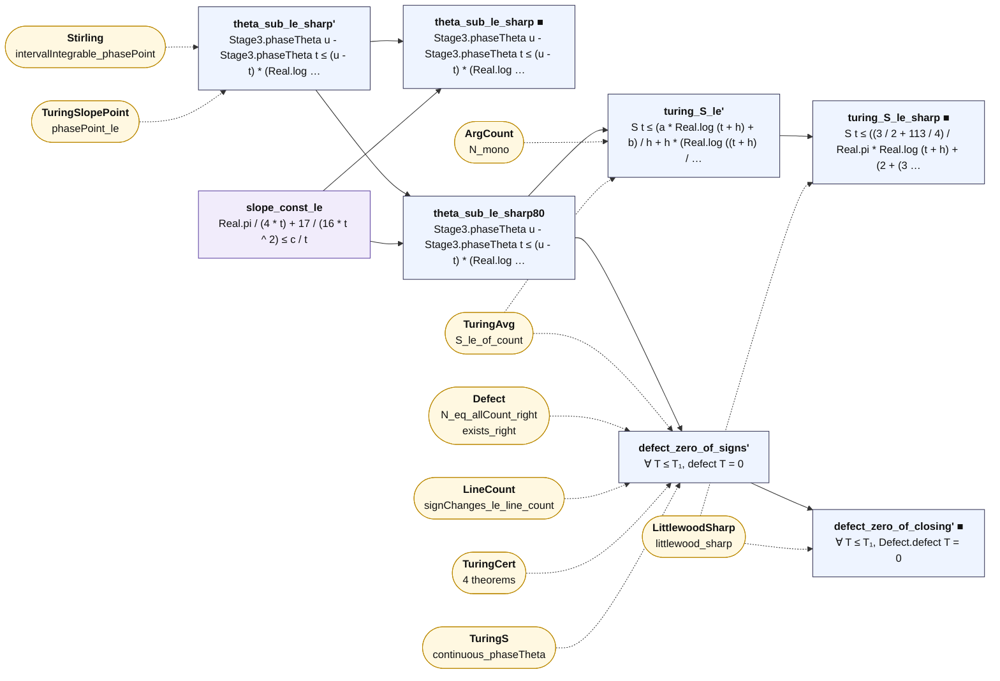

# `lean_stage3/Stage3/TuringSlope.lean`

> **Read from the source text.** This file changed after the last `python3 utilities/lean_map.py --dump`, so the arrows on this page are names occurring in each proof and have not been confirmed by Lean.

TuringSlope — block S14 of `lean_stage3/design/stencil.md`, Turing's slope term: the horizon's slope sharpened from `97/t` to `π/(4t) + 17/(16t²)`, and Turing's certificate restated with it and with `LittlewoodSharp.littlewood_sharp`. 2026-11-25. Pin "Turing's slope term", `PINS.md`.

8 theorems, 3 definitions, 353 lines. 

**Imports:** [`LittlewoodSharp`](../lean_stage3/LittlewoodSharp.md), [`TuringCert`](../lean_stage3/TuringCert.md), [`TuringSlopePoint`](../lean_stage3/TuringSlopePoint.md)  
**Imported by:** [`Stage3`](../lean_stage3/Stage3.md)

## The picture



An arrow A → B reads "A is used in the proof of B". Green: counting, integers only. Violet: shape, analysis with no ζ. Blue: reads ζ. A name ending in ■ is an end: nothing else uses it. Red: contains `sorry`. Yellow: theorems in another file, counted; a dotted arrow crosses files. Definitions are not drawn; they are listed below the diagram.

## Definitions

<a name="TuringSlope-turingK-"></a>
### `TuringSlope.turingK'`

def · line 175

The sharp slope of the horizon on `[T₁, T₁ + 1 + h]`.

- **Is:** `` turingK' (T₁ h : ℝ) : ℝ := Real.log ((T₁ + 1 + h) / (2 * Real.pi)) / 2 + (4 / 5) / T₁ ``
- **Used by 2:** [`TuringSlope.defect_zero_of_signs'`](#TuringSlope-defect_zero_of_signs-), [`TuringSlope.turingErr'`](#TuringSlope-turingErr-)

<a name="TuringSlope-turingErr-"></a>
### `TuringSlope.turingErr'`

def · line 178

Turing's error with the sharp slope.

- **Is:** `` turingErr' (a b h T₁ : ℝ) {m : ℕ} (s : Fin (m + 1) → ℝ) : ℝ := (a * Real.log (T₁ + 1 + h) + b - ∑ j : Fin m, (T₁ + h - s j.succ)) / h + h * turingK' T₁ h / (2 * Real.pi) ``
- **Built from:** [`TuringSlope.turingK'`](#TuringSlope-turingK-)
- **Used by 2:** [`TuringSlope.StmtClosingData'`](#TuringSlope-StmtClosingData-), [`TuringSlope.defect_zero_of_signs'`](#TuringSlope-defect_zero_of_signs-)

<a name="TuringSlope-StmtClosingData-"></a>
### `TuringSlope.StmtClosingData'`

def · line 308

The open certificate, sharp slope and sharp Littlewood constants. A finite computation, open: by `checks/turingslope/closing_height_slope.py` it needs `T₁ ≳ 439` and `≈ 280`–`980` certified signs.

- **Is:** `` StmtClosingData' (T₁ h : ℝ) : Prop := ∃ (k m : ℕ) (t : Fin (k + 1) → ℝ) (s : Fin (m + 1) → ℝ), StmtSignData k t ∧ t (Fin.last k) ≤ T₁ ∧ StmtSignData m s ∧ T₁ < s 0 ∧ s (Fin.last m) ≤ T₁ + h ∧ Stage3.phaseTheta T₁ / Real.pi + 1 + turingErr' ((3 / 2 + 113 / 4) / Real.pi) ((2 + (3 / 2) * Real.log 9 + 128) / Real.pi) h T₁ s < k + 2 ``
- **Built from:** [`Stage3.phaseTheta`](../lean_stage3/Stirling.md#Stage3-phaseTheta), [`Turing.StmtSignData`](../lean_stage3/TuringCert.md#Turing-StmtSignData), [`TuringSlope.turingErr'`](#TuringSlope-turingErr-)
- **Used by 1:** [`TuringSlope.defect_zero_of_closing'`](#TuringSlope-defect_zero_of_closing-)

## Theorems

<a name="TuringSlope-theta_sub_le_sharp-"></a>
### `TuringSlope.theta_sub_le_sharp'`

line 60 · arrows read from text

**Reads ζ.** It, or something it rests on, uses the zeta function, its zeros or the Riemann hypothesis.

**Why.** The slope of the horizon, sharp form.

**Proves**

```lean
Stage3.phaseTheta u - Stage3.phaseTheta t ≤ (u - t) * (Real.log (u / (2 * Real.pi)) / 2 + Real.pi / (4 * t) + 17 / (16 * t ^ 2))
```

**Needs** (its hypotheses)

  - `` ht : 1 ≤ t ``
  - `` htu : t ≤ u ``

**Fed by** (2 theorems its proof uses)

  - [`Stage3.intervalIntegrable_phasePoint`](../lean_stage3/Stirling.md#Stage3-intervalIntegrable_phasePoint) (Stirling) — `` IntervalIntegrable phasePoint MeasureTheory.volume a b ``
  - [`TuringSlope.phasePoint_le`](../lean_stage3/TuringSlopePoint.md#TuringSlope-phasePoint_le) (TuringSlopePoint) — `` phasePoint v ≤ Real.log (v / 2) + Real.pi / (2 * v) + 17 / (8 * v ^ 2) ``

**Definitions its proof touches:** [`Stage3.phasePoint`](../lean_stage3/Stirling.md#Stage3-phasePoint), [`Stage3.phaseTheta`](../lean_stage3/Stirling.md#Stage3-phaseTheta)

**Feeds** (2 that use it)

  - [`TuringSlope.theta_sub_le_sharp`](#TuringSlope-theta_sub_le_sharp) — `` Stage3.phaseTheta u - Stage3.phaseTheta t ≤ (u - t) * (Real.log (u / (2 * Real.pi)) / 2 + 1 / t) ``
  - [`TuringSlope.theta_sub_le_sharp80`](#TuringSlope-theta_sub_le_sharp80) — `` Stage3.phaseTheta u - Stage3.phaseTheta t ≤ (u - t) * (Real.log (u / (2 * Real.pi)) / 2 + (4 / 5) / t) ``

<a name="TuringSlope-slope_const_le"></a>
### `TuringSlope.slope_const_le`

line 102 · arrows read from text

**Shape.** Uses real or complex analysis; nothing in it or beneath it reads ζ.

**Why.** The slope constant: `π/(4t) + 17/(16t²) ≤ c/t` once `π/4 + 17/(16 t₀) ≤ c`.

**Proves**

```lean
Real.pi / (4 * t) + 17 / (16 * t ^ 2) ≤ c / t
```

**Needs** (its hypotheses)

  - `` ht₀ : 0 < t₀ ``
  - `` ht : t₀ ≤ t ``
  - `` hc : 3.1416 / 4 + 17 / (16 * t₀) ≤ c ``

**Fed by:** no theorem of this repo; it stands on Mathlib.

**Feeds** (2 that use it)

  - [`TuringSlope.theta_sub_le_sharp`](#TuringSlope-theta_sub_le_sharp) — `` Stage3.phaseTheta u - Stage3.phaseTheta t ≤ (u - t) * (Real.log (u / (2 * Real.pi)) / 2 + 1 / t) ``
  - [`TuringSlope.theta_sub_le_sharp80`](#TuringSlope-theta_sub_le_sharp80) — `` Stage3.phaseTheta u - Stage3.phaseTheta t ≤ (u - t) * (Real.log (u / (2 * Real.pi)) / 2 + (4 / 5) / t) ``

<a name="TuringSlope-theta_sub_le_sharp"></a>
### `TuringSlope.theta_sub_le_sharp`

line 115 · arrows read from text

**Reads ζ.** It, or something it rests on, uses the zeta function, its zeros or the Riemann hypothesis.

**Why.** The slope of the horizon, `c = 1`: `θ(u) − θ(t) ≤ (u − t)(½ log(u/2π) + 1/t)`, `5 ≤ t`.

**Proves**

```lean
Stage3.phaseTheta u - Stage3.phaseTheta t ≤ (u - t) * (Real.log (u / (2 * Real.pi)) / 2 + 1 / t)
```

**Needs** (its hypotheses)

  - `` ht : 5 ≤ t ``
  - `` htu : t ≤ u ``

**Fed by** (2 theorems its proof uses)

  - [`TuringSlope.slope_const_le`](#TuringSlope-slope_const_le) — `` Real.pi / (4 * t) + 17 / (16 * t ^ 2) ≤ c / t ``
  - [`TuringSlope.theta_sub_le_sharp'`](#TuringSlope-theta_sub_le_sharp-) — `` Stage3.phaseTheta u - Stage3.phaseTheta t ≤ (u - t) * (Real.log (u / (2 * Real.pi)) / 2 + Real.pi / (4 * t) + 17 / (16 * t ^ 2)) ``

**Definitions its proof touches:** [`Stage3.phaseTheta`](../lean_stage3/Stirling.md#Stage3-phaseTheta)

**Feeds:** nothing. It is an end.

<a name="TuringSlope-theta_sub_le_sharp80"></a>
### `TuringSlope.theta_sub_le_sharp80`

line 125 · arrows read from text

**Reads ζ.** It, or something it rests on, uses the zeta function, its zeros or the Riemann hypothesis.

**Why.** The slope of the horizon, `c = 4/5`, `80 ≤ t`.

**Proves**

```lean
Stage3.phaseTheta u - Stage3.phaseTheta t ≤ (u - t) * (Real.log (u / (2 * Real.pi)) / 2 + (4 / 5) / t)
```

**Needs** (its hypotheses)

  - `` ht : 80 ≤ t ``
  - `` htu : t ≤ u ``

**Fed by** (2 theorems its proof uses)

  - [`TuringSlope.slope_const_le`](#TuringSlope-slope_const_le) — `` Real.pi / (4 * t) + 17 / (16 * t ^ 2) ≤ c / t ``
  - [`TuringSlope.theta_sub_le_sharp'`](#TuringSlope-theta_sub_le_sharp-) — `` Stage3.phaseTheta u - Stage3.phaseTheta t ≤ (u - t) * (Real.log (u / (2 * Real.pi)) / 2 + Real.pi / (4 * t) + 17 / (16 * t ^ 2)) ``

**Definitions its proof touches:** [`Stage3.phaseTheta`](../lean_stage3/Stirling.md#Stage3-phaseTheta)

**Feeds** (2 that use it)

  - [`TuringSlope.defect_zero_of_signs'`](#TuringSlope-defect_zero_of_signs-) — `` ∀ T ≤ T₁, defect T = 0 ``
  - [`TuringSlope.turing_S_le'`](#TuringSlope-turing_S_le-) — `` S t ≤ (a * Real.log (t + h) + b) / h + h * (Real.log ((t + h) / (2 * Real.pi)) / 2 + (4 / 5) / t) / (2 * Real.pi) ``

<a name="TuringSlope-turing_S_le-"></a>
### `TuringSlope.turing_S_le'`

line 135 · arrows read from text

**Reads ζ.** It, or something it rests on, uses the zeta function, its zeros or the Riemann hypothesis.

**Why.** Turing's lemma, the standard form, sharp slope.

**Proves**

```lean
S t ≤ (a * Real.log (t + h) + b) / h + h * (Real.log ((t + h) / (2 * Real.pi)) / 2 + (4 / 5) / t) / (2 * Real.pi)
```

**Needs** (its hypotheses)

  - `` hL : StmtLittlewood a b t₀ ``
  - `` ht₀ : t₀ ≤ t ``
  - `` ht : 80 ≤ t ``
  - `` hh : 0 < h ``

**Fed by** (3 theorems its proof uses)

  - [`ArgCount.N_mono`](../lean_stage3/ArgCount.md#ArgCount-N_mono) (ArgCount) — `` riemannZeta.N T ≤ riemannZeta.N T' ``
  - [`Turing.S_le_of_count`](../lean_stage3/TuringAvg.md#Turing-S_le_of_count) (TuringAvg) — `` S t ≤ ((S₁ (t + h) - S₁ t) - (∫ u in t..t + h, c u) + K * h ^ 2 / (2 * Real.pi)) / h ``
  - [`TuringSlope.theta_sub_le_sharp80`](#TuringSlope-theta_sub_le_sharp80) — `` Stage3.phaseTheta u - Stage3.phaseTheta t ≤ (u - t) * (Real.log (u / (2 * Real.pi)) / 2 + (4 / 5) / t) ``

**Definitions its proof touches:** [`Stage3.phaseTheta`](../lean_stage3/Stirling.md#Stage3-phaseTheta), [`Turing.S`](../lean_stage3/TuringS.md#Turing-S), [`Turing.StmtLittlewood`](../lean_stage3/TuringS.md#Turing-StmtLittlewood), [`Turing.S₁`](../lean_stage3/TuringS.md#Turing-S-)

**Feeds** (1 that use it)

  - [`TuringSlope.turing_S_le_sharp`](#TuringSlope-turing_S_le_sharp) — `` S t ≤ ((3 / 2 + 113 / 4) / Real.pi * Real.log (t + h) + (2 + (3 / 2) * Real.log 9 + 128) / Real.pi) / h + h * (Real.log ((t + h) / (2 * Real.pi)) / 2 … ``

<a name="TuringSlope-turing_S_le_sharp"></a>
### `TuringSlope.turing_S_le_sharp`

line 166 · arrows read from text

**Reads ζ.** It, or something it rests on, uses the zeta function, its zeros or the Riemann hypothesis.

**Why.** Turing's lemma with the constants of `littlewood_sharp`.

**Proves**

```lean
S t ≤ ((3 / 2 + 113 / 4) / Real.pi * Real.log (t + h) + (2 + (3 / 2) * Real.log 9 + 128) / Real.pi) / h + h * (Real.log ((t + h) / (2 * Real.pi)) / 2 + (4 / 5) / t) / (2 * Real.pi)
```

**Needs** (its hypotheses)

  - `` ht : 80 ≤ t ``
  - `` hh : 0 < h ``

**Fed by** (2 theorems its proof uses)

  - [`LittlewoodSharp.littlewood_sharp`](../lean_stage3/LittlewoodSharp.md#LittlewoodSharp-littlewood_sharp) (LittlewoodSharp) — `` Turing.StmtLittlewood ((3 / 2 + 113 / 4) / Real.pi) ((2 + (3 / 2) * Real.log 9 + 128) / Real.pi) 2 ``
  - [`TuringSlope.turing_S_le'`](#TuringSlope-turing_S_le-) — `` S t ≤ (a * Real.log (t + h) + b) / h + h * (Real.log ((t + h) / (2 * Real.pi)) / 2 + (4 / 5) / t) / (2 * Real.pi) ``

**Definitions its proof touches:** [`Turing.S`](../lean_stage3/TuringS.md#Turing-S)

**Feeds:** nothing. It is an end.

<a name="TuringSlope-defect_zero_of_signs-"></a>
### `TuringSlope.defect_zero_of_signs'`

line 185 · arrows read from text

**Reads ζ.** It, or something it rests on, uses the zeta function, its zeros or the Riemann hypothesis.

**Why.** Turing's method, the analytic half, sharp slope.

**Proves**

```lean
∀ T ≤ T₁, defect T = 0
```

**Needs** (its hypotheses)

  - `` hbelow : StmtSignData k t ``
  - `` htT : t (Fin.last k) ≤ T₁ ``
  - `` habove : StmtSignData m s ``
  - `` hsT : T₁ < s 0 ``
  - `` hsh : s (Fin.last m) ≤ T₁ + h ``
  - `` hL : StmtLittlewood a b t₀ ``
  - `` ha : 0 ≤ a ``
  - `` ht₀ : t₀ ≤ T₁ ``
  - `` h1 : 80 ≤ T₁ ``
  - `` hh : 0 < h ``
  - `` hnum : Stage3.phaseTheta T₁ / Real.pi + 1 + turingErr' a b h T₁ s < k + 2 ``

**Fed by** (10 theorems its proof uses)

  - [`Defect.N_eq_allCount_right`](../lean_stage3/Defect.md#Defect-N_eq_allCount_right) (Defect) — `` riemannZeta.N T' = (allCount T : ℝ) ∧ lineCount T' = lineCount T ``
  - [`Defect.exists_right`](../lean_stage3/Defect.md#Defect-exists_right) (Defect) — `` ∃ T' : ℝ, T < T' ∧ ∀ z : ℂ, riemannZeta z = 0 → 0 < z.im → T < z.im → T' < z.im ``
  - [`LineCount.signChanges_le_line_count`](../lean_stage3/LineCount.md#LineCount-signChanges_le_line_count) (LineCount) — `` (k : ℤ) ≤ lineCount T ``
  - [`Turing.S_le_of_count`](../lean_stage3/TuringAvg.md#Turing-S_le_of_count) (TuringAvg) — `` S t ≤ ((S₁ (t + h) - S₁ t) - (∫ u in t..t + h, c u) + K * h ^ 2 / (2 * Real.pi)) / h ``
  - [`Turing.count_le_N_sub`](../lean_stage3/TuringCert.md#Turing-count_le_N_sub) (TuringCert) — `` (∑ j : Fin m, if s j.succ < u then (1 : ℝ) else 0) ≤ riemannZeta.N u - (allCount T₁ : ℝ) ``
  - [`Turing.defect_eq_zero_of_lt_two`](../lean_stage3/TuringCert.md#Turing-defect_eq_zero_of_lt_two) (TuringCert) — `` defect T = 0 ``
  - [`Turing.defect_zero_below`](../lean_stage3/TuringCert.md#Turing-defect_zero_below) (TuringCert) — `` ∀ T ≤ T₁, defect T = 0 ``
  - [`Turing.integral_step`](../lean_stage3/TuringCert.md#Turing-integral_step) (TuringCert) — `` (∫ u in a..b, if s < u then (1 : ℝ) else 0) = b - s ``
  - [`Turing.continuous_phaseTheta`](../lean_stage3/TuringS.md#Turing-continuous_phaseTheta) (TuringS) — `` Continuous Stage3.phaseTheta ``
  - [`TuringSlope.theta_sub_le_sharp80`](#TuringSlope-theta_sub_le_sharp80) — `` Stage3.phaseTheta u - Stage3.phaseTheta t ≤ (u - t) * (Real.log (u / (2 * Real.pi)) / 2 + (4 / 5) / t) ``

**Definitions its proof touches:** [`Defect.defect`](../lean_stage3/Defect.md#Defect-defect), [`LineCount.allCount`](../lean_stage3/LineCount.md#LineCount-allCount), [`LineCount.lineCount`](../lean_stage3/LineCount.md#LineCount-lineCount), [`Stage3.phaseTheta`](../lean_stage3/Stirling.md#Stage3-phaseTheta), [`Turing.StmtSignData`](../lean_stage3/TuringCert.md#Turing-StmtSignData), [`Turing.S`](../lean_stage3/TuringS.md#Turing-S), [`Turing.StmtLittlewood`](../lean_stage3/TuringS.md#Turing-StmtLittlewood), [`Turing.S₁`](../lean_stage3/TuringS.md#Turing-S-), [`TuringSlope.turingErr'`](#TuringSlope-turingErr-), [`TuringSlope.turingK'`](#TuringSlope-turingK-)

**Feeds** (1 that use it)

  - [`TuringSlope.defect_zero_of_closing'`](#TuringSlope-defect_zero_of_closing-) — `` ∀ T ≤ T₁, Defect.defect T = 0 ``

<a name="TuringSlope-defect_zero_of_closing-"></a>
### `TuringSlope.defect_zero_of_closing'`

line 318 · arrows read from text

**Reads ζ.** It, or something it rests on, uses the zeta function, its zeros or the Riemann hypothesis.

**Why.** Turing's method with the sharp slope and `littlewood_sharp`: the closing data give the defect `0`.

**Proves**

```lean
∀ T ≤ T₁, Defect.defect T = 0
```

**Needs** (its hypotheses)

  - `` hd : StmtClosingData' T₁ h ``
  - `` h80 : 80 ≤ T₁ ``
  - `` hh : 0 < h ``

**Fed by** (2 theorems its proof uses)

  - [`LittlewoodSharp.littlewood_sharp`](../lean_stage3/LittlewoodSharp.md#LittlewoodSharp-littlewood_sharp) (LittlewoodSharp) — `` Turing.StmtLittlewood ((3 / 2 + 113 / 4) / Real.pi) ((2 + (3 / 2) * Real.log 9 + 128) / Real.pi) 2 ``
  - [`TuringSlope.defect_zero_of_signs'`](#TuringSlope-defect_zero_of_signs-) — `` ∀ T ≤ T₁, defect T = 0 ``

**Definitions its proof touches:** [`Defect.defect`](../lean_stage3/Defect.md#Defect-defect), [`TuringSlope.StmtClosingData'`](#TuringSlope-StmtClosingData-)

**Feeds:** nothing. It is an end.

