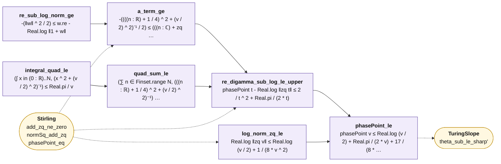

# `lean_stage3/Stage3/TuringSlopePoint.lean`

> **Read from the source text.** This file changed after the last `python3 utilities/lean_map.py --dump`, so the arrows on this page are names occurring in each proof and have not been confirmed by Lean.

TuringSlopePoint — block S14 of `lean_stage3/design/stencil.md`, Turing's slope term: the one-sided digamma bound on the quarter line. 2026-11-25.

7 theorems, 0 definitions, 386 lines. 

**Imports:** [`Stirling`](../lean_stage3/Stirling.md)  
**Imported by:** [`TuringSlope`](../lean_stage3/TuringSlope.md)

## The picture



An arrow A → B reads "A is used in the proof of B". Green: counting, integers only. Violet: shape, analysis with no ζ. Blue: reads ζ. A name ending in ■ is an end: nothing else uses it. Red: contains `sorry`. Yellow: theorems in another file, counted; a dotted arrow crosses files. Definitions are not drawn; they are listed below the diagram.

## Theorems

<a name="TuringSlope-re_sub_log_norm_ge"></a>
### `TuringSlope.re_sub_log_norm_ge`

line 44 · arrows read from text

**Shape.** Uses real or complex analysis; nothing in it or beneath it reads ζ.

**Why.** The one-sided log-Taylor step: `log‖1 + w‖ ≤ Re w + ‖w‖²/2`.

**Proves**

```lean
-(‖w‖ ^ 2 / 2) ≤ w.re - Real.log ‖1 + w‖
```

**Needs** (its hypotheses)

  - `` w : ℂ ``
  - `` hw : 1 + w ≠ 0 ``

**Fed by:** no theorem of this repo; it stands on Mathlib.

**Feeds** (1 that use it)

  - [`TuringSlope.a_term_ge`](#TuringSlope-a_term_ge) — `` -((((n : ℝ) + 1 / 4) ^ 2 + (v / 2) ^ 2)⁻¹ / 2) ≤ (((n : ℂ) + zq v)⁻¹).re - (Real.log ‖((n + 1 : ℕ) : ℂ) + zq v‖ - Real.log ‖(n : ℂ) + zq v‖) ``

<a name="TuringSlope-a_term_ge"></a>
### `TuringSlope.a_term_ge`

line 62 · arrows read from text

**Shape.** Uses real or complex analysis; nothing in it or beneath it reads ζ.

**Why.** The per-term lower bound of the telescope.

**Proves**

```lean
-((((n : ℝ) + 1 / 4) ^ 2 + (v / 2) ^ 2)⁻¹ / 2) ≤ (((n : ℂ) + zq v)⁻¹).re - (Real.log ‖((n + 1 : ℕ) : ℂ) + zq v‖ - Real.log ‖(n : ℂ) + zq v‖)
```

**Needs** (its hypotheses)

  - `` v : ℝ ``
  - `` n : ℕ ``

**Fed by** (3 theorems its proof uses)

  - [`Stage3.add_zq_ne_zero`](../lean_stage3/Stirling.md#Stage3-add_zq_ne_zero) (Stirling) — `` (n : ℂ) + zq t ≠ 0 ``
  - [`Stage3.normSq_add_zq`](../lean_stage3/Stirling.md#Stage3-normSq_add_zq) (Stirling) — `` ‖(n : ℂ) + zq t‖ ^ 2 = ((n : ℝ) + 1 / 4) ^ 2 + (t / 2) ^ 2 ``
  - [`TuringSlope.re_sub_log_norm_ge`](#TuringSlope-re_sub_log_norm_ge) — `` -(‖w‖ ^ 2 / 2) ≤ w.re - Real.log ‖1 + w‖ ``

**Definitions its proof touches:** [`Stage3.zq`](../lean_stage3/Stirling.md#Stage3-zq)

**Feeds** (1 that use it)

  - [`TuringSlope.re_digamma_sub_log_le_upper`](#TuringSlope-re_digamma_sub_log_le_upper) — `` phasePoint t - Real.log ‖zq t‖ ≤ 2 / t ^ 2 + Real.pi / (2 * t) ``

<a name="TuringSlope-integral_quad_le"></a>
### `TuringSlope.integral_quad_le`

line 90 · arrows read from text

**Shape.** Uses real or complex analysis; nothing in it or beneath it reads ζ.

**Why.** The quadratic weight integrates to at most `π/v` over `[0, N]`.

**Proves**

```lean
(∫ x in (0 : ℝ)..N, (x ^ 2 + (v / 2) ^ 2)⁻¹) ≤ Real.pi / v
```

**Needs** (its hypotheses)

  - `` hv : 0 < v ``
  - `` N : ℝ ``

**Fed by:** no theorem of this repo; it stands on Mathlib.

**Feeds** (1 that use it)

  - [`TuringSlope.quad_sum_le`](#TuringSlope-quad_sum_le) — `` (∑ n ∈ Finset.range N, (((n : ℝ) + 1 / 4) ^ 2 + (v / 2) ^ 2)⁻¹) ≤ 4 / v ^ 2 + Real.pi / v ``

<a name="TuringSlope-quad_sum_le"></a>
### `TuringSlope.quad_sum_le`

line 120 · arrows read from text

**Shape.** Uses real or complex analysis; nothing in it or beneath it reads ζ.

**Why.** The quadratic sum: `Σ_{n<N} ((n + 1/4)² + v²/4)⁻¹ ≤ 4/v² + π/v`.

**Proves**

```lean
(∑ n ∈ Finset.range N, (((n : ℝ) + 1 / 4) ^ 2 + (v / 2) ^ 2)⁻¹) ≤ 4 / v ^ 2 + Real.pi / v
```

**Needs** (its hypotheses)

  - `` hv : 0 < v ``
  - `` N : ℕ ``

**Fed by** (1 theorem its proof uses)

  - [`TuringSlope.integral_quad_le`](#TuringSlope-integral_quad_le) — `` (∫ x in (0 : ℝ)..N, (x ^ 2 + (v / 2) ^ 2)⁻¹) ≤ Real.pi / v ``

**Feeds** (1 that use it)

  - [`TuringSlope.re_digamma_sub_log_le_upper`](#TuringSlope-re_digamma_sub_log_le_upper) — `` phasePoint t - Real.log ‖zq t‖ ≤ 2 / t ^ 2 + Real.pi / (2 * t) ``

<a name="TuringSlope-re_digamma_sub_log_le_upper"></a>
### `TuringSlope.re_digamma_sub_log_le_upper`

line 164 · arrows read from text

**Shape.** Uses real or complex analysis; nothing in it or beneath it reads ζ.

**Why.** The one-sided digamma comparison: `Re ψ(zq v) − log‖zq v‖ ≤ 2/v² + π/(2v)`. The limit assembly is `Stage3.re_digamma_sub_log_le`'s, with the per-term bound `a_term_ge`.

**Proves**

```lean
phasePoint t - Real.log ‖zq t‖ ≤ 2 / t ^ 2 + Real.pi / (2 * t)
```

**Needs** (its hypotheses)

  - `` ht : 1 ≤ t ``

**Fed by** (4 theorems its proof uses)

  - [`Stage3.add_zq_ne_zero`](../lean_stage3/Stirling.md#Stage3-add_zq_ne_zero) (Stirling) — `` (n : ℂ) + zq t ≠ 0 ``
  - [`Stage3.phasePoint_eq`](../lean_stage3/Stirling.md#Stage3-phasePoint_eq) (Stirling) — `` phasePoint t = (Complex.digamma (zq t)).re ``
  - [`TuringSlope.a_term_ge`](#TuringSlope-a_term_ge) — `` -((((n : ℝ) + 1 / 4) ^ 2 + (v / 2) ^ 2)⁻¹ / 2) ≤ (((n : ℂ) + zq v)⁻¹).re - (Real.log ‖((n + 1 : ℕ) : ℂ) + zq v‖ - Real.log ‖(n : ℂ) + zq v‖) ``
  - [`TuringSlope.quad_sum_le`](#TuringSlope-quad_sum_le) — `` (∑ n ∈ Finset.range N, (((n : ℝ) + 1 / 4) ^ 2 + (v / 2) ^ 2)⁻¹) ≤ 4 / v ^ 2 + Real.pi / v ``

**Definitions its proof touches:** [`Stage3.phasePoint`](../lean_stage3/Stirling.md#Stage3-phasePoint), [`Stage3.zq`](../lean_stage3/Stirling.md#Stage3-zq)

**Feeds** (1 that use it)

  - [`TuringSlope.phasePoint_le`](#TuringSlope-phasePoint_le) — `` phasePoint v ≤ Real.log (v / 2) + Real.pi / (2 * v) + 17 / (8 * v ^ 2) ``

<a name="TuringSlope-log_norm_zq_le"></a>
### `TuringSlope.log_norm_zq_le`

line 329 · arrows read from text

**Shape.** Uses real or complex analysis; nothing in it or beneath it reads ζ.

**Why.** `log‖zq v‖ ≤ log(v/2) + 1/(8v²)`.

**Proves**

```lean
Real.log ‖zq v‖ ≤ Real.log (v / 2) + 1 / (8 * v ^ 2)
```

**Needs** (its hypotheses)

  - `` hv : 0 < v ``

**Fed by** (1 theorem its proof uses)

  - [`Stage3.normSq_add_zq`](../lean_stage3/Stirling.md#Stage3-normSq_add_zq) (Stirling) — `` ‖(n : ℂ) + zq t‖ ^ 2 = ((n : ℝ) + 1 / 4) ^ 2 + (t / 2) ^ 2 ``

**Definitions its proof touches:** [`Stage3.zq`](../lean_stage3/Stirling.md#Stage3-zq)

**Feeds** (1 that use it)

  - [`TuringSlope.phasePoint_le`](#TuringSlope-phasePoint_le) — `` phasePoint v ≤ Real.log (v / 2) + Real.pi / (2 * v) + 17 / (8 * v ^ 2) ``

<a name="TuringSlope-phasePoint_le"></a>
### `TuringSlope.phasePoint_le`

line 357 · arrows read from text

**Shape.** Uses real or complex analysis; nothing in it or beneath it reads ζ.

**Why.** The one-sided digamma bound on the quarter line: `Re ψ(1/4 + iv/2) ≤ log(v/2) + π/(2v) + 17/(8v²)` for `v ≥ 1`.

**Proves**

```lean
phasePoint v ≤ Real.log (v / 2) + Real.pi / (2 * v) + 17 / (8 * v ^ 2)
```

**Needs** (its hypotheses)

  - `` hv : 1 ≤ v ``

**Fed by** (2 theorems its proof uses)

  - [`TuringSlope.log_norm_zq_le`](#TuringSlope-log_norm_zq_le) — `` Real.log ‖zq v‖ ≤ Real.log (v / 2) + 1 / (8 * v ^ 2) ``
  - [`TuringSlope.re_digamma_sub_log_le_upper`](#TuringSlope-re_digamma_sub_log_le_upper) — `` phasePoint t - Real.log ‖zq t‖ ≤ 2 / t ^ 2 + Real.pi / (2 * t) ``

**Definitions its proof touches:** [`Stage3.phasePoint`](../lean_stage3/Stirling.md#Stage3-phasePoint)

**Feeds** (1 that use it)

  - [`TuringSlope.theta_sub_le_sharp'`](../lean_stage3/TuringSlope.md#TuringSlope-theta_sub_le_sharp-) (TuringSlope) — `` Stage3.phaseTheta u - Stage3.phaseTheta t ≤ (u - t) * (Real.log (u / (2 * Real.pi)) / 2 + Real.pi / (4 * t) + 17 / (16 * t ^ 2)) ``

