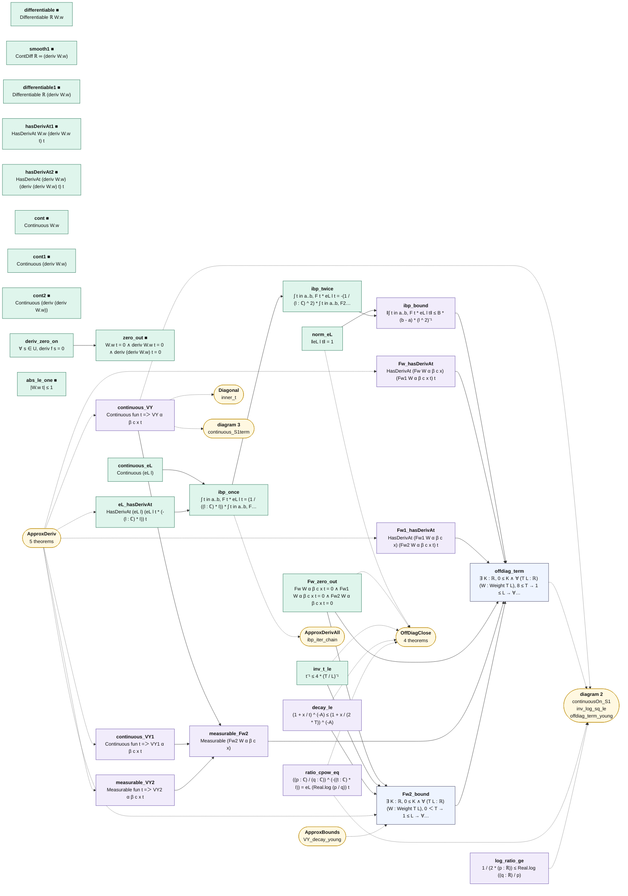
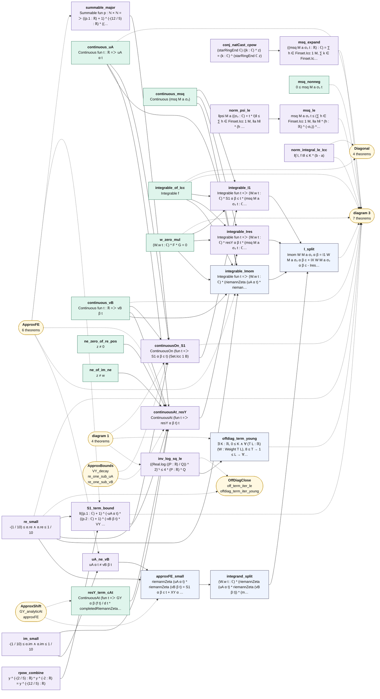
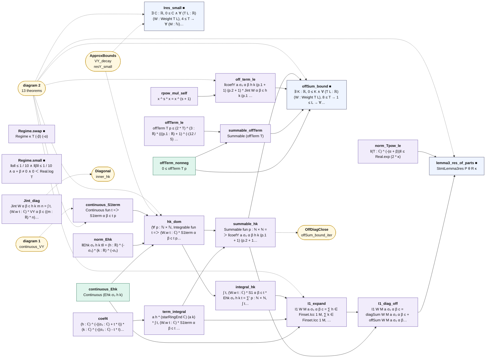

# `lean_stage3/Stage3/TwistedMoment.lean`

> **Read from the source text.** This file changed after the last `python3 utilities/lean_map.py --dump`, so the arrows on this page are names occurring in each proof and have not been confirmed by Lean.

# TwistedMoment — block S12 of `lean_stage3/design/stencil.md`, piece 2b-ii, the twisted moment. 2026-11-25.

82 theorems, 33 definitions, 1811 lines. 

**Imports:** [`ApproxDeriv`](../lean_stage3/ApproxDeriv.md)  
**Imported by:** [`Stage3`](../lean_stage3/Stage3.md), [`ApproxDerivAll`](../lean_stage3/ApproxDerivAll.md)

## The picture

### Diagram 1 of 3: `differentiable` to `log_ratio_ge`



### Diagram 2 of 3: `inv_log_sq_le` to `norm_integral_le_Icc`



### Diagram 3 of 3: `Ires_small` to `lemma3_res_of_parts`



An arrow A → B reads "A is used in the proof of B". Green: counting, integers only. Violet: shape, analysis with no ζ. Blue: reads ζ. A name ending in ■ is an end: nothing else uses it. Red: contains `sorry`. Yellow: theorems in another file, counted; a dotted arrow crosses files. Definitions are not drawn; they are listed below the diagram.

## Definitions

<a name="TwistedMoment-Weight"></a>
### `TwistedMoment.Weight`

structure · line 84

Young's admissible weight (2.1)–(2.3), `Δ = T/L`, the derivative bounds for `j ≤ 2`.

- **Is:** `` Weight (T L : ℝ) where w : ℝ → ℝ smooth : ContDiff ℝ ∞ w supp : ∀ t, w t ≠ 0 → T / 4 ≤ t ∧ t ≤ 2 * T nonneg : ∀ t, 0 ≤ w t le_one : ∀ t, w t ≤ 1 C1 : ℝ C2 : ℝ C1_nonneg : 0 ≤ C1 C2_nonneg : 0 ≤ C2 d1 : ∀ t, |deriv w t| ≤ C1 * (T / L)⁻¹ d2 : ∀ t, |deriv (deriv w) t| ≤ C2 * ((T / L) ^ 2)⁻¹ noncomputable ``
- **Used by 39:** [`Diagonal.Wg`](../lean_stage3/Diagonal.md#Diagonal-Wg), [`Diagonal.diag_mellin`](../lean_stage3/Diagonal.md#Diagonal-diag_mellin), [`Diagonal.diag_per_t`](../lean_stage3/Diagonal.md#Diagonal-diag_per_t), [`Diagonal.diag_shift`](../lean_stage3/Diagonal.md#Diagonal-diag_shift), [`Diagonal.diag_young`](../lean_stage3/Diagonal.md#Diagonal-diag_young), [`Diagonal.inner_hk`](../lean_stage3/Diagonal.md#Diagonal-inner_hk), [`Diagonal.inner_t`](../lean_stage3/Diagonal.md#Diagonal-inner_t), [`Diagonal.joint_integrable`](../lean_stage3/Diagonal.md#Diagonal-joint_integrable), [`Diagonal.shifted_bound`](../lean_stage3/Diagonal.md#Diagonal-shifted_bound), [`Diagonal.wVI_integrable`](../lean_stage3/Diagonal.md#Diagonal-wVI_integrable), [`Diagonal.wVI_swap`](../lean_stage3/Diagonal.md#Diagonal-wVI_swap), [`OffDiagClose.WeightAll`](../lean_stage3/OffDiagClose.md#OffDiagClose-WeightAll), [`TwistedMoment.Fw2_bound`](#TwistedMoment-Fw2_bound), [`TwistedMoment.I1_diag_off`](#TwistedMoment-I1_diag_off), [`TwistedMoment.I1_expand`](#TwistedMoment-I1_expand), [`TwistedMoment.I_split`](#TwistedMoment-I_split), [`TwistedMoment.Ires_small`](#TwistedMoment-Ires_small), [`TwistedMoment.Jint`](#TwistedMoment-Jint), [`TwistedMoment.Jint_diag`](#TwistedMoment-Jint_diag), [`TwistedMoment.StmtDiag`](#TwistedMoment-StmtDiag), [`TwistedMoment.StmtLemma3`](#TwistedMoment-StmtLemma3), [`TwistedMoment.StmtLemma3res`](#TwistedMoment-StmtLemma3res), [`TwistedMoment.StmtOffDiag`](#TwistedMoment-StmtOffDiag), [`TwistedMoment.StmtX`](#TwistedMoment-StmtX), [`TwistedMoment.errY`](#TwistedMoment-errY), [`TwistedMoment.hk_dom`](#TwistedMoment-hk_dom), [`TwistedMoment.integrable_I1`](#TwistedMoment-integrable_I1), [`TwistedMoment.integrable_Imom`](#TwistedMoment-integrable_Imom), [`TwistedMoment.integrable_Ires`](#TwistedMoment-integrable_Ires), [`TwistedMoment.integral_hk`](#TwistedMoment-integral_hk), [`TwistedMoment.integrand_split`](#TwistedMoment-integrand_split), [`TwistedMoment.offSum_bound`](#TwistedMoment-offSum_bound), [`TwistedMoment.off_term_le`](#TwistedMoment-off_term_le), [`TwistedMoment.offdiag_term`](#TwistedMoment-offdiag_term), [`TwistedMoment.offdiag_term_young`](#TwistedMoment-offdiag_term_young), [`TwistedMoment.summable_hk`](#TwistedMoment-summable_hk), [`TwistedMoment.term_integral`](#TwistedMoment-term_integral), [`TwistedMoment.w_zero_mul`](#TwistedMoment-w_zero_mul), [`TwistedMoment.what0`](#TwistedMoment-what0)

<a name="TwistedMoment-what0"></a>
### `TwistedMoment.what0`

def · line 102

- **Is:** `` what0 {T L : ℝ} (W : Weight T L) : ℝ := ∫ t, W.w t ``
- **Built from:** [`TwistedMoment.Weight`](#TwistedMoment-Weight)
- **Used by 7:** [`Diagonal.diag_shift`](../lean_stage3/Diagonal.md#Diagonal-diag_shift), [`Diagonal.diag_young`](../lean_stage3/Diagonal.md#Diagonal-diag_young), [`Diagonal.stmtDiag_of_main`](../lean_stage3/Diagonal.md#Diagonal-stmtDiag_of_main), [`TwistedMoment.StmtDiag`](#TwistedMoment-StmtDiag), [`TwistedMoment.StmtLemma3`](#TwistedMoment-StmtLemma3), [`TwistedMoment.StmtLemma3res`](#TwistedMoment-StmtLemma3res), [`TwistedMoment.lemma3_res_of_parts`](#TwistedMoment-lemma3_res_of_parts)

<a name="TwistedMoment-eL"></a>
### `TwistedMoment.eL`

def · line 159

- **Is:** `` eL (l t : ℝ) : ℂ := cexp ((t : ℂ) * (-(l : ℂ) * I)) ``
- **Used by 11:** [`ApproxDerivAll.ibp_iter`](../lean_stage3/ApproxDerivAll.md#ApproxDerivAll-ibp_iter), [`ApproxDerivAll.ibp_iter_chain`](../lean_stage3/ApproxDerivAll.md#ApproxDerivAll-ibp_iter_chain), [`OffDiagClose.offdiag_term_iter`](../lean_stage3/OffDiagClose.md#OffDiagClose-offdiag_term_iter), [`TwistedMoment.continuous_eL`](#TwistedMoment-continuous_eL), [`TwistedMoment.eL_hasDerivAt`](#TwistedMoment-eL_hasDerivAt), [`TwistedMoment.ibp_bound`](#TwistedMoment-ibp_bound), [`TwistedMoment.ibp_once`](#TwistedMoment-ibp_once), [`TwistedMoment.ibp_twice`](#TwistedMoment-ibp_twice), [`TwistedMoment.norm_eL`](#TwistedMoment-norm_eL), [`TwistedMoment.offdiag_term`](#TwistedMoment-offdiag_term), [`TwistedMoment.ratio_cpow_eq`](#TwistedMoment-ratio_cpow_eq)

<a name="TwistedMoment-Fw"></a>
### `TwistedMoment.Fw`

def · line 251

- **Is:** `` Fw (t : ℝ) : ℂ := (W.w t : ℂ) * VY α β c x t noncomputable ``
- **Built from:** [`ApproxFE.VY`](../lean_stage3/ApproxFE.md#ApproxFE-VY)
- **Used by 8:** [`OffDiagClose.Fw_contDiff`](../lean_stage3/OffDiagClose.md#OffDiagClose-Fw_contDiff), [`OffDiagClose.Fw_iter_bound`](../lean_stage3/OffDiagClose.md#OffDiagClose-Fw_iter_bound), [`OffDiagClose.Fw_iter_leibniz`](../lean_stage3/OffDiagClose.md#OffDiagClose-Fw_iter_leibniz), [`OffDiagClose.Fw_iter_zero_out`](../lean_stage3/OffDiagClose.md#OffDiagClose-Fw_iter_zero_out), [`OffDiagClose.offdiag_term_iter`](../lean_stage3/OffDiagClose.md#OffDiagClose-offdiag_term_iter), [`TwistedMoment.Fw_hasDerivAt`](#TwistedMoment-Fw_hasDerivAt), [`TwistedMoment.Fw_zero_out`](#TwistedMoment-Fw_zero_out), [`TwistedMoment.offdiag_term`](#TwistedMoment-offdiag_term)

<a name="TwistedMoment-Fw1"></a>
### `TwistedMoment.Fw1`

def · line 255

- **Is:** `` Fw1 (t : ℝ) : ℂ := ((deriv W.w t : ℝ) : ℂ) * VY α β c x t + (W.w t : ℂ) * VY1 α β c x t noncomputable ``
- **Built from:** [`ApproxDeriv.VY1`](../lean_stage3/ApproxDeriv.md#ApproxDeriv-VY1), [`ApproxFE.VY`](../lean_stage3/ApproxFE.md#ApproxFE-VY)
- **Used by 3:** [`TwistedMoment.Fw1_hasDerivAt`](#TwistedMoment-Fw1_hasDerivAt), [`TwistedMoment.Fw_hasDerivAt`](#TwistedMoment-Fw_hasDerivAt), [`TwistedMoment.Fw_zero_out`](#TwistedMoment-Fw_zero_out)

<a name="TwistedMoment-Fw2"></a>
### `TwistedMoment.Fw2`

def · line 259

- **Is:** `` Fw2 (t : ℝ) : ℂ := ((deriv (deriv W.w) t : ℝ) : ℂ) * VY α β c x t + 2 * ((deriv W.w t : ℝ) : ℂ) * VY1 α β c x t + (W.w t : ℂ) * VY2 α β c x t ``
- **Built from:** [`ApproxDeriv.VY1`](../lean_stage3/ApproxDeriv.md#ApproxDeriv-VY1), [`ApproxDeriv.VY2`](../lean_stage3/ApproxDeriv.md#ApproxDeriv-VY2), [`ApproxFE.VY`](../lean_stage3/ApproxFE.md#ApproxFE-VY)
- **Used by 5:** [`TwistedMoment.Fw1_hasDerivAt`](#TwistedMoment-Fw1_hasDerivAt), [`TwistedMoment.Fw2_bound`](#TwistedMoment-Fw2_bound), [`TwistedMoment.Fw_zero_out`](#TwistedMoment-Fw_zero_out), [`TwistedMoment.measurable_Fw2`](#TwistedMoment-measurable_Fw2), [`TwistedMoment.offdiag_term`](#TwistedMoment-offdiag_term)

<a name="TwistedMoment-psi"></a>
### `TwistedMoment.psi`

def · line 623

- **Is:** `` psi (M : ℕ) (a : ℕ → ℂ) (s : ℂ) : ℂ := ∑ h ∈ Finset.Icc 1 M, a h * (h : ℂ) ^ (-s) noncomputable ``
- **Used by 4:** [`TwistedMoment.continuous_msq`](#TwistedMoment-continuous_msq), [`TwistedMoment.msq`](#TwistedMoment-msq), [`TwistedMoment.msq_expand`](#TwistedMoment-msq_expand), [`TwistedMoment.norm_psi_le`](#TwistedMoment-norm_psi_le)

<a name="TwistedMoment-msq"></a>
### `TwistedMoment.msq`

def · line 627

- **Is:** `` msq (M : ℕ) (a : ℕ → ℂ) (σ₀ t : ℝ) : ℝ := ‖psi M a ((σ₀ : ℂ) + t * I)‖ ^ 2 noncomputable ``
- **Built from:** [`TwistedMoment.psi`](#TwistedMoment-psi)
- **Used by 15:** [`TwistedMoment.I1`](#TwistedMoment-I1), [`TwistedMoment.I1_expand`](#TwistedMoment-I1_expand), [`TwistedMoment.IX`](#TwistedMoment-IX), [`TwistedMoment.I_split`](#TwistedMoment-I_split), [`TwistedMoment.Imom`](#TwistedMoment-Imom), [`TwistedMoment.Ires`](#TwistedMoment-Ires), [`TwistedMoment.Ires_small`](#TwistedMoment-Ires_small), [`TwistedMoment.continuous_msq`](#TwistedMoment-continuous_msq), [`TwistedMoment.integrable_I1`](#TwistedMoment-integrable_I1), [`TwistedMoment.integrable_Imom`](#TwistedMoment-integrable_Imom), [`TwistedMoment.integrable_Ires`](#TwistedMoment-integrable_Ires), [`TwistedMoment.integrand_split`](#TwistedMoment-integrand_split), [`TwistedMoment.msq_expand`](#TwistedMoment-msq_expand), [`TwistedMoment.msq_le`](#TwistedMoment-msq_le), [`TwistedMoment.msq_nonneg`](#TwistedMoment-msq_nonneg)

<a name="TwistedMoment-S1"></a>
### `TwistedMoment.S1`

def · line 632

- **Is:** `` S1 (α β : ℂ) (c t : ℝ) : ℂ := ∑' p : ℕ × ℕ, ((p.1 : ℂ) + 1) ^ (-uA α t) * ((p.2 : ℂ) + 1) ^ (-vB β t) * VY α β c (((p.1 : ℝ) + 1) * ((p.2 : ℝ) + 1)) t ``
- **Built from:** [`ApproxFE.VY`](../lean_stage3/ApproxFE.md#ApproxFE-VY), [`ApproxFE.uA`](../lean_stage3/ApproxFE.md#ApproxFE-uA), [`ApproxFE.vB`](../lean_stage3/ApproxFE.md#ApproxFE-vB)
- **Used by 9:** [`TwistedMoment.I1`](#TwistedMoment-I1), [`TwistedMoment.I1_expand`](#TwistedMoment-I1_expand), [`TwistedMoment.IX`](#TwistedMoment-IX), [`TwistedMoment.I_split`](#TwistedMoment-I_split), [`TwistedMoment.approxFE_small`](#TwistedMoment-approxFE_small), [`TwistedMoment.continuousOn_S1`](#TwistedMoment-continuousOn_S1), [`TwistedMoment.integrable_I1`](#TwistedMoment-integrable_I1), [`TwistedMoment.integral_hk`](#TwistedMoment-integral_hk), [`TwistedMoment.integrand_split`](#TwistedMoment-integrand_split)

<a name="TwistedMoment-Imom"></a>
### `TwistedMoment.Imom`

def · line 642

- **Is:** `` Imom : ℂ := ∫ t, (W.w t : ℂ) * (riemannZeta (uA α t) * riemannZeta (vB β t)) * (msq M a σ₀ t : ℂ) noncomputable ``
- **Built from:** [`ApproxFE.uA`](../lean_stage3/ApproxFE.md#ApproxFE-uA), [`ApproxFE.vB`](../lean_stage3/ApproxFE.md#ApproxFE-vB), [`TwistedMoment.msq`](#TwistedMoment-msq)
- **Used by 4:** [`TwistedMoment.I_split`](#TwistedMoment-I_split), [`TwistedMoment.StmtLemma3`](#TwistedMoment-StmtLemma3), [`TwistedMoment.StmtLemma3res`](#TwistedMoment-StmtLemma3res), [`TwistedMoment.lemma3_res_of_parts`](#TwistedMoment-lemma3_res_of_parts)

<a name="TwistedMoment-I1"></a>
### `TwistedMoment.I1`

def · line 647

- **Is:** `` I1 : ℂ := ∫ t, (W.w t : ℂ) * S1 α β c t * (msq M a σ₀ t : ℂ) noncomputable ``
- **Built from:** [`TwistedMoment.S1`](#TwistedMoment-S1), [`TwistedMoment.msq`](#TwistedMoment-msq)
- **Used by 5:** [`TwistedMoment.I1_diag_off`](#TwistedMoment-I1_diag_off), [`TwistedMoment.I1_expand`](#TwistedMoment-I1_expand), [`TwistedMoment.I_split`](#TwistedMoment-I_split), [`TwistedMoment.StmtX`](#TwistedMoment-StmtX), [`TwistedMoment.lemma3_res_of_parts`](#TwistedMoment-lemma3_res_of_parts)

<a name="TwistedMoment-IX"></a>
### `TwistedMoment.IX`

def · line 651

- **Is:** `` IX : ℂ := ∫ t, (W.w t : ℂ) * (XY α β t * S1 (-β) (-α) c t) * (msq M a σ₀ t : ℂ) noncomputable ``
- **Built from:** [`ApproxFE.XY`](../lean_stage3/ApproxFE.md#ApproxFE-XY), [`TwistedMoment.S1`](#TwistedMoment-S1), [`TwistedMoment.msq`](#TwistedMoment-msq)
- **Used by 3:** [`TwistedMoment.I_split`](#TwistedMoment-I_split), [`TwistedMoment.StmtX`](#TwistedMoment-StmtX), [`TwistedMoment.lemma3_res_of_parts`](#TwistedMoment-lemma3_res_of_parts)

<a name="TwistedMoment-Ires"></a>
### `TwistedMoment.Ires`

def · line 655

- **Is:** `` Ires : ℂ := ∫ t, (W.w t : ℂ) * resY α β t * (msq M a σ₀ t : ℂ) ``
- **Built from:** [`ApproxFE.resY`](../lean_stage3/ApproxFE.md#ApproxFE-resY), [`TwistedMoment.msq`](#TwistedMoment-msq)
- **Used by 4:** [`TwistedMoment.I_split`](#TwistedMoment-I_split), [`TwistedMoment.Ires_small`](#TwistedMoment-Ires_small), [`TwistedMoment.StmtLemma3res`](#TwistedMoment-StmtLemma3res), [`TwistedMoment.lemma3_res_of_parts`](#TwistedMoment-lemma3_res_of_parts)

<a name="TwistedMoment-coefY"></a>
### `TwistedMoment.coefY`

def · line 1038

- **Is:** `` coefY (a : ℕ → ℂ) (σ₀ : ℝ) (α β : ℂ) (h k m n : ℕ) : ℂ := a h * (starRingEnd ℂ) (a k) * ((h : ℂ) ^ (-(σ₀ : ℂ)) * (k : ℂ) ^ (-(σ₀ : ℂ)) * (m : ℂ) ^ (-(1 / 2 + α)) * (n : ℂ) ^ (-(1 / 2 + β))) noncomputable ``
- **Used by 11:** [`Diagonal.inner_hk`](../lean_stage3/Diagonal.md#Diagonal-inner_hk), [`OffDiagClose.offSum_bound_iter`](../lean_stage3/OffDiagClose.md#OffDiagClose-offSum_bound_iter), [`OffDiagClose.off_term_iter_le`](../lean_stage3/OffDiagClose.md#OffDiagClose-off_term_iter_le), [`TwistedMoment.I1_diag_off`](#TwistedMoment-I1_diag_off), [`TwistedMoment.I1_expand`](#TwistedMoment-I1_expand), [`TwistedMoment.diagSum`](#TwistedMoment-diagSum), [`TwistedMoment.offSum`](#TwistedMoment-offSum), [`TwistedMoment.offSum_bound`](#TwistedMoment-offSum_bound), [`TwistedMoment.off_term_le`](#TwistedMoment-off_term_le), [`TwistedMoment.summable_hk`](#TwistedMoment-summable_hk), [`TwistedMoment.term_integral`](#TwistedMoment-term_integral)

<a name="TwistedMoment-Jint"></a>
### `TwistedMoment.Jint`

def · line 1044

- **Is:** `` Jint {T L : ℝ} (W : Weight T L) (α β : ℂ) (c : ℝ) (h k m n : ℕ) : ℂ := ∫ t, (W.w t : ℂ) * VY α β c ((m : ℝ) * n) t * ((h : ℂ) * m / ((k : ℂ) * n)) ^ (-((t : ℂ) * I)) ``
- **Built from:** [`ApproxFE.VY`](../lean_stage3/ApproxFE.md#ApproxFE-VY), [`TwistedMoment.Weight`](#TwistedMoment-Weight)
- **Used by 13:** [`Diagonal.inner_hk`](../lean_stage3/Diagonal.md#Diagonal-inner_hk), [`OffDiagClose.offSum_bound_iter`](../lean_stage3/OffDiagClose.md#OffDiagClose-offSum_bound_iter), [`OffDiagClose.off_term_iter_le`](../lean_stage3/OffDiagClose.md#OffDiagClose-off_term_iter_le), [`OffDiagClose.offdiag_term_iter_young`](../lean_stage3/OffDiagClose.md#OffDiagClose-offdiag_term_iter_young), [`TwistedMoment.I1_diag_off`](#TwistedMoment-I1_diag_off), [`TwistedMoment.I1_expand`](#TwistedMoment-I1_expand), [`TwistedMoment.Jint_diag`](#TwistedMoment-Jint_diag), [`TwistedMoment.diagSum`](#TwistedMoment-diagSum), [`TwistedMoment.offSum`](#TwistedMoment-offSum), [`TwistedMoment.offSum_bound`](#TwistedMoment-offSum_bound), [`TwistedMoment.off_term_le`](#TwistedMoment-off_term_le), [`TwistedMoment.summable_hk`](#TwistedMoment-summable_hk), [`TwistedMoment.term_integral`](#TwistedMoment-term_integral)

<a name="TwistedMoment-Ehk"></a>
### `TwistedMoment.Ehk`

def · line 1077

- **Is:** `` Ehk (σ₀ : ℝ) (h k : ℕ) (t : ℝ) : ℂ := (h : ℂ) ^ (-((σ₀ : ℂ) + t * I)) * (k : ℂ) ^ (-((σ₀ : ℂ) - t * I)) ``
- **Used by 6:** [`TwistedMoment.I1_expand`](#TwistedMoment-I1_expand), [`TwistedMoment.continuous_Ehk`](#TwistedMoment-continuous_Ehk), [`TwistedMoment.hk_dom`](#TwistedMoment-hk_dom), [`TwistedMoment.integral_hk`](#TwistedMoment-integral_hk), [`TwistedMoment.norm_Ehk`](#TwistedMoment-norm_Ehk), [`TwistedMoment.term_integral`](#TwistedMoment-term_integral)

<a name="TwistedMoment-S1term"></a>
### `TwistedMoment.S1term`

def · line 1096

- **Is:** `` S1term (α β : ℂ) (c t : ℝ) (p : ℕ × ℕ) : ℂ := ((p.1 : ℂ) + 1) ^ (-uA α t) * ((p.2 : ℂ) + 1) ^ (-vB β t) * VY α β c (((p.1 : ℝ) + 1) * ((p.2 : ℝ) + 1)) t ``
- **Built from:** [`ApproxFE.VY`](../lean_stage3/ApproxFE.md#ApproxFE-VY), [`ApproxFE.uA`](../lean_stage3/ApproxFE.md#ApproxFE-uA), [`ApproxFE.vB`](../lean_stage3/ApproxFE.md#ApproxFE-vB)
- **Used by 4:** [`TwistedMoment.continuous_S1term`](#TwistedMoment-continuous_S1term), [`TwistedMoment.hk_dom`](#TwistedMoment-hk_dom), [`TwistedMoment.integral_hk`](#TwistedMoment-integral_hk), [`TwistedMoment.term_integral`](#TwistedMoment-term_integral)

<a name="TwistedMoment-diagSum"></a>
### `TwistedMoment.diagSum`

def · line 1249

- **Is:** `` diagSum : ℂ := ∑ h ∈ Finset.Icc 1 M, ∑ k ∈ Finset.Icc 1 M, ∑' p : ℕ × ℕ, if h * (p.1 + 1) = k * (p.2 + 1) then coefY a σ₀ α β h k (p.1 + 1) (p.2 + 1) * Jint W α β c h k (p.1 + 1) (p.2 + 1) else 0 noncomputable ``
- **Built from:** [`TwistedMoment.Jint`](#TwistedMoment-Jint), [`TwistedMoment.coefY`](#TwistedMoment-coefY)
- **Used by 8:** [`Diagonal.diag_mellin`](../lean_stage3/Diagonal.md#Diagonal-diag_mellin), [`Diagonal.diag_per_t`](../lean_stage3/Diagonal.md#Diagonal-diag_per_t), [`Diagonal.diag_shift`](../lean_stage3/Diagonal.md#Diagonal-diag_shift), [`Diagonal.diag_young`](../lean_stage3/Diagonal.md#Diagonal-diag_young), [`Diagonal.stmtDiag_of_main`](../lean_stage3/Diagonal.md#Diagonal-stmtDiag_of_main), [`TwistedMoment.I1_diag_off`](#TwistedMoment-I1_diag_off), [`TwistedMoment.StmtDiag`](#TwistedMoment-StmtDiag), [`TwistedMoment.lemma3_res_of_parts`](#TwistedMoment-lemma3_res_of_parts)

<a name="TwistedMoment-offSum"></a>
### `TwistedMoment.offSum`

def · line 1256

- **Is:** `` offSum : ℂ := ∑ h ∈ Finset.Icc 1 M, ∑ k ∈ Finset.Icc 1 M, ∑' p : ℕ × ℕ, if h * (p.1 + 1) = k * (p.2 + 1) then 0 else coefY a σ₀ α β h k (p.1 + 1) (p.2 + 1) * Jint W α β c h k (p.1 + 1) (p.2 + 1) ``
- **Built from:** [`TwistedMoment.Jint`](#TwistedMoment-Jint), [`TwistedMoment.coefY`](#TwistedMoment-coefY)
- **Used by 7:** [`OffDiagClose.StmtOffDiagAll`](../lean_stage3/OffDiagClose.md#OffDiagClose-StmtOffDiagAll), [`OffDiagClose.offSum_bound_iter`](../lean_stage3/OffDiagClose.md#OffDiagClose-offSum_bound_iter), [`OffDiagClose.stmtOffDiag_holds`](../lean_stage3/OffDiagClose.md#OffDiagClose-stmtOffDiag_holds), [`TwistedMoment.I1_diag_off`](#TwistedMoment-I1_diag_off), [`TwistedMoment.StmtOffDiag`](#TwistedMoment-StmtOffDiag), [`TwistedMoment.lemma3_res_of_parts`](#TwistedMoment-lemma3_res_of_parts), [`TwistedMoment.offSum_bound`](#TwistedMoment-offSum_bound)

<a name="TwistedMoment-offTerm"></a>
### `TwistedMoment.offTerm`

def · line 1304

- **Is:** `` offTerm (T : ℝ) (p : ℕ × ℕ) : ℝ := (((p.1 : ℝ) + 1) * ((p.2 : ℝ) + 1)) ^ (3 / 5 : ℝ) * (1 + ((p.1 : ℝ) + 1) * ((p.2 : ℝ) + 1) / (2 * T)) ^ (-3 : ℝ) noncomputable ``
- **Used by 6:** [`TwistedMoment.offSeries`](#TwistedMoment-offSeries), [`TwistedMoment.offSum_bound`](#TwistedMoment-offSum_bound), [`TwistedMoment.offTerm_le`](#TwistedMoment-offTerm_le), [`TwistedMoment.offTerm_nonneg`](#TwistedMoment-offTerm_nonneg), [`TwistedMoment.off_term_le`](#TwistedMoment-off_term_le), [`TwistedMoment.summable_offTerm`](#TwistedMoment-summable_offTerm)

<a name="TwistedMoment-offSeries"></a>
### `TwistedMoment.offSeries`

def · line 1310

- **Is:** `` offSeries (T : ℝ) : ℝ := ∑' p : ℕ × ℕ, offTerm T p ``
- **Built from:** [`TwistedMoment.offTerm`](#TwistedMoment-offTerm)
- **Used by 1:** [`TwistedMoment.offSum_bound`](#TwistedMoment-offSum_bound)

<a name="TwistedMoment-Mof"></a>
### `TwistedMoment.Mof`

def · line 1509

- **Is:** `` Mof (T θ : ℝ) : ℕ := ⌊T ^ θ⌋₊ noncomputable ``
- **Used by 15:** [`Diagonal.SB_young`](../lean_stage3/Diagonal.md#Diagonal-SB_young), [`Diagonal.StmtDiagMain`](../lean_stage3/Diagonal.md#Diagonal-StmtDiagMain), [`Diagonal.aY_bound'`](../lean_stage3/Diagonal.md#Diagonal-aY_bound-), [`Diagonal.diag_young`](../lean_stage3/Diagonal.md#Diagonal-diag_young), [`Diagonal.stmtDiag_of_main`](../lean_stage3/Diagonal.md#Diagonal-stmtDiag_of_main), [`OffDiagClose.StmtOffDiagAll`](../lean_stage3/OffDiagClose.md#OffDiagClose-StmtOffDiagAll), [`OffDiagClose.aY_bound`](../lean_stage3/OffDiagClose.md#OffDiagClose-aY_bound), [`OffDiagClose.stmtOffDiag_holds`](../lean_stage3/OffDiagClose.md#OffDiagClose-stmtOffDiag_holds), [`TwistedMoment.StmtDiag`](#TwistedMoment-StmtDiag), [`TwistedMoment.StmtLemma3`](#TwistedMoment-StmtLemma3), [`TwistedMoment.StmtLemma3res`](#TwistedMoment-StmtLemma3res), [`TwistedMoment.StmtOffDiag`](#TwistedMoment-StmtOffDiag), [`TwistedMoment.StmtX`](#TwistedMoment-StmtX), [`TwistedMoment.aY`](#TwistedMoment-aY), [`TwistedMoment.lemma3_res_of_parts`](#TwistedMoment-lemma3_res_of_parts)

<a name="TwistedMoment-sig0"></a>
### `TwistedMoment.sig0`

def · line 1513

- **Is:** `` sig0 (T R : ℝ) : ℝ := 1 / 2 - R / Real.log T noncomputable ``
- **Used by 15:** [`Diagonal.SB_young`](../lean_stage3/Diagonal.md#Diagonal-SB_young), [`Diagonal.StmtDiagMain`](../lean_stage3/Diagonal.md#Diagonal-StmtDiagMain), [`Diagonal.aY_bound'`](../lean_stage3/Diagonal.md#Diagonal-aY_bound-), [`Diagonal.diag_young`](../lean_stage3/Diagonal.md#Diagonal-diag_young), [`Diagonal.stmtDiag_of_main`](../lean_stage3/Diagonal.md#Diagonal-stmtDiag_of_main), [`OffDiagClose.StmtOffDiagAll`](../lean_stage3/OffDiagClose.md#OffDiagClose-StmtOffDiagAll), [`OffDiagClose.aY_bound`](../lean_stage3/OffDiagClose.md#OffDiagClose-aY_bound), [`OffDiagClose.stmtOffDiag_holds`](../lean_stage3/OffDiagClose.md#OffDiagClose-stmtOffDiag_holds), [`TwistedMoment.StmtDiag`](#TwistedMoment-StmtDiag), [`TwistedMoment.StmtLemma3`](#TwistedMoment-StmtLemma3), [`TwistedMoment.StmtLemma3res`](#TwistedMoment-StmtLemma3res), [`TwistedMoment.StmtOffDiag`](#TwistedMoment-StmtOffDiag), [`TwistedMoment.StmtX`](#TwistedMoment-StmtX), [`TwistedMoment.aY`](#TwistedMoment-aY), [`TwistedMoment.lemma3_res_of_parts`](#TwistedMoment-lemma3_res_of_parts)

<a name="TwistedMoment-aY"></a>
### `TwistedMoment.aY`

def · line 1518

- **Is:** `` aY (P : Polynomial ℝ) (T θ R : ℝ) (h : ℕ) : ℂ := ((ArithmeticFunction.moebius h : ℤ) : ℂ) * ((P.eval (Real.log ((Mof T θ : ℝ) / h) / Real.log (Mof T θ)) : ℝ) : ℂ) * (((h : ℝ) ^ (sig0 T R - 1 / 2) : ℝ) : ℂ) noncomputable ``
- **Built from:** [`TwistedMoment.Mof`](#TwistedMoment-Mof), [`TwistedMoment.sig0`](#TwistedMoment-sig0)
- **Used by 14:** [`Diagonal.SB_young`](../lean_stage3/Diagonal.md#Diagonal-SB_young), [`Diagonal.StmtDiagMain`](../lean_stage3/Diagonal.md#Diagonal-StmtDiagMain), [`Diagonal.aY_bound'`](../lean_stage3/Diagonal.md#Diagonal-aY_bound-), [`Diagonal.diag_young`](../lean_stage3/Diagonal.md#Diagonal-diag_young), [`Diagonal.stmtDiag_of_main`](../lean_stage3/Diagonal.md#Diagonal-stmtDiag_of_main), [`OffDiagClose.StmtOffDiagAll`](../lean_stage3/OffDiagClose.md#OffDiagClose-StmtOffDiagAll), [`OffDiagClose.aY_bound`](../lean_stage3/OffDiagClose.md#OffDiagClose-aY_bound), [`OffDiagClose.stmtOffDiag_holds`](../lean_stage3/OffDiagClose.md#OffDiagClose-stmtOffDiag_holds), [`TwistedMoment.StmtDiag`](#TwistedMoment-StmtDiag), [`TwistedMoment.StmtLemma3`](#TwistedMoment-StmtLemma3), [`TwistedMoment.StmtLemma3res`](#TwistedMoment-StmtLemma3res), [`TwistedMoment.StmtOffDiag`](#TwistedMoment-StmtOffDiag), [`TwistedMoment.StmtX`](#TwistedMoment-StmtX), [`TwistedMoment.lemma3_res_of_parts`](#TwistedMoment-lemma3_res_of_parts)

<a name="TwistedMoment-c1Y"></a>
### `TwistedMoment.c1Y`

def · line 1525

- **Is:** `` c1Y (P : Polynomial ℝ) (M : ℕ) (α β : ℂ) : ℂ := 1 / ((α + β) * Real.log M) * ∫ u in (0 : ℝ)..1, (((P.derivative.eval u : ℝ) : ℂ) + α * Real.log M * (P.eval u : ℝ)) * (((P.derivative.eval u : ℝ) : ℂ) + β * Real.log M * (P.eval u : ℝ)) noncomputable ``
- **Used by 5:** [`Diagonal.StmtDiagMain`](../lean_stage3/Diagonal.md#Diagonal-StmtDiagMain), [`Diagonal.stmtDiag_of_main`](../lean_stage3/Diagonal.md#Diagonal-stmtDiag_of_main), [`TwistedMoment.StmtDiag`](#TwistedMoment-StmtDiag), [`TwistedMoment.cY`](#TwistedMoment-cY), [`TwistedMoment.lemma3_res_of_parts`](#TwistedMoment-lemma3_res_of_parts)

<a name="TwistedMoment-cY"></a>
### `TwistedMoment.cY`

def · line 1533

- **Is:** `` cY (P : Polynomial ℝ) (M : ℕ) (T : ℝ) (α β : ℂ) : ℂ := c1Y P M α β + (T : ℂ) ^ (-(α + β)) * c1Y P M (-β) (-α) noncomputable ``
- **Built from:** [`TwistedMoment.c1Y`](#TwistedMoment-c1Y)
- **Used by 3:** [`TwistedMoment.StmtLemma3`](#TwistedMoment-StmtLemma3), [`TwistedMoment.StmtLemma3res`](#TwistedMoment-StmtLemma3res), [`TwistedMoment.lemma3_res_of_parts`](#TwistedMoment-lemma3_res_of_parts)

<a name="TwistedMoment-Regime"></a>
### `TwistedMoment.Regime`

def · line 1538

- **Is:** `` Regime (κ T : ℝ) (α β : ℂ) : Prop := ‖α‖ ≤ κ / Real.log T ∧ ‖β‖ ≤ κ / Real.log T ∧ 1 / (κ * Real.log T) ≤ ‖α + β‖ noncomputable ``
- **Used by 12:** [`Diagonal.StmtDiagMain`](../lean_stage3/Diagonal.md#Diagonal-StmtDiagMain), [`Diagonal.diag_young`](../lean_stage3/Diagonal.md#Diagonal-diag_young), [`OffDiagClose.N_le`](../lean_stage3/OffDiagClose.md#OffDiagClose-N_le), [`OffDiagClose.StmtOffDiagAll`](../lean_stage3/OffDiagClose.md#OffDiagClose-StmtOffDiagAll), [`TwistedMoment.Regime.small`](#TwistedMoment-Regime-small), [`TwistedMoment.Regime.swap`](#TwistedMoment-Regime-swap), [`TwistedMoment.StmtDiag`](#TwistedMoment-StmtDiag), [`TwistedMoment.StmtLemma3`](#TwistedMoment-StmtLemma3), [`TwistedMoment.StmtLemma3res`](#TwistedMoment-StmtLemma3res), [`TwistedMoment.StmtOffDiag`](#TwistedMoment-StmtOffDiag), [`TwistedMoment.StmtX`](#TwistedMoment-StmtX), [`TwistedMoment.norm_Tpow_le`](#TwistedMoment-norm_Tpow_le)

<a name="TwistedMoment-errY"></a>
### `TwistedMoment.errY`

def · line 1543

- **Is:** `` errY {T L : ℝ} (W : Weight T L) : ℝ := (1 + W.C1 + W.C2) * (T / L) noncomputable ``
- **Built from:** [`TwistedMoment.Weight`](#TwistedMoment-Weight)
- **Used by 9:** [`Diagonal.stmtDiag_of_main`](../lean_stage3/Diagonal.md#Diagonal-stmtDiag_of_main), [`OffDiagClose.StmtOffDiagAll`](../lean_stage3/OffDiagClose.md#OffDiagClose-StmtOffDiagAll), [`OffDiagClose.stmtOffDiag_holds`](../lean_stage3/OffDiagClose.md#OffDiagClose-stmtOffDiag_holds), [`TwistedMoment.StmtDiag`](#TwistedMoment-StmtDiag), [`TwistedMoment.StmtLemma3`](#TwistedMoment-StmtLemma3), [`TwistedMoment.StmtLemma3res`](#TwistedMoment-StmtLemma3res), [`TwistedMoment.StmtOffDiag`](#TwistedMoment-StmtOffDiag), [`TwistedMoment.StmtX`](#TwistedMoment-StmtX), [`TwistedMoment.lemma3_res_of_parts`](#TwistedMoment-lemma3_res_of_parts)

<a name="TwistedMoment-StmtDiag"></a>
### `TwistedMoment.StmtDiag`

def · line 1550

- **Is:** `` StmtDiag (P : Polynomial ℝ) (θ R κ : ℝ) : Prop := ∃ C T₀ : ℝ, 0 ≤ C ∧ ∀ T : ℝ, T₀ ≤ T → ∀ W : Weight T (Real.log T), ∀ α β : ℂ, Regime κ T α β → ‖diagSum W (Mof T θ) (aY P T θ R) (sig0 T R) α β 1 - c1Y P (Mof T θ) α β * (what0 W : ℂ)‖ ≤ C * errY W noncomputable ``
- **Built from:** [`TwistedMoment.Mof`](#TwistedMoment-Mof), [`TwistedMoment.Regime`](#TwistedMoment-Regime), [`TwistedMoment.Weight`](#TwistedMoment-Weight), [`TwistedMoment.aY`](#TwistedMoment-aY), [`TwistedMoment.c1Y`](#TwistedMoment-c1Y), [`TwistedMoment.diagSum`](#TwistedMoment-diagSum), [`TwistedMoment.errY`](#TwistedMoment-errY), [`TwistedMoment.sig0`](#TwistedMoment-sig0), [`TwistedMoment.what0`](#TwistedMoment-what0)
- **Used by 2:** [`Diagonal.stmtDiag_of_main`](../lean_stage3/Diagonal.md#Diagonal-stmtDiag_of_main), [`TwistedMoment.lemma3_res_of_parts`](#TwistedMoment-lemma3_res_of_parts)

<a name="TwistedMoment-StmtOffDiag"></a>
### `TwistedMoment.StmtOffDiag`

def · line 1560

- **Is:** `` StmtOffDiag (P : Polynomial ℝ) (θ R κ : ℝ) : Prop := ∃ C T₀ : ℝ, 0 ≤ C ∧ ∀ T : ℝ, T₀ ≤ T → ∀ W : Weight T (Real.log T), ∀ α β : ℂ, Regime κ T α β → ‖offSum W (Mof T θ) (aY P T θ R) (sig0 T R) α β 1‖ ≤ C * errY W noncomputable ``
- **Built from:** [`TwistedMoment.Mof`](#TwistedMoment-Mof), [`TwistedMoment.Regime`](#TwistedMoment-Regime), [`TwistedMoment.Weight`](#TwistedMoment-Weight), [`TwistedMoment.aY`](#TwistedMoment-aY), [`TwistedMoment.errY`](#TwistedMoment-errY), [`TwistedMoment.offSum`](#TwistedMoment-offSum), [`TwistedMoment.sig0`](#TwistedMoment-sig0)
- **Used by 1:** [`TwistedMoment.lemma3_res_of_parts`](#TwistedMoment-lemma3_res_of_parts)

<a name="TwistedMoment-StmtX"></a>
### `TwistedMoment.StmtX`

def · line 1569

- **Is:** `` StmtX (P : Polynomial ℝ) (θ R κ : ℝ) : Prop := ∃ C T₀ : ℝ, 0 ≤ C ∧ ∀ T : ℝ, T₀ ≤ T → ∀ W : Weight T (Real.log T), ∀ α β : ℂ, Regime κ T α β → ‖IX W (Mof T θ) (aY P T θ R) (sig0 T R) α β 1 - (T : ℂ) ^ (-(α + β)) * I1 W (Mof T θ) (aY P T θ R) (sig0 T R) (-β) (-α) 1‖ ≤ C * errY W noncomputable ``
- **Built from:** [`TwistedMoment.I1`](#TwistedMoment-I1), [`TwistedMoment.IX`](#TwistedMoment-IX), [`TwistedMoment.Mof`](#TwistedMoment-Mof), [`TwistedMoment.Regime`](#TwistedMoment-Regime), [`TwistedMoment.Weight`](#TwistedMoment-Weight), [`TwistedMoment.aY`](#TwistedMoment-aY), [`TwistedMoment.errY`](#TwistedMoment-errY), [`TwistedMoment.sig0`](#TwistedMoment-sig0)
- **Used by 1:** [`TwistedMoment.lemma3_res_of_parts`](#TwistedMoment-lemma3_res_of_parts)

<a name="TwistedMoment-StmtLemma3"></a>
### `TwistedMoment.StmtLemma3`

def · line 1578

- **Is:** `` StmtLemma3 (P : Polynomial ℝ) (θ R κ : ℝ) : Prop := ∃ C T₀ : ℝ, 0 ≤ C ∧ ∀ T : ℝ, T₀ ≤ T → ∀ W : Weight T (Real.log T), ∀ α β : ℂ, Regime κ T α β → ‖Imom W (Mof T θ) (aY P T θ R) (sig0 T R) α β - cY P (Mof T θ) T α β * (what0 W : ℂ)‖ ≤ C * errY W noncomputable ``
- **Built from:** [`TwistedMoment.Imom`](#TwistedMoment-Imom), [`TwistedMoment.Mof`](#TwistedMoment-Mof), [`TwistedMoment.Regime`](#TwistedMoment-Regime), [`TwistedMoment.Weight`](#TwistedMoment-Weight), [`TwistedMoment.aY`](#TwistedMoment-aY), [`TwistedMoment.cY`](#TwistedMoment-cY), [`TwistedMoment.errY`](#TwistedMoment-errY), [`TwistedMoment.sig0`](#TwistedMoment-sig0), [`TwistedMoment.what0`](#TwistedMoment-what0)
- **Used by 0:** nothing

<a name="TwistedMoment-StmtLemma3res"></a>
### `TwistedMoment.StmtLemma3res`

def · line 1586

- **Is:** `` StmtLemma3res (P : Polynomial ℝ) (θ R κ : ℝ) : Prop := ∃ C T₀ : ℝ, 0 ≤ C ∧ ∀ T : ℝ, T₀ ≤ T → ∀ W : Weight T (Real.log T), ∀ α β : ℂ, Regime κ T α β → ‖Imom W (Mof T θ) (aY P T θ R) (sig0 T R) α β - cY P (Mof T θ) T α β * (what0 W : ℂ)‖ ≤ C * errY W + ‖Ires W (Mof T θ) (aY P T θ R) (sig0 T R) α β‖ ``
- **Built from:** [`TwistedMoment.Imom`](#TwistedMoment-Imom), [`TwistedMoment.Ires`](#TwistedMoment-Ires), [`TwistedMoment.Mof`](#TwistedMoment-Mof), [`TwistedMoment.Regime`](#TwistedMoment-Regime), [`TwistedMoment.Weight`](#TwistedMoment-Weight), [`TwistedMoment.aY`](#TwistedMoment-aY), [`TwistedMoment.cY`](#TwistedMoment-cY), [`TwistedMoment.errY`](#TwistedMoment-errY), [`TwistedMoment.sig0`](#TwistedMoment-sig0), [`TwistedMoment.what0`](#TwistedMoment-what0)
- **Used by 1:** [`TwistedMoment.lemma3_res_of_parts`](#TwistedMoment-lemma3_res_of_parts)

## Theorems

<a name="TwistedMoment-Weight-differentiable"></a>
### `TwistedMoment.Weight.differentiable`

line 108 · arrows read from text

**Counting.** Integers only: nothing in its statement or proof, or in anything it rests on, uses analysis or ζ.

**Proves**

```lean
Differentiable ℝ W.w
```

**Fed by:** no theorem of this repo; it stands on Mathlib.

**Feeds:** nothing. It connects to nothing.

<a name="TwistedMoment-Weight-smooth1"></a>
### `TwistedMoment.Weight.smooth1`

line 111 · arrows read from text

**Counting.** Integers only: nothing in its statement or proof, or in anything it rests on, uses analysis or ζ.

**Proves**

```lean
ContDiff ℝ ∞ (deriv W.w)
```

**Fed by:** no theorem of this repo; it stands on Mathlib.

**Feeds:** nothing. It connects to nothing.

<a name="TwistedMoment-Weight-differentiable1"></a>
### `TwistedMoment.Weight.differentiable1`

line 114 · arrows read from text

**Counting.** Integers only: nothing in its statement or proof, or in anything it rests on, uses analysis or ζ.

**Proves**

```lean
Differentiable ℝ (deriv W.w)
```

**Fed by:** no theorem of this repo; it stands on Mathlib.

**Feeds:** nothing. It connects to nothing.

<a name="TwistedMoment-Weight-hasDerivAt1"></a>
### `TwistedMoment.Weight.hasDerivAt1`

line 117 · arrows read from text

**Counting.** Integers only: nothing in its statement or proof, or in anything it rests on, uses analysis or ζ.

**Proves**

```lean
HasDerivAt W.w (deriv W.w t) t
```

**Needs** (its hypotheses)

  - `` t : ℝ ``

**Fed by:** no theorem of this repo; it stands on Mathlib.

**Feeds:** nothing. It connects to nothing.

<a name="TwistedMoment-Weight-hasDerivAt2"></a>
### `TwistedMoment.Weight.hasDerivAt2`

line 120 · arrows read from text

**Counting.** Integers only: nothing in its statement or proof, or in anything it rests on, uses analysis or ζ.

**Proves**

```lean
HasDerivAt (deriv W.w) (deriv (deriv W.w) t) t
```

**Needs** (its hypotheses)

  - `` t : ℝ ``

**Fed by:** no theorem of this repo; it stands on Mathlib.

**Feeds:** nothing. It connects to nothing.

<a name="TwistedMoment-Weight-cont"></a>
### `TwistedMoment.Weight.cont`

line 123 · arrows read from text

**Counting.** Integers only: nothing in its statement or proof, or in anything it rests on, uses analysis or ζ.

**Proves**

```lean
Continuous W.w
```

**Fed by:** no theorem of this repo; it stands on Mathlib.

**Feeds:** nothing. It connects to nothing.

<a name="TwistedMoment-Weight-cont1"></a>
### `TwistedMoment.Weight.cont1`

line 125 · arrows read from text

**Counting.** Integers only: nothing in its statement or proof, or in anything it rests on, uses analysis or ζ.

**Proves**

```lean
Continuous (deriv W.w)
```

**Fed by:** no theorem of this repo; it stands on Mathlib.

**Feeds:** nothing. It connects to nothing.

<a name="TwistedMoment-Weight-cont2"></a>
### `TwistedMoment.Weight.cont2`

line 127 · arrows read from text

**Counting.** Integers only: nothing in its statement or proof, or in anything it rests on, uses analysis or ζ.

**Proves**

```lean
Continuous (deriv (deriv W.w))
```

**Fed by:** no theorem of this repo; it stands on Mathlib.

**Feeds:** nothing. It connects to nothing.

<a name="TwistedMoment-Weight-deriv_zero_on"></a>
### `TwistedMoment.Weight.deriv_zero_on`

line 131 · arrows read from text

**Counting.** Integers only: nothing in its statement or proof, or in anything it rests on, uses analysis or ζ.

**Why.** A function vanishing on an open set has derivative zero there.

**Proves**

```lean
∀ s ∈ U, deriv f s = 0
```

**Needs** (its hypotheses)

  - `` hU : IsOpen U ``
  - `` h : ∀ s ∈ U, f s = 0 ``

**Fed by:** no theorem of this repo; it stands on Mathlib.

**Feeds** (1 that use it)

  - [`TwistedMoment.Weight.zero_out`](#TwistedMoment-Weight-zero_out) — `` W.w t = 0 ∧ deriv W.w t = 0 ∧ deriv (deriv W.w) t = 0 ``

<a name="TwistedMoment-Weight-zero_out"></a>
### `TwistedMoment.Weight.zero_out`

line 138 · arrows read from text

**Counting.** Integers only: nothing in its statement or proof, or in anything it rests on, uses analysis or ζ.

**Proves**

```lean
W.w t = 0 ∧ deriv W.w t = 0 ∧ deriv (deriv W.w) t = 0
```

**Needs** (its hypotheses)

  - `` ht : t ∉ Set.Icc (T / 4) (2 * T) ``

**Fed by** (1 theorem its proof uses)

  - [`TwistedMoment.Weight.deriv_zero_on`](#TwistedMoment-Weight-deriv_zero_on) — `` ∀ s ∈ U, deriv f s = 0 ``

**Feeds:** nothing. It is an end.

<a name="TwistedMoment-Weight-abs_le_one"></a>
### `TwistedMoment.Weight.abs_le_one`

line 149 · arrows read from text

**Counting.** Integers only: nothing in its statement or proof, or in anything it rests on, uses analysis or ζ.

**Proves**

```lean
|W.w t| ≤ 1
```

**Needs** (its hypotheses)

  - `` t : ℝ ``

**Fed by:** no theorem of this repo; it stands on Mathlib.

**Feeds:** nothing. It connects to nothing.

<a name="TwistedMoment-continuous_eL"></a>
### `TwistedMoment.continuous_eL`

line 161 · arrows read from text

**Counting.** Integers only: nothing in its statement or proof, or in anything it rests on, uses analysis or ζ.

**Proves**

```lean
Continuous (eL l)
```

**Needs** (its hypotheses)

  - `` l : ℝ ``

**Fed by:** no theorem of this repo; it stands on Mathlib and the definitions below.

**Definitions its proof touches:** [`TwistedMoment.eL`](#TwistedMoment-eL)

**Feeds** (1 that use it)

  - [`TwistedMoment.ibp_once`](#TwistedMoment-ibp_once) — `` ∫ t in a..b, F t * eL l t = (1 / ((l : ℂ) * I)) * ∫ t in a..b, F1 t * eL l t ``

<a name="TwistedMoment-eL_hasDerivAt"></a>
### `TwistedMoment.eL_hasDerivAt`

line 165 · arrows read from text

**Counting.** Integers only: nothing in its statement or proof, or in anything it rests on, uses analysis or ζ.

**Proves**

```lean
HasDerivAt (eL l) (eL l t * (-(l : ℂ) * I)) t
```

**Needs** (its hypotheses)

  - `` l t : ℝ ``

**Fed by** (1 theorem its proof uses)

  - [`ApproxDeriv.hasDerivAt_line`](../lean_stage3/ApproxDeriv.md#ApproxDeriv-hasDerivAt_line) (ApproxDeriv) — `` HasDerivAt (fun t : ℝ => w₀ + (t : ℂ) * e) e t ``

**Definitions its proof touches:** [`TwistedMoment.eL`](#TwistedMoment-eL)

**Feeds** (1 that use it)

  - [`TwistedMoment.ibp_once`](#TwistedMoment-ibp_once) — `` ∫ t in a..b, F t * eL l t = (1 / ((l : ℂ) * I)) * ∫ t in a..b, F1 t * eL l t ``

<a name="TwistedMoment-norm_eL"></a>
### `TwistedMoment.norm_eL`

line 174 · arrows read from text

**Counting.** Integers only: nothing in its statement or proof, or in anything it rests on, uses analysis or ζ.

**Proves**

```lean
‖eL l t‖ = 1
```

**Needs** (its hypotheses)

  - `` l t : ℝ ``

**Fed by:** no theorem of this repo; it stands on Mathlib and the definitions below.

**Definitions its proof touches:** [`TwistedMoment.eL`](#TwistedMoment-eL)

**Feeds** (2 that use it)

  - [`OffDiagClose.offdiag_term_iter`](../lean_stage3/OffDiagClose.md#OffDiagClose-offdiag_term_iter) (OffDiagClose) — `` ∃ K : ℝ, 0 ≤ K ∧ ∀ (T L : ℝ) (W : WeightAll T L), 8 ≤ T → 1 ≤ L → ∀ α β : ℂ, ‖α‖ ≤ 1 / 10 → ‖β‖ ≤ 1 / 10 → α + β ≠ 0 → ∀ x : ℝ, 0 < x → ∀ c : ℝ, 0 < c… ``
  - [`TwistedMoment.ibp_bound`](#TwistedMoment-ibp_bound) — `` ‖∫ t in a..b, F t * eL l t‖ ≤ B * (b - a) * (l ^ 2)⁻¹ ``

<a name="TwistedMoment-ibp_once"></a>
### `TwistedMoment.ibp_once`

line 182 · arrows read from text

**Counting.** Integers only: nothing in its statement or proof, or in anything it rests on, uses analysis or ζ.

**Why.** One integration by parts: `∫_a^b F e_λ = (1/(iλ)) ∫_a^b F' e_λ` when `F(a) = F(b) = 0`.

**Proves**

```lean
∫ t in a..b, F t * eL l t = (1 / ((l : ℂ) * I)) * ∫ t in a..b, F1 t * eL l t
```

**Needs** (its hypotheses)

  - `` hl : l ≠ 0 ``
  - `` hF : ∀ t, HasDerivAt F (F1 t) t ``
  - `` hF1 : IntervalIntegrable F1 volume a b ``
  - `` ha : F a = 0 ``
  - `` hb : F b = 0 ``

**Fed by** (2 theorems its proof uses)

  - [`TwistedMoment.continuous_eL`](#TwistedMoment-continuous_eL) — `` Continuous (eL l) ``
  - [`TwistedMoment.eL_hasDerivAt`](#TwistedMoment-eL_hasDerivAt) — `` HasDerivAt (eL l) (eL l t * (-(l : ℂ) * I)) t ``

**Definitions its proof touches:** [`TwistedMoment.eL`](#TwistedMoment-eL)

**Feeds** (2 that use it)

  - [`ApproxDerivAll.ibp_iter_chain`](../lean_stage3/ApproxDerivAll.md#ApproxDerivAll-ibp_iter_chain) (ApproxDerivAll) — `` ∀ F : ℕ → ℝ → ℂ, (∀ k < j, ∀ t, HasDerivAt (F k) (F (k + 1) t) t) → IntervalIntegrable (F j) volume a b → (∀ k < j, F k a = 0) → (∀ k < j, F k b = 0) … ``
  - [`TwistedMoment.ibp_twice`](#TwistedMoment-ibp_twice) — `` ∫ t in a..b, F t * eL l t = -(1 / (l : ℂ) ^ 2) * ∫ t in a..b, F2 t * eL l t ``

<a name="TwistedMoment-ibp_twice"></a>
### `TwistedMoment.ibp_twice`

line 207 · arrows read from text

**Counting.** Integers only: nothing in its statement or proof, or in anything it rests on, uses analysis or ζ.

**Why.** Two integrations by parts: `∫_a^b F e_λ = −(1/λ²) ∫_a^b F'' e_λ` when `F` and `F'` vanish at `a` and `b`.

**Proves**

```lean
∫ t in a..b, F t * eL l t = -(1 / (l : ℂ) ^ 2) * ∫ t in a..b, F2 t * eL l t
```

**Needs** (its hypotheses)

  - `` hl : l ≠ 0 ``
  - `` hF : ∀ t, HasDerivAt F (F1 t) t ``
  - `` hF1 : ∀ t, HasDerivAt F1 (F2 t) t ``
  - `` hF2 : IntervalIntegrable F2 volume a b ``
  - `` ha : F a = 0 ``
  - `` hb : F b = 0 ``
  - `` ha1 : F1 a = 0 ``
  - `` hb1 : F1 b = 0 ``

**Fed by** (1 theorem its proof uses)

  - [`TwistedMoment.ibp_once`](#TwistedMoment-ibp_once) — `` ∫ t in a..b, F t * eL l t = (1 / ((l : ℂ) * I)) * ∫ t in a..b, F1 t * eL l t ``

**Definitions its proof touches:** [`TwistedMoment.eL`](#TwistedMoment-eL)

**Feeds** (1 that use it)

  - [`TwistedMoment.ibp_bound`](#TwistedMoment-ibp_bound) — `` ‖∫ t in a..b, F t * eL l t‖ ≤ B * (b - a) * (l ^ 2)⁻¹ ``

<a name="TwistedMoment-ibp_bound"></a>
### `TwistedMoment.ibp_bound`

line 222 · arrows read from text

**Shape.** Uses real or complex analysis; nothing in it or beneath it reads ζ.

**Why.** The bound after two integrations by parts: `‖∫_a^b F e_λ‖ ≤ B (b − a)/λ²` when `‖F''‖ ≤ B` on `[a, b]`.

**Proves**

```lean
‖∫ t in a..b, F t * eL l t‖ ≤ B * (b - a) * (l ^ 2)⁻¹
```

**Needs** (its hypotheses)

  - `` hab : a ≤ b ``
  - `` hl : l ≠ 0 ``
  - `` hF : ∀ t, HasDerivAt F (F1 t) t ``
  - `` hF1 : ∀ t, HasDerivAt F1 (F2 t) t ``
  - `` hF2 : IntervalIntegrable F2 volume a b ``
  - `` ha : F a = 0 ``
  - `` hb : F b = 0 ``
  - `` ha1 : F1 a = 0 ``
  - `` hb1 : F1 b = 0 ``
  - `` hB : ∀ t ∈ Set.Icc a b, ‖F2 t‖ ≤ B ``

**Fed by** (2 theorems its proof uses)

  - [`TwistedMoment.ibp_twice`](#TwistedMoment-ibp_twice) — `` ∫ t in a..b, F t * eL l t = -(1 / (l : ℂ) ^ 2) * ∫ t in a..b, F2 t * eL l t ``
  - [`TwistedMoment.norm_eL`](#TwistedMoment-norm_eL) — `` ‖eL l t‖ = 1 ``

**Definitions its proof touches:** [`TwistedMoment.eL`](#TwistedMoment-eL)

**Feeds** (1 that use it)

  - [`TwistedMoment.offdiag_term`](#TwistedMoment-offdiag_term) — `` ∃ K : ℝ, 0 ≤ K ∧ ∀ (T L : ℝ) (W : Weight T L), 8 ≤ T → 1 ≤ L → ∀ α β : ℂ, ‖α‖ ≤ 1 / 10 → ‖β‖ ≤ 1 / 10 → α + β ≠ 0 → ∀ x : ℝ, 0 < x → ∀ c : ℝ, 0 < c → … ``

<a name="TwistedMoment-Fw_hasDerivAt"></a>
### `TwistedMoment.Fw_hasDerivAt`

line 265 · arrows read from text

**Shape.** Uses real or complex analysis; nothing in it or beneath it reads ζ.

**Proves**

```lean
HasDerivAt (Fw W α β c x) (Fw1 W α β c x t) t
```

**Needs** (its hypotheses)

  - `` hc : 0 < c ``
  - `` hα : ‖α‖ ≤ 1 / 10 ``
  - `` hβ : ‖β‖ ≤ 1 / 10 ``
  - `` hx : 0 < x ``
  - `` t : ℝ ``

**Fed by** (1 theorem its proof uses)

  - [`ApproxDeriv.VY_hasDerivAt`](../lean_stage3/ApproxDeriv.md#ApproxDeriv-VY_hasDerivAt) (ApproxDeriv) — `` HasDerivAt (fun t => VY α β σ x t) (VY1 α β σ x t₀) t₀ ``

**Definitions its proof touches:** [`TwistedMoment.Fw`](#TwistedMoment-Fw), [`TwistedMoment.Fw1`](#TwistedMoment-Fw1)

**Feeds** (1 that use it)

  - [`TwistedMoment.offdiag_term`](#TwistedMoment-offdiag_term) — `` ∃ K : ℝ, 0 ≤ K ∧ ∀ (T L : ℝ) (W : Weight T L), 8 ≤ T → 1 ≤ L → ∀ α β : ℂ, ‖α‖ ≤ 1 / 10 → ‖β‖ ≤ 1 / 10 → α + β ≠ 0 → ∀ x : ℝ, 0 < x → ∀ c : ℝ, 0 < c → … ``

<a name="TwistedMoment-Fw1_hasDerivAt"></a>
### `TwistedMoment.Fw1_hasDerivAt`

line 272 · arrows read from text

**Shape.** Uses real or complex analysis; nothing in it or beneath it reads ζ.

**Proves**

```lean
HasDerivAt (Fw1 W α β c x) (Fw2 W α β c x t) t
```

**Needs** (its hypotheses)

  - `` hc : 0 < c ``
  - `` hα : ‖α‖ ≤ 1 / 10 ``
  - `` hβ : ‖β‖ ≤ 1 / 10 ``
  - `` hx : 0 < x ``
  - `` t : ℝ ``

**Fed by** (2 theorems its proof uses)

  - [`ApproxDeriv.VY1_hasDerivAt`](../lean_stage3/ApproxDeriv.md#ApproxDeriv-VY1_hasDerivAt) (ApproxDeriv) — `` HasDerivAt (fun t => VY1 α β σ x t) (VY2 α β σ x t₀) t₀ ``
  - [`ApproxDeriv.VY_hasDerivAt`](../lean_stage3/ApproxDeriv.md#ApproxDeriv-VY_hasDerivAt) (ApproxDeriv) — `` HasDerivAt (fun t => VY α β σ x t) (VY1 α β σ x t₀) t₀ ``

**Definitions its proof touches:** [`TwistedMoment.Fw1`](#TwistedMoment-Fw1), [`TwistedMoment.Fw2`](#TwistedMoment-Fw2)

**Feeds** (1 that use it)

  - [`TwistedMoment.offdiag_term`](#TwistedMoment-offdiag_term) — `` ∃ K : ℝ, 0 ≤ K ∧ ∀ (T L : ℝ) (W : Weight T L), 8 ≤ T → 1 ≤ L → ∀ α β : ℂ, ‖α‖ ≤ 1 / 10 → ‖β‖ ≤ 1 / 10 → α + β ≠ 0 → ∀ x : ℝ, 0 < x → ∀ c : ℝ, 0 < c → … ``

<a name="TwistedMoment-Fw_zero_out"></a>
### `TwistedMoment.Fw_zero_out`

line 281 · arrows read from text

**Counting.** Integers only: nothing in its statement or proof, or in anything it rests on, uses analysis or ζ.

**Proves**

```lean
Fw W α β c x t = 0 ∧ Fw1 W α β c x t = 0 ∧ Fw2 W α β c x t = 0
```

**Needs** (its hypotheses)

  - `` ht : t ∉ Set.Icc (T / 4) (2 * T) ``

**Fed by:** no theorem of this repo; it stands on Mathlib and the definitions below.

**Definitions its proof touches:** [`TwistedMoment.Fw`](#TwistedMoment-Fw), [`TwistedMoment.Fw1`](#TwistedMoment-Fw1), [`TwistedMoment.Fw2`](#TwistedMoment-Fw2)

**Feeds** (4 that use it)

  - [`OffDiagClose.Fw_iter_zero_out`](../lean_stage3/OffDiagClose.md#OffDiagClose-Fw_iter_zero_out) (OffDiagClose) — `` iteratedDeriv k (Fw W.toWeight α β c x) t = 0 ``
  - [`OffDiagClose.offdiag_term_iter`](../lean_stage3/OffDiagClose.md#OffDiagClose-offdiag_term_iter) (OffDiagClose) — `` ∃ K : ℝ, 0 ≤ K ∧ ∀ (T L : ℝ) (W : WeightAll T L), 8 ≤ T → 1 ≤ L → ∀ α β : ℂ, ‖α‖ ≤ 1 / 10 → ‖β‖ ≤ 1 / 10 → α + β ≠ 0 → ∀ x : ℝ, 0 < x → ∀ c : ℝ, 0 < c… ``
  - [`TwistedMoment.Fw2_bound`](#TwistedMoment-Fw2_bound) — `` ∃ K : ℝ, 0 ≤ K ∧ ∀ (T L : ℝ) (W : Weight T L), 0 < T → 1 ≤ L → ∀ α β : ℂ, ‖α‖ ≤ 1 / 10 → ‖β‖ ≤ 1 / 10 → α + β ≠ 0 → ∀ x : ℝ, 0 < x → ∀ c : ℝ, 0 < c → … ``
  - [`TwistedMoment.offdiag_term`](#TwistedMoment-offdiag_term) — `` ∃ K : ℝ, 0 ≤ K ∧ ∀ (T L : ℝ) (W : Weight T L), 8 ≤ T → 1 ≤ L → ∀ α β : ℂ, ‖α‖ ≤ 1 / 10 → ‖β‖ ≤ 1 / 10 → α + β ≠ 0 → ∀ x : ℝ, 0 < x → ∀ c : ℝ, 0 < c → … ``

<a name="TwistedMoment-continuous_VY"></a>
### `TwistedMoment.continuous_VY`

line 286 · arrows read from text

**Shape.** Uses real or complex analysis; nothing in it or beneath it reads ζ.

**Proves**

```lean
Continuous fun t => VY α β c x t
```

**Needs** (its hypotheses)

  - `` hc : 0 < c ``
  - `` hα : ‖α‖ ≤ 1 / 10 ``
  - `` hβ : ‖β‖ ≤ 1 / 10 ``
  - `` hx : 0 < x ``

**Fed by** (1 theorem its proof uses)

  - [`ApproxDeriv.VY_hasDerivAt`](../lean_stage3/ApproxDeriv.md#ApproxDeriv-VY_hasDerivAt) (ApproxDeriv) — `` HasDerivAt (fun t => VY α β σ x t) (VY1 α β σ x t₀) t₀ ``

**Definitions its proof touches:** [`ApproxFE.VY`](../lean_stage3/ApproxFE.md#ApproxFE-VY)

**Feeds** (4 that use it)

  - [`Diagonal.inner_t`](../lean_stage3/Diagonal.md#Diagonal-inner_t) (Diagonal) — `` ∑' l : ℕ, ((A * (l + 1) : ℕ) : ℂ) ^ (-(1 / 2 + α)) * ((B * (l + 1) : ℕ) : ℂ) ^ (-(1 / 2 + β)) * ∫ t, (W.w t : ℂ) * VY α β c (((A * (l + 1) : ℕ) : ℝ) *… ``
  - [`TwistedMoment.continuousOn_S1`](#TwistedMoment-continuousOn_S1) — `` ContinuousOn (fun t => S1 α β c t) (Set.Icc 1 B) ``
  - [`TwistedMoment.continuous_S1term`](#TwistedMoment-continuous_S1term) — `` Continuous fun t => S1term α β c t p ``
  - [`TwistedMoment.measurable_Fw2`](#TwistedMoment-measurable_Fw2) — `` Measurable (Fw2 W α β c x) ``

<a name="TwistedMoment-continuous_VY1"></a>
### `TwistedMoment.continuous_VY1`

line 291 · arrows read from text

**Shape.** Uses real or complex analysis; nothing in it or beneath it reads ζ.

**Proves**

```lean
Continuous fun t => VY1 α β c x t
```

**Needs** (its hypotheses)

  - `` hc : 0 < c ``
  - `` hα : ‖α‖ ≤ 1 / 10 ``
  - `` hβ : ‖β‖ ≤ 1 / 10 ``
  - `` hx : 0 < x ``

**Fed by** (1 theorem its proof uses)

  - [`ApproxDeriv.VY1_hasDerivAt`](../lean_stage3/ApproxDeriv.md#ApproxDeriv-VY1_hasDerivAt) (ApproxDeriv) — `` HasDerivAt (fun t => VY1 α β σ x t) (VY2 α β σ x t₀) t₀ ``

**Definitions its proof touches:** [`ApproxDeriv.VY1`](../lean_stage3/ApproxDeriv.md#ApproxDeriv-VY1)

**Feeds** (1 that use it)

  - [`TwistedMoment.measurable_Fw2`](#TwistedMoment-measurable_Fw2) — `` Measurable (Fw2 W α β c x) ``

<a name="TwistedMoment-measurable_VY2"></a>
### `TwistedMoment.measurable_VY2`

line 296 · arrows read from text

**Shape.** Uses real or complex analysis; nothing in it or beneath it reads ζ.

**Proves**

```lean
Measurable fun t => VY2 α β c x t
```

**Needs** (its hypotheses)

  - `` hc : 0 < c ``
  - `` hα : ‖α‖ ≤ 1 / 10 ``
  - `` hβ : ‖β‖ ≤ 1 / 10 ``
  - `` hx : 0 < x ``

**Fed by** (1 theorem its proof uses)

  - [`ApproxDeriv.VY1_hasDerivAt`](../lean_stage3/ApproxDeriv.md#ApproxDeriv-VY1_hasDerivAt) (ApproxDeriv) — `` HasDerivAt (fun t => VY1 α β σ x t) (VY2 α β σ x t₀) t₀ ``

**Definitions its proof touches:** [`ApproxDeriv.VY1`](../lean_stage3/ApproxDeriv.md#ApproxDeriv-VY1), [`ApproxDeriv.VY2`](../lean_stage3/ApproxDeriv.md#ApproxDeriv-VY2)

**Feeds** (1 that use it)

  - [`TwistedMoment.measurable_Fw2`](#TwistedMoment-measurable_Fw2) — `` Measurable (Fw2 W α β c x) ``

<a name="TwistedMoment-measurable_Fw2"></a>
### `TwistedMoment.measurable_Fw2`

line 303 · arrows read from text

**Shape.** Uses real or complex analysis; nothing in it or beneath it reads ζ.

**Proves**

```lean
Measurable (Fw2 W α β c x)
```

**Needs** (its hypotheses)

  - `` hc : 0 < c ``
  - `` hα : ‖α‖ ≤ 1 / 10 ``
  - `` hβ : ‖β‖ ≤ 1 / 10 ``
  - `` hx : 0 < x ``

**Fed by** (3 theorems its proof uses)

  - [`TwistedMoment.continuous_VY`](#TwistedMoment-continuous_VY) — `` Continuous fun t => VY α β c x t ``
  - [`TwistedMoment.continuous_VY1`](#TwistedMoment-continuous_VY1) — `` Continuous fun t => VY1 α β c x t ``
  - [`TwistedMoment.measurable_VY2`](#TwistedMoment-measurable_VY2) — `` Measurable fun t => VY2 α β c x t ``

**Definitions its proof touches:** [`TwistedMoment.Fw2`](#TwistedMoment-Fw2)

**Feeds** (1 that use it)

  - [`TwistedMoment.offdiag_term`](#TwistedMoment-offdiag_term) — `` ∃ K : ℝ, 0 ≤ K ∧ ∀ (T L : ℝ) (W : Weight T L), 8 ≤ T → 1 ≤ L → ∀ α β : ℂ, ‖α‖ ≤ 1 / 10 → ‖β‖ ≤ 1 / 10 → α + β ≠ 0 → ∀ x : ℝ, 0 < x → ∀ c : ℝ, 0 < c → … ``

<a name="TwistedMoment-inv_t_le"></a>
### `TwistedMoment.inv_t_le`

line 320 · arrows read from text

**Counting.** Integers only: nothing in its statement or proof, or in anything it rests on, uses analysis or ζ.

**Why.** `t⁻¹ ≤ 4Δ⁻¹` on the support, `Δ = T/L ≤ T`.

**Proves**

```lean
t⁻¹ ≤ 4 * (T / L)⁻¹
```

**Needs** (its hypotheses)

  - `` hT : 0 < T ``
  - `` hL : 1 ≤ L ``
  - `` ht : T / 4 ≤ t ``

**Fed by:** no theorem of this repo; it stands on Mathlib.

**Feeds** (2 that use it)

  - [`OffDiagClose.VY_iter_on_supp`](../lean_stage3/OffDiagClose.md#OffDiagClose-VY_iter_on_supp) (OffDiagClose) — `` ‖iteratedDeriv r (fun t => VY α β c x t) t‖ ≤ C * (1 + 1 / ‖α + β‖ ^ 2) * (4 * (T / L)⁻¹) ^ r * (1 + x / (2 * T)) ^ (-A) ``
  - [`TwistedMoment.Fw2_bound`](#TwistedMoment-Fw2_bound) — `` ∃ K : ℝ, 0 ≤ K ∧ ∀ (T L : ℝ) (W : Weight T L), 0 < T → 1 ≤ L → ∀ α β : ℂ, ‖α‖ ≤ 1 / 10 → ‖β‖ ≤ 1 / 10 → α + β ≠ 0 → ∀ x : ℝ, 0 < x → ∀ c : ℝ, 0 < c → … ``

<a name="TwistedMoment-decay_le"></a>
### `TwistedMoment.decay_le`

line 332 · arrows read from text

**Shape.** Uses real or complex analysis; nothing in it or beneath it reads ζ.

**Why.** The decay factor at `t ≤ 2T`: `(1 + x/t)^(−A) ≤ (1 + x/(2T))^(−A)`.

**Proves**

```lean
(1 + x / t) ^ (-A) ≤ (1 + x / (2 * T)) ^ (-A)
```

**Needs** (its hypotheses)

  - `` hA : 0 < A ``
  - `` hx : 0 < x ``
  - `` ht0 : 0 < t ``
  - `` ht : t ≤ 2 * T ``

**Fed by:** no theorem of this repo; it stands on Mathlib.

**Feeds** (2 that use it)

  - [`OffDiagClose.VY_iter_on_supp`](../lean_stage3/OffDiagClose.md#OffDiagClose-VY_iter_on_supp) (OffDiagClose) — `` ‖iteratedDeriv r (fun t => VY α β c x t) t‖ ≤ C * (1 + 1 / ‖α + β‖ ^ 2) * (4 * (T / L)⁻¹) ^ r * (1 + x / (2 * T)) ^ (-A) ``
  - [`TwistedMoment.Fw2_bound`](#TwistedMoment-Fw2_bound) — `` ∃ K : ℝ, 0 ≤ K ∧ ∀ (T L : ℝ) (W : Weight T L), 0 < T → 1 ≤ L → ∀ α β : ℂ, ‖α‖ ≤ 1 / 10 → ‖β‖ ≤ 1 / 10 → α + β ≠ 0 → ∀ x : ℝ, 0 < x → ∀ c : ℝ, 0 < c → … ``

<a name="TwistedMoment-Fw2_bound"></a>
### `TwistedMoment.Fw2_bound`

line 341 · arrows read from text

**Reads ζ.** It, or something it rests on, uses the zeta function, its zeros or the Riemann hypothesis.

**Why.** The pointwise bound on `F''`: `‖(wV)''(t)‖ ≤ K (1 + C₁ + C₂) N Δ^(−2) (1 + x/(2T))^(−A)`, for `t ≥ 1`, from (2.3) and `VY_decay_young`, `VY_deriv_bound` (Young's (4.3), `j ≤ 2`).

**Proves**

```lean
∃ K : ℝ, 0 ≤ K ∧ ∀ (T L : ℝ) (W : Weight T L), 0 < T → 1 ≤ L → ∀ α β : ℂ, ‖α‖ ≤ 1 / 10 → ‖β‖ ≤ 1 / 10 → α + β ≠ 0 → ∀ x : ℝ, 0 < x → ∀ c : ℝ, 0 < c → ∀ t : ℝ, 1 ≤ t → ‖Fw2 W α β c x t‖ ≤ K * (1 + W.C1 + W.C2) * (1 + 1 / ‖α + β‖ ^ 2) * ((T / L) ^ 2)⁻¹ * (1 + x / (2 * T)) ^ (-A)
```

**Needs** (its hypotheses)

  - `` hA : 0 < A ``

**Fed by** (6 theorems its proof uses)

  - [`ApproxBounds.VY_decay_young`](../lean_stage3/ApproxBounds.md#ApproxBounds-VY_decay_young) (ApproxBounds) — `` ∃ C : ℝ, 0 ≤ C ∧ ∀ α β : ℂ, ‖α‖ ≤ 1 / 10 → ‖β‖ ≤ 1 / 10 → α + β ≠ 0 → ∀ t : ℝ, 1 ≤ t → ∀ x : ℝ, 0 < x → ∀ c : ℝ, 0 < c → ‖VY α β c x t‖ ≤ C * (1 + 1 /… ``
  - [`ApproxDeriv.VY_deriv_bound`](../lean_stage3/ApproxDeriv.md#ApproxDeriv-VY_deriv_bound) (ApproxDeriv) — `` ∃ C : ℝ, 0 ≤ C ∧ ∀ α β : ℂ, ‖α‖ ≤ 1 / 10 → ‖β‖ ≤ 1 / 10 → α + β ≠ 0 → ∀ t : ℝ, 1 ≤ t → ∀ x : ℝ, 0 < x → ∀ c : ℝ, 0 < c → ∀ j : ℕ, 1 ≤ j → j ≤ 2 → ‖(t … ``
  - [`ApproxDeriv.iteratedDeriv_VY`](../lean_stage3/ApproxDeriv.md#ApproxDeriv-iteratedDeriv_VY) (ApproxDeriv) — `` iteratedDeriv 1 (fun t => VY α β c x t) = (fun t => VY1 α β c x t) ∧ iteratedDeriv 2 (fun t => VY α β c x t) = (fun t => VY2 α β c x t) ``
  - [`TwistedMoment.Fw_zero_out`](#TwistedMoment-Fw_zero_out) — `` Fw W α β c x t = 0 ∧ Fw1 W α β c x t = 0 ∧ Fw2 W α β c x t = 0 ``
  - [`TwistedMoment.decay_le`](#TwistedMoment-decay_le) — `` (1 + x / t) ^ (-A) ≤ (1 + x / (2 * T)) ^ (-A) ``
  - [`TwistedMoment.inv_t_le`](#TwistedMoment-inv_t_le) — `` t⁻¹ ≤ 4 * (T / L)⁻¹ ``

**Definitions its proof touches:** [`ApproxDeriv.VY1`](../lean_stage3/ApproxDeriv.md#ApproxDeriv-VY1), [`ApproxDeriv.VY2`](../lean_stage3/ApproxDeriv.md#ApproxDeriv-VY2), [`ApproxFE.VY`](../lean_stage3/ApproxFE.md#ApproxFE-VY), [`TwistedMoment.Fw2`](#TwistedMoment-Fw2), [`TwistedMoment.Weight`](#TwistedMoment-Weight)

**Feeds** (1 that use it)

  - [`TwistedMoment.offdiag_term`](#TwistedMoment-offdiag_term) — `` ∃ K : ℝ, 0 ≤ K ∧ ∀ (T L : ℝ) (W : Weight T L), 8 ≤ T → 1 ≤ L → ∀ α β : ℂ, ‖α‖ ≤ 1 / 10 → ‖β‖ ≤ 1 / 10 → α + β ≠ 0 → ∀ x : ℝ, 0 < x → ∀ c : ℝ, 0 < c → … ``

<a name="TwistedMoment-offdiag_term"></a>
### `TwistedMoment.offdiag_term`

line 448 · arrows read from text

**Reads ζ.** It, or something it rests on, uses the zeta function, its zeros or the Riemann hypothesis.

**Why.** The off-diagonal integral, two integrations by parts. For every `A > 0` there is `K` with `‖∫ w(t) V_{α,β}(x,t) e^(−iλt) dt‖ ≤ K (1 + C₁ + C₂) N T Δ^(−2) λ^(−2) (1 + x/(2T))^(−A)`, `Δ = T/L`, uniformly in the weight, `‖α‖, ‖β‖ ≤ 1/10` with `α + β ≠ 0`, `x > 0`, `λ ≠ 0`, the line `c > 0`, `T ≥ 8`, `L ≥ 1`. Young §4, Lemma 5's proof at `j = 2`.

**Proves**

```lean
∃ K : ℝ, 0 ≤ K ∧ ∀ (T L : ℝ) (W : Weight T L), 8 ≤ T → 1 ≤ L → ∀ α β : ℂ, ‖α‖ ≤ 1 / 10 → ‖β‖ ≤ 1 / 10 → α + β ≠ 0 → ∀ x : ℝ, 0 < x → ∀ c : ℝ, 0 < c → ∀ l : ℝ, l ≠ 0 → ‖∫ t, (W.w t : ℂ) * VY α β c x t * eL l t‖ ≤ K * (1 + W.C1 + W.C2) * (1 + 1 / ‖α + β‖ ^ 2) * T * ((T / L) ^ 2)⁻¹ * (l ^ 2)⁻¹ * (1 + x / (2 * T)) ^ (-A)
```

**Needs** (its hypotheses)

  - `` hA : 0 < A ``

**Fed by** (6 theorems its proof uses)

  - [`TwistedMoment.Fw1_hasDerivAt`](#TwistedMoment-Fw1_hasDerivAt) — `` HasDerivAt (Fw1 W α β c x) (Fw2 W α β c x t) t ``
  - [`TwistedMoment.Fw2_bound`](#TwistedMoment-Fw2_bound) — `` ∃ K : ℝ, 0 ≤ K ∧ ∀ (T L : ℝ) (W : Weight T L), 0 < T → 1 ≤ L → ∀ α β : ℂ, ‖α‖ ≤ 1 / 10 → ‖β‖ ≤ 1 / 10 → α + β ≠ 0 → ∀ x : ℝ, 0 < x → ∀ c : ℝ, 0 < c → … ``
  - [`TwistedMoment.Fw_hasDerivAt`](#TwistedMoment-Fw_hasDerivAt) — `` HasDerivAt (Fw W α β c x) (Fw1 W α β c x t) t ``
  - [`TwistedMoment.Fw_zero_out`](#TwistedMoment-Fw_zero_out) — `` Fw W α β c x t = 0 ∧ Fw1 W α β c x t = 0 ∧ Fw2 W α β c x t = 0 ``
  - [`TwistedMoment.ibp_bound`](#TwistedMoment-ibp_bound) — `` ‖∫ t in a..b, F t * eL l t‖ ≤ B * (b - a) * (l ^ 2)⁻¹ ``
  - [`TwistedMoment.measurable_Fw2`](#TwistedMoment-measurable_Fw2) — `` Measurable (Fw2 W α β c x) ``

**Definitions its proof touches:** [`ApproxFE.VY`](../lean_stage3/ApproxFE.md#ApproxFE-VY), [`TwistedMoment.Fw`](#TwistedMoment-Fw), [`TwistedMoment.Fw2`](#TwistedMoment-Fw2), [`TwistedMoment.Weight`](#TwistedMoment-Weight), [`TwistedMoment.eL`](#TwistedMoment-eL)

**Feeds** (1 that use it)

  - [`TwistedMoment.offdiag_term_young`](#TwistedMoment-offdiag_term_young) — `` ∃ K : ℝ, 0 ≤ K ∧ ∀ (T L : ℝ) (W : Weight T L), 8 ≤ T → 1 ≤ L → ∀ α β : ℂ, ‖α‖ ≤ 1 / 10 → ‖β‖ ≤ 1 / 10 → α + β ≠ 0 → ∀ c : ℝ, 0 < c → ∀ h k m n : ℕ, 1 … ``

<a name="TwistedMoment-ratio_cpow_eq"></a>
### `TwistedMoment.ratio_cpow_eq`

line 498 · arrows read from text

**Shape.** Uses real or complex analysis; nothing in it or beneath it reads ζ.

**Why.** `(p/q)^(−it) = e_{log(p/q)}(t)` for `p, q > 0`.

**Proves**

```lean
((p : ℂ) / (q : ℂ)) ^ (-((t : ℂ) * I)) = eL (Real.log (p / q)) t
```

**Needs** (its hypotheses)

  - `` hp : 0 < p ``
  - `` hq : 0 < q ``
  - `` t : ℝ ``

**Fed by:** no theorem of this repo; it stands on Mathlib and the definitions below.

**Definitions its proof touches:** [`TwistedMoment.eL`](#TwistedMoment-eL)

**Feeds** (2 that use it)

  - [`OffDiagClose.offdiag_term_iter_young`](../lean_stage3/OffDiagClose.md#OffDiagClose-offdiag_term_iter_young) (OffDiagClose) — `` ∃ K : ℝ, 0 ≤ K ∧ ∀ (T L : ℝ) (W : WeightAll T L), 8 ≤ T → 1 ≤ L → ∀ α β : ℂ, ‖α‖ ≤ 1 / 10 → ‖β‖ ≤ 1 / 10 → α + β ≠ 0 → ∀ c : ℝ, 0 < c → ∀ h k m n : ℕ,… ``
  - [`TwistedMoment.offdiag_term_young`](#TwistedMoment-offdiag_term_young) — `` ∃ K : ℝ, 0 ≤ K ∧ ∀ (T L : ℝ) (W : Weight T L), 8 ≤ T → 1 ≤ L → ∀ α β : ℂ, ‖α‖ ≤ 1 / 10 → ‖β‖ ≤ 1 / 10 → α + β ≠ 0 → ∀ c : ℝ, 0 < c → ∀ h k m n : ℕ, 1 … ``

<a name="TwistedMoment-log_ratio_ge"></a>
### `TwistedMoment.log_ratio_ge`

line 507 · arrows read from text

**Shape.** Uses real or complex analysis; nothing in it or beneath it reads ζ.

**Why.** `log(q/p) ≥ 1/(2p)` for integers `1 ≤ p < q`.

**Proves**

```lean
1 / (2 * (p : ℝ)) ≤ Real.log ((q : ℝ) / p)
```

**Needs** (its hypotheses)

  - `` hp : 1 ≤ p ``
  - `` hpq : p < q ``

**Fed by:** no theorem of this repo; it stands on Mathlib.

**Feeds** (1 that use it)

  - [`TwistedMoment.inv_log_sq_le`](#TwistedMoment-inv_log_sq_le) — `` ((Real.log ((P : ℝ) / Q)) ^ 2)⁻¹ ≤ 4 * (P : ℝ) * Q ``

<a name="TwistedMoment-inv_log_sq_le"></a>
### `TwistedMoment.inv_log_sq_le`

line 525 · arrows read from text

**Shape.** Uses real or complex analysis; nothing in it or beneath it reads ζ.

**Why.** The gap, Young's `|log(hm/kn)| ≥ 1/(2√(hkmn))` in the squared form: `(log(P/Q))^(−2) ≤ 4PQ` for integers `P ≠ Q`, both `≥ 1`.

**Proves**

```lean
((Real.log ((P : ℝ) / Q)) ^ 2)⁻¹ ≤ 4 * (P : ℝ) * Q
```

**Needs** (its hypotheses)

  - `` hP : 1 ≤ P ``
  - `` hQ : 1 ≤ Q ``
  - `` hPQ : P ≠ Q ``

**Fed by** (1 theorem its proof uses)

  - [`TwistedMoment.log_ratio_ge`](#TwistedMoment-log_ratio_ge) — `` 1 / (2 * (p : ℝ)) ≤ Real.log ((q : ℝ) / p) ``

**Feeds** (2 that use it)

  - [`OffDiagClose.offdiag_term_iter_young`](../lean_stage3/OffDiagClose.md#OffDiagClose-offdiag_term_iter_young) (OffDiagClose) — `` ∃ K : ℝ, 0 ≤ K ∧ ∀ (T L : ℝ) (W : WeightAll T L), 8 ≤ T → 1 ≤ L → ∀ α β : ℂ, ‖α‖ ≤ 1 / 10 → ‖β‖ ≤ 1 / 10 → α + β ≠ 0 → ∀ c : ℝ, 0 < c → ∀ h k m n : ℕ,… ``
  - [`TwistedMoment.offdiag_term_young`](#TwistedMoment-offdiag_term_young) — `` ∃ K : ℝ, 0 ≤ K ∧ ∀ (T L : ℝ) (W : Weight T L), 8 ≤ T → 1 ≤ L → ∀ α β : ℂ, ‖α‖ ≤ 1 / 10 → ‖β‖ ≤ 1 / 10 → α + β ≠ 0 → ∀ c : ℝ, 0 < c → ∀ h k m n : ℕ, 1 … ``

<a name="TwistedMoment-offdiag_term_young"></a>
### `TwistedMoment.offdiag_term_young`

line 561 · arrows read from text

**Reads ζ.** It, or something it rests on, uses the zeta function, its zeros or the Riemann hypothesis.

**Why.** The off-diagonal term in Young's form. For every `A > 0` there is `K` with, for integers `h, k, m, n ≥ 1`, `hm ≠ kn`, `‖∫ w(t) V_{α,β}(mn,t) (hm/kn)^(−it) dt‖ ≤ K (1 + C₁ + C₂) N T Δ^(−2) · 4hkmn · (1 + mn/(2T))^(−A)`, uniformly as in `offdiag_term`. Young §4, Lemma 5's proof, with `j = 2`.

**Proves**

```lean
∃ K : ℝ, 0 ≤ K ∧ ∀ (T L : ℝ) (W : Weight T L), 8 ≤ T → 1 ≤ L → ∀ α β : ℂ, ‖α‖ ≤ 1 / 10 → ‖β‖ ≤ 1 / 10 → α + β ≠ 0 → ∀ c : ℝ, 0 < c → ∀ h k m n : ℕ, 1 ≤ h → 1 ≤ k → 1 ≤ m → 1 ≤ n → h * m ≠ k * n → ‖∫ t, (W.w t : ℂ) * VY α β c ((m : ℝ) * n) t * ((h : ℂ) * m / ((k : ℂ) * n)) ^ (-((t : ℂ) * I))‖ ≤ K * (1 + W.C1 + W.C2) * (1 + 1 / ‖α + β‖ ^ 2) * T * ((T / L) ^ 2)⁻¹ * (4 * ((h : ℝ) * m) * ((k : ℝ) * n)) * (1 + (m : ℝ) * n / (2 * T)) ^ (-A)
```

**Needs** (its hypotheses)

  - `` hA : 0 < A ``

**Fed by** (3 theorems its proof uses)

  - [`TwistedMoment.inv_log_sq_le`](#TwistedMoment-inv_log_sq_le) — `` ((Real.log ((P : ℝ) / Q)) ^ 2)⁻¹ ≤ 4 * (P : ℝ) * Q ``
  - [`TwistedMoment.offdiag_term`](#TwistedMoment-offdiag_term) — `` ∃ K : ℝ, 0 ≤ K ∧ ∀ (T L : ℝ) (W : Weight T L), 8 ≤ T → 1 ≤ L → ∀ α β : ℂ, ‖α‖ ≤ 1 / 10 → ‖β‖ ≤ 1 / 10 → α + β ≠ 0 → ∀ x : ℝ, 0 < x → ∀ c : ℝ, 0 < c → … ``
  - [`TwistedMoment.ratio_cpow_eq`](#TwistedMoment-ratio_cpow_eq) — `` ((p : ℂ) / (q : ℂ)) ^ (-((t : ℂ) * I)) = eL (Real.log (p / q)) t ``

**Definitions its proof touches:** [`ApproxFE.VY`](../lean_stage3/ApproxFE.md#ApproxFE-VY), [`TwistedMoment.Weight`](#TwistedMoment-Weight)

**Feeds** (1 that use it)

  - [`TwistedMoment.offSum_bound`](#TwistedMoment-offSum_bound) — `` ∃ K : ℝ, 0 ≤ K ∧ ∀ (T L : ℝ) (W : Weight T L), 8 ≤ T → 1 ≤ L → ∀ (M : ℕ) (a : ℕ → ℂ) (σ₀ : ℝ) (α β : ℂ), ‖α‖ ≤ 1 / 10 → ‖β‖ ≤ 1 / 10 → α + β ≠ 0 → ∀ c… ``

<a name="TwistedMoment-conj_natCast_cpow"></a>
### `TwistedMoment.conj_natCast_cpow`

line 661 · arrows read from text

**Shape.** Uses real or complex analysis; nothing in it or beneath it reads ζ.

**Proves**

```lean
(starRingEnd ℂ) ((k : ℂ) ^ z) = (k : ℂ) ^ (starRingEnd ℂ z)
```

**Needs** (its hypotheses)

  - `` k : ℕ ``
  - `` z : ℂ ``

**Fed by:** no theorem of this repo; it stands on Mathlib.

**Feeds** (1 that use it)

  - [`TwistedMoment.msq_expand`](#TwistedMoment-msq_expand) — `` ((msq M a σ₀ t : ℝ) : ℂ) = ∑ h ∈ Finset.Icc 1 M, ∑ k ∈ Finset.Icc 1 M, a h * (starRingEnd ℂ) (a k) * ((h : ℂ) ^ (-((σ₀ : ℂ) + t * I)) * (k : ℂ) ^ (-((… ``

<a name="TwistedMoment-msq_expand"></a>
### `TwistedMoment.msq_expand`

line 668 · arrows read from text

**Shape.** Uses real or complex analysis; nothing in it or beneath it reads ζ.

**Why.** `|ψ(σ₀+it)|² = Σ_{h,k ≤ M} a_h ā_k h^(−σ₀−it) k^(−σ₀+it)`.

**Proves**

```lean
((msq M a σ₀ t : ℝ) : ℂ) = ∑ h ∈ Finset.Icc 1 M, ∑ k ∈ Finset.Icc 1 M, a h * (starRingEnd ℂ) (a k) * ((h : ℂ) ^ (-((σ₀ : ℂ) + t * I)) * (k : ℂ) ^ (-((σ₀ : ℂ) - t * I)))
```

**Needs** (its hypotheses)

  - `` M : ℕ ``
  - `` a : ℕ → ℂ ``
  - `` σ₀ t : ℝ ``

**Fed by** (1 theorem its proof uses)

  - [`TwistedMoment.conj_natCast_cpow`](#TwistedMoment-conj_natCast_cpow) — `` (starRingEnd ℂ) ((k : ℂ) ^ z) = (k : ℂ) ^ (starRingEnd ℂ z) ``

**Definitions its proof touches:** [`TwistedMoment.msq`](#TwistedMoment-msq), [`TwistedMoment.psi`](#TwistedMoment-psi)

**Feeds** (1 that use it)

  - [`TwistedMoment.I1_expand`](#TwistedMoment-I1_expand) — `` I1 W M a σ₀ α β c = ∑ h ∈ Finset.Icc 1 M, ∑ k ∈ Finset.Icc 1 M, ∑' p : ℕ × ℕ, coefY a σ₀ α β h k (p.1 + 1) (p.2 + 1) * Jint W α β c h k (p.1 + 1) (p.2… ``

<a name="TwistedMoment-norm_psi_le"></a>
### `TwistedMoment.norm_psi_le`

line 684 · arrows read from text

**Shape.** Uses real or complex analysis; nothing in it or beneath it reads ζ.

**Proves**

```lean
‖psi M a ((σ₀ : ℂ) + t * I)‖ ≤ ∑ h ∈ Finset.Icc 1 M, ‖a h‖ * (h : ℝ) ^ (-σ₀)
```

**Needs** (its hypotheses)

  - `` M : ℕ ``
  - `` a : ℕ → ℂ ``
  - `` σ₀ t : ℝ ``

**Fed by:** no theorem of this repo; it stands on Mathlib and the definitions below.

**Definitions its proof touches:** [`TwistedMoment.psi`](#TwistedMoment-psi)

**Feeds** (1 that use it)

  - [`TwistedMoment.msq_le`](#TwistedMoment-msq_le) — `` msq M a σ₀ t ≤ (∑ h ∈ Finset.Icc 1 M, ‖a h‖ * (h : ℝ) ^ (-σ₀)) ^ 2 ``

<a name="TwistedMoment-msq_le"></a>
### `TwistedMoment.msq_le`

line 695 · arrows read from text

**Shape.** Uses real or complex analysis; nothing in it or beneath it reads ζ.

**Why.** `|ψ(σ₀+it)|² ≤ (Σ_{h ≤ M} |a_h| h^(−σ₀))²`.

**Proves**

```lean
msq M a σ₀ t ≤ (∑ h ∈ Finset.Icc 1 M, ‖a h‖ * (h : ℝ) ^ (-σ₀)) ^ 2
```

**Needs** (its hypotheses)

  - `` M : ℕ ``
  - `` a : ℕ → ℂ ``
  - `` σ₀ t : ℝ ``

**Fed by** (1 theorem its proof uses)

  - [`TwistedMoment.norm_psi_le`](#TwistedMoment-norm_psi_le) — `` ‖psi M a ((σ₀ : ℂ) + t * I)‖ ≤ ∑ h ∈ Finset.Icc 1 M, ‖a h‖ * (h : ℝ) ^ (-σ₀) ``

**Definitions its proof touches:** [`TwistedMoment.msq`](#TwistedMoment-msq)

**Feeds** (1 that use it)

  - [`TwistedMoment.Ires_small`](#TwistedMoment-Ires_small) — `` ∃ C : ℝ, 0 ≤ C ∧ ∀ (T L : ℝ) (W : Weight T L), 4 ≤ T → ∀ (M : ℕ) (a : ℕ → ℂ) (σ₀ : ℝ) (α β : ℂ), ‖α‖ ≤ 1 / 10 → ‖β‖ ≤ 1 / 10 → ‖Ires W M a σ₀ α β‖ ≤ C… ``

<a name="TwistedMoment-msq_nonneg"></a>
### `TwistedMoment.msq_nonneg`

line 699 · arrows read from text

**Counting.** Integers only: nothing in its statement or proof, or in anything it rests on, uses analysis or ζ.

**Proves**

```lean
0 ≤ msq M a σ₀ t
```

**Needs** (its hypotheses)

  - `` M : ℕ ``
  - `` a : ℕ → ℂ ``
  - `` σ₀ t : ℝ ``

**Fed by:** no theorem of this repo; it stands on Mathlib and the definitions below.

**Definitions its proof touches:** [`TwistedMoment.msq`](#TwistedMoment-msq)

**Feeds** (1 that use it)

  - [`TwistedMoment.Ires_small`](#TwistedMoment-Ires_small) — `` ∃ C : ℝ, 0 ≤ C ∧ ∀ (T L : ℝ) (W : Weight T L), 4 ≤ T → ∀ (M : ℕ) (a : ℕ → ℂ) (σ₀ : ℝ) (α β : ℂ), ‖α‖ ≤ 1 / 10 → ‖β‖ ≤ 1 / 10 → ‖Ires W M a σ₀ α β‖ ≤ C… ``

<a name="TwistedMoment-continuous_msq"></a>
### `TwistedMoment.continuous_msq`

line 703 · arrows read from text

**Counting.** Integers only: nothing in its statement or proof, or in anything it rests on, uses analysis or ζ.

**Proves**

```lean
Continuous (msq M a σ₀)
```

**Needs** (its hypotheses)

  - `` M : ℕ ``
  - `` a : ℕ → ℂ ``
  - `` σ₀ : ℝ ``

**Fed by:** no theorem of this repo; it stands on Mathlib and the definitions below.

**Definitions its proof touches:** [`TwistedMoment.msq`](#TwistedMoment-msq), [`TwistedMoment.psi`](#TwistedMoment-psi)

**Feeds** (3 that use it)

  - [`TwistedMoment.integrable_I1`](#TwistedMoment-integrable_I1) — `` Integrable fun t => (W.w t : ℂ) * S1 α β c t * (msq M a σ₀ t : ℂ) ``
  - [`TwistedMoment.integrable_Imom`](#TwistedMoment-integrable_Imom) — `` Integrable fun t => (W.w t : ℂ) * (riemannZeta (uA α t) * riemannZeta (vB β t)) * (msq M a σ₀ t : ℂ) ``
  - [`TwistedMoment.integrable_Ires`](#TwistedMoment-integrable_Ires) — `` Integrable fun t => (W.w t : ℂ) * resY α β t * (msq M a σ₀ t : ℂ) ``

<a name="TwistedMoment-re_small"></a>
### `TwistedMoment.re_small`

line 714 · arrows read from text

**Shape.** Uses real or complex analysis; nothing in it or beneath it reads ζ.

**Proves**

```lean
-(1 / 10) ≤ α.re ∧ α.re ≤ 1 / 10
```

**Needs** (its hypotheses)

  - `` hα : ‖α‖ ≤ 1 / 10 ``

**Fed by:** no theorem of this repo; it stands on Mathlib.

**Feeds** (6 that use it)

  - [`OffDiagClose.off_term_iter_le`](../lean_stage3/OffDiagClose.md#OffDiagClose-off_term_iter_le) (OffDiagClose) — `` ‖coefY a σ₀ α β h k (p.1 + 1) (p.2 + 1) * Jint W.toWeight α β c h k (p.1 + 1) (p.2 + 1)‖ ≤ (K * wsum W (2 * r) * (1 + 1 / ‖α + β‖ ^ 2) * T * ((T / L) … ``
  - [`TwistedMoment.S1_term_bound`](#TwistedMoment-S1_term_bound) — `` ‖((p.1 : ℂ) + 1) ^ (-uA α t) * ((p.2 : ℂ) + 1) ^ (-vB β t) * VY α β c (((p.1 : ℝ) + 1) * ((p.2 : ℝ) + 1)) t‖ ≤ C * (1 + 1 / ‖α + β‖ ^ 2) * B ^ 2 * (((… ``
  - [`TwistedMoment.approxFE_small`](#TwistedMoment-approxFE_small) — `` riemannZeta (uA α t) * riemannZeta (vB β t) = S1 α β c t + XY α β t * S1 (-β) (-α) c t - resY α β t ``
  - [`TwistedMoment.continuousAt_resY`](#TwistedMoment-continuousAt_resY) — `` ContinuousAt (fun t => resY α β t) t ``
  - [`TwistedMoment.integrable_Imom`](#TwistedMoment-integrable_Imom) — `` Integrable fun t => (W.w t : ℂ) * (riemannZeta (uA α t) * riemannZeta (vB β t)) * (msq M a σ₀ t : ℂ) ``
  - [`TwistedMoment.off_term_le`](#TwistedMoment-off_term_le) — `` ‖coefY a σ₀ α β h k (p.1 + 1) (p.2 + 1) * Jint W α β c h k (p.1 + 1) (p.2 + 1)‖ ≤ 4 * (K * (1 + W.C1 + W.C2) * (1 + 1 / ‖α + β‖ ^ 2) * T * ((T / L) ^ … ``

<a name="TwistedMoment-im_small"></a>
### `TwistedMoment.im_small`

line 717 · arrows read from text

**Shape.** Uses real or complex analysis; nothing in it or beneath it reads ζ.

**Proves**

```lean
-(1 / 10) ≤ α.im ∧ α.im ≤ 1 / 10
```

**Needs** (its hypotheses)

  - `` hα : ‖α‖ ≤ 1 / 10 ``

**Fed by:** no theorem of this repo; it stands on Mathlib.

**Feeds** (2 that use it)

  - [`TwistedMoment.continuousAt_resY`](#TwistedMoment-continuousAt_resY) — `` ContinuousAt (fun t => resY α β t) t ``
  - [`TwistedMoment.uA_ne_vB`](#TwistedMoment-uA_ne_vB) — `` uA α t ≠ vB β t ``

<a name="TwistedMoment-uA_ne_vB"></a>
### `TwistedMoment.uA_ne_vB`

line 720 · arrows read from text

**Shape.** Uses real or complex analysis; nothing in it or beneath it reads ζ.

**Proves**

```lean
uA α t ≠ vB β t
```

**Needs** (its hypotheses)

  - `` hα : ‖α‖ ≤ 1 / 10 ``
  - `` hβ : ‖β‖ ≤ 1 / 10 ``
  - `` ht : 1 ≤ t ``

**Fed by** (3 theorems its proof uses)

  - [`ApproxFE.uA_im`](../lean_stage3/ApproxFE.md#ApproxFE-uA_im) (ApproxFE) — `` (uA α t).im = α.im + t ``
  - [`ApproxFE.vB_im`](../lean_stage3/ApproxFE.md#ApproxFE-vB_im) (ApproxFE) — `` (vB β t).im = β.im - t ``
  - [`TwistedMoment.im_small`](#TwistedMoment-im_small) — `` -(1 / 10) ≤ α.im ∧ α.im ≤ 1 / 10 ``

**Definitions its proof touches:** [`ApproxFE.uA`](../lean_stage3/ApproxFE.md#ApproxFE-uA), [`ApproxFE.vB`](../lean_stage3/ApproxFE.md#ApproxFE-vB)

**Feeds** (1 that use it)

  - [`TwistedMoment.approxFE_small`](#TwistedMoment-approxFE_small) — `` riemannZeta (uA α t) * riemannZeta (vB β t) = S1 α β c t + XY α β t * S1 (-β) (-α) c t - resY α β t ``

<a name="TwistedMoment-approxFE_small"></a>
### `TwistedMoment.approxFE_small`

line 729 · arrows read from text

**Reads ζ.** It, or something it rests on, uses the zeta function, its zeros or the Riemann hypothesis.

**Why.** `approxFE` at `‖α‖, ‖β‖ ≤ 1/10`, `t ≥ 1`, `c ≥ 7/10`: `ζ(u)ζ(v) = S1 α β c t + X·S1 (−β) (−α) c t − resY α β t`.

**Proves**

```lean
riemannZeta (uA α t) * riemannZeta (vB β t) = S1 α β c t + XY α β t * S1 (-β) (-α) c t - resY α β t
```

**Needs** (its hypotheses)

  - `` hα : ‖α‖ ≤ 1 / 10 ``
  - `` hβ : ‖β‖ ≤ 1 / 10 ``
  - `` hαβ : α + β ≠ 0 ``
  - `` hc : 7 / 10 ≤ c ``
  - `` ht : 1 ≤ t ``

**Fed by** (3 theorems its proof uses)

  - [`ApproxShift.approxFE`](../lean_stage3/ApproxShift.md#ApproxShift-approxFE) (ApproxShift) — `` riemannZeta (uA α t) * riemannZeta (vB β t) = (∑' p : ℕ × ℕ, ((p.1 : ℂ) + 1) ^ (-uA α t) * ((p.2 : ℂ) + 1) ^ (-vB β t) * VY α β c (((p.1 : ℝ) + 1) * (… ``
  - [`TwistedMoment.re_small`](#TwistedMoment-re_small) — `` -(1 / 10) ≤ α.re ∧ α.re ≤ 1 / 10 ``
  - [`TwistedMoment.uA_ne_vB`](#TwistedMoment-uA_ne_vB) — `` uA α t ≠ vB β t ``

**Definitions its proof touches:** [`ApproxFE.XY`](../lean_stage3/ApproxFE.md#ApproxFE-XY), [`ApproxFE.resY`](../lean_stage3/ApproxFE.md#ApproxFE-resY), [`ApproxFE.uA`](../lean_stage3/ApproxFE.md#ApproxFE-uA), [`ApproxFE.vB`](../lean_stage3/ApproxFE.md#ApproxFE-vB), [`TwistedMoment.S1`](#TwistedMoment-S1)

**Feeds** (1 that use it)

  - [`TwistedMoment.integrand_split`](#TwistedMoment-integrand_split) — `` (W.w t : ℂ) * (riemannZeta (uA α t) * riemannZeta (vB β t)) * (msq M a σ₀ t : ℂ) = (W.w t : ℂ) * S1 α β c t * (msq M a σ₀ t : ℂ) + (W.w t : ℂ) * (XY α… ``

<a name="TwistedMoment-integrand_split"></a>
### `TwistedMoment.integrand_split`

line 741 · arrows read from text

**Reads ζ.** It, or something it rests on, uses the zeta function, its zeros or the Riemann hypothesis.

**Why.** The integrands split at every `t`, for `T ≥ 4`.

**Proves**

```lean
(W.w t : ℂ) * (riemannZeta (uA α t) * riemannZeta (vB β t)) * (msq M a σ₀ t : ℂ) = (W.w t : ℂ) * S1 α β c t * (msq M a σ₀ t : ℂ) + (W.w t : ℂ) * (XY α β t * S1 (-β) (-α) c t) * (msq M a σ₀ t : ℂ) - (W.w t : ℂ) * resY α β t * (msq M a σ₀ t : ℂ)
```

**Needs** (its hypotheses)

  - `` W : Weight T L ``
  - `` hT : 4 ≤ T ``
  - `` M : ℕ ``
  - `` a : ℕ → ℂ ``
  - `` σ₀ : ℝ ``
  - `` hα : ‖α‖ ≤ 1 / 10 ``
  - `` hβ : ‖β‖ ≤ 1 / 10 ``
  - `` hαβ : α + β ≠ 0 ``
  - `` hc : 7 / 10 ≤ c ``
  - `` t : ℝ ``

**Fed by** (1 theorem its proof uses)

  - [`TwistedMoment.approxFE_small`](#TwistedMoment-approxFE_small) — `` riemannZeta (uA α t) * riemannZeta (vB β t) = S1 α β c t + XY α β t * S1 (-β) (-α) c t - resY α β t ``

**Definitions its proof touches:** [`ApproxFE.XY`](../lean_stage3/ApproxFE.md#ApproxFE-XY), [`ApproxFE.resY`](../lean_stage3/ApproxFE.md#ApproxFE-resY), [`ApproxFE.uA`](../lean_stage3/ApproxFE.md#ApproxFE-uA), [`ApproxFE.vB`](../lean_stage3/ApproxFE.md#ApproxFE-vB), [`TwistedMoment.S1`](#TwistedMoment-S1), [`TwistedMoment.Weight`](#TwistedMoment-Weight), [`TwistedMoment.msq`](#TwistedMoment-msq)

**Feeds** (1 that use it)

  - [`TwistedMoment.I_split`](#TwistedMoment-I_split) — `` Imom W M a σ₀ α β = I1 W M a σ₀ α β c + IX W M a σ₀ α β c - Ires W M a σ₀ α β ``

<a name="TwistedMoment-continuous_uA"></a>
### `TwistedMoment.continuous_uA`

line 756 · arrows read from text

**Counting.** Integers only: nothing in its statement or proof, or in anything it rests on, uses analysis or ζ.

**Proves**

```lean
Continuous fun t : ℝ => uA α t
```

**Needs** (its hypotheses)

  - `` α : ℂ ``

**Fed by:** no theorem of this repo; it stands on Mathlib and the definitions below.

**Definitions its proof touches:** [`ApproxFE.uA`](../lean_stage3/ApproxFE.md#ApproxFE-uA)

**Feeds** (4 that use it)

  - [`TwistedMoment.continuousAt_resY`](#TwistedMoment-continuousAt_resY) — `` ContinuousAt (fun t => resY α β t) t ``
  - [`TwistedMoment.continuousOn_S1`](#TwistedMoment-continuousOn_S1) — `` ContinuousOn (fun t => S1 α β c t) (Set.Icc 1 B) ``
  - [`TwistedMoment.continuous_S1term`](#TwistedMoment-continuous_S1term) — `` Continuous fun t => S1term α β c t p ``
  - [`TwistedMoment.integrable_Imom`](#TwistedMoment-integrable_Imom) — `` Integrable fun t => (W.w t : ℂ) * (riemannZeta (uA α t) * riemannZeta (vB β t)) * (msq M a σ₀ t : ℂ) ``

<a name="TwistedMoment-continuous_vB"></a>
### `TwistedMoment.continuous_vB`

line 760 · arrows read from text

**Counting.** Integers only: nothing in its statement or proof, or in anything it rests on, uses analysis or ζ.

**Proves**

```lean
Continuous fun t : ℝ => vB β t
```

**Needs** (its hypotheses)

  - `` β : ℂ ``

**Fed by:** no theorem of this repo; it stands on Mathlib and the definitions below.

**Definitions its proof touches:** [`ApproxFE.vB`](../lean_stage3/ApproxFE.md#ApproxFE-vB)

**Feeds** (4 that use it)

  - [`TwistedMoment.continuousAt_resY`](#TwistedMoment-continuousAt_resY) — `` ContinuousAt (fun t => resY α β t) t ``
  - [`TwistedMoment.continuousOn_S1`](#TwistedMoment-continuousOn_S1) — `` ContinuousOn (fun t => S1 α β c t) (Set.Icc 1 B) ``
  - [`TwistedMoment.continuous_S1term`](#TwistedMoment-continuous_S1term) — `` Continuous fun t => S1term α β c t p ``
  - [`TwistedMoment.integrable_Imom`](#TwistedMoment-integrable_Imom) — `` Integrable fun t => (W.w t : ℂ) * (riemannZeta (uA α t) * riemannZeta (vB β t)) * (msq M a σ₀ t : ℂ) ``

<a name="TwistedMoment-integrable_of_Icc"></a>
### `TwistedMoment.integrable_of_Icc`

line 765 · arrows read from text

**Counting.** Integers only: nothing in its statement or proof, or in anything it rests on, uses analysis or ζ.

**Why.** A function that vanishes off `[a, b]` and is continuous on it is integrable.

**Proves**

```lean
Integrable f
```

**Needs** (its hypotheses)

  - `` hf : ContinuousOn f (Set.Icc a b) ``
  - `` h0 : ∀ t, t ∉ Set.Icc a b → f t = 0 ``

**Fed by:** no theorem of this repo; it stands on Mathlib.

**Feeds** (7 that use it)

  - [`Diagonal.diag_shift`](../lean_stage3/Diagonal.md#Diagonal-diag_shift) (Diagonal) — `` diagSum W M a σ₀ α β 1 = (what0 W : ℂ) * (riemannZeta (1 + α + β) * Sdiag M a σ₀ α β 0) + ∫ t, (W.w t : ℂ) * VerticalIntegral' (fun s => KY α β t s * … ``
  - [`Diagonal.inner_t`](../lean_stage3/Diagonal.md#Diagonal-inner_t) (Diagonal) — `` ∑' l : ℕ, ((A * (l + 1) : ℕ) : ℂ) ^ (-(1 / 2 + α)) * ((B * (l + 1) : ℕ) : ℂ) ^ (-(1 / 2 + β)) * ∫ t, (W.w t : ℂ) * VY α β c (((A * (l + 1) : ℕ) : ℝ) *… ``
  - [`TwistedMoment.I1_expand`](#TwistedMoment-I1_expand) — `` I1 W M a σ₀ α β c = ∑ h ∈ Finset.Icc 1 M, ∑ k ∈ Finset.Icc 1 M, ∑' p : ℕ × ℕ, coefY a σ₀ α β h k (p.1 + 1) (p.2 + 1) * Jint W α β c h k (p.1 + 1) (p.2… ``
  - [`TwistedMoment.hk_dom`](#TwistedMoment-hk_dom) — `` (∀ p : ℕ × ℕ, Integrable fun t => (W.w t : ℂ) * S1term α β c t p * Ehk σ₀ h k t) ∧ Summable fun p : ℕ × ℕ => ∫ t, ‖(W.w t : ℂ) * S1term α β c t p * Eh… ``
  - [`TwistedMoment.integrable_I1`](#TwistedMoment-integrable_I1) — `` Integrable fun t => (W.w t : ℂ) * S1 α β c t * (msq M a σ₀ t : ℂ) ``
  - [`TwistedMoment.integrable_Imom`](#TwistedMoment-integrable_Imom) — `` Integrable fun t => (W.w t : ℂ) * (riemannZeta (uA α t) * riemannZeta (vB β t)) * (msq M a σ₀ t : ℂ) ``
  - [`TwistedMoment.integrable_Ires`](#TwistedMoment-integrable_Ires) — `` Integrable fun t => (W.w t : ℂ) * resY α β t * (msq M a σ₀ t : ℂ) ``

<a name="TwistedMoment-w_zero_mul"></a>
### `TwistedMoment.w_zero_mul`

line 770 · arrows read from text

**Counting.** Integers only: nothing in its statement or proof, or in anything it rests on, uses analysis or ζ.

**Why.** The `I` integrand vanishes off the support.

**Proves**

```lean
(W.w t : ℂ) * F * G = 0
```

**Needs** (its hypotheses)

  - `` W : Weight T L ``
  - `` ht : t ∉ Set.Icc (T / 4) (2 * T) ``
  - `` F G : ℂ ``

**Fed by:** no theorem of this repo; it stands on Mathlib and the definitions below.

**Definitions its proof touches:** [`TwistedMoment.Weight`](#TwistedMoment-Weight)

**Feeds** (6 that use it)

  - [`TwistedMoment.I1_expand`](#TwistedMoment-I1_expand) — `` I1 W M a σ₀ α β c = ∑ h ∈ Finset.Icc 1 M, ∑ k ∈ Finset.Icc 1 M, ∑' p : ℕ × ℕ, coefY a σ₀ α β h k (p.1 + 1) (p.2 + 1) * Jint W α β c h k (p.1 + 1) (p.2… ``
  - [`TwistedMoment.Ires_small`](#TwistedMoment-Ires_small) — `` ∃ C : ℝ, 0 ≤ C ∧ ∀ (T L : ℝ) (W : Weight T L), 4 ≤ T → ∀ (M : ℕ) (a : ℕ → ℂ) (σ₀ : ℝ) (α β : ℂ), ‖α‖ ≤ 1 / 10 → ‖β‖ ≤ 1 / 10 → ‖Ires W M a σ₀ α β‖ ≤ C… ``
  - [`TwistedMoment.hk_dom`](#TwistedMoment-hk_dom) — `` (∀ p : ℕ × ℕ, Integrable fun t => (W.w t : ℂ) * S1term α β c t p * Ehk σ₀ h k t) ∧ Summable fun p : ℕ × ℕ => ∫ t, ‖(W.w t : ℂ) * S1term α β c t p * Eh… ``
  - [`TwistedMoment.integrable_I1`](#TwistedMoment-integrable_I1) — `` Integrable fun t => (W.w t : ℂ) * S1 α β c t * (msq M a σ₀ t : ℂ) ``
  - [`TwistedMoment.integrable_Imom`](#TwistedMoment-integrable_Imom) — `` Integrable fun t => (W.w t : ℂ) * (riemannZeta (uA α t) * riemannZeta (vB β t)) * (msq M a σ₀ t : ℂ) ``
  - [`TwistedMoment.integrable_Ires`](#TwistedMoment-integrable_Ires) — `` Integrable fun t => (W.w t : ℂ) * resY α β t * (msq M a σ₀ t : ℂ) ``

<a name="TwistedMoment-integrable_Imom"></a>
### `TwistedMoment.integrable_Imom`

line 775 · arrows read from text

**Reads ζ.** It, or something it rests on, uses the zeta function, its zeros or the Riemann hypothesis.

**Proves**

```lean
Integrable fun t => (W.w t : ℂ) * (riemannZeta (uA α t) * riemannZeta (vB β t)) * (msq M a σ₀ t : ℂ)
```

**Needs** (its hypotheses)

  - `` W : Weight T L ``
  - `` M : ℕ ``
  - `` a : ℕ → ℂ ``
  - `` σ₀ : ℝ ``
  - `` hα : ‖α‖ ≤ 1 / 10 ``
  - `` hβ : ‖β‖ ≤ 1 / 10 ``

**Fed by** (8 theorems its proof uses)

  - [`ApproxFE.uA_re`](../lean_stage3/ApproxFE.md#ApproxFE-uA_re) (ApproxFE) — `` (uA α t).re = 1 / 2 + α.re ``
  - [`ApproxFE.vB_re`](../lean_stage3/ApproxFE.md#ApproxFE-vB_re) (ApproxFE) — `` (vB β t).re = 1 / 2 + β.re ``
  - [`TwistedMoment.continuous_msq`](#TwistedMoment-continuous_msq) — `` Continuous (msq M a σ₀) ``
  - [`TwistedMoment.continuous_uA`](#TwistedMoment-continuous_uA) — `` Continuous fun t : ℝ => uA α t ``
  - [`TwistedMoment.continuous_vB`](#TwistedMoment-continuous_vB) — `` Continuous fun t : ℝ => vB β t ``
  - [`TwistedMoment.integrable_of_Icc`](#TwistedMoment-integrable_of_Icc) — `` Integrable f ``
  - [`TwistedMoment.re_small`](#TwistedMoment-re_small) — `` -(1 / 10) ≤ α.re ∧ α.re ≤ 1 / 10 ``
  - [`TwistedMoment.w_zero_mul`](#TwistedMoment-w_zero_mul) — `` (W.w t : ℂ) * F * G = 0 ``

**Definitions its proof touches:** [`ApproxFE.uA`](../lean_stage3/ApproxFE.md#ApproxFE-uA), [`ApproxFE.vB`](../lean_stage3/ApproxFE.md#ApproxFE-vB), [`TwistedMoment.Weight`](#TwistedMoment-Weight), [`TwistedMoment.msq`](#TwistedMoment-msq)

**Feeds** (1 that use it)

  - [`TwistedMoment.I_split`](#TwistedMoment-I_split) — `` Imom W M a σ₀ α β = I1 W M a σ₀ α β c + IX W M a σ₀ α β c - Ires W M a σ₀ α β ``

<a name="TwistedMoment-resY_term_cAt"></a>
### `TwistedMoment.resY_term_cAt`

line 798 · arrows read from text

**Counting.** Integers only: nothing in its statement or proof, or in anything it rests on, uses analysis or ζ.

**Why.** One term of `resY`, continuous in `t` where its pieces are defined.

**Proves**

```lean
ContinuousAt (fun t => GY α β (f t) / d t * completedRiemannZeta (g t)) t
```

**Needs** (its hypotheses)

  - `` hf : Continuous f ``
  - `` hd : Continuous d ``
  - `` hg : Continuous g ``
  - `` hd0 : d t ≠ 0 ``
  - `` hg0 : g t ≠ 0 ``
  - `` hg1 : g t ≠ 1 ``

**Fed by** (1 theorem its proof uses)

  - [`ApproxShift.GY_analyticAt`](../lean_stage3/ApproxShift.md#ApproxShift-GY_analyticAt) (ApproxShift) — `` AnalyticAt ℂ (GY α β) p ``

**Definitions its proof touches:** [`ApproxFE.GY`](../lean_stage3/ApproxFE.md#ApproxFE-GY)

**Feeds** (1 that use it)

  - [`TwistedMoment.continuousAt_resY`](#TwistedMoment-continuousAt_resY) — `` ContinuousAt (fun t => resY α β t) t ``

<a name="TwistedMoment-ne_zero_of_re_pos"></a>
### `TwistedMoment.ne_zero_of_re_pos`

line 807 · arrows read from text

**Counting.** Integers only: nothing in its statement or proof, or in anything it rests on, uses analysis or ζ.

**Proves**

```lean
z ≠ 0
```

**Needs** (its hypotheses)

  - `` h : 0 < z.re ``

**Fed by:** no theorem of this repo; it stands on Mathlib.

**Feeds** (1 that use it)

  - [`TwistedMoment.continuousAt_resY`](#TwistedMoment-continuousAt_resY) — `` ContinuousAt (fun t => resY α β t) t ``

<a name="TwistedMoment-ne_of_im_ne"></a>
### `TwistedMoment.ne_of_im_ne`

line 811 · arrows read from text

**Counting.** Integers only: nothing in its statement or proof, or in anything it rests on, uses analysis or ζ.

**Proves**

```lean
z ≠ w
```

**Needs** (its hypotheses)

  - `` h : z.im ≠ w.im ``

**Fed by:** no theorem of this repo; it stands on Mathlib.

**Feeds** (1 that use it)

  - [`TwistedMoment.continuousAt_resY`](#TwistedMoment-continuousAt_resY) — `` ContinuousAt (fun t => resY α β t) t ``

<a name="TwistedMoment-continuousAt_resY"></a>
### `TwistedMoment.continuousAt_resY`

line 814 · arrows read from text

**Shape.** Uses real or complex analysis; nothing in it or beneath it reads ζ.

**Why.** `resY α β` is continuous at every `t ≥ 1`.

**Proves**

```lean
ContinuousAt (fun t => resY α β t) t
```

**Needs** (its hypotheses)

  - `` hα : ‖α‖ ≤ 1 / 10 ``
  - `` hβ : ‖β‖ ≤ 1 / 10 ``
  - `` ht : 1 ≤ t ``

**Fed by** (11 theorems its proof uses)

  - [`ApproxBounds.re_one_sub_uA`](../lean_stage3/ApproxBounds.md#ApproxBounds-re_one_sub_uA) (ApproxBounds) — `` (1 - uA α t).re = 1 / 2 - α.re ``
  - [`ApproxBounds.re_one_sub_vB`](../lean_stage3/ApproxBounds.md#ApproxBounds-re_one_sub_vB) (ApproxBounds) — `` (1 - vB β t).re = 1 / 2 - β.re ``
  - [`ApproxFE.uA_re`](../lean_stage3/ApproxFE.md#ApproxFE-uA_re) (ApproxFE) — `` (uA α t).re = 1 / 2 + α.re ``
  - [`ApproxFE.vB_re`](../lean_stage3/ApproxFE.md#ApproxFE-vB_re) (ApproxFE) — `` (vB β t).re = 1 / 2 + β.re ``
  - [`TwistedMoment.continuous_uA`](#TwistedMoment-continuous_uA) — `` Continuous fun t : ℝ => uA α t ``
  - [`TwistedMoment.continuous_vB`](#TwistedMoment-continuous_vB) — `` Continuous fun t : ℝ => vB β t ``
  - [`TwistedMoment.im_small`](#TwistedMoment-im_small) — `` -(1 / 10) ≤ α.im ∧ α.im ≤ 1 / 10 ``
  - [`TwistedMoment.ne_of_im_ne`](#TwistedMoment-ne_of_im_ne) — `` z ≠ w ``
  - [`TwistedMoment.ne_zero_of_re_pos`](#TwistedMoment-ne_zero_of_re_pos) — `` z ≠ 0 ``
  - [`TwistedMoment.re_small`](#TwistedMoment-re_small) — `` -(1 / 10) ≤ α.re ∧ α.re ≤ 1 / 10 ``
  - [`TwistedMoment.resY_term_cAt`](#TwistedMoment-resY_term_cAt) — `` ContinuousAt (fun t => GY α β (f t) / d t * completedRiemannZeta (g t)) t ``

**Definitions its proof touches:** [`ApproxFE.resY`](../lean_stage3/ApproxFE.md#ApproxFE-resY), [`ApproxFE.uA`](../lean_stage3/ApproxFE.md#ApproxFE-uA), [`ApproxFE.vB`](../lean_stage3/ApproxFE.md#ApproxFE-vB)

**Feeds** (1 that use it)

  - [`TwistedMoment.integrable_Ires`](#TwistedMoment-integrable_Ires) — `` Integrable fun t => (W.w t : ℂ) * resY α β t * (msq M a σ₀ t : ℂ) ``

<a name="TwistedMoment-integrable_Ires"></a>
### `TwistedMoment.integrable_Ires`

line 855 · arrows read from text

**Shape.** Uses real or complex analysis; nothing in it or beneath it reads ζ.

**Proves**

```lean
Integrable fun t => (W.w t : ℂ) * resY α β t * (msq M a σ₀ t : ℂ)
```

**Needs** (its hypotheses)

  - `` W : Weight T L ``
  - `` hT : 4 ≤ T ``
  - `` M : ℕ ``
  - `` a : ℕ → ℂ ``
  - `` σ₀ : ℝ ``
  - `` hα : ‖α‖ ≤ 1 / 10 ``
  - `` hβ : ‖β‖ ≤ 1 / 10 ``

**Fed by** (4 theorems its proof uses)

  - [`TwistedMoment.continuousAt_resY`](#TwistedMoment-continuousAt_resY) — `` ContinuousAt (fun t => resY α β t) t ``
  - [`TwistedMoment.continuous_msq`](#TwistedMoment-continuous_msq) — `` Continuous (msq M a σ₀) ``
  - [`TwistedMoment.integrable_of_Icc`](#TwistedMoment-integrable_of_Icc) — `` Integrable f ``
  - [`TwistedMoment.w_zero_mul`](#TwistedMoment-w_zero_mul) — `` (W.w t : ℂ) * F * G = 0 ``

**Definitions its proof touches:** [`ApproxFE.resY`](../lean_stage3/ApproxFE.md#ApproxFE-resY), [`TwistedMoment.Weight`](#TwistedMoment-Weight), [`TwistedMoment.msq`](#TwistedMoment-msq)

**Feeds** (1 that use it)

  - [`TwistedMoment.I_split`](#TwistedMoment-I_split) — `` Imom W M a σ₀ α β = I1 W M a σ₀ α β c + IX W M a σ₀ α β c - Ires W M a σ₀ α β ``

<a name="TwistedMoment-summable_major"></a>
### `TwistedMoment.summable_major`

line 866 · arrows read from text

**Shape.** Uses real or complex analysis; nothing in it or beneath it reads ζ.

**Why.** The majorant of the terms of `S1`: `(m+1)^(−12/5)(n+1)^(−12/5)` is summable on `ℕ × ℕ`.

**Proves**

```lean
Summable fun p : ℕ × ℕ => ((p.1 : ℝ) + 1) ^ (-(12 / 5) : ℝ) * ((p.2 : ℝ) + 1) ^ (-(12 / 5) : ℝ)
```

**Fed by** (1 theorem its proof uses)

  - [`ApproxFE.summable_succ_rpow`](../lean_stage3/ApproxFE.md#ApproxFE-summable_succ_rpow) (ApproxFE) — `` Summable fun m : ℕ => ((m : ℝ) + 1) ^ r ``

**Feeds** (1 that use it)

  - [`TwistedMoment.continuousOn_S1`](#TwistedMoment-continuousOn_S1) — `` ContinuousOn (fun t => S1 α β c t) (Set.Icc 1 B) ``

<a name="TwistedMoment-rpow_combine"></a>
### `TwistedMoment.rpow_combine`

line 874 · arrows read from text

**Shape.** Uses real or complex analysis; nothing in it or beneath it reads ζ.

**Why.** `y^(−2/5) · y^(−2) = y^(−12/5)`.

**Proves**

```lean
y ^ (-(2 / 5) : ℝ) * y ^ (-2 : ℝ) = y ^ (-(12 / 5) : ℝ)
```

**Needs** (its hypotheses)

  - `` hy : 0 < y ``

**Fed by:** no theorem of this repo; it stands on Mathlib.

**Feeds** (1 that use it)

  - [`TwistedMoment.S1_term_bound`](#TwistedMoment-S1_term_bound) — `` ‖((p.1 : ℂ) + 1) ^ (-uA α t) * ((p.2 : ℂ) + 1) ^ (-vB β t) * VY α β c (((p.1 : ℝ) + 1) * ((p.2 : ℝ) + 1)) t‖ ≤ C * (1 + 1 / ‖α + β‖ ^ 2) * B ^ 2 * (((… ``

<a name="TwistedMoment-S1_term_bound"></a>
### `TwistedMoment.S1_term_bound`

line 879 · arrows read from text

**Shape.** Uses real or complex analysis; nothing in it or beneath it reads ζ.

**Why.** A term of `S1`, bounded on `1 ≤ t ≤ B` by `C N B² (m+1)^(−12/5)(n+1)^(−12/5)`.

**Proves**

```lean
‖((p.1 : ℂ) + 1) ^ (-uA α t) * ((p.2 : ℂ) + 1) ^ (-vB β t) * VY α β c (((p.1 : ℝ) + 1) * ((p.2 : ℝ) + 1)) t‖ ≤ C * (1 + 1 / ‖α + β‖ ^ 2) * B ^ 2 * (((p.1 : ℝ) + 1) ^ (-(12 / 5) : ℝ) * ((p.2 : ℝ) + 1) ^ (-(12 / 5) : ℝ))
```

**Needs** (its hypotheses)

  - `` hC0 : 0 ≤ C ``
  - `` hC : ∀ α β : ℂ, ‖α‖ ≤ 1 / 10 → ‖β‖ ≤ 1 / 10 → ∀ t : ℝ, 1 ≤ t → ∀ x : ℝ, 0 < x → ∀ c : ℝ, 0 < c → ‖VY α β c x t‖ ≤ C * (1 + 1 / ‖α + β‖ ^ 2) * (t / x) ^ (2 : ℝ) ``
  - `` hα : ‖α‖ ≤ 1 / 10 ``
  - `` hβ : ‖β‖ ≤ 1 / 10 ``
  - `` hc : 0 < c ``
  - `` ht : 1 ≤ t ``
  - `` htB : t ≤ B ``
  - `` p : ℕ × ℕ ``

**Fed by** (5 theorems its proof uses)

  - [`ApproxFE.norm_succ_cpow`](../lean_stage3/ApproxFE.md#ApproxFE-norm_succ_cpow) (ApproxFE) — `` ‖((m : ℂ) + 1) ^ z‖ = ((m : ℝ) + 1) ^ z.re ``
  - [`ApproxFE.uA_re`](../lean_stage3/ApproxFE.md#ApproxFE-uA_re) (ApproxFE) — `` (uA α t).re = 1 / 2 + α.re ``
  - [`ApproxFE.vB_re`](../lean_stage3/ApproxFE.md#ApproxFE-vB_re) (ApproxFE) — `` (vB β t).re = 1 / 2 + β.re ``
  - [`TwistedMoment.re_small`](#TwistedMoment-re_small) — `` -(1 / 10) ≤ α.re ∧ α.re ≤ 1 / 10 ``
  - [`TwistedMoment.rpow_combine`](#TwistedMoment-rpow_combine) — `` y ^ (-(2 / 5) : ℝ) * y ^ (-2 : ℝ) = y ^ (-(12 / 5) : ℝ) ``

**Definitions its proof touches:** [`ApproxFE.VY`](../lean_stage3/ApproxFE.md#ApproxFE-VY), [`ApproxFE.uA`](../lean_stage3/ApproxFE.md#ApproxFE-uA), [`ApproxFE.vB`](../lean_stage3/ApproxFE.md#ApproxFE-vB)

**Feeds** (2 that use it)

  - [`TwistedMoment.continuousOn_S1`](#TwistedMoment-continuousOn_S1) — `` ContinuousOn (fun t => S1 α β c t) (Set.Icc 1 B) ``
  - [`TwistedMoment.hk_dom`](#TwistedMoment-hk_dom) — `` (∀ p : ℕ × ℕ, Integrable fun t => (W.w t : ℂ) * S1term α β c t p * Ehk σ₀ h k t) ∧ Summable fun p : ℕ × ℕ => ∫ t, ‖(W.w t : ℂ) * S1term α β c t p * Eh… ``

<a name="TwistedMoment-continuousOn_S1"></a>
### `TwistedMoment.continuousOn_S1`

line 933 · arrows read from text

**Shape.** Uses real or complex analysis; nothing in it or beneath it reads ζ.

**Why.** `S1 α β c` is continuous on `[1, B]`.

**Proves**

```lean
ContinuousOn (fun t => S1 α β c t) (Set.Icc 1 B)
```

**Needs** (its hypotheses)

  - `` hα : ‖α‖ ≤ 1 / 10 ``
  - `` hβ : ‖β‖ ≤ 1 / 10 ``
  - `` hc : 0 < c ``
  - `` B : ℝ ``

**Fed by** (6 theorems its proof uses)

  - [`ApproxBounds.VY_decay`](../lean_stage3/ApproxBounds.md#ApproxBounds-VY_decay) (ApproxBounds) — `` ∃ C : ℝ, 0 ≤ C ∧ ∀ α β : ℂ, ‖α‖ ≤ 1 / 10 → ‖β‖ ≤ 1 / 10 → ∀ t : ℝ, 1 ≤ t → ∀ x : ℝ, 0 < x → ∀ c : ℝ, 0 < c → ‖VY α β c x t‖ ≤ C * (1 + 1 / ‖α + β‖ ^ 2… ``
  - [`TwistedMoment.S1_term_bound`](#TwistedMoment-S1_term_bound) — `` ‖((p.1 : ℂ) + 1) ^ (-uA α t) * ((p.2 : ℂ) + 1) ^ (-vB β t) * VY α β c (((p.1 : ℝ) + 1) * ((p.2 : ℝ) + 1)) t‖ ≤ C * (1 + 1 / ‖α + β‖ ^ 2) * B ^ 2 * (((… ``
  - [`TwistedMoment.continuous_VY`](#TwistedMoment-continuous_VY) — `` Continuous fun t => VY α β c x t ``
  - [`TwistedMoment.continuous_uA`](#TwistedMoment-continuous_uA) — `` Continuous fun t : ℝ => uA α t ``
  - [`TwistedMoment.continuous_vB`](#TwistedMoment-continuous_vB) — `` Continuous fun t : ℝ => vB β t ``
  - [`TwistedMoment.summable_major`](#TwistedMoment-summable_major) — `` Summable fun p : ℕ × ℕ => ((p.1 : ℝ) + 1) ^ (-(12 / 5) : ℝ) * ((p.2 : ℝ) + 1) ^ (-(12 / 5) : ℝ) ``

**Definitions its proof touches:** [`TwistedMoment.S1`](#TwistedMoment-S1)

**Feeds** (2 that use it)

  - [`TwistedMoment.I1_expand`](#TwistedMoment-I1_expand) — `` I1 W M a σ₀ α β c = ∑ h ∈ Finset.Icc 1 M, ∑ k ∈ Finset.Icc 1 M, ∑' p : ℕ × ℕ, coefY a σ₀ α β h k (p.1 + 1) (p.2 + 1) * Jint W α β c h k (p.1 + 1) (p.2… ``
  - [`TwistedMoment.integrable_I1`](#TwistedMoment-integrable_I1) — `` Integrable fun t => (W.w t : ℂ) * S1 α β c t * (msq M a σ₀ t : ℂ) ``

<a name="TwistedMoment-integrable_I1"></a>
### `TwistedMoment.integrable_I1`

line 946 · arrows read from text

**Shape.** Uses real or complex analysis; nothing in it or beneath it reads ζ.

**Proves**

```lean
Integrable fun t => (W.w t : ℂ) * S1 α β c t * (msq M a σ₀ t : ℂ)
```

**Needs** (its hypotheses)

  - `` W : Weight T L ``
  - `` hT : 4 ≤ T ``
  - `` M : ℕ ``
  - `` a : ℕ → ℂ ``
  - `` σ₀ : ℝ ``
  - `` hα : ‖α‖ ≤ 1 / 10 ``
  - `` hβ : ‖β‖ ≤ 1 / 10 ``
  - `` hc : 0 < c ``

**Fed by** (4 theorems its proof uses)

  - [`TwistedMoment.continuousOn_S1`](#TwistedMoment-continuousOn_S1) — `` ContinuousOn (fun t => S1 α β c t) (Set.Icc 1 B) ``
  - [`TwistedMoment.continuous_msq`](#TwistedMoment-continuous_msq) — `` Continuous (msq M a σ₀) ``
  - [`TwistedMoment.integrable_of_Icc`](#TwistedMoment-integrable_of_Icc) — `` Integrable f ``
  - [`TwistedMoment.w_zero_mul`](#TwistedMoment-w_zero_mul) — `` (W.w t : ℂ) * F * G = 0 ``

**Definitions its proof touches:** [`TwistedMoment.S1`](#TwistedMoment-S1), [`TwistedMoment.Weight`](#TwistedMoment-Weight), [`TwistedMoment.msq`](#TwistedMoment-msq)

**Feeds** (1 that use it)

  - [`TwistedMoment.I_split`](#TwistedMoment-I_split) — `` Imom W M a σ₀ α β = I1 W M a σ₀ α β c + IX W M a σ₀ α β c - Ires W M a σ₀ α β ``

<a name="TwistedMoment-I_split"></a>
### `TwistedMoment.I_split`

line 957 · arrows read from text

**Reads ζ.** It, or something it rests on, uses the zeta function, its zeros or the Riemann hypothesis.

**Why.** Part 2, the split. `I(α,β) = I₁ + I_X − I_res`, for `T ≥ 4`, `‖α‖, ‖β‖ ≤ 1/10`, `α + β ≠ 0`, `c ≥ 7/10`.

**Proves**

```lean
Imom W M a σ₀ α β = I1 W M a σ₀ α β c + IX W M a σ₀ α β c - Ires W M a σ₀ α β
```

**Needs** (its hypotheses)

  - `` W : Weight T L ``
  - `` hT : 4 ≤ T ``
  - `` M : ℕ ``
  - `` a : ℕ → ℂ ``
  - `` σ₀ : ℝ ``
  - `` hα : ‖α‖ ≤ 1 / 10 ``
  - `` hβ : ‖β‖ ≤ 1 / 10 ``
  - `` hαβ : α + β ≠ 0 ``
  - `` hc : 7 / 10 ≤ c ``

**Fed by** (4 theorems its proof uses)

  - [`TwistedMoment.integrable_I1`](#TwistedMoment-integrable_I1) — `` Integrable fun t => (W.w t : ℂ) * S1 α β c t * (msq M a σ₀ t : ℂ) ``
  - [`TwistedMoment.integrable_Imom`](#TwistedMoment-integrable_Imom) — `` Integrable fun t => (W.w t : ℂ) * (riemannZeta (uA α t) * riemannZeta (vB β t)) * (msq M a σ₀ t : ℂ) ``
  - [`TwistedMoment.integrable_Ires`](#TwistedMoment-integrable_Ires) — `` Integrable fun t => (W.w t : ℂ) * resY α β t * (msq M a σ₀ t : ℂ) ``
  - [`TwistedMoment.integrand_split`](#TwistedMoment-integrand_split) — `` (W.w t : ℂ) * (riemannZeta (uA α t) * riemannZeta (vB β t)) * (msq M a σ₀ t : ℂ) = (W.w t : ℂ) * S1 α β c t * (msq M a σ₀ t : ℂ) + (W.w t : ℂ) * (XY α… ``

**Definitions its proof touches:** [`ApproxFE.XY`](../lean_stage3/ApproxFE.md#ApproxFE-XY), [`ApproxFE.resY`](../lean_stage3/ApproxFE.md#ApproxFE-resY), [`TwistedMoment.I1`](#TwistedMoment-I1), [`TwistedMoment.IX`](#TwistedMoment-IX), [`TwistedMoment.Imom`](#TwistedMoment-Imom), [`TwistedMoment.Ires`](#TwistedMoment-Ires), [`TwistedMoment.S1`](#TwistedMoment-S1), [`TwistedMoment.Weight`](#TwistedMoment-Weight), [`TwistedMoment.msq`](#TwistedMoment-msq)

**Feeds** (1 that use it)

  - [`TwistedMoment.lemma3_res_of_parts`](#TwistedMoment-lemma3_res_of_parts) — `` StmtLemma3res P θ R κ ``

<a name="TwistedMoment-norm_integral_le_Icc"></a>
### `TwistedMoment.norm_integral_le_Icc`

line 982 · arrows read from text

**Shape.** Uses real or complex analysis; nothing in it or beneath it reads ζ.

**Why.** `‖∫ f‖ ≤ K (b − a)` for `f` vanishing off `[a, b]` with `‖f‖ ≤ K` there.

**Proves**

```lean
‖∫ t, f t‖ ≤ K * (b - a)
```

**Needs** (its hypotheses)

  - `` hab : a ≤ b ``
  - `` h0 : ∀ t, t ∉ Set.Icc a b → f t = 0 ``
  - `` hK : ∀ t ∈ Set.Icc a b, ‖f t‖ ≤ K ``

**Fed by:** no theorem of this repo; it stands on Mathlib.

**Feeds** (5 that use it)

  - [`Diagonal.inner_t`](../lean_stage3/Diagonal.md#Diagonal-inner_t) (Diagonal) — `` ∑' l : ℕ, ((A * (l + 1) : ℕ) : ℂ) ^ (-(1 / 2 + α)) * ((B * (l + 1) : ℕ) : ℂ) ^ (-(1 / 2 + β)) * ∫ t, (W.w t : ℂ) * VY α β c (((A * (l + 1) : ℕ) : ℝ) *… ``
  - [`Diagonal.shifted_bound`](../lean_stage3/Diagonal.md#Diagonal-shifted_bound) (Diagonal) — `` ∃ K0 : ℝ, 0 ≤ K0 ∧ ∀ (T L : ℝ) (W : Weight T L), 4 ≤ T → ∀ (M : ℕ) (a : ℕ → ℂ) (σ₀ : ℝ) (α β : ℂ), ‖α‖ ≤ 1 / 10 → ‖β‖ ≤ 1 / 10 → ‖∫ t, (W.w t : ℂ) * V… ``
  - [`Diagonal.stmtDiag_of_main`](../lean_stage3/Diagonal.md#Diagonal-stmtDiag_of_main) (Diagonal) — `` StmtDiag P θ R κ ``
  - [`TwistedMoment.Ires_small`](#TwistedMoment-Ires_small) — `` ∃ C : ℝ, 0 ≤ C ∧ ∀ (T L : ℝ) (W : Weight T L), 4 ≤ T → ∀ (M : ℕ) (a : ℕ → ℂ) (σ₀ : ℝ) (α β : ℂ), ‖α‖ ≤ 1 / 10 → ‖β‖ ≤ 1 / 10 → ‖Ires W M a σ₀ α β‖ ≤ C… ``
  - [`TwistedMoment.hk_dom`](#TwistedMoment-hk_dom) — `` (∀ p : ℕ × ℕ, Integrable fun t => (W.w t : ℂ) * S1term α β c t p * Ehk σ₀ h k t) ∧ Summable fun p : ℕ × ℕ => ∫ t, ‖(W.w t : ℂ) * S1term α β c t p * Eh… ``

<a name="TwistedMoment-Ires_small"></a>
### `TwistedMoment.Ires_small`

line 991 · arrows read from text

**Reads ζ.** It, or something it rests on, uses the zeta function, its zeros or the Riemann hypothesis.

**Why.** The resY-term. `‖I_res‖ ≤ C N B_ψ T e^(−T²/32)`, `B_ψ = (Σ_{h ≤ M} |a_h| h^(−σ₀))²`, `N = 1 + ‖α+β‖^(−2)`, for `T ≥ 4`, `‖α‖, ‖β‖ ≤ 1/10`; from `resY_small`.

**Proves**

```lean
∃ C : ℝ, 0 ≤ C ∧ ∀ (T L : ℝ) (W : Weight T L), 4 ≤ T → ∀ (M : ℕ) (a : ℕ → ℂ) (σ₀ : ℝ) (α β : ℂ), ‖α‖ ≤ 1 / 10 → ‖β‖ ≤ 1 / 10 → ‖Ires W M a σ₀ α β‖ ≤ C * (1 + 1 / ‖α + β‖ ^ 2) * (∑ h ∈ Finset.Icc 1 M, ‖a h‖ * (h : ℝ) ^ (-σ₀)) ^ 2 * T * Real.exp (-(T ^ 2 / 32))
```

**Fed by** (5 theorems its proof uses)

  - [`ApproxBounds.resY_small`](../lean_stage3/ApproxBounds.md#ApproxBounds-resY_small) (ApproxBounds) — `` ∃ C : ℝ, 0 ≤ C ∧ ∀ α β : ℂ, ‖α‖ ≤ 1 / 10 → ‖β‖ ≤ 1 / 10 → ∀ t : ℝ, 1 ≤ t → ‖resY α β t‖ ≤ C * (1 + 1 / ‖α + β‖ ^ 2) * Real.exp (-(t ^ 2 / 2)) ``
  - [`TwistedMoment.msq_le`](#TwistedMoment-msq_le) — `` msq M a σ₀ t ≤ (∑ h ∈ Finset.Icc 1 M, ‖a h‖ * (h : ℝ) ^ (-σ₀)) ^ 2 ``
  - [`TwistedMoment.msq_nonneg`](#TwistedMoment-msq_nonneg) — `` 0 ≤ msq M a σ₀ t ``
  - [`TwistedMoment.norm_integral_le_Icc`](#TwistedMoment-norm_integral_le_Icc) — `` ‖∫ t, f t‖ ≤ K * (b - a) ``
  - [`TwistedMoment.w_zero_mul`](#TwistedMoment-w_zero_mul) — `` (W.w t : ℂ) * F * G = 0 ``

**Definitions its proof touches:** [`ApproxFE.resY`](../lean_stage3/ApproxFE.md#ApproxFE-resY), [`TwistedMoment.Ires`](#TwistedMoment-Ires), [`TwistedMoment.Weight`](#TwistedMoment-Weight), [`TwistedMoment.msq`](#TwistedMoment-msq)

**Feeds:** nothing. It is an end.

<a name="TwistedMoment-coef4"></a>
### `TwistedMoment.coef4`

line 1048 · arrows read from text

**Shape.** Uses real or complex analysis; nothing in it or beneath it reads ζ.

**Why.** The four factors `h^(−σ₀−it) k^(−σ₀+it) m^(−u) n^(−v)` in Young's form.

**Proves**

```lean
(h : ℂ) ^ (-((σ₀ : ℂ) + t * I)) * (k : ℂ) ^ (-((σ₀ : ℂ) - t * I)) * ((m : ℂ) ^ (-uA α t) * (n : ℂ) ^ (-vB β t)) = ((h : ℂ) ^ (-(σ₀ : ℂ)) * (k : ℂ) ^ (-(σ₀ : ℂ)) * (m : ℂ) ^ (-(1 / 2 + α)) * (n : ℂ) ^ (-(1 / 2 + β))) * ((h : ℂ) * m / ((k : ℂ) * n)) ^ (-((t : ℂ) * I))
```

**Needs** (its hypotheses)

  - `` hh : 0 < h ``
  - `` hk : 0 < k ``
  - `` hm : 0 < m ``
  - `` hn : 0 < n ``
  - `` σ₀ t : ℝ ``
  - `` α β : ℂ ``

**Fed by:** no theorem of this repo; it stands on Mathlib and the definitions below.

**Definitions its proof touches:** [`ApproxFE.uA`](../lean_stage3/ApproxFE.md#ApproxFE-uA), [`ApproxFE.vB`](../lean_stage3/ApproxFE.md#ApproxFE-vB)

**Feeds** (1 that use it)

  - [`TwistedMoment.term_integral`](#TwistedMoment-term_integral) — `` a h * (starRingEnd ℂ) (a k) * ∫ t, (W.w t : ℂ) * S1term α β c t p * Ehk σ₀ h k t = coefY a σ₀ α β h k (p.1 + 1) (p.2 + 1) * Jint W α β c h k (p.1 + 1)… ``

<a name="TwistedMoment-continuous_Ehk"></a>
### `TwistedMoment.continuous_Ehk`

line 1080 · arrows read from text

**Counting.** Integers only: nothing in its statement or proof, or in anything it rests on, uses analysis or ζ.

**Proves**

```lean
Continuous (Ehk σ₀ h k)
```

**Needs** (its hypotheses)

  - `` σ₀ : ℝ ``
  - `` hh : 1 ≤ h ``
  - `` hk : 1 ≤ k ``

**Fed by:** no theorem of this repo; it stands on Mathlib and the definitions below.

**Definitions its proof touches:** [`TwistedMoment.Ehk`](#TwistedMoment-Ehk)

**Feeds** (2 that use it)

  - [`TwistedMoment.I1_expand`](#TwistedMoment-I1_expand) — `` I1 W M a σ₀ α β c = ∑ h ∈ Finset.Icc 1 M, ∑ k ∈ Finset.Icc 1 M, ∑' p : ℕ × ℕ, coefY a σ₀ α β h k (p.1 + 1) (p.2 + 1) * Jint W α β c h k (p.1 + 1) (p.2… ``
  - [`TwistedMoment.hk_dom`](#TwistedMoment-hk_dom) — `` (∀ p : ℕ × ℕ, Integrable fun t => (W.w t : ℂ) * S1term α β c t p * Ehk σ₀ h k t) ∧ Summable fun p : ℕ × ℕ => ∫ t, ‖(W.w t : ℂ) * S1term α β c t p * Eh… ``

<a name="TwistedMoment-norm_Ehk"></a>
### `TwistedMoment.norm_Ehk`

line 1087 · arrows read from text

**Shape.** Uses real or complex analysis; nothing in it or beneath it reads ζ.

**Proves**

```lean
‖Ehk σ₀ h k t‖ = (h : ℝ) ^ (-σ₀) * (k : ℝ) ^ (-σ₀)
```

**Needs** (its hypotheses)

  - `` σ₀ : ℝ ``
  - `` hh : 1 ≤ h ``
  - `` hk : 1 ≤ k ``
  - `` t : ℝ ``

**Fed by:** no theorem of this repo; it stands on Mathlib and the definitions below.

**Definitions its proof touches:** [`TwistedMoment.Ehk`](#TwistedMoment-Ehk)

**Feeds** (1 that use it)

  - [`TwistedMoment.hk_dom`](#TwistedMoment-hk_dom) — `` (∀ p : ℕ × ℕ, Integrable fun t => (W.w t : ℂ) * S1term α β c t p * Ehk σ₀ h k t) ∧ Summable fun p : ℕ × ℕ => ∫ t, ‖(W.w t : ℂ) * S1term α β c t p * Eh… ``

<a name="TwistedMoment-term_integral"></a>
### `TwistedMoment.term_integral`

line 1101 · arrows read from text

**Shape.** Uses real or complex analysis; nothing in it or beneath it reads ζ.

**Why.** One `(h, k, p)` term, integrated: it is `coefY · Jint`.

**Proves**

```lean
a h * (starRingEnd ℂ) (a k) * ∫ t, (W.w t : ℂ) * S1term α β c t p * Ehk σ₀ h k t = coefY a σ₀ α β h k (p.1 + 1) (p.2 + 1) * Jint W α β c h k (p.1 + 1) (p.2 + 1)
```

**Needs** (its hypotheses)

  - `` W : Weight T L ``
  - `` a : ℕ → ℂ ``
  - `` σ₀ : ℝ ``
  - `` α β : ℂ ``
  - `` c : ℝ ``
  - `` hh : 1 ≤ h ``
  - `` hk : 1 ≤ k ``
  - `` p : ℕ × ℕ ``

**Fed by** (1 theorem its proof uses)

  - [`TwistedMoment.coef4`](#TwistedMoment-coef4) — `` (h : ℂ) ^ (-((σ₀ : ℂ) + t * I)) * (k : ℂ) ^ (-((σ₀ : ℂ) - t * I)) * ((m : ℂ) ^ (-uA α t) * (n : ℂ) ^ (-vB β t)) = ((h : ℂ) ^ (-(σ₀ : ℂ)) * (k : ℂ) ^ (… ``

**Definitions its proof touches:** [`ApproxFE.VY`](../lean_stage3/ApproxFE.md#ApproxFE-VY), [`TwistedMoment.Ehk`](#TwistedMoment-Ehk), [`TwistedMoment.Jint`](#TwistedMoment-Jint), [`TwistedMoment.S1term`](#TwistedMoment-S1term), [`TwistedMoment.Weight`](#TwistedMoment-Weight), [`TwistedMoment.coefY`](#TwistedMoment-coefY)

**Feeds** (2 that use it)

  - [`TwistedMoment.I1_expand`](#TwistedMoment-I1_expand) — `` I1 W M a σ₀ α β c = ∑ h ∈ Finset.Icc 1 M, ∑ k ∈ Finset.Icc 1 M, ∑' p : ℕ × ℕ, coefY a σ₀ α β h k (p.1 + 1) (p.2 + 1) * Jint W α β c h k (p.1 + 1) (p.2… ``
  - [`TwistedMoment.summable_hk`](#TwistedMoment-summable_hk) — `` Summable fun p : ℕ × ℕ => ‖coefY a σ₀ α β h k (p.1 + 1) (p.2 + 1) * Jint W α β c h k (p.1 + 1) (p.2 + 1)‖ ``

<a name="TwistedMoment-continuous_S1term"></a>
### `TwistedMoment.continuous_S1term`

line 1124 · arrows read from text

**Shape.** Uses real or complex analysis; nothing in it or beneath it reads ζ.

**Proves**

```lean
Continuous fun t => S1term α β c t p
```

**Needs** (its hypotheses)

  - `` hα : ‖α‖ ≤ 1 / 10 ``
  - `` hβ : ‖β‖ ≤ 1 / 10 ``
  - `` hc : 0 < c ``
  - `` p : ℕ × ℕ ``

**Fed by** (3 theorems its proof uses)

  - [`TwistedMoment.continuous_VY`](#TwistedMoment-continuous_VY) — `` Continuous fun t => VY α β c x t ``
  - [`TwistedMoment.continuous_uA`](#TwistedMoment-continuous_uA) — `` Continuous fun t : ℝ => uA α t ``
  - [`TwistedMoment.continuous_vB`](#TwistedMoment-continuous_vB) — `` Continuous fun t : ℝ => vB β t ``

**Definitions its proof touches:** [`TwistedMoment.S1term`](#TwistedMoment-S1term)

**Feeds** (1 that use it)

  - [`TwistedMoment.hk_dom`](#TwistedMoment-hk_dom) — `` (∀ p : ℕ × ℕ, Integrable fun t => (W.w t : ℂ) * S1term α β c t p * Ehk σ₀ h k t) ∧ Summable fun p : ℕ × ℕ => ∫ t, ‖(W.w t : ℂ) * S1term α β c t p * Eh… ``

<a name="TwistedMoment-hk_dom"></a>
### `TwistedMoment.hk_dom`

line 1135 · arrows read from text

**Shape.** Uses real or complex analysis; nothing in it or beneath it reads ζ.

**Why.** The domination behind Fubini for the `(h, k)` piece: each term is integrable and the integrals of the norms are summable over `p` (by `summable_major`).

**Proves**

```lean
(∀ p : ℕ × ℕ, Integrable fun t => (W.w t : ℂ) * S1term α β c t p * Ehk σ₀ h k t) ∧ Summable fun p : ℕ × ℕ => ∫ t, ‖(W.w t : ℂ) * S1term α β c t p * Ehk σ₀ h k t‖
```

**Needs** (its hypotheses)

  - `` W : Weight T L ``
  - `` hT : 4 ≤ T ``
  - `` σ₀ : ℝ ``
  - `` hα : ‖α‖ ≤ 1 / 10 ``
  - `` hβ : ‖β‖ ≤ 1 / 10 ``
  - `` hc : 0 < c ``
  - `` hh : 1 ≤ h ``
  - `` hk : 1 ≤ k ``

**Fed by** (8 theorems its proof uses)

  - [`ApproxBounds.VY_decay`](../lean_stage3/ApproxBounds.md#ApproxBounds-VY_decay) (ApproxBounds) — `` ∃ C : ℝ, 0 ≤ C ∧ ∀ α β : ℂ, ‖α‖ ≤ 1 / 10 → ‖β‖ ≤ 1 / 10 → ∀ t : ℝ, 1 ≤ t → ∀ x : ℝ, 0 < x → ∀ c : ℝ, 0 < c → ‖VY α β c x t‖ ≤ C * (1 + 1 / ‖α + β‖ ^ 2… ``
  - [`TwistedMoment.S1_term_bound`](#TwistedMoment-S1_term_bound) — `` ‖((p.1 : ℂ) + 1) ^ (-uA α t) * ((p.2 : ℂ) + 1) ^ (-vB β t) * VY α β c (((p.1 : ℝ) + 1) * ((p.2 : ℝ) + 1)) t‖ ≤ C * (1 + 1 / ‖α + β‖ ^ 2) * B ^ 2 * (((… ``
  - [`TwistedMoment.continuous_Ehk`](#TwistedMoment-continuous_Ehk) — `` Continuous (Ehk σ₀ h k) ``
  - [`TwistedMoment.continuous_S1term`](#TwistedMoment-continuous_S1term) — `` Continuous fun t => S1term α β c t p ``
  - [`TwistedMoment.integrable_of_Icc`](#TwistedMoment-integrable_of_Icc) — `` Integrable f ``
  - [`TwistedMoment.norm_Ehk`](#TwistedMoment-norm_Ehk) — `` ‖Ehk σ₀ h k t‖ = (h : ℝ) ^ (-σ₀) * (k : ℝ) ^ (-σ₀) ``
  - [`TwistedMoment.norm_integral_le_Icc`](#TwistedMoment-norm_integral_le_Icc) — `` ‖∫ t, f t‖ ≤ K * (b - a) ``
  - [`TwistedMoment.w_zero_mul`](#TwistedMoment-w_zero_mul) — `` (W.w t : ℂ) * F * G = 0 ``

**Definitions its proof touches:** [`TwistedMoment.Ehk`](#TwistedMoment-Ehk), [`TwistedMoment.S1term`](#TwistedMoment-S1term), [`TwistedMoment.Weight`](#TwistedMoment-Weight)

**Feeds** (2 that use it)

  - [`TwistedMoment.integral_hk`](#TwistedMoment-integral_hk) — `` ∫ t, (W.w t : ℂ) * S1 α β c t * Ehk σ₀ h k t = ∑' p : ℕ × ℕ, ∫ t, (W.w t : ℂ) * S1term α β c t p * Ehk σ₀ h k t ``
  - [`TwistedMoment.summable_hk`](#TwistedMoment-summable_hk) — `` Summable fun p : ℕ × ℕ => ‖coefY a σ₀ α β h k (p.1 + 1) (p.2 + 1) * Jint W α β c h k (p.1 + 1) (p.2 + 1)‖ ``

<a name="TwistedMoment-integral_hk"></a>
### `TwistedMoment.integral_hk`

line 1178 · arrows read from text

**Shape.** Uses real or complex analysis; nothing in it or beneath it reads ζ.

**Why.** The `(h, k)` piece of `I₁` is the sum over `p` of its integrated terms (Fubini for the `tsum`).

**Proves**

```lean
∫ t, (W.w t : ℂ) * S1 α β c t * Ehk σ₀ h k t = ∑' p : ℕ × ℕ, ∫ t, (W.w t : ℂ) * S1term α β c t p * Ehk σ₀ h k t
```

**Needs** (its hypotheses)

  - `` W : Weight T L ``
  - `` hT : 4 ≤ T ``
  - `` σ₀ : ℝ ``
  - `` hα : ‖α‖ ≤ 1 / 10 ``
  - `` hβ : ‖β‖ ≤ 1 / 10 ``
  - `` hc : 0 < c ``
  - `` hh : 1 ≤ h ``
  - `` hk : 1 ≤ k ``

**Fed by** (1 theorem its proof uses)

  - [`TwistedMoment.hk_dom`](#TwistedMoment-hk_dom) — `` (∀ p : ℕ × ℕ, Integrable fun t => (W.w t : ℂ) * S1term α β c t p * Ehk σ₀ h k t) ∧ Summable fun p : ℕ × ℕ => ∫ t, ‖(W.w t : ℂ) * S1term α β c t p * Eh… ``

**Definitions its proof touches:** [`TwistedMoment.Ehk`](#TwistedMoment-Ehk), [`TwistedMoment.S1`](#TwistedMoment-S1), [`TwistedMoment.S1term`](#TwistedMoment-S1term), [`TwistedMoment.Weight`](#TwistedMoment-Weight)

**Feeds** (1 that use it)

  - [`TwistedMoment.I1_expand`](#TwistedMoment-I1_expand) — `` I1 W M a σ₀ α β c = ∑ h ∈ Finset.Icc 1 M, ∑ k ∈ Finset.Icc 1 M, ∑' p : ℕ × ℕ, coefY a σ₀ α β h k (p.1 + 1) (p.2 + 1) * Jint W α β c h k (p.1 + 1) (p.2… ``

<a name="TwistedMoment-summable_hk"></a>
### `TwistedMoment.summable_hk`

line 1192 · arrows read from text

**Shape.** Uses real or complex analysis; nothing in it or beneath it reads ζ.

**Why.** The `(h, k)` terms `coefY · Jint` are absolutely summable over `p`.

**Proves**

```lean
Summable fun p : ℕ × ℕ => ‖coefY a σ₀ α β h k (p.1 + 1) (p.2 + 1) * Jint W α β c h k (p.1 + 1) (p.2 + 1)‖
```

**Needs** (its hypotheses)

  - `` W : Weight T L ``
  - `` hT : 4 ≤ T ``
  - `` a : ℕ → ℂ ``
  - `` σ₀ : ℝ ``
  - `` hα : ‖α‖ ≤ 1 / 10 ``
  - `` hβ : ‖β‖ ≤ 1 / 10 ``
  - `` hc : 0 < c ``
  - `` hh : 1 ≤ h ``
  - `` hk : 1 ≤ k ``

**Fed by** (2 theorems its proof uses)

  - [`TwistedMoment.hk_dom`](#TwistedMoment-hk_dom) — `` (∀ p : ℕ × ℕ, Integrable fun t => (W.w t : ℂ) * S1term α β c t p * Ehk σ₀ h k t) ∧ Summable fun p : ℕ × ℕ => ∫ t, ‖(W.w t : ℂ) * S1term α β c t p * Eh… ``
  - [`TwistedMoment.term_integral`](#TwistedMoment-term_integral) — `` a h * (starRingEnd ℂ) (a k) * ∫ t, (W.w t : ℂ) * S1term α β c t p * Ehk σ₀ h k t = coefY a σ₀ α β h k (p.1 + 1) (p.2 + 1) * Jint W α β c h k (p.1 + 1)… ``

**Definitions its proof touches:** [`TwistedMoment.Jint`](#TwistedMoment-Jint), [`TwistedMoment.Weight`](#TwistedMoment-Weight), [`TwistedMoment.coefY`](#TwistedMoment-coefY)

**Feeds** (3 that use it)

  - [`OffDiagClose.offSum_bound_iter`](../lean_stage3/OffDiagClose.md#OffDiagClose-offSum_bound_iter) (OffDiagClose) — `` ∃ K : ℝ, 0 ≤ K ∧ ∀ (T L : ℝ) (W : WeightAll T L), 8 ≤ T → 1 ≤ L → ∀ (M : ℕ) (a : ℕ → ℂ) (σ₀ B : ℝ), 0 ≤ B → (∀ h : ℕ, 1 ≤ h → h ≤ M → ‖a h‖ * (h : ℝ) … ``
  - [`TwistedMoment.I1_diag_off`](#TwistedMoment-I1_diag_off) — `` I1 W M a σ₀ α β c = diagSum W M a σ₀ α β c + offSum W M a σ₀ α β c ``
  - [`TwistedMoment.offSum_bound`](#TwistedMoment-offSum_bound) — `` ∃ K : ℝ, 0 ≤ K ∧ ∀ (T L : ℝ) (W : Weight T L), 8 ≤ T → 1 ≤ L → ∀ (M : ℕ) (a : ℕ → ℂ) (σ₀ : ℝ) (α β : ℂ), ‖α‖ ≤ 1 / 10 → ‖β‖ ≤ 1 / 10 → α + β ≠ 0 → ∀ c… ``

<a name="TwistedMoment-I1_expand"></a>
### `TwistedMoment.I1_expand`

line 1205 · arrows read from text

**Shape.** Uses real or complex analysis; nothing in it or beneath it reads ζ.

**Why.** Young's (5.1). `I₁ = Σ_{h,k ≤ M} Σ_{m,n ≥ 1} coefY(h,k,m,n) · Jint(h,k,m,n)`, for `T ≥ 4`, `‖α‖, ‖β‖ ≤ 1/10`, `c > 0`.

**Proves**

```lean
I1 W M a σ₀ α β c = ∑ h ∈ Finset.Icc 1 M, ∑ k ∈ Finset.Icc 1 M, ∑' p : ℕ × ℕ, coefY a σ₀ α β h k (p.1 + 1) (p.2 + 1) * Jint W α β c h k (p.1 + 1) (p.2 + 1)
```

**Needs** (its hypotheses)

  - `` W : Weight T L ``
  - `` hT : 4 ≤ T ``
  - `` M : ℕ ``
  - `` a : ℕ → ℂ ``
  - `` σ₀ : ℝ ``
  - `` hα : ‖α‖ ≤ 1 / 10 ``
  - `` hβ : ‖β‖ ≤ 1 / 10 ``
  - `` hc : 0 < c ``

**Fed by** (7 theorems its proof uses)

  - [`TwistedMoment.continuousOn_S1`](#TwistedMoment-continuousOn_S1) — `` ContinuousOn (fun t => S1 α β c t) (Set.Icc 1 B) ``
  - [`TwistedMoment.continuous_Ehk`](#TwistedMoment-continuous_Ehk) — `` Continuous (Ehk σ₀ h k) ``
  - [`TwistedMoment.integrable_of_Icc`](#TwistedMoment-integrable_of_Icc) — `` Integrable f ``
  - [`TwistedMoment.integral_hk`](#TwistedMoment-integral_hk) — `` ∫ t, (W.w t : ℂ) * S1 α β c t * Ehk σ₀ h k t = ∑' p : ℕ × ℕ, ∫ t, (W.w t : ℂ) * S1term α β c t p * Ehk σ₀ h k t ``
  - [`TwistedMoment.msq_expand`](#TwistedMoment-msq_expand) — `` ((msq M a σ₀ t : ℝ) : ℂ) = ∑ h ∈ Finset.Icc 1 M, ∑ k ∈ Finset.Icc 1 M, a h * (starRingEnd ℂ) (a k) * ((h : ℂ) ^ (-((σ₀ : ℂ) + t * I)) * (k : ℂ) ^ (-((… ``
  - [`TwistedMoment.term_integral`](#TwistedMoment-term_integral) — `` a h * (starRingEnd ℂ) (a k) * ∫ t, (W.w t : ℂ) * S1term α β c t p * Ehk σ₀ h k t = coefY a σ₀ α β h k (p.1 + 1) (p.2 + 1) * Jint W α β c h k (p.1 + 1)… ``
  - [`TwistedMoment.w_zero_mul`](#TwistedMoment-w_zero_mul) — `` (W.w t : ℂ) * F * G = 0 ``

**Definitions its proof touches:** [`TwistedMoment.Ehk`](#TwistedMoment-Ehk), [`TwistedMoment.I1`](#TwistedMoment-I1), [`TwistedMoment.Jint`](#TwistedMoment-Jint), [`TwistedMoment.S1`](#TwistedMoment-S1), [`TwistedMoment.Weight`](#TwistedMoment-Weight), [`TwistedMoment.coefY`](#TwistedMoment-coefY), [`TwistedMoment.msq`](#TwistedMoment-msq)

**Feeds** (1 that use it)

  - [`TwistedMoment.I1_diag_off`](#TwistedMoment-I1_diag_off) — `` I1 W M a σ₀ α β c = diagSum W M a σ₀ α β c + offSum W M a σ₀ α β c ``

<a name="TwistedMoment-Jint_diag"></a>
### `TwistedMoment.Jint_diag`

line 1264 · arrows read from text

**Shape.** Uses real or complex analysis; nothing in it or beneath it reads ζ.

**Why.** On the diagonal the twist is `1`: `Jint = ∫ w(t) V(mn,t) dt` when `hm = kn`.

**Proves**

```lean
Jint W α β c h k m n = ∫ t, (W.w t : ℂ) * VY α β c ((m : ℝ) * n) t
```

**Needs** (its hypotheses)

  - `` W : Weight T L ``
  - `` α β : ℂ ``
  - `` c : ℝ ``
  - `` hk : 1 ≤ k ``
  - `` hn : 1 ≤ n ``
  - `` hd : h * m = k * n ``

**Fed by:** no theorem of this repo; it stands on Mathlib and the definitions below.

**Definitions its proof touches:** [`ApproxFE.VY`](../lean_stage3/ApproxFE.md#ApproxFE-VY), [`TwistedMoment.Jint`](#TwistedMoment-Jint), [`TwistedMoment.Weight`](#TwistedMoment-Weight)

**Feeds** (1 that use it)

  - [`Diagonal.inner_hk`](../lean_stage3/Diagonal.md#Diagonal-inner_hk) (Diagonal) — `` ∑' p : ℕ × ℕ, (if h * (p.1 + 1) = k * (p.2 + 1) then coefY a σ₀ α β h k (p.1 + 1) (p.2 + 1) * Jint W α β c h k (p.1 + 1) (p.2 + 1) else 0) = ∫ t, (W.w… ``

<a name="TwistedMoment-I1_diag_off"></a>
### `TwistedMoment.I1_diag_off`

line 1277 · arrows read from text

**Shape.** Uses real or complex analysis; nothing in it or beneath it reads ζ.

**Why.** `I₁` = diagonal + off-diagonal, for `T ≥ 4`, `‖α‖, ‖β‖ ≤ 1/10`, `c > 0`.

**Proves**

```lean
I1 W M a σ₀ α β c = diagSum W M a σ₀ α β c + offSum W M a σ₀ α β c
```

**Needs** (its hypotheses)

  - `` W : Weight T L ``
  - `` hT : 4 ≤ T ``
  - `` M : ℕ ``
  - `` a : ℕ → ℂ ``
  - `` σ₀ : ℝ ``
  - `` hα : ‖α‖ ≤ 1 / 10 ``
  - `` hβ : ‖β‖ ≤ 1 / 10 ``
  - `` hc : 0 < c ``

**Fed by** (2 theorems its proof uses)

  - [`TwistedMoment.I1_expand`](#TwistedMoment-I1_expand) — `` I1 W M a σ₀ α β c = ∑ h ∈ Finset.Icc 1 M, ∑ k ∈ Finset.Icc 1 M, ∑' p : ℕ × ℕ, coefY a σ₀ α β h k (p.1 + 1) (p.2 + 1) * Jint W α β c h k (p.1 + 1) (p.2… ``
  - [`TwistedMoment.summable_hk`](#TwistedMoment-summable_hk) — `` Summable fun p : ℕ × ℕ => ‖coefY a σ₀ α β h k (p.1 + 1) (p.2 + 1) * Jint W α β c h k (p.1 + 1) (p.2 + 1)‖ ``

**Definitions its proof touches:** [`TwistedMoment.I1`](#TwistedMoment-I1), [`TwistedMoment.Jint`](#TwistedMoment-Jint), [`TwistedMoment.Weight`](#TwistedMoment-Weight), [`TwistedMoment.coefY`](#TwistedMoment-coefY), [`TwistedMoment.diagSum`](#TwistedMoment-diagSum), [`TwistedMoment.offSum`](#TwistedMoment-offSum)

**Feeds** (1 that use it)

  - [`TwistedMoment.lemma3_res_of_parts`](#TwistedMoment-lemma3_res_of_parts) — `` StmtLemma3res P θ R κ ``

<a name="TwistedMoment-offTerm_nonneg"></a>
### `TwistedMoment.offTerm_nonneg`

line 1312 · arrows read from text

**Counting.** Integers only: nothing in its statement or proof, or in anything it rests on, uses analysis or ζ.

**Proves**

```lean
0 ≤ offTerm T p
```

**Needs** (its hypotheses)

  - `` hT : 0 < T ``
  - `` p : ℕ × ℕ ``

**Fed by:** no theorem of this repo; it stands on Mathlib and the definitions below.

**Definitions its proof touches:** [`TwistedMoment.offTerm`](#TwistedMoment-offTerm)

**Feeds** (2 that use it)

  - [`TwistedMoment.offSum_bound`](#TwistedMoment-offSum_bound) — `` ∃ K : ℝ, 0 ≤ K ∧ ∀ (T L : ℝ) (W : Weight T L), 8 ≤ T → 1 ≤ L → ∀ (M : ℕ) (a : ℕ → ℂ) (σ₀ : ℝ) (α β : ℂ), ‖α‖ ≤ 1 / 10 → ‖β‖ ≤ 1 / 10 → α + β ≠ 0 → ∀ c… ``
  - [`TwistedMoment.summable_offTerm`](#TwistedMoment-summable_offTerm) — `` Summable (offTerm T) ``

<a name="TwistedMoment-offTerm_le"></a>
### `TwistedMoment.offTerm_le`

line 1316 · arrows read from text

**Shape.** Uses real or complex analysis; nothing in it or beneath it reads ζ.

**Proves**

```lean
offTerm T p ≤ (2 * T) ^ (3 : ℝ) * (((p.1 : ℝ) + 1) ^ (-(12 / 5) : ℝ) * ((p.2 : ℝ) + 1) ^ (-(12 / 5) : ℝ))
```

**Needs** (its hypotheses)

  - `` hT : 0 < T ``
  - `` p : ℕ × ℕ ``

**Fed by:** no theorem of this repo; it stands on Mathlib and the definitions below.

**Definitions its proof touches:** [`TwistedMoment.offTerm`](#TwistedMoment-offTerm)

**Feeds** (1 that use it)

  - [`TwistedMoment.summable_offTerm`](#TwistedMoment-summable_offTerm) — `` Summable (offTerm T) ``

<a name="TwistedMoment-summable_offTerm"></a>
### `TwistedMoment.summable_offTerm`

line 1341 · arrows read from text

**Shape.** Uses real or complex analysis; nothing in it or beneath it reads ζ.

**Proves**

```lean
Summable (offTerm T)
```

**Needs** (its hypotheses)

  - `` hT : 0 < T ``

**Fed by** (2 theorems its proof uses)

  - [`TwistedMoment.offTerm_le`](#TwistedMoment-offTerm_le) — `` offTerm T p ≤ (2 * T) ^ (3 : ℝ) * (((p.1 : ℝ) + 1) ^ (-(12 / 5) : ℝ) * ((p.2 : ℝ) + 1) ^ (-(12 / 5) : ℝ)) ``
  - [`TwistedMoment.offTerm_nonneg`](#TwistedMoment-offTerm_nonneg) — `` 0 ≤ offTerm T p ``

**Definitions its proof touches:** [`TwistedMoment.offTerm`](#TwistedMoment-offTerm)

**Feeds** (1 that use it)

  - [`TwistedMoment.offSum_bound`](#TwistedMoment-offSum_bound) — `` ∃ K : ℝ, 0 ≤ K ∧ ∀ (T L : ℝ) (W : Weight T L), 8 ≤ T → 1 ≤ L → ∀ (M : ℕ) (a : ℕ → ℂ) (σ₀ : ℝ) (α β : ℂ), ‖α‖ ≤ 1 / 10 → ‖β‖ ≤ 1 / 10 → α + β ≠ 0 → ∀ c… ``

<a name="TwistedMoment-rpow_mul_self"></a>
### `TwistedMoment.rpow_mul_self`

line 1345 · arrows read from text

**Shape.** Uses real or complex analysis; nothing in it or beneath it reads ζ.

**Proves**

```lean
x ^ s * x = x ^ (s + 1)
```

**Needs** (its hypotheses)

  - `` hx : 0 < x ``
  - `` s : ℝ ``

**Fed by:** no theorem of this repo; it stands on Mathlib.

**Feeds** (1 that use it)

  - [`TwistedMoment.off_term_le`](#TwistedMoment-off_term_le) — `` ‖coefY a σ₀ α β h k (p.1 + 1) (p.2 + 1) * Jint W α β c h k (p.1 + 1) (p.2 + 1)‖ ≤ 4 * (K * (1 + W.C1 + W.C2) * (1 + 1 / ‖α + β‖ ^ 2) * T * ((T / L) ^ … ``

<a name="TwistedMoment-off_term_le"></a>
### `TwistedMoment.off_term_le`

line 1350 · arrows read from text

**Shape.** Uses real or complex analysis; nothing in it or beneath it reads ζ.

**Why.** One off-diagonal term: `‖coefY · Jint‖ ≤ 4 P X_h X_k (mn)^(3/5)(1 + mn/(2T))^(−3)`, `X_h = |a_h| h^(1−σ₀)`, `P` the prefactor of `offdiag_term_young` at `A = 3`.

**Proves**

```lean
‖coefY a σ₀ α β h k (p.1 + 1) (p.2 + 1) * Jint W α β c h k (p.1 + 1) (p.2 + 1)‖ ≤ 4 * (K * (1 + W.C1 + W.C2) * (1 + 1 / ‖α + β‖ ^ 2) * T * ((T / L) ^ 2)⁻¹) * ((‖a h‖ * (h : ℝ) ^ (1 - σ₀)) * (‖a k‖ * (k : ℝ) ^ (1 - σ₀))) * offTerm T p
```

**Needs** (its hypotheses)

  - `` hK0 : 0 ≤ K ``
  - `` hK : ∀ (T L : ℝ) (W : Weight T L), 8 ≤ T → 1 ≤ L → ∀ α β : ℂ, ‖α‖ ≤ 1 / 10 → ‖β‖ ≤ 1 / 10 → α + β ≠ 0 → ∀ c : ℝ, 0 < c → ∀ h k m n : ℕ, 1 ≤ h → 1 ≤ k → 1 ≤ m → 1 ≤ n → h * m ≠ k * n → ‖∫ t, (W.w t : ℂ) * VY α β c ((m : ℝ) * n) t * ((h : ℂ) * m / ((k : ℂ) * n)) ^ (-((t : ℂ) * I))‖ ≤ K * (1 + W.C1 + W… ``
  - `` W : Weight T L ``
  - `` hT : 8 ≤ T ``
  - `` hL : 1 ≤ L ``
  - `` a : ℕ → ℂ ``
  - `` σ₀ : ℝ ``
  - `` hα : ‖α‖ ≤ 1 / 10 ``
  - `` hβ : ‖β‖ ≤ 1 / 10 ``
  - `` hαβ : α + β ≠ 0 ``
  - `` hc : 0 < c ``
  - `` hh : 1 ≤ h ``
  - `` hk : 1 ≤ k ``
  - `` p : ℕ × ℕ ``
  - `` hd : h * (p.1 + 1) ≠ k * (p.2 + 1) ``

**Fed by** (2 theorems its proof uses)

  - [`TwistedMoment.re_small`](#TwistedMoment-re_small) — `` -(1 / 10) ≤ α.re ∧ α.re ≤ 1 / 10 ``
  - [`TwistedMoment.rpow_mul_self`](#TwistedMoment-rpow_mul_self) — `` x ^ s * x = x ^ (s + 1) ``

**Definitions its proof touches:** [`ApproxFE.VY`](../lean_stage3/ApproxFE.md#ApproxFE-VY), [`TwistedMoment.Jint`](#TwistedMoment-Jint), [`TwistedMoment.Weight`](#TwistedMoment-Weight), [`TwistedMoment.coefY`](#TwistedMoment-coefY), [`TwistedMoment.offTerm`](#TwistedMoment-offTerm)

**Feeds** (1 that use it)

  - [`TwistedMoment.offSum_bound`](#TwistedMoment-offSum_bound) — `` ∃ K : ℝ, 0 ≤ K ∧ ∀ (T L : ℝ) (W : Weight T L), 8 ≤ T → 1 ≤ L → ∀ (M : ℕ) (a : ℕ → ℂ) (σ₀ : ℝ) (α β : ℂ), ‖α‖ ≤ 1 / 10 → ‖β‖ ≤ 1 / 10 → α + β ≠ 0 → ∀ c… ``

<a name="TwistedMoment-offSum_bound"></a>
### `TwistedMoment.offSum_bound`

line 1437 · arrows read from text

**Reads ζ.** It, or something it rests on, uses the zeta function, its zeros or the Riemann hypothesis.

**Why.** The off-diagonal, summed, with two integrations by parts. There is `K` with `‖offSum‖ ≤ K (1 + C₁ + C₂) N T Δ^(−2) (Σ_{h ≤ M} |a_h| h^(1−σ₀))² · offSeries T`, for `T ≥ 8`, `L ≥ 1`, `‖α‖, ‖β‖ ≤ 1/10`, `α + β ≠ 0`, `c > 0`.

**Proves**

```lean
∃ K : ℝ, 0 ≤ K ∧ ∀ (T L : ℝ) (W : Weight T L), 8 ≤ T → 1 ≤ L → ∀ (M : ℕ) (a : ℕ → ℂ) (σ₀ : ℝ) (α β : ℂ), ‖α‖ ≤ 1 / 10 → ‖β‖ ≤ 1 / 10 → α + β ≠ 0 → ∀ c : ℝ, 0 < c → ‖offSum W M a σ₀ α β c‖ ≤ K * (1 + W.C1 + W.C2) * (1 + 1 / ‖α + β‖ ^ 2) * T * ((T / L) ^ 2)⁻¹ * (∑ h ∈ Finset.Icc 1 M, ‖a h‖ * (h : ℝ) ^ (1 - σ₀)) ^ 2 * offSeries T
```

**Fed by** (5 theorems its proof uses)

  - [`TwistedMoment.offTerm_nonneg`](#TwistedMoment-offTerm_nonneg) — `` 0 ≤ offTerm T p ``
  - [`TwistedMoment.off_term_le`](#TwistedMoment-off_term_le) — `` ‖coefY a σ₀ α β h k (p.1 + 1) (p.2 + 1) * Jint W α β c h k (p.1 + 1) (p.2 + 1)‖ ≤ 4 * (K * (1 + W.C1 + W.C2) * (1 + 1 / ‖α + β‖ ^ 2) * T * ((T / L) ^ … ``
  - [`TwistedMoment.offdiag_term_young`](#TwistedMoment-offdiag_term_young) — `` ∃ K : ℝ, 0 ≤ K ∧ ∀ (T L : ℝ) (W : Weight T L), 8 ≤ T → 1 ≤ L → ∀ α β : ℂ, ‖α‖ ≤ 1 / 10 → ‖β‖ ≤ 1 / 10 → α + β ≠ 0 → ∀ c : ℝ, 0 < c → ∀ h k m n : ℕ, 1 … ``
  - [`TwistedMoment.summable_hk`](#TwistedMoment-summable_hk) — `` Summable fun p : ℕ × ℕ => ‖coefY a σ₀ α β h k (p.1 + 1) (p.2 + 1) * Jint W α β c h k (p.1 + 1) (p.2 + 1)‖ ``
  - [`TwistedMoment.summable_offTerm`](#TwistedMoment-summable_offTerm) — `` Summable (offTerm T) ``

**Definitions its proof touches:** [`TwistedMoment.Jint`](#TwistedMoment-Jint), [`TwistedMoment.Weight`](#TwistedMoment-Weight), [`TwistedMoment.coefY`](#TwistedMoment-coefY), [`TwistedMoment.offSeries`](#TwistedMoment-offSeries), [`TwistedMoment.offSum`](#TwistedMoment-offSum), [`TwistedMoment.offTerm`](#TwistedMoment-offTerm)

**Feeds:** nothing. It is an end.

<a name="TwistedMoment-Regime-swap"></a>
### `TwistedMoment.Regime.swap`

line 1592 · arrows read from text

**Shape.** Uses real or complex analysis; nothing in it or beneath it reads ζ.

**Proves**

```lean
Regime κ T (-β) (-α)
```

**Needs** (its hypotheses)

  - `` h : Regime κ T α β ``

**Fed by:** no theorem of this repo; it stands on Mathlib and the definitions below.

**Definitions its proof touches:** [`TwistedMoment.Regime`](#TwistedMoment-Regime)

**Feeds:** nothing. It is an end.

<a name="TwistedMoment-Regime-small"></a>
### `TwistedMoment.Regime.small`

line 1598 · arrows read from text

**Shape.** Uses real or complex analysis; nothing in it or beneath it reads ζ.

**Proves**

```lean
‖α‖ ≤ 1 / 10 ∧ ‖β‖ ≤ 1 / 10 ∧ α + β ≠ 0 ∧ 0 < Real.log T
```

**Needs** (its hypotheses)

  - `` hκ : 0 < κ ``
  - `` hT : Real.exp (10 * κ) ≤ T ``
  - `` h : Regime κ T α β ``

**Fed by:** no theorem of this repo; it stands on Mathlib and the definitions below.

**Definitions its proof touches:** [`TwistedMoment.Regime`](#TwistedMoment-Regime)

**Feeds:** nothing. It is an end.

<a name="TwistedMoment-norm_Tpow_le"></a>
### `TwistedMoment.norm_Tpow_le`

line 1616 · arrows read from text

**Shape.** Uses real or complex analysis; nothing in it or beneath it reads ζ.

**Why.** `‖T^(−α−β)‖ ≤ e^(2κ)` on the range.

**Proves**

```lean
‖(T : ℂ) ^ (-(α + β))‖ ≤ Real.exp (2 * κ)
```

**Needs** (its hypotheses)

  - `` hT : 1 < T ``
  - `` h : Regime κ T α β ``

**Fed by:** no theorem of this repo; it stands on Mathlib and the definitions below.

**Definitions its proof touches:** [`TwistedMoment.Regime`](#TwistedMoment-Regime)

**Feeds** (1 that use it)

  - [`TwistedMoment.lemma3_res_of_parts`](#TwistedMoment-lemma3_res_of_parts) — `` StmtLemma3res P θ R κ ``

<a name="TwistedMoment-lemma3_res_of_parts"></a>
### `TwistedMoment.lemma3_res_of_parts`

line 1638 · arrows read from text

**Reads ζ.** It, or something it rests on, uses the zeta function, its zeros or the Riemann hypothesis.

**Why.** The assembly: the three open parts give Lemma 3 up to the remainder `I_res`, which `Ires_small` bounds by `C N B_ψ T e^(−T²/32)`. Young §5, "Lemma 6 implies Lemma 3".

**Proves**

```lean
StmtLemma3res P θ R κ
```

**Needs** (its hypotheses)

  - `` hκ : 0 < κ ``
  - `` hD : StmtDiag P θ R κ ``
  - `` hO : StmtOffDiag P θ R κ ``
  - `` hX : StmtX P θ R κ ``

**Fed by** (3 theorems its proof uses)

  - [`TwistedMoment.I1_diag_off`](#TwistedMoment-I1_diag_off) — `` I1 W M a σ₀ α β c = diagSum W M a σ₀ α β c + offSum W M a σ₀ α β c ``
  - [`TwistedMoment.I_split`](#TwistedMoment-I_split) — `` Imom W M a σ₀ α β = I1 W M a σ₀ α β c + IX W M a σ₀ α β c - Ires W M a σ₀ α β ``
  - [`TwistedMoment.norm_Tpow_le`](#TwistedMoment-norm_Tpow_le) — `` ‖(T : ℂ) ^ (-(α + β))‖ ≤ Real.exp (2 * κ) ``

**Definitions its proof touches:** [`TwistedMoment.I1`](#TwistedMoment-I1), [`TwistedMoment.IX`](#TwistedMoment-IX), [`TwistedMoment.Imom`](#TwistedMoment-Imom), [`TwistedMoment.Ires`](#TwistedMoment-Ires), [`TwistedMoment.Mof`](#TwistedMoment-Mof), [`TwistedMoment.StmtDiag`](#TwistedMoment-StmtDiag), [`TwistedMoment.StmtLemma3res`](#TwistedMoment-StmtLemma3res), [`TwistedMoment.StmtOffDiag`](#TwistedMoment-StmtOffDiag), [`TwistedMoment.StmtX`](#TwistedMoment-StmtX), [`TwistedMoment.aY`](#TwistedMoment-aY), [`TwistedMoment.c1Y`](#TwistedMoment-c1Y), [`TwistedMoment.cY`](#TwistedMoment-cY), [`TwistedMoment.diagSum`](#TwistedMoment-diagSum), [`TwistedMoment.errY`](#TwistedMoment-errY), [`TwistedMoment.offSum`](#TwistedMoment-offSum), [`TwistedMoment.sig0`](#TwistedMoment-sig0), [`TwistedMoment.what0`](#TwistedMoment-what0)

**Feeds:** nothing. It is an end.

