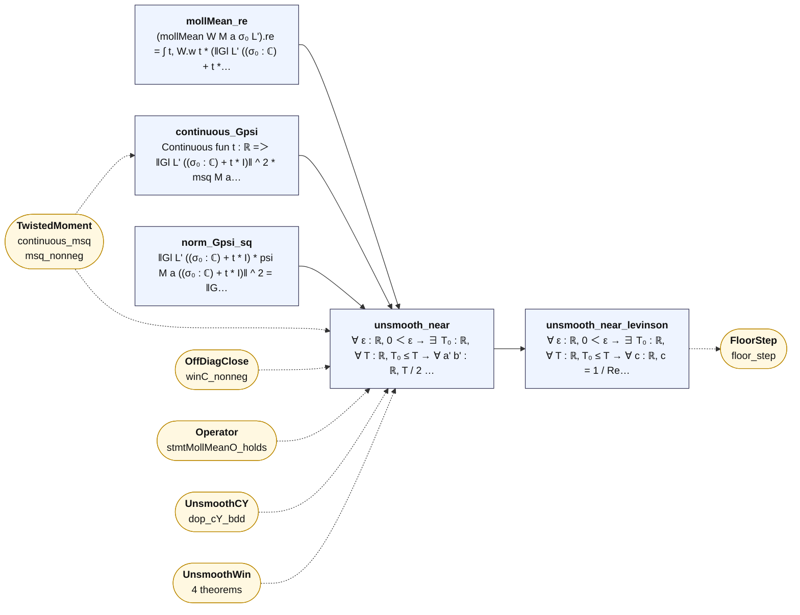

# `lean_stage3/Stage3/Unsmooth.lean`

> **Read from the source text.** This file changed after the last `python3 utilities/lean_map.py --dump`, so the arrows on this page are names occurring in each proof and have not been confirmed by Lean.

# Unsmooth — block S12 of `lean_stage3/design/stencil.md`, piece 4, unsmoothing: the sharp one-sided mean. 2026-11-25.

5 theorems, 0 definitions, 239 lines. 

**Imports:** [`LevinsonMollEdge`](../lean_stage3/LevinsonMollEdge.md), [`UnsmoothCY`](../lean_stage3/UnsmoothCY.md), [`UnsmoothWin`](../lean_stage3/UnsmoothWin.md)  
**Imported by:** [`Stage3`](../lean_stage3/Stage3.md), [`FloorStepCont`](../lean_stage3/FloorStepCont.md), [`FloorStepSize`](../lean_stage3/FloorStepSize.md)

## The picture



An arrow A → B reads "A is used in the proof of B". Green: counting, integers only. Violet: shape, analysis with no ζ. Blue: reads ζ. A name ending in ■ is an end: nothing else uses it. Red: contains `sorry`. Yellow: theorems in another file, counted; a dotted arrow crosses files. Definitions are not drawn; they are listed below the diagram.

## Theorems

<a name="Unsmooth-mollMean_re"></a>
### `Unsmooth.mollMean_re`

line 42 · arrows read from text

**Reads ζ.** It, or something it rests on, uses the zeta function, its zeros or the Riemann hypothesis.

**Why.** `Re mollMean = ∫ w |G|² |ψ|²`.

**Proves**

```lean
(mollMean W M a σ₀ L').re = ∫ t, W.w t * (‖Gl L' ((σ₀ : ℂ) + t * I)‖ ^ 2 * msq M a σ₀ t)
```

**Needs** (its hypotheses)

  - `` W : Weight T L ``
  - `` M : ℕ ``
  - `` a : ℕ → ℂ ``
  - `` σ₀ L' : ℝ ``

**Fed by:** no theorem of this repo; it stands on Mathlib and the definitions below.

**Definitions its proof touches:** [`Operator.Gl`](../lean_stage3/OperatorInt.md#Operator-Gl), [`Operator.mollMean`](../lean_stage3/OperatorInt.md#Operator-mollMean), [`TwistedMoment.Weight`](../lean_stage3/TwistedMoment.md#TwistedMoment-Weight), [`TwistedMoment.msq`](../lean_stage3/TwistedMoment.md#TwistedMoment-msq)

**Feeds** (1 that use it)

  - [`Unsmooth.unsmooth_near`](#Unsmooth-unsmooth_near) — `` ∀ ε : ℝ, 0 < ε → ∃ T₀ : ℝ, ∀ T : ℝ, T₀ ≤ T → ∀ a' b' : ℝ, T / 2 ≤ a' → a' ≤ T / 2 + 1 → T - 1 ≤ b' → b' ≤ T → (1 / (b' - a')) * ∫ t in a'..b', ‖Gl (Re… ``

<a name="Unsmooth-continuous_Gpsi"></a>
### `Unsmooth.continuous_Gpsi`

line 55 · arrows read from text

**Reads ζ.** It, or something it rests on, uses the zeta function, its zeros or the Riemann hypothesis.

**Why.** `t ↦ |G(σ₀+it)|² |ψ(σ₀+it)|²` is continuous for `σ₀ ≠ 1`.

**Proves**

```lean
Continuous fun t : ℝ => ‖Gl L' ((σ₀ : ℂ) + t * I)‖ ^ 2 * msq M a σ₀ t
```

**Needs** (its hypotheses)

  - `` M : ℕ ``
  - `` a : ℕ → ℂ ``
  - `` hσ : σ₀ ≠ 1 ``
  - `` L' : ℝ ``

**Fed by** (1 theorem its proof uses)

  - [`TwistedMoment.continuous_msq`](../lean_stage3/TwistedMoment.md#TwistedMoment-continuous_msq) (TwistedMoment) — `` Continuous (msq M a σ₀) ``

**Definitions its proof touches:** [`Operator.Gl`](../lean_stage3/OperatorInt.md#Operator-Gl), [`TwistedMoment.msq`](../lean_stage3/TwistedMoment.md#TwistedMoment-msq)

**Feeds** (1 that use it)

  - [`Unsmooth.unsmooth_near`](#Unsmooth-unsmooth_near) — `` ∀ ε : ℝ, 0 < ε → ∃ T₀ : ℝ, ∀ T : ℝ, T₀ ≤ T → ∀ a' b' : ℝ, T / 2 ≤ a' → a' ≤ T / 2 + 1 → T - 1 ≤ b' → b' ≤ T → (1 / (b' - a')) * ∫ t in a'..b', ‖Gl (Re… ``

<a name="Unsmooth-norm_Gpsi_sq"></a>
### `Unsmooth.norm_Gpsi_sq`

line 70 · arrows read from text

**Reads ζ.** It, or something it rests on, uses the zeta function, its zeros or the Riemann hypothesis.

**Why.** `|G ψ|² = |G|² |ψ|²`.

**Proves**

```lean
‖Gl L' ((σ₀ : ℂ) + t * I) * psi M a ((σ₀ : ℂ) + t * I)‖ ^ 2 = ‖Gl L' ((σ₀ : ℂ) + t * I)‖ ^ 2 * msq M a σ₀ t
```

**Needs** (its hypotheses)

  - `` L' : ℝ ``
  - `` M : ℕ ``
  - `` a : ℕ → ℂ ``
  - `` σ₀ t : ℝ ``

**Fed by:** no theorem of this repo; it stands on Mathlib and the definitions below.

**Definitions its proof touches:** [`Operator.Gl`](../lean_stage3/OperatorInt.md#Operator-Gl), [`TwistedMoment.msq`](../lean_stage3/TwistedMoment.md#TwistedMoment-msq), [`TwistedMoment.psi`](../lean_stage3/TwistedMoment.md#TwistedMoment-psi)

**Feeds** (1 that use it)

  - [`Unsmooth.unsmooth_near`](#Unsmooth-unsmooth_near) — `` ∀ ε : ℝ, 0 < ε → ∃ T₀ : ℝ, ∀ T : ℝ, T₀ ≤ T → ∀ a' b' : ℝ, T / 2 ≤ a' → a' ≤ T / 2 + 1 → T - 1 ≤ b' → b' ≤ T → (1 / (b' - a')) * ∫ t in a'..b', ‖Gl (Re… ``

<a name="Unsmooth-unsmooth_near"></a>
### `Unsmooth.unsmooth_near`

line 79 · arrows read from text

**Reads ζ.** It, or something it rests on, uses the zeta function, its zeros or the Riemann hypothesis.

**Why.** The sharp one-sided mean. For `P(0) = 0`, `0 < θ < 1/2`, `R > 0`, every `ε > 0`: from some height on, for `a′ ∈ [T/2, T/2 + 1]`, `b′ ∈ [T − 1, T]`, `(1/(b′−a′)) ∫_{a′}^{b′} |G(σ₀+it) ψ(σ₀+it)|² dt ≤ Re D[c](−R/L, −R/L) + ε`.

**Proves**

```lean
∀ ε : ℝ, 0 < ε → ∃ T₀ : ℝ, ∀ T : ℝ, T₀ ≤ T → ∀ a' b' : ℝ, T / 2 ≤ a' → a' ≤ T / 2 + 1 → T - 1 ≤ b' → b' ≤ T → (1 / (b' - a')) * ∫ t in a'..b', ‖Gl (Real.log T) ((sig0 T R : ℂ) + t * I) * psi (Mof T θ) (aY P T θ R) ((sig0 T R : ℂ) + t * I)‖ ^ 2 ≤ (Dop (Real.log T) (cY P (Mof T θ) T) ((-(R / Real.log T) : ℝ) : ℂ) ((-(R / Real.log T) : ℝ) : ℂ)).re + ε
```

**Needs** (its hypotheses)

  - `` P : Polynomial ℝ ``
  - `` hP0 : P.eval 0 = 0 ``
  - `` hθ0 : 0 < θ ``
  - `` hθ : θ < 1 / 2 ``
  - `` hR : 0 < R ``

**Fed by** (11 theorems its proof uses)

  - [`OffDiagClose.winC_nonneg`](../lean_stage3/OffDiagClose.md#OffDiagClose-winC_nonneg) (OffDiagClose) — `` 0 ≤ winC j ``
  - [`Operator.stmtMollMeanO_holds`](../lean_stage3/Operator.md#Operator-stmtMollMeanO_holds) (Operator) — `` StmtMollMeanO P θ R ``
  - [`TwistedMoment.msq_nonneg`](../lean_stage3/TwistedMoment.md#TwistedMoment-msq_nonneg) (TwistedMoment) — `` 0 ≤ msq M a σ₀ t ``
  - [`Unsmooth.continuous_Gpsi`](#Unsmooth-continuous_Gpsi) — `` Continuous fun t : ℝ => ‖Gl L' ((σ₀ : ℂ) + t * I)‖ ^ 2 * msq M a σ₀ t ``
  - [`Unsmooth.mollMean_re`](#Unsmooth-mollMean_re) — `` (mollMean W M a σ₀ L').re = ∫ t, W.w t * (‖Gl L' ((σ₀ : ℂ) + t * I)‖ ^ 2 * msq M a σ₀ t) ``
  - [`Unsmooth.norm_Gpsi_sq`](#Unsmooth-norm_Gpsi_sq) — `` ‖Gl L' ((σ₀ : ℂ) + t * I) * psi M a ((σ₀ : ℂ) + t * I)‖ ^ 2 = ‖Gl L' ((σ₀ : ℂ) + t * I)‖ ^ 2 * msq M a σ₀ t ``
  - [`Unsmooth.dop_cY_bdd`](../lean_stage3/UnsmoothCY.md#Unsmooth-dop_cY_bdd) (UnsmoothCY) — `` ∃ K : ℝ, 0 ≤ K ∧ ∃ T₀ : ℝ, ∀ T : ℝ, T₀ ≤ T → ‖Dop (Real.log T) (cY P (Mof T θ) T) ((-(R / Real.log T) : ℝ) : ℂ) ((-(R / Real.log T) : ℝ) : ℂ)‖ ≤ K ``
  - [`Unsmooth.integral_le_of_one`](../lean_stage3/UnsmoothWin.md#Unsmooth-integral_le_of_one) (UnsmoothWin) — `` ∫ t in a..b, f t ≤ ∫ t, W.w t * f t ``
  - [`Unsmooth.what0_le_of_zero`](../lean_stage3/UnsmoothWin.md#Unsmooth-what0_le_of_zero) (UnsmoothWin) — `` what0 W ≤ hi - lo ``
  - [`Unsmooth.winNY_one`](../lean_stage3/UnsmoothWin.md#Unsmooth-winNY_one) (UnsmoothWin) — `` winNY T L t = 1 ``
  - [`Unsmooth.winNY_zero`](../lean_stage3/UnsmoothWin.md#Unsmooth-winNY_zero) (UnsmoothWin) — `` winNY T L t = 0 ``

**Definitions its proof touches:** [`DiagMainStmt.errO`](../lean_stage3/DiagMainStmt.md#DiagMainStmt-errO), [`OffDiagClose.WeightAll`](../lean_stage3/OffDiagClose.md#OffDiagClose-WeightAll), [`OffDiagClose.winC`](../lean_stage3/OffDiagClose.md#OffDiagClose-winC), [`Operator.Dop`](../lean_stage3/OperatorCauchy.md#Operator-Dop), [`Operator.Gl`](../lean_stage3/OperatorInt.md#Operator-Gl), [`Operator.mollMean`](../lean_stage3/OperatorInt.md#Operator-mollMean), [`TwistedMoment.Mof`](../lean_stage3/TwistedMoment.md#TwistedMoment-Mof), [`TwistedMoment.aY`](../lean_stage3/TwistedMoment.md#TwistedMoment-aY), [`TwistedMoment.cY`](../lean_stage3/TwistedMoment.md#TwistedMoment-cY), [`TwistedMoment.msq`](../lean_stage3/TwistedMoment.md#TwistedMoment-msq), [`TwistedMoment.psi`](../lean_stage3/TwistedMoment.md#TwistedMoment-psi), [`TwistedMoment.sig0`](../lean_stage3/TwistedMoment.md#TwistedMoment-sig0), [`TwistedMoment.what0`](../lean_stage3/TwistedMoment.md#TwistedMoment-what0), [`Unsmooth.nearHi`](../lean_stage3/UnsmoothWin.md#Unsmooth-nearHi), [`Unsmooth.nearLo`](../lean_stage3/UnsmoothWin.md#Unsmooth-nearLo), [`Unsmooth.winNY`](../lean_stage3/UnsmoothWin.md#Unsmooth-winNY), [`Unsmooth.winNear`](../lean_stage3/UnsmoothWin.md#Unsmooth-winNear)

**Feeds** (1 that use it)

  - [`Unsmooth.unsmooth_near_levinson`](#Unsmooth-unsmooth_near_levinson) — `` ∀ ε : ℝ, 0 < ε → ∃ T₀ : ℝ, ∀ T : ℝ, T₀ ≤ T → ∀ c : ℝ, c = 1 / Real.log T → ∀ a' b' : ℝ, T / 2 ≤ a' → a' ≤ T / 2 + 1 → T - 1 ≤ b' → b' ≤ T → (1 / (b' -… ``

<a name="Unsmooth-unsmooth_near_levinson"></a>
### `Unsmooth.unsmooth_near_levinson`

line 202 · arrows read from text

**Reads ζ.** It, or something it rests on, uses the zeta function, its zeros or the Riemann hypothesis.

**Why.** The sharp one-sided mean in `levinson_window'`'s integrand, at `σ = σ₀`: `(ζ(s) + c ζ′(s)) · molli M β s` with `c = 1/log T`, `β = aY P T θ R`.

**Proves**

```lean
∀ ε : ℝ, 0 < ε → ∃ T₀ : ℝ, ∀ T : ℝ, T₀ ≤ T → ∀ c : ℝ, c = 1 / Real.log T → ∀ a' b' : ℝ, T / 2 ≤ a' → a' ≤ T / 2 + 1 → T - 1 ≤ b' → b' ≤ T → (1 / (b' - a')) * ∫ t in a'..b', ‖(riemannZeta (↑(sig0 T R) + ↑t * I) + c * deriv riemannZeta (↑(sig0 T R) + ↑t * I)) * LevinsonMollEdge.molli (Mof T θ) (aY P T θ R) (↑(sig0 T R) + ↑t * I)‖ ^ 2 ≤ (Dop (Real.log T) (cY P (Mof T θ) T) ((-(R / Real.log T) : ℝ) : ℂ) ((-(R / Real.log T) : ℝ) : ℂ)).re + ε
```

**Needs** (its hypotheses)

  - `` P : Polynomial ℝ ``
  - `` hP0 : P.eval 0 = 0 ``
  - `` hθ0 : 0 < θ ``
  - `` hθ : θ < 1 / 2 ``
  - `` hR : 0 < R ``

**Fed by** (1 theorem its proof uses)

  - [`Unsmooth.unsmooth_near`](#Unsmooth-unsmooth_near) — `` ∀ ε : ℝ, 0 < ε → ∃ T₀ : ℝ, ∀ T : ℝ, T₀ ≤ T → ∀ a' b' : ℝ, T / 2 ≤ a' → a' ≤ T / 2 + 1 → T - 1 ≤ b' → b' ≤ T → (1 / (b' - a')) * ∫ t in a'..b', ‖Gl (Re… ``

**Definitions its proof touches:** [`LevinsonMollEdge.molli`](../lean_stage3/LevinsonMollEdge.md#LevinsonMollEdge-molli), [`Operator.Dop`](../lean_stage3/OperatorCauchy.md#Operator-Dop), [`Operator.Gl`](../lean_stage3/OperatorInt.md#Operator-Gl), [`TwistedMoment.Mof`](../lean_stage3/TwistedMoment.md#TwistedMoment-Mof), [`TwistedMoment.aY`](../lean_stage3/TwistedMoment.md#TwistedMoment-aY), [`TwistedMoment.cY`](../lean_stage3/TwistedMoment.md#TwistedMoment-cY), [`TwistedMoment.psi`](../lean_stage3/TwistedMoment.md#TwistedMoment-psi), [`TwistedMoment.sig0`](../lean_stage3/TwistedMoment.md#TwistedMoment-sig0)

**Feeds** (1 that use it)

  - [`FloorStep.floor_step`](../lean_stage3/FloorStep.md#FloorStep-floor_step) (FloorStep) — `` ∀ ε : ℝ, 0 < ε → ∃ T₀ : ℝ, ∀ T : ℝ, T₀ ≤ T → (riemannZeta.N T - riemannZeta.N (T / 2)) - Real.log (max 1 ((Operator.Dop (Real.log T) (cY P (Mof T θ) T… ``

