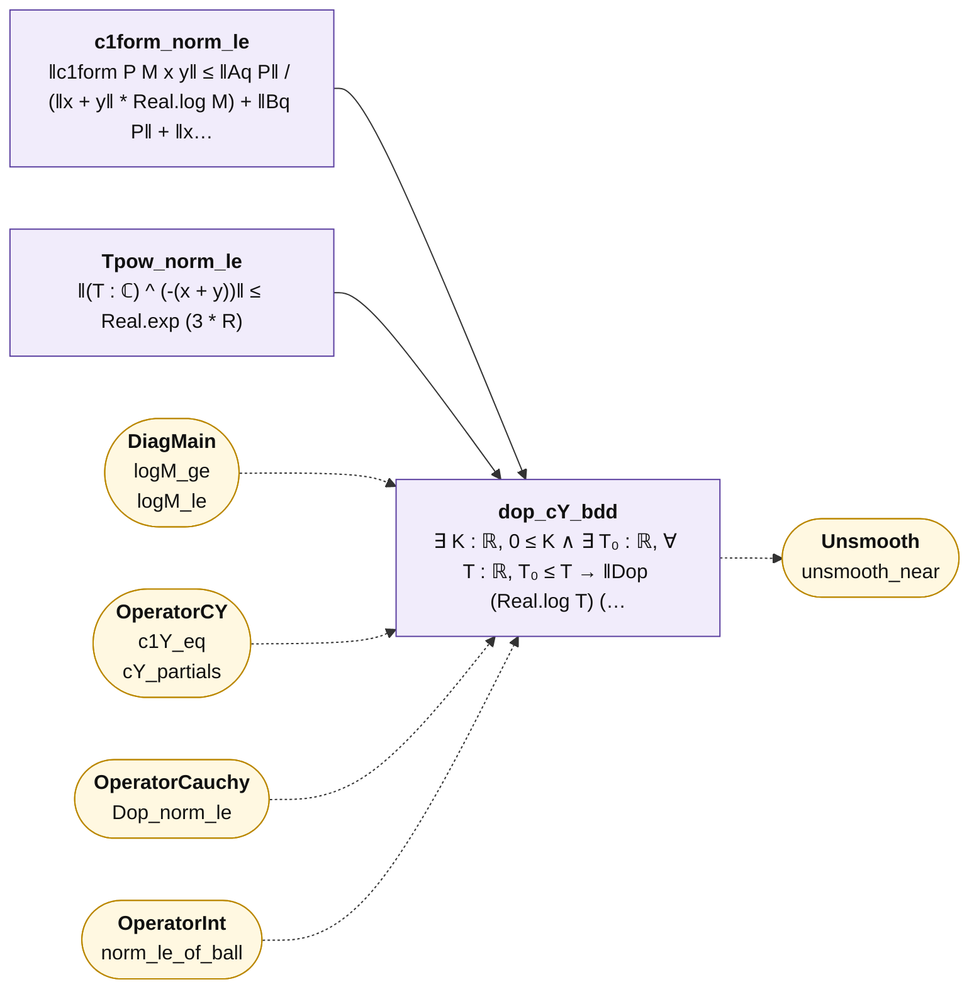

# `lean_stage3/Stage3/UnsmoothCY.lean`

> **Read from the source text.** This file changed after the last `python3 utilities/lean_map.py --dump`, so the arrows on this page are names occurring in each proof and have not been confirmed by Lean.

# UnsmoothCY — block S12 of `lean_stage3/design/stencil.md`, piece 4, unsmoothing: `D[c]` is bounded. 2026-11-25.

3 theorems, 0 definitions, 199 lines. 

**Imports:** [`DiagMain`](../lean_stage3/DiagMain.md), [`Operator`](../lean_stage3/Operator.md)  
**Imported by:** [`Unsmooth`](../lean_stage3/Unsmooth.md)

## The picture



An arrow A → B reads "A is used in the proof of B". Green: counting, integers only. Violet: shape, analysis with no ζ. Blue: reads ζ. A name ending in ■ is an end: nothing else uses it. Red: contains `sorry`. Yellow: theorems in another file, counted; a dotted arrow crosses files. Definitions are not drawn; they are listed below the diagram.

## Theorems

<a name="Unsmooth-c1form_norm_le"></a>
### `Unsmooth.c1form_norm_le`

line 27 · arrows read from text

**Shape.** Uses real or complex analysis; nothing in it or beneath it reads ζ.

**Why.** `‖c₁(x,y)‖ ≤ ‖A‖/(‖x+y‖ℓ) + ‖B‖ + ‖x‖‖y‖ℓ‖C‖/‖x+y‖`, `ℓ = log M > 0`, `x + y ≠ 0`.

**Proves**

```lean
‖c1form P M x y‖ ≤ ‖Aq P‖ / (‖x + y‖ * Real.log M) + ‖Bq P‖ + ‖x‖ * ‖y‖ * Real.log M * ‖Cq P‖ / ‖x + y‖
```

**Needs** (its hypotheses)

  - `` P : Polynomial ℝ ``
  - `` M : ℕ ``
  - `` hxy : x + y ≠ 0 ``
  - `` hℓ : 0 < Real.log M ``

**Fed by:** no theorem of this repo; it stands on Mathlib and the definitions below.

**Definitions its proof touches:** [`Operator.Aq`](../lean_stage3/OperatorCY.md#Operator-Aq), [`Operator.Bq`](../lean_stage3/OperatorCY.md#Operator-Bq), [`Operator.Cq`](../lean_stage3/OperatorCY.md#Operator-Cq), [`Operator.c1form`](../lean_stage3/OperatorCY.md#Operator-c1form)

**Feeds** (1 that use it)

  - [`Unsmooth.dop_cY_bdd`](#Unsmooth-dop_cY_bdd) — `` ∃ K : ℝ, 0 ≤ K ∧ ∃ T₀ : ℝ, ∀ T : ℝ, T₀ ≤ T → ‖Dop (Real.log T) (cY P (Mof T θ) T) ((-(R / Real.log T) : ℝ) : ℂ) ((-(R / Real.log T) : ℝ) : ℂ)‖ ≤ K ``

<a name="Unsmooth-Tpow_norm_le"></a>
### `Unsmooth.Tpow_norm_le`

line 45 · arrows read from text

**Shape.** Uses real or complex analysis; nothing in it or beneath it reads ζ.

**Why.** `‖T^(−(x+y))‖ ≤ e^(3R)` for `‖x+y‖ ≤ 3R/log T`, `T > 1`.

**Proves**

```lean
‖(T : ℂ) ^ (-(x + y))‖ ≤ Real.exp (3 * R)
```

**Needs** (its hypotheses)

  - `` hT : 1 < T ``
  - `` h : ‖x + y‖ ≤ 3 * R / Real.log T ``

**Fed by:** no theorem of this repo; it stands on Mathlib.

**Feeds** (1 that use it)

  - [`Unsmooth.dop_cY_bdd`](#Unsmooth-dop_cY_bdd) — `` ∃ K : ℝ, 0 ≤ K ∧ ∃ T₀ : ℝ, ∀ T : ℝ, T₀ ≤ T → ‖Dop (Real.log T) (cY P (Mof T θ) T) ((-(R / Real.log T) : ℝ) : ℂ) ((-(R / Real.log T) : ℝ) : ℂ)‖ ≤ K ``

<a name="Unsmooth-dop_cY_bdd"></a>
### `Unsmooth.dop_cY_bdd`

line 62 · arrows read from text

**Shape.** Uses real or complex analysis; nothing in it or beneath it reads ζ.

**Why.** `D[c]` at `(−R/L, −R/L)` is bounded, uniformly in `T`, for `0 < θ < 1/2`, `R > 0`.

**Proves**

```lean
∃ K : ℝ, 0 ≤ K ∧ ∃ T₀ : ℝ, ∀ T : ℝ, T₀ ≤ T → ‖Dop (Real.log T) (cY P (Mof T θ) T) ((-(R / Real.log T) : ℝ) : ℂ) ((-(R / Real.log T) : ℝ) : ℂ)‖ ≤ K
```

**Needs** (its hypotheses)

  - `` P : Polynomial ℝ ``
  - `` hθ0 : 0 < θ ``
  - `` hθ : θ < 1 / 2 ``
  - `` hR : 0 < R ``

**Fed by** (8 theorems its proof uses)

  - [`DiagMain.logM_ge`](../lean_stage3/DiagMain.md#DiagMain-logM_ge) (DiagMain) — `` θ * Real.log T / 2 ≤ Real.log (Mof T θ) ``
  - [`DiagMain.logM_le`](../lean_stage3/DiagMain.md#DiagMain-logM_le) (DiagMain) — `` Real.log (Mof T θ) ≤ θ * Real.log T ``
  - [`Operator.c1Y_eq`](../lean_stage3/OperatorCY.md#Operator-c1Y_eq) (OperatorCY) — `` c1Y P M α β = c1form P M α β ``
  - [`Operator.cY_partials`](../lean_stage3/OperatorCY.md#Operator-cY_partials) (OperatorCY) — `` DifferentiableAt ℂ (fun x => cY P M T x y) x ∧ DifferentiableAt ℂ (fun y => cY P M T x y) y ∧ DifferentiableAt ℂ (fun y => pa (cY P M T) x y) y ``
  - [`Operator.Dop_norm_le`](../lean_stage3/OperatorCauchy.md#Operator-Dop_norm_le) (OperatorCauchy) — `` ‖Dop L F α₀ β₀‖ ≤ S * (1 + 2 / r + 1 / r ^ 2) ``
  - [`Operator.norm_le_of_ball`](../lean_stage3/OperatorInt.md#Operator-norm_le_of_ball) (OperatorInt) — `` ‖x‖ ≤ ‖x₀‖ + δ ``
  - [`Unsmooth.Tpow_norm_le`](#Unsmooth-Tpow_norm_le) — `` ‖(T : ℂ) ^ (-(x + y))‖ ≤ Real.exp (3 * R) ``
  - [`Unsmooth.c1form_norm_le`](#Unsmooth-c1form_norm_le) — `` ‖c1form P M x y‖ ≤ ‖Aq P‖ / (‖x + y‖ * Real.log M) + ‖Bq P‖ + ‖x‖ * ‖y‖ * Real.log M * ‖Cq P‖ / ‖x + y‖ ``

**Definitions its proof touches:** [`Operator.Aq`](../lean_stage3/OperatorCY.md#Operator-Aq), [`Operator.Bq`](../lean_stage3/OperatorCY.md#Operator-Bq), [`Operator.Cq`](../lean_stage3/OperatorCY.md#Operator-Cq), [`Operator.Dop`](../lean_stage3/OperatorCauchy.md#Operator-Dop), [`Operator.pa`](../lean_stage3/OperatorCauchy.md#Operator-pa), [`TwistedMoment.Mof`](../lean_stage3/TwistedMoment.md#TwistedMoment-Mof), [`TwistedMoment.c1Y`](../lean_stage3/TwistedMoment.md#TwistedMoment-c1Y), [`TwistedMoment.cY`](../lean_stage3/TwistedMoment.md#TwistedMoment-cY)

**Feeds** (1 that use it)

  - [`Unsmooth.unsmooth_near`](../lean_stage3/Unsmooth.md#Unsmooth-unsmooth_near) (Unsmooth) — `` ∀ ε : ℝ, 0 < ε → ∃ T₀ : ℝ, ∀ T : ℝ, T₀ ≤ T → ∀ a' b' : ℝ, T / 2 ≤ a' → a' ≤ T / 2 + 1 → T - 1 ≤ b' → b' ≤ T → (1 / (b' - a')) * ∫ t in a'..b', ‖Gl (Re… ``

