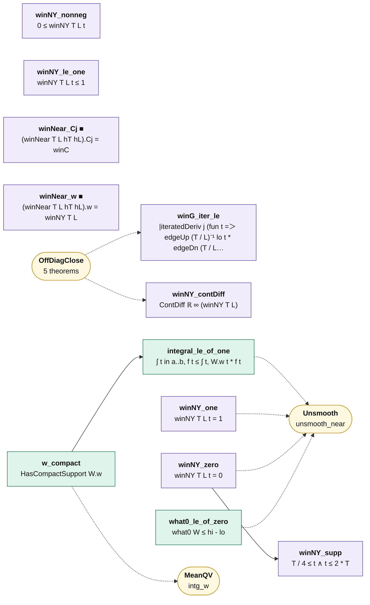

# `lean_stage3/Stage3/UnsmoothWin.lean`

> **Read from the source text.** This file changed after the last `python3 utilities/lean_map.py --dump`, so the arrows on this page are names occurring in each proof and have not been confirmed by Lean.

# UnsmoothWin — block S12 of `lean_stage3/design/stencil.md`, piece 4, unsmoothing: the near window. 2026-11-25.

12 theorems, 4 definitions, 200 lines. 

**Imports:** [`OffDiagClose`](../lean_stage3/OffDiagClose.md)  
**Imported by:** [`Unsmooth`](../lean_stage3/Unsmooth.md)

## The picture



An arrow A → B reads "A is used in the proof of B". Green: counting, integers only. Violet: shape, analysis with no ζ. Blue: reads ζ. A name ending in ■ is an end: nothing else uses it. Red: contains `sorry`. Yellow: theorems in another file, counted; a dotted arrow crosses files. Definitions are not drawn; they are listed below the diagram.

## Definitions

<a name="Unsmooth-nearLo"></a>
### `Unsmooth.nearLo`

def · line 33

The near window's rising edge `T/2 − 2T/L`.

- **Is:** `` nearLo (T L : ℝ) : ℝ := T / 2 - 2 * (T / L) ``
- **Used by 6:** [`Unsmooth.unsmooth_near`](../lean_stage3/Unsmooth.md#Unsmooth-unsmooth_near), [`Unsmooth.winNY`](#Unsmooth-winNY), [`Unsmooth.winNY_one`](#Unsmooth-winNY_one), [`Unsmooth.winNY_supp`](#Unsmooth-winNY_supp), [`Unsmooth.winNY_zero`](#Unsmooth-winNY_zero), [`Unsmooth.winNear`](#Unsmooth-winNear)

<a name="Unsmooth-nearHi"></a>
### `Unsmooth.nearHi`

def · line 36

The near window's falling edge `T + T/L`.

- **Is:** `` nearHi (T L : ℝ) : ℝ := T + T / L ``
- **Used by 6:** [`Unsmooth.unsmooth_near`](../lean_stage3/Unsmooth.md#Unsmooth-unsmooth_near), [`Unsmooth.winNY`](#Unsmooth-winNY), [`Unsmooth.winNY_one`](#Unsmooth-winNY_one), [`Unsmooth.winNY_supp`](#Unsmooth-winNY_supp), [`Unsmooth.winNY_zero`](#Unsmooth-winNY_zero), [`Unsmooth.winNear`](#Unsmooth-winNear)

<a name="Unsmooth-winNY"></a>
### `Unsmooth.winNY`

def · line 39

The near window `φ((t − lo)/Δ) φ((hi − t)/Δ)`, `Δ = T/L`.

- **Is:** `` winNY (T L t : ℝ) : ℝ := edgeUp (T / L)⁻¹ (nearLo T L) t * edgeDn (T / L)⁻¹ (nearHi T L) t ``
- **Built from:** [`OffDiagClose.edgeDn`](../lean_stage3/OffDiagClose.md#OffDiagClose-edgeDn), [`OffDiagClose.edgeUp`](../lean_stage3/OffDiagClose.md#OffDiagClose-edgeUp), [`Unsmooth.nearHi`](#Unsmooth-nearHi), [`Unsmooth.nearLo`](#Unsmooth-nearLo)
- **Used by 9:** [`Unsmooth.unsmooth_near`](../lean_stage3/Unsmooth.md#Unsmooth-unsmooth_near), [`Unsmooth.winNY_contDiff`](#Unsmooth-winNY_contDiff), [`Unsmooth.winNY_le_one`](#Unsmooth-winNY_le_one), [`Unsmooth.winNY_nonneg`](#Unsmooth-winNY_nonneg), [`Unsmooth.winNY_one`](#Unsmooth-winNY_one), [`Unsmooth.winNY_supp`](#Unsmooth-winNY_supp), [`Unsmooth.winNY_zero`](#Unsmooth-winNY_zero), [`Unsmooth.winNear`](#Unsmooth-winNear), [`Unsmooth.winNear_w`](#Unsmooth-winNear_w)

<a name="Unsmooth-winNear"></a>
### `Unsmooth.winNear`

def · line 126

- **Is:** `` winNear (T L : ℝ) (hT : 0 < T) (hL : 8 ≤ L) : WeightAll T L where w := winNY T L smooth := winNY_contDiff T L supp := winNY_supp hT hL nonneg := winNY_nonneg T L le_one := winNY_le_one T L C1 := winC 1 C2 := winC 2 C1_nonneg := winC_nonneg 1 C2_nonneg := winC_nonneg 2 d1 t := by have h := winG_iter_le (div_pos hT (by linarith)) (nearLo T L) (nearHi T L) 1 t rwa [iteratedDeriv_one, pow_one] at h d2 t := by have h := w… ``
- **Built from:** [`OffDiagClose.WeightAll`](../lean_stage3/OffDiagClose.md#OffDiagClose-WeightAll), [`OffDiagClose.winC`](../lean_stage3/OffDiagClose.md#OffDiagClose-winC), [`OffDiagClose.winC_nonneg`](../lean_stage3/OffDiagClose.md#OffDiagClose-winC_nonneg), [`Unsmooth.nearHi`](#Unsmooth-nearHi), [`Unsmooth.nearLo`](#Unsmooth-nearLo), [`Unsmooth.winG_iter_le`](#Unsmooth-winG_iter_le), [`Unsmooth.winNY`](#Unsmooth-winNY), [`Unsmooth.winNY_contDiff`](#Unsmooth-winNY_contDiff), [`Unsmooth.winNY_le_one`](#Unsmooth-winNY_le_one), [`Unsmooth.winNY_nonneg`](#Unsmooth-winNY_nonneg), [`Unsmooth.winNY_supp`](#Unsmooth-winNY_supp)
- **Used by 3:** [`Unsmooth.unsmooth_near`](../lean_stage3/Unsmooth.md#Unsmooth-unsmooth_near), [`Unsmooth.winNear_Cj`](#Unsmooth-winNear_Cj), [`Unsmooth.winNear_w`](#Unsmooth-winNear_w)

## Theorems

<a name="Unsmooth-winG_iter_le"></a>
### `Unsmooth.winG_iter_le`

line 45 · arrows read from text

**Shape.** Uses real or complex analysis; nothing in it or beneath it reads ζ.

**Why.** (2.3) for a window with any two edges: `|w^(j)| ≤ C_j Δ^(−j)`, the constants of `winW`.

**Proves**

```lean
|iteratedDeriv j (fun t => edgeUp (T / L)⁻¹ lo t * edgeDn (T / L)⁻¹ hi t) t| ≤ winC j * ((T / L) ^ j)⁻¹
```

**Needs** (its hypotheses)

  - `` hΔ : 0 < T / L ``
  - `` lo hi : ℝ ``
  - `` j : ℕ ``
  - `` t : ℝ ``

**Fed by** (5 theorems its proof uses)

  - [`OffDiagClose.edgeDn_contDiff`](../lean_stage3/OffDiagClose.md#OffDiagClose-edgeDn_contDiff) (OffDiagClose) — `` ContDiff ℝ ∞ (edgeDn c b) ``
  - [`OffDiagClose.edgeDn_iter_le`](../lean_stage3/OffDiagClose.md#OffDiagClose-edgeDn_iter_le) (OffDiagClose) — `` |iteratedDeriv i (edgeDn c b) t| ≤ phiB i * c ^ i ``
  - [`OffDiagClose.edgeUp_contDiff`](../lean_stage3/OffDiagClose.md#OffDiagClose-edgeUp_contDiff) (OffDiagClose) — `` ContDiff ℝ ∞ (edgeUp c a) ``
  - [`OffDiagClose.edgeUp_iter_le`](../lean_stage3/OffDiagClose.md#OffDiagClose-edgeUp_iter_le) (OffDiagClose) — `` |iteratedDeriv i (edgeUp c a) t| ≤ phiB i * c ^ i ``
  - [`OffDiagClose.phiB_nonneg`](../lean_stage3/OffDiagClose.md#OffDiagClose-phiB_nonneg) (OffDiagClose) — `` 0 ≤ phiB i ``

**Definitions its proof touches:** [`OffDiagClose.edgeDn`](../lean_stage3/OffDiagClose.md#OffDiagClose-edgeDn), [`OffDiagClose.edgeUp`](../lean_stage3/OffDiagClose.md#OffDiagClose-edgeUp), [`OffDiagClose.phiB`](../lean_stage3/OffDiagClose.md#OffDiagClose-phiB), [`OffDiagClose.winC`](../lean_stage3/OffDiagClose.md#OffDiagClose-winC)

**Feeds** (1 that use it)

  - [`Unsmooth.winNear`](#Unsmooth-winNear) — def

<a name="Unsmooth-winNY_contDiff"></a>
### `Unsmooth.winNY_contDiff`

line 75 · arrows read from text

**Shape.** Uses real or complex analysis; nothing in it or beneath it reads ζ.

**Proves**

```lean
ContDiff ℝ ∞ (winNY T L)
```

**Needs** (its hypotheses)

  - `` T L : ℝ ``

**Fed by** (2 theorems its proof uses)

  - [`OffDiagClose.edgeDn_contDiff`](../lean_stage3/OffDiagClose.md#OffDiagClose-edgeDn_contDiff) (OffDiagClose) — `` ContDiff ℝ ∞ (edgeDn c b) ``
  - [`OffDiagClose.edgeUp_contDiff`](../lean_stage3/OffDiagClose.md#OffDiagClose-edgeUp_contDiff) (OffDiagClose) — `` ContDiff ℝ ∞ (edgeUp c a) ``

**Definitions its proof touches:** [`Unsmooth.winNY`](#Unsmooth-winNY)

**Feeds** (1 that use it)

  - [`Unsmooth.winNear`](#Unsmooth-winNear) — def

<a name="Unsmooth-winNY_nonneg"></a>
### `Unsmooth.winNY_nonneg`

line 78 · arrows read from text

**Shape.** Uses real or complex analysis; nothing in it or beneath it reads ζ.

**Proves**

```lean
0 ≤ winNY T L t
```

**Needs** (its hypotheses)

  - `` T L t : ℝ ``

**Fed by:** no theorem of this repo; it stands on Mathlib and the definitions below.

**Definitions its proof touches:** [`Unsmooth.winNY`](#Unsmooth-winNY)

**Feeds** (1 that use it)

  - [`Unsmooth.winNear`](#Unsmooth-winNear) — def

<a name="Unsmooth-winNY_le_one"></a>
### `Unsmooth.winNY_le_one`

line 81 · arrows read from text

**Shape.** Uses real or complex analysis; nothing in it or beneath it reads ζ.

**Proves**

```lean
winNY T L t ≤ 1
```

**Needs** (its hypotheses)

  - `` T L t : ℝ ``

**Fed by:** no theorem of this repo; it stands on Mathlib and the definitions below.

**Definitions its proof touches:** [`Unsmooth.winNY`](#Unsmooth-winNY)

**Feeds** (1 that use it)

  - [`Unsmooth.winNear`](#Unsmooth-winNear) — def

<a name="Unsmooth-winNY_one"></a>
### `Unsmooth.winNY_one`

line 86 · arrows read from text

**Shape.** Uses real or complex analysis; nothing in it or beneath it reads ζ.

**Why.** The plateau: `w = 1` on `[T/2 − T/L, T]`.

**Proves**

```lean
winNY T L t = 1
```

**Needs** (its hypotheses)

  - `` hΔ : 0 < T / L ``
  - `` h1 : T / 2 - T / L ≤ t ``
  - `` h2 : t ≤ T ``

**Fed by:** no theorem of this repo; it stands on Mathlib and the definitions below.

**Definitions its proof touches:** [`OffDiagClose.edgeDn`](../lean_stage3/OffDiagClose.md#OffDiagClose-edgeDn), [`OffDiagClose.edgeUp`](../lean_stage3/OffDiagClose.md#OffDiagClose-edgeUp), [`Unsmooth.nearHi`](#Unsmooth-nearHi), [`Unsmooth.nearLo`](#Unsmooth-nearLo), [`Unsmooth.winNY`](#Unsmooth-winNY)

**Feeds** (1 that use it)

  - [`Unsmooth.unsmooth_near`](../lean_stage3/Unsmooth.md#Unsmooth-unsmooth_near) (Unsmooth) — `` ∀ ε : ℝ, 0 < ε → ∃ T₀ : ℝ, ∀ T : ℝ, T₀ ≤ T → ∀ a' b' : ℝ, T / 2 ≤ a' → a' ≤ T / 2 + 1 → T - 1 ≤ b' → b' ≤ T → (1 / (b' - a')) * ∫ t in a'..b', ‖Gl (Re… ``

<a name="Unsmooth-winNY_zero"></a>
### `Unsmooth.winNY_zero`

line 98 · arrows read from text

**Shape.** Uses real or complex analysis; nothing in it or beneath it reads ζ.

**Why.** Off the edges `w = 0`.

**Proves**

```lean
winNY T L t = 0
```

**Needs** (its hypotheses)

  - `` hΔ : 0 < T / L ``
  - `` h : t ∉ Set.Ioo (nearLo T L) (nearHi T L) ``

**Fed by:** no theorem of this repo; it stands on Mathlib and the definitions below.

**Definitions its proof touches:** [`OffDiagClose.edgeDn`](../lean_stage3/OffDiagClose.md#OffDiagClose-edgeDn), [`OffDiagClose.edgeUp`](../lean_stage3/OffDiagClose.md#OffDiagClose-edgeUp), [`Unsmooth.nearHi`](#Unsmooth-nearHi), [`Unsmooth.nearLo`](#Unsmooth-nearLo), [`Unsmooth.winNY`](#Unsmooth-winNY)

**Feeds** (2 that use it)

  - [`Unsmooth.unsmooth_near`](../lean_stage3/Unsmooth.md#Unsmooth-unsmooth_near) (Unsmooth) — `` ∀ ε : ℝ, 0 < ε → ∃ T₀ : ℝ, ∀ T : ℝ, T₀ ≤ T → ∀ a' b' : ℝ, T / 2 ≤ a' → a' ≤ T / 2 + 1 → T - 1 ≤ b' → b' ≤ T → (1 / (b' - a')) * ∫ t in a'..b', ‖Gl (Re… ``
  - [`Unsmooth.winNY_supp`](#Unsmooth-winNY_supp) — `` T / 4 ≤ t ∧ t ≤ 2 * T ``

<a name="Unsmooth-winNY_supp"></a>
### `Unsmooth.winNY_supp`

line 112 · arrows read from text

**Shape.** Uses real or complex analysis; nothing in it or beneath it reads ζ.

**Proves**

```lean
T / 4 ≤ t ∧ t ≤ 2 * T
```

**Needs** (its hypotheses)

  - `` hT : 0 < T ``
  - `` hL : 8 ≤ L ``
  - `` t : ℝ ``
  - `` h : winNY T L t ≠ 0 ``

**Fed by** (1 theorem its proof uses)

  - [`Unsmooth.winNY_zero`](#Unsmooth-winNY_zero) — `` winNY T L t = 0 ``

**Definitions its proof touches:** [`Unsmooth.nearHi`](#Unsmooth-nearHi), [`Unsmooth.nearLo`](#Unsmooth-nearLo), [`Unsmooth.winNY`](#Unsmooth-winNY)

**Feeds** (1 that use it)

  - [`Unsmooth.winNear`](#Unsmooth-winNear) — def

<a name="Unsmooth-winNear_Cj"></a>
### `Unsmooth.winNear_Cj`

line 146 · arrows read from text

**Shape.** Uses real or complex analysis; nothing in it or beneath it reads ζ.

**Proves**

```lean
(winNear T L hT hL).Cj = winC
```

**Needs** (its hypotheses)

  - `` T L : ℝ ``
  - `` hT : 0 < T ``
  - `` hL : 8 ≤ L ``

**Fed by:** no theorem of this repo; it stands on Mathlib and the definitions below.

**Definitions its proof touches:** [`OffDiagClose.winC`](../lean_stage3/OffDiagClose.md#OffDiagClose-winC), [`Unsmooth.winNear`](#Unsmooth-winNear)

**Feeds:** nothing. It is an end.

<a name="Unsmooth-winNear_w"></a>
### `Unsmooth.winNear_w`

line 148 · arrows read from text

**Shape.** Uses real or complex analysis; nothing in it or beneath it reads ζ.

**Proves**

```lean
(winNear T L hT hL).w = winNY T L
```

**Needs** (its hypotheses)

  - `` T L : ℝ ``
  - `` hT : 0 < T ``
  - `` hL : 8 ≤ L ``

**Fed by:** no theorem of this repo; it stands on Mathlib and the definitions below.

**Definitions its proof touches:** [`Unsmooth.winNY`](#Unsmooth-winNY), [`Unsmooth.winNear`](#Unsmooth-winNear)

**Feeds:** nothing. It is an end.

<a name="Unsmooth-what0_le_of_zero"></a>
### `Unsmooth.what0_le_of_zero`

line 151 · arrows read from text

**Counting.** Integers only: nothing in its statement or proof, or in anything it rests on, uses analysis or ζ.

**Why.** `ŵ(0) ≤ hi − lo` for a weight vanishing off `[lo, hi]`.

**Proves**

```lean
what0 W ≤ hi - lo
```

**Needs** (its hypotheses)

  - `` W : Weight T L ``
  - `` hlh : lo ≤ hi ``
  - `` h0 : ∀ t, t ∉ Set.Icc lo hi → W.w t = 0 ``

**Fed by:** no theorem of this repo; it stands on Mathlib and the definitions below.

**Definitions its proof touches:** [`TwistedMoment.Weight`](../lean_stage3/TwistedMoment.md#TwistedMoment-Weight), [`TwistedMoment.what0`](../lean_stage3/TwistedMoment.md#TwistedMoment-what0)

**Feeds** (1 that use it)

  - [`Unsmooth.unsmooth_near`](../lean_stage3/Unsmooth.md#Unsmooth-unsmooth_near) (Unsmooth) — `` ∀ ε : ℝ, 0 < ε → ∃ T₀ : ℝ, ∀ T : ℝ, T₀ ≤ T → ∀ a' b' : ℝ, T / 2 ≤ a' → a' ≤ T / 2 + 1 → T - 1 ≤ b' → b' ≤ T → (1 / (b' - a')) * ∫ t in a'..b', ‖Gl (Re… ``

<a name="Unsmooth-w_compact"></a>
### `Unsmooth.w_compact`

line 162 · arrows read from text

**Counting.** Integers only: nothing in its statement or proof, or in anything it rests on, uses analysis or ζ.

**Why.** `w` has compact support.

**Proves**

```lean
HasCompactSupport W.w
```

**Needs** (its hypotheses)

  - `` W : Weight T L ``

**Fed by:** no theorem of this repo; it stands on Mathlib and the definitions below.

**Definitions its proof touches:** [`TwistedMoment.Weight`](../lean_stage3/TwistedMoment.md#TwistedMoment-Weight)

**Feeds** (2 that use it)

  - [`MeanQ.intg_w`](../lean_stage3/MeanQV.md#MeanQ-intg_w) (MeanQV) — `` Integrable (fun t => W.w t * f t) ``
  - [`Unsmooth.integral_le_of_one`](#Unsmooth-integral_le_of_one) — `` ∫ t in a..b, f t ≤ ∫ t, W.w t * f t ``

<a name="Unsmooth-integral_le_of_one"></a>
### `Unsmooth.integral_le_of_one`

line 167 · arrows read from text

**Counting.** Integers only: nothing in its statement or proof, or in anything it rests on, uses analysis or ζ.

**Why.** The sharp integral under the smooth one: `∫_a^b f ≤ ∫ w f` for `f ≥ 0` continuous and `w = 1` on `[a, b]`.

**Proves**

```lean
∫ t in a..b, f t ≤ ∫ t, W.w t * f t
```

**Needs** (its hypotheses)

  - `` W : Weight T L ``
  - `` hf : Continuous f ``
  - `` hf0 : ∀ t, 0 ≤ f t ``
  - `` hab : a ≤ b ``
  - `` h1 : ∀ t ∈ Set.Icc a b, W.w t = 1 ``

**Fed by** (1 theorem its proof uses)

  - [`Unsmooth.w_compact`](#Unsmooth-w_compact) — `` HasCompactSupport W.w ``

**Definitions its proof touches:** [`TwistedMoment.Weight`](../lean_stage3/TwistedMoment.md#TwistedMoment-Weight)

**Feeds** (1 that use it)

  - [`Unsmooth.unsmooth_near`](../lean_stage3/Unsmooth.md#Unsmooth-unsmooth_near) (Unsmooth) — `` ∀ ε : ℝ, 0 < ε → ∃ T₀ : ℝ, ∀ T : ℝ, T₀ ≤ T → ∀ a' b' : ℝ, T / 2 ≤ a' → a' ≤ T / 2 + 1 → T - 1 ≤ b' → b' ≤ T → (1 / (b' - a')) * ∫ t in a'..b', ‖Gl (Re… ``

