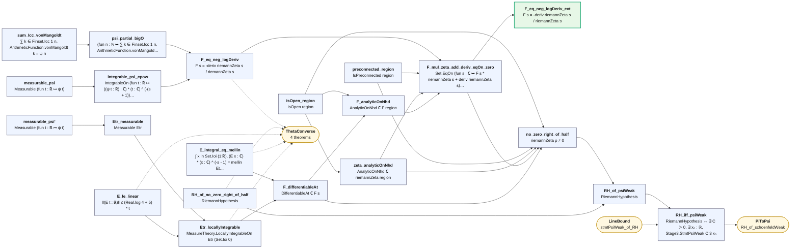

# `lean_stage3/Stage3/VonKochScaffold.lean`

# Von Koch converse — roadmap B1, COMPLETE (∃ C x₀, ∀ t ≥ x₀, |ψ t − t| ≤ C·√t·(log t)³) → RiemannHypothesis

21 theorems, 4 definitions, 654 lines. Arrows are Lean's own record of what each proof uses.

**Imports:** [`LineBound`](../lean_stage3/LineBound.md)  
**Imported by:** [`Stage3`](../lean_stage3/Stage3.md), [`PiToPsi`](../lean_stage3/PiToPsi.md), [`ThetaConverse`](../lean_stage3/ThetaConverse.md)

## The picture



An arrow A → B reads "A is used in the proof of B". Blue: theorem. Green: a theorem nothing else uses (an end). Dashed: connects to nothing. Red: contains `sorry`. Yellow: theorems in another file, counted; a dotted arrow crosses files. Definitions are not drawn; they are listed below the diagram.

## Definitions

<a name="VonKoch-E"></a>
### `VonKoch.E`

def · line 31

The error function.

- **Is:** `` E (x : ℝ) : ℝ := ψ x - x ``
- **Used by 9:** [`Stage3.F_differentiableAt_theta`](../lean_stage3/ThetaConverse.md#Stage3-F_differentiableAt_theta), [`Stage3.zeroFreeRight_one_of_chebyshev`](../lean_stage3/ThetaConverse.md#Stage3-zeroFreeRight_one_of_chebyshev), [`VonKoch.E_integral_eq_mellin`](#VonKoch-E_integral_eq_mellin), [`VonKoch.E_le_linear`](#VonKoch-E_le_linear), [`VonKoch.Etr`](#VonKoch-Etr), [`VonKoch.Etr_locallyIntegrable`](#VonKoch-Etr_locallyIntegrable), [`VonKoch.F`](#VonKoch-F), [`VonKoch.F_differentiableAt`](#VonKoch-F_differentiableAt), [`VonKoch.F_eq_neg_logDeriv`](#VonKoch-F_eq_neg_logDeriv)

<a name="VonKoch-F"></a>
### `VonKoch.F`

def · line 34

The completed right-hand object: `s/(s−1) + s·∫₁^∞ E(x)·x^(−s−1) dx`.

- **Is:** `` F (s : ℂ) : ℂ := s / (s - 1) + s * ∫ x in Set.Ioi (1:ℝ), (E x : ℂ) * (x : ℂ) ^ (-s - 1) ``
- **Built from:** [`VonKoch.E`](#VonKoch-E)
- **Used by 10:** [`Stage3.F_analyticOnNhd_theta`](../lean_stage3/ThetaConverse.md#Stage3-F_analyticOnNhd_theta), [`Stage3.F_differentiableAt_theta`](../lean_stage3/ThetaConverse.md#Stage3-F_differentiableAt_theta), [`Stage3.F_mul_zeta_add_deriv_eqOn_zero_theta`](../lean_stage3/ThetaConverse.md#Stage3-F_mul_zeta_add_deriv_eqOn_zero_theta), [`Stage3.no_zero_right_of_theta`](../lean_stage3/ThetaConverse.md#Stage3-no_zero_right_of_theta), [`VonKoch.F_analyticOnNhd`](#VonKoch-F_analyticOnNhd), [`VonKoch.F_differentiableAt`](#VonKoch-F_differentiableAt), [`VonKoch.F_eq_neg_logDeriv`](#VonKoch-F_eq_neg_logDeriv), [`VonKoch.F_eq_neg_logDeriv_ext`](#VonKoch-F_eq_neg_logDeriv_ext), [`VonKoch.F_mul_zeta_add_deriv_eqOn_zero`](#VonKoch-F_mul_zeta_add_deriv_eqOn_zero), [`VonKoch.no_zero_right_of_half`](#VonKoch-no_zero_right_of_half)

<a name="VonKoch-Etr"></a>
### `VonKoch.Etr`

def · line 38

The truncated error, as a function on `(0,∞)`: `E` on `(1,∞)`, zero below.

- **Is:** `` Etr : ℝ → ℂ := Set.indicator (Set.Ioi 1) (fun t : ℝ ↦ ((E t : ℝ) : ℂ)) ``
- **Built from:** [`VonKoch.E`](#VonKoch-E)
- **Used by 5:** [`Stage3.F_differentiableAt_theta`](../lean_stage3/ThetaConverse.md#Stage3-F_differentiableAt_theta), [`VonKoch.E_integral_eq_mellin`](#VonKoch-E_integral_eq_mellin), [`VonKoch.Etr_locallyIntegrable`](#VonKoch-Etr_locallyIntegrable), [`VonKoch.Etr_measurable`](#VonKoch-Etr_measurable), [`VonKoch.F_differentiableAt`](#VonKoch-F_differentiableAt)

<a name="VonKoch-region"></a>
### `VonKoch.region`

def · line 354

The working region: past the critical line, minus the pole.

- **Is:** `` region : Set ℂ := {s : ℂ | 1/2 < s.re ∧ s ≠ 1} ``
- **Used by 8:** [`Stage3.regionθ_half`](../lean_stage3/ThetaConverse.md#Stage3-region-_half), [`VonKoch.F_analyticOnNhd`](#VonKoch-F_analyticOnNhd), [`VonKoch.F_eq_neg_logDeriv_ext`](#VonKoch-F_eq_neg_logDeriv_ext), [`VonKoch.F_mul_zeta_add_deriv_eqOn_zero`](#VonKoch-F_mul_zeta_add_deriv_eqOn_zero), [`VonKoch.isOpen_region`](#VonKoch-isOpen_region), [`VonKoch.no_zero_right_of_half`](#VonKoch-no_zero_right_of_half), [`VonKoch.preconnected_region`](#VonKoch-preconnected_region), [`VonKoch.zeta_analyticOnNhd`](#VonKoch-zeta_analyticOnNhd)

## Theorems

<a name="VonKoch-measurable_psi-"></a>
### `VonKoch.measurable_psi'`

line 40

**Proves**

```lean
Measurable (fun t : ℝ ↦ ψ t)
```

**Fed by:** no theorem of this repo; it stands on Mathlib.

**Feeds** (1 that use it)

  - [`VonKoch.Etr_measurable`](#VonKoch-Etr_measurable) — `` Measurable Etr ``

<a name="VonKoch-Etr_measurable"></a>
### `VonKoch.Etr_measurable`

line 47

**Proves**

```lean
Measurable Etr
```

**Stated with:** [`VonKoch.Etr`](#VonKoch-Etr)

**Fed by** (1 theorem its proof uses)

  - [`VonKoch.measurable_psi'`](#VonKoch-measurable_psi-) — `` Measurable (fun t : ℝ ↦ ψ t) ``

**Feeds** (1 that use it)

  - [`VonKoch.Etr_locallyIntegrable`](#VonKoch-Etr_locallyIntegrable) — `` MeasureTheory.LocallyIntegrableOn Etr (Set.Ioi 0) ``

<a name="VonKoch-E_le_linear"></a>
### `VonKoch.E_le_linear`

line 52

**Why.** Crude bound, no hypothesis: `|E t| ≤ (log 4 + 5)·t` for `t ≥ 0`.

**Proves**

```lean
‖(E t : ℝ)‖ ≤ (Real.log 4 + 5) * t
```

**Needs** (its hypotheses)

  - `` ht : 0 ≤ t ``

**Stated with:** [`VonKoch.E`](#VonKoch-E)

**Fed by:** no theorem of this repo; it stands on Mathlib and the definitions below.

**Feeds** (2 that use it)

  - [`Stage3.zeroFreeRight_one_of_chebyshev`](../lean_stage3/ThetaConverse.md#Stage3-zeroFreeRight_one_of_chebyshev) (ThetaConverse) — `` StmtZeroFreeRight 1 ``
  - [`VonKoch.Etr_locallyIntegrable`](#VonKoch-Etr_locallyIntegrable) — `` MeasureTheory.LocallyIntegrableOn Etr (Set.Ioi 0) ``

<a name="VonKoch-E_integral_eq_mellin"></a>
### `VonKoch.E_integral_eq_mellin`

line 60

**Why.** The E-integral IS the Mellin transform of `Etr` at `-s` — as raw integrals, no convergence needed.

**Proves**

```lean
∫ x in Set.Ioi (1:ℝ), (E x : ℂ) * (x : ℂ) ^ (-s - 1) = mellin Etr (-s)
```

**Needs** (its hypotheses)

  - `` s : ℂ ``

**Stated with:** [`VonKoch.E`](#VonKoch-E), [`VonKoch.Etr`](#VonKoch-Etr)

**Fed by:** no theorem of this repo; it stands on Mathlib and the definitions below.

**Feeds** (2 that use it)

  - [`Stage3.F_differentiableAt_theta`](../lean_stage3/ThetaConverse.md#Stage3-F_differentiableAt_theta) (ThetaConverse) — `` DifferentiableAt ℂ VonKoch.F s ``
  - [`VonKoch.F_differentiableAt`](#VonKoch-F_differentiableAt) — `` DifferentiableAt ℂ F s ``

<a name="VonKoch-Etr_locallyIntegrable"></a>
### `VonKoch.Etr_locallyIntegrable`

line 80

**Why.** `Etr` is locally integrable on `(0,∞)`.

**Proves**

```lean
MeasureTheory.LocallyIntegrableOn Etr (Set.Ioi 0)
```

**Stated with:** [`VonKoch.Etr`](#VonKoch-Etr)

**Fed by** (2 theorems its proof uses)

  - [`VonKoch.E_le_linear`](#VonKoch-E_le_linear) — `` ‖(E t : ℝ)‖ ≤ (Real.log 4 + 5) * t ``
  - [`VonKoch.Etr_measurable`](#VonKoch-Etr_measurable) — `` Measurable Etr ``

**Definitions its proof touches:** [`VonKoch.E`](#VonKoch-E)

**Feeds** (2 that use it)

  - [`Stage3.F_differentiableAt_theta`](../lean_stage3/ThetaConverse.md#Stage3-F_differentiableAt_theta) (ThetaConverse) — `` DifferentiableAt ℂ VonKoch.F s ``
  - [`VonKoch.F_differentiableAt`](#VonKoch-F_differentiableAt) — `` DifferentiableAt ℂ F s ``

<a name="VonKoch-F_differentiableAt"></a>
### `VonKoch.F_differentiableAt`

line 118

**Why.** V1 — F is differentiable on `re s > 1/2`, given the von Koch bound. The hypothesis is consumed here: `E = O(t^{1/2+δ})` at infinity makes the Mellin transform of `Etr` differentiable at `-s` whenever `re s > 1/2 + δ`.

**Proves**

```lean
DifferentiableAt ℂ F s
```

**Needs** (its hypotheses)

  - `` hbound : ∀ t : ℝ, x₀ ≤ t → |ψ t - t| ≤ C * Real.sqrt t * (Real.log t) ^ 3 ``
  - `` hs : 1/2 < s.re ``
  - `` hs1 : s ≠ 1 ``

**Stated with:** [`VonKoch.F`](#VonKoch-F)

**Fed by** (2 theorems its proof uses)

  - [`VonKoch.E_integral_eq_mellin`](#VonKoch-E_integral_eq_mellin) — `` ∫ x in Set.Ioi (1:ℝ), (E x : ℂ) * (x : ℂ) ^ (-s - 1) = mellin Etr (-s) ``
  - [`VonKoch.Etr_locallyIntegrable`](#VonKoch-Etr_locallyIntegrable) — `` MeasureTheory.LocallyIntegrableOn Etr (Set.Ioi 0) ``

**Definitions its proof touches:** [`VonKoch.E`](#VonKoch-E), [`VonKoch.Etr`](#VonKoch-Etr)

**Feeds** (2 that use it)

  - [`VonKoch.F_analyticOnNhd`](#VonKoch-F_analyticOnNhd) — `` AnalyticOnNhd ℂ F region ``
  - [`VonKoch.no_zero_right_of_half`](#VonKoch-no_zero_right_of_half) — `` riemannZeta ρ ≠ 0 ``

<a name="VonKoch-sum_Icc_vonMangoldt"></a>
### `VonKoch.sum_Icc_vonMangoldt`

line 196

**Why.** The partial sums of `Λ` over `Icc 1 n` are `ψ n`.

**Proves**

```lean
∑ k ∈ Finset.Icc 1 n, ArithmeticFunction.vonMangoldt k = ψ n
```

**Needs** (its hypotheses)

  - `` n : ℕ ``

**Fed by:** no theorem of this repo; it stands on Mathlib.

**Feeds** (1 that use it)

  - [`VonKoch.psi_partial_bigO`](#VonKoch-psi_partial_bigO) — `` (fun n : ℕ ↦ ∑ k ∈ Finset.Icc 1 n, ArithmeticFunction.vonMangoldt k) =O[Filter.atTop] fun n : ℕ ↦ (n : ℝ) ^ (1:ℝ) ``

<a name="VonKoch-psi_partial_bigO"></a>
### `VonKoch.psi_partial_bigO`

line 203

**Why.** ψ is O(x) unconditionally, in big-O form on ℕ.

**Proves**

```lean
(fun n : ℕ ↦ ∑ k ∈ Finset.Icc 1 n, ArithmeticFunction.vonMangoldt k) =O[Filter.atTop] fun n : ℕ ↦ (n : ℝ) ^ (1:ℝ)
```

**Fed by** (1 theorem its proof uses)

  - [`VonKoch.sum_Icc_vonMangoldt`](#VonKoch-sum_Icc_vonMangoldt) — `` ∑ k ∈ Finset.Icc 1 n, ArithmeticFunction.vonMangoldt k = ψ n ``

**Feeds** (1 that use it)

  - [`VonKoch.F_eq_neg_logDeriv`](#VonKoch-F_eq_neg_logDeriv) — `` F s = -deriv riemannZeta s / riemannZeta s ``

<a name="VonKoch-measurable_psi"></a>
### `VonKoch.measurable_psi`

line 217

**Why.** The ψ-integrand is integrable on `Ioi 1` for `re s > 1`.

**Proves**

```lean
Measurable (fun t : ℝ ↦ ψ t)
```

**Fed by:** no theorem of this repo; it stands on Mathlib.

**Feeds** (1 that use it)

  - [`VonKoch.integrable_psi_cpow`](#VonKoch-integrable_psi_cpow) — `` IntegrableOn (fun t : ℝ ↦ ((ψ t : ℝ) : ℂ) * (t : ℂ) ^ (-(s + 1))) (Set.Ioi (1:ℝ)) ``

<a name="VonKoch-integrable_psi_cpow"></a>
### `VonKoch.integrable_psi_cpow`

line 224

**Proves**

```lean
IntegrableOn (fun t : ℝ ↦ ((ψ t : ℝ) : ℂ) * (t : ℂ) ^ (-(s + 1))) (Set.Ioi (1:ℝ))
```

**Needs** (its hypotheses)

  - `` hs : 1 < s.re ``

**Fed by** (1 theorem its proof uses)

  - [`VonKoch.measurable_psi`](#VonKoch-measurable_psi) — `` Measurable (fun t : ℝ ↦ ψ t) ``

**Feeds** (1 that use it)

  - [`VonKoch.F_eq_neg_logDeriv`](#VonKoch-F_eq_neg_logDeriv) — `` F s = -deriv riemannZeta s / riemannZeta s ``

<a name="VonKoch-F_eq_neg_logDeriv"></a>
### `VonKoch.F_eq_neg_logDeriv`

line 262

**Why.** V2 — the identity on `re s > 1`. The Mellin–Stieltjes representation is Mathlib's `LSeries_eq_mul_integral_of_nonneg` (partial sums `O(n^1)`, from unconditional Chebyshev); `LSeries_vonMangoldt_eq_deriv_riemannZeta_div` names the left side; `integral_Ioi_cpow_of_lt` evaluates the main term.

**Proves**

```lean
F s = -deriv riemannZeta s / riemannZeta s
```

**Needs** (its hypotheses)

  - `` hs : 1 < s.re ``

**Stated with:** [`VonKoch.F`](#VonKoch-F)

**Fed by** (2 theorems its proof uses)

  - [`VonKoch.integrable_psi_cpow`](#VonKoch-integrable_psi_cpow) — `` IntegrableOn (fun t : ℝ ↦ ((ψ t : ℝ) : ℂ) * (t : ℂ) ^ (-(s + 1))) (Set.Ioi (1:ℝ)) ``
  - [`VonKoch.psi_partial_bigO`](#VonKoch-psi_partial_bigO) — `` (fun n : ℕ ↦ ∑ k ∈ Finset.Icc 1 n, ArithmeticFunction.vonMangoldt k) =O[Filter.atTop] fun n : ℕ ↦ (n : ℝ) ^ (1:ℝ) ``

**Definitions its proof touches:** [`VonKoch.E`](#VonKoch-E)

**Feeds** (2 that use it)

  - [`Stage3.F_mul_zeta_add_deriv_eqOn_zero_theta`](../lean_stage3/ThetaConverse.md#Stage3-F_mul_zeta_add_deriv_eqOn_zero_theta) (ThetaConverse) — `` Set.EqOn (fun s : ℂ ↦ VonKoch.F s * ζ s + deriv ζ s) 0 (regionθ θ) ``
  - [`VonKoch.F_mul_zeta_add_deriv_eqOn_zero`](#VonKoch-F_mul_zeta_add_deriv_eqOn_zero) — `` Set.EqOn (fun s : ℂ ↦ F s * riemannZeta s + deriv riemannZeta s) 0 region ``

<a name="VonKoch-isOpen_region"></a>
### `VonKoch.isOpen_region`

line 356

**Proves**

```lean
IsOpen region
```

**Stated with:** [`VonKoch.region`](#VonKoch-region)

**Fed by:** no theorem of this repo; it stands on Mathlib and the definitions below.

**Feeds** (3 that use it)

  - [`VonKoch.F_analyticOnNhd`](#VonKoch-F_analyticOnNhd) — `` AnalyticOnNhd ℂ F region ``
  - [`VonKoch.no_zero_right_of_half`](#VonKoch-no_zero_right_of_half) — `` riemannZeta ρ ≠ 0 ``
  - [`VonKoch.zeta_analyticOnNhd`](#VonKoch-zeta_analyticOnNhd) — `` AnalyticOnNhd ℂ riemannZeta region ``

<a name="VonKoch-preconnected_region"></a>
### `VonKoch.preconnected_region`

line 363

**Proves**

```lean
IsPreconnected region
```

**Stated with:** [`VonKoch.region`](#VonKoch-region)

**Fed by:** no theorem of this repo; it stands on Mathlib and the definitions below.

**Feeds** (2 that use it)

  - [`VonKoch.F_mul_zeta_add_deriv_eqOn_zero`](#VonKoch-F_mul_zeta_add_deriv_eqOn_zero) — `` Set.EqOn (fun s : ℂ ↦ F s * riemannZeta s + deriv riemannZeta s) 0 region ``
  - [`VonKoch.no_zero_right_of_half`](#VonKoch-no_zero_right_of_half) — `` riemannZeta ρ ≠ 0 ``

<a name="VonKoch-zeta_analyticOnNhd"></a>
### `VonKoch.zeta_analyticOnNhd`

line 416

**Proves**

```lean
AnalyticOnNhd ℂ riemannZeta region
```

**Stated with:** [`VonKoch.region`](#VonKoch-region)

**Fed by** (1 theorem its proof uses)

  - [`VonKoch.isOpen_region`](#VonKoch-isOpen_region) — `` IsOpen region ``

**Feeds** (2 that use it)

  - [`VonKoch.F_mul_zeta_add_deriv_eqOn_zero`](#VonKoch-F_mul_zeta_add_deriv_eqOn_zero) — `` Set.EqOn (fun s : ℂ ↦ F s * riemannZeta s + deriv riemannZeta s) 0 region ``
  - [`VonKoch.no_zero_right_of_half`](#VonKoch-no_zero_right_of_half) — `` riemannZeta ρ ≠ 0 ``

<a name="VonKoch-F_analyticOnNhd"></a>
### `VonKoch.F_analyticOnNhd`

line 420

**Proves**

```lean
AnalyticOnNhd ℂ F region
```

**Needs** (its hypotheses)

  - `` hbound : ∀ t : ℝ, x₀ ≤ t → |ψ t - t| ≤ C * Real.sqrt t * (Real.log t) ^ 3 ``

**Stated with:** [`VonKoch.F`](#VonKoch-F), [`VonKoch.region`](#VonKoch-region)

**Fed by** (2 theorems its proof uses)

  - [`VonKoch.F_differentiableAt`](#VonKoch-F_differentiableAt) — `` DifferentiableAt ℂ F s ``
  - [`VonKoch.isOpen_region`](#VonKoch-isOpen_region) — `` IsOpen region ``

**Feeds** (1 that use it)

  - [`VonKoch.F_mul_zeta_add_deriv_eqOn_zero`](#VonKoch-F_mul_zeta_add_deriv_eqOn_zero) — `` Set.EqOn (fun s : ℂ ↦ F s * riemannZeta s + deriv riemannZeta s) 0 region ``

<a name="VonKoch-F_mul_zeta_add_deriv_eqOn_zero"></a>
### `VonKoch.F_mul_zeta_add_deriv_eqOn_zero`

line 427

**Why.** The load-bearing identity: `F·ζ + ζ′` vanishes on the whole region.

**Proves**

```lean
Set.EqOn (fun s : ℂ ↦ F s * riemannZeta s + deriv riemannZeta s) 0 region
```

**Needs** (its hypotheses)

  - `` hbound : ∀ t : ℝ, x₀ ≤ t → |ψ t - t| ≤ C * Real.sqrt t * (Real.log t) ^ 3 ``

**Stated with:** [`VonKoch.F`](#VonKoch-F), [`VonKoch.region`](#VonKoch-region)

**Fed by** (4 theorems its proof uses)

  - [`VonKoch.F_analyticOnNhd`](#VonKoch-F_analyticOnNhd) — `` AnalyticOnNhd ℂ F region ``
  - [`VonKoch.F_eq_neg_logDeriv`](#VonKoch-F_eq_neg_logDeriv) — `` F s = -deriv riemannZeta s / riemannZeta s ``
  - [`VonKoch.preconnected_region`](#VonKoch-preconnected_region) — `` IsPreconnected region ``
  - [`VonKoch.zeta_analyticOnNhd`](#VonKoch-zeta_analyticOnNhd) — `` AnalyticOnNhd ℂ riemannZeta region ``

**Feeds** (2 that use it)

  - [`VonKoch.F_eq_neg_logDeriv_ext`](#VonKoch-F_eq_neg_logDeriv_ext) — `` F s = -deriv riemannZeta s / riemannZeta s ``
  - [`VonKoch.no_zero_right_of_half`](#VonKoch-no_zero_right_of_half) — `` riemannZeta ρ ≠ 0 ``

<a name="VonKoch-F_eq_neg_logDeriv_ext"></a>
### `VonKoch.F_eq_neg_logDeriv_ext`

line 445

**Why.** V3 — agreement extends to the punctured half-plane. From `F·ζ + ζ′ ≡ 0` on the region: divide by `ζ` where it does not vanish.

**Proves**

```lean
F s = -deriv riemannZeta s / riemannZeta s
```

**Needs** (its hypotheses)

  - `` hbound : ∀ t : ℝ, x₀ ≤ t → |ψ t - t| ≤ C * Real.sqrt t * (Real.log t) ^ 3 ``
  - `` hs : 1/2 < s.re ``
  - `` hs1 : s ≠ 1 ``
  - `` hz : riemannZeta s ≠ 0 ``

**Stated with:** [`VonKoch.F`](#VonKoch-F)

**Fed by** (1 theorem its proof uses)

  - [`VonKoch.F_mul_zeta_add_deriv_eqOn_zero`](#VonKoch-F_mul_zeta_add_deriv_eqOn_zero) — `` Set.EqOn (fun s : ℂ ↦ F s * riemannZeta s + deriv riemannZeta s) 0 region ``

**Definitions its proof touches:** [`VonKoch.region`](#VonKoch-region)

**Feeds:** nothing. It is an end.

<a name="VonKoch-no_zero_right_of_half"></a>
### `VonKoch.no_zero_right_of_half`

line 460

**Why.** V4 — no zeros right of the line. At a hypothetical zero `ρ`, factor `ζ = (z−ρ)^(k+1)·g` with `g ρ ≠ 0`. The identity `F·ζ + ζ′ = 0` factors as `(z−ρ)^k · [(k+1)·g + (z−ρ)·(F·g + g′)] = 0`; off `ρ` the power is nonzero, so the bracket vanishes on the punctured neighbourhood — yet it is continuous at `ρ` with value `(k+1)·g ρ ≠ 0`. (Order `⊤` would make `ζ` vanish identically on the region, against `ζ(2) ≠ 0`.)

**Proves**

```lean
riemannZeta ρ ≠ 0
```

**Needs** (its hypotheses)

  - `` hbound : ∀ t : ℝ, x₀ ≤ t → |ψ t - t| ≤ C * Real.sqrt t * (Real.log t) ^ 3 ``
  - `` hρ : 1/2 < ρ.re ``
  - `` hρ1 : ρ ≠ 1 ``

**Fed by** (5 theorems its proof uses)

  - [`VonKoch.F_differentiableAt`](#VonKoch-F_differentiableAt) — `` DifferentiableAt ℂ F s ``
  - [`VonKoch.F_mul_zeta_add_deriv_eqOn_zero`](#VonKoch-F_mul_zeta_add_deriv_eqOn_zero) — `` Set.EqOn (fun s : ℂ ↦ F s * riemannZeta s + deriv riemannZeta s) 0 region ``
  - [`VonKoch.isOpen_region`](#VonKoch-isOpen_region) — `` IsOpen region ``
  - [`VonKoch.preconnected_region`](#VonKoch-preconnected_region) — `` IsPreconnected region ``
  - [`VonKoch.zeta_analyticOnNhd`](#VonKoch-zeta_analyticOnNhd) — `` AnalyticOnNhd ℂ riemannZeta region ``

**Definitions its proof touches:** [`VonKoch.F`](#VonKoch-F), [`VonKoch.region`](#VonKoch-region)

**Feeds** (1 that use it)

  - [`VonKoch.RH_of_psiWeak`](#VonKoch-RH_of_psiWeak) — `` RiemannHypothesis ``

<a name="VonKoch-RH_of_no_zero_right_of_half"></a>
### `VonKoch.RH_of_no_zero_right_of_half`

line 550

**Why.** V5 — reflection. No zeros right of the line forces every nontrivial zero onto it: a zero at `re < 1/2` inside the strip reflects through `riemannZeta_one_sub` to one at `re > 1/2`.

**Proves**

```lean
RiemannHypothesis
```

**Needs** (its hypotheses)

  - `` h : ∀ ρ : ℂ, 1/2 < ρ.re → ρ ≠ 1 → riemannZeta ρ ≠ 0 ``

**Fed by:** no theorem of this repo; it stands on Mathlib.

**Feeds** (2 that use it)

  - [`Stage3.RH_of_psiWeakTheta_half`](../lean_stage3/ThetaConverse.md#Stage3-RH_of_psiWeakTheta_half) (ThetaConverse) — `` RiemannHypothesis ``
  - [`VonKoch.RH_of_psiWeak`](#VonKoch-RH_of_psiWeak) — `` RiemannHypothesis ``

<a name="VonKoch-RH_of_psiWeak"></a>
### `VonKoch.RH_of_psiWeak`

line 632

**Why.** B1 — the converse, assembled from V1–V5.

**Proves**

```lean
RiemannHypothesis
```

**Needs** (its hypotheses)

  - `` hbound : ∀ t : ℝ, x₀ ≤ t → |ψ t - t| ≤ C * Real.sqrt t * (Real.log t) ^ 3 ``

**Fed by** (2 theorems its proof uses)

  - [`VonKoch.RH_of_no_zero_right_of_half`](#VonKoch-RH_of_no_zero_right_of_half) — `` RiemannHypothesis ``
  - [`VonKoch.no_zero_right_of_half`](#VonKoch-no_zero_right_of_half) — `` riemannZeta ρ ≠ 0 ``

**Feeds** (1 that use it)

  - [`VonKoch.RH_iff_psiWeak`](#VonKoch-RH_iff_psiWeak) — `` RiemannHypothesis ↔ ∃ C > 0, ∃ x₀ : ℝ, Stage3.StmtPsiWeak C 3 x₀ ``

<a name="VonKoch-RH_iff_psiWeak"></a>
### `VonKoch.RH_iff_psiWeak`

line 641

**Why.** B2 — the equivalence. RH holds iff `ψ` satisfies the von Koch bound at one extra logarithm (von Koch's own exponent is `k = 2`; `k = 3` is the coarsened route's price). Forward is `RHPull.stmtPsiWeak_of_RH`; the converse is B1.

**Proves**

```lean
RiemannHypothesis ↔ ∃ C > 0, ∃ x₀ : ℝ, Stage3.StmtPsiWeak C 3 x₀
```

**Stated with:** [`Stage3.StmtPsiWeak`](../lean_stage3/PsiToPi.md#Stage3-StmtPsiWeak)

**Fed by** (2 theorems its proof uses)

  - [`RHPull.stmtPsiWeak_of_RH`](../lean_stage3/LineBound.md#RHPull-stmtPsiWeak_of_RH) (LineBound) — `` ∃ C > 0, ∃ x₀ : ℝ, Stage3.StmtPsiWeak C 3 x₀ ``
  - [`VonKoch.RH_of_psiWeak`](#VonKoch-RH_of_psiWeak) — `` RiemannHypothesis ``

**Feeds** (1 that use it)

  - [`PiToPsi.RH_of_schoenfeldWeak`](../lean_stage3/PiToPsi.md#PiToPsi-RH_of_schoenfeldWeak) (PiToPsi) — `` RiemannHypothesis ``

